# 013：深度学习导论（第一部分）

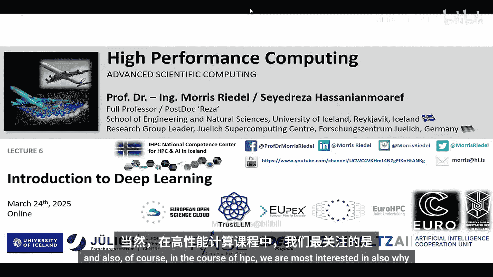

## 概述

在本节课中，我们将要学习深度学习的基础知识。我们将从回顾上一讲关于GPU加速器的内容开始，然后深入探讨机器学习和深度学习的基本概念。我们将了解它们之间的关系，并特别关注它们如何利用GPU的强大计算能力。课程的核心是理解人工神经网络，从最简单的感知器学习模型开始，逐步过渡到更复杂的多层感知器（即人工神经网络），并探讨其背后的计算原理。

---

## 回顾：GPU与高性能计算

上一讲我们介绍了加速器，特别是图形处理单元（GPU）。我们了解到，GPU作为一种特殊形式的加速器，其核心在于拥有一个芯片内的众多核心，这些核心虽然单个性能不如高端CPU，但数量庞大，非常适合大规模并行计算。

如今，GPU已经广泛进入全球超级计算机Top 500榜单。榜单中的许多顶级系统，尤其是排名靠前的，都采用了某种形式的GPU进行通用目的计算（GPGPU）。这是因为许多科学计算任务可以很好地并行化，非常适合在GPU上运行。

目前市场上有不同的GPU供应商。虽然英伟达（NVIDIA）的A100、H100等卡在市场份额上占据主导，但AMD的Instinct卡等也在快速发展。从最新的Top 500榜单可以看出，美国拥有许多顶尖系统，但欧洲的系统，如芬兰的LUMI，也位列前十，显示出激烈的竞争态势。

一个关键的里程碑是，在2022年，名为“Frontier”的系统首次突破了百亿亿次（Exaflop）计算的边界。这标志着超算性能进入了一个新时代。值得注意的是，像Summit这样几年前还是顶尖的系统，如今因其技术相对陈旧已被逐步淘汰，这体现了该领域快速发展的步伐。

尽管Top 500排名具有一定影响力，但也有人认为应用基准测试更能体现系统的真实性能。无论如何，该榜单为我们提供了观察硬件趋势、供应商份额和加速器采用情况的窗口。

最后，我们来总结一下GPU的编程模型。其基本模式是：CPU（主机）将数据和指令传输到GPU（设备）内存中，GPU上的调度器执行一个称为“内核”的程序，利用其众多核心完成大量简单操作，然后将结果写回设备内存，最后传回主机内存。内核通常使用CUDA或ROCm等语言编写。CUDA因其市场地位和持续投资而发展迅速，而像OpenCL这样的开放标准有时可能难以跟上最新硬件的特性。最新的技术，如英伟达的Blackwell架构和NVLink高速互联，进一步提升了GPU集群的性能。关于GPU的话题足以开设一门完整的课程，但由于时间有限，我们将快速转向深度学习的介绍。

---

## 机器学习与深度学习基础

现在，让我们进入机器学习和深度学习的领域。请注意，这只是一个非常基础的介绍，要深入掌握需要学习专门的课程。

### 监督学习

我们将采用一种更偏向应用的方法来入门。**监督学习**是机器学习的一种主要方法。之所以称为“监督”，是因为我们拥有带有标签的数据集。

以下是其核心思想：
*   **输入数据**：一个包含多个特征值的向量。
*   **输出数据（标签）**：对于每个输入数据，我们都有一个已知的、期望的输出值。

这个已知的输出就像一个“监督者”，在学习过程中为我们提供指导，告诉我们模型的预测是否正确，从而决定是否需要调整模型。监督学习常用于**预测**未来观测值或进行**分类**，以及进行**推断**以理解变量间的关系。

与监督学习相对的是**无监督学习**（只有输入数据，没有标签，需自行发现模式，如通过聚类）和**强化学习**（通过奖励和惩罚机制让智能体学习，类似于游戏）。

### 一个简单例子：鸢尾花分类

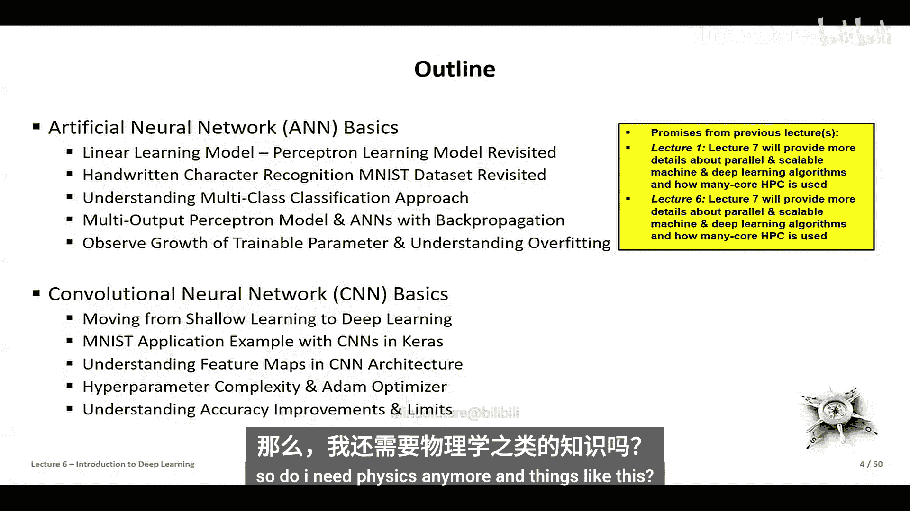

我们用一个简单的例子来说明。假设我们有一个鸢尾花数据集，包含三种鸢尾花（Setosa, Versicolor, Virginica）的150个样本，每个样本有花瓣长度和宽度等特征。

当我们绘制这些数据时，可以发现Setosa（绿色点）与其他两种花能较好地区分开。机器学习的目标是建立一个模型，能够对未来未知的数据进行正确分类。例如，给定一朵新花的花瓣尺寸，模型需要判断它属于哪一类。

这就引出了**决策边界**的概念。我们希望学习一个模型，能在特征空间中画出一条线（对于更高维度是超平面），将不同类别的数据分开。在这个例子中，决策边界上方可能是Virginica，下方可能是Versicolor。

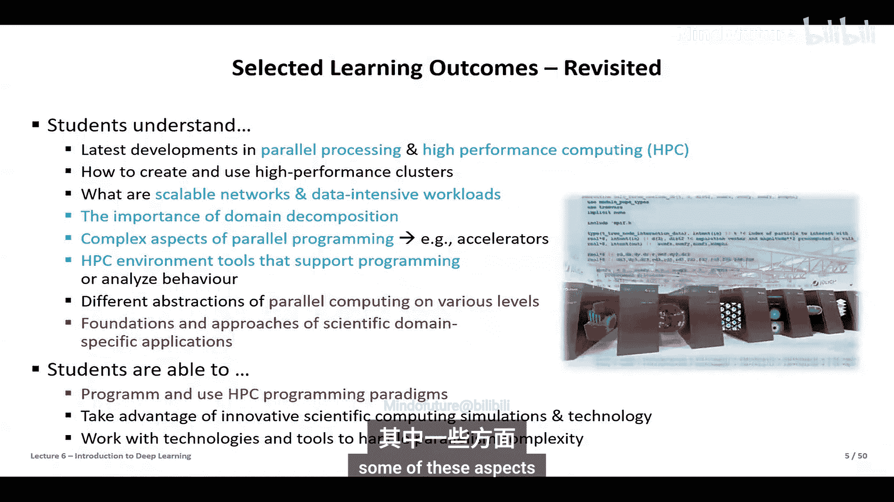

这便引出了我们能构建的最简单的学习模型：**感知器学习模型**。

---

## 感知器学习模型

感知器提供了一个**线性学习模型**，意味着它在权重和空间上都是线性的。其目标是在空间中找到一条直线（决策边界）来分隔数据。

其数学模型可以表示为：

**`y = f( w0 + w1*x1 + w2*x2 + ... + wm*xm )`**

其中：
*   **`x1, x2, ..., xm`** 是输入特征（常量，来自我们的数据集）。
*   **`w0, w1, ..., wm`** 是**可训练的参数（权重）**，这是模型需要学习的关键。
*   **`w0`** 是偏置项，允许直线在空间中平移。
*   **`f`** 是一个**非线性激活函数**。即使求和部分是线性的，激活函数可以引入非线性，这对于分类至关重要。

为了数学上的便利，我们常使用向量形式表示：**`y = f( x^T * w )`**，这本质上是输入向量 **`x`** 和权重向量 **`w`** 的点积。

### 应用实例：手写数字识别（MNIST）

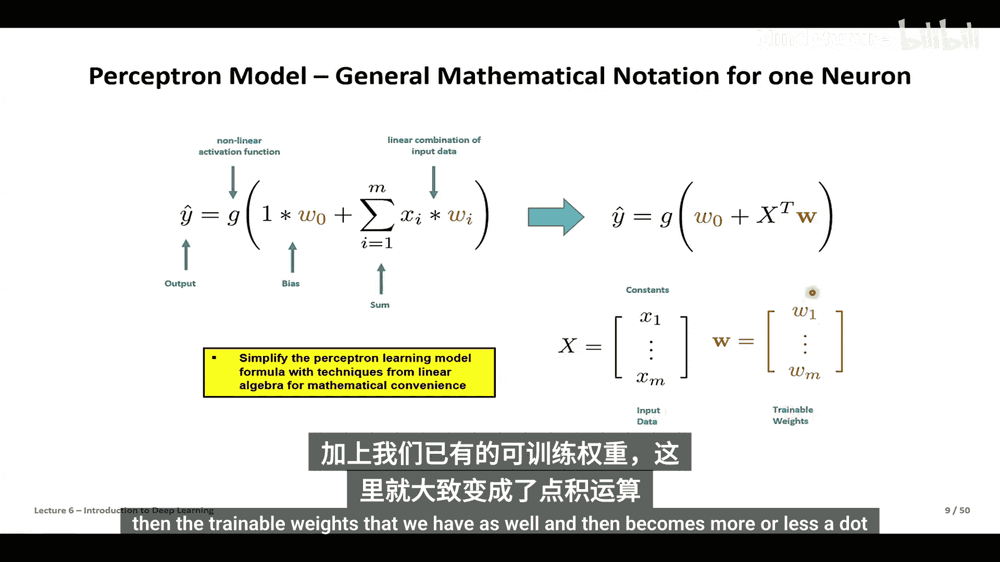

我们将使用一个著名的基准数据集：MNIST手写数字数据集。这个数据集包含0到9的手写数字图像。

以下是该数据集的关键信息：
*   每张图像是28x28像素的灰度图。
*   共有60,000张训练样本和10,000张测试样本。
*   每个样本都有一个对应的标签（0-9中的一个数字）。

使用Python库（如Keras）可以方便地加载这个数据集。数据看起来像是一些手写的、灰度显示的字符，并且每个图像都有一个指导标签Y，例如y=5, y=0, y=2等。

在机器学习中，通常将数据分为**训练集**（用于训练模型）、**验证集**（用于模型选择和调参，防止过拟合）和**测试集**（用于最终评估模型性能）。还有像交叉验证这样的技巧来更有效地利用数据。这些是机器学习的基础知识，本课程不会深入展开。

### 数据预处理与模型构建

为了适应感知器模型，我们需要对数据进行预处理：

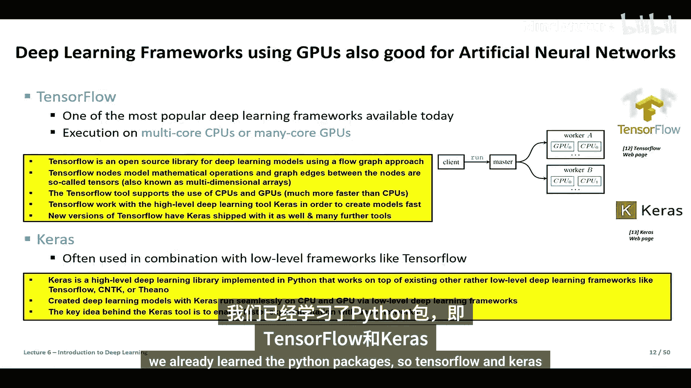

1.  **向量化（重塑）**：将2D的28x28图像“展平”成一个1x784的长向量。这样做会丢失像素间的空间上下文信息，但为了使用最简单的线性模型，这是必要的。
2.  **归一化**：将像素值（0-255）缩放到0-1之间。这有助于在后续的矩阵乘法等计算中保持数值稳定，避免梯度爆炸或消失等问题。

以下是使用Keras构建感知器模型的代码核心部分：

```python
# 假设 x_train_flat 是已经展平并归一化的训练数据
# 假设 num_classes = 10

model = Sequential()
model.add(Dense(units=num_classes, input_shape=(784,), activation='softmax'))
```

这段代码创建了一个**顺序模型**，并添加了一个**全连接层（Dense Layer）**。该层有10个神经元（对应10个数字类别），输入形状是784（展平后的向量），并使用**softmax**作为激活函数。softmax函数将神经元的输出转化为概率分布，表示输入图像属于每个数字类别的可能性。

这个简单的模型有多少参数呢？输入有784个特征，连接到10个输出神经元，因此有784 * 10 = 7840个权重，再加上10个偏置项，总共是**7850个可训练参数**。

### 模型训练与优化

模型通过**优化算法**来学习。我们通常使用**随机梯度下降（SGD）** 或其变体（如Adam）。其核心思想是：
1.  定义一个**损失函数**（例如，对于多分类问题常用**分类交叉熵损失**）。
2.  计算损失函数关于权重的**梯度**。
3.  沿着梯度反方向更新权重，以减小损失。

这个过程会迭代多次（遍历整个训练集多次，每次使用一个**批次**的数据），逐步调整权重。在Keras中，这通过`model.compile`（指定优化器、损失函数和评估指标）和`model.fit`（执行训练）函数完成。

使用这个简单的感知器模型，我们在MNIST测试集上能达到约**92%的准确率**。这是一个不错的起点，但模型非常简单（没有隐藏层，本质上是一个多输出感知器）。

### 过拟合与模型选择

在训练过程中，我们需要警惕**过拟合**。这意味着模型在训练集上表现太好，甚至“记住”了训练样本的噪声和细节，导致在未见过的测试数据上表现下降。这就像学生只死记硬背了旧考题，而无法理解知识应对新考题一样。

为了避免过拟合，可以使用**正则化**技术，并用**验证集**来监控训练过程，在模型开始过拟合时停止训练（早停法）。我们的简单模型准确率在92%左右波动，提升空间有限。

---

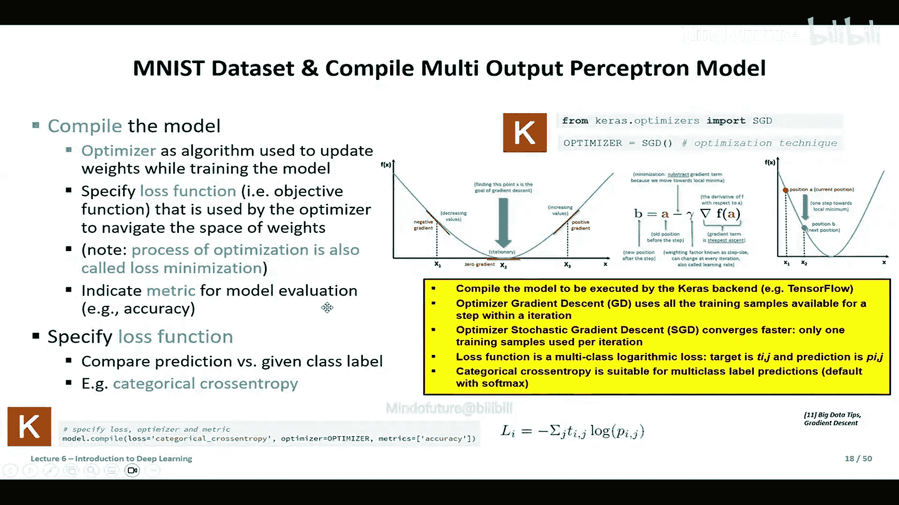

## 人工神经网络

那么，如何改进我们的学习模型呢？关键是从多输出感知器升级到**人工神经网络**。ANN的核心特征是引入了**隐藏层**。

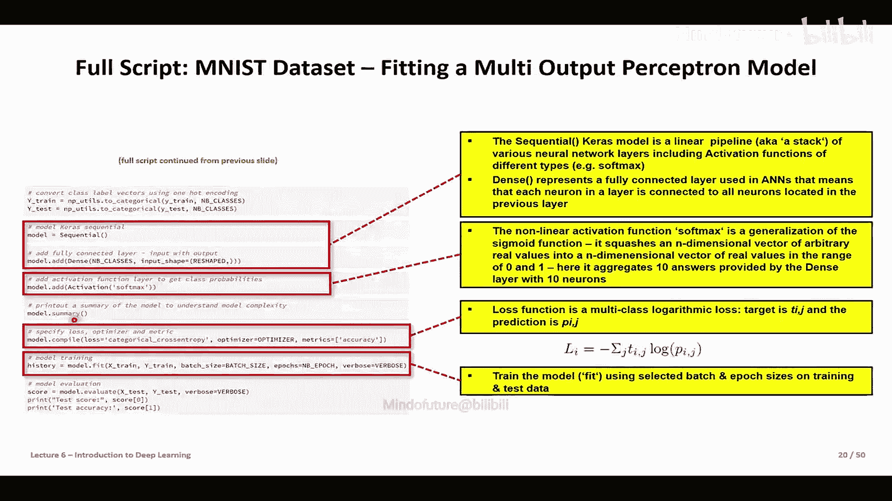

### 从感知器到神经网络

感知器是线性的，其能力有限（例如，它无法解决经典的“异或”问题）。人工神经网络通过组合多个感知器（神经元）并堆叠成层来克服这个限制。

其架构如下：
*   **输入层**：接收数据。
*   **一个或多个隐藏层**：每层包含多个神经元。每个神经元仍然执行“加权求和 + 激活函数”的操作。
*   **输出层**：产生最终预测。

这种结构使得网络能够学习数据中复杂的、**非线性的**模式。激活函数（如ReLU、Sigmoid、Tanh）在这里至关重要，它们将每层线性的加权和转换为非线性输出，从而使整个网络能够拟合非线性决策边界。

### 反向传播算法

当网络有了隐藏层后，如何将最终输出层的误差传递回去，以更新前面所有层的权重呢？解决方案是**反向传播算法**。

该算法基于链式法则，将损失函数计算出的误差从输出层向输入层反向传播，并计算每个权重对总误差的贡献（梯度）。然后，使用优化器（如SGD）根据这些梯度更新所有权重。这是ANN能够成功训练多层网络的关键突破。

### 学习率

在更新权重时，我们用一个称为**学习率**的参数乘以梯度。学习率的选择非常重要：
*   **学习率太小**：收敛速度极慢，可能无法在合理时间内找到好的解。
*   **学习率太大**：更新步伐过大，可能在最优点附近震荡甚至发散，无法收敛。

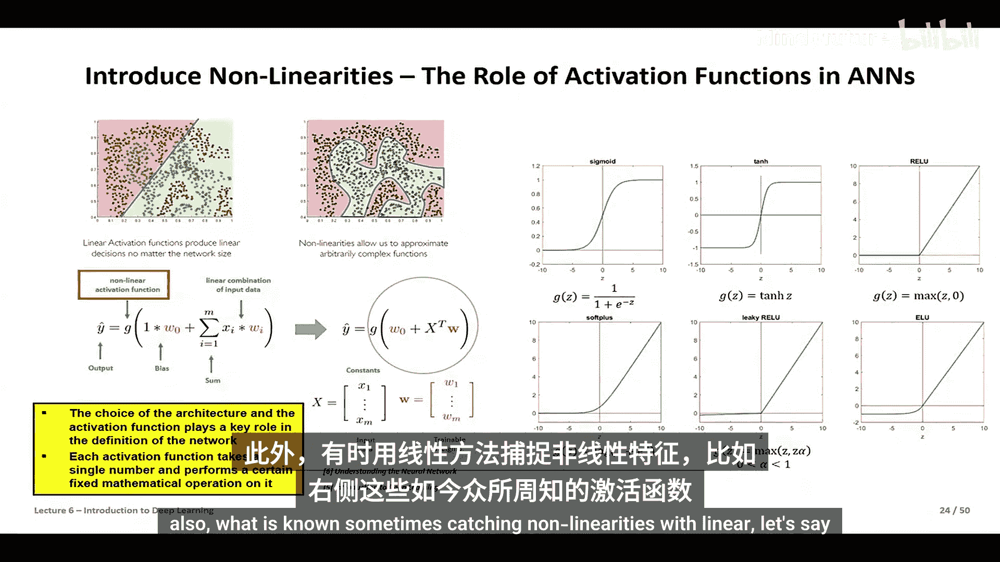

因此，找到一个合适的学习率是训练神经网络的重要一环。

### 构建一个简单的人工神经网络

现在，让我们用Keras构建一个具有两个隐藏层的人工神经网络：

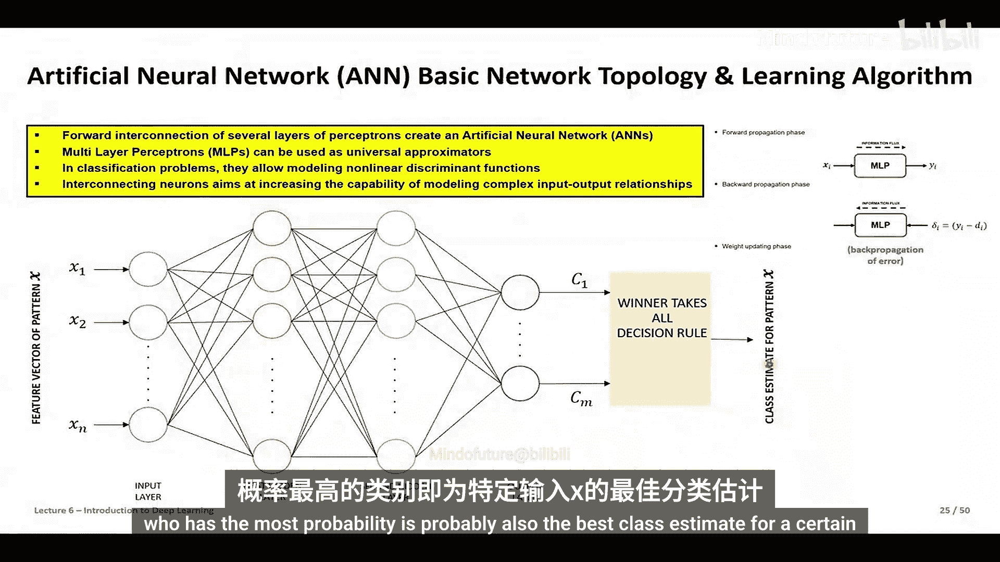

```python
model = Sequential()
model.add(Dense(128, activation='relu', input_shape=(784,))) # 第一隐藏层，128个神经元，使用ReLU激活
model.add(Dense(64, activation='relu')) # 第二隐藏层，64个神经元
model.add(Dense(num_classes, activation='softmax')) # 输出层，10个神经元，使用softmax
```

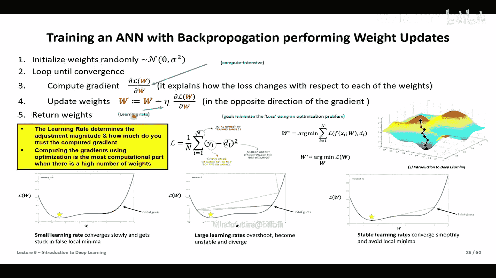

这个网络结构更强大。第一隐藏层有128个神经元，这意味着输入层（784）到第一隐藏层（128）就有784 * 128 + 128 ≈ 100,480个参数。加上后续层的参数，总参数量远超之前的7850个，达到约**12万个**。

计算代价增大了，但性能也提升了。通过训练这个ANN，我们在MNIST上的准确率可以从92%提升到约**97%**。如果考虑到正则化等因素，一个更现实的评估可能达到**95%** 左右。这相比简单感知器是一个显著的进步。

---

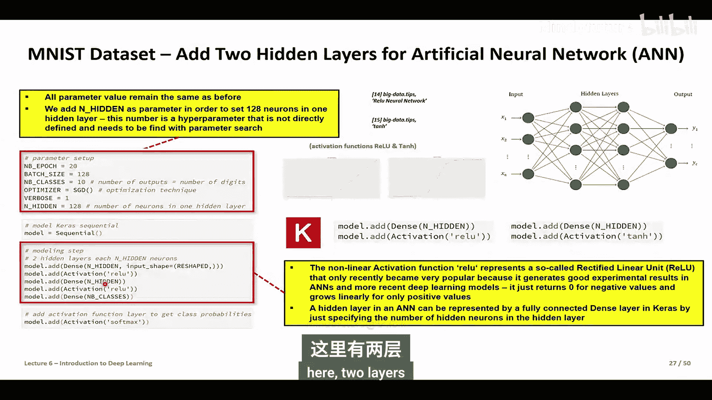

## 总结

在本节课的第一部分中，我们一起学习了以下内容：

1.  **回顾了GPU在高性能计算中的地位**，理解了其并行计算能力为何对后续的深度学习至关重要。
2.  **介绍了机器学习中的监督学习范式**，并通过鸢尾花例子理解了分类任务和决策边界的概念。
3.  **深入探讨了最简单的学习模型——感知器**。我们了解了其线性本质、数学模型，并应用于MNIST手写数字识别任务，实现了约92%的准确率。
4.  **认识了感知器的局限性**，并由此引入了**人工神经网络**。我们了解了ANN通过添加隐藏层和非线性激活函数来学习更复杂模式的能力。
5.  **简要了解了ANN训练的核心——反向传播算法**，以及**学习率**这一重要超参数的作用。
6.  **实践构建了一个简单的两层ANN**，观察到其参数量大幅增加至约12万，但准确率也显著提升至95%-97%。

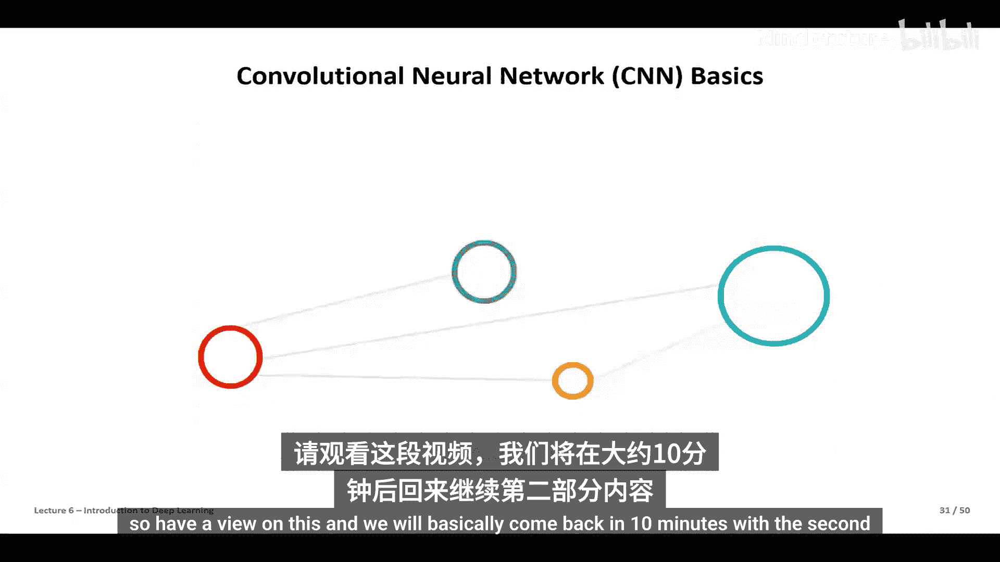

我们看到了性能提升所带来的计算复杂度增加。在下一部分，我们将探索如何通过**深度学习**（特别是卷积神经网络）来进一步提升性能，同时更有效地处理像图像这样的结构化数据。我们也将更深入地讨论超参数调优，并理解为何深度学习如此依赖GPU的强大算力。