# 014：加速器与图形处理器（第二部分）

## 概述

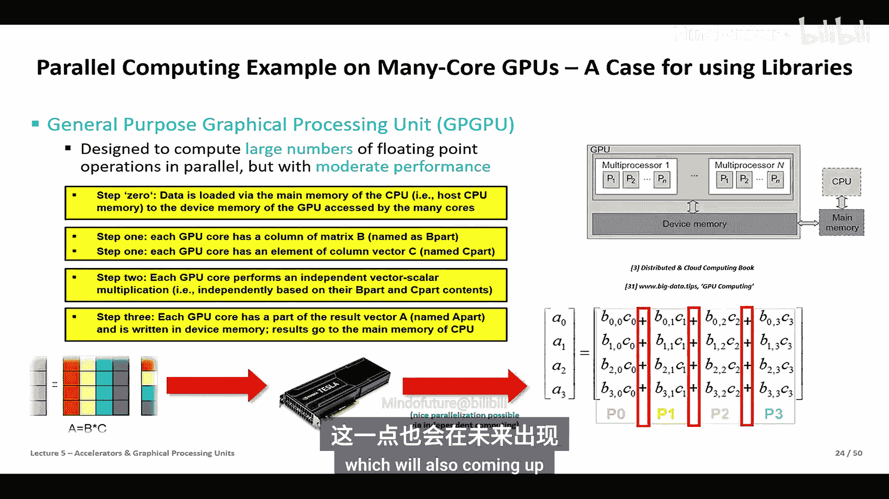

在本节课中，我们将继续学习加速器与图形处理器。我们将深入了解GPU编程的基本流程、其在科学计算与深度学习中的广泛应用，并探讨当前高性能计算领域GPU的市场格局与标准化趋势。

## GPU编程核心流程回顾

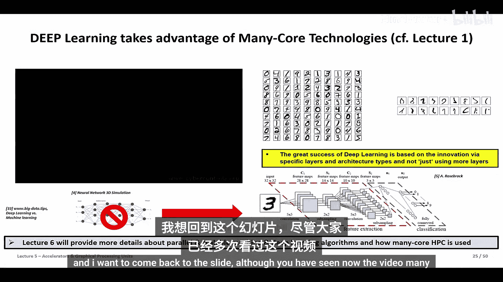

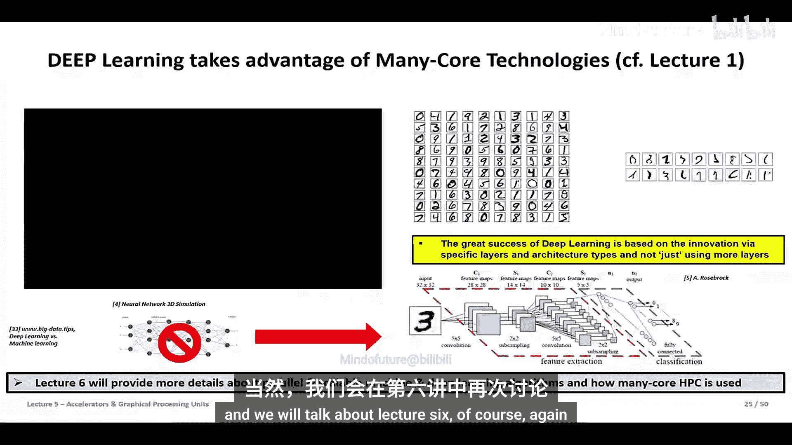

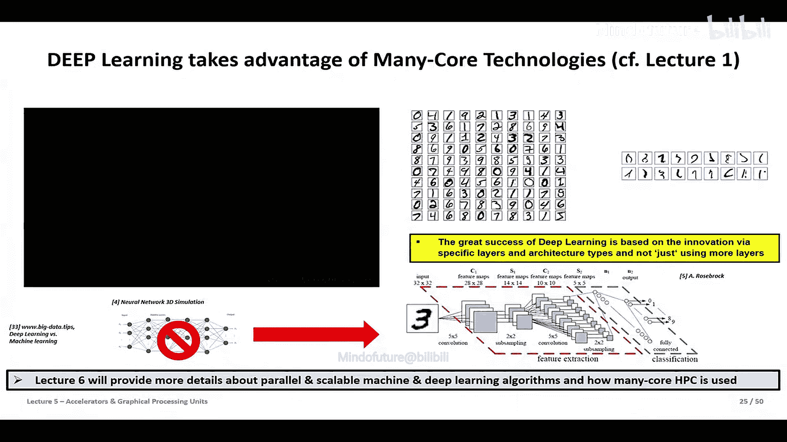

上一节我们介绍了GPU的基本架构和多核特性。本节中，我们来看看如何实际使用GPU进行计算。其核心流程涉及主机（CPU）与设备（GPU）之间的协作。

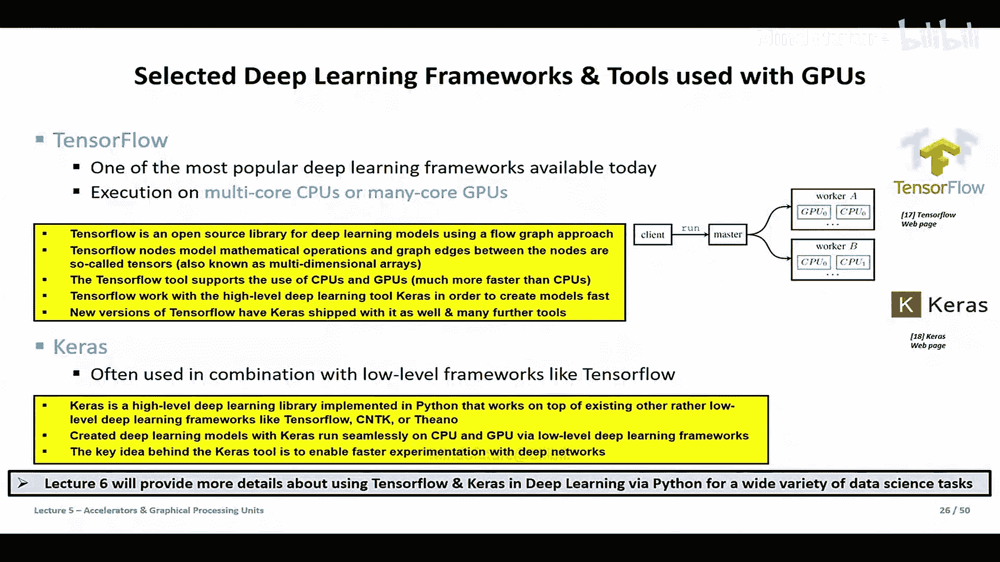

一个典型的GPU计算任务遵循以下步骤：
1.  **数据准备**：在主机内存中准备数据。
2.  **数据传输**：将数据从主机内存复制到设备（GPU）内存。
3.  **内核执行**：将包含应用逻辑的程序（称为“内核”）加载到GPU上并执行。内核会利用GPU的数千个核心对数据进行并行处理。
4.  **结果回传**：将计算结果从设备内存复制回主机内存。

这个流程强调了GPU作为“加速器”的角色：它不独立运行，而是由CPU调度，专门处理高度并行化的计算任务。

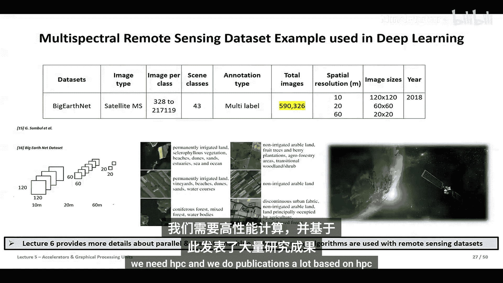

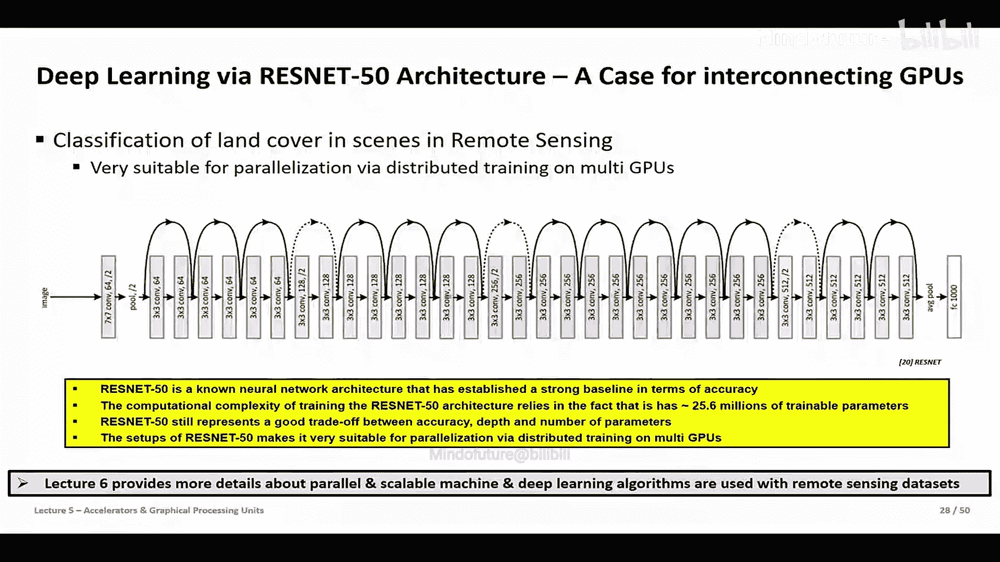

## GPU在深度学习中的应用

GPU因其强大的并行计算能力，已成为深度学习训练不可或缺的工具。深度学习模型，如卷积神经网络或Transformer，其核心运算（如矩阵乘法）天然适合在GPU上并行执行。

以下是深度学习框架利用GPU加速的两个关键点：
*   **框架支持**：开发者通常无需从零开始编写底层GPU代码。现有框架（如TensorFlow、PyTorch）已集成了对GPU的支持，自动处理数据迁移和内核调度。
*   **分布式训练**：当模型或数据集过于庞大，单卡GPU无法容纳时，需要进行分布式训练。这通常涉及在多台服务器（节点）的多个GPU上并行处理数据。

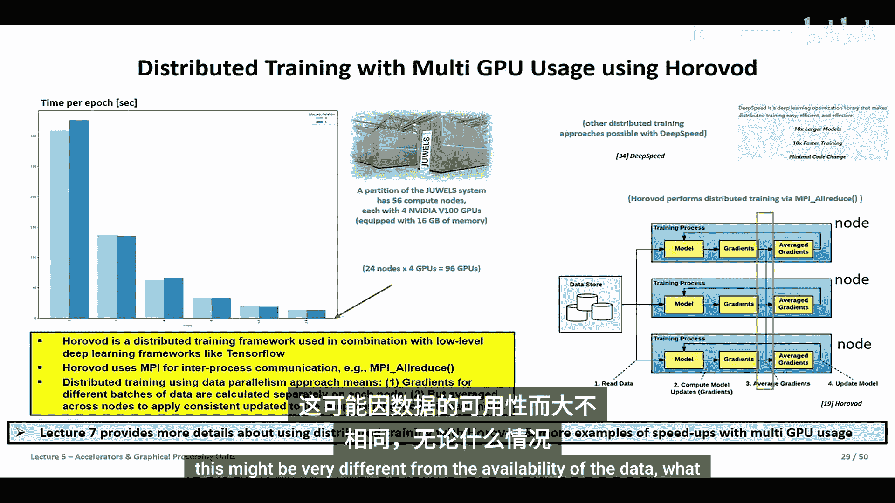

在分布式训练中，各个GPU计算出的模型参数更新（梯度）需要同步，以确保模型的一致性。此时，我们之前学到的MPI（消息传递接口）技术再次发挥作用，用于在节点间高效地交换梯度信息。

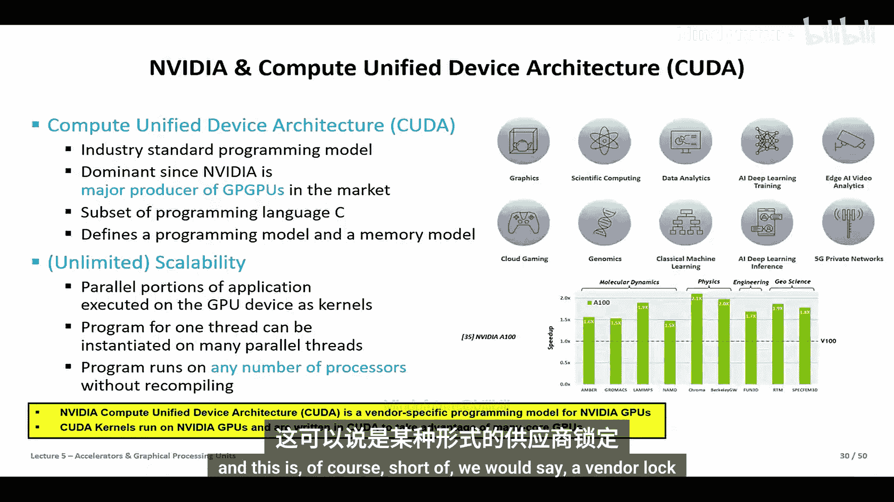

## GPU在传统科学计算中的应用

GPU的应用远不止于人工智能。许多传统的科学计算领域也已广泛采用GPU加速。

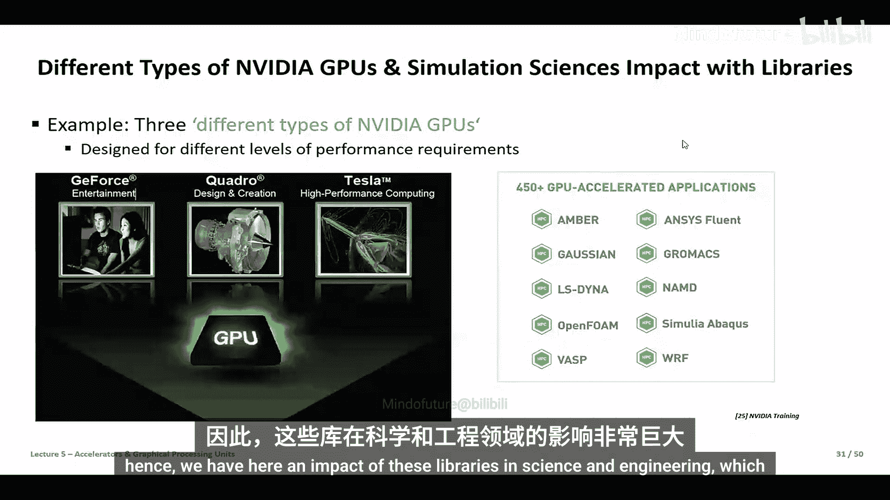

以下是一些已支持GPU加速的科学计算库与应用领域：
*   **分子动力学**：例如AMBER、GROMACS，用于模拟分子运动，助力药物研发。
*   **计算流体动力学**：例如ANSYS Fluent、OpenFOAM，用于模拟流体运动、预测天气或雪崩。
*   **线性代数运算**：例如cuBLAS库，为矩阵运算等基础数学例程提供GPU加速版本。
*   **气象研究与预报**：例如WRF模型，用于高精度气象模拟。

对于科研人员和工程师，在着手解决计算问题时，首先应查询是否存在成熟的、已支持GPU加速的库或应用程序，这可以极大提升开发效率和计算性能。

## 编程模型示例

为了让您更直观地理解GPU编程，我们来看一个简单的例子：SAXPY运算。其公式为：
`y = a * x + y`
其中`a`是标量，`x`和`y`是大型向量。这个运算的每个元素都是独立的，非常适合并行化。

在CUDA编程模型中，实现该运算的代码结构大致如下：
```c
// 1. 在设备上分配内存
cudaMalloc(&d_x, size);
cudaMalloc(&d_y, size);
// 2. 将数据从主机复制到设备
cudaMemcpy(d_x, h_x, size, cudaMemcpyHostToDevice);
cudaMemcpy(d_y, h_y, size, cudaMemcpyHostToDevice);
// 3. 调用GPU内核函数执行SAXPY运算
saxpy_kernel<<<...>>>(n, a, d_x, d_y);
// 4. 将结果从设备复制回主机
cudaMemcpy(h_y, d_y, size, cudaMemcpyDeviceToHost);
// 5. 释放设备内存
cudaFree(d_x);
cudaFree(d_y);
```
另一种更接近OpenMP风格的编程模型是OpenACC。它通过编译指令来指导编译器进行并行化：
```c
#pragma acc data copyin(x[0:n]) copy(y[0:n])
{
    #pragma acc parallel loop
    for (i = 0; i < n; ++i) {
        y[i] = a * x[i] + y[i];
    }
}
```
`#pragma acc data`指令管理数据在主机与设备间的传输，而`#pragma acc parallel loop`指令则告诉编译器将接下来的循环并行化到GPU上执行。

## 市场格局与标准化

目前，NVIDIA凭借其CUDA生态在GPU计算市场占据主导地位。然而，市场也在多元化发展。

需要注意的两个重要趋势是：
1.  **竞争对手的崛起**：例如，目前全球排名前列的Frontier超算系统使用了AMD的Instinct GPU，这促进了基于ROCm等开放平台的发展。
2.  **标准化努力**：为了提升代码在不同硬件（如NVIDIA GPU和AMD GPU）间的可移植性，出现了像HIP这样的编程接口。HIP的语法与CUDA非常相似，旨在让开发者能以较小的代价将代码迁移到不同平台。

## 总结

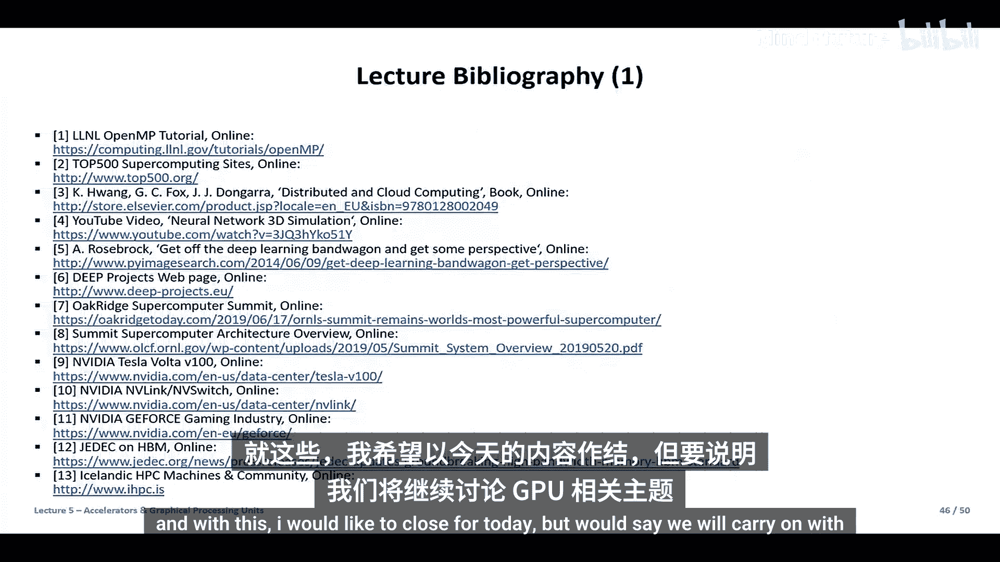

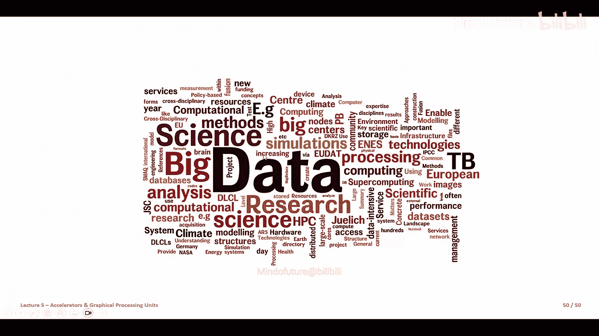

本节课中我们一起学习了GPU编程的核心工作流程，了解了GPU在深度学习和传统科学计算中的关键作用。我们看到了通过高级框架或特定库来使用GPU的便捷性，也初步接触了CUDA和OpenACC等编程模型。最后，我们认识到GPU计算领域存在一定的市场集中度，但开放标准与多元竞争正在推动其向前发展。在接下来的课程中，我们将更深入地探讨GPU在分布式深度学习训练中的具体应用。