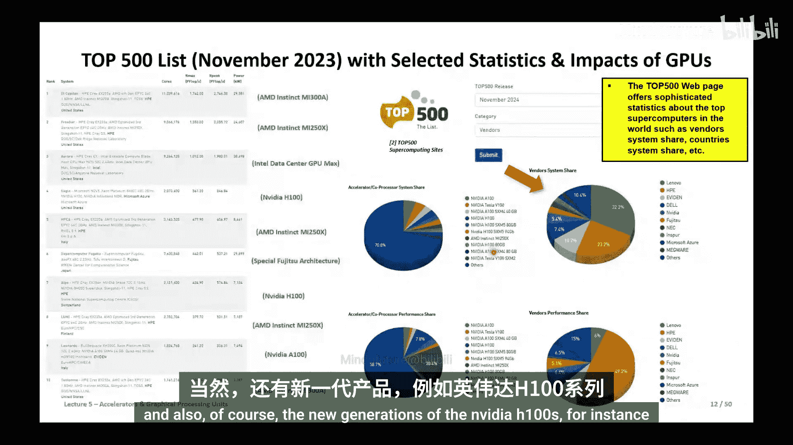
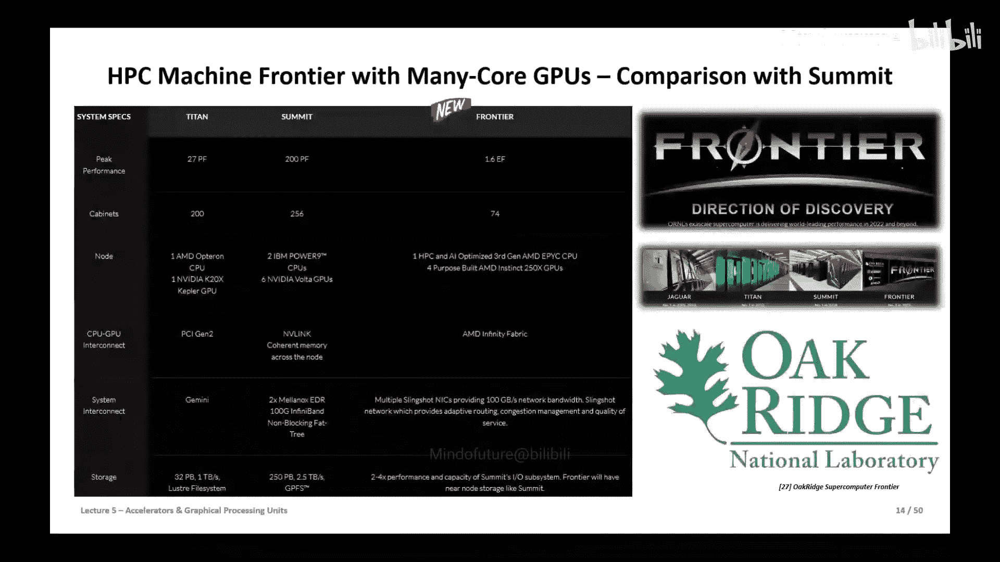
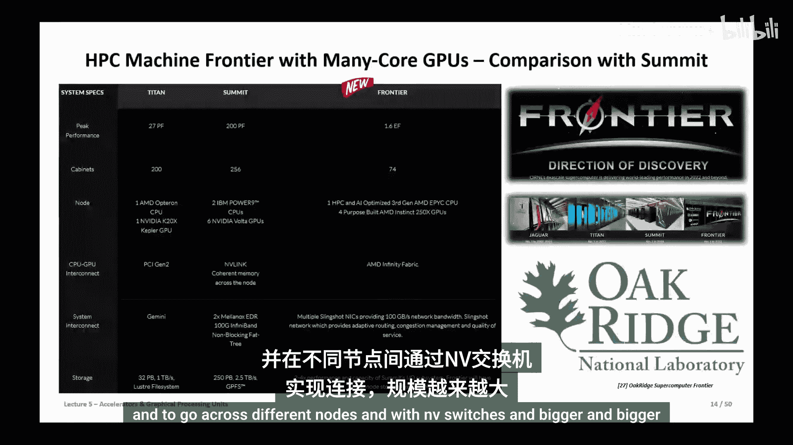
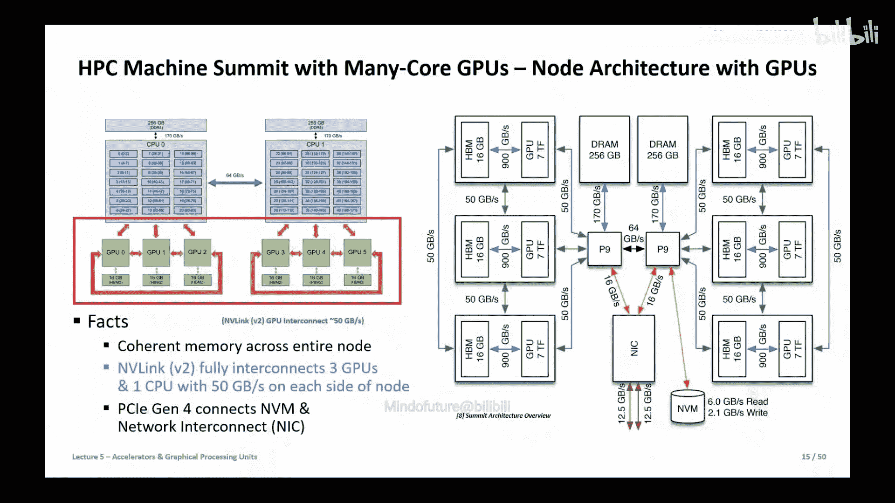
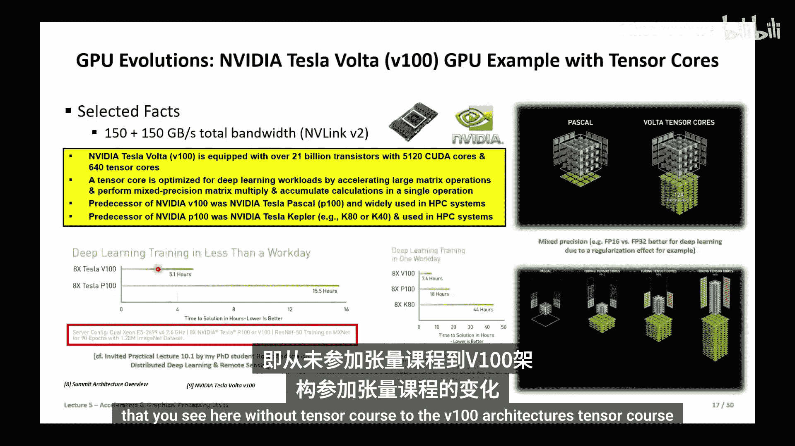
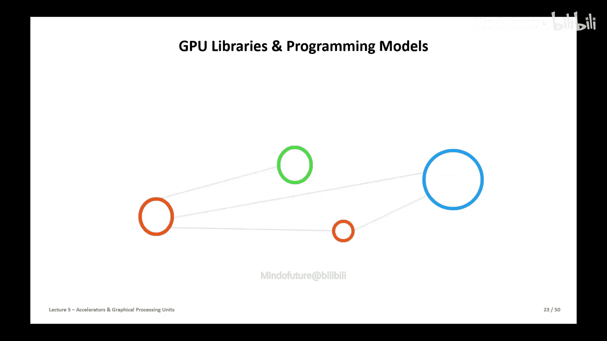

# 015：加速器和图形处理器（第一部分）

在本节课中，我们将学习高性能计算中的加速器技术，特别是图形处理器。我们将回顾GPU技术的发展历程、其在科学计算和深度学习中的应用，以及如何在高性能计算系统中大规模部署GPU。

上一节我们介绍了共享内存编程模型OpenMP。本节中，我们将转向一种不同的并行计算范式——利用图形处理器进行加速计算。

## GPU概述与演进

GPU最初是为图形处理设计的。然而，人们发现其**多核心、高并行**的架构非常适合处理可并行化的通用计算任务，因此诞生了**GPGPU**的概念。与追求单核高性能的CPU不同，GPU通过在单个芯片上集成数千个计算核心来实现高吞吐量。

GPU技术的演进速度极快。从早期的Fermi、Kepler架构，到后来的Pascal、Volta，再到如今的Ampere、Hopper以及最新的Blackwell架构，每一代都在计算核心数量、内存带宽和专用硬件（如**张量核心**）方面有显著提升。

## GPU在高性能计算中的应用

GPU的应用已远不止于图形和深度学习。许多传统的科学模拟代码，例如分子动力学软件**Amber**，也通过移植到CUDA等平台，成功利用GPU加速，获得了显著的性能提升。这表明GPU正在成为推动物理、气候建模、基因组学等多个科学领域发展的关键计算资源。

## 高性能计算系统与GPU扩展

单个GPU工作站并非我们讨论的高性能计算系统。真正的高性能计算意味着将成千上万个GPU互连起来，形成大规模计算集群。

以2018年排名世界第一的**Summit**超级计算机为例：
*   它拥有约4,600个计算节点。
*   每个节点配备6个NVIDIA V100 GPU。
*   系统总计约27,000个GPU。

这样的系统展示了GPU在高性能计算中的核心地位：通过高带宽网络（如**NVLink**和**NVSwitch**）将大量GPU紧密耦合，以解决大规模科学问题。然而，技术迭代迅速，Summit已于近期退役，被基于AMD Instinct MI300等新一代加速器的Frontier等系统所取代。

## 关键硬件概念

以下是理解GPU高性能的几个核心硬件概念：

*   **高带宽内存**：GPU配备的HBM提供远超传统CPU内存的带宽（例如900 GB/s），这对于需要快速“喂食”数据给数千个计算核心的应用至关重要。
*   **NVLink/NVSwitch**：这是NVIDIA的GPU间高速互连技术。它允许GPU直接、高速地交换数据，对于多GPU协同工作至关重要。其带宽也在快速演进，最新一代已达到1.8 TB/s。
*   **张量核心**：从Volta架构开始引入的专用计算单元，为混合精度矩阵运算（尤其是**FP16**）进行了优化，极大地加速了深度学习训练和推理。

## 编程模型与未来展望

目前，**CUDA**是主流的GPU编程模型。然而，行业也在推动标准化和开放性，例如**OpenCL**、**HIP**以及**SYCL**。尽管CUDA生态仍占主导地位，但AMD Instinct卡及其ROCm平台、Intel的GPU产品都在推动多元化发展。

未来，我们可能会看到更紧密的CPU-GPU集成架构，甚至可能出现专为通信任务优化的“弱”CPU与强大GPU组合的设计模式，以最大化计算密度和能效。

## 冰岛的GPU资源

在冰岛本地，我们拥有包含NVIDIA A100等GPU的计算资源，例如配备8个A100的单节点和多个配备双A100的节点。此外，作为EuroHPC联合计划的成员，冰岛的研究人员也可以申请使用欧洲范围内的顶级超算系统。

本节课中，我们一起学习了GPU作为加速器在高性能计算中的核心作用。我们回顾了其从图形处理器到通用计算设备的演进，探讨了其关键硬件特性（如多核心、HBM、高速互连），并了解了其如何被集成到Summit等大规模超算系统中以解决前沿科学问题。GPU技术的快速迭代及其在从深度学习到传统科学模拟等广泛领域的成功应用，奠定了它作为现代高性能计算基石的牢固地位。