# 019：并行化基础（第一部分）

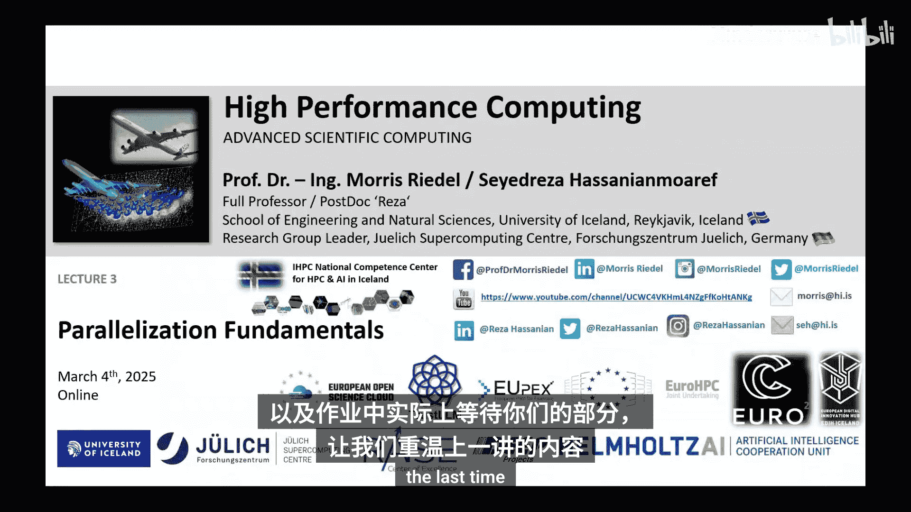

在本节课中，我们将要学习并行计算的基础概念和常见策略。我们将从回顾上一讲关于MPI的实践内容开始，然后深入探讨并行化的核心思想，包括域分解、不同的并行化范式（如SPMD和MPMD）以及数据与功能并行化。课程内容旨在为初学者提供清晰、直观的理解。

---

## 回顾：MPI点对点与集体通信

上一节我们介绍了MPI编程的实践，本节中我们来回顾其中的核心概念。

在分布式内存系统中，进程间需要通过消息传递来交换数据。我们学习了两种主要的通信方式：

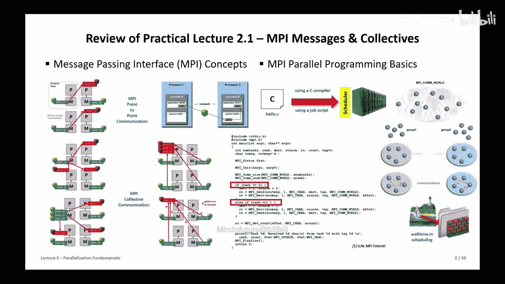

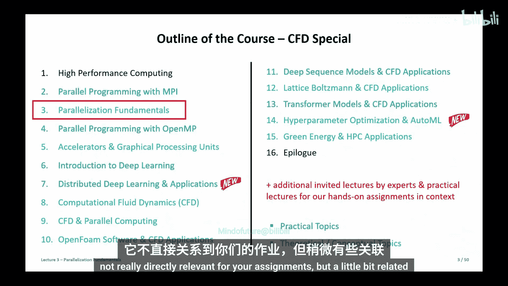

*   **点对点通信**：涉及两个特定进程（发送方和接收方）之间的数据交换。它需要一个系统缓冲区来暂存待发送的数据。其核心模式是阻塞式的 `MPI_Send` 必须与匹配的 `MPI_Recv` 配合使用，正如在“乒乓”示例中展示的那样。
    ```c
    MPI_Send(&data, count, datatype, destination, tag, communicator);
    MPI_Recv(&data, count, datatype, source, tag, communicator, &status);
    ```

*   **集体通信**：允许一个进程组内的所有进程参与协同操作。例如，`MPI_Bcast`（广播）操作允许一个根进程将数据发送给通信域内的所有其他进程，这比使用循环进行多次点对点通信更高效、代码更简洁。
    ```c
    MPI_Bcast(&data, count, datatype, root, communicator);
    ```

我们还使用了笛卡尔通信器（`MPI_Cart_create`）来创建具有网格拓扑结构的进程组，这更符合许多科学计算问题的结构。每个进程通过唯一的 `rank` 来标识自己，并通过 `MPI_Comm_size` 获知进程总数，这是实现SPMD（单程序多数据）模式的基础。

---

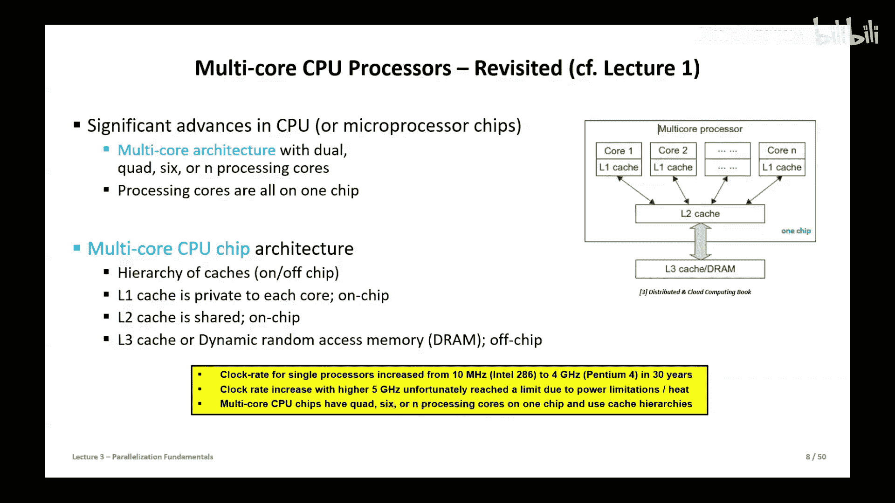

## 并行化的常见策略

上一节我们回顾了MPI通信机制，本节中我们来看看实现并行计算的常见策略。

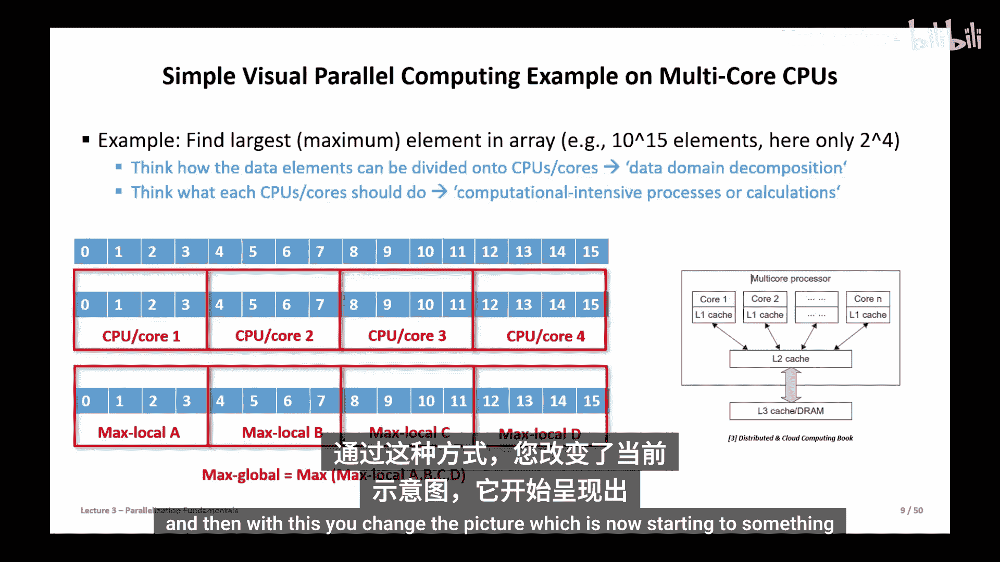

并行计算的核心思想是**将一个大问题分解成多个较小的部分，并分配给多个处理器（进程）协同解决**，以追求更高的性能（如更快的求解速度）。高性能计算系统正是由许多这样的处理器通过高速网络互连而成。

以下是几个简单的并行计算示例：

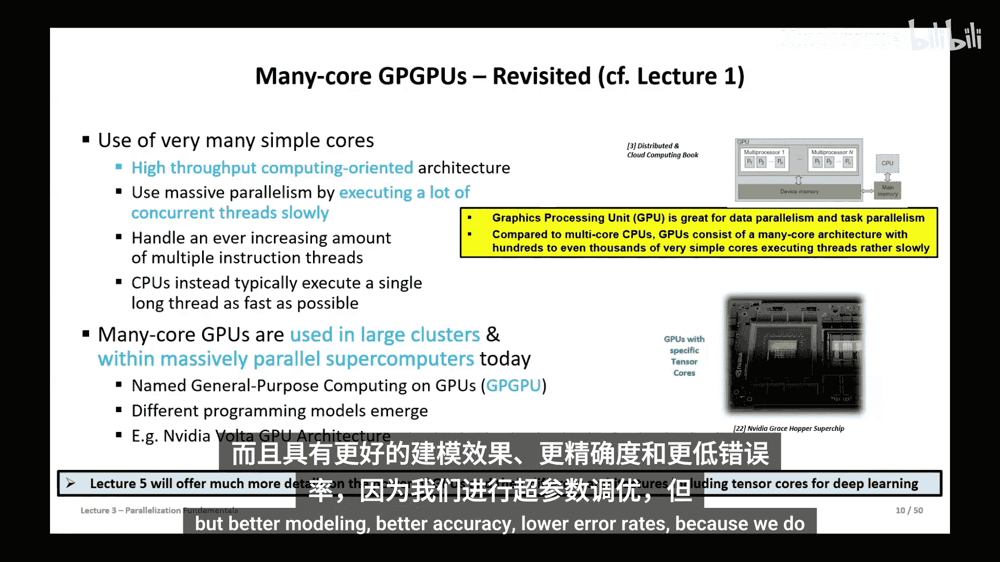

*   **寻找数组最大值**：假设有一个包含16个元素的数组。如果我们有4个处理器，可以将数组平均分成4份，每个处理器负责计算本地片段的最大值。最后，通过一个归约操作（如 `MPI_Reduce`）收集所有本地最大值并找出全局最大值。与单个处理器遍历全部16个元素相比，这有望获得**加速**。
*   **GPU上的矩阵向量乘法**：GPU拥有数千个计算核心，非常适合处理可以高度并行化的操作。例如，在矩阵向量乘法中，结果向量的每个元素可以独立计算，几乎不需要核心间的通信。这种**数据并行**模式是GPU在人工智能领域表现卓越的原因之一。
*   **数值天气预报**：地球被划分成许多3D网格单元。每个单元内的物理过程（如温度、气压）的计算不仅依赖于自身，还强烈依赖于其相邻单元的状态。因此，在计算每个时间步后，进程需要与邻居交换边界信息。这类问题对**通信性能**的要求很高。

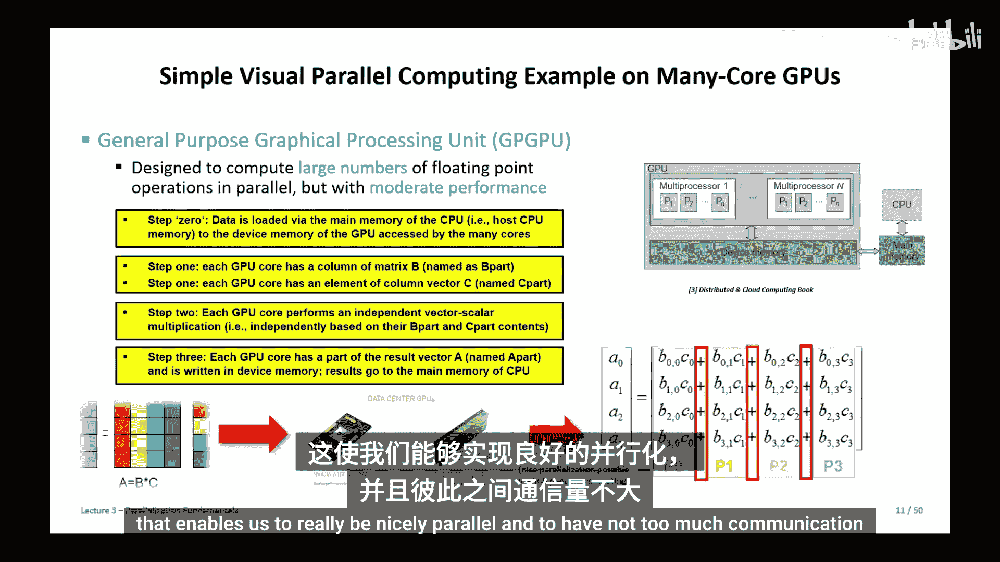

---

## 域分解

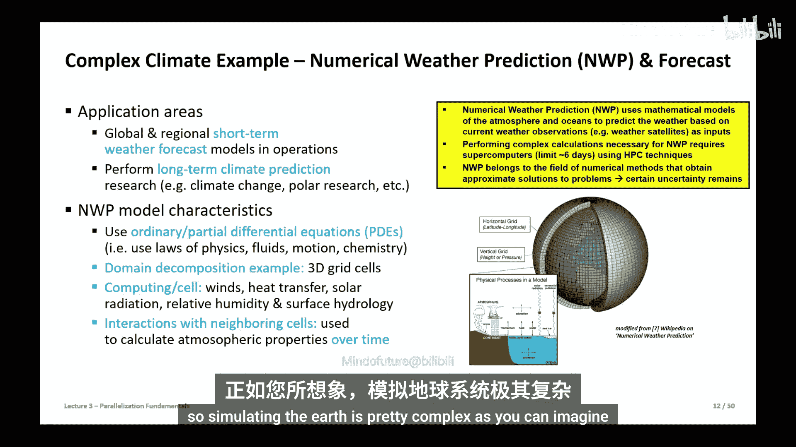

从上述例子可以看出，如何将计算域（数据）有效地划分给多个处理器至关重要，这个过程称为**域分解**。

域分解的方式多种多样，取决于具体应用：
*   对于一维数组，可能是简单的线性划分。
*   对于二维或三维网格（如模拟海洋、大气），划分可以是条带状、块状或更复杂的形状。
*   在计算流体动力学中，甚至可能采用**自适应网格加密**，在物理变化剧烈的区域使用更精细的网格。

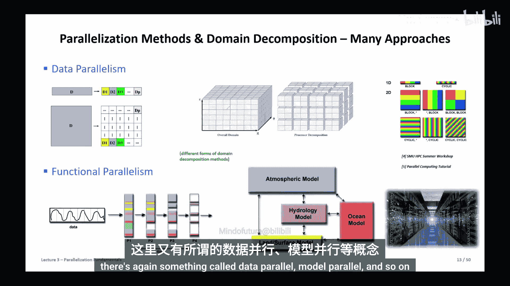

选择分解策略时需要考虑：
1.  **负载均衡**：尽量让每个处理器承担相近的计算量。
2.  **通信开销**：最小化处理器间需要交换的数据量。例如，一个块状分解通常比条带状分解拥有更小的边界（通信面）。
3.  **内存限制**：每个处理器需要有足够的内存存储其分配到的子域数据。

---

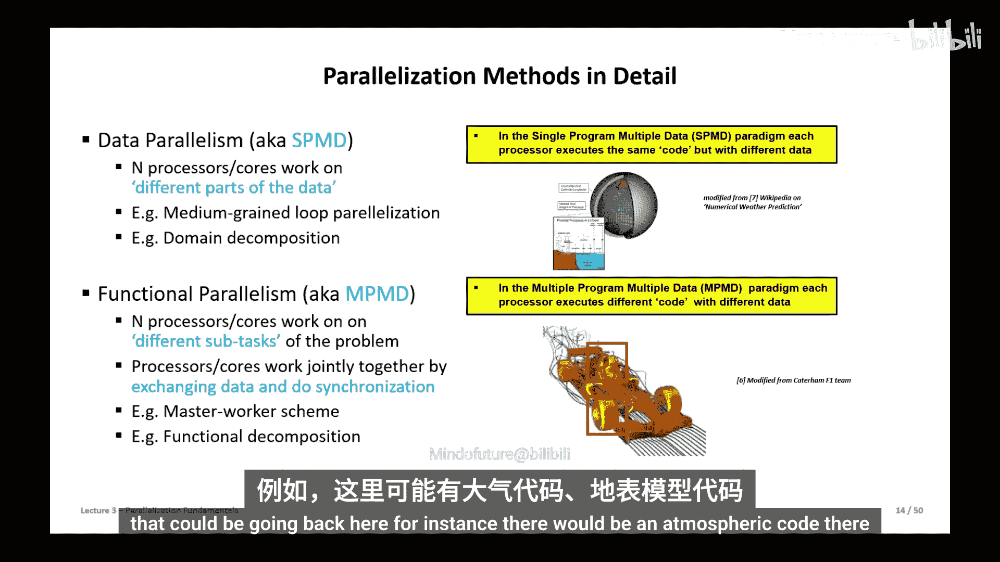

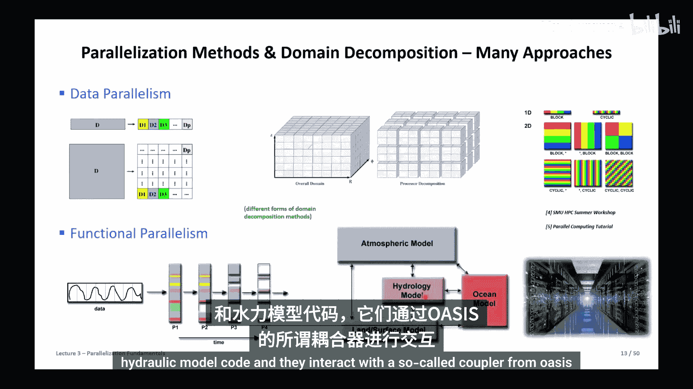

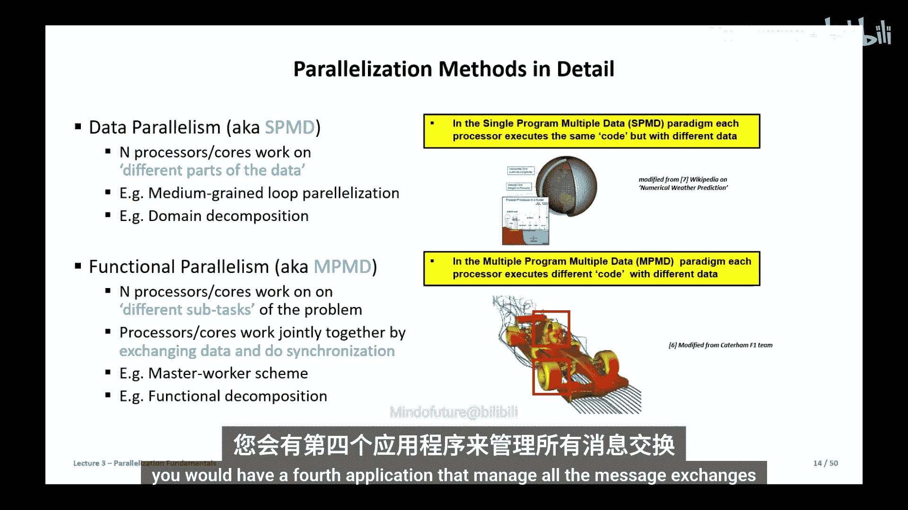

## 并行化范式：SPMD vs MPMD

根据程序和数据组织方式的不同，并行化主要有两种范式：

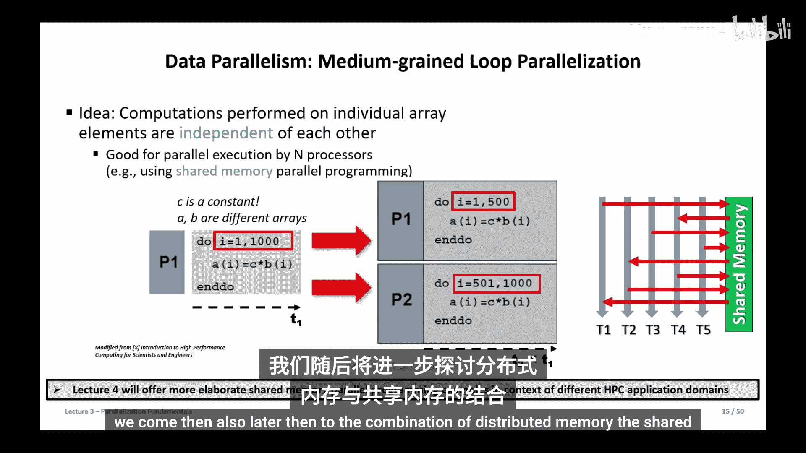

*   **SPMD（单程序多数据）**：所有处理器执行**相同的程序副本**，但操作**不同的数据**。这是MPI编程的典型模式，通过进程的 `rank` 来区分行为（例如，哪个进程负责广播）。
*   **MPMD（多程序多数据）**：不同的处理器可能执行**不同的程序**，处理**不同的数据**。这常用于**功能并行**或**耦合模拟**。例如，一个气候模拟系统可能由独立的大气模型、海洋模型和陆面模型组成，它们通过一个“耦合器”程序来交换数据。

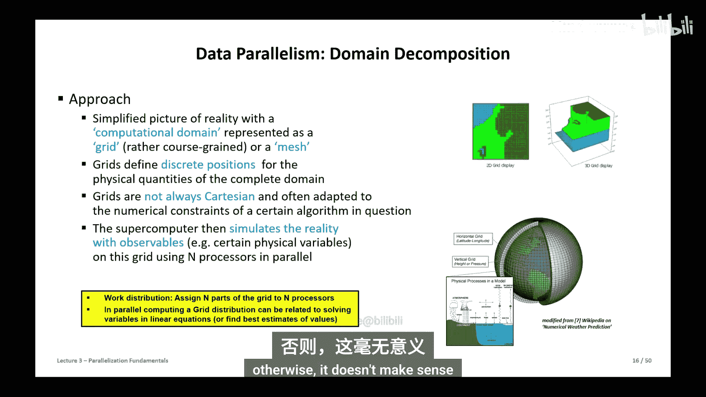

---

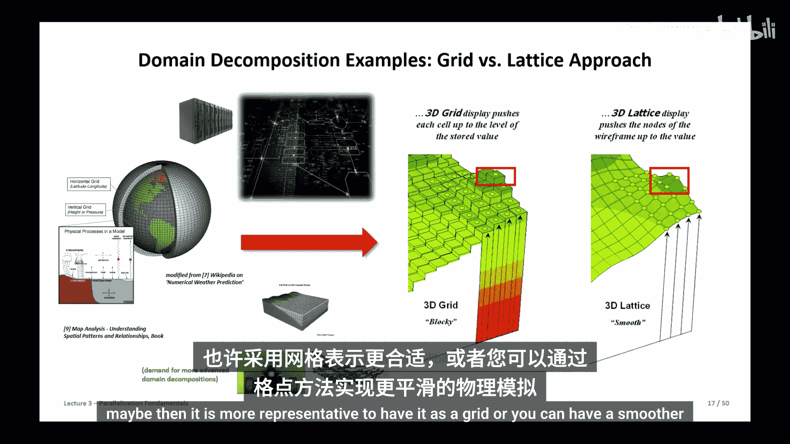

## 数据并行与功能并行

我们可以从另一个角度理解并行化：

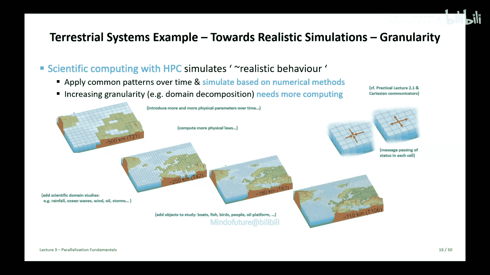

*   **数据并行**：将同一操作应用于大量数据的不同部分。例如，对一个大型数组的每个元素进行相同的计算。**共享内存编程**（如OpenMP）非常适合这种模式，因为多个线程可以直接访问同一内存空间中的不同数据部分。
    ```c
    #pragma omp parallel for
    for (int i = 0; i < N; i++) {
        c[i] = a[i] + b[i]; // 每个迭代独立
    }
    ```
*   **功能并行**：将整个计算任务分解成多个不同的功能模块，由不同的处理器同时执行。例如，在图像处理流水线中，一个处理器负责解码，另一个负责滤波，第三个负责编码。

在实际的高性能计算应用中，常常会混合使用这些模式。

---

## 时间维度与幽灵层

在许多科学模拟中，问题不仅涉及空间域分解，还涉及**时间维度**。物理状态是随时间演化的（如热量扩散、流体运动），通常通过时间步进法求解。

在每个时间步内：
1.  各处理器基于**当前时间步**自身子域及邻居子域的数据进行计算。
2.  计算完成后，各处理器需要与邻居交换边界数据，为**下一个时间步**的计算做准备。

在分布式内存系统中，一个处理器的“邻居”数据可能位于另一个处理器的内存中。为了便于计算，我们引入**幽灵层**或**光环层**的概念。这是子域边界外的一层虚拟单元格，专门用于存储从邻居进程接收来的数据。在每个时间步的通信阶段，进程间通过MPI交换信息来填充彼此的幽灵层。这样，在下个时间步的计算中，每个进程就拥有了计算所需的完整局部数据视图。

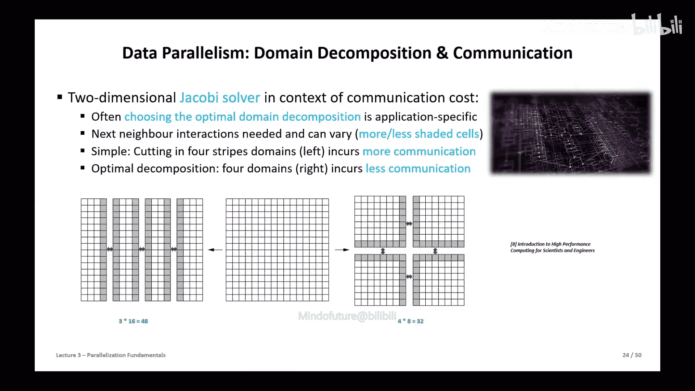

---

## 总结

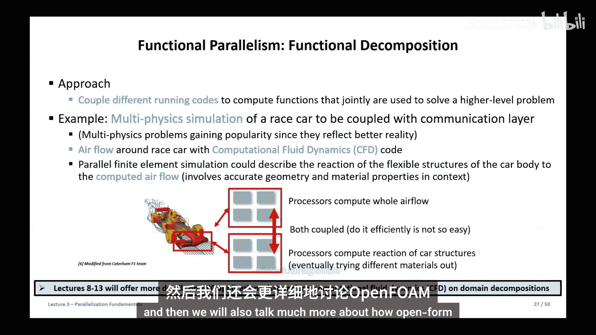

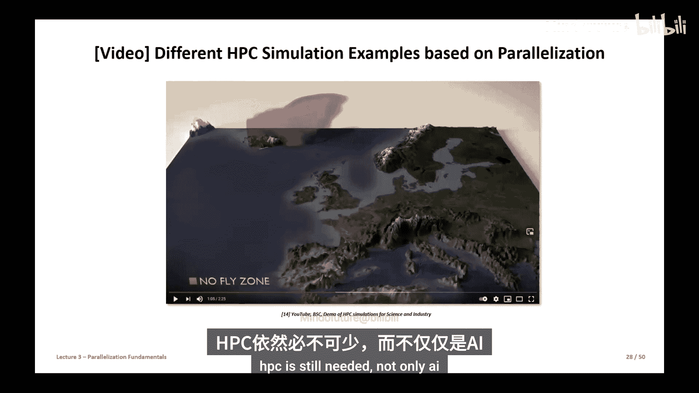

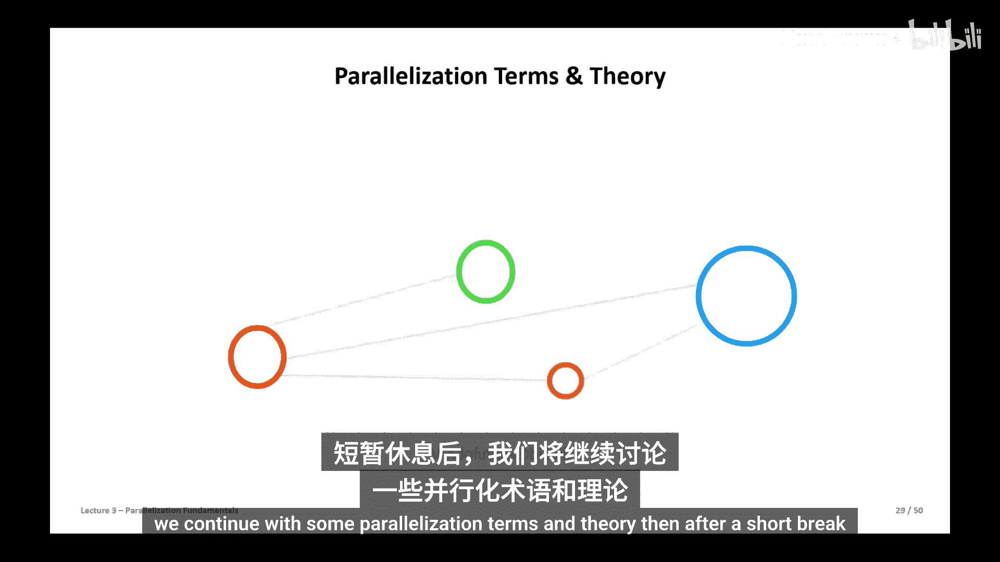

本节课中我们一起学习了并行计算的基础知识。我们回顾了MPI通信的核心机制，包括点对点和集体通信。我们探讨了并行化的动机和常见策略，理解了**域分解**是将大问题分解为可并行处理的小问题的关键。我们区分了**SPMD**和**MPMD**两种并行范式，以及**数据并行**和**功能并行**的不同思路。最后，我们引入了**时间步进**模拟中至关重要的**幽灵层**概念，它解决了分布式内存系统中子域间的数据依赖问题。这些概念为理解如何设计和实现高效的高性能计算应用奠定了坚实的基础。