# 021：MPI消息与集合操作（第一部分）🚀

在本节课中，我们将学习MPI（消息传递接口）的基础知识，包括如何初始化MPI环境、进行点对点通信以及使用集合操作。我们将通过一系列简单的C语言示例，从“Hello World”开始，逐步深入到消息传递的核心概念。

## 概述

MPI是用于分布式内存并行编程的标准。它允许运行在不同处理器（或计算节点）上的进程通过发送和接收消息来协同工作。本节课将重点介绍MPI的基本环境设置、点对点通信（如“乒乓”示例）以及集合通信（如广播操作）。我们还将了解如何通过作业调度器（如Slurm）来管理和运行MPI程序。

---

## MPI环境与“Hello World” 🌍

上一节我们概述了MPI的基本概念。本节中，我们来看看如何创建一个最简单的MPI程序来验证并行环境。

任何MPI程序都必须包含MPI头文件，并在`MPI_Init`和`MPI_Finalize`之间编写并行代码。两个最关键的函数是`MPI_Comm_size`（获取通信域中的进程总数）和`MPI_Comm_rank`（获取当前进程的唯一标识符，即“秩”）。

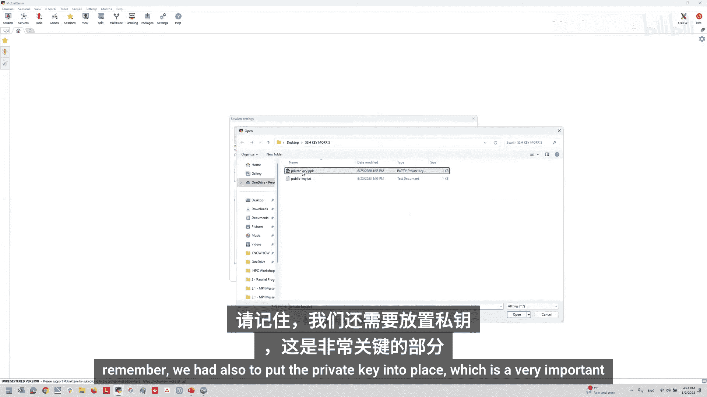

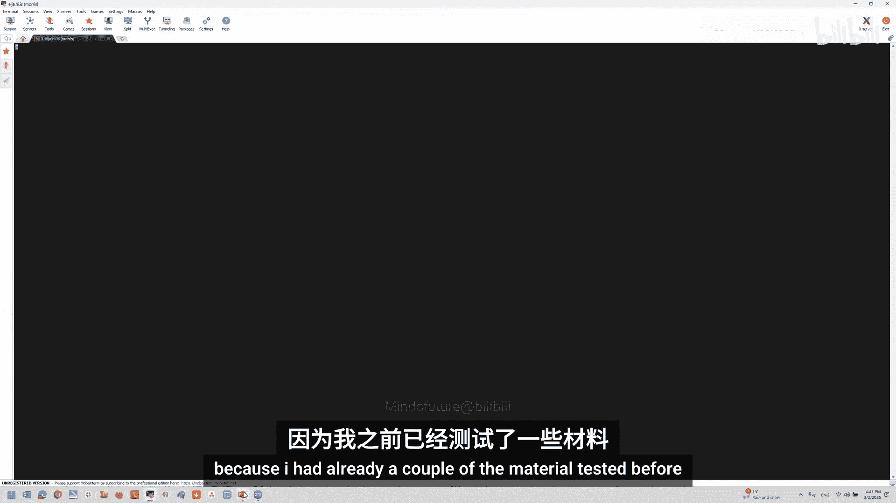

以下是一个“Hello World”MPI程序的代码框架：

```c
#include <mpi.h>
#include <stdio.h>

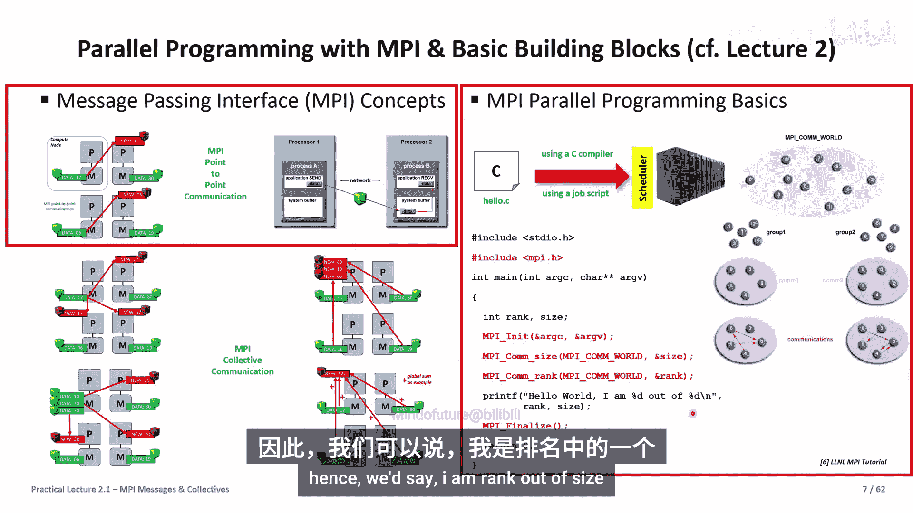

int main(int argc, char** argv) {
    // 初始化MPI环境
    MPI_Init(&argc, &argv);

    // 获取进程总数和当前进程的秩
    int world_size, world_rank;
    MPI_Comm_size(MPI_COMM_WORLD, &world_size);
    MPI_Comm_rank(MPI_COMM_WORLD, &world_rank);

    // 每个进程打印自己的信息
    printf("Hello world, I am rank %d out of %d\n", world_rank, world_size);

    // 终止MPI环境
    MPI_Finalize();
    return 0;
}
```

编译和运行这个程序时，我们需要使用MPI编译器（如`mpicc`）并指定运行进程的数量。进程数量可以通过作业脚本（例如使用Slurm的`#SBATCH --ntasks`选项）或`mpirun`命令的参数来控制。同一个可执行文件会被启动多次，每个进程通过其唯一的“秩”来区分并执行不同的代码分支。

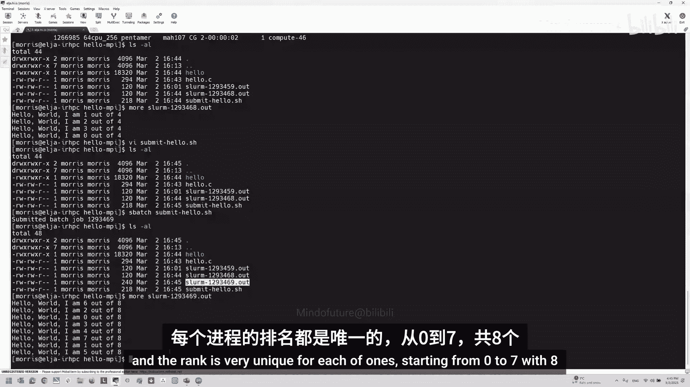

---

## 点对点通信：乒乓示例 🏓

理解了如何启动并行进程后，我们来看看进程间如何交换数据。点对点通信要求一个进程发送消息，另一个进程必须准备好接收它。

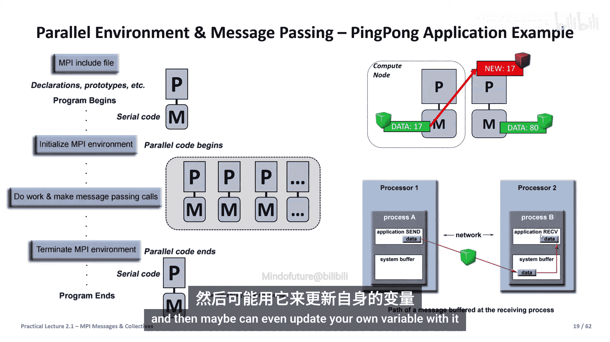

“乒乓”是一个经典示例，模拟了两个进程（秩0和秩1）之间来回传递消息的过程。其核心逻辑是：
*   秩0首先向秩1发送一个消息（“乒”）。
*   秩1必须调用接收操作来获取这个消息。
*   接着，秩1向秩0发送一个回复消息（“乓”）。
*   秩0也必须调用接收操作来获取这个回复。

以下是实现“乒乓”通信的关键代码逻辑：

```c
if (world_rank == 0) {
    // 秩0：发送“乒”给秩1，然后接收“乓”
    MPI_Send(&ping, 1, MPI_CHAR, 1, 0, MPI_COMM_WORLD);
    MPI_Recv(&pong, 1, MPI_CHAR, 1, 0, MPI_COMM_WORLD, &status);
} else if (world_rank == 1) {
    // 秩1：接收“乒”来自秩0，然后发送“乓”回去
    MPI_Recv(&ping, 1, MPI_CHAR, 0, 0, MPI_COMM_WORLD, &status);
    MPI_Send(&pong, 1, MPI_CHAR, 0, 0, MPI_COMM_WORLD);
}
```

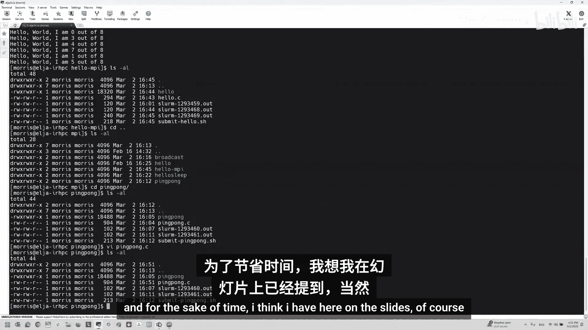

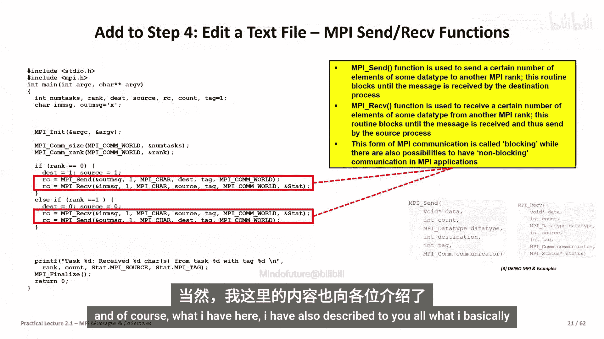

**重要概念**：每一个`MPI_Send`都必须有一个配对的`MPI_Recv`，否则程序可能会挂起等待。在作业调度系统中，我们可以灵活地分配这两个进程：它们可以运行在同一个计算节点的两个CPU核心上，也可以分布在两个不同的计算节点上。后者虽然可能浪费资源，但展示了MPI程序在分布式内存架构上的灵活性。

---

## 集合通信：广播操作 📢

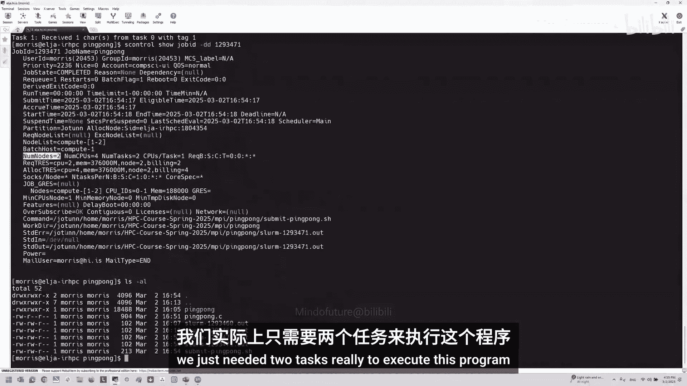

点对点通信适用于特定进程间的对话。但当需要将一个进程的数据分发给所有其他进程时，使用集合通信会更高效。广播（`MPI_Bcast`）是最常用的集合操作之一。

假设我们有一个数组，只在秩0的进程中被初始化，但我们希望所有进程都拥有这个数组的完整副本。如果不使用集合操作，我们需要写一个循环，让秩0依次向其他每个进程发送数据。使用广播，一行代码即可完成。

以下是使用广播的示例：

```c
int data[COUNT];
// 只有秩0初始化数据
if (world_rank == 0) {
    for (int i = 0; i < COUNT; i++) {
        data[i] = i;
    }
}
// 关键的一行：秩0将data数组广播给通信域中的所有进程
MPI_Bcast(data, COUNT, MPI_INT, 0, MPI_COMM_WORLD);
// 现在，所有进程的data数组都包含了{0, 1, 2, ...}
```

广播操作的美妙之处在于其简洁性和内在的可扩展性。我们无需修改源代码，只需在提交作业时改变进程数量（例如从4个改为8个），广播操作会自动将数据分发给所有新增的进程。这体现了MPI程序设计的目标：编写与进程数量无关的、可扩展的并行代码。

---

## 作业调度与运行时间管理 ⏱️

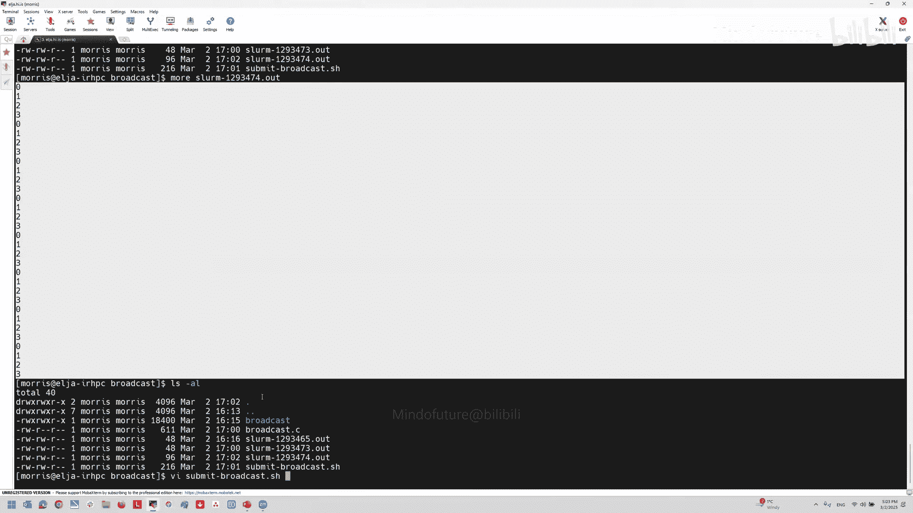

在真实的高性能计算环境中，MPI程序通过作业调度系统（如Slurm）提交到计算集群上运行。除了指定需要的进程数，另一个至关重要的参数是“运行时间”（wall time）。

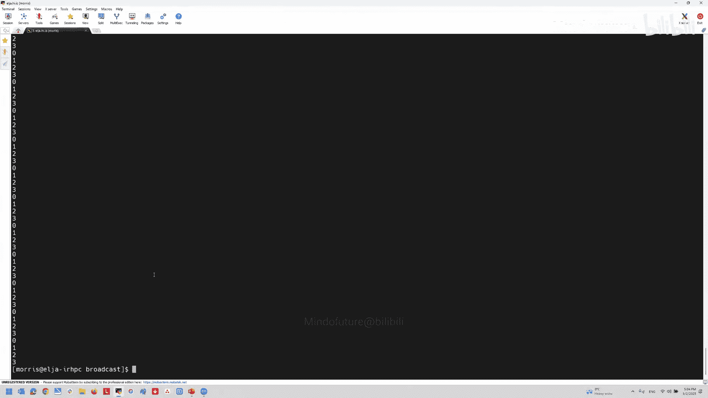

运行时间是用户向调度器申请的作业最大运行时长。调度器根据这个信息来安排作业，优化整个集群的利用率。如果作业的实际运行时间超过了申请的限制，调度器会强制终止该作业。

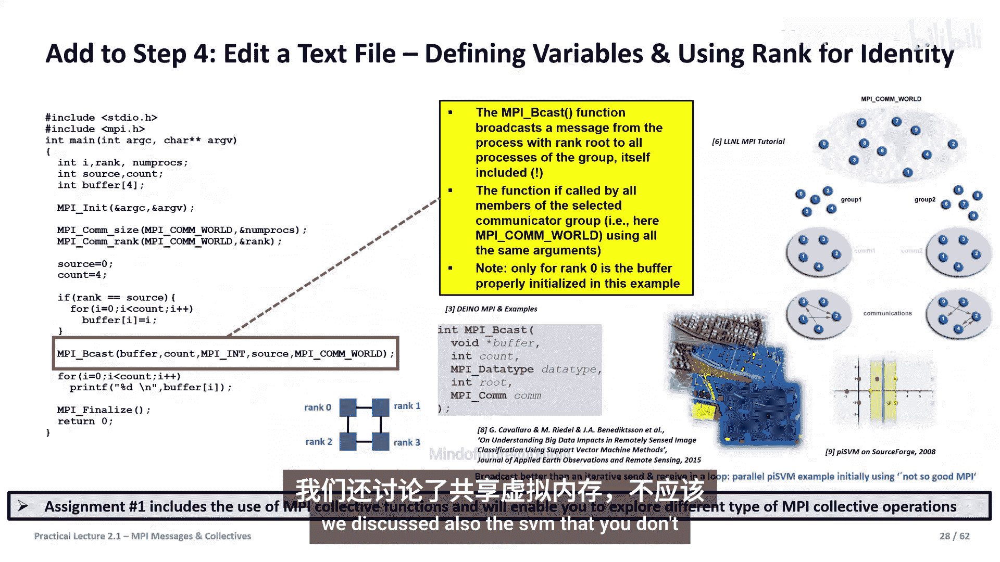

这个概念可以通过一个“睡眠”程序来演示。我们在程序中调用`sleep(seconds)`来模拟长时间计算。

```c
int sleep_seconds = 120; // 程序将睡眠120秒
printf(“I am going to sleep for %d seconds.\n”, sleep_seconds);
sleep(sleep_seconds);
printf(“I am awake!\n”);
```

**关键点**：如果我们在作业脚本中申请的时间（例如20秒）短于程序实际需要的时间（120秒），那么程序将在运行20秒后被系统强制终止，无法完成并输出“I am awake!”。因此，在运行大型科学计算应用时，准确预估并设置合理的运行时间上限非常重要。

---

## 总结

本节课中我们一起学习了MPI并行编程的基础核心内容。

我们首先从**MPI环境初始化**开始，学会了如何获取进程的“秩”和“大小”，这是所有MPI程序的起点。接着，我们探索了**点对点通信**，通过“乒乓”示例理解了`MPI_Send`和`MPI_Recv`必须配对使用的原则。然后，我们引入了更高效的**集合通信**，使用`MPI_Bcast`演示了如何将数据从根进程一次性分发给所有进程，并体会了MPI程序的可扩展性。最后，我们讨论了在真实HPC环境中通过**作业调度器**运行MPI程序的关键，特别是合理设置运行时间的重要性。

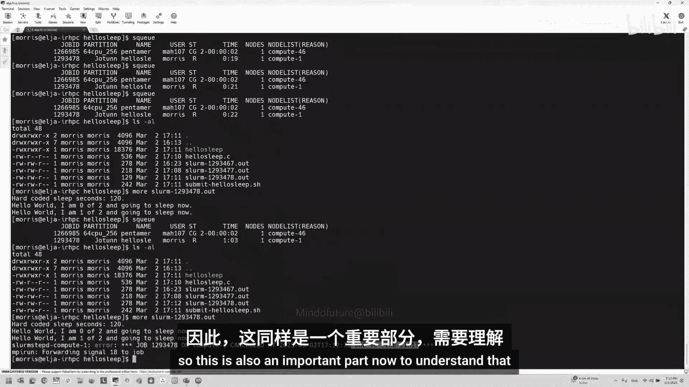

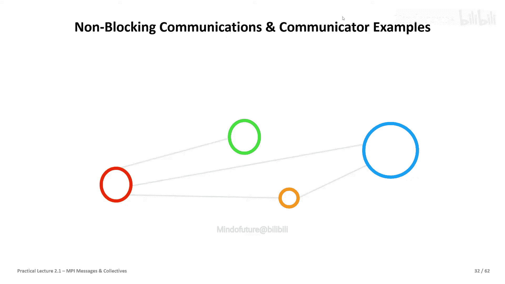

这些知识构成了使用MPI进行分布式内存编程的基石。在接下来的部分，我们将继续探讨更高级的主题，如非阻塞通信和笛卡尔通信器，以构建更复杂、更高效的并行应用。