# 023：使用MPI并行编程（第一部分）🚀

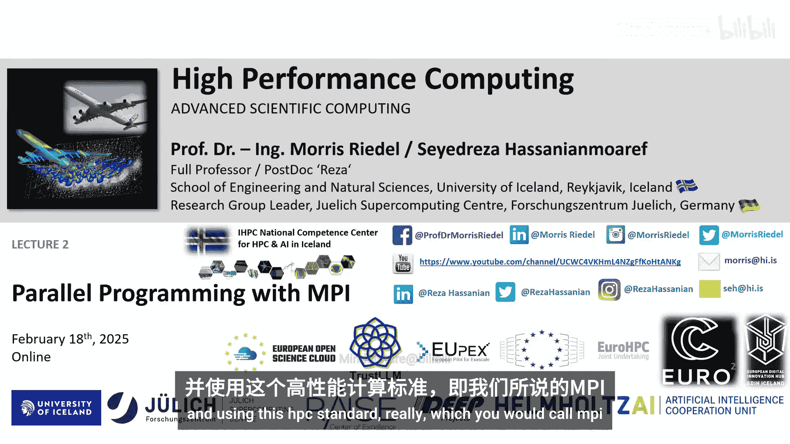

在本节课中，我们将要学习并行编程的核心概念，特别是消息传递接口（MPI）。我们将探讨MPI的基本原理、关键术语以及它如何支持分布式内存编程。课程将涵盖点对点通信、集体通信等核心概念，为后续的实践课程打下基础。

## 课程回顾与背景

上一节我们介绍了C/C++程序在高性能计算（HPC）中的重要性，并学习了如何在HPC系统上通过调度器提交作业。本节中，我们来看看如何利用MPI标准，编写能够充分利用多个计算节点资源的可扩展并行程序。

HPC系统，如Juwels Booster，拥有数千个GPU，这些资源需要被多个研究者和研究组高效共享。调度算法（如先来先服务、回填）旨在最大化系统利用率。提交作业时，我们通过作业脚本请求资源，而无需修改程序本身的可执行文件。这引出了MPI编程的核心动机：编写一个能够根据分配的进程数进行扩展的应用程序。

## 什么是MPI？

MPI（Message Passing Interface）是一个用于并行编程的**开源标准**库。它主要用于分布式内存系统，即每个进程拥有自己独立的地址空间（内存）。当一个进程需要另一个进程的数据时，它必须通过“消息传递”的方式进行显式通信。

**核心公式**：进程A发送数据给进程B。
```c
MPI_Send(&data, count, datatype, destination, tag, communicator);
MPI_Recv(&buffer, count, datatype, source, tag, communicator, &status);
```

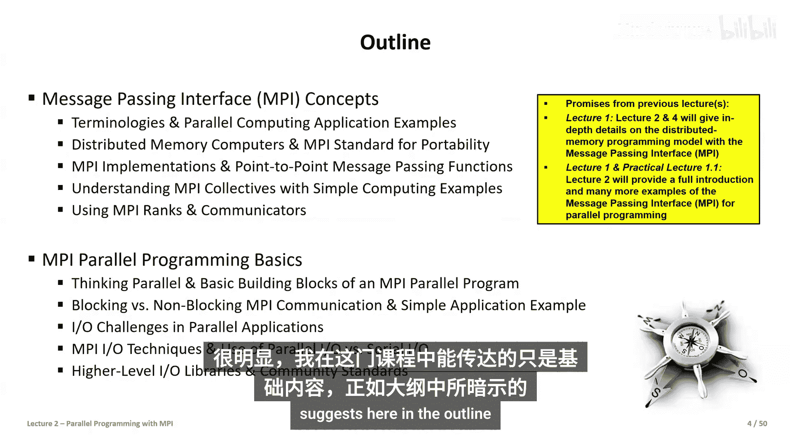

与共享内存编程（如OpenMP）不同，MPI要求程序员显式管理进程间的数据交换。它的优势在于可移植性高，遵循MPI标准的程序可以相对容易地在不同的HPC系统间迁移。

## MPI的核心概念

### 1. 进程与MPI环境
一个MPI程序由多个**进程**组成。每个进程运行相同的程序副本（SPMD模型），但可以通过逻辑分支执行不同的任务。MPI环境在程序启动时初始化，为这些进程提供通信的基础设施。

### 2. 秩（Rank）
每个进程在通信域（Communicator）中被分配一个唯一的标识符，称为**秩（Rank）**。秩通常是从0开始的整数。进程通过秩来识别彼此，从而指定数据的发送目标和接收来源。

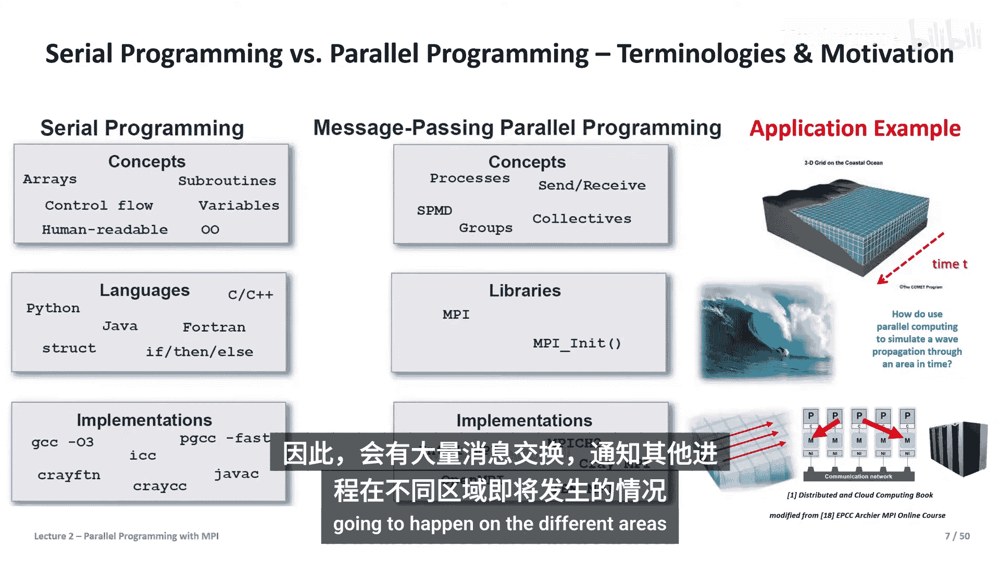

**核心概念**：`MPI_Comm_rank(communicator, &rank)` 用于获取当前进程的秩。

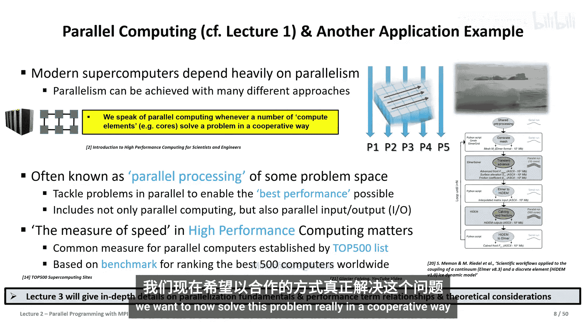

### 3. 通信域（Communicator）
**通信域**定义了一组可以互相通信的进程及其上下文。最常用的通信域是`MPI_COMM_WORLD`，它包含了所有初始启动的进程。你可以创建子通信域来定义更小的进程组，以优化特定组内的通信。

### 4. 点对点通信
点对点通信涉及两个进程：一个发送者，一个接收者。这是最基本的通信模式。

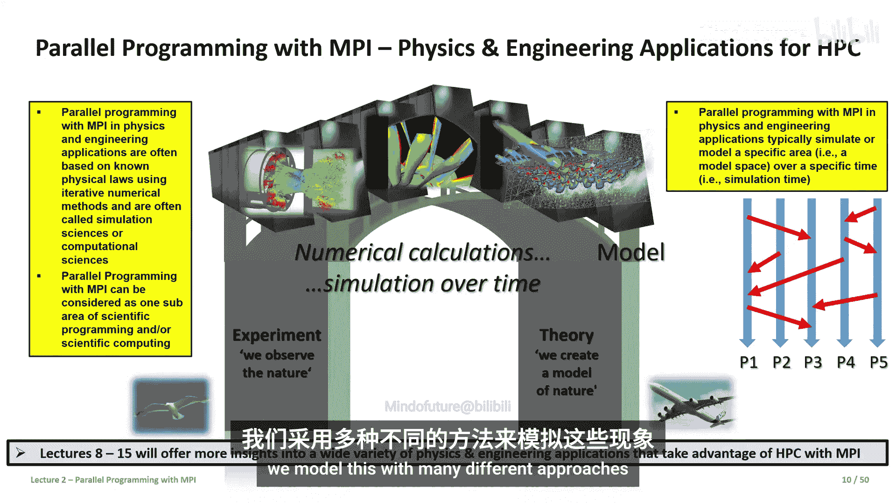

以下是点对点通信的类型：
*   **阻塞通信**：`MPI_Send` 和 `MPI_Recv` 会一直等待，直到通信操作安全完成才返回。这可能导致死锁，需要谨慎设计通信顺序。
*   **非阻塞通信**：`MPI_Isend` 和 `MPI_Irecv` 会立即返回，允许进程在通信进行的同时执行其他计算，然后通过 `MPI_Wait` 来等待操作完成。这有助于提高程序性能。

### 5. 集体通信
集体通信涉及一个通信域内的所有进程。MPI提供了高效的集体通信函数，它们通常基于树形算法实现，比手动使用循环进行点对点通信更高效、更简洁。

以下是主要的集体通信操作：
*   **广播（Broadcast）**：一个进程（根进程）将相同的数据发送给通信域内的所有其他进程。
    *   `MPI_Bcast(&data, count, datatype, root, communicator)`
*   **散播（Scatter）**：根进程将一个数组的不同部分发送给通信域内的每个进程。
    *   `MPI_Scatter(sendbuf, sendcount, sendtype, recvbuf, recvcount, recvtype, root, communicator)`
*   **聚集（Gather）**：与散播相反，根进程从所有进程收集数据到一个数组中。
    *   `MPI_Gather(sendbuf, sendcount, sendtype, recvbuf, recvcount, recvtype, root, communicator)`
*   **归约（Reduce）**：对所有进程提供的数据进行一个操作（如求和、求最大值），并将结果存储在根进程中。
    *   `MPI_Reduce(sendbuf, recvbuf, count, datatype, operation, root, communicator)`

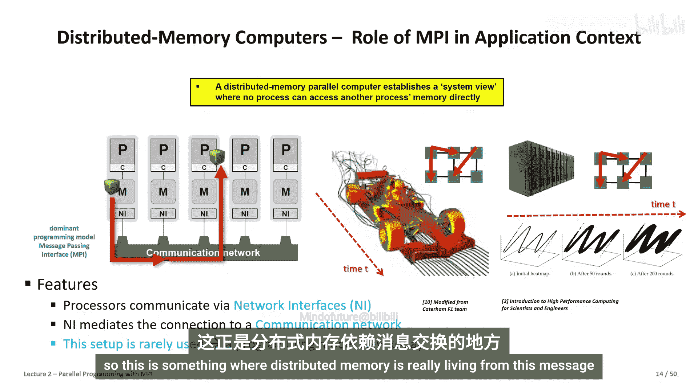

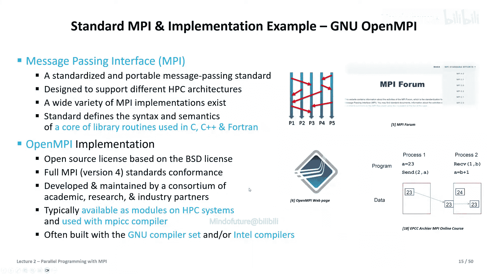

## MPI的应用动机

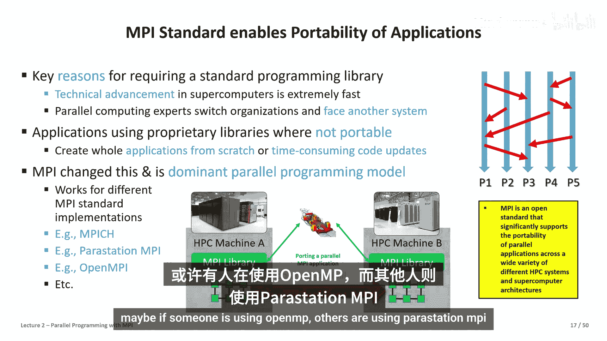

为了理解MPI的必要性，让我们看一个应用示例：模拟海洋波浪传播。我们将一个大的3D海洋区域网格分解成许多小块（域分解），每个进程负责计算其中一块的波浪高度。随着时间推移，相邻网格块的波浪会相互影响。因此，进程之间必须频繁交换边界处的波浪高度数据，这正是MPI消息传递的用武之地。

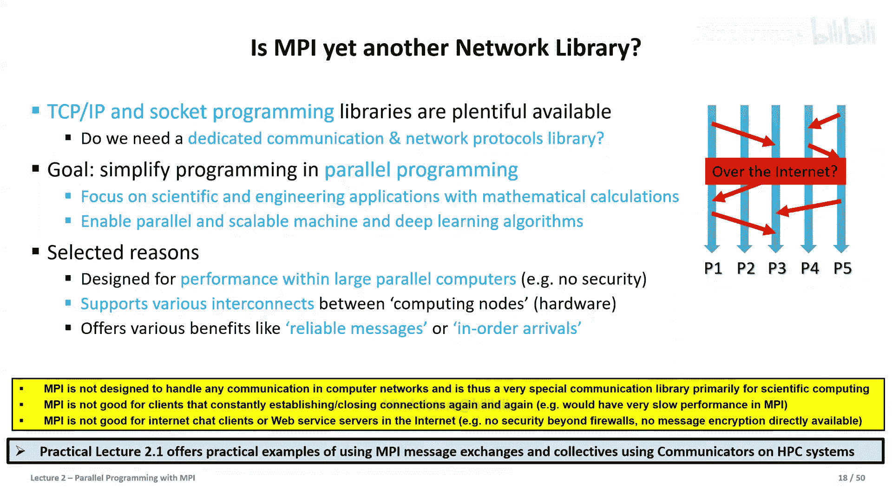

类似的应用广泛存在于科学和工程领域，如计算流体动力学（模拟赛车气流、风力涡轮机应力）、气候模拟、冰川崩解模拟以及大规模数据聚类分析等。这些应用都依赖MPI来实现大规模并行计算。

## MPI不是什么？

需要明确的是，MPI并非用于互联网通信的网络编程库（如TCP/IP套接字编程）。它是一个为**单个HPC集群内部**的高性能、低延迟通信而优化的库，其抽象和函数专门为科学计算中常见的数值数据和通信模式设计。

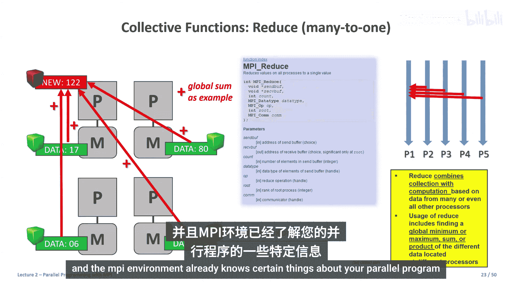

## 总结

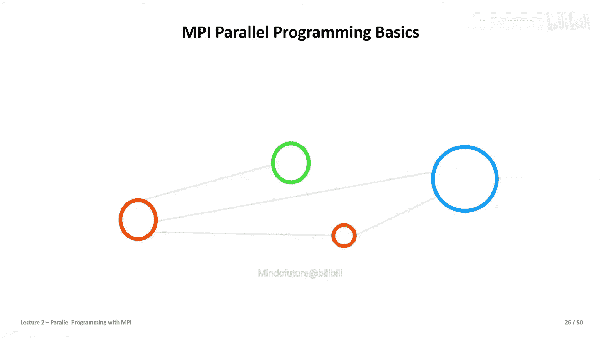

本节课中我们一起学习了MPI并行编程的基础概念。我们了解了MPI作为分布式内存编程标准的核心思想，包括进程、秩、通信域等基本术语。我们重点区分了点对点通信和集体通信，并介绍了广播、散播、聚集和归约等常用集体操作。最后，我们通过波浪模拟等例子了解了MPI在解决大规模科学计算问题中的关键作用。在接下来的实践课中，我们将通过具体的代码示例来巩固这些概念。