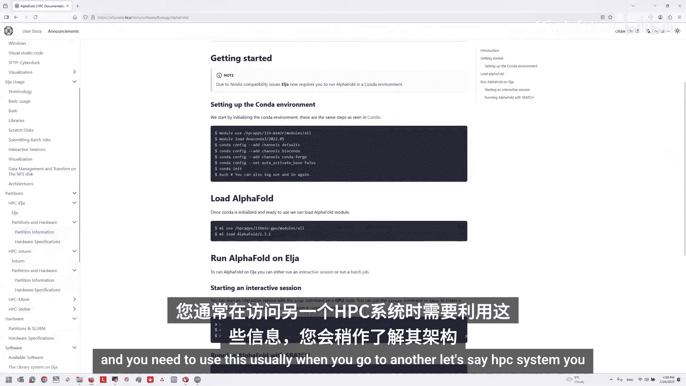
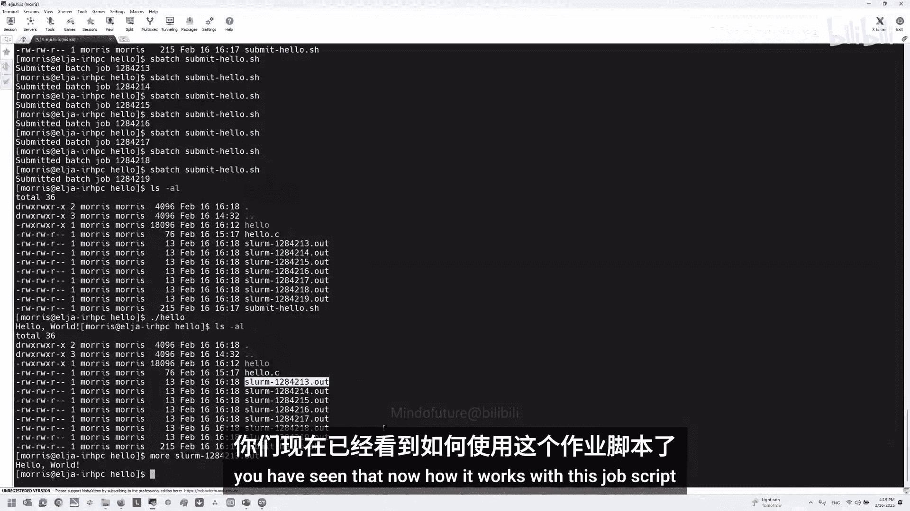
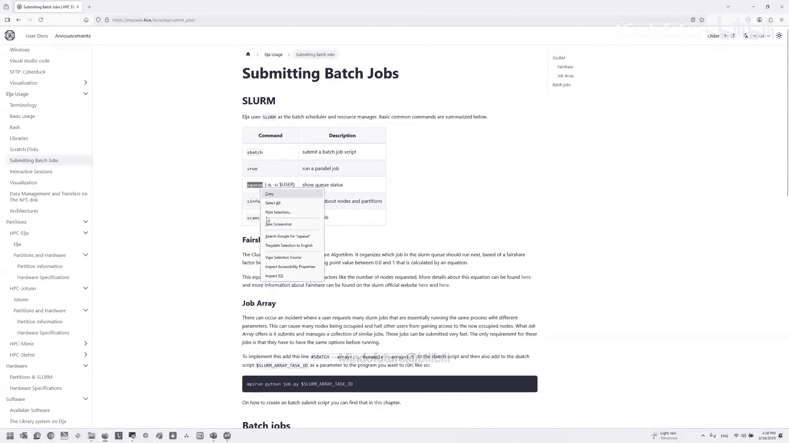
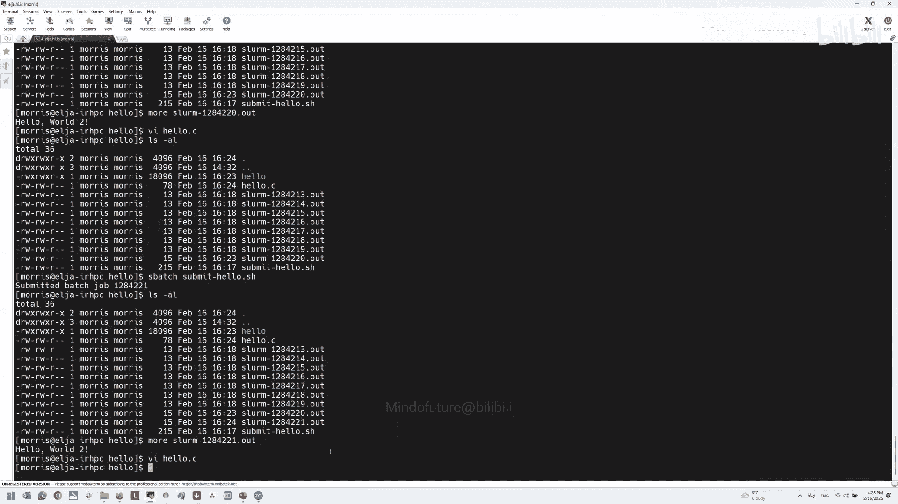

# 024：C语言编程导论与作业调度（第二部分）🚀

## 概述

在本节课中，我们将继续学习C语言编程，并深入了解高性能计算（HPC）系统中的核心概念——作业调度。我们将探讨为什么不能直接在登录节点上运行计算程序，以及如何通过调度系统将作业提交到计算节点上执行。

上一节我们介绍了如何在HPC系统上编写和编译一个简单的“Hello World”C程序。本节中，我们来看看如何正确地在这个多用户环境中运行它。

---

## HPC系统：多用户共享环境

高性能计算系统与个人笔记本电脑不同，它们是供许多用户同时使用的大型共享资源。不同的用户有不同的计算需求，例如，有些应用需要高性能的单核CPU进行数值计算，而另一些则需要大量GPU进行高度可扩展的并行计算。

为了满足这些多样化的需求，现代超级计算机通常采用**模块化超级计算架构**。这种架构将系统划分为不同的模块（例如，CPU密集型集群和GPU加速器），每个模块服务于特定类型的应用。

由于许多用户和作业需要同时使用这些昂贵的系统，我们必须有一种机制来管理资源分配，确保公平性和高利用率。这就是**作业调度系统**的作用。

---

## 监控与调度：系统的两大支柱

为了有效管理HPC系统，我们主要依赖两个工具：**监控系统**和**调度系统**。

### 监控系统

监控系统（如Ganglia、LLview）以图形化方式展示系统的实时状态。你可以看到：
*   **系统负载**：当前有多少CPU、内存、网络正在被使用。
*   **运行中的作业**：不同颜色代表不同用户或不同类型的作业。
*   **系统健康**：是否有节点故障或处于维护状态。

这些可视化工具帮助用户和管理员了解系统的整体运行状况。

### 调度系统

调度系统（如Slurm）是管理用户作业提交和执行的引擎。它的核心任务是：
1.  接收用户提交的作业请求。
2.  根据作业的资源需求（如CPU数量、内存大小、运行时间）和系统的当前空闲情况，将作业放入队列。
3.  在资源可用时，将作业分配到合适的计算节点上启动执行。

常见的调度算法包括“先到先服务”，并结合“回填”策略来填充资源间隙，以提高整体系统利用率。

---

## 从登录节点到计算节点

在HPC系统中，节点分为两类：
*   **登录节点**：用于登录、编辑文件、编译代码和提交作业。**严禁在此运行任何实际的计算任务**，因为这会严重影响其他用户登录和使用系统。
*   **计算节点**：专门用于执行计算任务。用户通过调度系统获得计算节点的访问权限。

我们之前编译的`hello`程序，如果直接在登录节点运行，虽然对于这个小程序无害，但这是一个错误的做法。正确的流程是：在登录节点编译，然后通过调度系统将可执行文件提交到计算节点运行。

---

## 实践：编写并提交作业脚本

要将作业提交给调度系统，你需要创建一个**作业脚本**。这个脚本告诉调度器你的作业需要什么资源以及如何运行。

以下是一个简单的作业脚本示例，用于运行我们的“Hello World”程序：

```bash
#!/bin/bash
#SBATCH --job-name=hello_example   # 作业名称
#SBATCH --partition=utu            # 指定分区（教学分区）
#SBATCH --nodes=1                  # 请求1个计算节点
#SBATCH --ntasks-per-node=1        # 每个节点上运行1个任务
#SBATCH --time=00:01:00            # 最大运行时间（1分钟）
#SBATCH --mail-user=your_email@example.com # 作业完成时通知邮箱
#SBATCH --output=hello_%j.out      # 标准输出重定向到此文件
#SBATCH --error=hello_%j.err       # 标准错误重定向到此文件

# 加载必要的软件模块（例如MPI环境）
module load openmpi/4.1.1



# 执行你的程序
./hello
```

**脚本关键部分说明：**
*   `#SBATCH` 开头的行是给调度器的指令。
*   `--partition` 指定作业在哪个分区运行。你需要根据系统文档选择正确的分区。
*   `--nodes` 和 `--ntasks-per-node` 定义了并行规模。对于简单的串行程序，设为1。
*   `--time` 设置了作业的“墙钟时间”限制，超时作业会被终止。
*   `--output` 和 `--error` 文件用于保存程序的输出和错误信息，`%j`会被替换为作业ID。

---

## 提交与管理作业

创建好作业脚本（例如 `submit_hello.sh`）后，就可以使用调度器命令来提交和管理它。

以下是常用的Slurm命令：

```bash
# 提交作业
sbatch submit_hello.sh

# 查看队列中所有作业的状态
squeue

# 查看特定用户的作业
squeue -u <用户名>





# 查看已完成的作业详细信息
sacct -j <作业ID> --format=JobID,JobName,Partition,Elapsed,State,NodeList

# 取消一个正在排队或运行的作业
scancel <作业ID>
```

提交作业后，使用 `squeue` 命令可以看到作业在队列中的状态（如`PENDING`等待中，`RUNNING`运行中）。作业完成后，输出结果会保存在你指定的 `--output` 文件中。

**一个重要提示**：作业脚本中指定的可执行文件路径是相对于你提交作业时的目录。如果你修改了源代码（`hello.c`），**必须重新编译**生成新的可执行文件，否则调度器运行的仍然是旧版本的程序。

---

## 总结



本节课中我们一起学习了HPC系统作业调度的核心概念与实践。我们了解到：
1.  HPC系统是复杂的多用户共享环境，需要调度系统来高效、公平地管理资源。
2.  绝对不能在**登录节点**上运行计算任务，所有计算都应在**计算节点**上进行。
3.  通过编写**作业脚本**（包含资源需求和执行指令），并使用 `sbatch` 命令提交，是运行HPC作业的标准方式。
4.  使用 `squeue`、`sacct`、`scancel` 等命令可以有效地监控和管理自己的作业。


这为我们后续学习消息传递接口（MPI）并行编程打下了坚实基础。在接下来的课程中，我们将把这里的“Hello World”程序扩展为真正的并行程序。