# 026：高性能计算概述（第二部分）

在本节课中，我们将继续学习高性能计算（HPC）的概述。上一部分我们介绍了HPC的基本概念、重要性以及其四大支柱（硬件、理论、数据、技术）。本节中，我们将深入探讨HPC的生态系统技术、系统架构，并特别关注当前推动HPC发展的两大驱动力：GPU加速计算与人工智能/深度学习。

## HPC生态系统技术

上一节我们介绍了HPC的硬件基础，本节中我们来看看支撑这些硬件的系统软件生态系统。HPC系统的软件环境远比个人电脑复杂，它需要管理多用户并发访问、资源调度和系统健康等。

### 调度系统

HPC系统需要同时为众多用户服务，因此需要一个调度系统来管理计算资源的分配。这与多人同时想使用一台个人电脑的情况类似，必须有一个系统来协调。

以下是调度系统的核心概念：
*   **批处理队列**：用户将任务（作业）提交到集群，任务会在一个队列中等待，直到系统有足够的资源来运行它。这意味着你的任务可能需要等待一段时间（例如一小时）才能开始执行。
*   **调度算法**：存在多种调度算法，例如支持“回填”的算法，它可以在调度空隙中运行较小的作业，以提高资源利用率。
*   **SLURM**：本课程将重点介绍SLURM这一广泛使用的调度系统，并在接下来的实践课中进行演示。

### 系统监控与管理

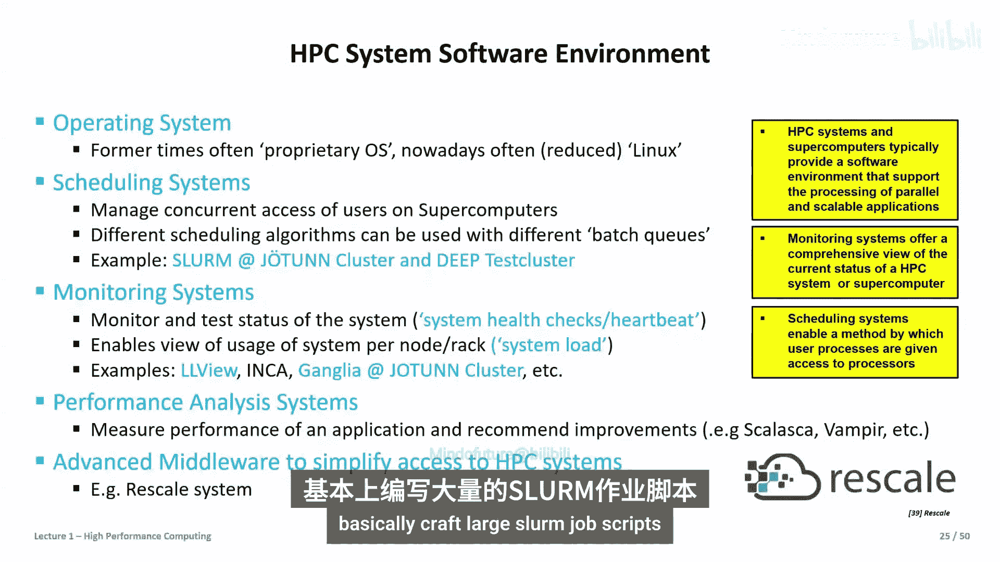

将众多不同的技术集成到一个大型机架中会带来许多挑战，不仅涉及系统负载，还包括系统健康状态。

以下是相关的系统软件：
*   **健康检查**：监控系统是否正常运行，例如CPU是否过热、存储连接是否正常。
*   **性能分析**：使用如Scalasca等工具分析并行程序的性能，识别瓶颈，帮助优化代码以获得最佳性能。这对于并行编程专家尤为重要。
*   **资源监控**：跨节点、跨用户监控内存使用情况等，其规模远大于个人电脑上的进程管理。

### 中间件与简化访问

直接通过SSH密钥和编写复杂的SLURM作业脚本来访问HPC系统对初学者是一大挑战。因此，出现了中间件来简化访问流程。

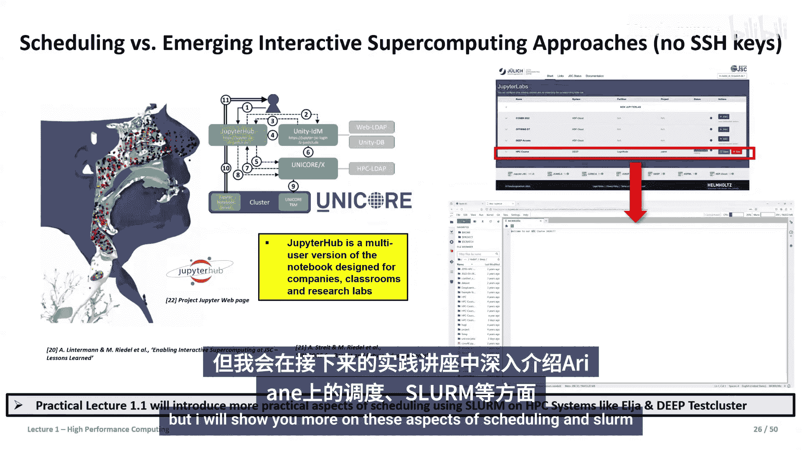

以下是中间件的作用：
*   **简化访问**：用户可以选择应用程序并直接运行，无需手动编写底层的作业脚本。例如Rescale或UNICORE系统。
*   **交互式计算**：像Jupyter Lab这样的工具，通过与UNICORE等中间件结合，允许用户通过用户名密码以交互方式访问HPC资源，直接在计算节点上启动Jupyter Notebook实例。这对于探索性工作、AI建模初期非常方便，尽管在扩展到成千上万个GPU时，可能仍需回归批处理作业方式。

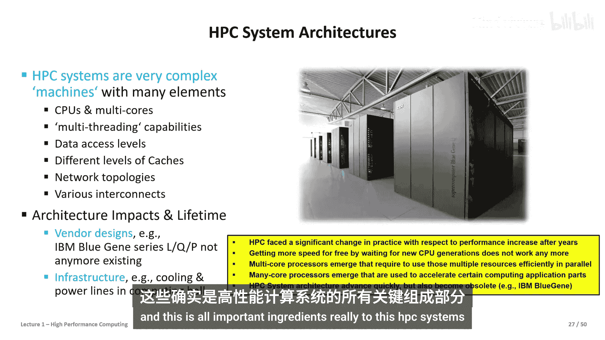

## HPC系统架构与术语

理解了系统软件后，我们来看看HPC硬件的物理组织。超级计算机是复杂的系统设计，需要专门的供电、冷却（气体或液体冷却）和洁净环境。

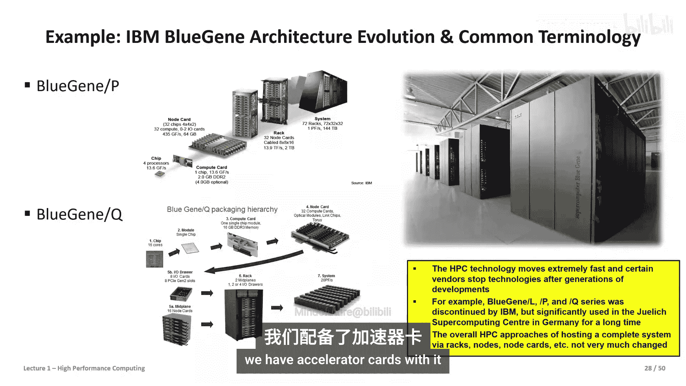

### 硬件层级

从微观到宏观，HPC系统遵循特定的硬件组织术语。

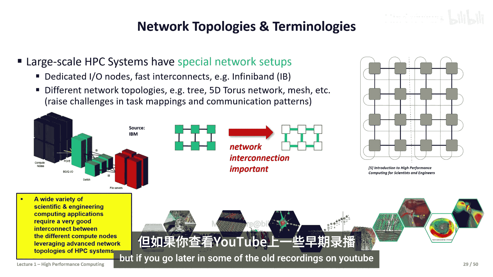

以下是常见的硬件术语：
*   **芯片**：包含多个处理核心（多核/众核）。
*   **计算卡**：多个芯片高度集成在一块卡上。
*   **节点卡**：多块计算卡进一步集成在一块节点卡上。这与笔记本电脑或台式机的组件密度有巨大差异。
*   **机架**：多个节点卡安装在一个机架中。我们通常看到的闪烁灯光的大型机柜就是机架。
*   **系统互连**：所有机架通过高速网络（拓扑结构）连接在一起，构成完整的超级计算机。

### 网络拓扑

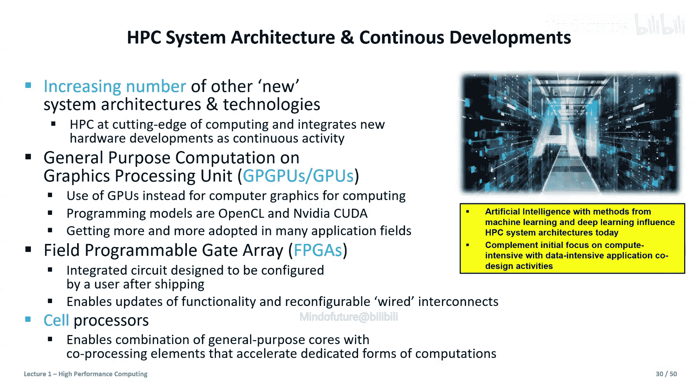

节点之间的连接方式对通信效率至关重要，尤其对于需要频繁交换数据的并行应用（如波传播模拟）。

以下是网络拓扑的关键点：
*   **互连模式**：例如三维环面网络或网格网络。
*   **通信影响**：网络结构决定了任务映射和通信性能，高效的拓扑能实现高性能的MPI通信。
*   **I/O考虑**：计算节点不仅相互连接，还连接到文件服务器。大型模拟应用（如地震、熔岩模拟）在运行中需要定期转储数据，因此I/O性能也是系统设计的关键，避免成为瓶颈。

## GPU加速计算与深度学习

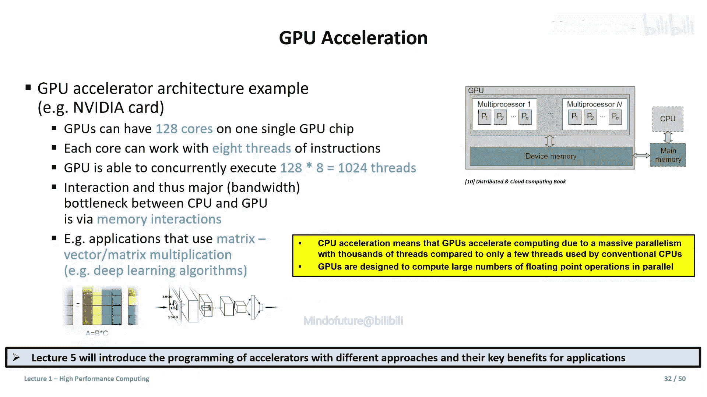

现在，我们转向近年来为HPC带来巨大动能的两个领域。首先是GPU加速的通用计算，它极大地推动了深度学习的发展。

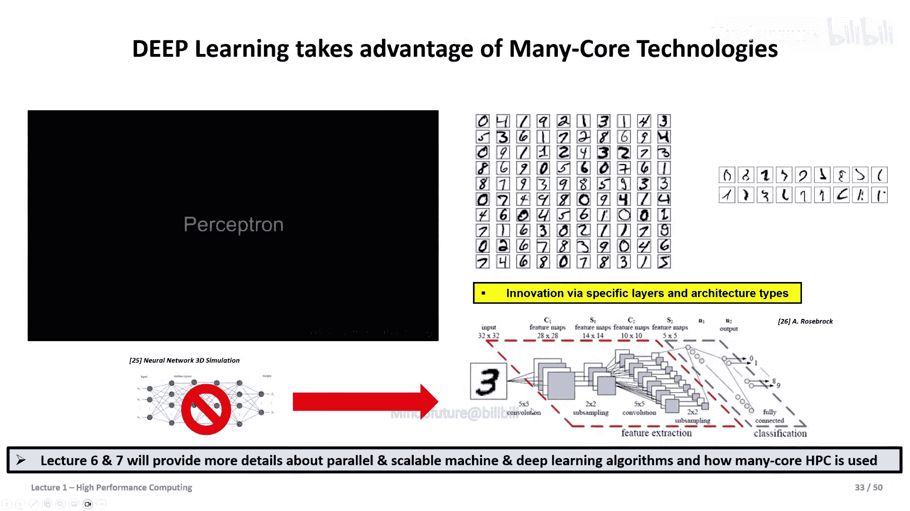

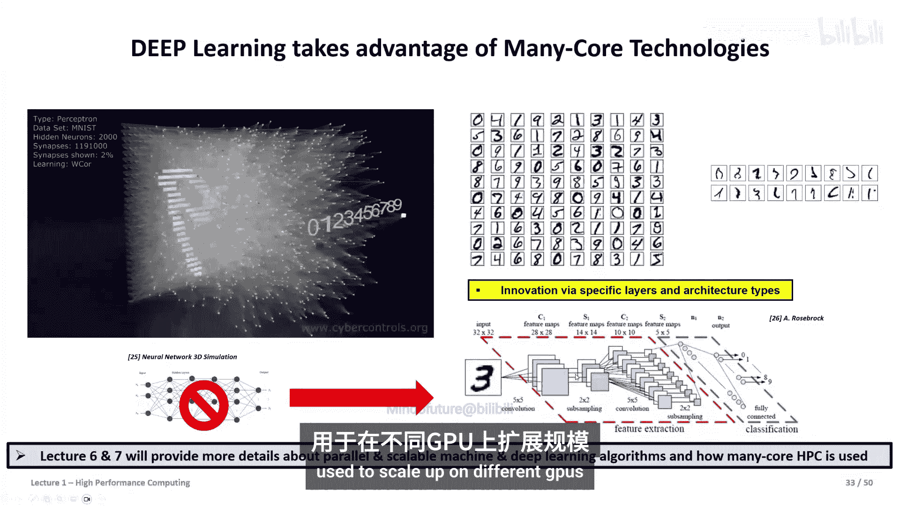

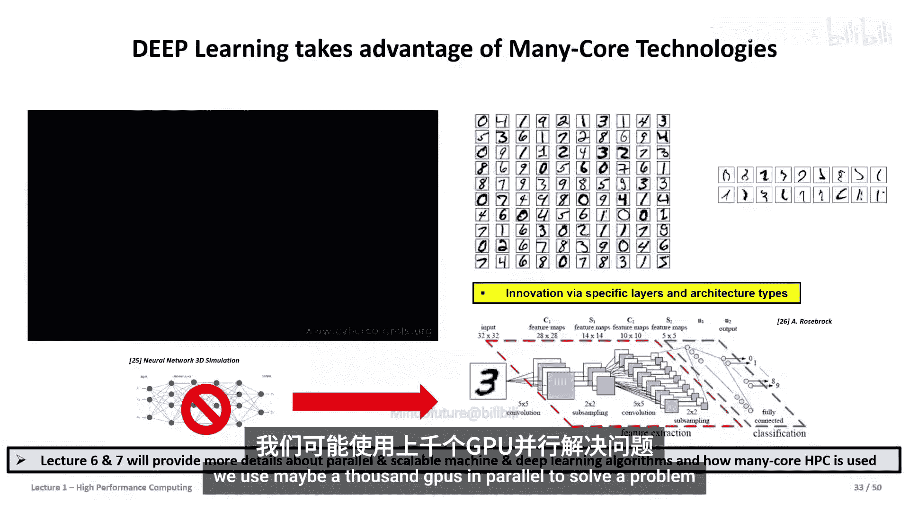

### GPU：从图形处理到通用计算

GPU最初为计算机图形和游戏设计，但现在被广泛用于通用目的计算（GPGPU，但通常简称为GPU）。

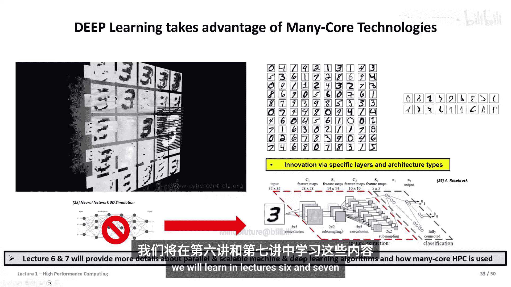

以下是GPU的核心特点：
*   **众核架构**：与追求高单线程性能的CPU不同，GPU集成了数百个性能适中的核心，通过高并行吞吐量来解决问题。
*   **能效与适用性**：GPU在能效和处理特定计算模式（如矩阵运算）方面具有优势。
*   **编程模型**：存在多种编程模型，如OpenCL、NVIDIA CUDA、AMD ROCm以及旨在统一标准的SYCL。我们将在专门的GPU讲座中深入探讨。
*   **主机-设备模式**：当前主流范式是，CPU（主机）负责准备数据并传输到GPU（设备）内存，然后由GPU执行计算。这种数据传输有时会成为瓶颈。

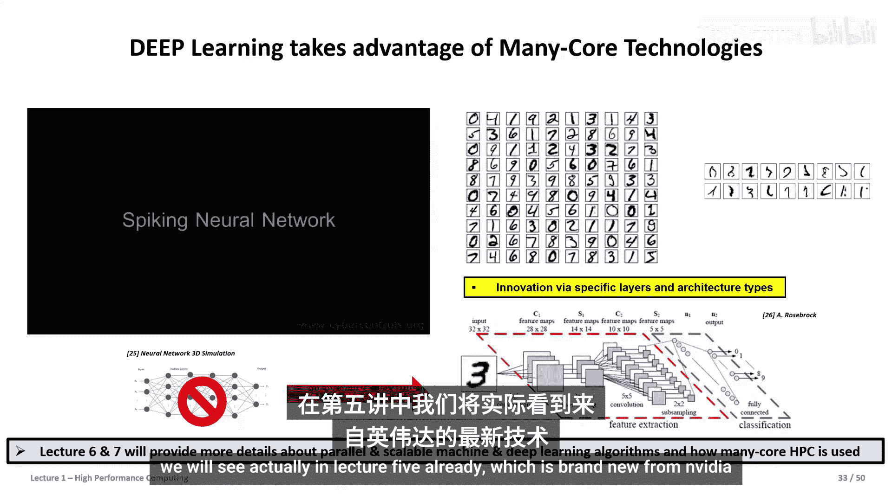

### GPU为何适合深度学习

深度学习，特别是其中的矩阵运算，与GPU的架构特性完美契合。

以下是GPU加速深度学习的原理：
*   **核心操作**：深度学习网络的前向传播和反向传播涉及大量的矩阵-矩阵乘法和矩阵-向量乘法。
*   **可并行性**：这些矩阵运算通常可以很好地被分解并行处理。例如，矩阵B乘以向量C得到向量A的计算，可以按颜色分区，各部分独立计算，最后合并结果。
*   **计算示例**：`A = B * C` （其中B是矩阵，C是向量，A是结果向量）。通过将B和C分块，可以在多个GPU核心上并行计算部分结果。

### 深度学习中的HPC需求

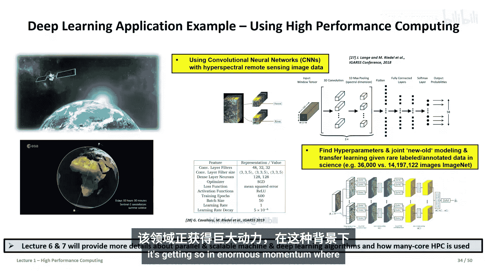

深度学习模型，尤其是像Transformer这样的大型语言模型，其成功很大程度上得益于HPC提供的强大计算能力。

以下是HPC对于深度学习的关键作用：
*   **训练成本高昂**：训练大型网络需要巨大的计算量。例如，卫星图像分析或ImageNet等基准测试，涉及数千万张图片，其数据量和计算需求远超个人电脑的处理能力。
*   **超参数优化**：深度学习模型有许多需要手动设置的超参数（如学习率、批大小、优化器类型、网络层数等）。找到最佳超参数组合需要多次训练尝试，这本身就是一个计算密集型任务。
*   **HPC的双重收益**：使用HPC不仅能够**显著缩短单次模型的训练时间**（通过并行化），还能通过**并行探索大量超参数配置**，从而找到更优模型，**提高最终预测的准确性**。超参数优化本身已成为一个重要的HPC应用领域。

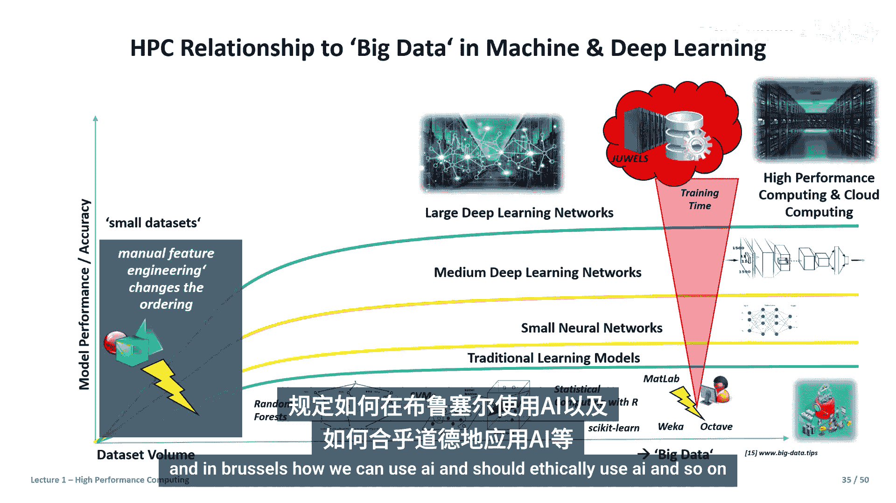

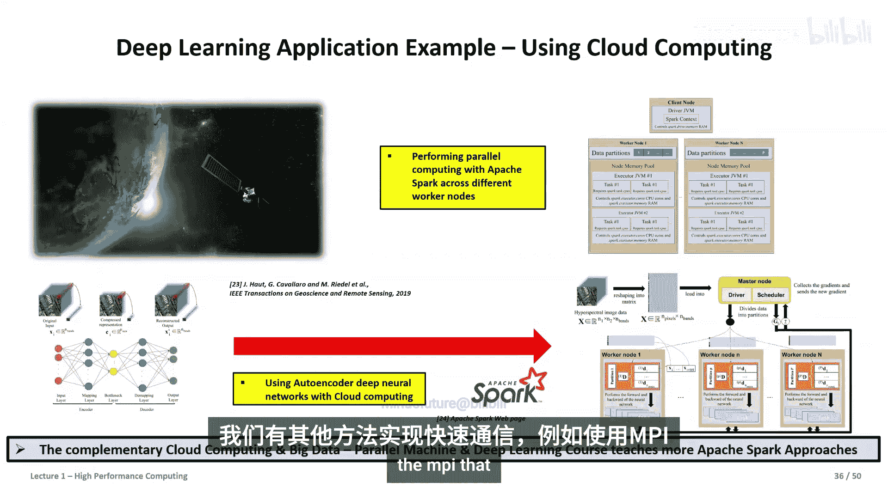

## HPC与大数据的挑战

最后，我们简要探讨HPC与大数据的关系。大规模模拟科学（如高精度地震模拟）会产生PB级甚至EB级的数据输出。

以下是HPC面临的数据挑战：
*   **存储层级差距**：计算核心的缓存和内存速度很快，但容量有限且昂贵。用于海量数据存储的磁带归档库容量大但速度极慢。磁盘处于中间位置，但仍难以匹配现代GPU的计算吞吐量对数据供给的需求。
*   **“内存墙”/“DRAM Gap”**：内存容量和速度的增长跟不上计算能力（尤其是GPU）的增长速度，导致数据供给成为瓶颈。
*   **应用协同设计**：这一挑战推动了“应用协同设计”的HPC架构发展，例如模块化超级计算机，以及像NVIDIA Grace Hopper这样的新型芯片，它集成了高速的HBM内存，旨在更好地为GPU喂数据。然而，满足多用户、多应用的海量数据需求仍是持续的研究课题。

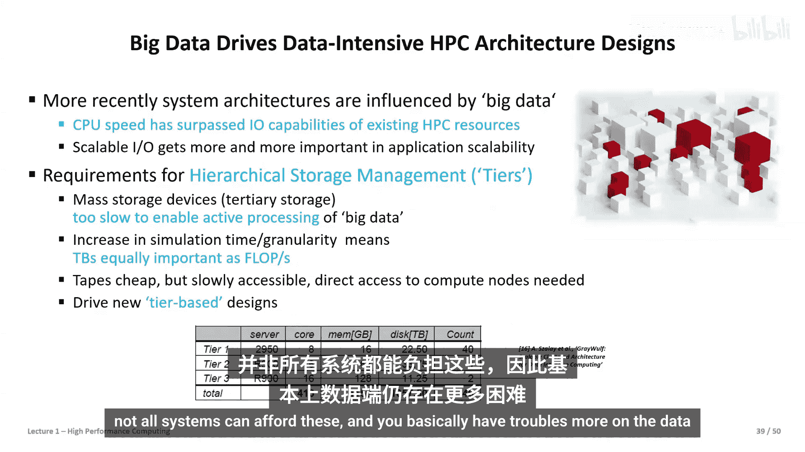

## 总结与展望

本节课中我们一起学习了高性能计算生态系统的关键软件技术（调度、监控、中间件），了解了超级计算机的硬件组织术语（芯片、节点、机架、网络拓扑），并深入探讨了当前HPC发展的两大引擎：GPU加速计算及其在驱动人工智能/深度学习革命中的核心作用。我们还指出了HPC在处理大规模模拟数据时面临的I/O和存储层级挑战。

HPC是一个悠久的领域，并持续演进。展望未来，量子计算等新兴技术可能成为新的加速器。欧洲的EuroHPC联合事业等倡议正在推动下一代百亿亿次（Exascale）及更高级别的超级计算发展。作为学生和未来的从业者，理解这些基础概念和趋势，将有助于你在这个充满活力且至关重要的领域中探索和贡献。

下次实践课，我们将具体学习如何使用SLURM调度系统。

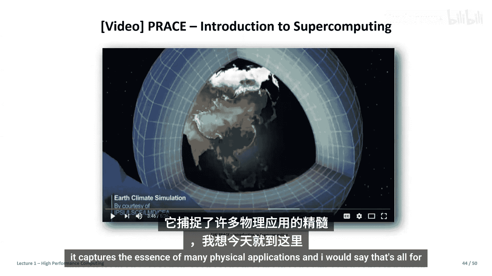

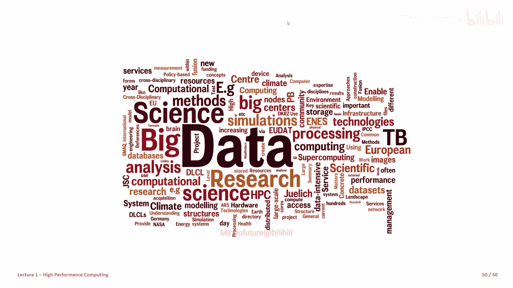

