# 027：高性能计算导论

在本节课中，我们将要学习高性能计算的基本概念。我们将从回顾上一讲的关键内容开始，然后深入探讨高性能计算的定义、核心架构、并行编程模型以及相关的生态系统。课程旨在为初学者提供一个全面而清晰的概览。

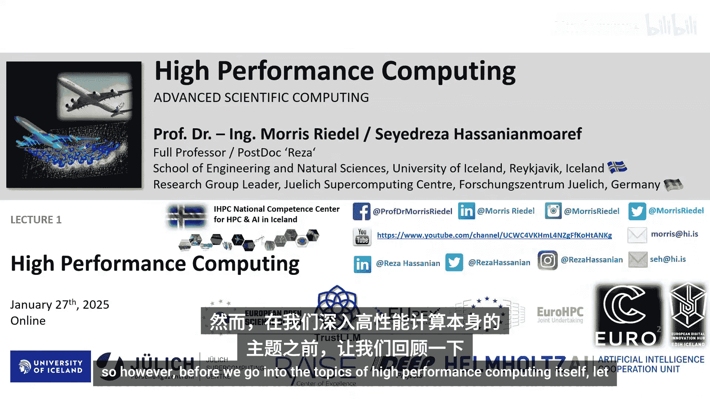

## 回顾：远程访问与Unix基础

上一节我们介绍了课程的基本信息，本节中我们来看看如何为实际操作做好准备。要使用高性能计算系统，首先需要掌握远程访问和基本的Unix操作技能。

以下是远程访问HPC系统的核心步骤：

1.  **生成SSH密钥对**：在本地计算机上生成一个私钥-公钥对。私钥必须始终安全地保存在你的本地主机上，切勿分享。公钥则可以安全地提供给HPC系统的管理员。
2.  **配置远程系统**：管理员会将你的公钥与你在HPC系统上的用户名关联。这样，系统就允许持有对应私钥的用户进行访问。
3.  **建立连接**：使用SSH客户端（如MobaXterm、macOS/Linux终端）并指定主机名、用户名和你的私钥文件，即可连接到远程HPC系统。

成功登录后，你将面对一个Unix/Linux操作系统环境。需要掌握一些基本命令，例如使用 `hostname` 来确认你连接到了正确的远程系统。

此外，HPC系统通常使用**模块系统**来管理预安装的软件。你可以使用 `module avail` 查看可用软件，使用 `module load [软件名]` 来加载特定环境，例如Python或深度学习框架。

掌握SSH和基础Unix技能是使用全球范围内许多HPC系统（包括冰岛的EHPC、欧洲的EuroHPC联合项目系统）的通用钥匙。

## 高性能计算基础

理解了如何访问系统后，我们现在正式进入高性能计算的世界。高性能计算并不仅仅是关于强大的硬件，它是一个涵盖理论、多样化架构、复杂软件栈和实际应用的广阔领域。

### 什么是高性能计算？ 🚀

高性能计算通常与超级计算紧密相关。它代表着计算领域的“一级方程式”，总是采用最前沿的处理器（如最新的NVIDIA GPU）来构建世界上最强大的系统。这些系统通过**高性能网络互连**将成千上万个计算节点连接起来，以支持密集的进程间通信。

一个常见的误解是HPC只关乎硬件。实际上，它包含多个层面：

*   **理论与模型**：涉及加速比定律、并行计算理论等。
*   **硬件架构**：包括多核/众核处理器、高速网络、存储系统等，并且架构可以非常多样化。
*   **软件生态**：包含操作系统、调度器、监控工具、数值库、科学可视化工具以及领域专用的应用程序。
*   **实际访问**：通过项目申请等方式，研究人员和学生可以获取这些强大系统的计算资源。

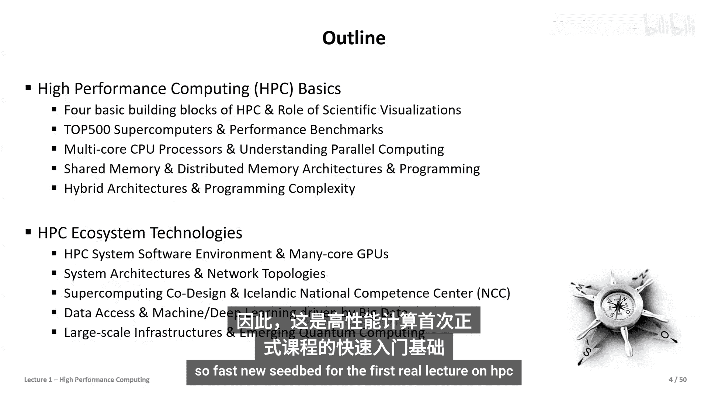

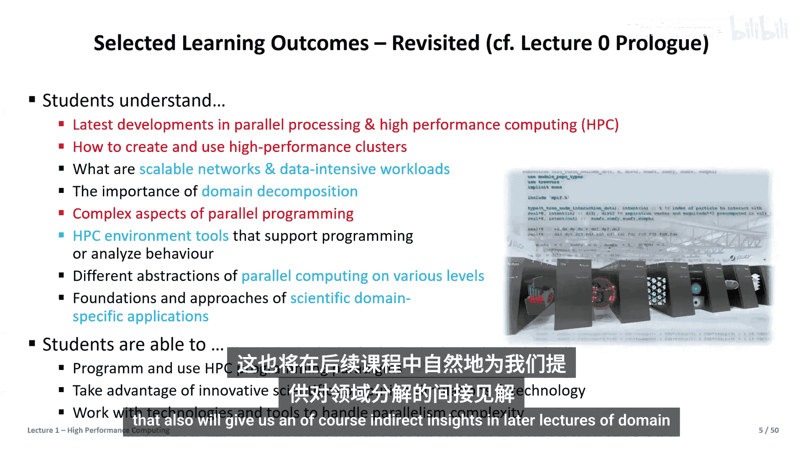

### 并行处理与科学可视化 🎨

高性能计算的核心目标是**并行处理**：将一个大问题分解，同时在多个处理器（进程）上协作解决，以获得最佳性能。

许多科学和工程问题，如计算流体动力学模拟飞机湍流、气候建模或分子动力学模拟，计算量极其庞大。并行计算使得这些模拟成为可能。

然而，模拟产生的数据往往非常复杂和抽象。这时，**科学可视化**就变得至关重要。它能够将庞大的数值数据转化为直观的图像、动画或交互式图形，帮助研究人员理解和发现隐藏在数据中的规律。正所谓“一图胜千言”。

### 性能衡量：TOP500榜单 📊

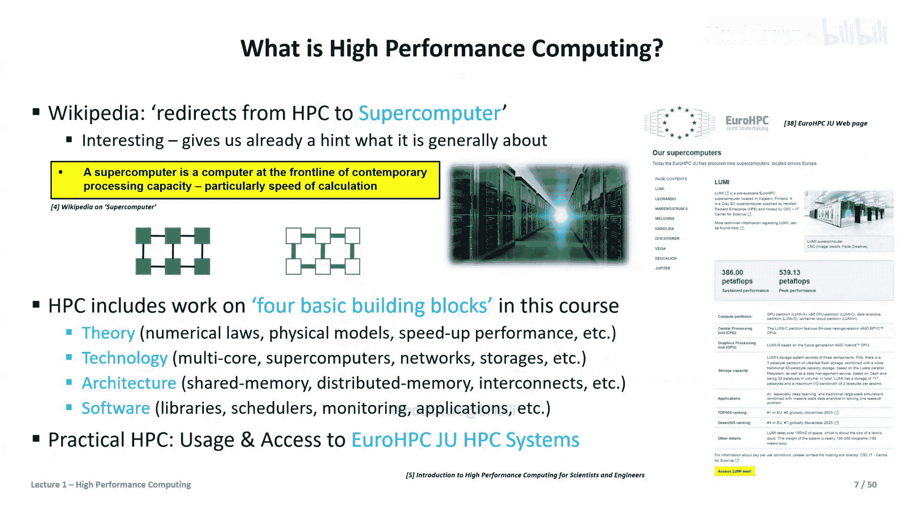

全球超级计算机的性能通常通过 **TOP500** 榜单来排名。该榜单每半年更新一次，使用LINPACK基准测试程序来评估系统的浮点计算能力。

观察TOP500榜单可以了解行业趋势，例如不同厂商的市场份额、主流处理器技术（如NVIDIA GPU各代产品的普及情况）等。但需要注意的是，LINPACK测试主要针对密集线性代数运算，并不能完全代表所有实际应用的性能。因此，像HPCG这样的更贴近实际应用的基准测试也变得越来越重要。

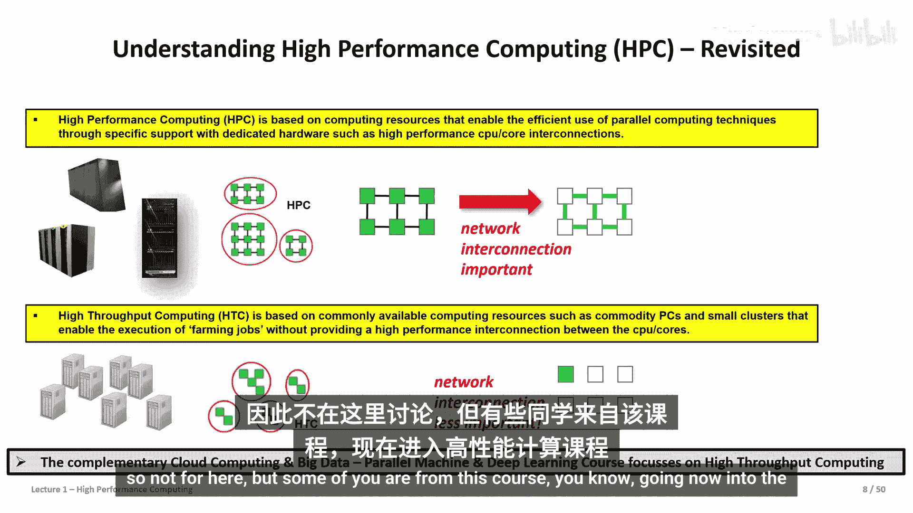

### 核心硬件：多核处理器

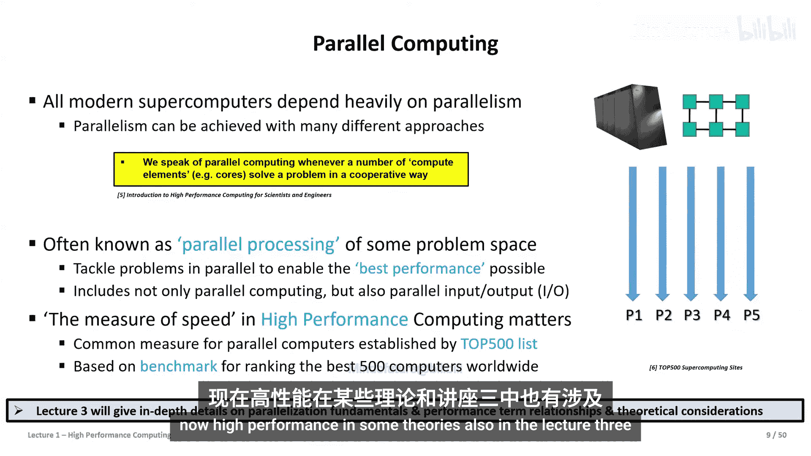

现代计算的基础是**多核处理器**。单个CPU芯片内集成了多个处理核心，每个核心都能独立执行线程。这些核心通常具有较高的单线程性能（高主频），并共享多级缓存，以加速对内存的访问。

多核CPU仍然是许多应用的主力。然而，由于物理限制（功耗和散热），单纯提升单个核心的频率已遇到瓶颈，这推动了**众核处理器**（如GPU）的发展，我们将在课程第二部分详细讨论。

## 主流架构与编程模型

了解了基本组件后，我们来看看如何将它们组织成完整的系统。当前主要有两种基础架构，而实际系统往往是两者的混合体。

### 共享内存架构

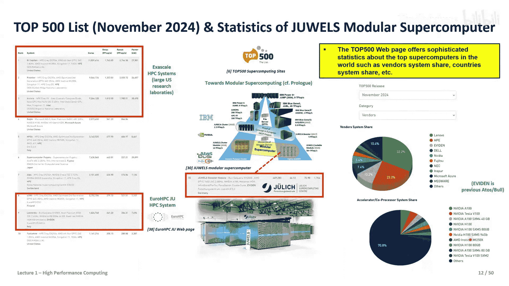

在共享内存系统中，多个处理器核心通过总线或交叉开关连接到一个统一的全局内存池。所有核心都能直接访问这片共享内存。

*   **编程模型**：主要使用 **OpenMP** 标准。它是一种基于编译器指令的模型，通过在代码中标记并行区域（如循环）来创建多个轻量级线程。
*   **通信方式**：线程间通过读写共享内存中的变量进行通信，无需显式发送消息。
*   **优点**：编程相对简单直观。
*   **挑战**：需要处理同步问题（如竞态条件），且可扩展性受限于单一内存控制器的带宽和延迟。常见的两种模型是：
    *   **UMA**：统一内存访问，所有处理器访问任何内存地址的时间相同。
    *   **NUMA**：非统一内存访问，处理器访问本地内存更快，访问其他处理器的内存较慢，但通过缓存一致性协议对程序员屏蔽了这种差异。

### 分布式内存架构

在分布式内存系统中，每个计算节点都有自己的处理器和本地内存。一个节点内的内存不能被其他节点直接访问。

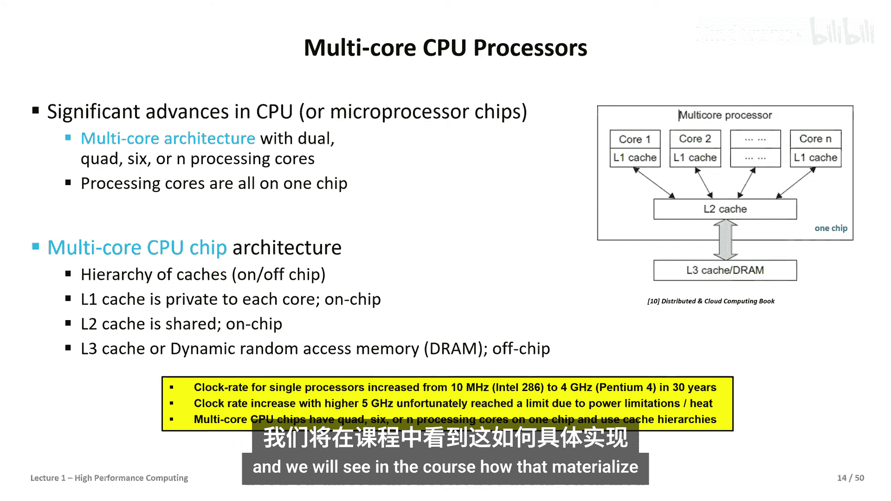

*   **编程模型**：主要使用 **MPI** 标准。它是一个消息传递接口库，程序运行时会启动多个独立的进程。
*   **通信方式**：进程之间必须通过**网络互连**显式地发送和接收消息来交换数据。
*   **优点**：具有极强的可扩展性，可以通过增加节点来构建包含成千上万个处理器的超大规模系统。
*   **挑战**：编程更复杂，需要开发者显式地管理数据分布和通信。

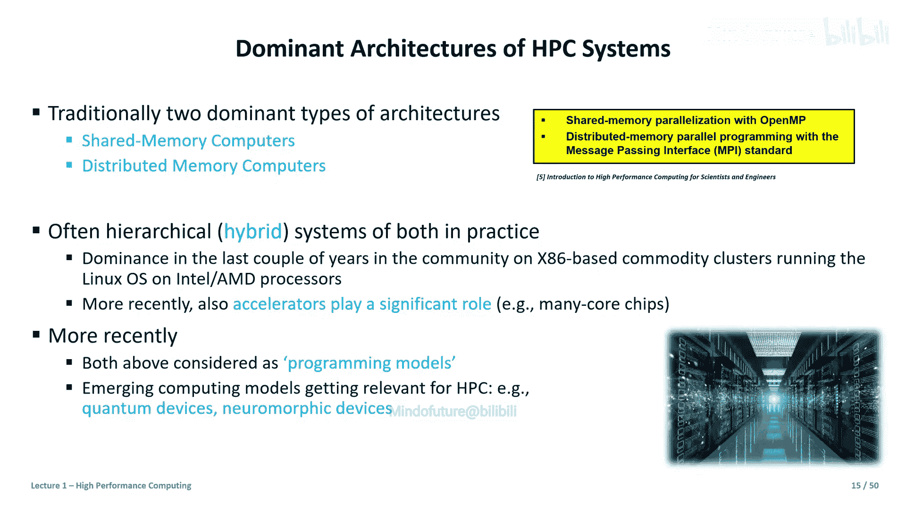

### 混合架构与未来挑战

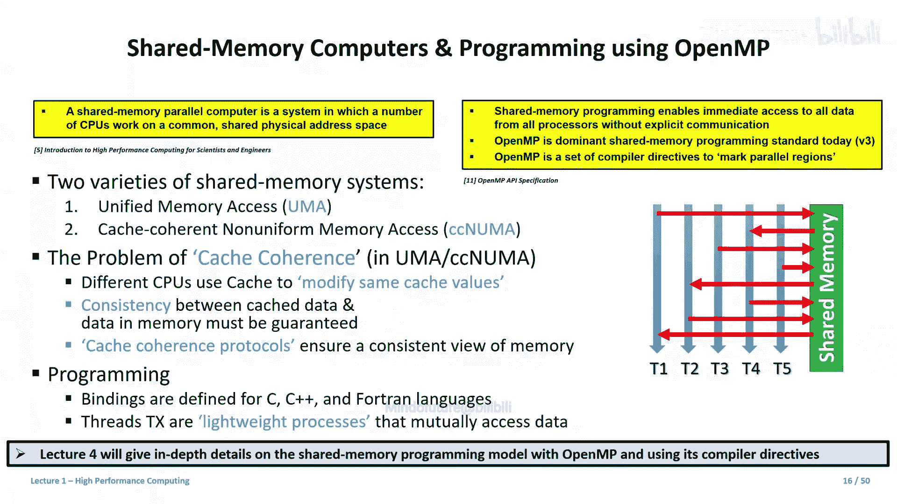

现代超级计算机通常是**混合架构**。在一个计算节点内部，多个CPU核心构成一个共享内存系统，可以使用OpenMP进行并行化。而跨节点之间，则构成一个分布式内存系统，必须使用MPI进行通信。

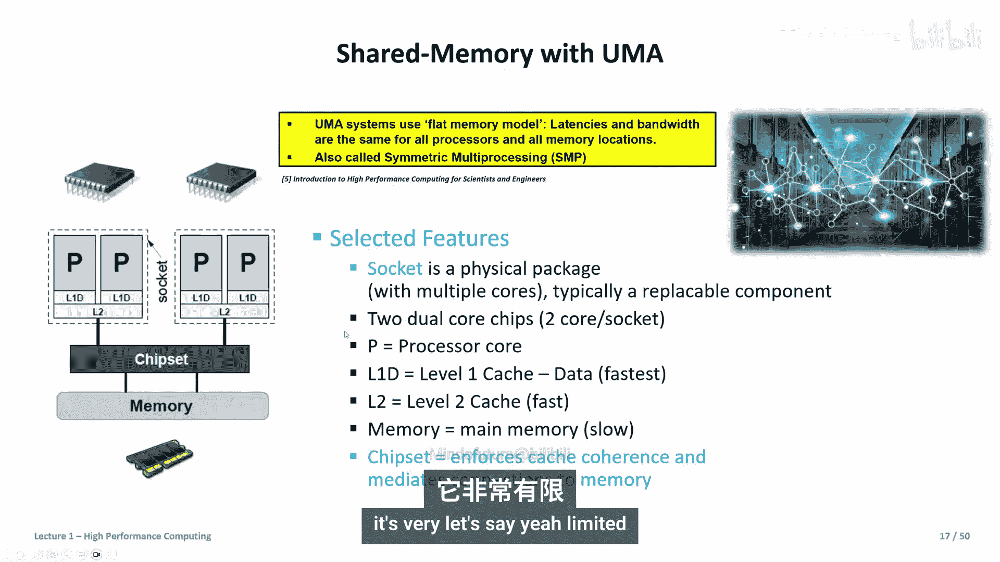

此外，节点上还可能挂载**加速器**（如GPU）。这就形成了“三明治”式的复杂编程模型：MPI用于节点间通信，OpenMP用于节点内CPU并行，CUDA或OpenACC等用于GPU加速。

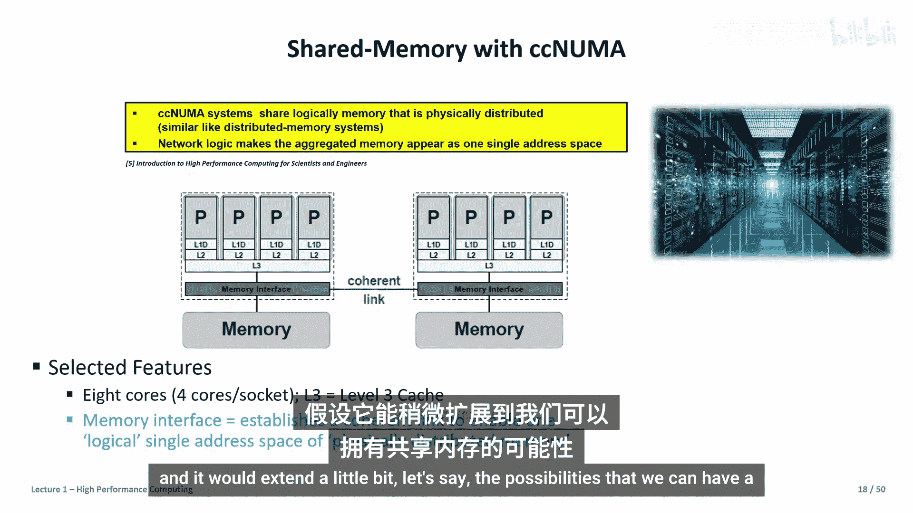

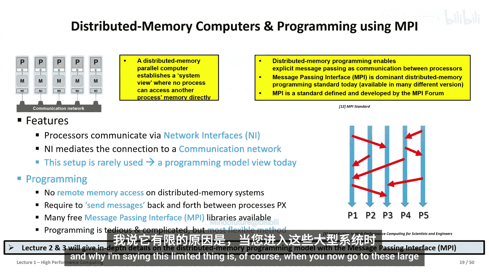

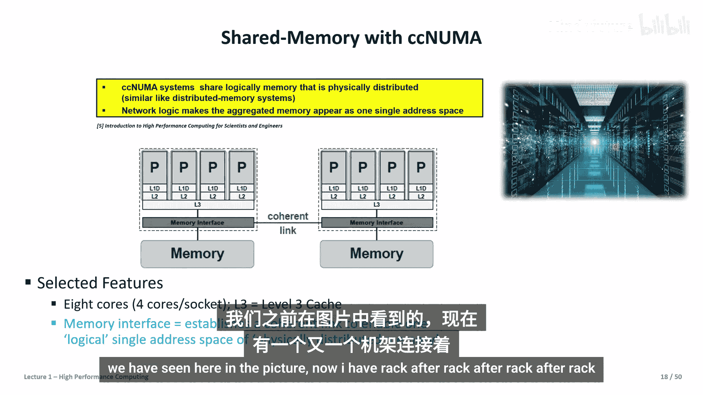

这种混合模式带来了巨大的编程复杂性，但也是充分利用现代超算强大算力的必然途径。在后续课程中，我们将深入学习MPI和OpenMP。

## 总结

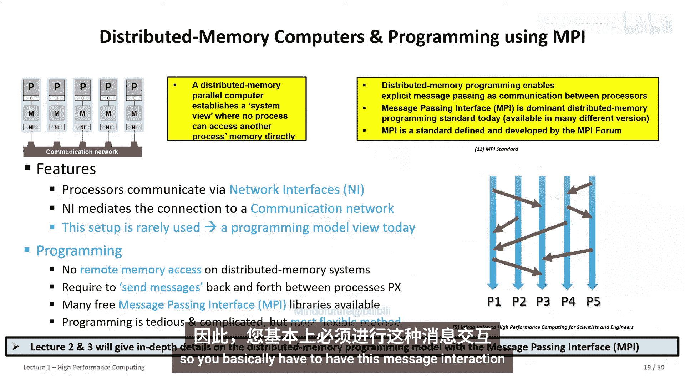

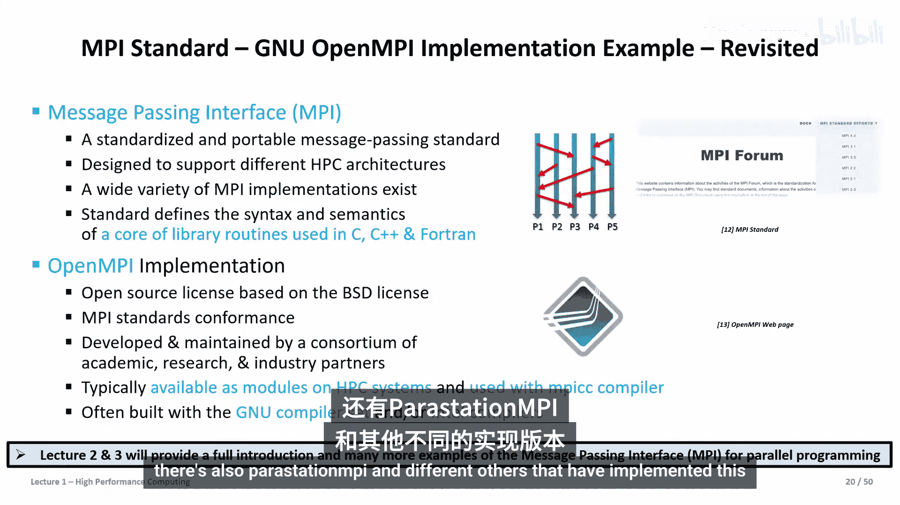

本节课中我们一起学习了高性能计算的入门知识。我们首先回顾了通过SSH密钥对安全访问远程HPC系统以及必要的Unix基础。然后，我们探讨了HPC的广泛内涵，它远不止是硬件，更包含理论、软件和应用生态。

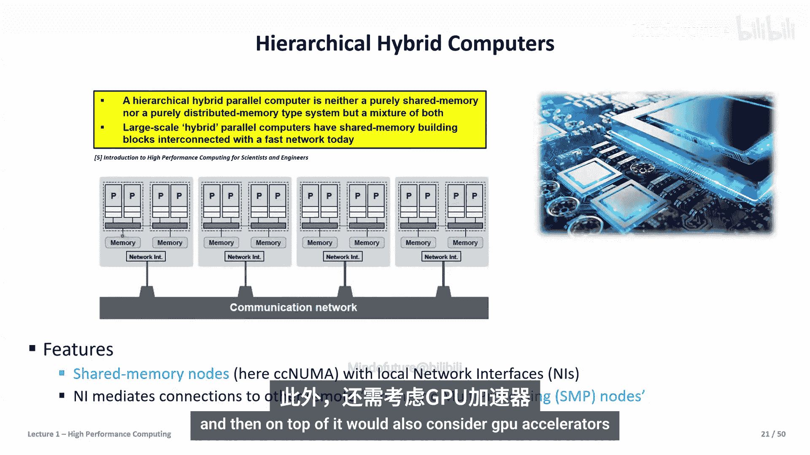

我们了解了并行处理是HPC的核心，科学可视化是理解复杂模拟结果的关键工具，而TOP500榜单则是衡量全球超算性能的标尺。接着，我们剖析了共享内存与分布式内存这两种基础架构及其对应的编程模型（OpenMP和MPI），并指出现代系统实为两者结合的混合架构，且正融入GPU等加速器技术。

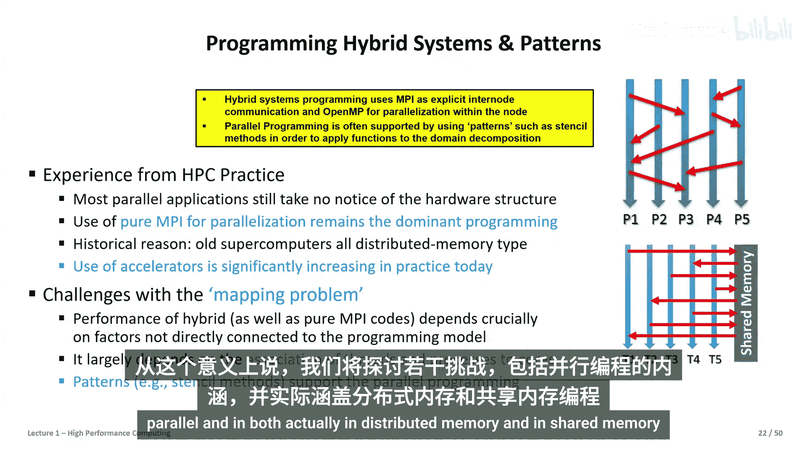

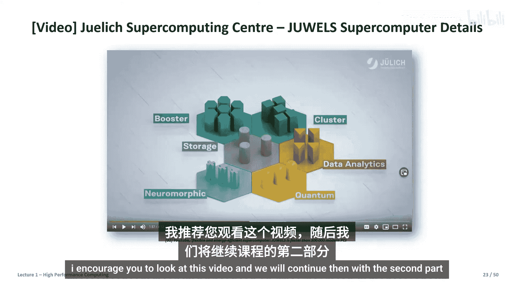

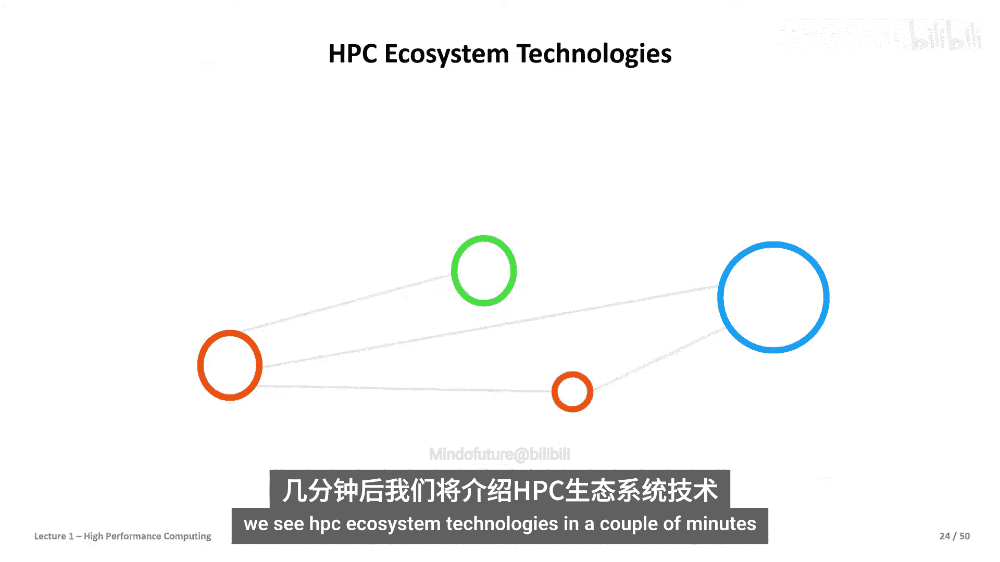

掌握这些基础知识，为你后续深入学习并行编程、特定应用领域以及利用EuroHPC等大型计算资源奠定了坚实的基础。