# 029：实践讲座 0.1 - SSH 与 UNIX 简短介绍（第一部分）🚀

在本节课中，我们将学习如何通过 SSH 协议连接到远程高性能计算系统，并初步了解 UNIX 环境。这是支持后续课程作业的实践性讲座。

## 课程回顾与背景

上一节我们介绍了高性能计算课程的整体框架，探讨了其不断演进的技术背景及其在科学与工程应用中的重要性。本节中，我们来看看支持这些应用的基础访问工具。

高性能计算涉及大规模并行计算，例如模拟汽车碰撞、计算流体动力学或地下水建模。这些任务需要远超个人笔记本电脑能力的计算资源，即由众多 CPU 和 GPU 并行工作的高性能计算机。

课程将涵盖两种主要的并行计算范式：用于跨节点通信的**消息传递接口**和用于节点内共享内存的**OpenMP**。此外，我们还将学习分布式深度学习、计算流体动力学以及利用 GPU 等加速器。访问这些超级计算机通常需要通过 **SSH 协议**，并在 **UNIX** 环境下操作，这正是本次实践讲座的重点。

## 连接高性能计算系统

要使用高性能计算集群，首先需要安全地远程访问它们。这不仅仅是硬件连接，还涉及一系列 HPC 环境工具，例如作业调度和本次将重点介绍的 **SSH 访问** 与 **模块环境**。SSH 是一种几乎被全球所有 HPC 系统采用的安全访问协议。

我们将以两个系统为例进行演示：
1.  **DEEP 系统**：位于德国于利希超算中心，是一个采用模块化超算架构的研究原型系统。
2.  **Elli 系统**：位于冰岛，是冰岛国家研究基础设施的一部分。

以下是访问 HPC 系统所需的关键信息：
*   **主机名**：系统的网络地址（如 `deep` 或 `elli`）。
*   **用户名**：由系统管理员分配的唯一账户标识。
*   **SSH 密钥对**：用于身份验证的一对加密密钥。

## 理解 SSH 与密钥对 🔑

SSH 使用非对称加密技术进行安全连接。其核心是**公钥-私钥对**。

*   **私钥**：必须严格保密，存储在你的个人电脑上。它用于解密由对应公钥加密的信息。
*   **公钥**：可以公开分享，需要上传到目标 HPC 系统。

连接过程如下：
1.  你在本地生成一对密钥。
2.  将**公钥**上传到 HPC 系统。
3.  当你通过 SSH 客户端连接时，客户端会向服务器出示你的**私钥**。
4.  服务器用存储的**公钥**验证私钥的有效性。匹配成功，则授予访问权限。

**公式表示认证过程：**
`服务器验证(客户端私钥签名) == 使用存储的公钥进行验证`

为了使用私钥，你通常需要用一个密码来解锁本地的密钥存储。在建立连接时，SSH 客户端会使用你指定的私钥文件。

## 实践演示：连接到 DEEP 系统

现在，我们来看一个具体的连接示例。我们将使用 MobaXterm 作为 SSH 客户端连接到德国的 DEEP 系统。

**连接命令的基本格式如下：**
```bash
ssh -i /path/to/your/private_key username@hostname
```

在图形化客户端中，你需要填写：
*   **远程主机**：`deep`
*   **用户名**：你的专属用户名
*   **私钥文件**：选择你本地存储的私钥文件路径

首次连接时，系统会提示你输入密码来解锁私钥。成功登录后，你会看到系统的欢迎屏幕，其中包含重要通知、维护信息和基本使用指南。

你可以使用一些简单的命令来确认自己已进入远程系统：
*   `hostname`：显示当前主机名。
*   `ls -la`：列出当前目录下的文件和目录。
*   `exit`：退出当前 SSH 会话。

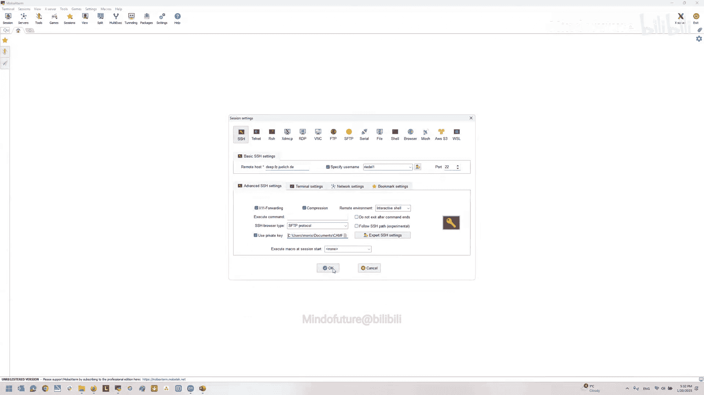

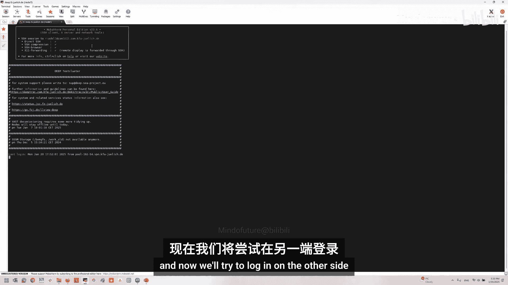

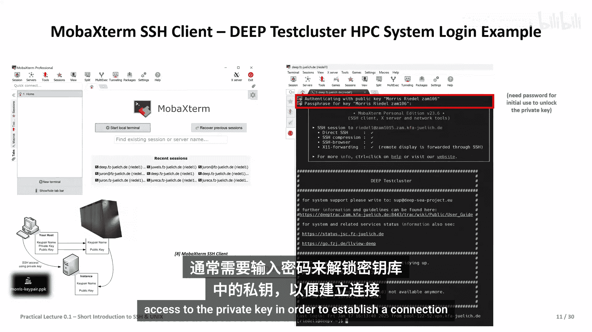

## 实践演示：连接到 Elli 系统

连接不同系统的原理完全相同，只是参数发生了变化。现在，我们退出 DEEP 系统，连接到冰岛的 Elli 系统。

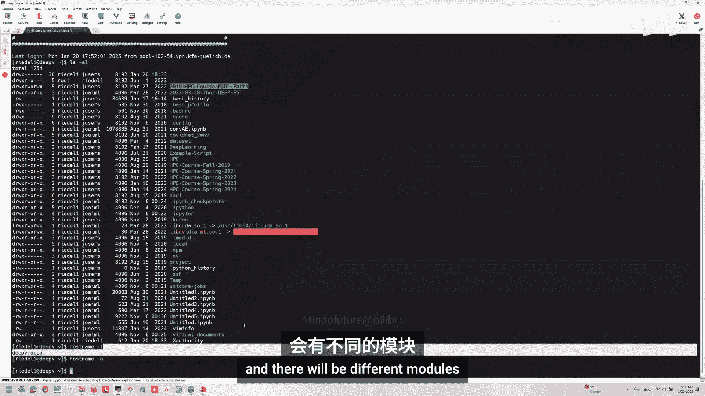

所需的变化信息是：
*   **远程主机**：`elli`
*   **用户名**：在 Elli 系统上分配的用户名

**关键点在于**：即使你使用同一对 SSH 密钥，只要将公钥上传到了不同的 HPC 系统，你就可以通过更改**主机名**和**用户名**来访问它们。私钥始终保留在你的本地机器上。

在 MobaXterm 中新建一个会话，填入 Elli 系统的主机名和用户名，并选择相同的私钥文件进行连接。成功登录后，同样可以使用 `hostname` 等命令确认环境。

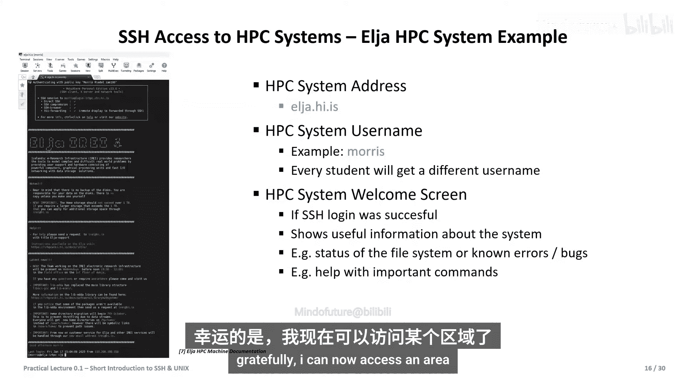

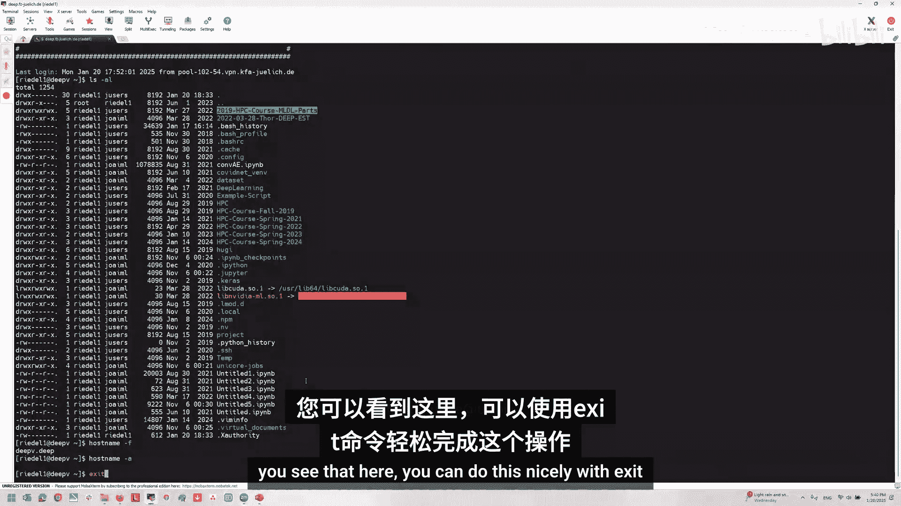

## 欧洲高性能计算生态系统

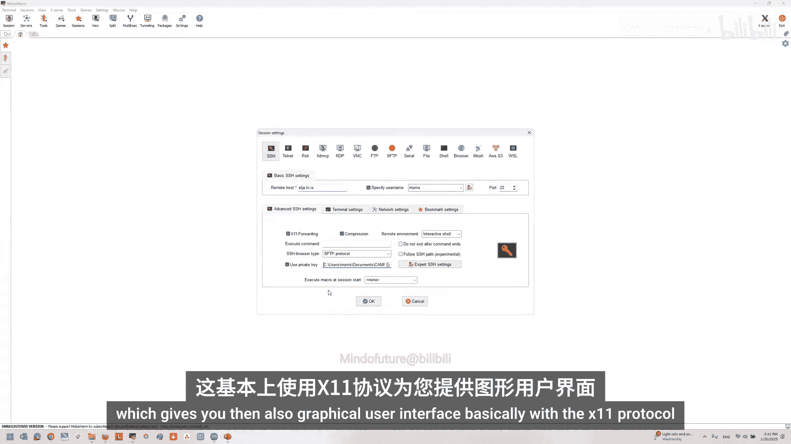

通过 SSH 可以访问的不仅是课程中使用的系统。例如，欧洲高性能计算联合事业支持多个大型超级计算机，如芬兰的 LUMI、意大利的 Leonardo 和西班牙的 MareNostrum 5。这些系统通常需要通过项目评审来获得计算资源配额。即将上线的 Jupiter 系统将是欧洲首台百亿亿次级超算，同样采用模块化架构，这标志着相关研究项目（如 DEEP 项目系列）的目标正在成为现实。

## 本节总结

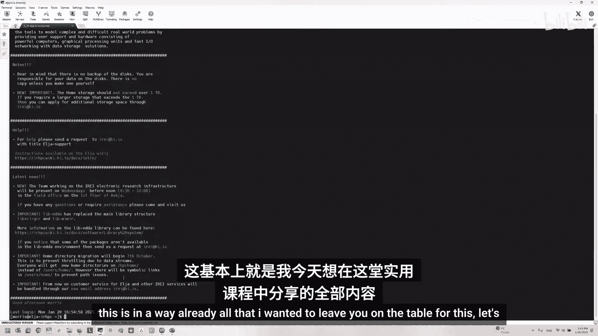

本节课中，我们一起学习了高性能计算系统访问的基础。
1.  我们回顾了 HPC 的应用背景，理解了远程访问的必要性。
2.  我们掌握了 **SSH 协议** 的基本概念，特别是**公钥-私钥对**的工作原理。
3.  我们通过实际操作，演示了如何使用 SSH 客户端连接到位于德国和冰岛的两个不同的 HPC 系统。
4.  我们了解到，改变**主机名**和**用户名**即可用同一密钥访问不同系统，而私钥必须妥善保管在本地。

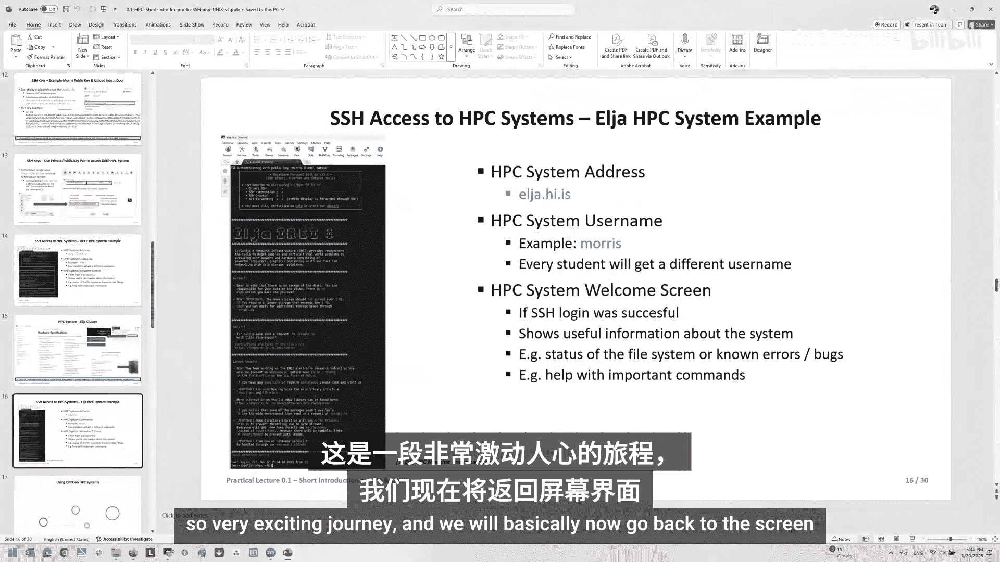

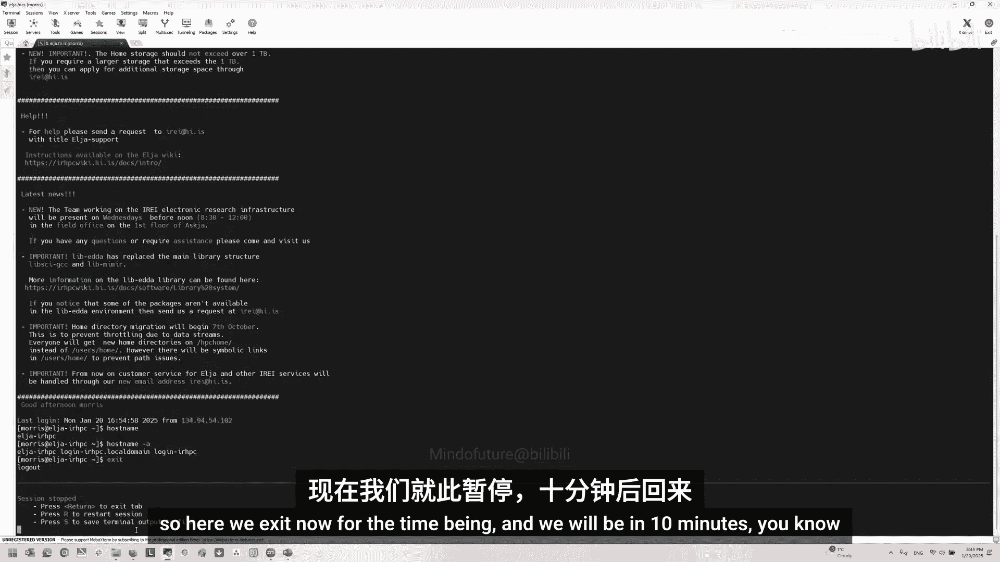

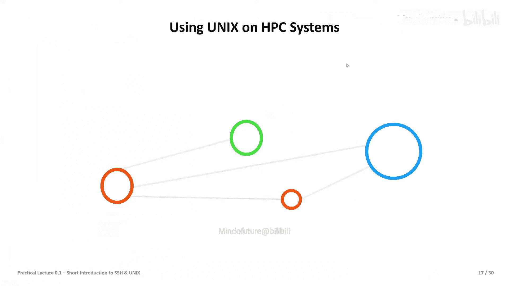

这为你后续的课程作业打下了基础。在接下来的部分，我们将在成功连接的 UNIX 环境中，学习一些基本的命令和操作。