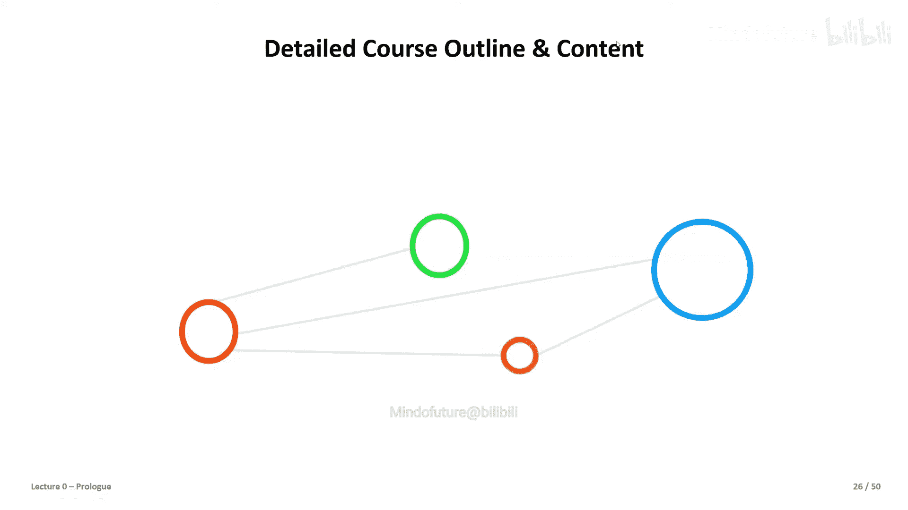

# 031：课程序言（第一部分）

在本节课中，我们将一起了解高性能计算（HPC）课程的整体概览、动机、内容结构以及它与现代计算科学和人工智能的紧密联系。

## 课程概述与结构

欢迎来到高性能计算课程。我是Morris，将与我的同事Raza一同讲授这门课程。

今天，我们进行的是第0讲，即课程的序言。这是一个温和的开端，旨在解释课程中出现的诸多元素，例如幻灯片上的各种标识，并介绍课程内容，解答你可能存在的疑问。

在序言之后，课程将正式开始。首先，我们会深入介绍高性能计算，提供比今天更详细的导论。紧接着，我们会进入实践环节。课程设计将实践主题前置，以便与你的作业相结合。绿色的主题通常与你的作业直接相关。

我们将学习使用MPI和OpenMP进行并行编程，并因此需要了解并行化基础，这构成了你的第一项作业。根据过去十年的教学经验与学生反馈，我们没有像往常那样先讲授并行化基础等概念性主题，而是选择从一些实践主题入手，让你尽早开始动手。课程中还会穿插一些实践讲座，由Raza或我进行演示，这些内容也与你的作业直接相关。

## 从并行编程到加速计算

在理清并行化的基本概念，并理解如何在HPC机器上进行并行编程后，我们将深入探讨过去五到十年间日益重要的领域：加速器和图形处理单元（GPU）。我相信你们中的许多人都已经听说过GPU。

接下来，我们将直接进入课程的另一个实践环节：理解深度学习，特别是分布式深度学习。鉴于深度学习目前在HPC领域获得的巨大发展势头，以及许多应用离不开HPC资源，我们今年特别引入了这个新主题。这是一个非常有趣且实用的方向。

## 计算流体力学与人工智能的融合

今年，我们还将计算流体力学（CFD）作为一个重点引入，这得益于另一位讲师Raza的专长。他将在后续课程中带领大家深入这个领域。CFD涉及理解流体流动等物理现象，我们将学习为何并行计算对此至关重要，以及如何使用OpenFOAM等软件。例如，我们可以用它来模拟冰岛的雪崩。鉴于OpenFOAM的发展势头，我们将其纳入了课程。

同时，结合当前HPC领域的发展趋势，我们也将探讨CFD与人工智能的融合，即物理信息深度学习或基于物理定律约束的深度学习。这是一个有趣的新领域，我们将学习深度序列模型（处理时间序列数据）及其在CFD应用中的体现。为了更好理解CFD，我们还需要学习一些基础概念，如纳维-斯托克斯方程等。

## 前沿模型与优化技术

近期，深度学习中的Transformer模型也获得了巨大发展势头。我们在此领域进行了大量研究，因此课程中也会包含相关的实践内容。

我们还集成了超参数优化和自动机器学习（AutoML）作为新主题。这意味着HPC的优势不仅在于加速深度学习模型的训练，还在于优化模型本身。选择合适的超参数通常对模型的准确率有巨大影响，我们将在相关讲座中学习这一点。

最后，绿色能源是当前讨论超大规模HPC应用时越来越受关注的话题，因此在这样的课程中也值得考虑。

## 课程收尾与职业关联

课程的尾声部分将较为正式地总结，同时也会非正式地探讨职业描述，解答你的问题，将课程内容与未来的工作机会联系起来。今天讲座的第二部分将更详细地介绍所有这些不同的课程内容，帮助你更好地理解。

## 高性能计算的动机与领域

现在，让我们从课程动机出发，回顾一下高性能计算本身。当然，第一讲会全面介绍它，但你们中的许多人可能已经知道，它关乎那些有趣的、装满计算资源的庞大系统。这是一个不断变化的广阔领域，如今你甚至可以攻读HPC方向的硕士学位。

这门课程所能教授的，只是HPC技术和概念的基础与概览。这主要体现在两个层面：一是物理视角，例如CFD可用于模拟汽车碰撞或管道中的烟雾传播，这些通常基于已知物理定律的数值模拟；另一个是地球观测领域，例如结合大气降雨模拟地下水流动和地表相互作用。正是这些计算密集型的应用，推动了过去几十年高性能计算领域的设计与发展。

课程标识中的红色部分暗示了在计算机内部模拟飞机飞行的概念，我们将在课程后期了解更多。我们不仅会涵盖一些基础知识，还会尝试带你进入一些特定领域的应用，如CFD，以及其他科学与工程领域。如今，这些领域也常与人工智能结合，因此我们也相应调整了课程材料，加入了分布式深度学习等内容。

## 并行编程基础与核心理念

从编程角度看，共享内存和分布式内存编程仍然是基础。你将在课程中学习这些概念，尽管我们会将其控制在适度范围内。例如，MPI（消息传递接口）用于在HPC机器上进行分布式编程，这本身就可以是一门为期数周的课程。

因此，这门课程是基于学生反馈和社区新动态精心设计的混合体。课程标识或许应该更多地向AI方向更新，但我们并非只关注物理。关键要点在于，你将学习并行处理与分布式计算，即从使用单个GPU转向使用多个GPU。

这样，我们就进入了高级科学计算领域，不再局限于你可能从其他课程（如使用Matlab、Scikit-learn的AI课程）中了解的、在单台笔记本电脑或台式机上进行的计算。这里我们考虑的是大规模计算模拟和深度学习，它们需要更强的计算能力。因此，我们必须停止串行计算，转向并行计算。这带来许多影响，不仅包括之前幻灯片中提到的消息交换，还包括技术层面，如内存大小、多核/众核处理器的使用，以及如何结合物理/数值方法和AI工具来利用所有这些技术。

## 课程目标与技能培养

本课程还特别包含CFD和一些AI内容，旨在让你为就业做好准备，因为市场对高性能计算和并行处理技能的需求日益增长。课程结束时，你应该对最新发展有深入的了解。当然，我们无法在一门课程中涵盖HPC的所有领域科学应用（从等离子体物理到固体物理等），但你将获得并行处理工作原理以及HPC集群构建方式的基本理解。

网络互连在HPC中扮演重要角色，而当我们讨论深度学习和AI时，数据密集型工作负载也是重要议题。我们将在课程开始时教你一些重要概念，特别是**域分解**——如何将一个大问题分解成更小的部分。这在并行编程中至关重要，即通过共同解决小问题来联合解决大问题。

在整个课程中，尤其是在实践环节，你将学习HPC环境工具，例如作业调度系统，甚至是进行C编程时所需的编译器。别担心，我们不会做太多C编程，主要是通过一些C代码来理解MPI，然后我们会使用Python进行AI编程等。

我们还将学习并行计算有不同的实现层次，你可以根据目标进行选择。特别是，如果你考虑自己使用MPI或OpenMP进行共享内存编程，就需要考虑变量和并行性等问题；而使用TensorFlow、PyTorch等现代AI工具时，它们本身就在处理并行性。

当然，这不是一门纯粹的CFD课程，也不是一门纯粹的AI课程。如果你对这些领域感兴趣，还需要选修相应的专门课程。但在本课程之后，你将掌握如何进行并行计算的基础知识，并理解其基本原理（例如我们讨论过的域分解）。因此，你将有能力在HPC系统上进行编程，从而比从Scikit-learn或Matlab等小型串行技术中获得的体验更进一步，充分利用并行技术的优势。这些技术在设计上就考虑了处理并行复杂性的思想，我们将在后续课程中学习。

## 讲师背景与相关资源

简要说明一下由我来讲授HPC的原因：我在这个领域已有超过20年的经验，在卡尔斯鲁厄理工学院获得了HPC和网格应用方向的计算机科学博士学位。我目前仍在于利希超算中心（欧洲最大的HPC中心之一）任职，在来冰岛任教之前曾在那里担任多个职位。冰岛和于利希之间保持着良好的合作，我的研究小组约有20名学生，经常往返于德国和冰岛之间。

我还曾涉足云计算等领域，担任过战略总监等职务，并参与了许多欧盟项目。与本课程更相关的是，你将会听到“EuroHPC联合执行体”这个术语，它是新近成立的，我稍后会谈到。我也是冰岛在该联合执行体理事会的成员，参与EuroHPC的战略规划。

此外，你可以在YouTube上找到许多过去的大学课程视频。本课程材料源自多门课程，如统计数据挖掘以及早期的高性能计算课程。像往年一样，所有内容基本上都会在YouTube上公开。

快速介绍一下于利希超算中心，它会反复出现，因为我们也会使用该中心系统景观中的一些HPC系统。该中心是一个拥有5000多名研究人员的大型研究中心，旗下有多个专注于特定领域的中心。这是我们具体合作的一部分。

我还提到，课程中会有另一位讲师Raza，他是我的博士后，最近于2024年底毕业，是流体力学等物理领域的计算工程专家。他将在课程后期，当我们完成深度学习基础介绍后，接手CFD部分的讲授。他稍后也会自我介绍。

## 冰岛大学与国家级能力中心

继续介绍冰岛大学。我想你们中的许多人可能已经了解，但对于YouTube上的广大观众来说，冰岛大学在遥感等领域是一所重要的大学，在《泰晤士高等教育》等排名中表现突出。我们拥有许多国际学生和交流项目。

同时，我们也是冰岛国家高性能计算与人工智能能力中心的协调机构，该中心隶属于EuroCC项目。这是一个庞大的体系。我们必须讨论这一点，因为它现在也与HPC直接相关。

因此，我们来谈谈EuroHPC联合执行体。它的使命是与欧盟委员会、欧盟成员国以及冰岛、挪威等欧洲自由贸易联盟国家合作，支持HPC的发展，为研究、工程和工业提供不同的项目和资源。我们参与了其中几个项目。

EuroCC项目非常重要，你可以在EuroHPC网站上看到相关信息。能力中心会组织活动，我们将在课程中称之为研讨会，你可以通过参加这些活动获得加分或用于最终项目。冰岛在所有不同的研究项目中都非常活跃，包括云项目。一些选修过云课程的同学可能已经知道，我们也参与了欧洲开放科学云等项目。

冰岛的HPC能力中心体系在所有成员国中都有类似机构，例如芬兰NCC、挪威NCC、德国NCC等。我们将能力组织成所谓的“模拟与数据实验室”，涵盖自然语言处理（由我的同事Hafsteinn Einarsson驱动）、化学（Hannes Jónsson）、计算流体动力学（Raza）、软件工程（Matthías Book）、遥感（Gabriele Cavallaro教授）等不同主题。任何以某种方式使用HPC的人员，基本上都是这个能力中心的一部分。我们将他们组织到模拟与数据实验室中，以积累特定领域的经验，从而更好地服务于工业界用户。

## 工业合作与应用实例

以下是两个合作示例：一是与冰岛一家语言公司合作，我们共同开发了名为“Trust the Lem”的欧盟项目，利用HPC资源训练了冰岛语的大型语言模型，这将成为后续课程的一部分；另一个是与工程系声学与触觉工程实验室的合作，他们与Össur公司合作，利用能力中心提供的HPC系统，更好地模拟教室、歌剧院等场所的声学效果。如果你参加我们宣布的EuroHPC研讨会，将有机会见到来自Össur、Mideind等工业合作方的人员。

当然，我们与许多不同伙伴都有合作，不仅是中小企业和大型企业，还包括冰岛统计局等公共管理机构，他们也是我们国家能力中心活动的参与者。

我想向你指出一个例子：遥感模拟与数据实验室。它规模很大，因为正如我之前所说，遥感对冰岛非常重要。这里进行了大量的深度学习和机器学习模型研究。对于你们中的一些人来说，这可能并不明显具体是什么。

通过机器学习，你可以理解地球覆盖物。我们不仅使用卫星每日拍摄的可见光图像，还使用高光谱和多光谱通道进行更深入的探测。例如，遥感实验室正在研究如何区分建筑物、河流、树木等。我们也会在课程中引用一些相关示例。

## 人工智能、机器学习与深度学习的区别

简要谈谈术语，因为我想说明HPC如今对于深度学习也至关重要。如果你之前没听说过这些，可以看到人工智能（包括机器人学）的广阔世界旨在模仿人类行为，这是一个需要分解的大主题。其中之一是专注于机器学习领域，即从数据中学习，而不是通过显式编程代码。我们当然会有相关讲座介绍如何做到这一点。

而今天我们所称的深度学习，是机器学习的一个特定子集。它指的是相对庞大、具有特定层级结构的神经网络，这些结构使其在学习任务中极为成功。学习任务的例子包括分类（将数据点归入不同组别）或聚类（根据欧几里得距离等将数据点分组），以及回归（发现数据趋势）等。所有这些都属于机器学习或数据挖掘算法。

但所有这些都会在不同的讲座中出现。让我简要地通过一个视频来解释深度学习模型和机器学习的复杂性。在机器学习中，我们手动设计特征，然后使用支持向量机等模型学习。而在深度学习中，特征学习内置于模型中，模型更大、能力更强。深度学习不仅仅是层数更深，它还包括卷积层、池化层、下采样层等用于特征学习的特定逻辑。我们有一整讲来讨论它。

正是通过深度学习，我们在许多领域取得了巨大成功，例如从图像片段学习整个场景，或者Transformer模型等创新方法，这些我们也会在课程中学习。

（视频内容解释：视频展示了从简单的感知机模型到多层感知机，再到卷积神经网络（CNN）的演变。CNN属于深度学习网络，它通过卷积过程构建特征图，逐层提取数字的特征（如小圆形部分），最后仍然通过全连接网络进行分类决策。深度学习模型的许多要素都具有这种特征学习的特性，这正是它们的优势所在。）

## 为何需要高性能计算

回到为什么我们需要HPC的问题。将机器学习、深度学习以及相关的数据方面和模型性能准确性放在一张幻灯片上考虑。这是我曾在德国联邦议院被要求向政治家们解释的内容：用一张幻灯片说明一切。

数据量是机器学习和深度学习的关键要素。大数据越多，进行深度学习的可能性就越大。但你会遇到串行计算的限制。当你使用R、Scikit-learn、Weka、Matlab/Octave等传统统计计算工具时，随着数据量越来越大，你的小型笔记本电脑将成为主要瓶颈。因此，你需要我们称之为高性能计算和云计算的东西。

即使是小型神经网络，也能受益于当今HPC中大量的GPU。但当你真正转向中型和大型深度学习网络、大型Transformer模型、大型语言模型时，其训练时间将非常可观，这已无法在笔记本电脑上以合理的方式完成。因此，高性能计算变得必不可少。我们将特别说明GPU为何如此成功。

当然，重要的是要理解，当数据集足够大时，深度学习网络在准确性和性能上已经超越了以前的计算机视觉算法和传统学习模型。但如果数据量仍然很小，随机森林和支持向量机可能仍然优于深度学习。因此，幻灯片上所示的排序在数据不足的初期并不成立，因为深度学习和HPC确实需要大量数据。

## 高性能计算与高吞吐量计算的区别

还需要区分高性能计算和高吞吐量计算，一些同学可能已经从云课程中了解。高吞吐量计算更侧重于任务吞吐量，而这里我们谈论的是大型、紧密互连的机器。这些机器成本高昂，因为互连电缆和GPU是目前最昂贵的部分。

这里还提到了FLOPS（每秒浮点运算次数）的概念，用于衡量计算速度。像Juwels这样的超级计算机是过去十年间出现的尖端系统之一，拥有数百个计算节点、大量CPU和GPU。

## 课程安排与评估方式

在结束前，简要说明一下Canvas工具、办公时间等。请将办公时间等请求发送给我的助教（邮件地址见幻灯片）。除最终成绩通过UGLA系统发布外，其他所有事项基本上都通过Canvas进行。

课程组织方面，有三项作业，占总成绩的40%。此外，还有一个课程项目，占总成绩的10%到50%（注：原文此处表述似有矛盾，按后续内容，项目占比较大）。作业已经在开始时提到，实践讲座将与之密切相关。

对于课程项目，重要的是组成2到3人的小组，并将信息发送给我和我的助教。课程项目将占总成绩的50%（或主要部分），因此需要在四月份提交报告，并从二月份开始准备。但中期报告是必要的，它将额外贡献10%的分数。尽早开始很有好处，因为许多学生总是到最后才匆忙开始最终项目，我们希望尽量避免这种情况。

课程期间还会有特邀讲座。幻灯片上的黄色区块标明了每个部分的关键要点，用于问答环节。同样，Canvas也可用于提问。再次强调，作业提交和评分都将在Canvas上进行。

## 额外资源与结语

最后，我想指出，你可以在YouTube上找到以往课程的录像。如果你有兴趣，可以从今天的开始看起。当然，课程内容每年会根据当前重点（例如超参数优化）有所调整，但旧的讲座也在那里。新的高性能计算课程录像也将为你提供。

我们在社交媒体上也非常活跃，这对于获取项目资助很重要。如果你想与我们的社区互动，可以在LinkedIn等平台上找到我们。

最后一个常见问题：相关的参考文献和书目通常会在每讲中提供。例如，这张幻灯片上列出的书目，如果你想了解更多，可以查阅像《Gka》这样的书籍，它可能是一本有趣的参考书。

我们在YouTube上的课程多年来获得了来自冰岛大学以外广大YouTube社区的极好反馈。在每堂课中，我都会提供一个视频供你在家观看。今天作为课程序言，我鼓励你在开始下一部分关于详细课程大纲和内容的讲解（与Raza一起）之前，先观看这个来自Prajwal的YouTube视频。

本节课中，我们一起了解了高性能计算课程的整体框架、动机、涵盖的核心主题（从并行编程基础到CFD与AI的融合），以及HPC在现代科学计算与人工智能中的关键作用。我们还介绍了课程的组织方式、评估方法以及相关的学习资源。希望这为你接下来的学习奠定了清晰的基础。