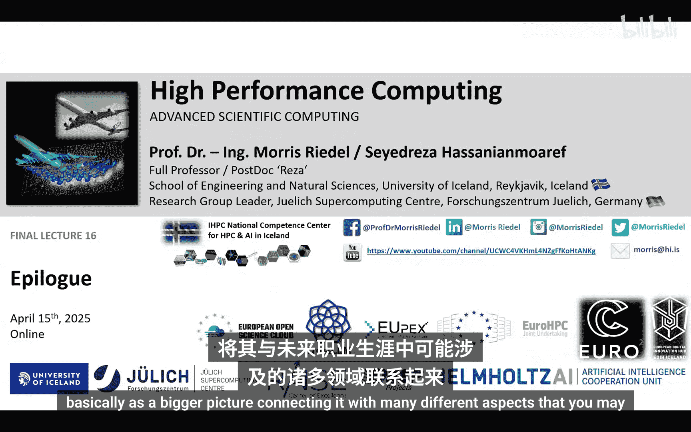
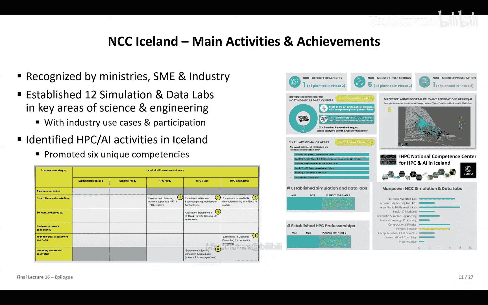
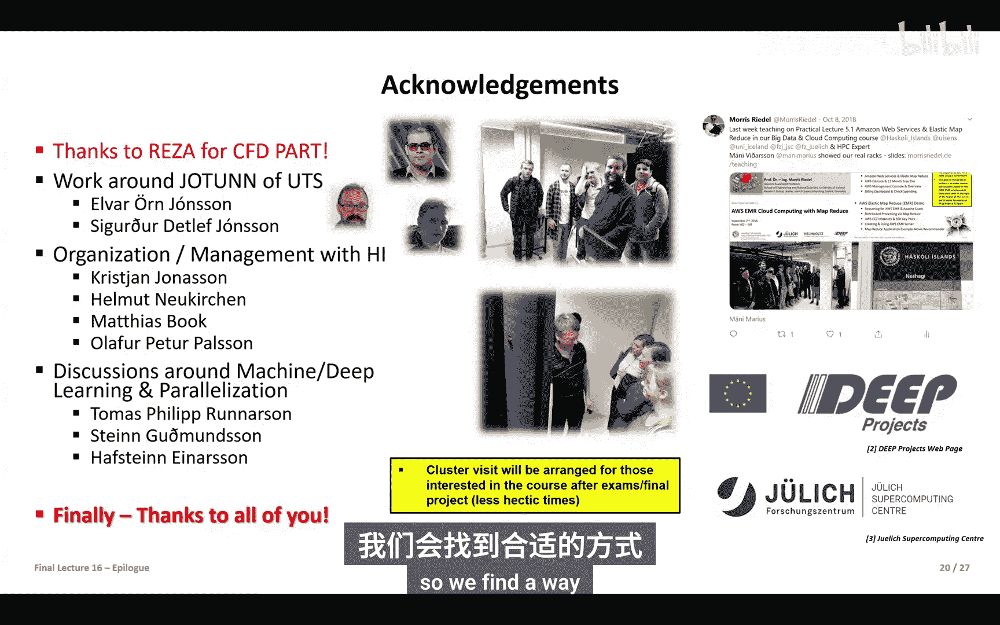
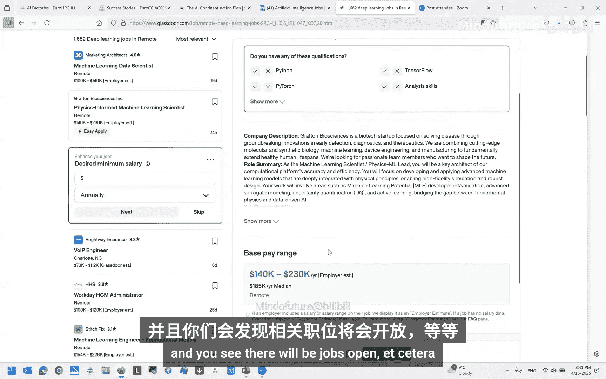
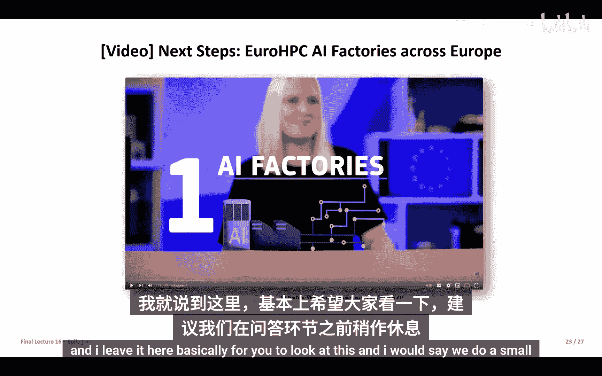
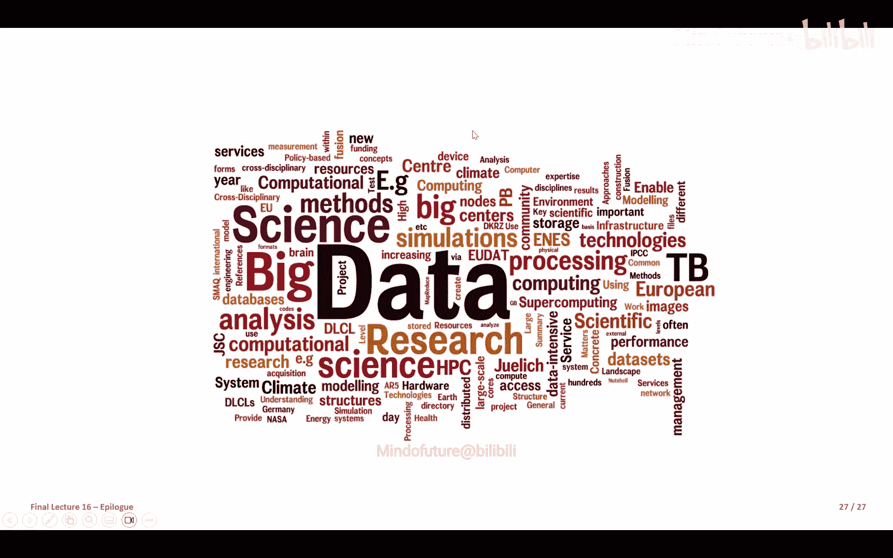

# 【冰岛大学】高性能计算课程-｜-2025-High-Performance-Computing-｜-Prof-Dr-Ing-Morris-Riedel-p01-P01_Final_Lecture_16_结语--BV1k34zzaEK8_p1-

Al right， so welcome， everyone for high performance computing。

 advancedanced scientificific computing。 We have our final lecture today， final lecture 16。

 which is an AP look to the course， and it is such a little bit different than the course you know our we had together before was all of lecture content or the industry project you were working on。

😊，So today we want to look a little bit on high performanceform computing basically as a bigger picture connecting it with many different aspects that you may will you know learn in your future life when you maybe go to companies so which are relevant aspects wheres the European Commission going with say I factories with new interesting elements I incorporated this a little bit and then also thinking a little bit about what we learned think about the job descriptions and so on where do you find materials of potentially you know finding job and so on so it's a sort of informal final lecture I do just to give you。

 let's say again， let's say perspectives of these different levels that I think very important in general。

 you always have to think about when you go to the field of the job workforce or even in science and engineering。

 you have this different levels on mindset skillset toolet。

And this is something also what is maybe interesting to look at when you have now a full course where we basically have to put this a bit in context because of course it's a little tiny thing of a huge community of huge technology and with this。

 you know we have to be a bit open-minded as a name firstly also suggests so well go a little bit into job offerings in the market also thinking about all the buzzwords that you learned in CFD but also in generally AI deep learning。

 machine learning， GPUs and so on so where do we find this in job descriptions so we go to LinkedIn jobs and also Glassdoor I can recommend you to find jobs。

And there also be open minded maybe two more academic ideas。

 so we have also master Bchelor theis around， I will talk about this also in a minute。

Then a little bit we go back to the skill sets so you have now different techniques。

 paradigms really that extend the test of time， but also let's say aspects of theory。

 so we put that all into a perspective to give you some indicators which probably will remain in the next 10 years thoses some of the more hype topics maybe that are just you know shortly around and then when we talk about the toolet many of that you have learned again machine learning deep learning needs HPC I think by now you know that and also the European Commission is appreciating this a lot this AI factories and the AI continent。

 if you are in social media you have probably seen several posts around that we are part of that community and I will also show you a little bit you know what that means。

There are related topics which would require another university lecture like quantum computing。

 neural networks on the chip， which we call more or less neuromorphic chips and normalmorphic computing。

 these are all elements which shape our future so we have already publications in quantum computing。

 but we're not there yet of having unfortunately complete course。

 I think human you had a quantum cryptography course at least right so the first steps to go towards this future。

 but there we can expect probably much more in the next couple of years。So。Again。

 when we think about the outline， I really want to bring across the HPC from a completely different perspective。

Here and there discuss some of the elements that we maybe not have in the course because they are sort of not technical but very important to understand further readings and also the HPBC community I will highlight some of the aspects which are related to your industry project so if you go to industry paper may ask why HPC so we have a couple of success stories in the UCC network I will show you where we you know can directly make a point that similar elements might be Oceanen Iceland might be everywhere you go maybe after the studies。

Then again， shortly the Bachelor mastersis topics， what would be the content roughly and the ideas of the community that is behind that theres the PhD retreats we do and so on。

Is a short appetizer for me， especially for some of you that have been not in the cloud computing course last year。

 the cloud computing course this year will have several overlaps the technology is very similar so when you know CPUs。

 GPs。This aspect and on all the aspect of deep learning artificial intelligence machine learning。

 the things we learned will be reflected in the cloud computing course of course then put into perspective of hyperscales like AWS MS Asia。

 Google Cloud platform versus rather our HPC systems we have here today and also reflect a bit what the cloud situation in Iland so Boreals data centers at North and so on so the course we will discuss will be having also different facets but theres some overlaps or maybe quite interesting for you。

And finally， some job descriptions where I said we can go a little bit let's say。

 go through LinkedIn jobs with some of the buzzwords you learned here in the course and also reflect on the A factory news。

So let me start first highperform computing from another perspective so this is really now again coming back after whole course。

 what will remain right what would be now elements where you have three different facets usually theory techniques and paradigms in a course where you would say these are things that probably remain whatever the the details would be in the implementation and that's why you know the idea of university course should be always looking a little bit like this。

 not what are short termm hyps， but what will be remain and I think the theory that we have all around parallel algorithms that you learned in the beginning of the course so shopping a big problem into smaller problems is a paradigm and the theoretical element which will never be you know you know vanishing that is something which is even teamwork and so on you know that so this aspects of it included lots of theoretical aspects much more than actually was teaching you know the speedup element where we said okay it's nice to add more and more。

nor GPUs to really get， you know speed up and we can， you know， train AI models faster we can do。

 you know numerical simulations much better， but you have seen also limits in the theory right so for the approaches。

 we had the idea of weak scaling and strong scaling。

 strong scaling was putting more and more computing capacity， weak scaling was doing the same。

 but also increasing the workload。And there we will see that communication overheads will suddenly come right and having the problem of really getting。

 let's say parallelization towards the end because even if you have。

 let's say unlimited computing power， the problem will be remaining in different parts and this is also reflecting basically in Uds and Gustson's law when you come to theory。

 Ud's law is a problem is a serial limits there would be always some serial when you have communication from A to B。

 and you need to do this from A2 B， there's no way to paralyze this communicational adss。

 but also data。Right loading data in preparing the MPI environment for pilot execution。

 This is all something where there are serial limits。

 which will remain and that you cannot paralyise。 So there will be always limits。 the more you go up。

And Gutason law is a similar aspect when you come to the weak scaling idea。So in a sense。

 we have the limit sometimes that we need to have much better simulations， put more problems to it。

 but this is easier said than done， we need the data。

 you have seen this in some of the CFD elements with screws LSTMs from razor you need maybe much much more time seriesious data that we have access to so we could scale up but we don't have the data for instance。

 so there are different elements in this which should be considered then the idea of numerical approximation we had a little bit so the theory says we can hardly have the real world simulated right so even the weather forecast in the end is driven by partial different equations numerical methods to you know basically get the weather as as close as possible。

Three days and then the numerical instability comes into place。

 you know that all from basically weather still one from our weather forecast everything after three three days is probably very hard still when you think about climate simulations governing similar aspects。

 not in that detail can still predict something over several years。

 but as an abstraction process and by large I think this approximation which is important。

On the other hand， then with deep learning， machine learning， artificial intelligence。

 you have something we call the statistical learning theory， which is very important。

 and I could just put just very basic steps here in our lecture so when you want to do machine learning deep learning you have to learn more about statistical learning theory。

And this has relationships of why can we learn from data which is essentially not really possible。

 it's only possible in a probabilistic approximate sense we call this learning learning。

 sorry so this is a huge element in it， that we're not doing a function approximation but rather function approximation over distribution of data。

 so the elements which you know machine learning learning from data have lots of theoretical limits and that's why the statistical learning theory is very important。

 also showing you the evidence of basically why we need validation， cross validation。

 why we need regular， so they are sort of elements which really are key to the heart to really learn well from data。

 which is an important part including the famous aspect of you know rubbish data in rubbish data out。

So there's lots of things which still need to be learned， however。

 I think as a basic crash course in a couple of lectures we had here。

 you got the story that HC is really a key ingredient today to make it fast if you want to do deep learning and so。

From the technical extent for communication the message passing interface is very old and still onvogue so we have seen in some of the parallel deep learning frameworks MPI is still the message of choice so the interconnect working between different GPUs between different HPC Res this is a message message passing interface then openmp the idea of shared memory will also not really quickly go away because we have memory here we have extremely highpe memory where we can read and write data to so also this concept is remaining and have limits as you have seen so hence we can only do openmp shared memory to a certain scale of the memory and even if we would say we have you know kind of need for more we have seen it's very expensive to have memory if you look into the new NVDdia GPUs blackwell and the other generations we had before you see it's an increasingly importance on the data with HM high bandwidth memory。

Same concept fueling the GPU with data right hence the memory。

 the idea of shared memory is an important pass， but we have always limits hence we need distributed memory message passing in the end。

We're doing this across different res The importance of going high performance computing means always network communication。

 no matter where。 So in this sense， this is an important factor。

 we didn't have that much in the course。 and sort of the underlying assumption that the Res are all very well interconnected。

 You remember one of my videos， I think I showed you as a second floor。 you know。

 under all these different racks。 there lots of cables into connecting all this different racks。

 So it's not just a laptop put next to a laptop next to a laptop connecting them a little bit Internet cable。

 That's not what high performance computing is。Then when you think about the techniques to breaking down you know a problem into different pieces。

 we call that sometimes meshes， sometimes things we in CFfD， but also in other areas。

 we have this idea of discretize an area so really if we have the ocean if you remember we at the Cartasian communicator have a cattesian grid over the reality is a bit strange。

 but it captures the essence of what you want to compute and you can always refine the mesh make it you know smaller in terms of kilo it covers the different approaches there's even adaptive mesh refinements we have seen that this is smoke evolving in a tube as an example one of the lectures。

 so all of these ideas that high performance lifts from the idea of crunching things down into smaller pieces in parallel algorithms。

 computing parallel requires us also to think about the domain as a technique how I do the discretization。

 how I do a mesh or even if it's block you know we have seen the lattice as well。

So different ideas how you can do this。Then machineine deep learning is an interesting technique because you think about that many of the things we started with were governed by physics or physical formulas then using numericalmer methods for instance。

 whether forecast and so on that also CFD is often doing similar elements。

 machine learning changes a bit and deep learning the picture that learning from data instead so you don't have the physics governing。

 you have data data sets you start from， also technique which will're not vanish because we accumulate data every day。

 we have it everywhere in basically silos， the problem that we maybe face in the future is to bring the silos together to learn better from data。

 the aspects like federated learning we didn't teach in the course which make that happen。

 but the whole approach is a bit different technique right which requires us then go back to the statistical learning theory。

 what if if I defined a data where I have the same input different outputs。

You know you remember the Netflix example， you look the movie at once and you rate it like this。

 you look the same movie one year later and you rate it otherwise。

 so this is something what functions and mathematics can't handle right the function would be a function like this hence the whole idea probabilistically looking at this and approximate then where we can go with whole idea of deep learning and machine learning still we have seen deep learning has some advantages with machine learning of the Mist let's say simple data as an example and similar elements we see of course really in production examples。

 deep learning by now has surpassed many of the computer vision algorithms and basic machine learning algorithms and is a method of choice today wherever you go in languages。

 transformers and so on。Then of course for techniques computational fluid dynamics was special in the course based also on some of our industry requirements that have asked for us to do this。

 so this is a completely different area of physics however we have seen interesting enough and that's what we want to bring across that CFD can be now intertwined with AI with machine learning with deep learning this brings up in whole field we didn't cover of physics constrained machine learning or physics inspired physics informed deep learning there are different words for it but the point is to not neglect physics when you learn from data so you need both it's the future and I think many appreciate this and in this sense this would be also an interesting future study still matter of active research how you really do that properly where had to see race that was working on it but there's also more to come。

And then for the paradigms， which maybe then。Stand for an even longer period of time we have seen high performance computing in this course and contrasted it a bit with high throughput computing in terms of the interconnect so in high performance computing we have really a requirement talking a lot message exchanges a lot between the different racks between the different nodes high throughput computing is something what we rather have in the cloud computing course breaking a problem into smaller pieces。

 let's say analyze how many buzzwords are in different articles， news articles。

Then you count them separately。 You can scale that up to 102100 doing this separately。

 And in the end， you have just summary statistics saying well。

 this word was appearing in these new articles like this and this theres no need for communication in between When you do weather forecast every single iterative time step。

 you need to exchange the variables。 If you have water over the ocean。

 the wave height on your tile to the left will actually inform your own tile you know how the way it is。

 And the next time the one right to you。 So basically you see lots of interconnection aspects in the high performance computing。

 and then the computational modeling is a discipline reaching to a very long let's say decades of engineering building a bridge and so on。

Building today holds cities based on airflow through them we call that partly smart cities and approaches where you have lots of sensors helping in the computation modeling to better cities on a really high scale where then high performances computing comes in so how meta the scale is you can go into the very few right small atoms perspective inside the human body and do their computation modeling so this is a paradigm which is also stand the test of time。

including iterative numericalmer simulations， speaking of the approximations。

 how you do this and also the learning from data and artificial intelligence is something where this has been done way in the past before computing was really there in high performance computing and the learning from data paradigm is something which will prevail no matter what we have in artificial intelligence are put here AI particularly because it's larger than machine learning and deep learning so general intelligence so are we know going to you know more human intelligence and just the machine and deep learning algorithms。

 so this is also paradigm which will not change which have been basically researched and many of the aspects whether you go to you know modeling of physical phenomena manner or you go to deep learning machine learning。

 hyperpymeter optimization will be the parameters that let's say government model are very important and also then。

tingW whichch model to use， which is a little bit the outm L that you also learned in one of the course hours are very important to see which artificial network at all is maybe the best one for a given problem。

 So these are all topics。Which will spend the test of time when you go out here and chances are in 10 years we will talk。

 you know， still much about it。When you want to read more about it of course obviously today you have a big internet so you know there's lots of material around it。

 one of the training materials I would let's say encourage you to read is our UCC access training network you know the Compnce centers many of you have been in our Icelandic HPBC workshops which are organized by the national Compnce center of Iceland but you see here we have a large network across Europe I was also presenting this in one of the lectures right and they all give training on different aspects on different tools on MPI but then not one course for 40 minutes or two times 40 minutes it's a whole week it's three days so this is where you really learn the substance to get more in the game it's where' openM with artificial learning you have the link here to the training portal and there you can also search and see what basically trainings are available couple of them here basically available。

Then of course I gave training in the past so you know the YouTube channel by now。

 we always change of course a little bit， some lectures go in， some go out。

 you know we update the material and if you go back now in the YouTube trainings you basically see。

Yeah here and there are some changes a couple of years ago we didn't have a CVD special for instance。

 so there would be much more different let's say applications in science and engineering and physics which might be interesting for you to look at and was different let's say insights into you know where you can see HPC is used I also wanted to take the opportunity because we were exploring in this course quite a unique aspect。

 so we tried for the first time to have a final project alongside the course so I'm also interested to see how the students were seeing it to get rid of the exam but of course having more load over the whole in our duration if that's really a good thing or not we basically did this on your request so to turn the exam into a project we turned it into a final project and a cloud course but this was a bit too stressful at the end so we saw doing it parallel doing the course would be good we sacrificed some course hours for this in this sense the short lectures were a bit more。

Time but that is not necessarily a problem so far we could got reflections basically from our industrial partners。

 so but I also interested alongside with all other instructors here to see how you thought about this so basically is that something where we should continue or should we go back to exams or should we go to final projects。

No。Talk about final projects， many of you have been involved with some SMEs and just to show you that basically on a larger scale when you continue to do this maybe an industry later and want to be inspired what can you actually do with industry in HPC there's again the website here on the UCC2 network which has lots of lots of success stories collected we have also contributed to with SME Greenfish and SME treble here from Iceland so where you see where we do HPC and Iceland with them。

 but here you see of course across Europe where basically industries using HPC and chances are if you as a student work in a different industry after your studying chances are that they are already use HPC but you don't know that but you can check where other people in this industry use HPC so it might be also an interesting facet for you to understand in your own company。

 can you leverage HPC needless to say that many of those are now also talk about artificial。

ligence you see here one good example， LLM fine tuning right so large language models。

 big domain and industry， we almost daily talk about it in the National Competnce Center just this morning again with EDH and so on and you see again an LLM example here。

 but then also you know speech to text related aspects and so on。Hence。😊。

I would encourage you to look at this website just to browse through there many more where you can see a little bit of you know where actually HPC is used successfully in industry and in SMEs。

Then also many of you have been already participating in our EHBC workshop so thank you very much for attending and you're of course further invited I mean this would have maybe not an impact into your points for some final project but you're definitely invited to join us for instance。

 in the next one in August we don't do one in June it's a summer break so usually we have just essentially then one in August October December and you know the website Ehpc。

s please register for it it would be nice so that the catering is right here that we don't run out of cheese and wine as you know and also catering。

But if you let us know， that would be nice， if not， it's not the big deal。

 bring your friends and we have to thankfully here。

 you know quote also that we get funded by the European projects here to make that happen。

Hence you're part of the community now you have seen HPC。

 you have been part of the HPC community workshops， feel free to continue working with us just here。

 a key point are also to our expertise， you know the 12 simulation and data lab so this might be something where you can become involved in the future when you do you know your future work in industry leaving here the master and Bchelor programs we also do this in collaborations industry so don't you know be shy。

 come back to us talk to us say well we are now in this company we are think about HPC adoption or AI can you help us we have basically lots of programs here in Iceland like EDH。

 European digital innovation H being a onestop shop for AI to really help industry to get you going and as you know already some details here from the course。

 I think you can really also maybe convince some of your bosses or your senior engineers at is called sometimes in the companies to maybe make the move。

Again， some examples， how you could use it， how many people work in several simulation data labses。

 more statistical information。The same is actually true for public administration。

 you see an avalanche basically in flatter from the Me office here which was created an open form。

 CFD， you've got the story basically you've learned the basics。

 of course now applying it to a real situation in flatter for avalanches。

It needs more work right it's not that the HPC course can easily tackle this but you have the basics and you know how to approach the problem still you can also talk to the National Competnce Center and get help in doing so。

Then the large aspect of large language models， natural language processing。

 we have a trustem European project here， me together with Hfstein。

 but we are all here both from my team where more will happen so especially with the Icelandic Corra we work with this intensively and there's also chances that maybe your company is interested in maybe for downstream tasks so language translation or chatbox in a company or so that is understanding Icelandic。

 so this is just an example where we work outs of this industry like SME me then where we have no problem also working with other industry collaborators if you go there。

Then collaboration activities beyond that， if you go to Europe somewhere else to your other countries you basically come from。

 maybe there are lots of collaboration opportunities。

 there are lots of you know large industries around data centers around the U HPC JU is basically very European。

 I come to this also is AI factories which are now a new thing and a brilliant opportunity for all of you getting jobs because everybody is searching now for people fueling the AI factories with people and having the expertise you learned in this course。

So good chance。So also maybe look at the Icelandic website from EHPC again with an idea how can you do an international collaboration。

 we have lots of links as you know， to different membership countries of the EU and so。

 and we can also help you even across our communities stretched across America， China。

 basically very international these days。If you really want to do low levelve HPC。

 there's one book I would recommend which also sort of stent the test of time is very good written from one of my colleagues from the HPC community。

 but I think also these days you have lots of material outside so I would not necessarily maybe buy it。

 but if you're really interested then you can really have open MP and chat memory aspects understood to the very heart。

Briefly about Bchelor and master PhD thesis topics what would be of course a quintesence。

 so if it's interesting for you to work in the topics we had sort of in the course right which are here basically think about several methods and tools related to statistics。

 machine learning， scientific computing， data mining。

 parallelization so this is something where we have lots of topics of available。

 you would be something in between you would say software engineer sta engineer， data minor。

Something we call sometimes a computational scientist or data scientist these days。

 right where you basically combine the areas of different fields together to build something in applications。

 which is an important factor and hopefully get some insights which are swimming there in the ocean。

And。Yeah， masters thesis are very easy for the PhD。 We have to talk longer。

 but also PhD is quite fruitful。 I mean， Razor was once a PhD here with me。

 So you have seen him in action as a postdoc。 So I'm very grateful that he also state basically after his PhD And I think important part is also to understand that you're not alone as a PhD here。

 we have always this retreats here over the last couple of years and we have also won again in this fall where we bring all the PhD is always in the community together。

 So you're not isolated and rather work together as a team in the research group。

 So if you're interested， let me know or let one of the instructor low。 I mean。

 Heman also and Razor they can be it's our first contact for you for this。A sneak preview。

 what's happening to the cloud computing course in the fall， again， I was saying。

 I mean you can look in YouTube what you would expect， I record everything on YouTube。

There will be some changes， definitelyly as a European sovereign cloud。

 there's several different facets that you always have some elements of change。 But again。

 we talked there about some paradigms mapreduce。 I mean， have you heard about mapreduce， maybe。

Not not Hadoop， Mareduce。So this spark actually spark。 So there are more。

 let's say different frameworks that we will cover in the cloud computing course， which are more。

 let's say adopted in hyperscale like Asia， Amazon， Google， But if you go under the hood。

 you will see that the deep learning algorithms， machine learning algorithms don't change very much that the provisioning of GPus is also not changing very much。

 right is's much more a commercial way。 how you get basically access to these resources。

 And maybe here and theres this service paradigm， right Everything is a bit more simpler to use and so。

 So this is what we want to understand there。 Also how what fuels a system like， you know， big。

 large user groups。Well talk about Facebook， how they use it。

 but also enterprise resource planning and other， let's say applications combined also， of course。

 with a huge let's say view on big data， machine learning， deep learning again。

 how we can use these systems with this。So here us a sneak preview and then maybe towards the end did us just acknowledge。

 I mean firstly erazor for the CFD part， thank you very much was very kind to you know take the CFD part here from Razor and Christian。

 you're just here， I have you on the acknowledged ledl， don't run away。

So you need one of my senior scientists here， Chris Young， Hemo Mathis。

 Oliver that overhel me was a management and organization， of course， stuff。And around it。

We have also basically the team that gave you Adlia and U Aition Access Zgaro Dla here。

 this guy I know you don't really have seen maybe but he is behind your accounts as well as Elva working on Ut and Atla to make it happening I apologize on this that actually exactly in our HQC course timeline they transitioned the system from our location at how E to the Met office so there were some interrupt especially towards the deadline so this is what we then let's say mitigated by dropping assignment3 right to get you know you more time now and this should be hopefully a fair deal and then of course there more machine learners here I would encourage you to talk to I mean some of you maybe took already stains course in the past but also Hfstein is a great scientist and teacher for large language models natural language processing he would be the guy to talk to and then Thomas Philip optimization operations research machine learning deep learning is also a good guy to talk。

2。There's a possibility to look at the cluster， so we either go to the Bo data center again like in the last years or we go basically to the new location Me office。

 we have to find out。But let me know and send me an email then we can organize a trip there。

 we will probably collect a couple of students and four more times we did this within the semester。

 but usually at the end of semester everybody is very busy with exams with assignments final project so we thought we're doing this after this period right so we find a way the data centers are all day around operating so there's no point of doing this also two at the end of the course where everybody is very let's say stressed anyway。

For job descriptions this could be taking let's say hours obviously I think two that are quite known is for instance。

 I think LinkedIn jobs right this is something where you have a direct access if some of you are not in LinkedIn I would recommend you to do so it's a professional platform not just the little bit of social media like Facebook or something it's really a professional platform these days where if you are in the business sector and moving from student to let's say a really employee this is really a step that you should consider I'm not paid by LinkedIn by the way。

 I just say this has opened up lots of opportunities I think for everyone and it has a job part here where you can maybe search just search for artificial intelligence and get lots lots of different jobs and if you then sometimes go in the detailed description of the job you will find again AI elements chat GT head of AI so you have to understand a bit of AI AI features so。

Basically several things that you already learned in the course。

 and you see also why maybe the cloud course is quite compliment everything what I just gave you as a sneak preview。

AWS hyperperscalealar， Google Cloud MSs Asia Docker a container technology。

 we didn't talk about this in HPVC course we talk about this in the cloud course。

 So hence you see for the job description perspective if you want to let's see be a master to really apply I would also can you know recommend you to look at the cloud computing course a little bit if you wanteds lots of complementary aspect that really gets you to an expert and if you go further I mean you can browse through that yourself I don't want to take too much like know points for it。

 but you see quite the momentum on this NLP large language models as I was alluding to this will probably stay with us in the future a bit and。

You can you know go through different facets， maybe also just briefly mentioning Gdo might be another idea where you can find jobs put just deep learning in to have something different from artificial intelligence。

 machine learning data scientists and also if you here go through the different let's say details you will find machine learning models you will find different elements。

 Tens offlow， something you already learned in your assignment that you had already on the slide。

 which basically is related to you know good jobs again。

 complementary would be Asiaure spark things we talk about in the cloud course right So hence it might be useful for some of you are seriously interested to be a machine learning data scientists somewhere I mean think about the salary is' not so bad right100000 which one of 40000 a year。

But of course， then you have like many of the things， maybe Pythch Tensorflow you already。

 but there are several other aspects data collection SQL that we have a little bit more than in the cloud course again。

Yeah， you see also one of the things I mentioned physics informed。Machine learning specialists。

 we were alluding to this， right to combine these two worlds and you see there will be jobs open。

 etc。

So let let's see a little bit what's coming up for you and this will be really why my last sort of slide of content is now the idea of the AI continent。

 I not sure have you seen that somehow AU Cont AI factories。

 Aome here in the I should also ask the online audience， sorry for that。

I hope some of you have actually seen that in the news。

 but this is a new big plan in the European Commission that you know basically we will be or we try to be let's say。

 AI leading in the world of having lots of different investments you see here。

 200 billion euro go into this， lots of jobs will be created in the next five years to 10 years。

And one of the key aspects of HPC will be these AI factories which have been already developed。

 so they're1 searching around。That are basically operating right now where you with your company can get access right now right So these are your HPpC supercomputers。

 especially for AI designed， which you can use and we are part of this ecosystem。

 So when you go to the U HPPC website， you will also see lots of ideas how to apply for an AI factory and so on。

 So in a sense， it's HPC very optimized for AI。 and the point is now you see here all the new AI factories。

 they search heavily people It's not just hardware。

 important is also that you have software services， people catering you know。

 basically the needs of the people using it。 So chances are that you find alongside these factories。

 also drop openings in all this different member states。And with this I close here。

 basically I give you this video as a homework AI factories if you go to the European Commission space on AI Conent。

 which is a larger action plan with five different pillars if you want。

 then you find much much more information right but of course the ones that is very relevant to HPC are the AI factories we will develop gigga factories in the future with let's say billions of years of investments together with industry and I leave it here basically for you to look at this and I would say we do a small break before we do it to the Q&A。

My final statement is of course of thank you very much for being part of the course right if you don't have any questions and want to leave thank you very much it was a great pleasure to do this course。

 especially as were exploring a little bit of more close let's say work with industry so again in the Q&A session I would like to love to hear for your feedback on this so thank you very much also for the online audience and YouTube giving all this brilliant comments and very nice commentsm also very happy about this I could use it in many reviews thank you very much and of course we take also your feedback into account if there's some changes and the slides will be all publicly available as well。

😊，Thank you very much and talk to you or see you soon in some of the community events。

