# 【冰岛大学】高性能计算课程-｜-2025-High-Performance-Computing-｜-Prof-Dr-Ing-Morris-Riedel-p02-P02_短讲座_15_绿色能源__HPC_应用--BV1k34zzaEK8_p2-

Hello everyone， welcomecom to High Performance Computing Advanced Scientific Comp course。

This is lecture 15 green Energy and HPBC applications。

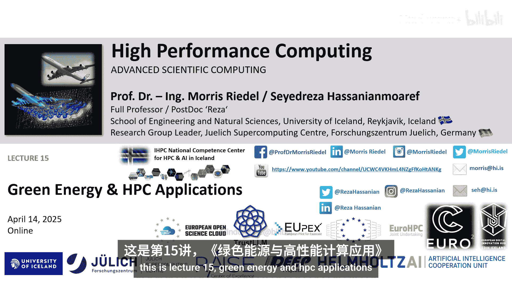

So as we're following the outline of the course。And thisia was a CFP special currently we continue on the lecture 15。

 and we will discuss the relevant between the green energy and HPC。

Which is somehow the demand of the energy is related to HPC and also how the HPC is helping to conduct the research and develop the green energy。

As usual， let's have a review on lectureture 14。which was hyper parameter optimization and auto。

There was。ThePresation about the importance of the hypermeter or why hypermeter is important。

And how it's improving the performance of the machine learning learning model in connection to the H PCC。

And some of the ha perimeter is defined what of the hyper perimeter。For example。

 when we are working with machine learning model， what parameter of。

In these categories and need to find them。Usually traditionally， for example。

 in the most of the physical application when we are using the machine learning。

 selecting of this high perform format， it's using the traditional approach。

We can say we trial and error to find the。Best value for the hackcroometer。 But in this day。

 with development of some software， these ability developed much better。

 and we can find the hackcroometer with。The automatic system。However。

 using this software also sometimes has the demand of the HPC to find the have parameter values。

And there was a good example in this lecture， the importance of the HPA parameter。

 you saw some examples that how it's important and helping to improve the model in terms of the performance and also in terms of the speed additionally regarding the GPU allocation also in the H parameter there was discussion and provide the perspective that how you can use the HPA parameter tu in your application。

And now let's move on to our lecture。So in this lecture。

 we basically we will have an introduction regarding the sustainable energy resources。

 which is mostly well known at this time。And all of us will know the importance of the energy and what is relevant to climate change and global warming。

And there are a lot of effort to。Develop the application of this sustainable still energy in or dailyized。

So we will discuss how the HPC helping us to approach this goals and also HPC with the computing is required energy resources。

 power resources， so when we are working with a large number of large size of the problem。

 of course we have high demand of the energy， so we have some example and we will see how the energy demand in the HPC also is important。

Let's start with the green energy sheet and what's its definition。

And while we are using the HPC to solve or simulate some aspect of the green energy or renewable energy problems。

SoRegarding the renewable energy resources， we have the solar power。Wd power， geothermal， hydropower。

 ocean energy and bioengy。 This is most portion of the energy in some kind。 There are some other。

Application， like currently the hydrogen energy， its the honor the resources it's developing。

And there are new application of it， let's focus on these most applied resources and see some example。

 which is relevant to computing and HPC resources and additionally why it's demanding also the HPC system。

The solar， as we know， it based of the irradiation that it gets from the solar system via the flat surfaces it called photovolta panels and it's converting in space of the poing of the energy could be converted to the electricity。

The the winds working based off the equipment， we call them。Wind turbine。

 there are different type and category of this wind turbine is smaller scale la scale and regarding their structure also there is a horizontal wind turbine。

 axial axis wind turbine。And they are working based off the blow speed。

 they are different design of the height for the wind turbine and also regarding the shape of the to on the plates for each turbine and it's led to different performance。

Regarding the geothermal also is based of the high pressure and high temperature water comes up from the wells in the earth and with this high energy water。

 it's feed to turbine and turning the generator and increasing the power power the ocean energy also there are different method to use this ocean with the wave of the ocean and how with different levels of the water we can turn such a turbine and creating energy also there are other approach in the development the bioenergy of course using the advanced sources on the earth。

To convert them to the energy， which is also has a different。

Metro and different resources in this area。H。In one aspect。

 these resources can feeding and supplying the required energy on the HC also。

 rather than other application in the industry on the。

The citiesities and development of the small cities also。How to developing this energy design。

 as we said， each one working with a specific equipment， for example。

 the wind tuine we have it through energy， the photo attack panel we have it in there。Solar energy。

 as much as possible， when we improving the design and making the optional design for them。

 we can have a high performance high efficiency of the energy production。

 so that's why it's important to able use the HPC in the design of these energy resources application。

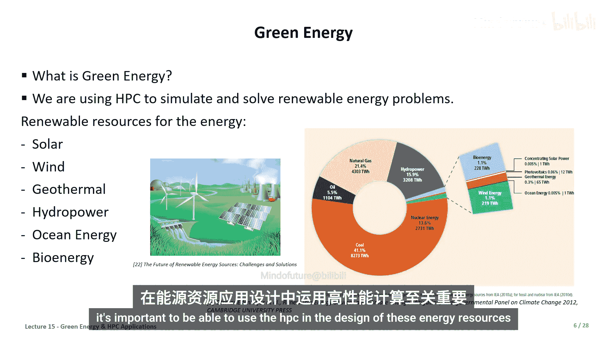

Let's have a short TV on there。Importance of the climate change and global warming and why it's relevant to green energy application。

 In fact， regarding the climate， we have term of the weather and climate。With， in fact。

 the change of the。Pattern， which happening in the short term and locally， for example。

 above the main pattern we can see in the short term， it could be changed。In the local area。

But the climate change is about the changing of the the climate， in fact。

 changing of the pattern for the long periods， I thought like during the 30 years。

 So this is a different term between the climate and the weather， which is very important。

So when we are looking for the global warming and the climate change also， global warming。

 is' relevant to global temperature change after the industrial revolution。

 which increased the temperature。Because of the using of the。没。

Fsil fuel and a coal and search of these energy resources。

But the climate change is regarding the change of the。

Global pattern of the weather in the long period， globally。

So this is the difference between the what is the global warm and what is the climate change。

So we are assuming when we are studying this different phenomena because of the size of the problem and because of the term of the change。

 using method like CFD what we talked in this lecture。It required large computing。

 so we need the HPC resolve to deal with such problems。

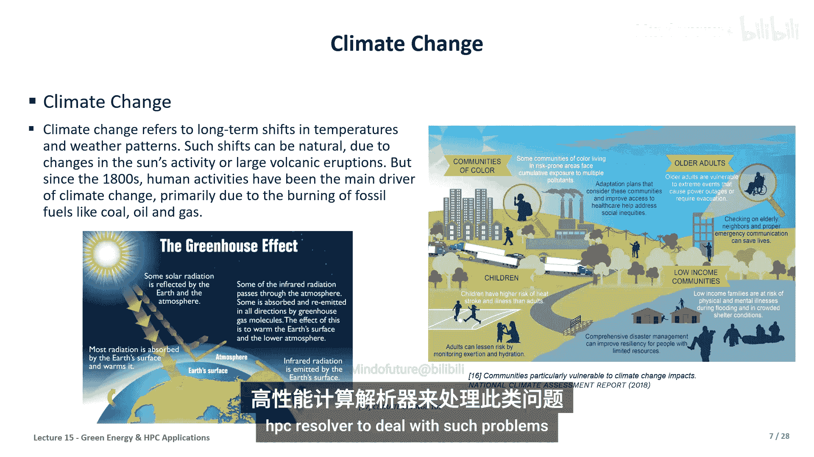

And in fact， in this area， usually we are dealing with many parameters。 For example， here。

 we can see。What's para impacting the temperature of the area near to a lake。

Or when we have many different parameter around the area and what how we can find the correlation between them and how it's taking acal for such simulational model so it's very important to be able use the capability of the HPC in this area which is so helpful and in this day we can see many research ongoing using the CFT for example。

 making a simulation and also from the other。Application for machine learning， for example。

 using data for view sensing。To monitoring some changes， like theia。

Or a level of the lake or the ocean， maybe or the sea near cities。

 which is used with the large and extensive data posts with the remote sense。

So studying and monitoring the global warming or climate change with the HPC， of course。

 is important and it indicate how much HP can help us to monitor and know about these changes。

From other view， looking at these two terms of the global warming and climate change。

 its also emphasized that we need to use the green energy and sustainable energy resources in our application of the HPC to reduce the。

Eff of the effect and impact of the environment by these systems。

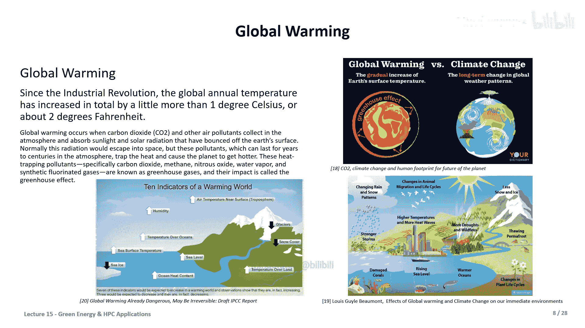

Shortly， let's look at some example of these energy resources。 For example， the wind energy。

 as we know， we have the wind turbine， which。Flow over these turbine leading to generating the electricity。

also the。Some important aspects need to be understood for the wind turbine， for example。

 when placing a number of the wind turbines in fall。

 there is the event it's called weight loss effect。

Wch each turbine impacting the downstream installed turbine with the change of the flow。

 which is from the fluid dynamic area and could be impact and reduce the efficiency of the turbine。

 so it's necessary to use the capability of the CFD to make a simulation of this wind turbine and study the effect and reduce it。

Also， for example， recently， some research presenting installing the wind turbine。

 offshore wind turbine near to the city came to lead a long term pattern change of the weather to the city that's located down the stream to that offshore windfall。

All of these need to have a much more simulation study with the CFD。

 of course with large computing to understand what's happening and also about the wind energy there is another wind turbine is called vertical axis wind turbine。

Which gets a lot of interest these days， because it's working。

Much more with much more flexibility and there is no known weight loose effect from this winter turbine and because of the importance of the effect of this phenomena。

Currently， using the HPC to simulate these wind turbine is important to understand the impact of the weight loss effect of the performance of these turbines。

Well， regarding the solar energy。We can say it's one of the greatest option of the energyUZ。In fact。

 based off the energy that is gained from the solar system。

 we can say the computing is presenting us the calculation showing us one hour of the solar energy can supply the energy consumption for the entire year。

 so that's why we can see why this area is very important So as much as possible we can if we can improve the efficiency and gaining of the energy from this system。

 we can have much more energy and of course， green energy， which helping to。A supply the demand。

F these responses and of course， reduce the。Impact on the global warming and climate change。

Here is the simple presentation of the。A photo panel， how it look like and how it's。

Po think to call the irriation from the solar system to the electricity。

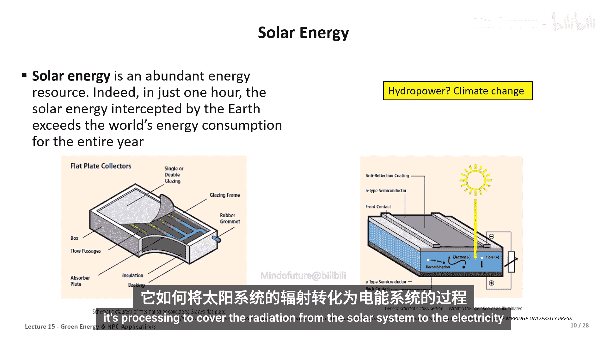

Hi， Duji， it's one of the research developed resources of the energy。

 which get a lot of focus and interest of。In fact， it's one of the also clean and clean and green energy could be use。

诶好而家就喺条先。It's the type of the energy that to produce it。

 we need to use the electricity to do that based on the you can see an example of the electricityia。

 how it's happening we need to have。C on。To make a production of the hydrogen from。で。Wat。

However to do that， these will be a very key and important parameter that from which energy we can produce it。

 For example， if we want to produce the hydrogen energy as a green and clean and using the fossil fuel energy like using electricity that produce the power plant from the gas。

 So it doesn't seems it's the proper approach to produce the clean energy with using the。

Nogo energy energy resources。诶。The form quality is the too important idea that how we can use the solar energy system all the wind power energy to you produce the hydrogen from the water with the electricity electricity of the。

呃我。To do that， there is a combination。Power plant， which say we can have combination of them。

 We need a solar power near to water resources to produce the hydrogen from them。 Also。

 this lead to another idea that how we can have the solar power plant and wind power plant combined other in the offshore。

Which making is possible， for example， at the time when the reserve。

There is no high resources on the we， the solar on that area will be interchangegingly when there is a solar power of where we weak power resources。

To do that， in some cases， is required to make a large competition。

If we are using the CFP simulation to start with this energy production。Yeah。

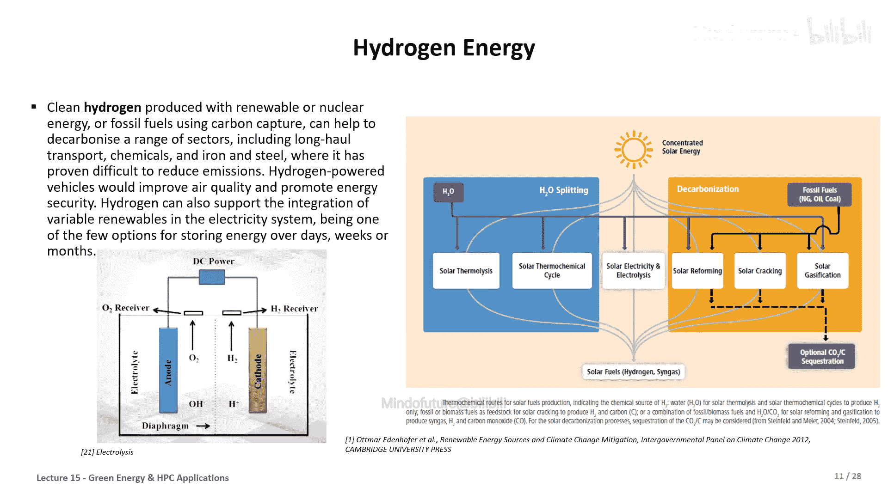

Developing the green energy application is very important。As you can see。

 based off Li' United Nations solution in this report。

That there are six of the solution to the climate crisis。Which we can cut 2。

5 gigattons of the greenhouse emission analog。 And we have the necessary technology origin。

 And just we need to conduct these。Technology and how we can。

Make much more efficiency out on these such resources like Indonesia or solar and hydrogen and。

Reaching this cutting of the greenhouse emission。

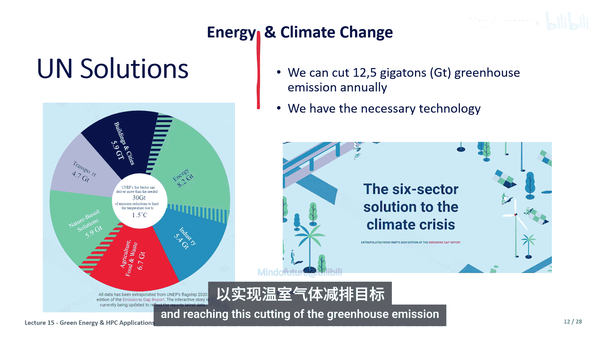

Here Im presenting these。figure with how the power grid is distributing the energy between different application。

 of course first of all the power grid will transfer the energy for the power user in the cities and inhabit Haant and then we have some facility in the city like Twain oromba。

And also with the。Electric car currently it will supporting the required power for them。

 Additionally， with the new term of the harvesting the hydrogen energy from the water。

 we can use this power to make that Additionally， with the development of the research。

the competition， the C simulationulator。And all of the other computation that is available。

 of course， in the science and in the industry， using the HECC， it's necessary。 And this time。

 then we have the other parameter added to the power user as the HPC system。

And since we are reaching the next of the computing at scale， and of course。

 it will be development of the future years， this demand needs the purpose supply to use from the given energy and sustainable energy。

That way， in this example， you can see how。The wind energy is important and can make all the supply from the marine resources。

Furthermore， how do you find the connection between the H PC here and wind energy， for example。

 in the wind energy， there is。Isue an obstacle about the wheat prediction， because when。W producer。

 or we can say that wheat farm need to response to the demand available for the user。

 they need to have a short or long term of the production of the power production。

Which is exactly relevant to the wind speed。The wind speed basically relevant to weather prediction and also in recent years there are some application of the machine learning and differently working with data from the recorded or measurements measure data for the wind speed to make a prediction for the wind speed。

 then when we have a prediction of the wind speed with this model。

 we can speed in the system in the wind power or wind pump and they can have a prediction of the production in next curve which could be long term motion term。

Regarding the short term a long term in the literature， there are different definition， for example。

 that in the short term， it's from a few hour to one day。 and for the long term， it's from two。

 three days to 10 days。There are different results from this application。

 however this is emphasized on the application of the HPC because when we want to use the prediction model of the deep learning with extensive data。

 for example， measurement of the wind speed for 10 years。

 it would be extensive computing and we need to have an access to the HPC resources。The for here。

 we can see。 there is a。A look of the energy resources。

 which the we can supply the energy demand of the electricity system。 and from other view。嗯。

The HPC has to improve the efficiency of the wind power production with these prediction models。

this is an example of the how the green energy can have a cycle between the production and also improving the performance from other time regarding the HPC system。

 usually the supercomp since they are physical equipment and working in some equipment with some。

Heating its getting some heating so we need to control the heating with the cooling system on the HPC。

 usually especially when we have high demand of the computing on this system these increasing the temperature and heat on this system and need to be controlled so the cooling resources also for this system is important。

 the are different system that making the cooling on this system and therefore here also it's presenting the HPC from other aspects with the temperature also have some effect of the environment or the climate can control with the cooling system。

Here you can see presentation of the。So energy for the H PCC and how the energy management strategy for the HC class could be in different manner。

 You can see the CPU usage and also the power。On the left hand side， and you can see with different。

Contl theory and policy， how it behaved differently and which one reducing the power usage much more than other。

呃。So with these， we can understand that H PCC from different aspects from the。

Demand of the energy and also from the heating which happening with the demand of the computing of this system has a different effect of the climate change so it is from this view additionally to the HPC helping us to developing the efficiency and performance of this system。

 also it means to we have a control on its effect to make it much more environment might be and we can say。

Climateimate badly to reduce its impact。Following up our example about the HPC energy demand here。

 we can see when we have different energy resources from the wind from the solar and also from the。

Fossil fuel energy or coal maybe how it's working， for example。

 from the computation for the petscale error， how we are getting to the excess scale currently。

 the consumption for the power for a single machine it's around 25 megawatt so with increasing of the site。

 of course this demand is getting higher。诶でに诶。Develop is getting us to have much more high computing。

 so there is a design of the design and location for the new system。

 which is important where we place them because it's relevant to the power distribution network capacity and the arrangement response to this demand which all of these parameter it showed the importance of firstly that how we can harvest and use the green energy resources and from other view how we can make a loop between the HPC system to helping us improving the given energy and how also increasing the HPC system will lead to some impact of the environment and also the energy demand。

Regarding the power distribution for the HP system also。

 there are some element and criteria need to be pay attention， for example。

 it should be a secure transmission system because when the HP system is working and of course on the demand。

Assuming you are running a very big problem and it will taking maybe a couple of hours or maybe days if there is no secure distribution system and shutdown is happening all the previous computation maybe will be lost and there is again it will be nextcomp so it's with the energy that way for this such system it's required to have a safe and secure。

Po system， which make to have a specific criteria for these distribution transfer for them。

Furthermore， when we are talking about the cooling system， which mostly working with some。

Power supply is required to keep the control on this part of the HPC to provide safe procedure for the system and avoid any damage because of the heating because of the sound failure of the cooling system。

 which are relevant to the power supply storm its resources， which could be。

One of the green resources that we mentioned or from the fossil。

 So here there are this key about the power distribution and how it's working。 and additionally。

I think regular maintenance work could help us to reduce these failure and impacts of the power distribution cut。

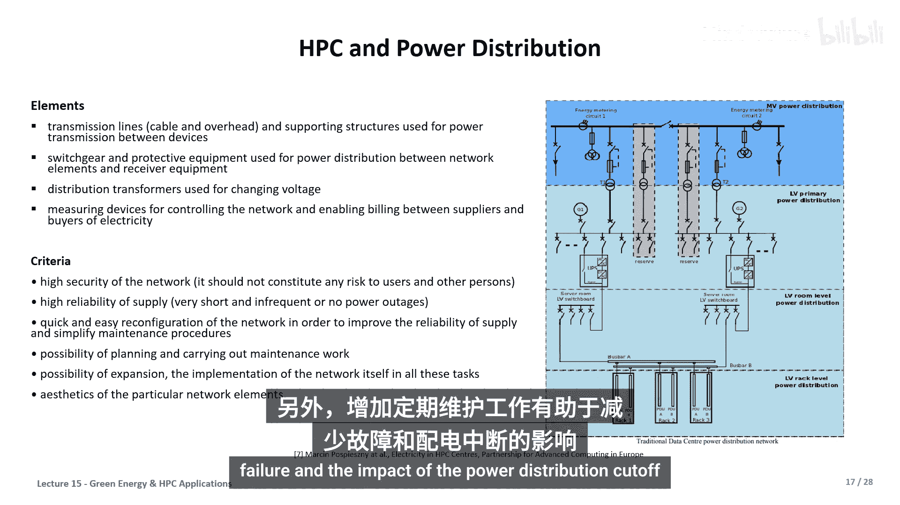

To have example from the CFD for a large scale in the green energy here I'm presenting some example。

 we can see how the scale it look like， for example， the wind energy or for the geothermal energy。😊。

For the solar collector， for the combustion engine and the hydrogen production。

 So usually we are working with largest scale with the。

Large amount of the element for competition from the CFD， which is required， as we said。

 we are using the CD。Because of the limit of the experiment analysis analysis。

 we cannot perform the experiment for all problem。 For example， here。

 You can see example from the geothermal， of course， it's。

We can say maybe it's impossible to make an experimental study on such phenomena。

 so using the CFD is required and of course， having access to HPC system to deal with that problem to understand the problem and then use this information to design the facility and equipment and harvest the energy from these resources is important。

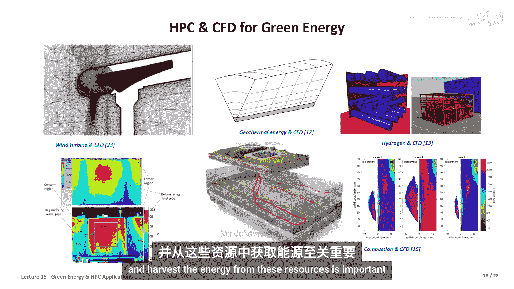

。Here is another example for the CFD application for the cooling system of the HPC， as we mentioned。

 it's very important。Because of the cost of the HC system and also about the demand of the computation of this system。

 which is done by the user and it's very important。 there are different。

Currently system used for the cooling， for example， the air cooling。

 And there is a direct air cooling， and there is open water cooling system to。

Improve the design and to understand how this different setup is working to help to cooling this system and avoiding the damage or failure of the system。

 C have be helping to see how this system make cooling and controlling the temperature of the system with this size of the computation also。

 is' required to have the HC。嗯。Then the benefit of the H PCC also in each side to control the cooling system for it。

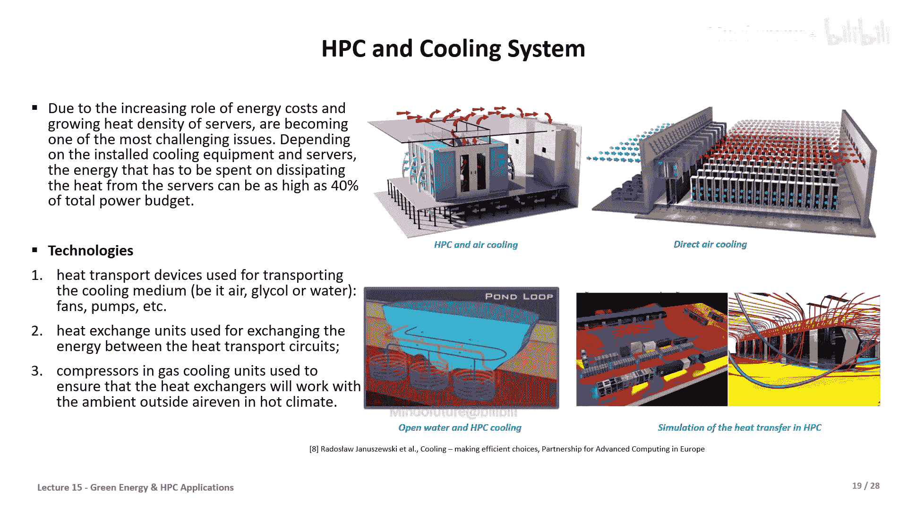

So to wrap up the HPCM doing energy importance。From one side， we said。

For the simulation and study of the energy resources and the equipment and improving the efficiency of the green energy resources using the HPC it required in turn。

 for example， in the CFP simulation or other studies or other computation。For example。

 it's using the chemical interaction also it's happening， for example。

 the hydrogen or maybe in the reaction of the combustion in the M which using the CFT simulation or heat simulation so all of these simulation and study and development or engineering design require the HPC system to do that from other side。

 the HPC requires the power supply to response is demand in the computation。

 and it's very important to have a stable and secure energy transition to keep it stable and response to its demand。

 Furthermore， there is a heating because of the demand of the computation on the HPC system which need to be controlled with the cooling system。

 which cooling system also is relevant to。The power supply and the most efficient。Cooling system。

 which is different to the HPC design， it needs to be selected and modified and optimized。

Then there is a loop or cycle of this term of the HPC。

 CFD or other computation and the energy supply to keep all of these working properly with the required computation and require energy supply。

 of course with increasing of the demand of the HPC。

 if we want to stay of the using the fossil fuel energy。

 the impact of this energy will transfer to the climate change and global warming。

 since we are looking to reduce this effect， of course using the game energy to supply this system will effectively reduce the impact and the side effect。

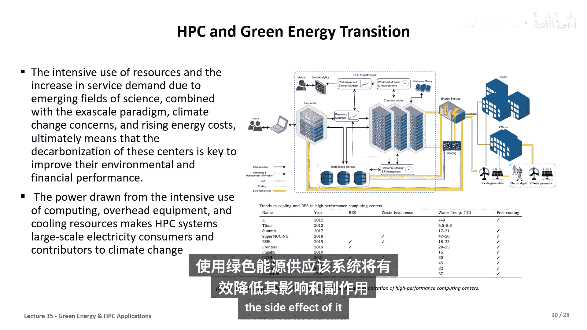

In the terms of the perspective of the energy demand of the HPC。As we know。

 this area is developing fast。 and currently we are entering the Ex scale area。 So in the future。

 also， we will increase on this。Pow of the computation。

 therefore it's important to have the proper energy resources for you to response its demand also there are some mid it's helping to have an electrical solution for the electrical distribution network design。

 which here we point to the connected power which is a parameter indicating the maximum power consumption with the average oil period of the time。

Additionally， there is a design power which define the develop the instantaneous power for which the mean power supply of design。

 and furthermore， the contracted power is the maximum of the active instantaneous power consume body center under the contact with the distribution network operator。

Using this TV term with。Condition， which mean this relationship between these power parameterss。

 keeping the correct operation of the distribution network。

 So this is the example of this powermetric， which helping how supply the demand of the system and。

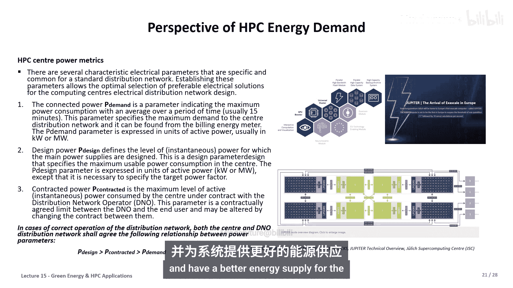

Have a bit of energy supply for them。As the example recently。

 we had a research that how we can optimize the wind energy production， which。

A loop connection between the H PC resources， and also with the。

Improving the wind energy production with the computation of the HPC so if you are interested。

 of course it a link is available in the references and you look at this example as a use case and you can see how it's important to。

Find the connection between the green energy resources and H PCC resources。

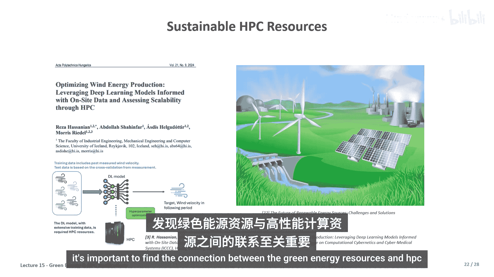

Sovia， we have ended with this lecture。And here is a video for the H PCC for energy。

 And if you're interested if the link is available and you can watch it and you see visually how this connection is available for the H PCC。

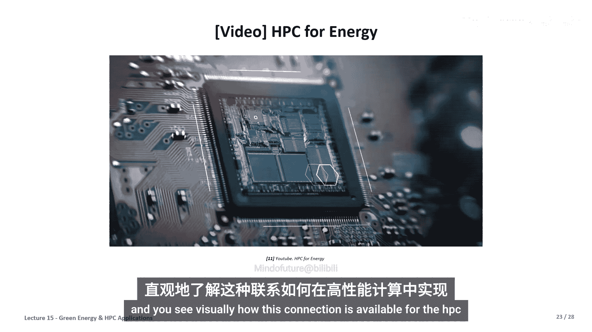

We will continue and feel free to contact us for the final project。We will continue in next lecture。

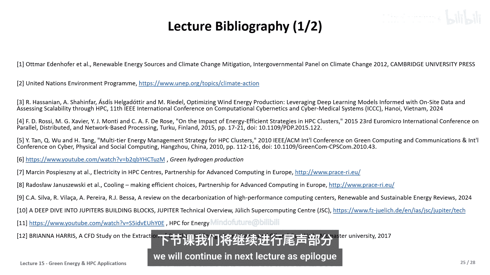

As epi。Thank you。And good luck。