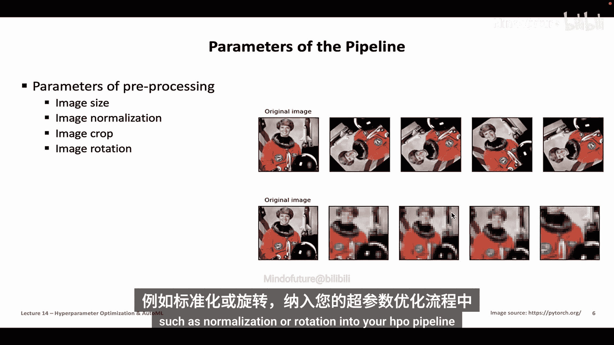
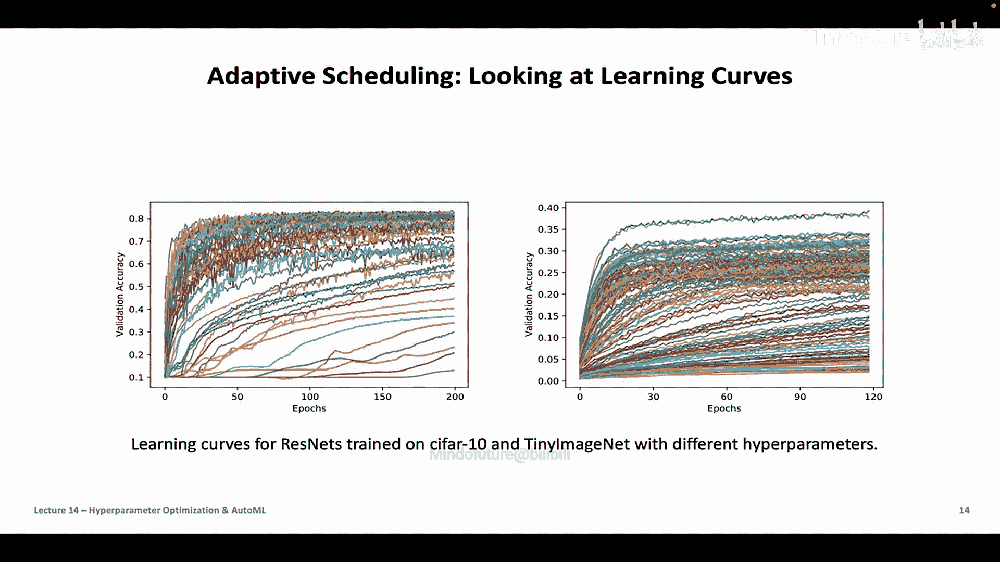
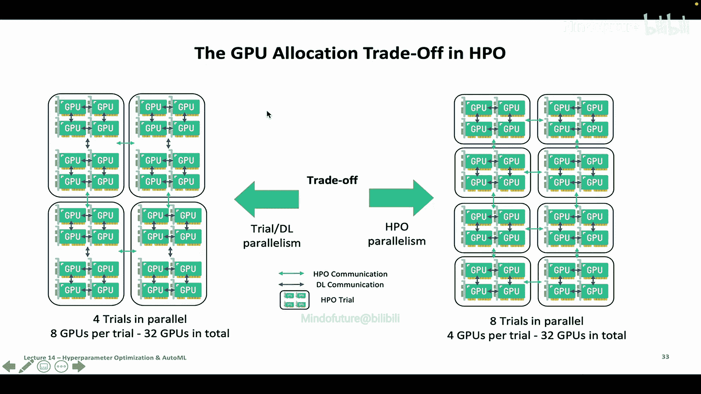
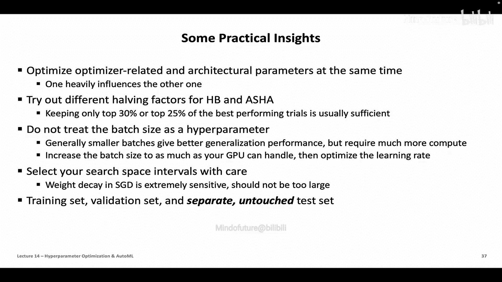

# 【冰岛大学】高性能计算课程-｜-2025-High-Performance-Computing-｜-Prof-Dr-Ing-Morris-Riedel-p03-P03_短讲座_14_超参数优化__自动机器学习--BV1k34zzaEK8_p3-

Hello everybody and welcome to High Performance Computing。My name is Marcel R。

 I'm working at the simulation and data labb， fluids and So engineering at the Uli supercomputing Center in Germany。

And I will be giving today's lecture on the topic of。

Hyperparmeter optimization and automated machine learning。

What we will cover in today's lecture is to give you an overview over what are hyperparameter。

Then look at different algorithms to optimize these hyperpar split into adaptive scheduling and adaptive selection methods。

Look at which algorithm to use in which case and finally also go a bit into how to use hyperparaaa optimization efficiently on high performance computing systems。

Now， just to make sure everybody's on the same page， what are hyperparameter？

So the hyperparameter are the parameters that influence the learning behavior of your machine learning model and are usually set by you as the user or the developer before the training。

This can include architectural parameters such as the type of machine learning model you are using。

 the number and kind of layers in your network or the activation functions。But more prominently。

 it refers to the parameters of the optimization process， such as the type of optimizer。

 the learning rate or the momentum value。But that's not all。

 sometimes also the parameters of the whole machine learning pipeline can be included。

So if you're working with images， you could also include the image pre processingcess steps such as normalization or rotation。

Into your HO pipeline。To put this all into perspective。

 there are free areas where you can tune predefined parameters。

 One is the so called neuro architecture search that just deals with architectureural parameters。

Then we have the so called classic hyperpermmeter optimization。

 and then if you add parameters of the pipeline on top。

 you get what is commonly referred to as automated machine learning。

You would not be here if you did not already know just how important happy parameters are for the success of your machine learning model。

And just to visualize it again， here's an overview of the learning curves of a simple resnet model。

 which was traineded on the Cypher 10 dataset set。And from this plot。

 you can see the importance the learning rate makes on the difference between getting a good model。

 which achieves more than 80% classification accuracy or getting a model that learns nothing at all。

 So if you。Get 10% accuracy on Cypher 10， and there are 10 classes that means your model is just randomly guessing。

And this also actually gives you a first hint towards why the problem of selecting the hyperparamat is so hard。

When we look at these these curves here， we see that there's no general prediction possible。

 So you usually cannot say a large learning rate is good and the small learning rate is bad。

But these decision are usually very， very fine grain。A bit of terminology。

 so when I talk about search space， I mean the hyperparameter and the intervals that these hyperparameters are sampled from。

When I talk about the configuration， I mean a set of hyperparmeters that is sampled from the search space。

And when I talk about the trial， I mean one training run of such a combination。

 such a configuration of hyperparameter。And I want to mention this here already because it's very important when you do hyperpermate optimization。

You need free data sets。 So first， you need a training data set that you。

Train your machine learning models on， then you need a validation data set that you validate the performance of your different hyper of parametermeter configurations on and then select the best type of parameters。

Based on the validation set performance。 And then in the end。

 you also need a completely untouched test data set。

That you then again test the performance of your hyperparametersome。Now。

 the main reason why hyperparmate optimization is hard。

Is that the search space is often a mix of lots of different types of parameters。

 So the number of layers is， of course， a discrete value。

While the learning grade is usually a continuous value， and in these settings。

 you cannot compute gradients like we do with gradient descent to find a minimum。So instead。

 we need to look at other methods to find a minimum here。

And this is also the main reason why HBO can be very computationally expensive。

You can only evaluate the performance of a configuration of hyperparmeters with total certainty after you have the model completely trained。

 so after you have run the training for all the epochs。Which， of course。

 becomes computationally very expensive。And actually in today's setting。

 because there is usually a general lack of guidance on how to approach hyperparmeter optimization today。

 this is still mainly done via trial and error。By the human developer。

So in order to find better approaches， we' are now gonna look at。

HPO algorithms to do this hyperparmeter optimization in a more systematic way。

And the easy or naive way when you approach this problem is to either do random search or grid search。

In random search， as the name suggests you just sample randomly from your hyperparameter search space。

 while in grid search you evaluate every possible hyperparameter combination there is。Now。

 the interesting thing is that especially random search is already a very good starting point。

 so when you don't know anything about your problem， you should at least do random search。

And from an parallel computing point of view， both methods， of course， are embarrassingly parallel。

As there's virtually no combination required between your different hyperparmeter trials。

 and they can run independently of each other。But at the same time。

 you are also wasting lots and lots of computing resources。

On hyperpermeter trials that probably have very bad performance and which you shouldn't really continue fully training。

So how can we accelerate this and make it more efficient？There are two ways to approach this。

We can either do an adaptive selection of the configurations that we want to evaluate。

So this means using Bayesian optimization or evolutionary optimization to pick better configurations。

The main problem here is which I've already mentioned earlier。

Usually our search space is very high dimensional。And this can make it hard for some of these methods to work in these very high dimensional search spaces。

The other option which we will focus on mostly here today is to perform adaptive scheduling of your trials。

 and this means that you stop trials with bad performance and instead use the computing resources for trials with better performance。

And the main problem we have here， of course， is how do I decide which trial is a bad trial and which trial is a good trial？

When I don't have much information about the problem， I valuable。

And we can already see here that we can get some information by looking at these learning curves at the same time and then comparing them to each other。

So what we see here again are learning curves for ReNe models trained on Cypher 10 and tiny imagenet to computer vision。

Benchmarking data sets。And we can see that。Because we have so many learning curves available that we can start comparing one learning curve to another。

 and then we have a guess of which one of these two is the better learning curve。

And this is then where something called successive having comes into play。

The basic idea here is very simple and again based on the concept of early stopping bed trials and allocating their resources to more promising ones。

And we can do that at multiple points in time， so in practice it would look something like this。

We start out with an initial number of configurations。Then train them for some time。

Then after a few epochs， for example， we do a relative ranking of all of our trials， for example。

 by the validation loss or validation accuracy， we terminate then the worst 50% of trials and continued training only with the better half。

Then we train for some more epochs and repeat this process again。

What then happens is that in the end， we will hopefully end up with just one single trial that has the lowest loss。

So in this figure， that would be the dark green line here。While this looks good。

 the main question here is then how do we balance our computational resources。

 Should we run more trials in the beginning。To get more exploration or should we run our trialss for longer in order to get more exploitation。

This is where the hyperband algorithm extends the classical successive thing approach by performing a successive thing with different levels of aggression so to say。

So what happens here is that in the first， you have these different rankgs。And in the first run。

 you make a cut every 20 epoch， and the next one you make the cut only every 40 epoch。And so on。

 and the hope is then that this actually catches the trials that start out week but get strong later on。

So in this example， what we would do is to。Have a total number of trials。

And then actually train a few of these trials without。Any， any early stopping。

Then train a certain other number of configurations with one early stopping step。

A large amount of trials with two early stopping steps and then have a really large number of configurations which we then very aggressively early stop。

And type of band does all of this at the same time。Now。

 especially when you're moving to a setting where you have lots of parallel computing resources available。

 such as is usually the case on an HPC system。You can run into performance issues with these classical Hyband approach。

And the problem here is because these decision points where you want to measure how good。

A trial is compared to another trial。These decision points are， at the same time， also time barriers。

So in order to make the decision here， which of these trials is the better one you of course need to have both at least two results available。

To make the decision， which of these trials is the better one。

But if your trials have different runtime， which lot of in a lot of cases， happens when you have。

 for example， a different number of neurons in your neural network。

 the neural network with fewer neurons usually runs much faster when than a neural network with a lot of neurons。

So in this case， then you have the problem that your algorithm is very sensitive to these stragrs。

And these faster trials need to wait for these lower ones before they are allowed to continue。

And when you have a very parallel setting with lots of different trials running in parallel。

 this can essentially degrade your performance。By a large factor。

We therefore need to move to an asynchronous setting， and here comes the Azure algorithms into play。

What this algorithm does is that at。Each of these decision points。

 it looks immediately at the performance of the incoming trials and then continues training them based on the information it already has a valuable。

So looking at this visualization。On the left， we see the hyperb algorithm。

Which at each of these decision points needs to wait。

Until all of the trials have reached the decision point before continuing the training。

Compared to the Aure algorithm， which at each of these decision points。

Just continuous training some of the trials。Even if they， in the end， end up not。

Being the good choices， not being among the trials that achieve the lowest loss。

It still continues training them because it doesn't want to。Run into these string problems。

 So what you're doing here here is that you are continuing training some trials。

 And if they are end up being among your worst trials， you just terminate them later。

 It's it's not a bad thing to do。 but if they end up with with good performance。

 It's you are lucky that you continue training them。

Because then you get your results in the end much faster。

And this is the main reason why Aher is very efficient from a computational point of view。Also。

 a brief overview of the adaptive selection method of hyper parametersa。

The idea here is to build a surrogate model that is cheap to compute but can mimic the performance of your original machine learning model。

And there are many different algorithms and libraries available， for example。

 many won't use Bayian approaches such as Smack， Dragonfly or tuna or the Piper。

The main challenge they all have to deal with is how to handle lots of parallel results coming in at the same time。

Ipatian optimization is usually a sequential process。And as already mentioned， sometimes also。

Paiian optimization。Has problems in very high dimensional search spaces。嗯。

And it's also possible to combine this patient optimization。

With the Hyvent approach that I've shown you earlier。A specialial case。

 I would like to address these non stationary or dynamic hyperparameter。

 so the ones that change during the training of a model。The prime example here， of course。

 are changing learning rates over the number of epochs。And while here。

 lots of predefined schedulers are already available such as the cosine or exponential anne schedule。

You can also optimize for learning rate schedules on your own。

And this is where population based training originally introduced by Google Deepmind can help。

Here we start out with an initial population of trials。Which is then again。

 trained for a certain amount of time。Then again， we measure the relative performance of the trials。

 start comparing them to each other， and the worst half of the trials is terminated。

What makes this approach now special is that the trials with bad performance copy the state of the well performing models。

Including all the architecture weights。And then apply small mutations to their hyperparmeters。

 such as changing the learning rate by a small factor。

And then they continue training with these models。This approach is generally referred to as evolutionary optimization。

And there are all， again， lots of other libraries that do similar things。For example。

 nevervagrd or Proulate， which is also a hyperpermate optimization tool that is optimized for usage on HPC systems。

Now that we have seen some approaches to HO。The question is， when to use which algorithm。

And here I have an overview which was adapted from a colleague。

 but it's also sprinkled with some of my own experience from doing HO on the large scale for quite some time now。

So what we need to look here is。First， the dimension of your search space。

 if your search space is very。Low dimension。 So if say you have just two hyperparmeters that you want to optimize for。

Then it's probably the best idea to do random search and just sample configuration from the search space and train them until completion。

Or do the same thing with grid search， sample every value and and look at how。

HowHow do your models perform？Again， this is a pretty simple starting point。

And if you don't want to deal with advanced hyper permit optimization。

 I would always recommend to at least do a random search。

And usually when you just have two hyperparmeters to optimize for。

 you can also afford to do this from a computational resource perspective。

But if your search space does get larger and you have， let's say， more than three hyperparmeter。

 for example。Then as a next step， you would look at how long each of your trials run。And again， here。

 if your your runtime per trial is really short， let's say。Less than5 minutes。

And you have HC resources available。Then you probably still can afford to do random search。However。

 deep neural networks， as you know， sometimes or actually in the majority of cases probably do not train for just a few minutes。

 but usually training them takes on the scale of several hours。

So then we move on to the next decision point， which。Is to look at if you are。Models your training。

 the type of models you're training would be considered late learners。

 and late learner means that the largest improvement of your training run happens during the second half of training。

Because if that's the case。You， of course， it could happen to you that you start terminating very good trials way too early。

嗯。I have to say from experience and again， looking at these， these classical learning curves here。

 we usually see that。The biggest improvement in performance happens during the first， let's say。

 25% of training。So it's usually safe to say that machine learning models here are not late learners。

 and then you can very safely use methods such as Hypan and Uher。 however， if they。

You have this special case where your model could be considered a late learner。嗯。

Then we move on to the next decision point， which is to look at the total number of trials you。

Can afford to run with your computer resources。And if that's smaller than 200。

 it makes sense to use things such as Bayesian optimization or Bayesian optimization combined with Hyband。

However， if you have a large compute budget。And then can afford to run。Triiled in the thousands。

Then you are again back to the methods from the beginning， which is random search。Or of course。

 the more efficient version of this the Azure algorithm， because with such large number of trials。

 usually not so many things can go wrong。And apart from this， of course， also。

 we have the special case where you have these non stationary。

 these dynamic hyperpar such as learning rate schedules in those cases， you should switch to。

Evolutionary approaches such as the population based training。There are， of course。

 also some totally different approaches to the problem。So we could also use reinforcement learning。

 And here have a reinforcement learning agent， select the parameter combinations。

And then use the performance of these combinations as a reward。

When you use a special representation of your architecture search space。

 it can actually become possible to compute gradients。

This is called differentiable architecture search， and then of course you can also do gradient descent on the architecture search space to find a minimum。

Some very interesting work is looking at so called zero cost proxies and how they relate to the final performance of a model。

One example of such a zero cost proxy is to just take the total number of parameters of the neural network and。

Make a prediction with that and like like a regression and。This works surprisingly well。

And in the time of very large foundation models where you can probably only even with HPC resources afford one training run。

One option here is to train a few models which are much smaller in size than your large model。

And then。See how to transfer the hyperparmeters of these smaller models efficiently from small to the large scale。

And one。Method that you see a lot is this mu transfer method。

Another issue I want to touch upon here is also the overfitting problem。

So usually you evaluate the performance of a hyperparameter configuration on a data set that stays fixed。

And if you run lots and lots of trials， you can also， of course， overfit to that validation data set。

Some techniques to avoid that include building postdoc ensembles。

Taking a certain number of models and averaging their prediction after training。

Instead of measuring the performance on a fixed validation set， you can also do cross validation。

 but this is of course very， very computationally expensive as you need to rerun your training or your evaluation for each cross validation split。

And what I've actually also seen in my research is that using lower than single precision calculations such as half precision。

Can also improve the generalization performance of your HO loops due to the inherent regularization effect。

These slow precision methods have。Okay， now for the final part。

 on doing hyperperate optimization on HPC， we have already seen that methods like ASA are very scalable in a parallel computing setting。

 for example， on HPC systems， but when you are on an HPC system and want to run HPO for some machine learning model。

 they are actually some choices you need to make。And one of these choices is how to allocate your number of GPUus。

So， when you're training a。Machine learning model on a large data set。

 you usually want to use GPUs to do this。And。Let's say you have a different number of GPUus available。

 Let's say 32 in total。You can then。And then you want to do hyperparmate optimization here。

 you can then either choose to enforce more parallelism on the trial side or on this side of the disbutive learning。

And。Yeah， when when you allocate more GPUus to the distributed learning loop， your models。

 each single one of your models will。Run faster as I think you've already learned in one of the earlier lectures。

But then if I have a fixed number of GPUus using more GPUs third trial means that I have less trials running in parallel。

 So if I use 8 GPUus for the distributed deep learning。Loop of my neural networks。

 and I have 32 GPUs in total， I can just run four trials in parallel。On the other hand。

 it could also enforce more parallelism on the HO level。

So I can take just four GPUs for the distributed training of my models。

But then have more trials running in parallel。 So if I use four GPUus per trial。

 that would mean I could afford to run。8 trials and parallel。But then each of these trials would。

 of course。Train much longer because it's just using4 GPUus instead of8 GPUs。

And you can alleviate this trade off a bit by again， going back to the concept of successive having。

What's usually done in the literature is that successive having is mostly applied in the time domain。

Again， what I've shown earlier， this means that better models are just trained for more epochs and this is shown in the left plot。

 so bad performing configurations are terminated and the better ones continue training。It is。

 however， also possible to add a spatial component to this successive having loop and perform a success of having in time。

While at the same time performing a successive doubling of the compute resources and space。

This is shown on the ploty on the right， where again we terminate the bed performing trails。

But what we now do is to take the GPUs of these terminated trials here and give them to the training loops of the better trials of the trials that are allowed to continue training。

And what this will do is actually accelerate the runtime of your better performing trialss because now they have more GPUs to run in parallel。

When you're just doing a success of having in time， like in the first approach on the left here。

The problem is that when doing HPO on large data， sooner or later you will actually run into idlink GPUs。

Because the trials that are stopped don't continue running。 And then at some point in time。

 there will not be any more trials you can allocate to these idling GPUus。Yeah， and these low。

GPU usage results in a less efficient usage of your computing resources and is also not liked very much by HPPC administrators。

Now， however， if we take the second approach that I introduced and combine this successive having in time with a successive doubling in space routine。

呃。This algorithm is called resource adaptive successive doubling。

You actually avoid the idling of GPUs by assigning the free GPUs to the distributed deep learning loop of the trials that continue training you。

The nice thing， of course， is that now the trial that was allowed to continue。

Has not only four GPUs to train on， but the total number of8 GPUs after the first successive having step。

 so assuming ideal scaling， it will now run twice as fast。嗯。And we can again。

 not only do this at one point， but actually at multiple points in time。

So that after another successive doubling step， this trial will actually run not on 8 GPus。

 but on 16 GPUus at the same time。 and then compared to the initial training time of。

Running just on 4 GPUs， it will get a speed up with a factor of4， which is， of course。

 quite significant yeah。And yeah， in general， this method is， is very suitable for application on。

Pel computing systems， such as。High performance computing systems， where， of course。

 you have lots of GPs available that can。You can leverage to run your hyperperate optimization。Okay。

 now I finally want to wrap up with some practical insights that I want to share with you。Yeah。

 these I combined these based on my experience of running hyperprimate optimization workloads on HPC systems for quite some time now。

The first one is to optimize these classical optimizer related parameters。

And the parameters of your architecture at the same time。

So to not just do new architecture search or classical HO。

 but actually fuse those two things together because often they heavily influence one another。So。

 you won't get the。Ajo benefits of running both things at the same time。

 if you choose to do this differently。Then， for these efficient。

Successive having or successive doubleublin algorithms。

It's usually worth it to try out different levels of aggressivenessia。

 So in the examples I showed you。I always continued training the best 50%。

 but you can usually be even more aggressive and keep only the top 30% or even just the top 25% of the best performing trials and just a cut off the rest。

One thing that's also important is to not treat the batch size as a hyperparmeter。So in general。

 smaller batches will give you a better generalization performance。

 but require a more compute as they cannot fill up the GPU memory。And especially on modern GPUs。

 larger batch sizes are more computationally efficient。So， the。

Best thing to do here is to actually increase the batch size to as much as your GP can handle。

And then instead， focus on optimizing the learning rate。The next point is2。

Select your search space intervals with a lot of care。And one example here is the weight decay value。

 which you find in in the classical SGD optimizer。 This value is extremely sensitive。

 If you choose an interval that is too large。Basically。

 all your hyperparmeter configurations will result in a bad performance if this weight decay value is too large。

And then you cannot get any information of of your HO run。

 because even though all your other hyperparmeters might be really optimal if your weightDK value is bad。

None of these good hyperparmeters will matter， and your training will probably even diverge。And yeah。

 I want to finish with the last but most important point， which should be clear。

 but I want to mention it again that when you are doing HO， you need free data sets。

You first need a training data set to train your models on。

Then you need a validation data set to validate the performance of your different type of parameter configurations。

And then pick the best type of parameter configuration based on this validation set performance。

And finally， you also then again， need an completely untouched test data set where you take the best hyper parameter configuration that you found from the validation set and then again。

 test it on the test set。 and the test set score is the model score that you want to report for your model。

 This is the。The finest score your model gets。Training， training。

 performance and validation performance are not so important because they are， of course。

 biased when you do lots of hyperparmate optimization。 but this test set performance is the value。

 which is then。Representative of your model performance。Yes， this was my last slide。 and with this。

 I thank you for your attention。And see you soon。 Bye bye。

