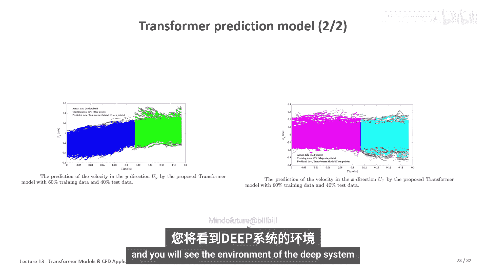
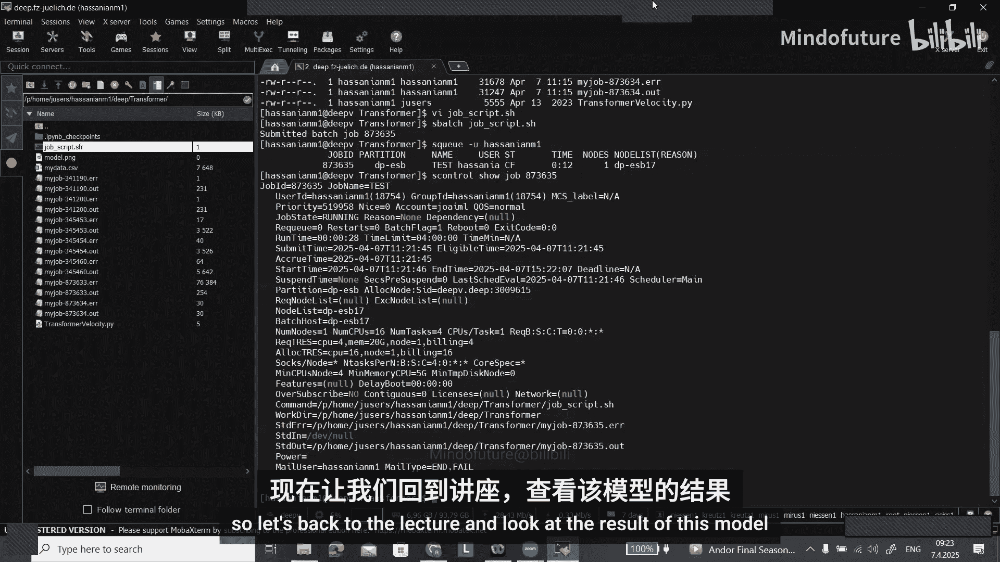
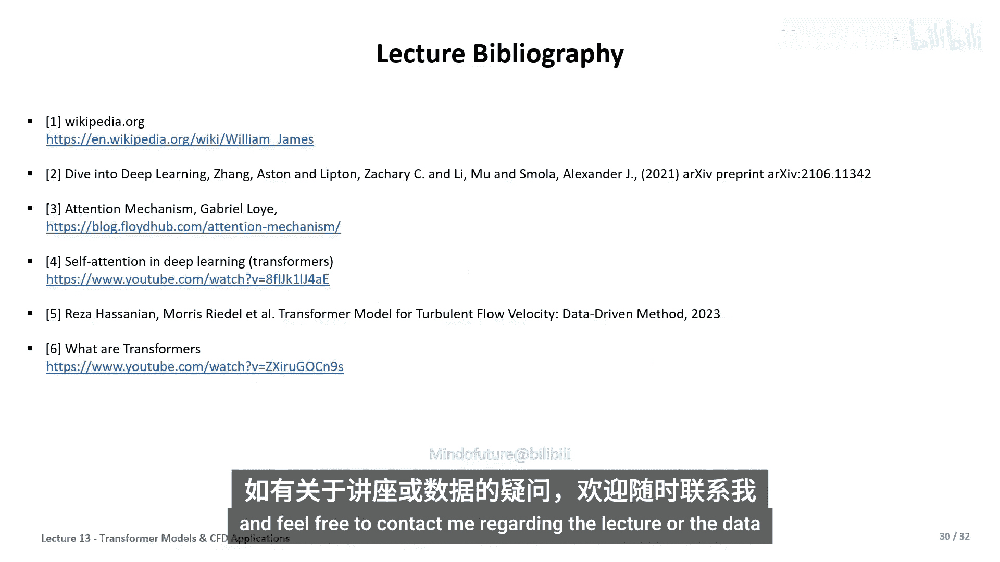

# 【冰岛大学】高性能计算课程-｜-2025-High-Performance-Computing-｜-Prof-Dr-Ing-Morris-Riedel-p04-P04_短讲座_13_Transformer_模型__CFD_应用--BV1k34zzaEK8_p4-

Good afternoon everyone， welcome to Highperformance Computing Advanced scientificific Comput course。

 so we are here to continue on the Le 13 Trans Mo and CFT applications。

In the second part of the course， we had a focus on the CFD application and how it's aligned to HPC and why HPC is important。

 we looked at the numerical approach of the CFD and why we need the HPC to run this simulation and also had example with some software like Open form。

And we look at the deep learning model in this application today we will continue lecture 13 and we will present the recent and novelel model of the deep learning。

 which is covered to be used in the F dynamic area with combination of the HPC resources。

As usual in these course， we plan always to have a review on the previous lecture shortly let's have a review on the of the lecture 12。

which was lattice sportsman at CF application， we point to some important feature of the lattice sportsman equation。

 first of all it's working base of the miroscopic scale and we said this scale its place between the microscopic and microscopic scale。

 we are not following the particle like the microscopic scale。

However it's based of the probability distribution and based of this idea。

 we saw how we get to the equation of the lattice sportssman。

 there was a comparison between lattice sportssman equation and regular C the traditional method。

 we saw some。呃。We of the CFD in contrast to the lattice sportsman equation。

 additionally regarding the high performance computing and power computing。

 because lattice sportsman equation working based on the two event which is include steaming and collusion。

It's great for pilot computing and it's a great part of it and also about some limited application like post media。

 which regular CFD， it's not work properly， it's working very well。

How a still sportsman in development and many research going on this method。

To make it much more applicable， for example， in the turbnet flow application。

 one of themato that need to be resolved in every lattice spokesman simulation is the vicosity。

Wwhich is a complex term， especially when were working with He number for the larger scale。

 the concept itself' say the dominant feature based on the energy transfer between the large at and the viscosity doesn't work two much。

 so it's required to specify the viscosity for the lattice sportssman model however for the smallest scale。

 the viscosity is the dominant player in the flow。With this short review。

 let's go back to our lecture 15。In the lecture 17， we will have。

Some introduction about the attention mechanism and what is it and how it' led the transformer with it。

诶 and the summer咩。part of the transformer models like self attention and position includingco。

 how it make it great to be used in the deep learning model and it's a powerful model。

 which is basically we call it encoded decoder architecture。诶按即。

We will discuss example from the F dynamic and how we can use the transform model for it and we will shortly look at the deep system to see how we can submit example of the transformer model training with data to make a prediction for turb flow。

Then let's see the attention mechanism。 and its fundamental。Based on the detail issue。

 the idea of the attention and self attention mechanism is relevant to the attention cues in the bio。

In fact， based on the biology and human study， the knowledge of the human when getting information from the environment doesn't post in all the information in fact there is a direct attention capability which only take fraction of the information of the interest to the brain and then focusing on that special part of this information。

 so these make the human be capable with a lot of information。

Getting the point to focus on it and without posting all the information with a long period of the time。

When we。Investigating these attention cues in the biology。

 so how the attention is working with the visual world。

 this idea it came from William James in the 1890。And in fact， it's defined at firm work。

 the subject activity from the attention， both relevant to non volal cu and volal cu。

So this is the base idea therefore we have two categories of cues。

 we can say two type of the cues and how they are working that's making the human able or with a lot of information just taking fraction of the information and directly point to the part that it's needed at the time when with the visualization gain the information。

Let's have an example to see how the noneal Q and volal Q are working。In the first example。

 in the right hand side， we have45。Object， which are paper notebook and a cup of copy。呃。

When we are using the volitional queue。Directly， we are looking for a book to read a book。

 So without more poing M O。5 object。 We will look at the book between them。

 So this is the defect of the。AVitional cu， which directly find the object base of the aim。

But in the nonvolal queue， which in the left hand side， we have against these different object。

 The idea is to look or find the thing which is non paper。 and also we can say the red cup here。

This is based of the comparison， So we will see what is between this object。

 It's a non paper is doesn't made from the paper。So we are looking to the red。

This is the criteria that how selection is working between these two depend。呃。

Selection and these idea used to be modified and。In the attention mechanism。

 which is led to transform a model one of the powerful deep learning at this time。

If we look on the simple attention mechanism here in this figure。

We can say the attention pooling is designed in this way， that。Volal cues， which is called QB。

 can interact with the non volal cues， which here is called keys and with values or sensor inputs。

 it can guide the bias of the selection。Here in this figure， the key values and the query it。

AD that how they are interconnected。And how the。Values make the weight for this data。

 and we can say it's making attention and self attention based off these model。So， well。Here。

 we can see how when we have data input for the model， with two part of the attention。

 which is among all the data and also self attention， which make the。

Importance of each one as giving weight for them this transformer working with data。

To give the output of the model。So if we want to have a look on its architecture。In the beginning。

 the transfer used for language and the translation。

 so we can say the basic of the working with the input and output fairlyly。

There is a general attention which work with going between the input and output element。

 and also there is a step attention with working with the input element。

So let's see the example here that we have a sentence。

How was your day and which one to turns later to the French version the attention mechanism。

 what is doing here， the voltage in the output set is map the important and relevant words from the input set and these assigned the higher weight for each of these words of the accuracy for the output of the perition。

This is what the self attention making。And which usually we say the encodeder of decoder capable to。

Make a attention mechanism mechanism system between the8 input and output。

And that is the problem of the。Attention mechanism， which here we will look at the transformer model。

When we look at the sequential model like what we have in the Bitcoin neural network and in the previous lecture we discussed it and we said in the Bitcoin neural network in the basic one。

 there was a vanishing gradient problem when we woke with a long period of the data。

And with some modification， like with long short term elessium and glue， it's re。

 how with the encode a the model like attention mechanism。This working much better。

 because base of the。Selectivity that is available in the。Tranformer model of attention mechanism。

 There is a mapping between the output and the input。 so easily the data from deco deck。

 which is posting the output have access to entire output sequence。

Input and so it's able to make a selectivity and pick out the specific element from the sequence。诶。

Therefore， we can say in this mechanism， the focus and place more attention on the relevant parts of the input sequence as needed。

 which makes it powerful because mostly we're facing problem when we don't have history from the input。

 when we don't have enough information from the input and we can't find a mapping between them。

Especially with long term of the data。So it seems the transform with this idea which mapping the output to all input in the queue。

 making these challenge easier to work with long period of data and we can use it for sequential model lifetime time series。

So we look at the transform architecture and how the different layer or step offered in this architecture is working with data before that let's point to the attention mechanism type。

 which basically there are two different major type by attention and long attention。

 the principle of attention of these two type is saying and the only difference is the architecture and the computation for these two different type。

A phone don't know attention。Here， you can see the step how the data is posted in these principle。

 how。The main。Change or aim of the improvement of these attention for the sequence to sequence mode。

It was for machine translation by aligning the decoder with relevant input sentence and implementing attention。

 So this is the most change and important part of this model。

 which made too sequential to sequential model。 But let's see how is difference with the long attention model。

The long attention model， as we said， it has the same principle， but。

The main difference between these two it the way that the alignment is square is calculated and also the position at which the attention mechanism is big introduced in the deco for the。

Long attention， the type of the alignment squing function。 However， in the bar。

 there is only one time。 So here we can see the difference between these two attention， mechanism。

 which is proposed。And we will continue to see how we use the transformer model base of these attention mechanism。

The impact fact this structure of the transformer include two level of the attention， we can see。

When the input of the data came to the model as and in fact。

 with feeding the model with sequence of the。Tokens into attention， pulling。

It will be caves of the key and values， which is。Also connected to Q。 Therefore。

 these generating one attention output。And also， because these three attempts。

 queries and key and values came from the same place。These making with attention level， also。

With the data so with two level of this attention， were able to mapping the output to all input with these design and making the model much more powerful than the regular sequential model like computational network or。

诶俾个。For the transformal architecture， this is the base。

Dgraph that presenting the transformer architecture。 It came in the first paper of this work。

 which you。They a thing。We can see it basically， there is encoding and decoding part。

And with the position eming is getting this power with the attention and posting the data and including them in the first part and then going to the encoded。

 And again， with the。呃。Multi had attention in these two parts， As we said， it's make the。

Great capability to make a connection and mapping between the output and whole input in the model。诶好。

As we mentioned， we are interested to use this model for sequential application。

 which is midtime series。 Then we have a data with。correlationlation to the time。

 then it would be great to input this data， which has a time correlation with the positional embedding。

 It's making。AGreat turning to the model to predict unseen data of these。A use case。

 which has a sequential behavior。Here we have listed some feature of the transformer model。

 how it's working with the data which came in the original paper。In fact。

 the transformal model have encode andequ layers。The number of the encodeal deco layers should be same as in the first original work it had six deco layers。

Of course， finding the number of the layer， there is no magic number and it's required to examine and find the right number to have an optum transformer model。

Also， regarding the computing， which is the most important part in the deep learning and we are talking about it in this lecture。

About the computing part， In fact， when we。Comparing the transform with regular。

Sequial model like long short term SM or gate the unit need go。 it's working with less layers。

 less layers is mean less computing。 So it's it's very important。 that it's mean with the same data。

 for example， if we are working with transformer is expected to。诶 get诶。Speder。

 and so we need less computing power。 Furthermore， from the experience work also when we work with high fluctuating data。

 it seems the transform with same data has a much more power to get some extent event or。

Fation in the data when we have a very noisy data， the transformer has a much better capability with less training it can able to get this fluctuation。

 which in or study or visit with the SM need to work with more data training。

 more computing to be able to get this data。 So these are some。

A specific point related to the transform。 And it's making as you know， currently。

 the encode and the model great option to work with sequential data。诶Here。

I added this slide to see the statement from this main paper of the transformer。

 that's how they explain the transformer public and how its they use。

Significant improvement in the computational efficiency through factorization tweaks and conditional computations。

 while also evolving model performance in case of the letter。 So this is。

The main point that is mentioned in the paper， which in the beginning。

WeNotified the capability of the publicization of the transformer model。

 how well in the recent years in this research， we had also in our research group and in the literature。

 it seems it's working very well， especially with large data。

And in terms of the performance and accuracy， it's able to work much better than regular sequential models。

Now， let's see an example from the fluid dynamic。CfD and how we can use the。

Tranform a model to make a prediction for such data This is of course case study based of the data development。

 the data is from the experimental fluid dynamic and in the previous lecture we discussed this that how we need valid data and reliable data to be used for to random model in the fluid dynamic community to be sure that these model results is。

Therefore here in this study， were using data from the experiment。

The second point is finding the correlation between the input in the first step。

 we designed to use term cells of the velocity only as a function of the time， however。

To make the model much more general， we investigated at this point that training each component of the velocity individually。

 which mean one time the transfer of model， we train the velocity component， for example。

 in the X direction。 and the other time we turn on the y direction and make a prediction for them individually。

 the complexity of these model and how it able to make a prediction as we know its based of the。呃。

P that its working the。 But we we try to understand what the。

Coorlllation between a different component。 In fact， the velocity very。

Important feature in the fluid spin， which were， as you。

 its time all the required information of the turbulent flow to be able to make a prediction。

 That's why when we are training a model with the velocity， it's gaining all the information。

 all heat feature of the flow， then able to make a prediction。

So let's point to this important matter that in the CFV I reserve or in the fluid dynamic。

 we can say we have experimental approach， which we said it's limited to some point。

The analytical approach it's not available only for field numbers of the turbulence flow problems。

 the other approach the Ne approach and we said it computational of light dynamic CFD。

In some it's limited。 first of all， if we want to have a very accurate solution and with high service solution。

 we need to use the diectchemical solution。 and we said in the DNS。

It's costly and required a large computation power to do that。

 These make it not interested option because of the limits of the power in the many。

 it's of course the HC developing fast。 However， we are still power to use the HPC for every size of the turbulence flow。

 especially with three dimension and with high number。

This is still the limit that we have on the machine on the memory of the computation and the posting of data and also we have some term that you specifying them in the CFD increase the computation requirement。

 for example， the gravity is a term when it's added to the numerical approach which will add the other term for the computation and entering the computation power。

So the computation power one limit and also for some problem like Thomass video。

The CD doesn't work perfectly， and we mentioned for the CFD， we need the boundary condition。

 initial condition to solve such problem。 and in some use cases。

 this is also challenge to have all required information。

So to overcome on these limits and problem and going forward。

 always there is a step to find alternative or improve the method that's available one other approach that we talked in the previous lecture was lattice spokesmen that reso some matter that may be limited or difficult on the traditional CFE and under the approach that in these days come it machine learning and deep learning。

 which is working with data div approach so it means we don't need to give a theory or the analytical equation to the model and is working based on the data。

However， the limit and the range of this model， Where is it is still unknown and with every single use case。

 getting much better the knowledge in this area。But it's good with the power of the HPC working with large data from the flight and for the tut flow and study this phenomenon in the lecture element。

 we presented the sequential deep learning model， we use data from the tablet flow with LSTM and go and we presented。

Its capability in this lecture， we will look on the transformer。

 which will out based on the encoded deco layers and its them。

It's working properly and it's able to capture much more detail from the turning later to make a prediction。

This is here a we about the problem of the turbulence flu。

 as we know it's und problem with the classical physics。

And here the method we mentioned that the CFD could be used around LES and DNS about the available hypothesisthe in the term of the turbuls below。

 there are two main assumption on the basic hypotheses one is homogeneous and isotopic which in the largeed they are completely not isotopic and the small E mostly on istop so this make this hypothesisthe working on the limit area and also including the universal e of theoryV there are。

Some challenge that baachelor for example， introduce the comoco hypothesisthe working on the universal equilibriumal so what when we have nonequal system。

 what's happening and also this figure presenting nice presentation of the energy cascade how from the largest scale。

 the large size of the E， the energy transfer to the small one and split it to smaller size of the scale？

So this is the based and fundamental hypothesis that is available in the turbulent flow。

 however because of this limit that we mentioned here。

 the comohy has a limit and also the universal economy。

 the data driven approach in the deep learning is great application because we don't need to feed the model or inform the model from the theory。

Then it's based。 Its working base of the data。Therefore， in our research， for example， in this area。

 we use the transformer model with four encoder and decoder layers。And you can see here。

 the data the。The blue color figure is presenting the velocity in of the turbulence below in the y direction and the giving one presenting the velocity component in the X direction。

 So we have a two components。That they are separated。

 and we can use these two components to turn the model and make a prediction of them individually。

 These make the model。Benefit to be used， for example。

 when we have TV components of the turbence flow can use them。

 I should mention here that these data use two components because the measurement taken with one high speed camera in the particle tracking velocity of La particle tracking and therefore。

 we have only two component to run the and capture the information of the experiment with。

A city component is required to have more than two camera to get the accurate data。

And it's not actually subject of the research。 The most important thing regarding the turbulence flow。

 the turbulence flow is a t dimensional event， So it's required to simulate the turbulence flu and TV dimension to capture all the information for example。

 in the sea of this simulation in the experiment we are working with real of data It mean the data carries all the information from the turbulence flow in TV dimension。

 but the only capture data during this measurement was in two dimension It doesn't mean these model its length of the information of the TV dimension turbulence flow。

Here you can see results of this model prediction for transformer here with 80% ratio of the data。

 the 80% training， we can see how much the prediction it match in the test part of this model。

 one for the X direction and one for y direction of the velocity。

 also we reduce the training ratio to 60% to see how the model is working。

 of course the accuracy went down however。Still it probably have a nice prediction and it seems when we are going forward。

 it's losing its accuracy So it seems， of course， the 80% training is working much better for this prediction now shortly。

 let's go to the SC system and present to how the running this work you can use the deep system or earlier to run this transformer model training with the data and make a prediction for such application in the flood dynamic and you will see the environment of the。

Deep system。

So let's have an example with the transformer and to see how we can submit a job。

 I'm using the deep system machine， some of you have access to earlier and some of you beep so I will run this example on the deep。

Here， let's get A。If you want to have a look on the data that we have here。

 you can see the project if you have assigned before。Here we have the time formula。All this example。

 I want run it。Let's look at the file that we have here。 We have the batch cube file here。

We look at the setup on it。And this is the result from the previous one was this is the data which you use to turn the model。

 and here the python code for this model。 So this is the requirement and we will need to modify the batch file。

 Then we submit it。 Now let's go to the。Is directory。哦无论。😔，Go to the batch find。

Here is the batch file。As you can see， we need to define the project that we will get access to。

 then we will specify the politician。You can see the politician that's available in your project。

Here we are working with deep， we have different partian。This is a job name。

 you can a specify number of the node and task square node and etc。

AndThen here the module that is required for this setup and here the command tool around this walk via are the batch。

诶 so。As you know to submit the work and the other file that it' required， as we said。

 we have the data and of course quote the Python quote， which is here。

 so we only need to submit the work and wait to see when it's getting the result。

So did is the command on。Then when we submit， we have there。嗯。Job I D here。

 We can see what we have on the queue。Here is presenting us that the work is submitted and their job Id and it's in the queue and。

If we want to look on the detail of the work， of course， we can use less con。

With the job I and here it's presenting us to work it ironic。😔，Then when it's done。

 you will see the result。 And if you get some oil， maybe you can look at the。

F of the error also and see how you can。Do some modification so this is a very short presentation of the example how you can submit a job on the deepS step and of course in a similar way you can use earlier。

 however of course the system information and the job skill need to be modified based on that system。

And you select the politician。So， let's back to the。Lectture。And look at the results of this。

modernern。呃Here。I want to mention the hyperpowermeter optimization， how much is important。

 for example， in the studies that I presented here。

 we had the L andTM go and the transformer you can see in this table how。

That mean absolute evil and our to score and one time。For these different。嗯。

Mo in this table you can see one of the column is go edge。

 which is mean go hyperparmeter optimization。 This go model has a larger data than other TV models that it's done before。

 but with hyperparmeter un it's get we can say higher accuracy and a shorter time the data that used for this go model I can say it was。

Doublin， however， the computer share here is lower than two other mode。

 So this is presenting the importance of the hypermarket huming for such model。And。

That's why it's very important to select the correct values for the hyperparmeteral in the deep learning model。

Here also， there are resultss from the speedup when increasing number of the GPU。

 as you can see in the table2， there are same node number on the Jus booststep system and also on the deep down module。

With increasing the GPU and the drill booster， the speed up getting reaching like more than 2。

6 times than the first one GPU。 And in the figure also。

 we can see how it speed up the turning of this model。

And also in the table one is presenting the performance with these different model that we talk about them with similar data with 80% and 60% training。

 and also we talk the Transformer is working faster with a similar data set than Google and LSD。

Regarding the hyperparmeter optimization here I presenting example on the Jus boost you can see with four GPUs here the hyperpar is doing what with the batch size per GPU and you can see when the batch size increased。

The main absolute album it。Went down and at the batchside of 512 is getting the minimum value。

 And again， after that went up。 So we found that these batch size per GPU is the optimum1。

 therefore the computing also time， you can see it reduced to 255。

 when we had four when we had8 batchside， you can see how much difference between the computing so。

 So the optimal optimization with the hyper monitormeter， reduced the level。

 and also increase the speed off of these mode。To have a conclusion of from this application。

 we can say these model work with the data from the turbul flow without any information from the hypothesis or analytical assumption and its work properly is make a great prediction with 80% and 60% training with very high A score。

And this is based of the Lagonian framework that we explained it on the next 11 that how we can find the correlation between the local properties in the Lanian framework to the time as a time series and feed the sequential model like LSTM go and transform and also it working with CNN based of this idea。

Then make a prediction for this data。 These approach could help us to study the turbul flow for longer period。

 For example， we can generate longer period of the data and study the turbul flow。

 and also some application making prediction will help in some industry。

So here we are ended with this lecture lecture 13， transformformer model and C application。

 there is a video here is' presenting a self attention deep learning link on the transformers and I suggest you to watch it the link is irrelevant in the references。

And feel free to contact me。You the lecture or the data。

Good luck。your final project。