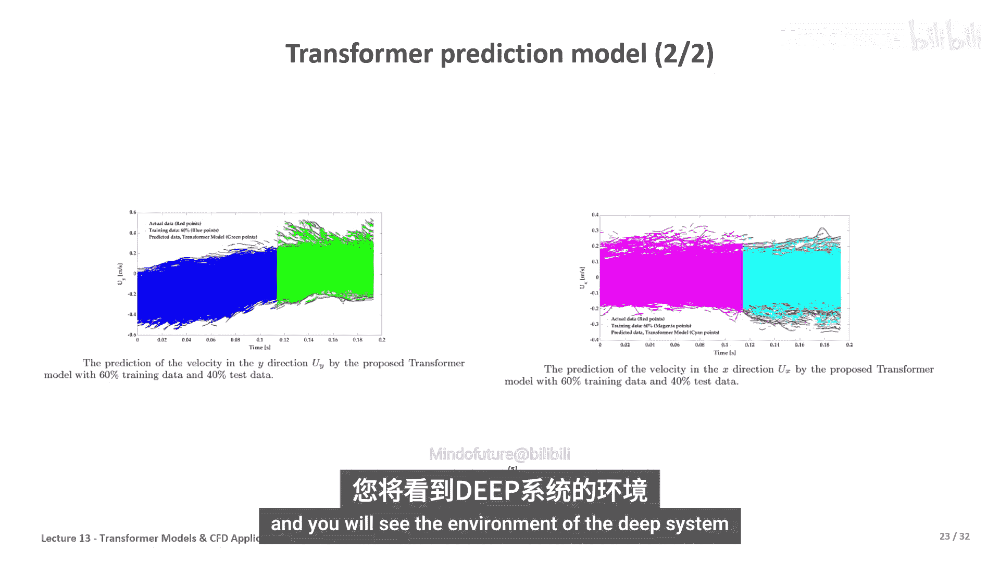
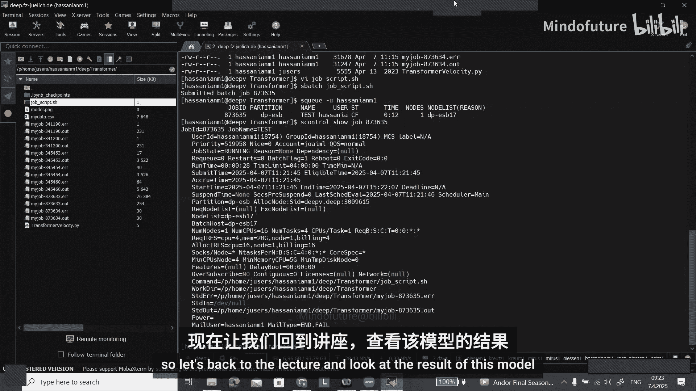
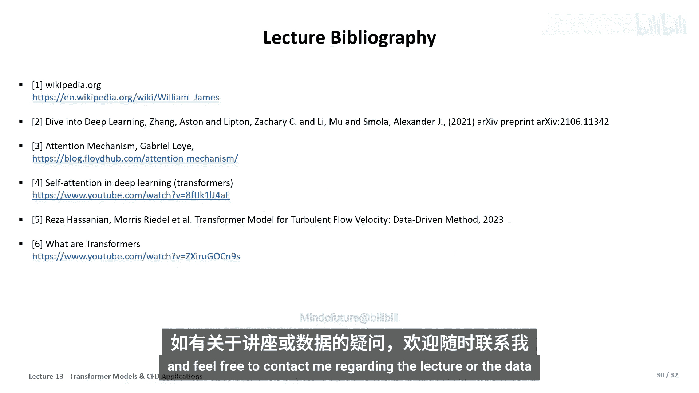

# 高性能计算课程：P04：Transformer模型与CFD应用 🚀

## 概述
在本节课中，我们将学习深度学习领域一个新颖且强大的模型——Transformer，并探讨其如何与高性能计算资源结合，应用于计算流体动力学领域。

---

## 回顾：第12讲内容
上一节我们介绍了格子玻尔兹曼方法及其在CFD中的应用。该方法基于介观尺度，介于微观和宏观尺度之间，不追踪单个粒子，而是基于概率分布函数。我们对比了格子玻尔兹曼方程与传统CFD方法，并讨论了其在并行计算方面的优势，特别是在多孔介质等传统CFD难以处理的领域。然而，该方法在处理湍流等复杂流动时仍需发展，例如需要精确指定粘度参数。

---

## 本节内容：Transformer模型简介
本节中，我们将介绍注意力机制及其如何催生出Transformer模型。我们将探讨Transformer的核心组成部分，如自注意力和位置编码，并分析其强大的编码器-解码器架构。

### 注意力机制基础
注意力机制的思想源于生物学中人类处理信息的方式。人类并非处理所有环境信息，而是有选择性地关注感兴趣的部分。这一概念由William James在1890年提出，并分为非自主性提示和自主性提示两类。

以下是两类提示的工作方式示例：
*   **自主性提示**：例如，在一堆物品（纸、笔记本、咖啡杯）中，若目标是找书阅读，注意力会直接聚焦于书本。
*   **非自主性提示**：例如，在一堆物品中寻找“非纸质”或“红色”的物品，这需要基于比较进行选择。

### 注意力机制模型化
简单的注意力汇聚模型设计如下：自主性提示（称为查询，`query`）与非自主性提示（称为键，`key`）进行交互，并结合感官输入（称为值，`value`），从而引导选择偏向。该模型通过为数据分配权重来实现注意力和自注意力。

当模型接收数据输入时，注意力机制（关注所有数据间的关系）和自注意力机制（评估每个数据元素自身的重要性）共同作用，为数据赋予权重，最终由Transformer模型产生输出。

### 从序列模型到Transformer
传统的序列模型，如循环神经网络，在处理长序列数据时可能面临梯度消失等问题。而Transformer模型通过注意力机制，允许解码器访问整个输入序列，从而能够有选择地聚焦于输入序列的相关部分。这种将输出映射到所有输入的设计，使其在处理长时间序列数据时更为强大和高效。

---

## Transformer架构与类型
让我们看看Transformer的架构及其不同层如何工作。首先，注意力机制主要有两种类型：加性注意力和点积注意力。两者的原理相似，主要区别在于架构和计算方式。

### Transformer架构解析
Transformer的基础架构图展示了其编码器和解码器部分。通过位置编码和注意力机制，数据被输入模型。编码器和解码器中的多头注意力层使得模型能够在输出和整个输入之间建立连接和映射。

由于我们关注其在时间序列等序列数据上的应用，因此将具有时间相关性的数据与位置编码一起输入模型，可以很好地训练模型以预测未见过的序列数据。

以下是Transformer模型的一些特性，源自其原始论文：
*   模型包含编码器和解码器层。在原始工作中，两者均有6层。实际应用中，需要试验以找到最优层数。
*   在计算方面，与LSTM或GRU等序列模型相比，Transformer通常使用更少的层数，这意味着在相同数据下需要更少的计算资源，速度可能更快。
*   经验表明，对于波动较大的数据，Transformer能够用更少的训练捕捉到极端事件或波动，而RNN可能需要更多的数据和计算才能达到类似效果。

这些特点使得Transformer成为处理序列数据的强大选择。原始论文中也指出，Transformer通过因式分解调整和条件计算，显著提高了计算效率，同时提升了模型性能。

---

## CFD应用案例：湍流预测 🌊
现在，让我们看一个流体动力学领域的例子，了解如何使用Transformer模型进行预测。本案例基于实验流体动力学数据。

### 背景与挑战
在CFD领域，我们有以下几种方法：
1.  **实验方法**：存在局限性。
2.  **解析方法**：仅适用于少数湍流问题。
3.  **数值方法（CFD）**：也存在限制。例如，要获得高精度解，需要使用直接数值模拟，但这需要巨大的计算资源。此外，对于某些问题（如多相流），CFD可能效果不佳，并且需要边界条件和初始条件，而这有时难以获取。

为了克服这些限制，除了上一讲提到的格子玻尔兹曼方法，另一种新兴方法是基于数据的机器学习和深度学习。它不依赖于理论或解析方程，但其有效范围和局限性仍在探索中。

### 湍流问题与数据驱动方法
湍流是经典物理学中的未解难题。CFD中常用的LES和DNS方法基于某些假设，例如均匀各向同性假设，但这些假设在大多数实际流动中并不完全成立。数据驱动方法则无需向模型灌输这些理论，仅基于数据工作，因此在此领域具有巨大潜力。

在我们的研究中，我们使用了一个包含4层编码器和解码器的Transformer模型。数据来自粒子图像测速实验，包含湍流速度的X和Y两个分量。我们分别使用这两个分量来训练模型并进行独立预测。

**重要说明**：湍流本质上是三维现象。本实验数据虽源自三维流动，但测量仅捕获了二维信息。这并不意味着模型完全缺失三维信息，但需注意其局限性。

### 预测结果
使用80%的数据进行训练，模型在测试集上对X和Y方向速度的预测结果与真实值吻合良好。当训练数据比例降至60%时，模型精度有所下降，但仍能进行合理的预测，不过随着预测步长增加，精度会逐渐损失。显然，80%的训练比例在此案例中表现更佳。

---

## 实践：在HPC系统上运行Transformer模型 💻
接下来，我们简要介绍如何在Deep系统上提交和运行Transformer模型的训练任务。

以下是提交任务的基本步骤：
1.  准备必要的文件：批处理脚本、Python代码和数据文件。
2.  编辑批处理脚本，指定项目账户、分区、作业名、资源需求（节点数、任务数等）、需要加载的软件模块以及执行命令。
3.  使用`sbatch`命令提交作业。
4.  使用`squeue`命令查看作业状态。
5.  作业完成后，查看输出和日志文件以分析结果。

在Euler系统上的操作流程类似，但需要注意系统特定的配置和分区选择。

---

## 超参数优化与性能分析 ⚙️
超参数优化对深度学习模型至关重要。下表展示了不同模型（LSTM, GRU, Transformer）在类似数据集上的性能对比，其中一项是进行了超参数优化的GRU模型。

| 模型 | 平均绝对误差 (MAE) | R² 分数 | 计算时间 | 备注 |
| :--- | :--- | :--- | :--- | :--- |
| LSTM | 数值A | 数值A‘ | 时间A | - |
| GRU (无优化) | 数值B | 数值B‘ | 时间B | - |
| **GRU (带优化)** | **数值C** | **数值C‘** | **时间C** | **数据量翻倍，但计算时间更短** |
| Transformer | 数值D | 数值D‘ | 时间D | - |

可以看到，经过超参数优化的GRU模型虽然使用了更多数据，但获得了更高的精度和更短的计算时间，这凸显了超参数调优的重要性。

### 并行加速效果
增加GPU数量可以显著加速训练过程。在Juwels Booster和Deep系统上的测试表明，当GPU数量增加时，训练速度提升了超过2.6倍。

### 超参数优化实例
以批量大小为例，在4个GPU上进行超参数搜索。结果显示，当每个GPU的批量大小达到512时，平均绝对误差最小。同时，计算时间也大幅减少。找到最优的超参数组合既能降低误差，又能提升训练速度。

---

## 总结
本节课我们一起学习了Transformer模型及其在CFD中的应用。

我们首先回顾了注意力机制的生物学起源及其在深度学习中的模型化。接着，深入探讨了Transformer的编码器-解码器架构、自注意力机制和位置编码，并解释了其相对于传统序列模型的优势。

然后，我们通过一个湍流预测的实际案例，展示了如何使用基于实验数据的Transformer模型来克服传统CFD方法的一些限制。该模型无需任何湍流理论假设，仅基于数据就能做出高质量的预测。

最后，我们简要介绍了在HPC系统上运行此类任务的方法，并强调了超参数优化对于提升模型精度和计算效率的关键作用。

这种基于拉格朗日框架将流动局部属性与时间关联，并输入给LSTM、GRU、Transformer或CNN等序列模型的方法，有助于生成更长时间的湍流数据，用于深入研究，并在工业预测应用中发挥价值。

---
**建议**：关于Transformer和自注意力的更多细节，可参考课程资料中提供的视频链接。
**祝各位期末项目顺利！**