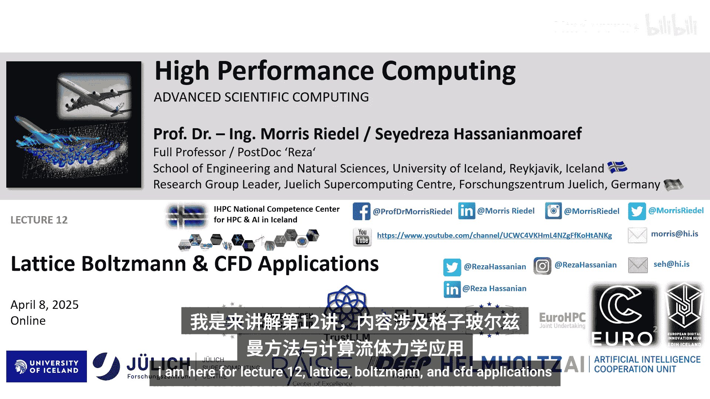
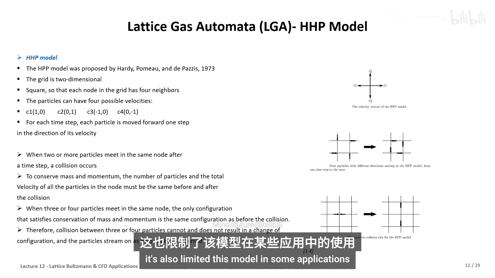
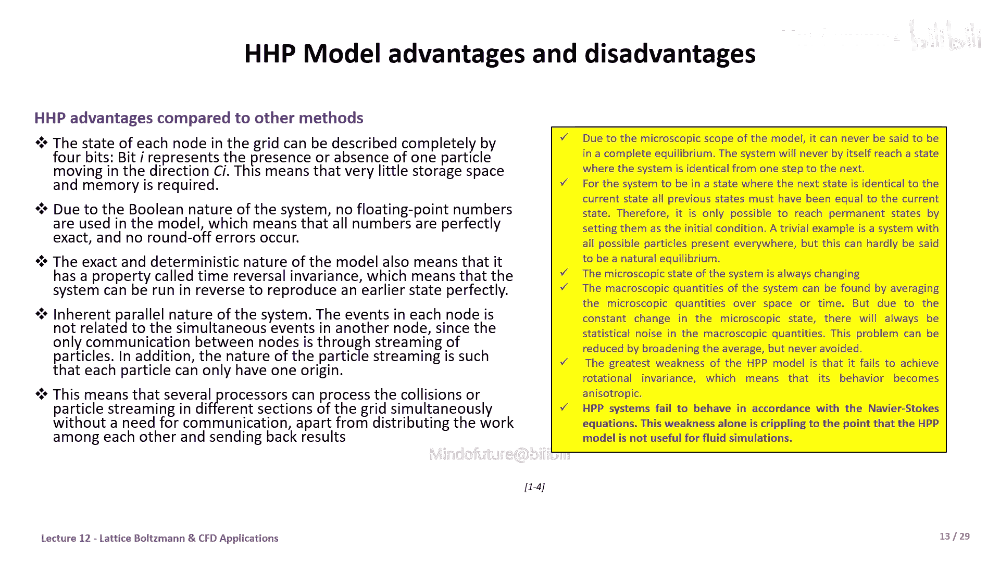
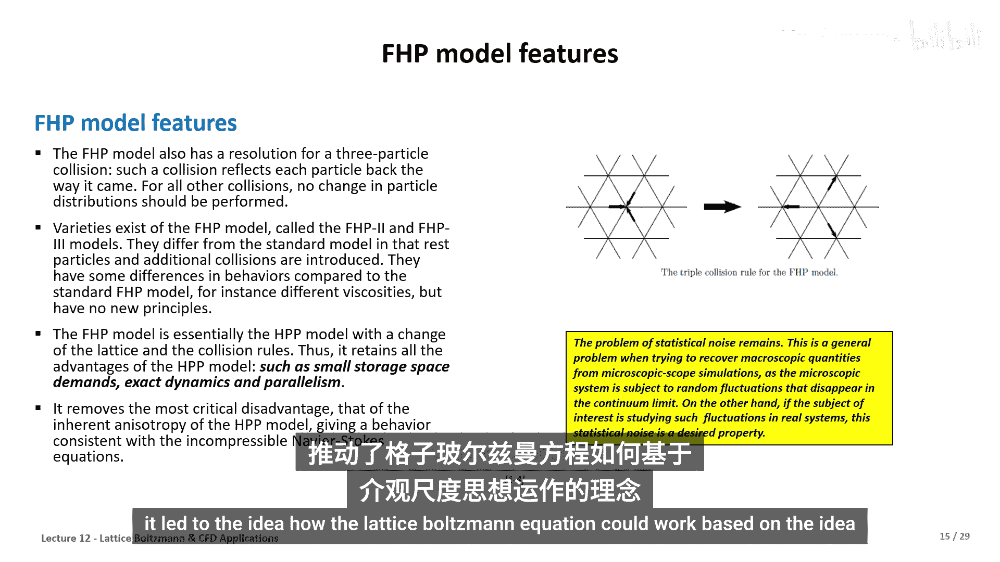
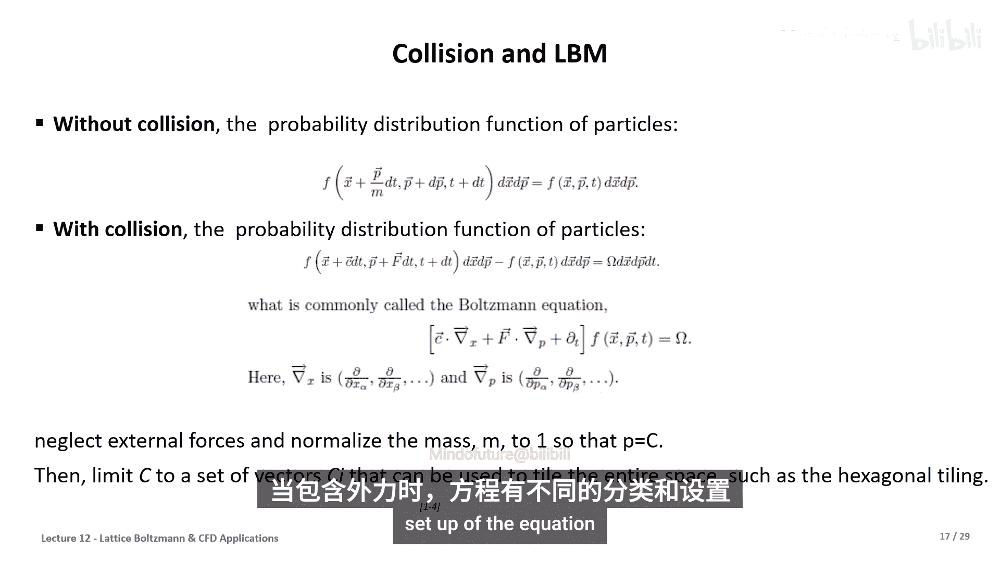
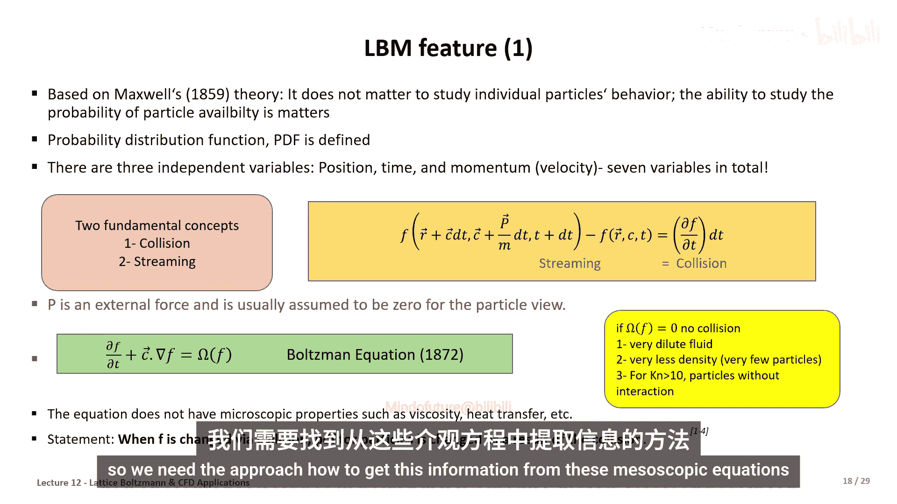
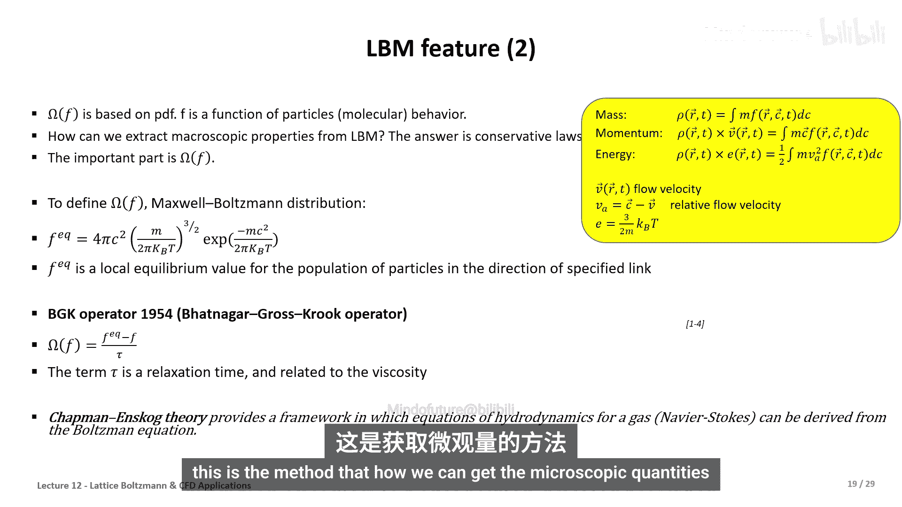
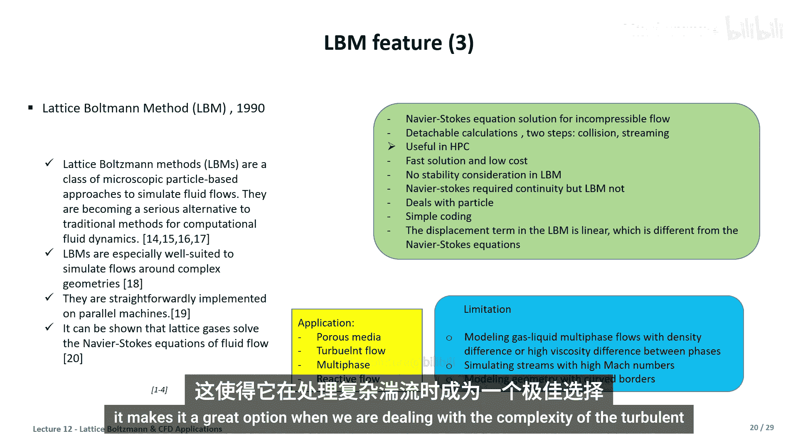
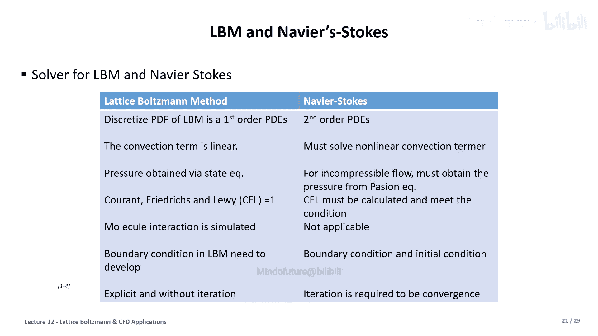
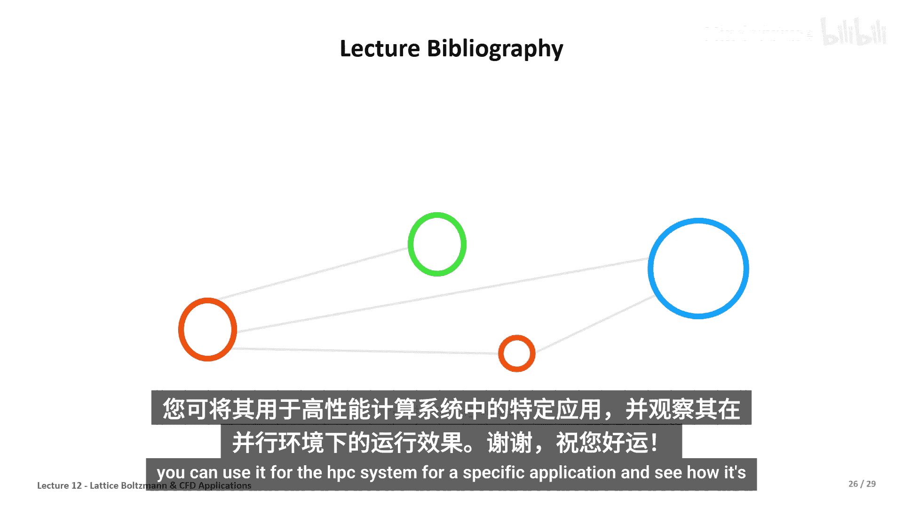

# 【冰岛大学】高性能计算课程-｜-2025-High-Performance-Computing-｜-Prof-Dr-Ing-Morris-Riedel-p05-P05_短讲座_12_格子玻尔兹曼__CFD_应用--BV1k34zzaEK8_p5-

Hello everyone， welcome to High performanceformance Computing， Advanced Scientific Computing course。

 I am here for Le 12， lattice Btzman and CFT applications。

The following of。Outline of the course this year， which is a CFT special， so we have lecture 2。

Let's in the beginning have a review on the previous lecture。In lecture 11。

 we discussed the deep sequence models from deep learning in the F dynamic and CF application。

 which it' interwined with HPC。Because of two major reason， one of them was large data。

 which is required computing power and also in the most application we need。

A large deep learninging model for the sequential model。

 which also is make it require the computing resources to train the model and then。

See the prediction， how it's working。We talked about the importance of the prediction in the fluid dynamic impact in the fluid dynamic。

 we have unsolved problem， it's called turbulent flow。

And we discussed this matter from the second part of the course。

 which we started with the introduction to the CFP。As we said in the tut globe。

 currently the research using some limited analytical approach。

 there is experimental and the other numerical approach。

 which is called CFD with combination of these three different categories still it's unsd and there is a lack of knowledge about the tuulence flow。

 in only in 1941。There is a hypothesis from Conbogo， which explain。How the process of the。

Different scale in the turbulence flow， which it mean how the largest scale transfer the energy to the smallerest scale。

 However， these hypothees have a specific assumption， for example， the flow should be isottopic。

 however， in the most application， it's on isottopic。And also about the largest scale。

 which is most complex part of the turb flow steel， there is not much known about it。

Then we explained how we can use the deep learning for the turbulent flow。

 we specified we need to determine a connection between the data from the flow field and the architecture of the deep learning model。

 we explained how we have lagium framework in the turbulent flow which is following a particle in the flow field there is a correlation between the flow purposes like velocity with the displacement and the time so we can assume these data is the time series or sequential data。

 therefore we can define a connection between these sequential data and the sequential model of the deep learning。

And using this data to train a model and see how it's working with a prediction。

Also we emphasize on the statistics approach， which is in the tuult flow applicable and it's addressed very well in the literature。

 which is when we can work with different realization of the tuult flow to use this sta data and study tut flow additional。

 we mentioned that in the tuul flow。We cannot have a similar visualization for the experiment when it's done with similar setup because of the sensitivity of the tablet flu。

 especially in the highemble。When it has a height tube less intensity。And additionally。

 regarding the deep sequence model， we said that we needed the data to train this data div model in the fluid dynamic and the turbulence flow。

 the most reliable approach to get to use the data which involve all the information of the tu from the experiment and DVDD simulation from the DNS we mentioned the DNS is one of the expensive approach the numerical approach so there is a challenge at how we can get a large data。

 we can have a data to use the deep sequence models to study the turbulence flow。诶。

I should mention that in this lecture we presented some of the most recent research in this area。

 which they are known and currently known the community of the turbulence group from our research group and stilling our research group we are working on a such model to develop this application。

Now， let's move on to continue on the lecture 12。In the lecture 2。

 we will look at the latest sportssman。Equation， we will see what the concept of this application。

And how we are using this equation for the modeling in the flight dynamic what。

Its application on the tablet flow and what it' relevant to the HBC。

 we will see that lattice sportssman has a great capability to work with parallel computing。

This is one of the reasons that lattice Sptzman application developing fans in this day because with power computing。

 it could be used in the turbulent flow as native approach to traditional CFP method that we were talking about。

Now let's look at the method that could be used in the fluid dynamic。

The CFD was from the numerical approach。 And we said the numerical approach。咩。

Should we define that when were looking on the tuulnet flow。

 we presented three main approach around LES and DNS， and we said。At the limit of each one。

 especially about the HC our resources， which is needed for the DNS。To get the exact solution。

 how we should mention that there are some limits still available。For example。

 in the turbul flu and the fluid dynamic area， we have。

Ty of the flu is called multiface flow and also we have a particle la tuin。

 which is mean the flow has the two phases of the substance and for example。

 a solid particle in a flow。The interaction between these particles and the flow is very complex in addition to complex you the turb flow which is on。

 then its make it very difficult to make a simulation of these especially about the computing and we have effect of the gravity on the particle when we are doing the multiface flow or particle flow。

U and。Adding the effect of the gravity to the solution。

 its make more complexity to the problem and also solving this term of the gravity in the equation adding more the computing resources required so because of this reason in some application we have limit steel from the CF application and as we said。

For the CFD we need to able to define the boundary condition and initial condition for the problem and some problem is still we are not able to do that。

 we talked about the boundary condition for example。

 we talked about periodic boundary condition and non periodic boundary condition。

This all limit is available in the in America which is the most applicable one experiment also we point to limit and obstacle in this approach especially about the cost and about the scanning we are not ever learning the experiment for many studies。

Especially about the cost and also about the devices and the scale and some environment that required to。

Generated for the experiment and the analytical， of course。

 it's the best one and it's providing much general solution to the equation how it's only available to very limited number of the cases in the tube light flu。

With this limit， always there is a search to find alternative or a more solution for this kind of the limit。

 as we mentioned in the previous lecture， for example。

 in the recent year the machine learning and deep learning came to the game and theyre also providing some possibility to be using in the Floy dynamic and view and will be hopefully helping to get gaining more。

Understanding of this complex phenomena。 And additionally， we have the Bzman method。

 which we discuss is in this lecture。 Its additional method and。

Usually in the literature we say it's the alternative methods for the traditional CFD and it's working in some cases that we cannot use the CFD。

Additionally， because it's working with a specific method and we will explain it in the next slide of this lecture。

 it's great to use in the parallel and working very well with HPC。

To start about the lattice Btzmann method， let's have an introduction and a very short explanation about the scale scope that it's relevant to this approach。

There are three scale scope it's used in the definition of the method to dealing with the problem。

 especially in the partial differential equation， we have microscopic which is。

Based of the continuous domain， in fact， when we have a substance， for example， in the fluid flow。

 we are looking at it and the continuous condition。The second one is the microscopic。

 which is non continuous and base of the particle， which is mean when we study the domain of the problem in at each particle we are looking at that particle。

Between these two different scale， we can assume how much difference computing is required。

 For example， when we are looking at the temperature in the domain of the problem in the microscopy。

 of course， with the C， we can。Make a detization of the domain based of the sum condition which we defined in the lecture8 and what size of the special domain and what size of the time step then we can solve and get some information but in the microscopic method we will look at each particle of that domain each particle or we can say each point。

 this make it much more computation it's required and here one of the issue between these different approach the third scale it's the mesooscopic it's based of the statistical particle。

In the simpler word， we can say it's based on the group of the particle。

 we look on the group of the particle and study the probability status of this particle in this specific state of the。

嗯么。Mi Kate， we can。Have a different computation and also different view to study garmin of a problem。

 which here is fluid slope。so诶。This is a different scale that could be used in the studies of the affloid and let's see how we can reach to lattice this Bsman battle and how it's working。

Therefore， when we are talking about the microcroscopicpy scope。As we。

Mentioned in the microsco called， we are studying an element of volume of the flow in the partial differential equation。

 So the discrete of。Msh generation， iss making this scope possible to study。Regarding the continuity。

 in fact， the more mean the more cold mean free path。

 it's very smaller than smallest below like the escape。And there is a number， which it' used。

 We call it not number。 It has a range when the flow it。Meet this requirement of the nucent range。

 we can use the no stack equation。How well solving the now use the location or PDs。

 it's costly in the CFD， additionally， the decuritization。

 which could be led to error in the solution。And also the mesh generation in this type of the study。

 it's high costly and usually when we are generating a mesh for such complex problem in the CFD。

 50% of the computation maybe is going to the mesh generation。Additionally。

 it's limited to some environment like the pose Meium， we can't use this approach in this area。

When we look deeply to the microscopic approach， as we said， we are a look at a particle motion。

 so we have particle governing motion， then we can have the whole flow motion。

 It's based of the molecular dynamic approach。And explaining the particle based on the Newton second law for single particle and the solving the problem with this approach with high accuracy。

However， the computation is very costly because we are doing the computation for every single particle。

And therefore， because the computation for all the particle of the problem， it make it so costly。

 therefore this method is limited is limited to the short period of the study and only limited for few million of particles。

呃。This is one of the limit for this approach， and we can not use it for every problem or large problem。

And only for limited studies， how the advantage of the microscopic approach。

 it's easy understanding and easy poly because we are doing it for every single one。

 then we extend it to the whole flow motion。But。Because of this limit。

 let's look at the messageoscopicpy one。Thus， we can see the methodoscopic average， as we said。

 it's not on the based on the element of the flow and not based on the particle。

 it's based on the sta view， in fact it's when we。Determine the microscopic one is based on the particle。

 but here it' based on the staistic view， not exactly the single particle it's working with long period and large data set。

 so it's solving the matter that we had in the microscopic one。诶 and。

The goal is understanding the average of the properties and probability distribution。

 this LED to probability particle distribution function。

And this is the base concept for the lattice boltzman method and how it's working for the flow field and flow motion。

Okay。Then we can say the misocopy approach is between the microscopic and microscopic approach。

It's not based on the particle and not based on the element or volume of the flow。

 it's basically look at the data statistically so it make it could be used for much broad area and also resolving some limit that is available to other scopes that we discussed。

Based on the detereration， we can say the lattice Watchman method is's something that relevant to the earlier model of the lattice gold automerta is called LGA in the LGA the purpose is to simulate the behavior interaction of many single particles in a gas。

呃。In this way， the idea is。呃 to。Model the gas as a park spare particle。

 they are moving along a regular grid with this case set of possible velocities we call them C for each particle The collusion between the particle is handled by a set of elastic collusion ruless that must concept the system quantities of mass M and momentum P。

This is the base idea when we explain the LGA， therefore， we can see here in this slide。

 how base of the specific。Great， weekend。Define a motion of the particle and find a collusion between them and before the collusion and after the col。

 what's happened， and we will explain it based of the lattice Bolzman equation。

Regarding the LGA method， it has different models suggested to simulate the gas particle。

 one of them HHP model， which was proposed by how the Pomo and deposits in 1973。

This gear it's working in two dimension， not three dimension， so it's only called two dimension。

 and for each node there are four enables which make the particle has a full option of the velocities in four direction。

And in each time step， when the particle is moved in the next time step。

There will be a con mass or momentum examination when the number of the particle and the total probability of all particle in the node。

Examine before and after the collusion， there will be decision to see what the what the status of the conservative mass and momentum This is the base of the idea。

However， because of some limit this， for example， the collusion between3 or four particle cannot and does not result in the change of the configuration and the particle stream on as if no collusion occurred also when3 or four particle meet in the same node the only configuration that set for a conservation of mass and momentum is the same configuration as before the collision。

 So there are some。A statement need to use in this HHP model。

 and it's also limited this model in some applications。

So， as we said， HHB model has some advantage and some disadvantage regarding the disadvantage。

 mostly most of the disadvantage is relevant to microscopic scope of this model。

Which cannot be said that it's complete equilibriumium。 The system has a complete equilibrium。

 and additionally， the HHP model usually face the unisropic condition。

 which is one of the most important isver that it's available and the weakness of this model。Also。

 the microcrsco state of the system。 It's always changing。 So you can see much more。

AWeakness and disadvantage of the modern however。Also this。These are available in some application。

 it's working。And it has some advantage that they are listed here。

The only model， we can say the next generation for the LGA， it's FHP model。

 which is proposed in 1986。It's， in fact， we saw some limit of the。HHP and it change the grid。

 we can say from square lattice to hexagonagonal lattice and these make it its working for in comparison equation and as we can see in this model each in the FHp model the velocity vector getting a strict direction based of the。

Latuce that is defined in this model。So this is the difference that is presented in this model。

 however it has some moral advantage and resolve some limit。For example。

 one of the weakness of the FHP model is dealing regarding the。Getting the microscopic quantities。

 in fact， because this model they are based of the microscopic scope。

 so finding the maccroscopic scale of quantities， it will be difficult because in the microscopic。

 the system subject to the random of fluctuation。And these random of fluctuation are disappear in the continuum limit。

Additionally， the problem with the statistical noise is remaining in this model。

However it resolved some limit of the previous model， as we say and。

It has a much more application than HHP。But this。Definition of the lattice， it's。

L to the idea how the lattice spokesman equation could work based off the idea of the Meisco。

So here we can see one of the model for lattice Bosman metal。We can see each particle has。

Different velocitylocities。 And it's based off the probability distribution function。

With our quantity explained here， X is the equation。 T is time， and P is the momentum。

 And we are looking for the conservation status for these。嗯。quantitiesantities。

And the base concept here is the quantity of the particle will be equaled before。 and after the。呃。

External force， if there is no collusion and also， if collusion is happening。

 there will be different quantity of the particle and before and after the collusion。

 So this is the most important。Fundamental that should be used in the lattice boltsman metal。

 And do see how these。Configuration is working on based on this equation。Then as we said。

 the collusion here is the matter of what is happening after the collisionlusion and before the collisionlusion。

If the collusion is available， there is a probability distribution function， which is。

Because of the difference between before and after the collisionlusion。

But when there is no pollution， both function are before and after they are the same。

 So the difference between this condition will define a function or the equation。

 which LED to lattice Bosman equation。And in this equation。

 in fact its ignore the external force and when the internal the external force you can。

 there is a different categorization and the setup of the equation and we will discuss is small。

We can say the lattice Waltzman has a based on the T concept from the Maxwell from 1859。

 which that doesn't matter to study the individual particle behavior。

 if we are able to study the probability of the particle then that is the matter and it's helping us to understand the situation that's why it's used the probability distribution function。

That need to define and also in this type of the study。

 there are3 independent variable position time momentum and could be velocity or momentum they could be changed since the position and the momentum they have a 3 components in3 dimension。

 so totally there are seven variables in such equation。And as we mentioned。

 there is the fundamental of the collusion and Etemic to get the equation here in this slide we are presenting that there is a Etemic which is different condition before and after the col and what's happening after the col。

This difference lead to equation， and。In this green box。

 you can see the boltman equation how it look like。There is a gradient of the distributed function。

Hey， and how it LED to。A function of the difference between before and after the conclusion regarding the。

AF of the。Distribut or the function that defining the lattice Bman equation， if it's equal to 0。

 which can we say in the lattice Bman equation， it the right hand side is0。

 which is mean no collusion， which means the state of the particle condition before and after the。

Colusion， it's same。This condition could be happening in some fluid， for example， here。

 we have some example， very less density when we have very few particle and when the knots not appear larger than 10。

 which means the particle doesn't have interaction。And also in the very di plo。

 this could be happening。But we should mention that this equation has no microscopic properties such as viscosity。

 hetaa and etca， which are important， for example， the viscosity。

 So we need an approach how to get this information。呃。From this meoscopic equation。

So were looking at the Bosman equation， we can say the。

Prob distribution function on the right hand side， its the key concept in this equation。And。

Defining this function will solve the equation for every problem。诶。For example。

 there is a Maxwell Bosman distribution is defined for this function and you can see its here。

 which is using the local equilibrium for the particles。Also there is another operator。

 it's called a B GK operator， it suggested in 1954。

As an operator to define this function when the collusion is happening。And also。

 the under the point is how we can define the properties of the flow， the maccroscopic quantities。

 we can see with。呃。Inteegual of the。TheProbability function， we can get this point。

 you can see how we can calculate the mass the momentum and the energy and we can get the flow velocity from this equation。

Then this is the method that how we can get the microscopic quantities。

Let's have a review on some feature of the lattice sportssman equation。 In fact。

 the lattice sportssman equation is based of the class of the particle， we can say mesooscopic。

 it's based of the particle， but it's looking to a probability of them。

 then its definition of the mesooscopic。And as we said。

 it's one of the alternative methods for traditional CFD for problem that we cannot solve with the regular CFD。

 also it's working for complex geometies， which is great。And。As we said， because this method。

 consists to a stop of the collusion and its aim， it's working very well in the parallel computing。예。

For some specific cases that using the CFD， the traditional CFD dealing with some obstacles and difficulty。

 for example， the post media turbulence flow multiid and reactive flow。

 it's a great option and is working well however in some approach we need to use something。

 for example， when we're working with turbulence flow with high number as we said in this definition。

 the viscosity it is not defined and the viscosity definition for turbulence flow is still it's a matter because。

As we discussed previously on the turbul flow， when the flow is getting from the largest scale to a small scale。

 there is a different behavior of the viscosity， so defining the viscosity in a different scale the largest scale scale is a matter。

 so this is the sum key kits acquired when using it for turbul flow。😊。

How will there are some limit also can be considered for the lattice boltsman。For example。

 the modeling gasly liquid motivates flow with density and stimulating with high mark number。

 it's challenging。And the modeling geometry we with curve borders is。Has some difficult application。

how诶。One of the great capabilities that can study the particle in the tablet blue。

 is make it great option when we are dealing with complexity of the tut blue。

So we can see the comparison between the Naier stocks and the lattice Volaltzman metal。

 how it's working， especially when we are working with PDE。

 and we can see in some level the lattice Volman working much better。诶How will。

It's still limited in the application and many research ongoing for lattice Bolzmann method to develop its application in fluid dynamic area。

 especially in the Fent flow。We can say， for example， in the na question in the regular CFD。

 there is a term it's called CFL that is must calculate and meet the condition to use the CFD。

 but in the lattice bolttzman it's always a one。Regarding the pressure。

 when we are working for thecomp incomphenible flow must obtain the pressure from。separate equation。

 but in the lattice watchman， it's possible to you calculate the pressure we are state equation。

Latuce bolt and computing also here we are presenting example that how a domain of the problem is discretized and H。

Dcuitization， how we can use the lattice boltman for you， for example， here， of course。

 there are different model could be using two dimension here。 The D2 Q 9 is two dimensional model。

 It's defined。As we can see， the state of each particle。

 each time step is dependent on neighbor part。So this led to update of the properties locally and these are reducing the computing slot and time。

That。The lattice spokesman it great to use in the public computing， as we mentioned before。

Regarding the model that could be used， there are very different definition for the model for two dimension or three dimension and based of the problem and the geometry under dimension we need to select the purple。

As we said， selecting the right model based of the。

Damage of the problem is important and also we need to look how many velocity vectors should be defined here。

 for example， we can see in the example is performance a evaluation of the lattice sportsman method called fluid simulation on the specific post。

In the right hand side， we can see for the weak scaling result。When the number of the for example。

 when we say D3q153 is the dimension so the problem is3 dimension and the 15 is number of the  velocitylocities when the number of the velocity increase from 15 to 27 we can see there will no much change on the performance and also the performance of the lower number of the  velocity is how it's better than the high one so it doesn't change too much in the weak scale how in the other example in the lefthand side we can see the computing on the single node with one MP post with working for example with3 dimension and again the number of the velocity increase from 15 to 17 and we can see when the number of the core get higher than 14。

250。The model with larger number of the velocity 19 and 27 is working much better than 15。

 Then here there are some evaluation need to be done to see which one is working better in the performance。

 And additionally， we can see the effect of the pilot computing for such models。Here also。

 it's another example application of the lattice sportsman for elliptical cylinder It' falling in the。

Clsed narrow domain and with the different effect it's investigated。

 there are some approximation formula literature and this study using lattice water make a comparison and of course for this condition using the lattice waterman great option when we are dealing with such the specific care of this cylinder and this presenting the capability of lattice wateramp for such study。

So we finished this lecture for Latin Sportsman and C of the application。

 as we said in the short lecture and we tried to have introduction to this approach。

Here there is a video presenting the mearoscopic scale， how it looked like。

 and I suggest you to watch this video the link is available in the Earthmans for the lecture。And。

Of course， the latest spokesman is。A method need to be studied in more detail here is what short introduction introduction。

 of course if you are interested there are reference sets you can look at them and learn much more on it of course it's one of the open research area and if you are interested you can use it for the HPC system for a specific application and see how it's working in the parallel Thank you。

听 good luck。