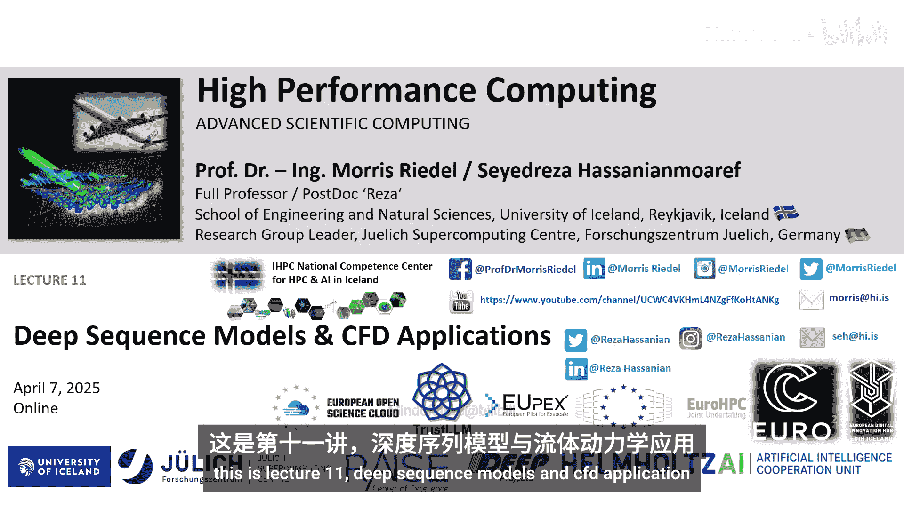
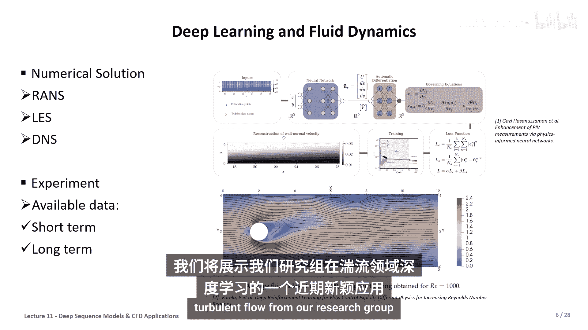
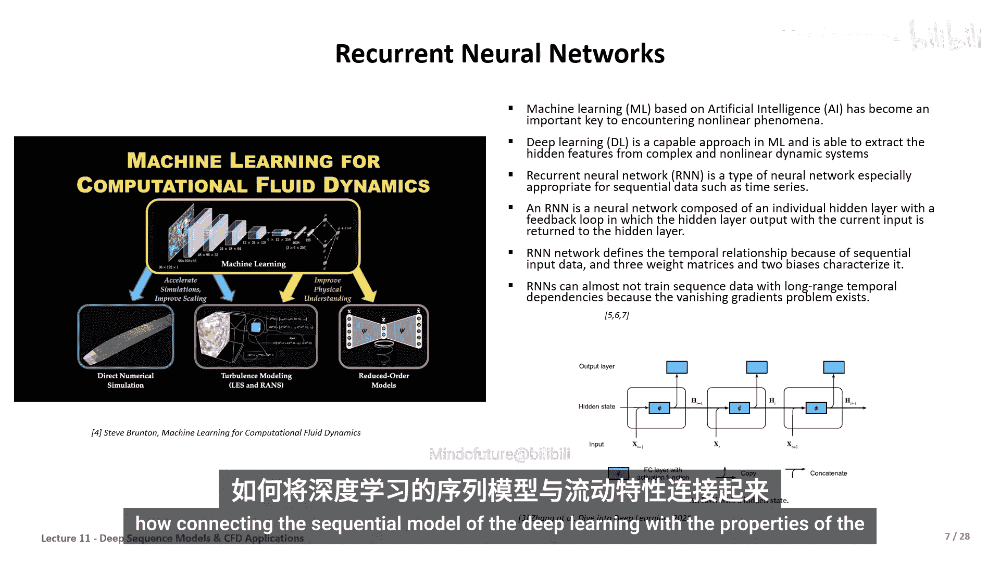
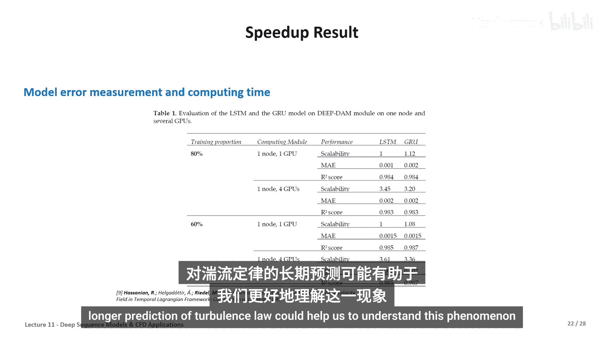
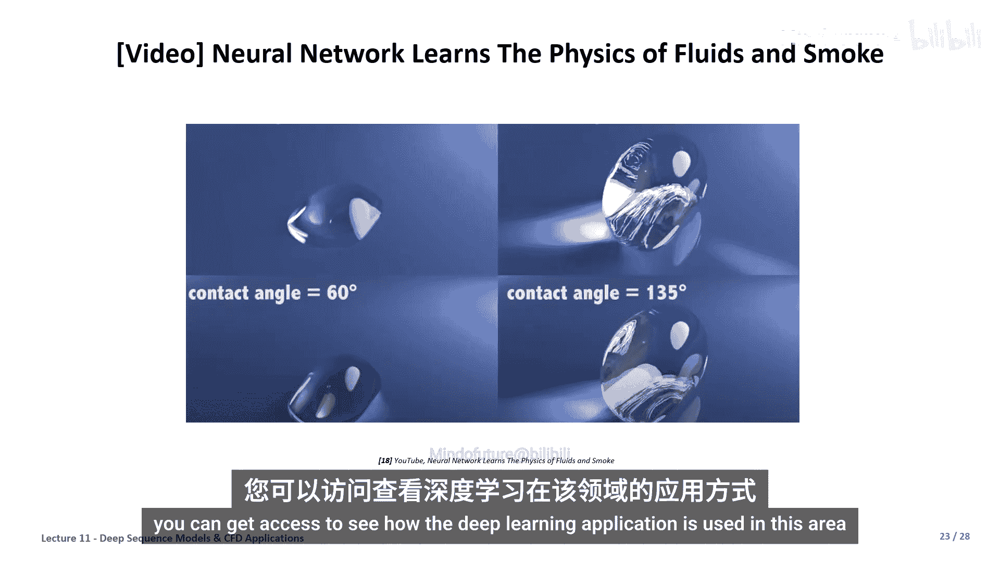
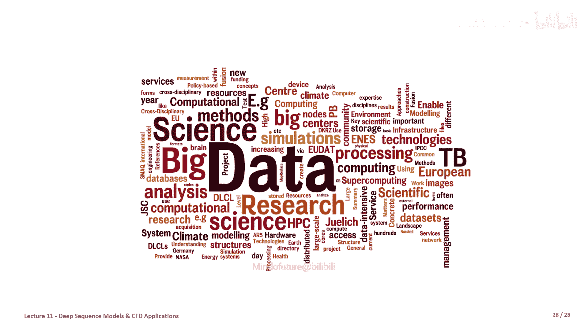

# 【冰岛大学】高性能计算课程-｜-2025-High-Performance-Computing-｜-Prof-Dr-Ing-Morris-Riedel-p06-P06_短讲座_11_深度序列模型__CFD_应用--BV1k34zzaEK8_p6-

Hello everyone， welcome to High Per Comping， Advanced scientificientific Computing course。

 this is lecture relevant， deep sequence models and CFD application。

As we promise on the outline， we will have application of the deep sequence model in the F dynamic area in the lecture 11。

Let's have a short review on the lecture 10， C the application and open form。 We presented the。

Short introduction about the open form software as its open source software。

 And we can modify a new code for a new problem。And it's compatible with some visually software。

 like Power view。 And it has a great capability to run on the public computing we。

Discuss that decomposition method is called simple hair alcohol and scch and what's the different or what the advantage and disadvantage of them。

And then we mentioned how the decomposition on the3 dimension dummy can be conducted。

 and what the effect of the boundary condition on the。

Decomposition and how there are two type of the boundary condition could be used in this regard。

 and we。Describe the difference between periodic boundary condition and non periodic boundary condition Also we had detail about how submit a batch for open form on the HPC system with the example that you have the original batch file you can use it for your assessment on the pilot computing。

Now let's back to this lecture， we will talk about the turb flow in the fluid dynamic and why the forecasting is important。

What the approach could use for the forecasting and how sequential model of the deep learning could be used in this area。

And what's the role of the HPC in these applications？AFlod flow prediction。

And deep learning and fluid dynamics。We mentioned in the fluid dynamics area。

 there are approaches could be used to deal with this problem。

 one of them is experiment and the other one analytical approach。

 which is only available with a limited problem。Then we had the numerical approach which for turbulnet flow used as a res a stroke surrounds。

 large E simulation LES and direct numerical simulation DNS。

 we talked about the difference and the advantage and disadvantage of these method and especially in the HPC course we emphasized on the computing power which is required to learn LES and DNS and they are costly。

In contrast to the land。Regarding the。How we can apply the deep learning the fluid dynamic carrier。

 usually when we are running the numerical solution because of the power also。

 we cannot run a long period of the simulation for unsteady problems therefore。

 deep learning it could be used in this area， especially because in the fluid dynamic the。

Pties of the floor all function of the location and time。

 and usually we say the data are e spatial and temporal。诶。To modify this application。

 it is necessary to find a connection between the deep learning model and the properties of the flow field。

Therefore， we will present the sequential model which they are basically working for time series。

 we can say， and we will explain how they can connect it to the physics of the problem the turbulent flow and we will present one of the recent novelel application of the deep learning in the turbul flow from our research group。

In this lecture， we will talk about。A wecon network， one of the deep learning network that。

Sas working correctly with sequential data。And in the fluid dynamics area。

 especially in turbulence flow， we a define approach how it can be used to have time save of the data of the turbulence flow and how it can be used with recurrent neural network RN。

From the literature。It's known that for no nonlinear near phenomenon like turbulent flow。

 the deep learning has a great capability。And it's working with complex data。

 it's able to extract the hidden feature。And with the。Some combination of different。

 deep learning model。 also， it is possible to。Inrease the performance。

 and the model is working much better。In this lecture。

 we will present one of the research and development but our research group and how we used it in the F dynamic area with determining a new framework in the F dynamic area and using the data from it in the deep learning。

How connected the sequential model of the diploma with the properties of the flow？

I networks when working with extensive large data in the term of the periodyramid。

 which is mean long term long term。It's dealing with vanishing gradients。

And that's why it could not be worked properly with a long period of the data long term memory is a network variant from the Parliament。

 which suggested in 1995。And it resolved the managing gradient issue。In fact。

 LSDM using the structure with the。呃。The full gate gate input gate and the output gate included Ci gate。

 and also it's keeping the information from the。Previous data。

 which helping to solving the vanishing ingredient。In the recent years。

 application of L STTM is increased in the fluid dynamic area， especially with time series data。

 how most of the application they are using data from numerical approach which means the data measures from the CFT and not data and additionally there is no definition how we can。

Use that approach in with other data。Wwhichch are the only use cases in this lecture with example that developed in our research group。

 we will see how we can make connection between deep learning architecture and layers and the sequential feature of the fluid dynamic。

And we see how it's working。 How from the LSTM， we have also other value， which is called Google。

 And let's talk about Google also and what difference between LSTM and Google。

Gate that we record in units。G is a variant from the LSTM and indeed in the go4 Gt gate an input gate replaced to with only one Gi update gate this helping to reducing the computing and is important because it's helping in the speed up and additionally is working with fewer parameters than LSTM。

Based on the literature that they use the go and LSTM in different areas。

 they reporting that go is working faster than LSTM with same data set and also keep the same performance this is important in this in。

The term of the competition。Because usually when we're working with diploma within that they are。

consists of many layers。And recently， because of the complexity of the data is used。

 the deep learning model is in the size they are increasing。

 they are getting bigger size and also the data also is increased and we are。

Dealing with big data so in this regard we can see this day the distributed deploying model comes to the game。

 in fact the distributed deep learninging eplan the large deep model between different person or if the data is too large will keep will make a copy from each model to one person and distribute the data between different person and you will see much detail about this approach in the upcoming lectures。

 how I point to the importance of the computing which is required in the deploy learninging model which is regard the data and also about the complexity of the model。

The capability of the LSTN variant， it's reported in the literature in many applications。

 for example， for picture processing for some data series in the for example。

 stock markets and make a prediction for data from the measurement and also from an numerical approach and also using some data from the known analytical equation。

 each is great and has able to predict with high accuracy。With low error。

 how will the competition is matter when we are dealing with live data and when we are dealing with complex model。

 And we need to see how these partss are also impacting the result when we have。Complex model。

 So we are expecting to increase the accuracy， how we know。

Getting a large model and number of the batch size， for example， it's impacting the accuracy。

 so that way based off the sum example that you use when we have a large number of the batch size maybe the。

E will goes up， and sometimes we need to find this number from the hyperpometer unit。

As we discussed it before， in this course。So finding the optimum numbers for to designing a good deep learning model is required to take right。

Pmeter selection and model design。 And here we will focus on this matter to show example how could LED to optimal model。

To have an initial assessment of this model， here we are presenting a comparison of LT and Go with the data that we have in our research with similar data。

 the results show us the go working faster。Then they list him。As is mentioned， the little。

 for example， when we use 80% training data with go and LSTM go was 8 to 12% faster than LTM and with 60% training。

 it was 5 to 10% faster So it seems on the working with GPU without GPU Google working faster than LTM。

 However， when we use this similar model with the GPUs， the LSTM and go presented same speed。

This matter could be relevant to the data because when we are using the GPU， also。

 it's important to see how large data we are using in our application。 In fact。

 in our example that here we mentioned， we didn't have extensive data。 therefore using the GPU。

 Maybe it doesn't help too much about the size of the data and the in fact， some。Time。

 which is taken to escallate the model and data between different GPU could cover the time and then lead to same speed。

The fog， this is not。呃咩。this doesn't been immune。 The GPU doesn't have benefit。

 but it's required to have。Lgeger data to see this。Impact on the visa。With CPUU。

 the GPU working faster SDT with data， which is great because it's reducing the computation。

When we are talking about the sequentialial data， heres the question how we can make a connection between the sequentialial data and the deep learning model。

In fact we are dealing in the flood industry we dealing with physical problem。Therefore。

 to define a time save of data。It's important， and it's depend to its framework and how the feature are designed and how finding connection between the time and this data。

So we see how in this data， we can find these。Time series and how we can make connection between them。

Regarding application of machine learning， and we can see deep learning in the fluid mechanics in 2020。

 there was paper that mentioned the importance of the。Application of them。

 which could be focused on the turbulent flow and we can deal with the random and nonlinear term in the turbulence flow。

 Also we can deal with height dimension functionalityality。

The work we can help to have understanding one of the challenges in the physics。

 which known as unsold problem。诶。Not because usually when we are using a numerical approach。

 we are dealing to trying to solve flow cases。 but how additionally to solving the problem。

Maybe didn you could help us to understand this phenomenon and started a flow。In addition to only so。

Especially when we are dealing with our law， which during the time。It has a transit position。

 and we need to understand what's happening during that。It's necessary to。

Pocessing of the data during the time and what how the sequential data is working in such models。

The most applicable method to use in。F then with data on the deep learning。

It's data driven model in the data driven model usually we need the data to turn the model and expect and make a prediction for the flow。

Regarding the data in the privilege loop as a complex and un problem。

There are two main resources to get the data that's reliable and could be used to understand and know that they are based of the realWt measurement。

One of them is experiment。For the valid experience。

 we can have reliable data for make a prediction and train model。 The other from the CFD。

 However from the CFP Port。As we discussed before， events providing the average results show the data that we have with the average doesn't。

Carried all the information from the flow L S， also。As we said。

 it's sort based of the specific size of theeds and then its compute the smaller scale。

 which is not accurate solution。But DNS is the most accurate solution in the CFP。

 The who to have a reliable data for the CF， the DNS data could be used。For the analytical problem。

 however， in the literature， there are some research now to assessing the different learning model。

 they are using data from the analytical approach that means for a problem we have an analytical solution they are using before this data analytical solution and make a traditional data they。

Comparing the resultard from the deep learning model with the analytical solution。

 maybe it is a good idea to。嗯。It can't assess the differ model。 but however。

 it doesn't make sense that why we consider a un model when we have a solution for it。

 So it doesn't help us more than this to understand this phenomenon。Therefore。

 we can say that main source of the data hit get from the CFP and experiment。From the other view。

 if we look to the data， there is an aspect of the correlation。😊。

It's very important when we are using data， we need to look at the correlation of the data。

 What the correlation between。Sometimes maybe we are using some because we are in the deep learning as we know。

 we are looking for the target， and then we have some development that。

This should be a correlation between the targets and the input of the data We be the model to turn with。

That one here， the sequentiality of the data is very important when we are talking about the target。

 for example， the velocity is the velocity has a correlation with the time or with the other format。

 for example， the acceleration has a correlation between velocity or time or location or displacement。

So， these are very important。Pmeter， it must be considered when we want to use data to train the deploy learning model in the F dynamic area。

Now， let's have a statement about applying the computer file regarding the tu flow here。

 you can see this。figure is presenting the direction of the turbulent flow impacting the turbulent flow based on the last hypothees。

 we have a scale， largest scale and small scale and it seems the flow in the beginning has the largest scale and then during the time the energy transferred from largest scale to smallest scale。

 the small scale in the largest scale the dominant feature controlled by the largest scale。

 but in the smallest scale the dominant feature will be based on the fiscal in the flowtomy。

This a fundamental concept of the to flu and how this process is happening。

 What picture is impacting the initial condition， boundary condition。Yeah。

 and the material property is how it's impacting the。

Tran of the energy between the different skin E thin it on soap the form。

Ely when we are talking about larger scale， there is not much known about the larger scale in the coconut clo however there are many question maybe comes up。

Hello， we have a statement here from Peter Estino He said we used to have lots of questions to which there were no answers。

 Now， with the computer， there are lots of answers to which we haven't thought of the questions。😔。

So this is the basic the idea that's suggesting， okay。

 let's now use the computer power to answer some question and don't create a new question This is a great idea so we can say the deep learning is a great idea that is come to gain now and we can use it to at least understand some problem and deal with some obstacle that is aware。

AT flow， as it' known as unsolt problem in 1941， there is a hypo its called hypo of a column removalval K we call it K41。

It's。Defining chocolate。That how the energy transfer from love to small scale and then defining some scale size in the term of the time。

And and。Especially also how this theory has some assumption， which is not universal。

And we can see this assumption in the specific condition。 One of them ph atroic tu flu， in fact。

Most of the flow on is is a topic。 So we can't say this hypothe working everywhere。

And also there is some idea about equilibrium tuul flow and none。

 which is mean is doesn't cover every condition of the turbul flow to be determined。

That's why we have this statement from。The Richard Payman， when he said turbulence。

 is the most important uns problem of classical physics。In this slide。

 you can see this nice presentation of the area of the study Port below。

 we have the experiment we have。The simulation of na approach。

 And we have the two combining all of these together。

What we have so far is from these areas that combine together。In recent， Deep learning also。

 it's added much more understanding and some application。

 which helping to see how the turbulent flow could be studied with these new tools。

Regarding the sequential data， as we said， we need to have correlation between。put data target data。

So it's need to a specify framework in the fluid dynamic。

 we have two main viewpoint of framework work。It should be used to define the properties in the floy。

One of them Laganian and one of them Olivium， if we want to have a very simple definition for them in the Olivan language。

 we can assume one single point in the flow iss stationary and the flow passing this point。

What measurement we are taking from this what is based on the overlap。In the different viewpoint。

 which is called Laangia。诶啊修。That's going to all five tickets move in the flow。

Which following the flow， and it's not stationing。 So every single time step when we are measuring it has a different displacement and has its properties。

Based of the language framework， there is a correlation between the properties of the particle when it's moving which this particle or point。

It's。can日 boys六。There is a correlation between these properties which velocity and displacement and the time。

So still the budget of the work is a great。option to define as a framework to make a connection between them。

诶的。平啊。Since， we are talking about the sequential g model。

 which they are as a time working as a time series。

 We can ask you we have time series of the velocity。 We have time series of the displacement。

 We have time series of the acceleration。 We have time series of the velocity in the fluid。

And we can attain the model with this data and looking for the target。 For example。

 we can train a model with time with displacement and velocity。 and the target also a velocity。

 and training we train the model to。え。More time find the upcoming velocity and how you look that I'm making a test。

In the industry， and in the lab to experiment， there are different methods to take a measurements from the。

诶 flu。We have the flu， which is using the industry。嗯。

Which we can say is based on the O1ium because we have a specific location these installment tools install and making measurement at this distinctive point。

CTA， a constant temperature a， and also it's called hot wire in the same application。

Laser Doppler annuator， Peterer tube， light detection and imaging。These are different。

Data is a measurement that could be used with different devices。How for咩。

Different view weekend doing the setup between the display data and the data that are measured。

additional， in the top， based of the study， there are different efforts to study the， one of them。

A statistical approach， and one of them determin。Therefore。

 it's very clear that having a statistical data from the table slope with different realization could provide us good data to train body。

Then。As we know the statistical data is working for turbul flow。

 having a statistical measurement from the turbul flow will provide a possibility to use this data for deeping model。

Therefore so far， we specified how we can make a connection between the deep learning model and the data that could be measured in the two black flow。

We have。The Lagonia framework that we can define the time series data of the flow properties。

And we cant find the correlation between these properties and using it for such model like LSTM or go。

 which they are very similar variant， and then investigate the formula computing in this such model。

This definition helping us to find a connection between La network in turbulent flow and the sequential model in the deep learning。

Maybe it's not limited to the LT and go that we are presenting here。 Of course。

 there are upcoming order at at the time that we are talking， for example。

 the transformer is the one of the。Other different model could be used， which is could be。

Develop with such model and make a prediction model for to overlap look。

AndNow let's shortly here present the data that using the experiment in this slide you can see picture of the a which using that experiment。

This apparatususe is a tiny feed with a water， and we ate in play in the corner of this tank with a specific speed of the rotation。

 making the flow is totally。And there is it heavier in the center of the tank。

specified with green color here。T measurement or high camera。

I'm measuring at a specific period of the time。But how we are measuring the performance of clock these based of the particle tagging in the experiment of the。

Fluid dynamic。 we have this effort that we can see the flow with the particle。

And then tracking this particle with laser light and detection system。

 then we have tracking each particle motion and giving us its displacement in velocity and we take that with the acceleration。

If this study。Ts are particles used trace particles thats particles that they have similar density to the water。

So they can follow the stream and also we have a specific。

term is called strokes number is calculated for this particle to be sure that the particle。

 when they are seated， they're moving with the streamline of the flow。

 which is meanwhile we are measuring the properties of this particle。

 we are measuring the properties of the flow。And this all I've done in the experiment。Hey the。诶。

To see， to。De find also a specific。Mo of this flow to disk in the apparatus is available up and down。

 And at the specific time， they are moving toward to the center with the nearly constant speed to creating deformation or deformation in the flow。

All of these。Conducted action in making the flow with a specific condition。

 which doesn't have unknown pattern to follow or define its motion。therefore。

 we have a flow of the measurement particle， which there is no known model for them。

 and there is no equation to define them。So we can use this data to define。

And the motion I make a prediction model that how this particle could be followed。

This table here is presenting the data and how it's looked like。

 It's me for every specific time or every time stamp。 We have include displacement。诶系嘅。我的微信が发。

Since we are working with statistical data。 So there are a lot of data here this table you can see。

270000。640 particle in this table is available。诶 we can。

defineine the ratio of the training for up 60% or 80%。 And with the rest of the data making the test。

On this data。So these also this data here is measured with one camera in the part the 3 method when we are using one camera。

 we have two dimension data。 However， we should mention that here。

 because the experiment in the work。 It's include all the data from the turbence flow。你 and it诶。对不对。

Different with the some data that could be obtained from the numerical airport。

 We have the numerical airport。 We have some limit。 Maybe we cannot study some effect like gravity。

Because of the complexity and the computation。 But here the V group data is available with all effective climate。

Because turbulence flow is the the dimension phenomenon。

 If you are doing simulation only two dimension， it doesn't cover all the information of the turb flow。

 It is necessary to make a simulation in the TV dimension to have a full information of it。

 the point the experiment。 We have all the required information of the turbulence flow。

In this this slide， you can see a result from the prediction by this LSTM and chrommod。

The left hand side presenting the result when they turning with 18% of the ratio of the data and the left hand side the right hand side when the turning data with 16% ratio and 40% test data and we can see how the prediction is matching with the test data。

 which is's presenting the great capability of this model。

How is this some questions that are available， for example， if we have longer period of the data。

 because the short time period of the data here is too short， if we have longer period of the data。

 does it work， How with longer period of the data， the data will be much longer。嗯。

Which make it much more complex。To see if it's possible or not。

This table here also is presenting the metric measured for this。Example。

 which is mean when we have one not win one GPU or 4 GPU for 80% training。

 and in the term of 60% training what the different， of course the。

The level between the 60% and 80% could be different。 However with more data。

 we can reduce the level。 But here it's important we see。When we use one node and one GPU。

 the go working faster than LSTM， this is what we mentioned in the previous slide。

 how with more GPUs andSTM go performing with similar speed。诶而家啲唱获炖知啊。As we know， diploma。

 they are basically working with larger data。 So if we。To have a launch of data for the training。

 we should expect that we have a much better result and prediction for such models。诶 and诶。

This is the one point should be mentioned here， how the definition of this model here and that how explain the connection between the datata from the La Gian viewpoint and the detailed model。

 which could be a SDium or or for example， transformer。

It's a great design to be used and make a prediction for turb law。

 longer prediction of turbence log would help us to understand this phenomenon maybe be much better。

And here we ended this with the lecture。Deep sequence model and CFT application。

 there is a video presenting the application of the neural network in the physics App。

And I suggest you to watch it。 The link is available in the fences。

 and you can get access to see how a deep learning application is。

Used in this area。In next short lecture， we will continue。

To the lecture that this year is as special on the CFD and HPC application。

And we can see how the application of different areas of the。Nomer of the CFD and other approaches。

Relevant to the HPC， which is very important in this develop。Thank you。And good luck。

 We will continue in next election。

