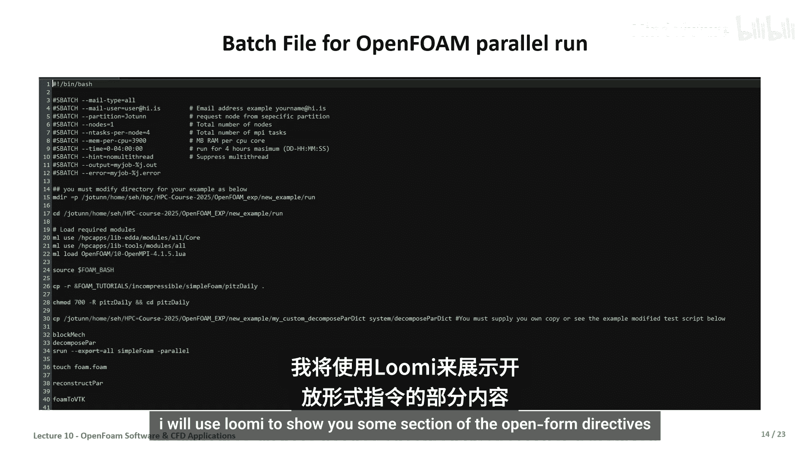
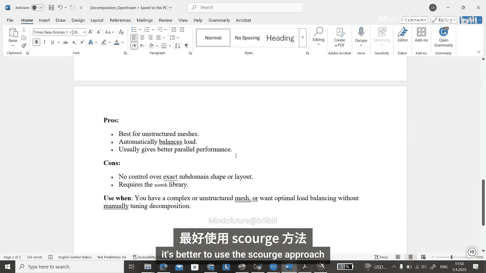
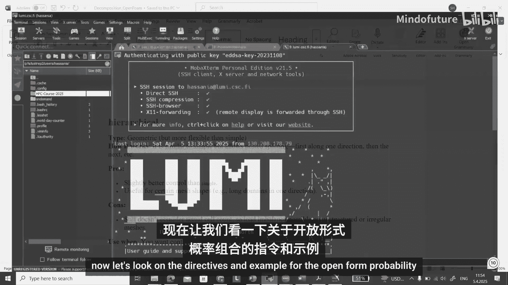
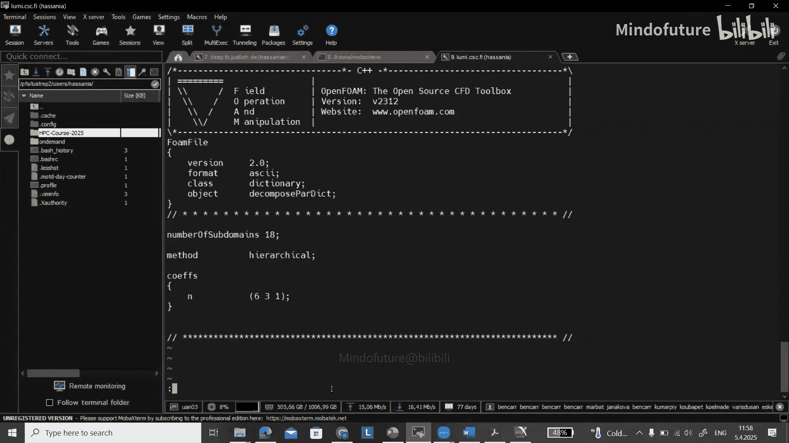
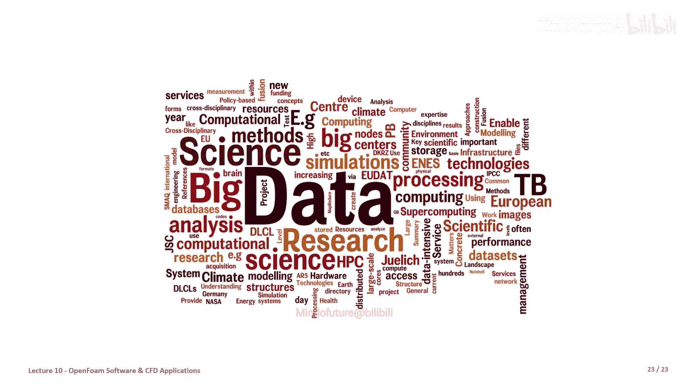

# 【冰岛大学】高性能计算课程-｜-2025-High-Performance-Computing-｜-Prof-Dr-Ing-Morris-Riedel-p07-P07_短讲座_10_OpenFoam_软件__CFD_应用--BV1k34zzaEK8_p7-

Hello everyone， Welcome to High Performance Computing Advanced Scientific computinguting course。

This is lecture 10， Openform software and CFP applications。

So we are following the outline of the course， which is this year it's CFP special and in the lecture 10 we will have a short lecture for open form software。

To have a short recall from the previous lecture lecture9。

We take a look at the application of the CFD， which specific categories it's called Irans。

 LES and DNS for tut blue and we learned that it's required to have access to the HPC to run such simulation because of the complex sitting long nonlinear and a large computation in the tut blue。

And also we talked about that。Different of the capability between this method when we are using advanced and when LS and DNS。

Especially DNS was costly unusual used for the research and development in the industry。

 the most applicable method it advanced， we also presented the MPI application and CFP and how we can decompose the domain of the problem in between different post and what the matter about the boundaries between the to transfer the information between them。

Now let's move on to this lecture。🎼Of form is the。The open source software is used in the a flow dynamic area。

And since it's free and open source， we can have a new design of the problem with the domain with the boundary condition and write a new problem and also a solver for it and make modification to use with hot performance computing。

 we will have introduction to this software。Wwhichch is open source and how we are doing the decomposition method。

 how the NP and decomposition relevant to these open source code。

 and I will try to show you a practical example on the HpC system and how you can set up your。

That's one。Then open for me is。Open source code and you can see the presentation of the official web page of this software。

 you can find the good information about this software。And it's working in the fluid dynamic。

 as we said， we have different type of regime of the flow Laminina and tablet it's working for both of them。

 Also， we can use it for compible and compable flow。

 and it has this ability to run the power computing， which is important part of the。

A simulation in the CFD。In fact， everything for the setup for the solving the problem its going ir regular。

 you need to have a geometry of the problem and。The properties of the material information for the boundary condition and initial condition。

Then in one setup you need to define the parallel computing， which has a different approach。

 then when you running the solution base of these set up the problem will be solved in the parallel with the number of the code that we are defined by the person。

Regarding the open form language and algorithm which used in this software。

 it's working with a C++ toolbox and it's possible to customize that。Let me cancel it。诶呢家车。

It is possible to create a code for the specific problem in the Laminar flow turbulent flow and from the scratch and you specify the problem domain everything the geometries and the condition of the problem with its toolbox language and create a new model and so this is the more thing that the researcher for the new problem they are doing and this is the great capability that's often from created because it's connected to the visualize software we can have the visualization we will talk them in the next slide。

And also， it has capability to learn in power。In the open form。

 we can have the pay or postponing and also doing the solution for quantum mechanic problem。

 which is mostly the core application it' on the Comp flight dynamicss CFP。In the industry。

 also some example we can mention here regarding the automotive manufacturing， process， engineering。

 environmental engineering， they are using it。On the basic physics study also there are some simulation used in the fluid dynamic。

Doing the simulation and maybe to understanding the。An internal posting of the turb blue， in fact。

 to mention。The CFD capability maybe its good to point to it impact in the fluid dynamic。

 as we said on the turbulence blue， there are different approaches using one of them experiment。

And one of them are or in the turbulent flow， mostly we can say sta and deteristic metal。

And the another one is the CFP。 In fact， CFP helping us to deal with some problem and get the solution。

 but it doesn't provide us。诶，Processing that going in the structure of the phenomenon。

 therefore it's really helpful and significant a result is presenting in the industry。

But to study the physics of the problem， it's helping with this visualization to understand what's going in the specific problem based on the domain and the initial condition and body condition。

Also open form as a software has its structure， in fact there is part of the libraries and directories we can use and doing the setup for the problem as we said based on the C++ language is it possible to do this there is a standard solver using this software and also we can define solver based on our problem and we talked about this since it's open source so it's flexible to have a new setup and the new application。

Wwhich make it a great option to study the F dynamic area。

 and we will mention that some capability of these solution when it's visualized by the powerview software。

 it makes it great to present visa。Here you can see the list of the libraries and directories which is used in the open form simulation。

 in fact it's depend to the user selection and it could be additional directories they are the standard one the system。

Constant and zero， which is mostly used for the initial time directory。

 there could be more directories which， for example。

 the result time directories and about the post postcing。

Wwhichch mostly relevant to visualization and we will see how it's working with the specific visualization software。

 which is at the third party connected to the open form for open form usually we are using the Power view。

 is F3 and has a modification and compiler and customization。

Which we can use it with is comment on the open form。 We can present a visa。

 We can make a post post processing。And the。Also， it's capable to run it on the HC resources。

which is also open source software。 So so far we see the open form。

Yeah it's on open source and we can make modification and we can have a new setup for the oil problem and capital to evaluate it on the HPC when we look on the visualization also。

Which is power view。 It's open source， and we can make a modification and compile it。 And also。

 it's around on the。HPC， why it's important because some visual in the CFD when we are working。

 especially with a large problem or with complex problem in the turbulence flow the Vi will be。

Massive data to run this visualization of the software is required to have access to the H PCC and power of the。

A graphicra to present this result。To make a parallel computing and HPC application for the CFP。

 this is a reminder that we presented in the previous lecture how the parallel computing is working for the specific domain of the problem。

 we need to make a decomposition of the problem。And here we can see how the number of the storage which is required。

 and also we talked about the。overlap between the subdomamine。

 which is important because the Bo condition， the Boev data need to have interchange in this area。

 especially when we have an un problem and during each tongue step it's required to update the information from the neighbor subdomamine to perform the solution and get the result。

And we talked regarding this matter in the previous lecture so we can understand how the public computing is working on the。

呃。呃。Open form software and here the presentation is 2D。 So imagine if we have3D problem。

 we will have thecomposition of the3 dimension problem based of these information so that。Over。

 it will be not pointing to it be like a surface between different subdoome and it required to transfer the information between them and on the surface。

 of course we have many grid point which require to have the possibility to update every time step。

Regarding the MPI that we talked in previous lecture， it's important to use this。

Capability in the HPC to have efficient HPC component and also keep the accuracy of the solution here is examples from results for lead driving ca flow with MPI the。

In this figure， there are results from the ideal scanning MPI and MPI plus open MP。

That we can see in the left hand side its for a single node application with a domain of 200 times 200。

 200 cell， which is used and we can see how when the number of the core increase there is a difference between the ideal scanning and MPI and Openmp and the openmp plus MP and MPI they are very close to each other。

 but in the right hand side it's used for example with 100 times 100 times 100 cells with multiple nodes。

And we can see when there is an increase in the number of the pool。

 the ideally scaling MPI and MPI plus open MPI they close to each other and in fact。

 the ideally scaling also is getting like linear。Behavior and the MPI is getting similar。

 How from the specific number of the call， they getting a different result。

That's why it's important to。Select the efficient setup for the API in the CFT and able to make the efficient running of the pilot computing with accurate results。

Then we can the decomposition and the subdomamine need to created for the domain of the problem and example of the MPI that we talked about it。

The decomposition method in the open form is available in the standard form。

 we can say that only we can run it with its command there is a one it's called simple and have article one is code and the manual which need be set up by the user。

And make a modification we will present them on the code and you can see how they are working and they are effective to make the simulation。

 in fact each one has a different decomposition set up on the domain and the selection of these different method it is a knowledge about the these structure that how it makes decomposition because based of the geometry。

 sometimes we havesymmetric geometry， sometimes no and sometimes the geometry it's have a back shape or we can say on the mesh also sometimes we are dealing with structure on the structured one then it's required to select the best one to have efficient solution in the HPC and also。

Ppa result。Oh。To have example of the parallel electronic for the open form。

 I will share this batch file on the lecture。You can use it and you run example of the open form in parallel。

Regarding the setup up on this batch file， as you know。

 and you modify the other batch file in this course。On the second line。

 you need to specify by your E mail。And since you have access to earlierA system。

 so well use the partition on the U as we specify here， the other setup is fine。

You can see a number of the node of course， to see the computation。

 you can use different number here， the node is one and you can change it the task per node also is specified for you can change。

 of course， which is relevant to the number of the MP path。Also。

 you can change the memory if you think the time the maximum time of the v here is4。

It depends the Q that you when you submit the word。And you can also here。

 we specify the file for the output and also for the error。In the next section of these batch file。

You need to specify directory for the。Simulation that you want run here。

 the address is specified directory specified for the my the file that I'm using。

You need to specify it based on the or， because， of course， every person has its direct on the。

Any system， you take a copy from the file and you can use it there。

Regarding the open file example you will see in the next section。

 how is it the module that you need to load to around this simulation here is specified please pay attention sometimes maybe you will run it if you get error about the modules you can check it with the。

Administister of the system， they will tell you maybe there is some update。

 you can ask them and it will be resolved， but correctly it's working with this module。

Then you use the source， a common source of the foam bag， which is required here。

Then you will make a copy from the file， which is available in the directory of the form tutorial from the incomplaible example。

 simple form and pitch daily， this command will make a copy from this file and then you will use the command to。

Well copy this file to your directory。To advance the simulationia firstly， we need to do the me。

 Then the next command is black mesh。Then the decomposed part。

 which make the decomposition of imper from this simulation so as。

We discussed in the previous slide when we presented the decomposition type or method in the open form。

 we had a simple score and howarch then we are doing the setup on the directories and here only were running the command for thecomposition you should pay attention when you are being copy of the example you can go to the directories of the example and select your method for the decomposition for example you can run TV times with different method and you can see the different type different of these。

Computing time and also bit of the result。Therefore， in the batch part。

 we are not doing anything regarding the decomposition method。

 which needs to be done from the directories。Then we run the simulation。

 which is based of the simple form。In parallel with command of thech Torch form that form it will created the result。

 the recon power also we reconstruct the domain based off what we meet decompositions when it will collected all information there one domain and one result and we can use the visualization with the command of the form to VTK which is converted to visual exit and we can use the power view。

Then this S here is presented here in this batch file and you can use it and I will share the original file on the compass and you will have access to use this batch file so we will look to the。

你。Earlier system2 on open form file， however， as I said。

 at the time of the recording because I didn't have access to the earlier I will use looming to show you some section of the open form de。

Okay， before doing the modification on the exam for the batch file。

Let's present you some references for the open form。

 it will be useful and you can take a look if you're interested in the open form。

And maybe you are using it here there is a CFT direct。

 it has a good user code and usually it's updated with a new version。

And you can see how some example you can around and also regarding the pilot computing that we were talking。

Then you can see section of the is in the in the content in the Cha 3， running application in power。

Here you can see the information regarding the different decomposition。As we talked about them。

 the simple hierarchical and scch。And how they are working and how you can run the decomposition command on the pilot and you can see the result。

We will present it in the batch file， as we talked before， also in the open open form Viki。

 you can see good information。 There are some。Resources for tutorials from literature， for example。

 the tutorials we can see very different collections。

And you can learn from them how you can use the open form and with some example which set up。

Regarding the the methods that we talk in the decomposition method。

 we need to measure that these selecting this method it's affecting the performance and load Walls here there are some least regarding the。

Simple the method of the decomposition， for example。

 the simple what type is it and how it's working it's based off the。

Diion x y it and there is a post and con list of them however the limit of the application is working with the uniform structure。

When we look on the ha panel， it's flexible， then simple， we can work with this。

It's walking along one direction。And you can see list of the person code， and。嗯。

It's working better than simple。 we can say。Sco is working graphical based， it's topological。

And diving in fact， the domain to sub and raising the cell connectivity and trying to balance the load and minimize the communication between subdin。

So this is the poles and cons of heat and also we can mention when we have complex and unsstructureuched mesh。

 it's better to use the Scorch approach。

Now， let's look on the。

呃。The directs and the。Example for the。Open form probability decomposition I'm running this example on the Lummi because at this time that I'm recording the earlier system is down and it will working on Monday so I'm using Lumomy system as I said the setup is same just here the initial condition determineminant determine on the batch file for the Lummi and you will use the same setup for earlier。

Let's look at the file that we have。你屎。we have the open phone for now。😔。

Let's see the director of the motorbike。You me to the to the motorbike。

So here we can see the different directories that is available as we mentioned we had the zero directories here。

 we can have the initial condition， we have the constant。And also， we have the system。

 we can do the setup for the decomposition。 let's open the。B a look at it。So here we have the file。

 as you can see， there is a different setup we used in this example here。

 We use one time hiarch S code， and let's open the。This clutch one。嗯。We look on this， fine。

So it seems we didn't use this one。 Let's open one of another one。Here。

 we can see the setup for the type of the。My method it' used here， we use the hierarch。

 as we said the called working along a direction and here the number of the sum is specified。

 then we need to spur the coefficientient which mean in which direction and how many numbers we need to specify in here which is x Y z。

And we specify。Alongside which direction and how many number to。

Decompose the domain of the problem and in the same approach we can specify the type here we can write simple or a score。

 but how the coefficient will be different setup。So here it's how we can make the setup of the decomposition。

The detail regarding how we can doing the setup for the open form example。Of course。

 could that be called in this one short lecture， however I presented some？Resources。

 you can use them and of course you have access to EliEA system it has the open form and I will share the。

Bch file， you can use it and you can run it and you can see how it's working on the earlierEA system。

Then let's continue to discuss the effect that need to be pay attention for the setup of the decomposition when we are using the MPI with the open form。

嗯。So what is the domain decomposition here it's a simple visualization to see how there is a different approach to make the decomposition of the domain in the 3D of the simulation。

 as you can see in the both of these example， there are eight blocks。

 which assigned to individual visual posts。But this decomposition for the stomach is different。

We can say in the left hand side， we have a queue。诶不咩。Right hand side。

 do we have a corner of the blocks。With same domain， This is important how we select these blocks。

 because it's depend to the。Boundary condition， sometimes it's required to make a block or sometimes you indicate columns。

This is information based on the problem。 and also it's effective with。They。

Interconnection between the person。 for example， when we look at the cube one in the left hand side。

 we can see it has a。2 surface connected to neighbor domain vertically and one horizontally off。

 So there are three surfaces。 But when we look on the column one。

 there are two surfaces connected to neighbor domain and there is no third one。 in fact， two。

Fourth up the domain， the surface are connected to the boundary condition。

 not the internal connection。 So this information about the boundary of the problem。

 body condition and how we need to transfer the information between the domain is important to do the setup of the decomposition。

Therefore the decomposition has a step to use the MP。诶边诶。

Contras to the previous setup for the decomposition here。

 Also you can see the different setup of the blocks。Here。

 the blocks only the internal blocks has two surfaces that they are connected to up and down。

Neighb subdin， so this set up as we said is depend to the problem。

 but here if you want to look on the setup the steps to use the domain decomposition。

 in fact in the beginning we need to break up the domain into blocks or subdamine。

Then it's assigned each block to the NP post， therefore we can make the modification and write the call to update the single block and providing a map of neighbors for each post instead the communication subring and then adjust the boundary condition。

This set up require to make the decomposition。This is the point we are using the MPI is need to be done to use this capability and also we need to mention that。

In the open form， these decomposition setup up could be done from the decomposition block。

And we can connect these decomposition to the NPR。 So we are set up。诶。

Therefore it's not a decomposition based of the geometry， we need to look at the boundary condition。

 initial condition and the geometry of the domain then we are able to make the decomposition when we have unstructured mission also is important which in some places there is a much more。

诶 con of the。Find find mes， which get。Much more accurate solution for us。

To emphasize the importance of the boundary condition here。

 let's have this simple description that in addition to knowing who is the neighbor。

 each process need to know whether any whether any of its boundary is， in fact。

 a physical boundaries。This helping to avoid the programming error and also apply the boundary condition correctly。

 There are two cases of the boundary condition could be used as the periodic boundary condition and non periodic boundary condition。

We will determine what this mean these to different point of condition and how we can apply them in the problem。

went well， what keep we there。perioderic boundary condition in fact any inter any。

Blocks is treated as internal block。 That's mean， if we have。

Block at the end of the domain or subding， which is at the end， it's assumed as other internal block。

2。Apply these upon the reution we only need to define the correct math of the neighbors for each one。

 For example， here， you can see example of the person for the subit， for example，2。

To make a correct map library。We can have the post of zero as a need for。Post that work。 Therefore。

 it's make it。APic boundaryev condition and in fact。

 this term all subdomamine assumed as the internal block in the domain of the public。

I is the simple definition。 How when we have。Different maybe boundary condition or especially about the geometry。

 maybe we need to pay attention more to the setup to apply the correct setup for it。

In non periodic boundaries， we behave a different for the setup for the person if we assume the same example that we have in the previous presentation the previous slide。

The policy 12 doesn't has neighbor in the right hand side。

 so we should mention this that we say there is no information from the non existing block。

 there is no block in the neighbor， so there is no information we need to specify this information for block 12。

The easy approach when we are using the MPI， we can use MPI contact to handle it from the MPI po noon。

And here you can see example in the blue block that how these S is working to avoid sending or receiving data from a nonexistent block。

 so this is the difference between the periodic boundaries and non periodic monary condition and how we are dealing with especially postal or subdomain that they are at the end of the domain which they don't have a neighbor to getting information from them。

So here we ended with a lecture 10 open from software and CFD application in the end there is a video and the link is available I suggest you to watch it to see how the API is working。

 especially for this CFD application that you are talking about them。

And in this lecture you saw application practically of the open form and how it's working for the do composition and how we can also make a modification with the MPI。

 especially we talked about the effect of the boundary conditions。

 and how we can use the periodic one and nonperic boundary conditions。Thus when we are using the MPI。

 we can make efficient parallel computing for such problems。So， thank you。

We will continue in next lecture。 Good luck。

