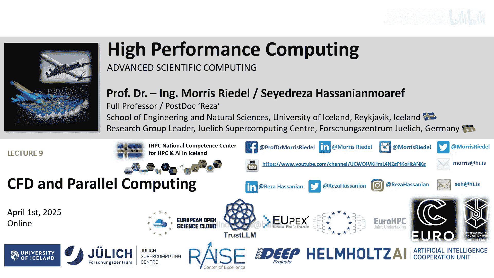
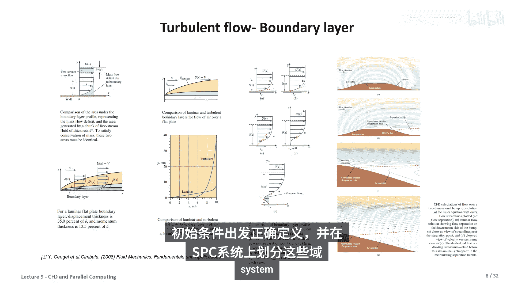
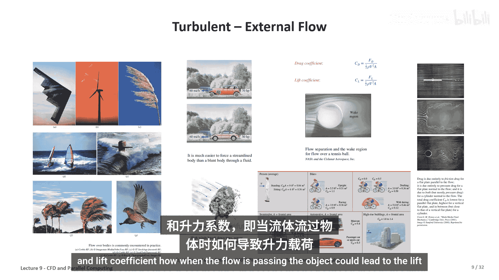
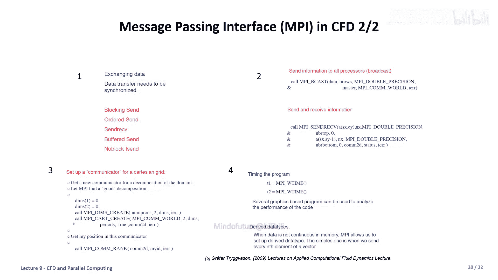
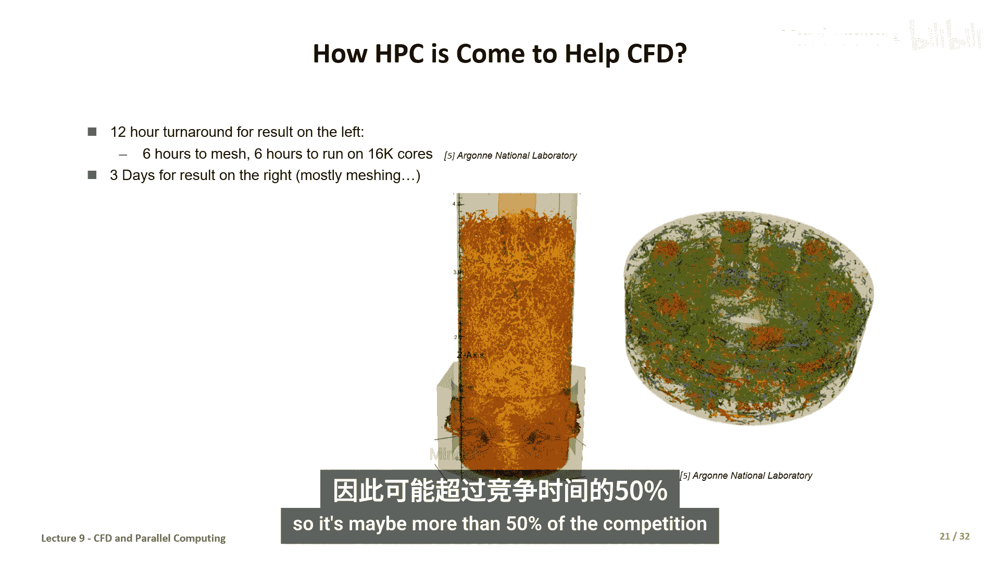
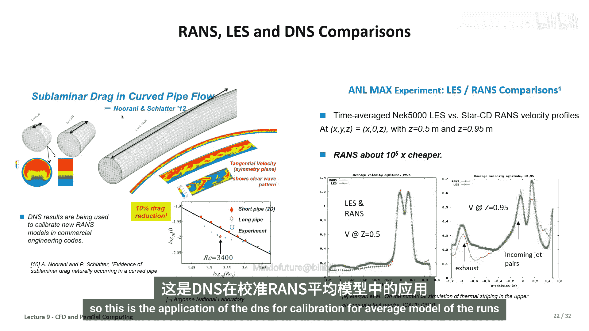
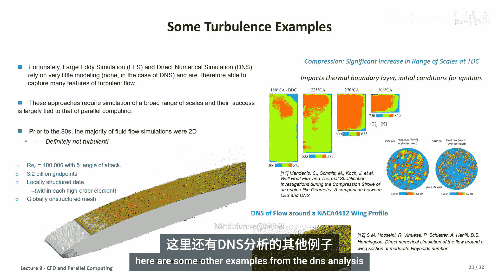
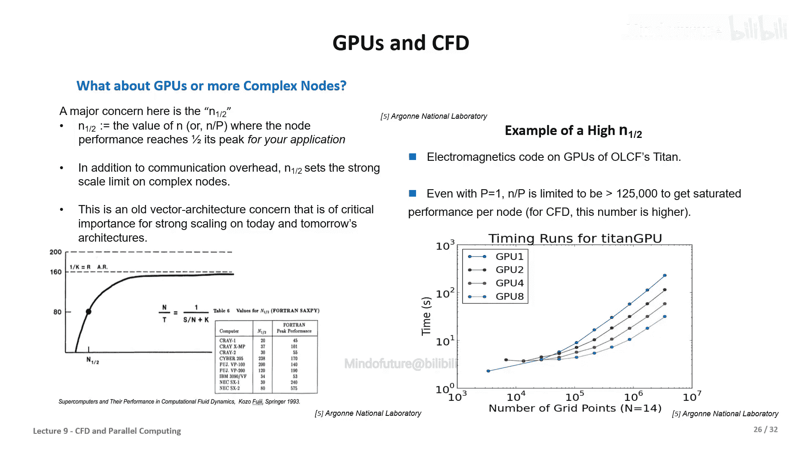
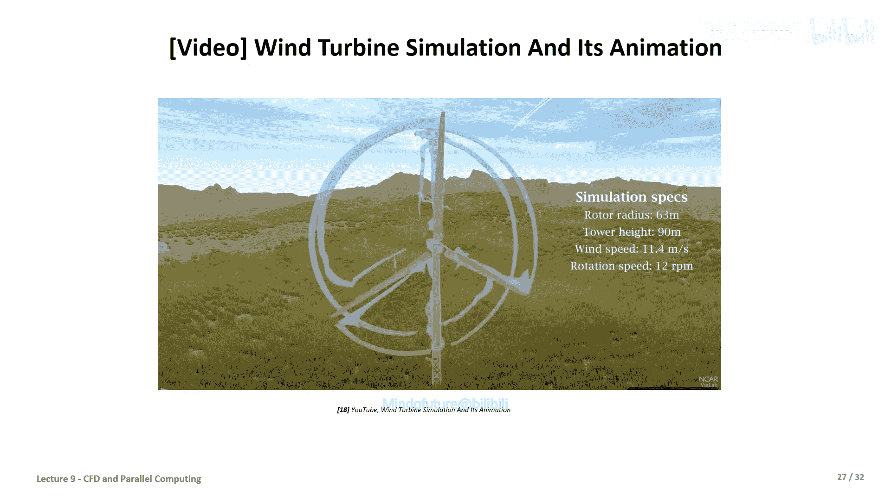

# 【冰岛大学】高性能计算课程-｜-2025-High-Performance-Computing-｜-Prof-Dr-Ing-Morris-Riedel-p08-P08_短讲座_9_CFD__并行计算--BV1k34zzaEK8_p8-

hello啊 everyone。Welcome to high performance computing， Adv scientific computing E series lecture 9。

CFD and power computing in this lecture will continue to have some。

We tabulation and how we are using the public computing with the CFD。Especially for the two minutes。

So we are following the author of the course， which is lecture 9 since this year it's CFD special course for the HPC。

To have a review of public Cha 8， we have introduction we had an introduction for the CFP。

We looked shortly on the history of the fluid dynamics， which has a very old history。

And we talked about the fundamental of the CFD， which is basically discreetized the domain of the problem to the small grade point or element。

 then using the algebraic equation transferred from the partial differential equation PDs。Also。

 we discussed why we are using the CFD， why the fluid dynamic。

 the numerical approach is important because of the limit that is available in the experimental approach and approach。

Also， we mentioned to。Some points regarding the mesh and how we discretize the domain based on the different approach of the finite difference。

 finite element and finite volume methods。And was of the limits for them。

We emphasize on the importance of the HPC for the CFD。

 why when the number of the grid and the size of the grid is changed。

 directly impact the competition and it's very important。So let's continue with this lecture9。

To see how the pilot computing is working with some example。

Here we are presenting the outline of this lecture。

 we will have some example and discussion about the tablet flow and how the topology of the p architecture is working here and some example of the eventss and LES and DNS。

So。A the 초 flow。To have some visualization here， we have some examples。呃。First of all。

 we mentioned in the previous lecture to the as number， which is a non dimensional parameteritive。

 it's determined the initial force to the visco force when the initial forces will be dominant in the flow so the flow will be turbulent。

In the fifth figure in the。Left hand side， we can see how the flow from the injection， how。

Behave when it's laビa， it has a。A pattern that can be followed。 but when is turbulent。

 It has a lot of mal nonlinearity and fluctuation。When the flow is fully laminar and fully tu。

 also we can see in the third figure。How it look like there is a uniform velocity。

 when it's laminina， but when it's the turbulent， there is a lot of fluctuationtion。

 which this fluctuation comes from the turbulent resources。Also。

 there is another example for the smoke plum of the。诶 caning。

When it's laminal and when it's  term to tut。🎼Flow this is a visualization in in fact the majority of the flow is propulent and that way it's very important to see how we can deal with kind of problem in the fluid dynamic。

From the category is turbult flow， we have internal flow and external flow。

 example of the internal flow when the flow inside the pipe。

Here is presenting the real world example。 you can see。

In this three picture I will up to down how the flow when its laminina how it looked like the water。

From a pipe the outlet of the pipe power is with when it's turning to turbulent。

In the circular pipe there is arranged for the res number， when is the re number is lower than 2。

300 it's called Laminar flu， when between 4000 and the larger the 2300 is transitional area when its transition is happening from the Laminar to tut flu and when it increasing higher than 4000。

 it will be2rb flu。In the left hand side， you can see presentation what look like the layer of the。

F in the laina and turbulence， how they are mixed in the turbulence floor and how they have a。

A uniformform layer， when it's lada。Regarding the turbulence flow during the time。

 if we take a realization or measurement。There is an average value for the velocity， for example。

 and there is a fluctuation。I want this agi。You can see example of the how the average of mean velocity profile for turbulence flow in the pie。

 How。He， and also， we can see the Boevvi layers， how it's created for the la how it required for the two flow。

 the slope of the。V of the velocity， very sharp for the。Lina flow how in the tuul in the beginning。

 it has a lower。A slope for this graduation。 the the gradient。Also。

 we can see how it's looked like the profile of the velocity for the lainate flow and turbulent flow inside the pipe when it get to the fully developed condition in turbulent flow and the laminar flow so this is the visualization of difference between this behavior for a majority of the lamininate flow we have the analytical solution but for the turbulent flow。

Most of the solution currently we working with an numerical approach。Here also。

 it's another example for the turbulent flow of the bodeous layer when the flow is passing an object and what's happening for the separation。

 These are very specific examples from the。Tubulence flow that the separation is happening because of the stagation point and also the separation point。

And sometimes the reverse flow is happening here we are presenting them just as an example and you can see how the two flow impact really different type of the flow we are not going to detail about this why it's happening。

 what reason so sort each of these example is based of the numerical approach it's required to define properly from the equation from the boundary cache from the initial condition and then how we can split these domain on the HPC system。

呃。Now if we transforming from the internal flow to the external code here。

 there are some other examples from the external flow， we can see a nice picture。

 the left hand side from the external flow， how the flows passing some objects which we can see in many areas from the。

Rature to the industrial and energy section。Also in the vehicle and the automobile industry。

 there is a very important application of the external flow， which is called drag force。

The shape of the car it impacting this force and that's why we see different shape of the car and if we look on the history of the automobile industry。

 we can see its change during this time。And here， the definition of the the coefficient and lip coefficientient。

 how when the flow is passing， the object could lead to the lip forward or right force。

Now let's see example for the application of the CFP in the tuulent flow area。

As we mentioned in the previous lecture， we have RAs， AES and DNS。

Categories for the turbulent flow advance mostly provide the mean of the properties of the flow。

 the here is the example used for such idea， in fact when we are using advanced。

 we focus on the mean flow and the effect of the turbulent on the need flow properties。

In the Res Re Navi stocks equation， there is a re status term in the equation which need to be solved since it's no linear term and there are some models suggested to deal with this term。

In the vans， there are different suggestion here the example is use K Epsilon a model to solve this example。

 the right hand example of the application for the vans。For the airphone。And the the second one。

 the lower one is the example for the。A skin friction， A coefficientient。And。

Oal1 is the peripheral coefficient， but we can see how much the。

Alignment between the solution from the Rs。And from the experiment can be seen。

 the pressure coefficient is working well well。 but for the skin fri。

 there is a deviation between the。Avan and the。Experiment down the example。

 it's in the left hand side。 It's example for the events applied to。呃。

For the plan of jet and the lower one is for the。The。For the cylinder， when floor is passing for you。

We can see。The second one has a much alignment with the result from the advanceds with the experiment。

 but the upper one there is a deviation between the experiment and the advanced solution。

 So here we can see the application of the land in some cases because of the geometry of the problem especially。

It's working very well and it' providing good results with the experiment However in some cases。

 it seems there is a far difference between。Rance and the experiment。

 So it's required to take on the action and maybe use on the approach like L S or DNS。No。

Here in this slide， we can see examples from the larges simulation LEs。This example presenting from。

Up to down the result from the experiment and the second one from the arise and the third one from the LS。

 we can see how much the first one and the third one have a very similar result in the visualization。

 which is mean the LS can extract much more detail in the simulation for such example here the example from flow over a surface mounted cube。

 which is from the experiment compared to LS and length。In fact， in the LES large dissimulation。

 the solution based on this idea that in the turbulence flow。

 the dominant properties and the behavior of the flow by the large scale of the flow。

 then firstly with the sunfilration。This problem solve for the largest scale。 And then with the。

To solve it for the smallest scale， there is another approach is called soft scale， SgS， mode。

To solve them for their small skin and then extend the result from there。

A largege scale with a small skin。This method， especially for the complex geometry。

 it was so successful and started with this idea。The next CFD simulation is dial simulation。

 DNS photos below。Which is providing the most accurate solution。

And it's highly costly in the term of the computing resources。

Here there are examples that presenting the result from the DNS compared to experiment and it's presenting very high accuracy。

Then in the term of the accuracy， DNS is the first ranking， and then we have the LS。

They then advance。But when we are looking on the computing resources cost， DNS。え？Very costly。

 And D L S cheaper than LE S is cheaper than D N S， but it's。Much more expensive than Iran。

So based on the accuracy and the solution that is required on the application is dependent to the computing and the accuracy。

 we must select the apple。That way they industry doing mostly， if you mean every solution。

 its covered the requirement。Then， events mostly used。DNS could be used for the development。

 and also to。H validate did some one way to some test。

And technique may be relevant to the experiment。So based of the computational assess。

 we see for the turbul flow simulation， the HPC is required and the difference only regarding the amount of the computing and which one have a higher cost and which one has a。

for the computer。Also， we talked about the。numericalmer simulation for the turbul flow。

 it also should be mentioned that each simulation has its courage in the range of the scale of the turbult flow。

Here in this slide， you can see this figure for the energy cascade and the different scale in the turbul flow。

 which each simulation depend on the。Cllage should be selected。 For example。

 the DNS has a larger coverage than。AbsS and also events has a smaller event for to cover this type of the problem。

 So this is the also matter when we are selecting the simulation method。

Regarding the cost for the DNS， as we said in the previous lecture， and we discussed here。

The degree of the freedom for the problem is correlated to the main sample。

And when the oil cost evaluated， including the time step。

 the computation is proportional to Reinos Epoo3。Which is very large number。

 as we said we usually we start with 1 million neurons in turbulent flow so we can assume how much computing required。

For this， a type of the problems。Regarding the variance and LE S。

 also the assessment is show the variance10。2，5 is cheaper than L E，So it's this cost it。Important。

 it's not something that can be neglected and when we need to select between LES and else we should see how much accuracy and how much average or detail we need from the problem and we discuss it in the next example when working with some specific geometry maybe events can call all the domain and we need to use the LES。

Here it's like Ri and the review on the previous lectures that you have for the。

Maching configuration， S I SD， S I M D and M I M D。

Wwhich is depend on on instruction and the data and also you had the term of the distributed memory and also the shared memory。

 which are matter and we talk about them in the topology section。In fact。

 we can see when we have a distributed memory and interconnection network。

 how the posting between the CPU and memory is ongoing for the computation and solution of kind of the CFT problem and also when we have the shared memory we can see the entire connection network。

 how it' make a connection between the CPU and the memory which is different configuration and behave have differently and it's important to know which one it。

Work properly with the CFT method and depend of the problem when we are doing the discization of the domain to the number of the subding。

Now let's continue for the topology， in fact the topology is defined there how the interconnection is going between the processorcesors。

Which is mean each given poster， who is its neighbors。

 Who are the neighbors and how the interconnection and going。

It's important because the communication between these neighbor it's important to have a better performance on the architectures。

Which is mean to have a better performance and maybe the ideal performance for the competition extensive to have the competition pattern in the。

Hemmoographic behavior。 then in the term of the topology。

 the computer network is related to two bird categories， static and dynamic。

The static one it the connectivity pattern in in。Fix one and split off。

 So this is the based on the category for the aesthetic。 When is dynamic。

It's support time changing connectivity pattern。Then。

To have a deeper look at the popular static topology， they have a Vk and one dimensional tools。

 mesh and two dimensional tools， hypercute TV and fully connected。In the right hand side。

 we can see example of these different topology and network。For the aesthetic ofpology and network。

 there is a sound feature which make them my AD much better。 No a low number of link per node。

For example， when we make a comparison between them， for example。

 we can see for the star that won the great point or have only one correction。

 But which one in the center has。Many connection depend on the number of their nodes。

But when we're looking on the ring， always each。No of this network has a tool leak。

So it's very important to select one that has a。AL number of the length panel。

 there is small inter node distance and a high number of alternative paths between any two nodes and also capability to increase the number of the nodes without changing the topology。

They making the aesthetic network performing much better。The dynamic topology has some。

Much more the important topology， crosspower switch， vast multi stage switch。

 And here we can see example of this different dynamic topology。Therefore。

 when we apply the pilot computing for the CFD to have a proper efficiency here in this figure you can see。

 we should look at the goal of the pilot computing。

 firsts often think there are two main goals reduce the e lapse time of given application at the fixed size。

And solve increasingly larger problem at a fixed cost instead of when these two goal。明2 개。

Then the pilot computing will have a better efficiency。

 and there is a main issues to control the pilot efficiency。whichch are a fraction of public content。

 load balance， commicivity and redundancy， which could be discussed in detail how they are working。

 there is a lot detail about them but here we are presenting is in the selected discussion。

To mention that how the public computing could be efficient and how we can increase the efficiency of such system。

Now let's look at the parallel computing for the simple example and how it's important about the neighbor nodes when processing the solution。

 in this example we have a domain which is with large grid with 20，000 by 20。

000 then the storage requirement as it's calculated here we can see is 6。54 gigabyte。呃。

And the domain is as split to 6 subdin between6 person。The the point that iss very important is。

It should be overlap。Between the subtomy， especially on the borderex。And this point。

 exchanging the information during the situation every time。When updating it during the time。

 it's required to have information from the neighbor person， from neighbor domain。

And as it's mentioned here with a red line on the domain for 3D and 2D problem is necessary to exchange line and plane of data between them。

Here that what we mentioned and emphasize emphasize that。

It's very important to determine the right topology for the problem to exchange the required information between。

Neighbment。Message Pass interface MPI， you learned about it a lot in the HPC course and the first part of this course。

 which we know is a library and has a subroutin for different languages。

W whichhich facilitate the publicization of the programs。And， in fact， it is。

Not the is MP is a specification， not a particular implementation。 So some power computer vendor。

 they offering the MP implementation for their machines。And it's very important。

And here we are presenting a simple structure of the MPI when we are using its for example。

 for the CFD。The main。A structure of it when there is the program had identity of each person。

 when we initialize the MPI and the number of the person used should be defined。

 then the actual code placed in this place that's mentioned here， then ending the MPI。And now。

 in the next slide， we will see。A step how we can set up our CF code to be used with APII。

ButThen here we are presenting the MPI how we can run it for the CFD problem with fourth step in the first step there is exchange data and data transfer need to be synchronized in this step and as you learn a different method block order standard receive and etc。

Then in the second step， send the information to our publisher， which you can use the broadcast。

And send and receive the information。Which we can see how it could be work。

Then in the third step we have the setup for the communicator for the Carteian green。

 which could be defined then in the fourth step we have timing of the program that could be determined and also we have the derived data typos。

So this is a simple structure of the MP how we can earn it for the CFP code。

 and of course we can develop this structure。

Let's have some。Quantity measurement for the HPC when it comes to the C of the application for this complex and the large size of the computer。

Here we have a tour example。嗯。Both of them for a heat exchange simulation。

And the left hand side is take 12 hours。To， to the visit， for the visit。

 which was six hour for fishing and six hour to evaluate on the 16000。こう。The right hand side。

 it takes three0 days for the solution mostly for the machine。Here。

 we should mention this point that when we have phase simulation with excessive size。

The machine usually take It' well known in the churches。

 about 50% of the competition taking for the machine。Good。At least 50%， and sometimes maybe stan。

And here you can see3 days for the right one and mostly the mission。

 so it's maybe more than 50% of the competition。

诶 there话 some。AComp of the advanced LS and ES to see how they are performing on different example。

 the right hand side its the experiment compared to the E and advanced。

There is a different level of the simulation on this geometry。One of them is。

z equal to half met and the other one z is equal to 0。95 me。

 we can see for the z half me LE and runs as a very good alignment and very close result to the experiment also。

 but when there are a level of the geometrymetric with a specific point is increased to 0。95。

We can see there is deviation， especially from the ion and L is able to match better with the experiment。

Here it shown us that in some specific condition with some geometry。

 the vans could not cover the solution properly and it need to be used in some other much more accurate a like areas。

The only example in the left hand side is a sublumminar drag in the curve pipe flu。

 which in the figure here is presented， it' showing the deviation from the variance to the experiment。

How this approach is showing that how we can use the DNS result to be used and collibrate the new advanced model。

 it mean in the commercial application， for example。

 in the some software that we have in the market now。And the。When we have the advance。

 we can calibrate it with one tie with DNS， which means we solve the problem one tie with DNS and they collibrate the DNS and we can perform it with a different problem again but cheaper。

 so this is the only application of the DNS for calibration for average model of the Iran。

Here are some other examples from the DNS and LES and the first one in the right hand side it's for the compression。

 it's for the engine， which range of the scale at TDC， TDC。

 it's the evaluation for top depth center when the piston is the the forest position and the kanksha。

In this situation， there is a simulation of the LES and direct simulation for the piton and it's。

Investigating the temperature and this visualization here it showing the different detail that is presented by LES and DNS and as we can see。

 the comparison between these two approach showing that how much DNs presenting much more detail than LES。

The other one is DNS of flow El W profile with profile NAA4412。And。Yeah。In fact。In this simulation。

 the vendor number is a 400000。And the angular attack is。T at 5 degrees。This setup presented a 3。

2 billion grid point and with locally structured data and the globally unstructured mesh。And。

And we can see this simulation here for the weak profile how much detail present and when there is a zoom in on there。

😔，De， we can see。There are different scale can be seen for these DNS solution。

 So the capability of the DNS is too high， and in fact。诶。呃。From the time that the DNS and of course。

 the LS come to the play， it's helped a lot to get much more information about the interaction of the different。

Co structure in the turbulence。 In fact， prior to the 18， the majority flow simulation were 2D。 and。

 of course， not for the turbulent。 It was for the laina maybe simple problems。

 So here it's presenting the importance and。Effect of this approach to understanding such complex phenomena in the industry and different application。

And now here， let's have a look on the effect of the polying and how we can have efficiency in the computation。

To have a deeper consideration impact when we have a high order。For the CFD simulation。

 there is a reduction in the problem and so we should have hopefully reduce in the cost。

 so the high order is helping it this way。F， multileve solve also the co grid solve is big challenge power。

 so it's very important to see how we can deal with the solve。And the next one is the more parallel。

 in fact， when we doing the setup for the parallel， how much poly is required。

 increasing the poly it's helping to get speed up in the solution。

 this question need to have deep consideration to see what range of the parallelism it's helping to speed up and sometimes when increasing maybe it doesn't impact and in fact in the practical application。

 you can see this happening many times when we increase the number maybe it doesn't change a lot。

 so we need to have some tweak to be sure about the parallelism make efficient computation。

Here is the example from the DNS solution。This example has 3。9 million elements with all the6。

Which mean there are 84 million points on this C model。And。To run it，100 with 131000 quote。

Which is one to six of the MiA supercomputer form Arguna National Labor。This example is evaluated。

So how we can make this solution faster， we can run it faster if we make better algorithm。

 like a lower order or faster solve or more power。こ。Then to look at the publication for this example。

The maximum value for the totalo is 3。9 million。 And if we diving the。Number agreed to the proposal。

 There will be 216 point per proposal。It seems it's too low。 Why， because for every system。

 there are some envelope analysis such a minimum of the。Point per person。

 which is for a mirror for There is a 2000 point per MPI rank。

To realize 50% of the parallel efficiency， Therefore。

 for any final difference volume or element code， is required to have。P number of the point purpose。

In the current simulation with this setup， there are 3200 number purpose。

Looking at the scanning with capacity of the。Mirrer supercomputer。

 which have 524000 core and using one or two rank per core。

 we can see here in this figure about the time increasing number of the per super core reducing the time。

 the giving one with two per super core and the red one with one per super core。

 So we see the time is reducing， but when we look on the efficiency。

The blue one is presenting us when we have two% of a call when and we increasing the parallelism。

 when we have half of the processoror， it's reaching the maximum efficiency。

 But when we increase the parallelism， it is using to 60%。 So it's very important that we select the。

Correct number of the to have a highest efficiency of the power。好。And here in the end， just。

 I wantna mention to the。There is a concept in the CFD simulation， but we call it and subha。

 which is mean it's half of the peak of the time step when we have a time step in the problem。

Sometimes in the sum scheme， we're using half of the time step or half of the peak of the time for the application。

 When we are using this approach， the computing is increasing。

 and one of the approach is to use the GPU to deal with this half calculation。

 Here is example is presenting when we are using the GPU 1，2。

4 or8 GPU for this kind of the calculation， which is dealing with and sub half。

Increasing the number of the grid point， how its behaved with higher number of the GPUs and we can see with higher number of the GPU the time will be very different and it's important to stay4 such kind of the unsteady calculation with and sub half using the GPU and sometimes reducing the computation time maybe 50% as we can see here how much different between the curve of the GPU 8 and GPU1。

嗯。

Then here we have ended with lecture9 CFP and public computing。And in the end of the Vi a video。

 I suggest you to watch it is on the YouTube and present example of the simulation for Winter tupoint。

 which this example presenting how the HPC is required in such application。

Which is very important in this day for in the wind power。

We will continue for next year。In next scheduled time。

And there as it planned to you working for the final project。With the industry。

 feel free to contact us。If you need help or any method regarding the project。

A good luck。All thank you。