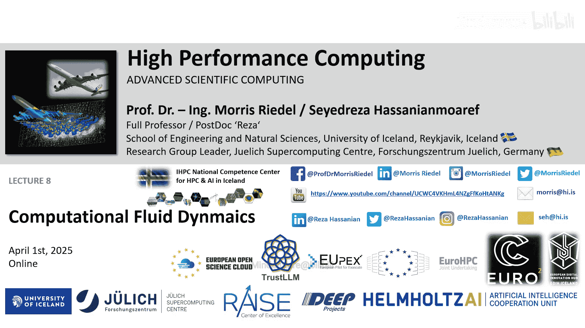
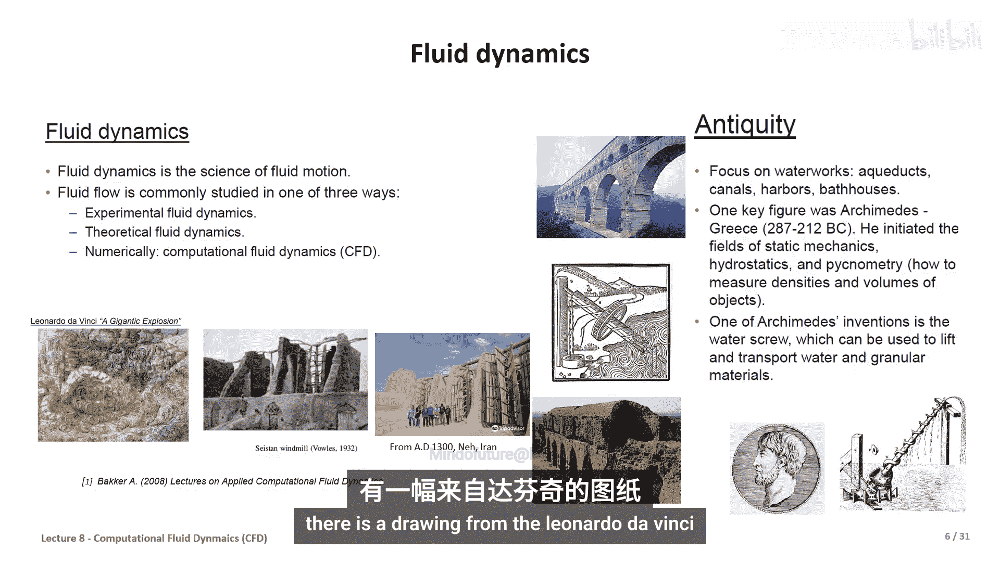
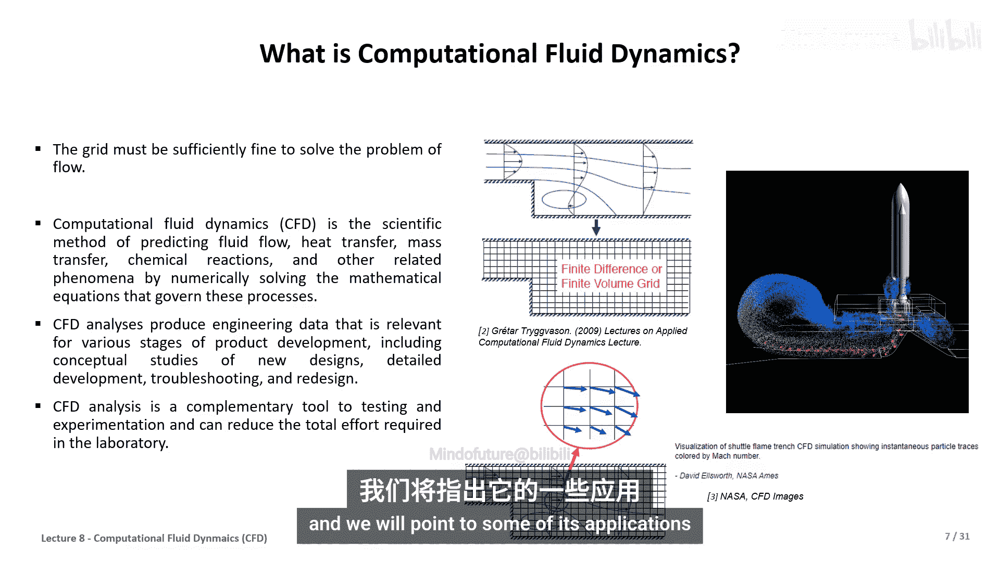
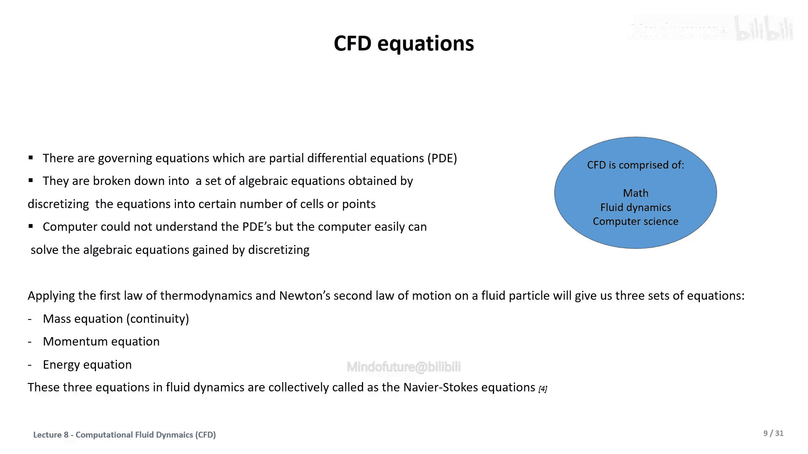
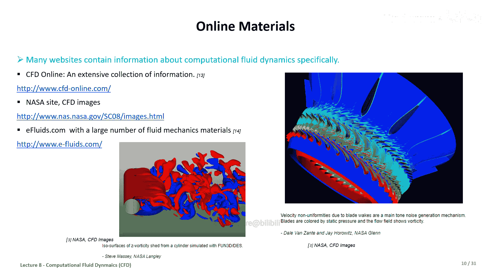
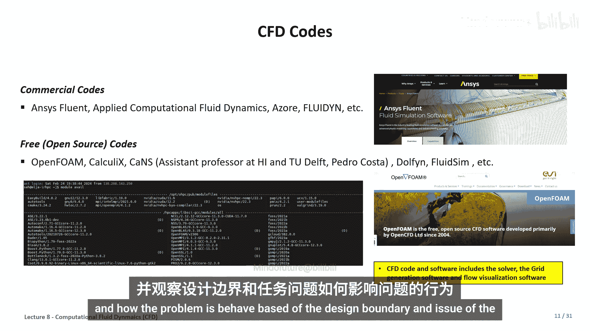
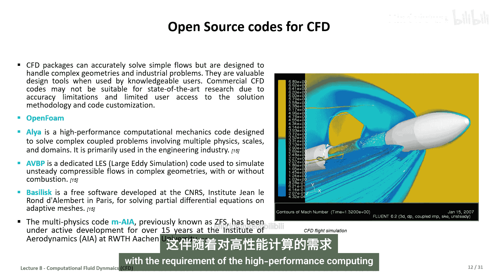
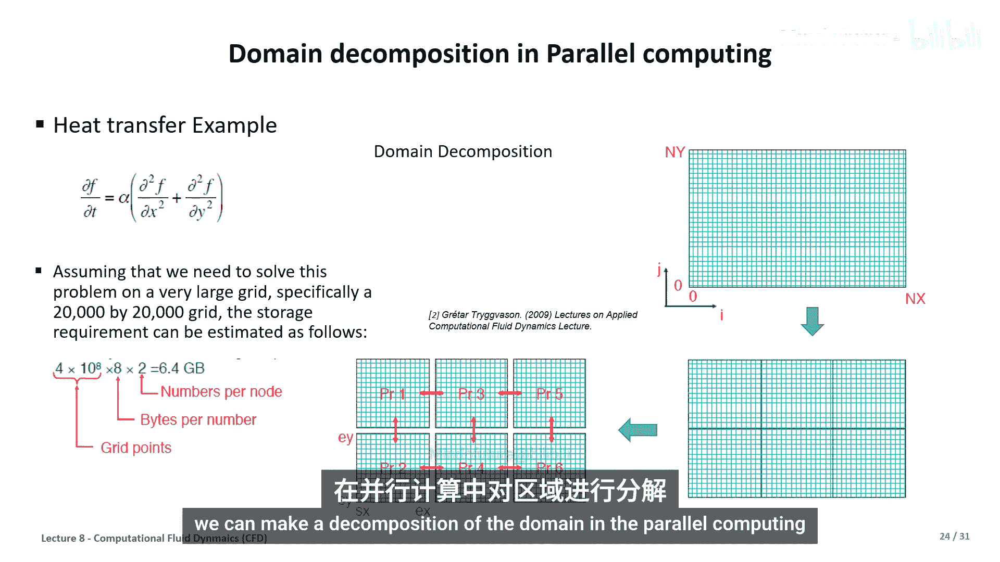

# 【冰岛大学】高性能计算课程-｜-2025-High-Performance-Computing-｜-Prof-Dr-Ing-Morris-Riedel-p09-P09_短讲座_8_计算流体力学--BV1k34zzaEK8_p9-

Hello everyone， welcome to High performanceformance Computing Advanced I Computing this is lecture8。

 Comp App dynamicsmics。Let me introduce myself before starting this lecture， I'm Valeza。

 a postical researcher at the University of Iceland， committee working with a Mo research group。

My focus on the to flu in the blood dynamic and I am applying the HPC AI methods and CFD in this area。

It's my pleasure to be on this course and I will take over the second part of the course from lecture 8 to lecture 15。

This year， I need to mention that， because of the。Time and Easterb is approaching and also it plan to student have a final project with the industry。

 so we manage to have your lecture time focusing mostly on the project working with your teammates。

Then from this lecture， we will have a short presentation for each lecture to cover the material of the quotes and also you'll able to work on your final project。

Now let's continue for this lecture。

Let's first have the review of lecture7， distributed deep learning and application。

As its discussed in the lecture seven， because of the deep learning model。

 it's developing and going fast， there ares， the size of the data and also about the models the deep learning model and their parameter。

So for the distributed deep learning， in fact， there are two options we can do。

We can distribute the data between different number of the notess。

 and then it should have a copy of the deep learning model and running the。

A training for this type of the deep learning and the older one。

 when we have a complex and a very high number of the parameter of the deep learning。

We can distribute the deep learning model between different nodes。So in fact。

 this approach is important to be able benefit from the public computing for deep learninging model since size of the data and number of the parameter and complexity of the deep learninging model is growing this action is in the。

The complex cases is required。Here we have outlineline of the course， which is here is。

Plan to have a C， special。Under lecture8， we will start for the introduction for the CFT and now let's begin。

These are the。Subject it will covered in this short lecture。

About the CFT and its background range of its application。

 I will talk shortly about the Naistic equation。What are the schemes is using in the numerical method。

 at some point about the machine and boundary condition and the3 categories that it's used in the CFE4 turbulence blue？

AComp of light dynamics， which is called CFD。CFD is an numerical method， which is U deploy dynamic。

Regarding the F dynamic， there are evidence that this show has a very。old history。

One of the key figures， for example， was Ermus， it was at the time before Christ。And。

He designed and used the fundamental of the fluid mechanics in some inventions。Like the water school。

 which transport the water and gal material。To study the fluid dynamics。

 usually there are three approaches， one of them is experimental。W whichhich。你 sure we get得。

Most more evidence in this area， then do you have the theoretical and analytical approach and the other one is the numerical approach which is relevant to the CFD。

In this slide， you can see example from the fundamental of the。

Flolight dynamic is some invention and application there is a drawing from the Lon Laci。

And also， there are example from the wind tuine from very old time。不。Now， let's see。 what's the。

Competition of light dynamics。In fact， when we are dealing with a flood dynamic problem， we will。

Talk much more about the complex city of the。Equation。

 the governing equation and the boundary condition and initial condition， how it's impacting the。

A problem in the flight dynamic， then when we are dealing in such problem。

Maybe you have a governing equation。 but because of the complexity of the problem， no linear term。

And also some limitation and unknown issue about the initial condition or boundary condition。

 it's difficult to have an analytical solution for is the CFD the approach it。

Making very small grid point on the problem domain and using these scheme to solve the problem point by point or element by element they are very different approach in this method。

 one of them the finite difference one of them finite volume method and one of them is the finite volume method。

 each of these method has its theback and capability。And depend of the project。

 depend of the geometry of the problem， depend on the boundary or initial condition。

 the expert decide to use which of these apple so here in this slide you can see example of a problem at how its discritized to very small element。

And then using the final defense method to find and solve the problem for the target properties like could be velocity。

 pressure， or for example， in the heat transferpher it should be the temperature。And this approach。

 in fact， has a great power。However， from the turbul flow in the F dynamic。

 the big issue is we don't have enough understanding。

That's how the processing of the toling is happening。

But the CFP helping us to solve the problem and to get the solution that way in the industry。

 it has a lot of application and we will point to some of its application。

Yeah。Now let's see what we are using the CFD。To honor is the fluid dynamic problem。

 as we mentioned in the。History section。There are three different perspectives。

 one of them experiment， the other one analytical solution。

 and the third one is the numerical solution which is relevant to the CFD。

The experiment possible to conducted it with a specific problem。

 there is a limitation for the measurement， for example。

 when we have high temperature or we need very specific initial condition or boundary condition for problem。

 maybe we can't perform between the control liability condition。

 the tools and the cost of the experiment， it's a matter。And there is an issue about the scaling。

 also about the experiment。How is the experiment helping us to validate the numerical solution？

Theeth solution is available limited for the limited number of the problems。

 especially only when they are linear for the nonlinear its very complicated。诶 for the。

About the computation also sometimes is very costly。And for most of the problem。

 there is no analytical solution。And it's great that it's presenting general solution equation for the problem。

Now， let's see whats about the numerical solution of the CFD。

It doesn't has the limitation for the solving。So also。

 it's possible to reduce the computational operation cost depend on the method。

It could be used for the complex problem， depend on the geometry also。And maybe the boundaries。

It could be validated before the application。However on the CD。

 we need to have the boundary condition， initial condition。

 and the computation time also is dependent to the power of the computer。

This term exactly what we will talk about it in this lecture and in this course and we will see how the HPC placed on the。

H critical part of the CFD when we are dealing with complex problem with tut flu is required to have the HPC to able to solve this problem and of course the HPC development accelerate the solution for such a complex problem in recent years。

When we are dealing with the CFD， we have an equation which they are regardinging equation for the problem and they are partial differential equation。

 we call them PE。When discretizing the dominant of the problem to the small grid。

 which could be element of grid points。呃，These。APd use equation will be converted to algebraic equation。

 then the computer power could be used to solve this such equation。 In fact。

 to have the governing equation。Floid dynamic， we have the mass equation。

 continuity momentum equation energy equation。 and this theory equation its。Let to。

The main equation the p dynamic is called no of the equation。

Here is some for the example of the material for application of the。CFP。

 which are very important and in the development of some achievement， for example， from NASA。

And there are some examples from software also can be seen here and if you are interested。

 you can look at them。

For the CFD application also， there are different categories of the codes。

 we have some commercial code like An。Applate computational pdynamic， alz Fine， and etc。

 also there are some open sources of recordss like open foam， calcus， cans， dophin， Fidm and Ele。

Is depend to the requirement and whatever the problem we need， or it's for the research。

 or it's for the industry。 We are using the。relevantlevant quote。

 the open source code is great opportunity。 and it's possible to have your new quote and added to these。

Soces and solve this kind of problem。He， in fact， the CF code also include there。

Great generation of machine and solving the problem and the visualization。

To able to see the solution and how the problem is behave based of the designed boundarying and initial condition。

诶。ForMost of the C code thats are available。 Basically。

 they are packaged that to dealing with the simple problem。

 but they are capable and designed to handle the complex geometries and industrial problem Here。

 we are listed some of the。Well known。Soces， open sources for the code， like open form。

 as I mentioned。Alilia， ABBP and Basililis。Also， mayor。

 they are from the different institution USD in the Europe。

And they used for the complexity of the turbulence flow。

And we will talk much more in the next slide about the tuflow and why it matter and why the CFD is very important in the ED area with the requirement of the high performance computing。

We kind't think of the CFD， usually it's assumed as a multidisciplinary topic。

Here it's nice presentation。呃。For the CFD， as we can see。

 the knowledge of some of the fluid mechanics， its required in numerical analysis and the Comp science。

To perform the great solution for the complex CFD problem， which is acquired the computation。In fact。

 the CFD in the traditional application have been one of the most demanding computational application。

And in the sense of this requirement， it's one of the effective applications which led to the development of the powerful computers。

For example， it was first single poster computer and then in the  AT was a vector computer then in 90 the power computer and you know we are talking about the shared memory and distributed memory and you have the lecture for this different。

呃 categoriesategories。Okay。So as we said in the CFD， we have guard equation。

Which is basically it's from the Na equation， it's converted to algebraic equation and then using the power of the computation to sort this kind of the power。

嗯。Then now the question， it's from the Ne alternative fluid and incompible flow。

 they are in fact second order nonlinear PDs。And here we mention it's quite formidable。

To mention the complexity here， there is a presentation in these small figures or two regime of the flow or type of the flow。

It's called laminina flow and tubinness for the laminina flow， which in the upper one。

We can see these。Line is presenting the stream line of the flow。 and we can see they have a。

A very clear motion and pattern。 And we can follow these lines。

But when we looking at the turbulent type of turbulent flow。In the second figure。

 we can see they have a very non linearity and。randomness。And the wind there are a lot of pain。

Flowor streamline， it's very difficult to be able to follow each one。

This is the complexity of the to flu。Which is available as a term in the noisistic equation。

 and it make it difficult to deal with this kind of the problem。

 tuernet is one of the unsolved problems in the physics now。And di research are going on this area。

CfP helping to solve this kind of problem they， however。

 about the comprehensive understanding about the coher structure and how it's posting the toto eteem。

 there are many unknown。Regarding the CFD， the numerical method is。Fin defense， finite volume。

 finite element， a spectral element， a spectral method， bond element， reduce method。

 and some many others new echo。And solving this complexity with this method。

 it required the computation from the hyper performance computing to able to get the solution and to get the result。

From such complexs do of the pub。In fact， the equation has a full unknown pressure。

And a steady component of the velocity。Then it should be combined with the nervous equation should be combined with the comp continuity to form form equation for this for unknown。

The anousistic equation have only limited number of the non consumption。However， the CFP in recent。

Is provided great possibility to solve this kind of the。Problem and this equation in some cases。

 However， when we are dealing with。A complex geometry， and three dimension。

The number of the computation is increasing extensively。

And then it's required to have HPC to be able to solve these kind of problems。这。

To present some matter in the CFD here we will mention some point regarding the machine and also the quantity condition。

Inect CF of the。It's alone is a course， and it has a basic and advanced level of the。

Courses and the experts in this area need to be familiar with it fundamental and。

Enough knowledge to use。Here we are presenting it at a case， which required the HPC。And， of course。

 this lecture does not cover the。Hold information， hold card material for the CFD expert。Hey， how。

 if you are interested， there are a lot of references with example and you can look at them and you can see how the governing equation is。

Created base of the problem and then defining the initial condition or boundary condition and then select the relevant method to solve this type of the problem here。

 for example， we mentioning about the final difference method is the simple and straightforward to apply。

 but usually it could be useful for the regular grade。In fact， for the mission of the problem。

 we have a structured and unstructured， you can see here in this figure how the structured one it looks like and how the unstructured one。

In fact， because of the some geometry of the problem， we need on some areas of the domain。

 we need much more fine grid to able get the。Coll solution when we when we increasing the number of the grid or when we are reducing the size of the grid。

Then the competition gets much more high。Furthermore。

 there are limit also that how much we can make the grid smaller and teeny and this is the base of the knowledge that you have from the problem and also above the limit。

诶暗心。Point that you need to meet in your problem design。

The one is finite volume method usually it used for the e machines grid。

 so when we have measures which they are not in the usual form。

 we can use a finite volume method the one finite element method。

 which this one is the much has a much more power than others。

It's working for a structure and structure degree， however， from the mathematics view。

 it's much more complex than other two。And。It has a sophisticated computation。

And what it' able to solve any problem with different equation。

 and it's known as this as a complex method。For example， most of the commercial software and the CFP。

 they are using the finite value method。 the finite element method also is available there。

And it's able to cover much more。The company exp。In the fluid dynamic， we have a type of the flow。

 or we call it a flow。EWhich is called lamininate flow and turbulence flow。

To have a visualization of these two different regime here， we are presenting the flow。

Passing a cylinder。The upper one is turbulent blue and。で？Second one is the laminina。

 We can see when the flow in the laminar regime passing a cylinder。

It has asymmetricsymmetric on this object。And it's very easy to follow or maybe predict the flow。

 And for the lamin of flow， we are able to solving the analytical solution for it。

But when we are dealing with turbulent flow， as we can see， one flow is passing the object。

 this cylinder。There is a wake and complexity geometry for the flow。In the donte。

When it's passing the flow， passing the object and this complexity could be seen in the solution and dealing with the analytical solution for this kind of the power to categoriesize this flow regime。

 there is a known dynamic parameter is called a reolds number。

Which is defined as the inertial force to the visco force， which is mean in the turbulence flow。

 the inertial force will be dominant in the flow。And when these power of the initial reducingcing。

 then we have the lamininate flow。嗯。The quote the ven number has arranged depend on the type of the problem。

And the boundary condition of the problem。For example。

 when we have internal flow like flow in the pipe， there is a specific image for the flow when it's laminar and weight is turbulent。

And in fact， between these two regime， there is a inable area it's called transition area when the flow is transitioned from the laminar to the tut flow。

 this has also a specific image and in this area the flow is not tuulent and nu laminar and it's between them。

Then the flow reaching there， if we want to explain what's happening in the beginning。

 if it's laminar and the ven number is increased， then the transition is happening from the transmission is transferred to the tut and then it's reaching the developed tut flow。

Okay。So here also the presentation from the flow from the pipe。

 how it look like when it's Laia and when it's turbulent。

And the we number is defining the regime of the flow base of this definition。

Moreover in the fluid dynamic， we have categories of the compible and incompasible flow。In fact。

 it's leading to under dimension number it's called mark number。When we have the fluid dynamic。

 the compress will flow mostly about the gas dynamic。

And when we are dealing with the hybrid dynamic and incompverible hybrid dynamic。

 which is which mark number less than one。We can say it's incompible flow。

 The behavior of these flow iscomp different。 And I。

 we can say the expert are working in this two area。

They have specializeds in the complaible law or incompasible law。And it require knowledge to be used。

 In fact， the behavior of the gas and the liquid is different。 So it's required different。

Meth of the solution。 And also regarding the garlicing equation where it's used and how we behave with them when we are using the CD to solve this kind of problems。

Just to have a short。It's theoid of the CFD application on the PDs， in fact for the PDs。

 there is a classification， it's called the PDs could be hyperbolic， powerbolic or elliptic。

And to solve this kind of the equation， the bond condition and the initial condition required in different ways。

 Some of them need both of them， some one of them。However， for example。

 in a finite defense method when it's used， it's very important to have the scheme for the solution to have a consistency。

 stability and convergence。Withhich they of the factor it needs to be checked when we are using the CFD to solving a problem。

To a step what is the problem solution in the CFT first we have the physical knowledge of the problem。

 then physical within。AndThen we need to have the gardening equation of the model of the problem。

 defining the boundary conditional condition， then the disccuritization need to be done。

 which is led to the machine， in fact， in the software。

We will obtain the system of algebraic equation。Then here。

 the numericalal method is come to solve this type problem is depend on type of the equation。

And so we got the quiet computer then doing the post processinging and the visualization here in the in the slide。

 you can see how the grid point is generated for the final defense method。

There is a domain of the problem。And it discreized to the small。We gave a image with the size of the。

In two dimension size， Delta y and Delta X， this side of these element also is required to be checked to have the consistency and stability of the solution。

And then be sure that this solution will converge us to a right solution。嗯。In fact， as we mentioned。

 this type of the method， the finding defense， of course， is limited。

And does it has capability similar to finite element method or finite element method。

 especially about the geometry， as you can see， we need a structure me to use this method。说。When we。

Creating the algebraic equation in the CFE。It depend to the setup of the problem。

 usually when we are dealing with the honest problem， which is changing during the time。

We will have explicit type of the problem， which is mean we have one unknown or implicit。

Which is mean more than one or not problem。是。As we mentioned in the final defense。

 we need to have the consistency stability and convergence。There are different known method。

 for example in the finite defense method to lead to explicit or implicit method in the explicit one。

 for example， we have the forward time centile space， which is conditionally stable。

 but we have the default vehicle scheme which is unconditionally stable。About the implicit method。

 the laon scheme and county scheme are。Implicit method。

When we categorize these different scheme to explicit and implicit。

 here the important point coming about the HPC。When we are using the implicit method。Mostly。

 they have great stability。Because more than from other view。

 because more than one unknown appear in the Alic equation。

 then more computation time is required per a step。So here the HPC is required to perform it faster。

And sometimes if you， if we don't have the enough competition。

 we are not able to solve this kind of problem。Then， using the implicit method。

Le to much better solution， stability consistent and convergence。We may share two examples of them。

 lessonsonant and c。But much more computation is required。Some point about the HPC。

 the gi size and time step both directly affect the stability and consistency。It's mean。

When we have a smaller time step and smaller unit size。

 we can have much more stability and consider how we limit and we need to know this limit。

But when we have a small size， fine size of the grid and also small time step。

 it mean we need much more compute， then it means when we are using the setup to have much more stability and consistency the computing required。

系。Then the time is step and gives size impact the computation time。

Especially you are dealing with TV dimension。We must choose grid size and thermo step to meet a stability condition and perform suitable computation time。

Then it's very important that when we need to solve some kind of the problem to have enough。呃。

Compet pop。Regarding the scheme to solving them for Al equation， we have two different main approach。

 direct methods and intuitive methods， for example， for the low upper decomposition。

 Gaussian elimination， multi scanning and gaus elimination we are using direct method。

 the it methods it's using for jabi Gaussian seeal method and successive oil relaxation as well。

For the tri angleular andmatics algorithm also the Thomas algorithm is available for this kind of problem and of course it required the knowledge which one need you selected depend on the scheme and the problem。

As we mentioned before， when we are dealing with on Starship。

 we need to use the other method like a finite volume or finite a method in the finite。

Fite make volume。 We have agreed， and。Element for two dimension and three dimension here。

 you can see some of them。And we need to use this shape of the grid and volume to discreize the domain of the problem for an structure one to be able to solve this kind of the problem。

 which make the complexity much more because sometimes we don't havesymmetricmetric geometry。

And the it make much more computing with。And also， we have different sizes of the element。

 and they are not all in the same size。Then so far， here we saw some air。

Point that it's show how the CFD solution is getting to the high competition。

 and we need the HPC to solve of the problems。呃。And。

If we wanna be much more detailed about the competition。rather thanね。The number of the elements。

 size of the element， size of the time step。Then we are， when we are dealing with turb law， which。

In the F dynamic， in fact。Most of the floor is turb。

Especially in the industry and most of the phenomena that we can see。

Then the majority of the fluid flow is open it。In the tu law。

 there is a broad range of the schemes and。High dimensionality with non nonlinear interaction。

And there is a point also it's sensitive to initial condition， in fact， in the initial condition。

 usually there is a perturbation and always from the view of the experiment， for example。

 if we are performing ex with a similar setup every time when we run this。Experiment。

 we will never get the same condition of the performed experiment impact they are in the same range when they're similar。

 but the initial condition very sensitive to the perturbation。

And the turbulent flow complex and randomness。When we are looking to the turbulent flow in the mean of the flow。

 we can see some predictable and repeatable properties。In the turbulence flu and CF the application。

 there are 50 main categories is called very aoriginal advanced。

Large simulation LS and direct numerical simulation DNS。

 we will talk in detail in the next lecture about them however we have just you want to mention the difference in the computation for these approaches。

In fact， DNS providing the most accurate solution。And yes， it's in the balance。

 which is providing better solution， but。Better solution than advanced。

 but is' cheaper than the DNS because DNS is the most accurate and costly solution in the CFP。

But the advance， which is mostly providing the average solution。

 it's a cheaper one and both using the industrial economy。When we look at the computation for it。

 usually the advance its。10 five times cheaper than the。

 So it's not sometimes that we can neglect it。 and it's high difference in the computation。

 However events has some limitation， for example， for some a specific geometry。

 some body condition is doesn't co。And when we use LE S or or。

DNS is need to have the knowledge how because of the computation class， DNS。

 it's so difficult to be used to have the required computation。

And LES and advanced the most application in the research and in the industry。

 however the industry prefer to use the advanceds if there is an issue that could not be covered the eventss maybe they using the LES。

嗯。Here in this slide， you can see presentation of the solution of these theory approaches， advanceds。

 LES and DNS， we can see the van presenting average solution for this case which is predicting a turbulence of the jet。

The middle one is the LES largely diss simulationim and the。呃。The leftft hand side one is the DNS。

And they can see how much detail difference between DNAs and Iran。

However it depend to the application and how much detail it's required from the solution。呃。

They selecting to using the DNS LES or as as we said。ES is working with complex geometry。

And it's cheaper than DNS， but France it's working much more general for the regular apartment。

Then when we are dealing with complex problem and we need the detail of the problem， for example。

 and it's important for us or maybe advancedN doesn't able to solve this type of problem。

 it's required to use the LES and DNS and here the HPC is the most important part which is required however advanced also it's required the HPC but it's much more cheaper than to others。

Let's have an example of the public computing in the CFP for turbulence flow。

Usually we can calculate the number of degrees freedom of the problems with Reynolds number。And。

The ven number also is in the real light most of the time is exceed 10 to 6。

Then the number degree of freedom， we expected usually 10 to 13。

 So it's the high degree of the freedom。 If we looking at the computer posting speed。

Fop point operation per second。We can assume how the computation is going F or T time clock time in second。

 then this is the posting speed for this kind of problem now if we're looking on the a regular calculation the CFE with none a second which is regular and how now we are reaching the excessK then we can expect much more computationing possible。

 but with the none a second，The theoretical peak speed for this kind of the CFP problem with the vein was 10 to6。

Wch have。10 to 17。 D you have freedom them。Then each degree of freedom takes 700 fop in a single time step。

 These mean 10 to 6 million gig oflo per second is required。

 It's about a failure to compute just a single time step with the power of the。

not a second or gig ofla a second。Okay。This is just example of the computation at how we need a supercomputer。

 we need a public computing， we need to esate the domain of the problem to a small subdin and espiade them between different processor or GPUs at this time。

As we know， the GPU accelerates the computation to be able to deem the computation of this type of the problem。

Then we can say in this error at this error that we are we are working with the CFD。

 the HPC is the essential part to dealing with this complex problem。

That we are using in many applicationss。Regarding the domain decomposition and power computing here it's very simple example of the heat transfer example。

 you can see we have a two dimension du。And as we need to solve this problem with very large grid。

 which is mean it has 20000 by 20000 grid， then the grid point are。400000。

And here you can see the number of the note per each one and bit per number。 How much。

A story is required for this kind of the problem。A 6。4 gig for this power。

And you can see how it's this thisvaization of the domain is split to6 sub domain to。

Have a parallel computation for these them for the。A domain of a problem。Is believed to。

ANumb of the subdamine， the boundary of this subdamine also is a matter because every time。

Since from these bond each subdine relevant to other。

 they need to have interaction and change the information between each other。

 So this is a matter that is required in a setup and solution of this kind of problem。

 taking the consideration。So this is just a simple example to see how we can make a decomposition of the domain in the power computing。

Then here we ended with the lecture 8 from high performance computing course。

And there is a video here it showing how need to we need to use the HPC for the CFD and recently developing project mode。

Application of the HPC could help us in the CFD， and I suggest you to watch this video。

That so will continue in next。Lecture。About the complexity of the table flow and how。It's helping。

With the HP PCC to deal with the complexity of the F。Thank you。

