# 【冰岛大学】高性能计算课程-｜-2025-High-Performance-Computing-｜-Prof-Dr-Ing-Morris-Riedel-p10-P10_讲座_7_分布式深度学习__应用_第二部分--BV1k34zzaEK8_p10-

Welcome everyone for High performance computinging。

This is the second part of lecture 7 about distributed deep learning and applications。

And in the first part of lecture seven， we basically introduced a little bit the foundations of distributed deep learning。

 we pulled together different pieces of different lectures we had before to make a comprehensive picture why basically for distributed deep learning we care more about one GPU so we go in a multinote setup。

 meaning we leaving the space basically of one GPU with one memory space， and we have to communicate。

 hence the communication， then needs to be supported by communication libraries and we had the example of NICA。

 for instance， for NVdia， we just sort of on the software side。

 but then we also learned this NV linknk and NV switches we have their support basically on the hardware in the NVdia set。

 and this enabled us also in the example of the summit HPC system for instance。

 to have six GPUs on oneNotote communicating Barry。

Altogether via this Nvy link and N these pictureses。Now。

Today we want to then basically not only stop there in onene with many GPUs together。

 which is already a form of distributed learning。 We also want to go to you know multinote setups involving much more GPU。

 so not only let's say six per node， but really scaling up。

And by doing this we will also explore limits， so what happens to the batch sizes。

 you remember in Apos we train with batches and we will also explore a little bit the different functionalities that we enable basically distributed learning with。

Like model parallel data parallel， and there's even a more or less new approach or a combination if you want to called pipelining。

So hence before we go into the material of the second part now in detail。

 let us just briefly review this part because this is now important to understand the motivation behind all of this and I think we have seen one of the the ideas in the last part of the lecture that the large learning models for instance with a billion of learnable parameters is really a space where you leave the you know basically the space of one GPUs and need very many GPUs because of all this learnable parameters in other words you know large language models as a name suggests large transformers have many learnable parameters and with this you know these weights needs to be trained and this needs lots of computing power and。

By doing so， of course we go in a distributed fashion right so we involve basically the power of high performance computing having very good interconnects between all of these different nodes with many different GPUs。

And that's one of the motivation right kind of the model sizes are getting bigger and bigger。

 however， what we also explore you know more and more in different areas of science and engineering is also the data right so we see that more and more big data has really come into place the data sets are increasingly in terms you know of volume of quality and in this sense we also see that really obviously you know availability really of more data that we have seen。

 for instance， in the satellite image examples。There's also another need of going out of the GPU space in terms of memory right so one memory is not enough of a GPU Hence we have to have more on GPUs to actually digest the data that we want to use for training and you see now in this particular graph here that if we combine this well let's say cutting edge transformer models on cutting edgeH machine machines we come to a very good accuracy that is basically fueled with large deep learning networks and of course a lot language models are there as a premiere or king examples but this holds all the truths for remote sensing and other applications I will talk within the second part of the lecture So this is incredible to understand the different let's say motivations again I summarize them here the learner parameters they will grow significantly as we know already from the large language models and billions of parameters but then also the data sizes。

So。In order to approach this problem， we already looked a little bit in the first part of the lecture on what we now basically formalize a little bit and will you know basically define as a data parallel technique because you can do also other techniques like model parallel。

So here the idea is splitting up the data right and then basically have the training on multiple nodes in parallel so the model is basically copied on each node。

 you see that here essentially right so this is the same model here on all of this different nodes but the big chunk of data that we have the data store modeled here is then actually split it up。

Right and every time you know these different nodes in this processing are actually then doing the learning。

 you know， this is done via back propagation， for instance。

 of a neural network model taking the gradients then and update the weights of this particular model。

 but as the model should be in sync， of course we then as we learned already a little bit leverage here MPI to do the of the gradients。

In updating the model then we basically have the idea。

That we continue the learning on each of the different nodes。

 but of course use older than the MPI every now and then to synchronize and make an average across the nodes。

Hence， something we already explored a little bit， the beauty is it is really well suited for parallelization and to order you know basically get it speed up out of this。

 which is important for us so we don't want to paralyize just for fun。

Which is now one part we want to achieve， of course， a speed up so faster training。

But we also will see that in one respect we have a certain constraint there bringing us also to the batch size problem。

 mini batches and so on， so this is a terminology about the batches which usually in a machine learning course will be much more explored so here we take it as the point of going through the data。

You know， in different batches， and then of course， when you have more and more。

 let's say these data split it， we talk about more or less mini batches and still doing the gradient descent。

Basically， on these mini batches。 And in the end， you have the benefit that it's。

A more accurate estimation and it has usually a smoother convergence and it basically can with this going also to larger learning rates right so in other words。

 when you have larger learning rates， you train faster and you trust more the gradient so this is you remember but we had a lecture six a little bit there stochastic gradient descent going downhill on the arrow slope basically and then you basically have here。

 we see let's say smaller or mini batches a better idea of that you have trust in this。So。

And you send these pictureses across the GPUs compute on them。

 you know do a smaller training if you will， but of course many many on parallel we come to this。

 of course later， when we now think about it now you don't involve just three GPUs here as the let's say illustration suggest we involve maybe 512 or024 GPUs and we will see what happens hence theres also limits we have to discuss and the limits are basically also constituted a little bit in constraints in the learning。

And also the idea that in some point of time， we as machine learners maybe not care only about speedup that is nice to have faster training。

 yes， but we also care about the accuracy of our model much more。Hence there's not really a tradeoff。

 although it would suggest that pass training， you lose the accuracy， what's the point。

 you have to think about that AI usually as a purpose， this machine learning algorithms。

 deep learning algorithms want to solve an application problem。

 hence we will also look at some of the applications later。

 but this means we want to have the accuracy well or a low error rate of these models when I just lose this by throwing more computing to it。

 then we also don't win hence there's a certain constraint that whatever we do in this parallelization techniques here。

 a data parallel model parallel and so on。We want to keep the accuracy as best as possible。

 And this is technically not possible when we scale up very much。 Hence。

 there's a certain limit we will explore。But coming better maybe then to the idea of the data parallel approach where we have the implementation aspects which could be two different approaches and one in the past of news was a parameter server one where you have here for instance the idea on the right side you see that that in fact you have different workers working on a problem you know doing their distributed deep learning on different parts of the data as we just learned so splitting up the data and while doing so we have one master implementing in a way the master worker paradigm that you know this basically is where the gradients will be all then averaged at the server and then you know distributed it again so the same concept as we have seen essentially here but here we didn't actually differentiated between the let's say parameter master and you can imagine in other let's say larger。

Ideas of distributed deep learning， you have you an example from Uber also describing this if you want using how what at scale with data from the Uber that you probably also know from the cars and so on。

 So then you can also grow back bigger in this。 So essentially have a multiple mask and multiple worker paradigm here that you implement。

And this is， of course， something which in a way。And handle the load。 And， of course。

 this is our first concern。 So if you have more data， we need more workers， if you have， let's say。

 bigger and bigger models， that means bigger and bigger gradient amounts and metricesis。

 or maybe even one parameter service not enough， however。

To identify the right ratio then of workers to parameter service is one of these challenges。 right。

 This is manually done。 It's actually quite a hassle a little bit from the coding complexity as well。

 because you have to start these work and parameter service。 So in a way you do this， let's say。

 parallelization， partly yourself。While we can imagine already having learned a little bit in the earlier lectures about the so-called message passing interface that there are nice abstractions of these complexities。

 and maybe there's a possibility and you know this answer already from the first part of actually leveraging rather MP in a smart way。

 coming back to the collective functions， the one that we are most interesting in is the MPI or reduce。

 which is not this one that you see here， but this basically very similar。

 just implementing this MP reduce then for all the processes at once。

 So everybody in the end gets a global sum， right， while here。

 you remember everyone in the communicator get automatically。Here the the sum in the MPI reduced。

 as the example was。And by lever this communicator。

 we essentially with the MPI environment don't have this hassle anymore like starting up the service with parameter service workers。

 et cea， et ceter， but here we take and leverage the MPI runtime。

And as collective operation this is also very well implemented and the way how it is send in the data par approach really used is the so-called MPI ring or reduce so we keep still the idea of data par so let's you know inherent that you see on the top right we have now data and we putting that in the different devices let's say in media GPUs as an example。

 but could be also let's say different devices。Where we have now the small amounts of data we train per worker as we did before。

 but you see and observe there is no parameter to serve anymore。Hence。

 the idea of using MPI now in the stepwise fashion you see here which is ring or reduce means that we use and leverage the buffer space in the moment where we send also in receiving new updates in the next iteration。

So you come then to the effect， and this is then the idea of this ring idea that you implement here is that through using the buffers and sending around the average updates using MPI or reduce。

 you have a very efficient implementation。I have put this a little bit here in more detail because essentially you you have a communication library that is already perfectly implemented to be of high performance right we learned this already in the beginning of the course through MPI。

That is his main role， so distributing data， hence we're leveraging it here more precisely than for deep learning and it involves communication。

 let's say two times n minus one times of depending of n of course how many node we have in the game the three I always do here is basically just illustration again think about now we going up to 512 GPUs。

So。And how it works is then in the first iteration here that you would have essentially where you go once through it。

 you basicallyly receive the values and as I said， updates to the buffers and when you then essentially go another iteration through。

 you receive the values from others and replace what you basically in your own note buffer。

And with this， you have a sort of a moving average ring that you see a little bit also in the colors here when you go through the ring。

So I have your also references that's not clear to everyone needless to say in this lecture here we go a little bit more advanced right so definitely the topic of distributed deep learning is not the simplest one especially if you now come up to more elements where machine learning is also inherent end you will see the learning rate the batch sizes。

 many of the machine learning aspects will drive some of the distributed deep learning aspects as well so here we really combine a lot of knowledge on machine learning。

 deep learning， a lot of knowledge of high performance computing and so on in order to make the point for distributed deep learning and you can consider as one of the most let's say advanced topics that we have also here in the course so I think here and there it's maybe good to look again to some you know basically references I put in here and just to you know also have now a different view on it and you see that here data parallelism where the motor parallelism。

We introduce also now the idea of model parallel approaches to distribute deep learning。

Needless to say you would have one model right there is now another way of doing it that you layerwise can cut right on this different devices so it's not anymore like you remember what we said here the same model on all devices you train a little average gradients and then you keep the model in syncnc although basically it's there let's say they are also problem sometimes that maybe the model is so large that doesn't fit two memory right so then hence you can do a model parallelization techniques of essentially creating this layer independence aspect which is a little bit shown here in this nice picture which is actuallyre also out of a very good paper I would recommend you if you're really interested in the topic here reference 23 from a colleague of mind Torss and Hersler really expert in the field of HPC and also distributed deep learning so there's a huge let's say resource to really understand it let's say to the really down。

Details but of course this would be not then anymore more introduction to HPC course here we would talk about really material which cover let's say a couple of lectures just on this and we don't have that space here in this particular course however good reference and when you now come to this model parallelism I think it's sort of understood that this mini batches we talked about is actually now to all processes copied so we don't have basically the idea of making this data par anymore hence we have this model parallel and then we use a data on all these different devices with fractions of the model right so and of course you can imagine that there are some bottlenecks again or some elements where it's a bit more complicated for instance in the dense layers right where you have an all to all communication suddenly。

So I think that's pretty obvious what model parallel stands for and contrast to data parallel and many of the examples we have here and there are data parallel。

 but think in your head that sometimes the model might be so huge that actually model parallelism is necessary。

In terms of deep learning frameworks now supporting all of this。

 we basically heard already a little bit about TensorLone chorus and if you look in the scripts that you had in lecture six and that of your assignments。

 they are based on TensofLone Cars。And they are already having a， let's say。

 runtime that is already working with GPU so can leverage， let's say。

 a GPU apart from only CPUs for instance， and also can basically run a little bit in parallel I come to this in a moment because TensorFlow for instance。

 has its own implementation of this power service that I was alluding to right even if that's maybe not the best。

 it's still already supported and others extend this mechanisms then with different ways of doing rather the MPI implementation for instance。

Then Kaas is a library on top and again， when you look at lecture6， for instance。

 on the code I was providing in the previous lecture。

 you see it's quite understandable from the sort of layerwise architecture。

 which is quite nice in Kas making it also a good tool。

 let's say for or learning for training because you have quite an analogy of the different layers that you have in deep learning and the functionalities。

 while Tensorflowlow as the name suggests a little bit lower level way already you know think about multidimensional arrays。

 Tensor is mattress is flowing through your neural network right so it's basically a bit of different abstraction layers。

 however， Kas is built basically then and uses and Tensorflow constructs and Tensorflowlow itself has already。

 let's say an engine leveraging GPUs at the end of course， it means Ka。

Now extending this view with a particular focus on distributed deep learning we have there other tools as well。

 so for instance， the Horow what approach that we were just you know a little bit using here and therefore getting the data parallel understood is essentially now this implementation where you use maybe different let's say deep learning packages with so you can use it with Tensorflow and Horow what for instance or you can also put it on top of Pytorch even if you want or other deep learning frameworks there's for instance Apache MX。

 net and so on。So also it's quite nice and it's not so much work essentially to do this in A what。

 so's just a couple of lines of codes， if you will。And we know it's based on MPI。

 as we were alluding to before。 And on top of this， we know that MPs leveraging interconnects。

 Of course， there we know from the previous part of lecture 7。

 there's this interesting Nel library as well， right， so essentially。

Implementing this MPI or reduce ring where we don't have a parameter server anymore and this a very efficient implementation。

Then TensorFlow of course， as I said earlier has this kind of parameter server for usynchronous and then also there's another strategy for synchronous training。

 so this is something where you can use it of course。

 but think about that maybe Horow is a better way to go because if you have MPI and then of course also the interconnect。

We should also mention Pytorch， which is something I didn't used before here in the lectures very much because this gets momentum and many people use Pytorch in research and also more and more in training so this has also distributed data parlor training part which you can use which stands essentially for Pytorch DDP。

Also having let's say the general approach like H Workpi data parallel training and the distributed training also relatively easy to use and it's not an additional tool because basically you use maybe Py To ready as a deep learning framework builder you know building your AI models。

 your deep learning models and then with PyToch GDPP you essentially run it then in a distributed fashion。

 so you stay with a tool if you want。So。Then。Let us look a little bit in some aspects on this when you're now thinking about icy textures of HPC and communication ideas。

 single node versus multinote setups and so on again I use here this interesting paper that really looked in a lot of papers that published you know findings over many years now。

And you see here a little bit the time span， you know， from the different years。

 which gives us a little bit an overview that， I mean， first of all， GPUs since 2010。

Clearly the code you see and the course here is getting really GPUs oriented right so this is distributed and our learning with GPUs。

 which is basically the fact to standard today， hence we also put more and more evidence now here in the HPC course in this not only for deep learning and machine learning but also now the distributed deep learning and hyperparmit optimization which also leverages GPUs which we will see then in the later lecture 14。

So we also can explore that essentially from 2010 to 201017 nicely that people don't stay with a single node anymore right so this was maybe done in the past you have your own workstation client somewhere under the desk proudly having say a GPU or a single node。

As you would call it， the people go more more to multiple nodes in the experiments that you see also here in this。

 you know， and that doesn't and I think that that's a very good thing to say。

It doesn't mean that all problems can be always done on multiple nodes or should be， right Firstly。

 we talked about the energy。 So is it really necessary。 Secondly， you remember the accuracy。

 So maybe we're having just， you know more and more training on more and more nodes。

 I don't really leverage the GPU memory anymore。 So the efficiency goes down。

 we talk about this later， and maybe doesn't make sense。

 So many problems in machine learning deep learning and so on maybe still fit on a single node。

 It's just the point that many others。 And we see here。

 obviously an increasing number of problems over the last， let's say，10 years。

15 years are really going， let's say to more and or multiple nodes probably because the models are going bigger。

 bolder as we learned as one of the motivation all the available data sets get bigger and bolder。

 And with this require， also the use of multiple nodes。So and with this。

 you know we have here another example of the note code。

 but I think for us important in the course is really then also the dominance of the communication library MPI right so this is in a way very fascinating because MPI has a long track record in physical sciences in our numerical methods using known physical laws in computational fluid dynamics but any other weather。

 whatever， examples I have in other courses already。

 let's say from HPC and we will explore there's not of course in our short lecture series coming now from Razor within this course as well。

But this is interesting that this MPI then also now let's say brings really lots of added value to the AI domain as well。

 hence that more and more people in the AI domain also use high performance computing right and we see here different other ways how you can do distributed computing some of you know my my cloud computing and big data course that I have at the university there we go into spark Apache Sp there we talk about mapre which is an interesting paradigm let's say how doop and so on and you see the fraction of how this is used over all the years and you can clearly see that MPI still is a very dominant framework in communication doing so as we just have learned for instance with the MPI all reduce ring which probably is also here one of the that's say added values that you have here and also has some footprint in the usage of MPI and the dominance so this is。

Inesting and of course， also good that let's say a new domain that is leveraging HPC more and more in these days is actually based on technology that have been created for something different。

 but is also very much efficient and usable for AI。

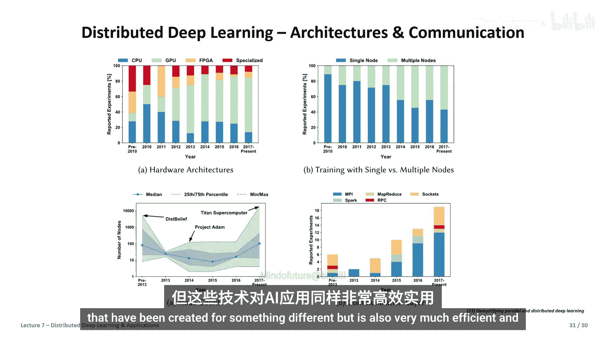

Hence an interesting takeaway and in a way。This lectures called disability deep learning and then code go on and go on。

But I guess you get the basics。The whole topic would cover much more time。

 So H I would give you also a link here to one of our trainings we have in the center of excellencelence race where I teamed up with。

 I think a couple of others like Roco， for instance。

 one of my PhD students in the past now actually graduated。

 He was also a expert in or he is an expert in distributed deep learning and has done a seminar with me。

 which is much older perhaps than this lecture here。

 but it captures the essence of many other parts I couldn't cover here。

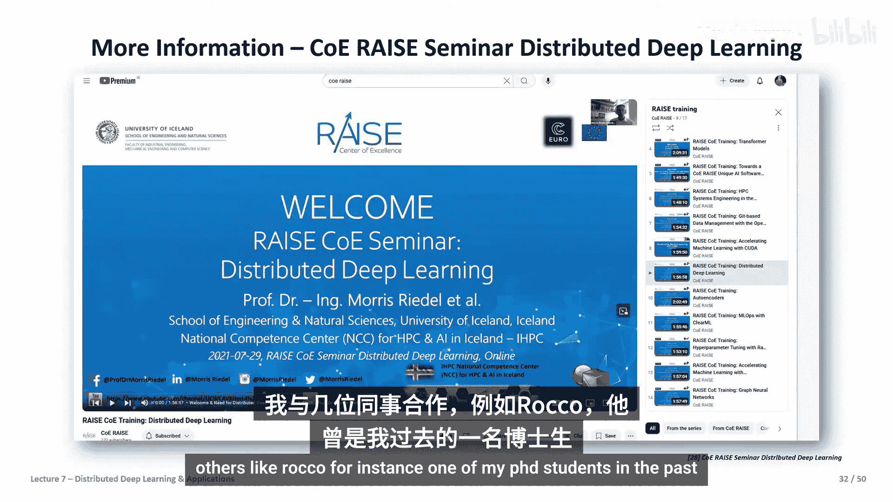

And the reason is that I want to give you also some applications。

 but also some insights in newer learning models and also of course some limits as we discussed as well。

 hence the distributed learning in itself needs probably three。

 four lectures these days to really cover it in a more profound way and I think let's say proper machine learning course just focusing on this parallel execution might be then in order to look at if you really you know what to understand the details the seminar here is also a good example to start and you have the paper that I was let's say giving us some reference earlier。

And with this let us look then a little bit also on the limitations that we have right by doing this multinote GPU training so here we see really the problem that we have is a local batches right the more let's say we have the data you know in these global batch that we would have if we don't do data parallel for instance right so then we all find Pe GPU but if the data is let's say and we increase the number of GPUs more and more then we also see that the local batches would be let's say you know not really。

Fillling the GPU， right， So in other words， you would also then consider that the more notes you have。

 you basically have to increase the batch size of actually。Fill the GPSus with data。

Right and this is now a key concern when you now look in the performance of the different let's say frameworks which are there。

 we discussed already Py towards GDP， we discussed already horror what what we left out a little bit is this interesting dolly that you see here which is a data loader from NVdia which also brings us quite high performance in terms of data loading and I would recommend to look at this if you really on insider。

 the interesting thing is from the data throughput here you see they all enable quite a good performance right so in a way if you scale up to more and more GPUs。

 you see  thousand24 GPUs that's beautiful and the data throughput is let's say following suit if you all。

That that is quite good and even if you have here the extended study a little bit with you know deeppe native the other framework that we will also talk about later。

 Ho what and Pytorch native you see that the data loader using that is essentially a key element in it right so to keep let's say that the data loaded as a name suggests and then you see also the impact of which tool you use in the end is not so big anymore then you see perhaps this here is Pytorch being the best but with a data loader from Dli you can actually have a quiet let's say good。

Loading us the different GPUs， if you， let's say， increase the scaling。 However。

 what you also should now see and get sensitive to is now exactly what you see here。

 because the more we I was explaining this， you know， add the number of GPus here。

 there's a key drawback that to give the GPUs that we have more and more also enough to work on。

 we have to increase the batch size were going through the data， right， which you see here。

 which is still fine for smaller batch sizes。But here is now the key limit I was alluding to talking about the problem of so-called large batch sizes。

That the more you basically then scale up and need this large batch sizes。

 so lower is actually your you know your accuracy and with this the validation accuracy is of course a core important part for us so there's no point of saying how we can have a big batch size and we can scale up 2000 of GPUs if let's say our validation accuracy is not following suit and falls down so significantly。

Hence you see here sort of a speed spot of saying you can speed up the training but perhaps only until 8K。

 then we have already a problem that the validation accuracy goes down and what one of the studies from one of my PhD students now also graduated Marsa actually was doing this experimenting a bit with a learning rates is an impact let's say using the learning rate for this learning in different ways and can we let's say mitigate this problem of the large batch sizes。

 but this is only possible a little bit as you see with the learning rate doing this in an exponential way still we talk about a validation accuracy which actually lose quite some performance of the large batch sizes and there's not a perfect cure for this problem and you see with this even if let's say Leonardo what about maybe 15。

000 GPUs of a label our problem at hand while this is of course just you know an example here of an application or problem at hand。

They'll face the problem of the large batch sizes significantly， and with this we have a problem。

You see also another concern in a sense which not only is a key element in AI with the validation accuracy。

 also the efficiency that you see here。Then when you use basically this different frameworks on the one hand and then also use a number of GPUs because then now the efficiency means do you really use the most amount of memory do you use really the computing power of each of the individual GPUs a lot and depending on the different frameworks you are a little bit let's say better or worse but here again。

 Dali also gives the opportunity to be relatively close to each other that we quite nicely here。

 but it's still far from media right so we're saying we still lose the efficiency the more GPUs we put so in the end in this study that should also very nicely that you need to have the data to keep you know the GPUs also very efficiently running for the training but at some point in time when you also increase let's say to thousands of GPUs you will also see the communication overhead which is another sort of limitation right instead of computing there。

Lots of averaging there's this ring reduce there's lots of communication happening again the computing weights essentially so the efficiency of the GPU drops because it's not really used so there are different factors。

Which in this course we just briefly go through again you have hear the reference if you want to learn more。

 also think about the different models have different motorsoorundi。

 the residual networks we had already reson at 50 as an example was one where the efficiency is。

 let's say quickly dropping and with other larger networks。

 larger networks means more weights right more layers so more to compute this effect is a little bit slower but also at some point in time just kicks in as well。

RightSo hence this is another factor I was always alluding to data or communication。

 Of course here we have also the size of the model we were exploring in the beginning why we do this parallelization Also here you see sort of the limit of the efficiency breaking down。

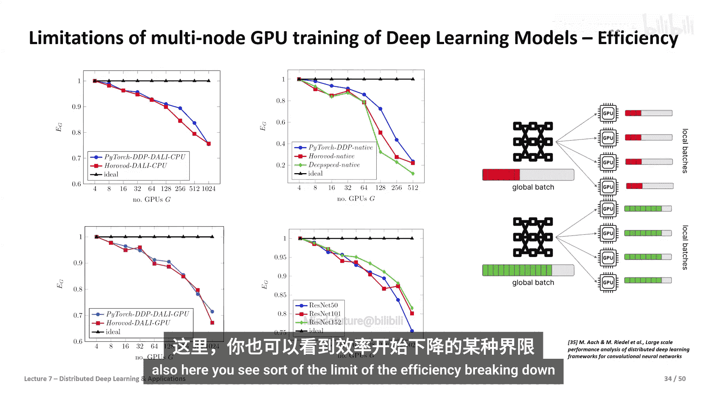

So this is an interesting study and in a way we could also dive into too much more in this。

 but I also promised you some applications here。And some of them that we not really talked about very much is the idea of recurren structures and this is a loaded topic because you see it's also alluding to a topic called transformers I will basically introduce here very roughly because this is a topic I need basically three lectures for but I think it's important to understand the key substance of it because this is fueling the large language models today however languages and let's say what we call sequence data has a long history long before transformers where existing right so we basically give you here a little bit of application examples based on different models that have been standing the test of times and this is a model four sequences called recurend neural networks so you see that a little bit here when you want to digest maybe you know language you have a sequence where you have each of the characters is part of the sequence like also you would have others right medical signal speed。

And so on or sentences are all sequences of data and that's where recurrent neural networks are good for you know depending on the time if you have made medical signals or on the placement of the words you have the sequence and you see here this sort of delay that you see here with this recurrent structure that you basically model often here as an unrolling over the time steps and the same you can do essentially in this illustration where you have then also the activation function showing you a little bit all the time step before influences the time step then according to this kind of you know loop to itself。

In a different time step coming in at X1， X1 plus and so on。

 And essentially the step before influences then， you know， the the computing of the next step。

 which， of course， makes sense， especially if you now， let's say， have languages， right So。

 of course， what the character was before has a high impact of what the next character is。

So this is a traditional area where let's say it's a very specific type of an artificial neural network。

 not any more feet forward right so this is for sequence modeling which loop in other words you call it acyclic connection。

And。There are now new variants on this。 One of the one of the ones most known is a long short term memory you see having different gates here and different functions that in a way has a certain memory here。

 you see that through all the different cells while still the output of you know one time step is the input of the next。

 right So we keep the idea of the let's say recurrent neural network for sure， But additionally。

 where the sort of memory borrow from computer science， if you will， that you can manipulate。

 which is then the idea of this long short term memory that you can influence and resist a much better in sequences and there's even the gated recurrent unit these days that is a little bit。

 let's say streamlined in terms of how many you know gates you really have here a bit simpler if you want。

 but also applies better。

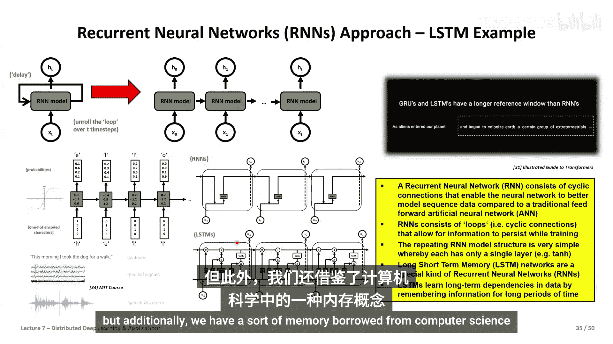

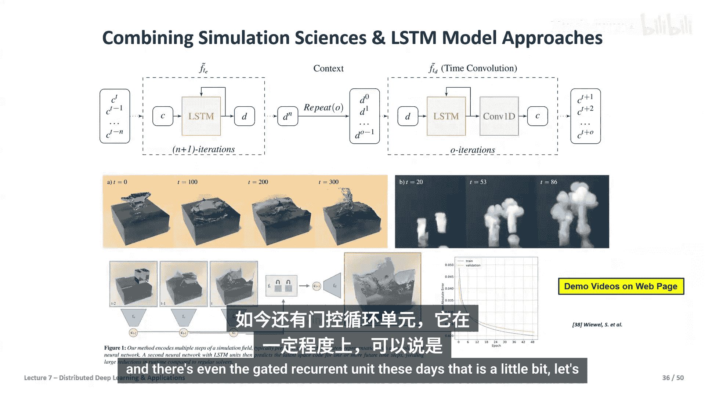

And if you now want to think about that these have now different spans of looking at sentences as a rule。

So these record neural networks do essentially something like a wind on it and LSTMs and crews as well。

And of course， they have with their memory structure already an idea to be much bigger in terms of what window they can look at at the sentence。

 you see that nicely visualized here。

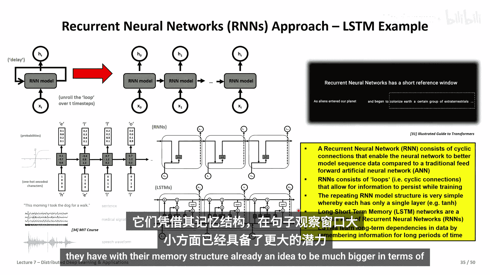

And this will be now also a step where transformers are very different and also good at by looking at the whole space。

 but we come to this in a moment I will just leave you on the table one application example again from physics。

 so you see an LSTM over time has interestingly enough。

 generalized very well to let's say unseen structures of water which is essentially a physical process but if you learn enough you could show that the LSTM you know through its different time steps and sequence data analyzed again and again generalized well to unseen elements you throw in the water and you have the let's say example here also if you want to learn more they're actually quite nice demo videos on the webage if you want。

 which is remarkable for machine learning in a way。

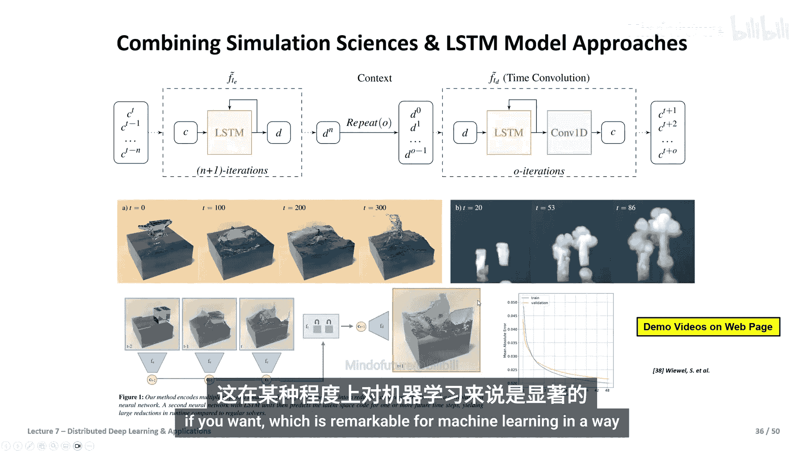

Because essentially AI as you know， means learning from data so we avoid essentially looking at physical formulas that are established already in fluid flow。

 which you would have of course， in the idea of computing it purely on the let's say equations from physics and this is let's say one interesting example here that I was alluding to showed that AI can actually generalize well。

 also for physical， let's say problems have let's say also the physical formulas to validate and so on it's not perfect yet。

 and many people call now new research around， let's say physics informed machine learning physics constraint machine learning to even combine the power of both。

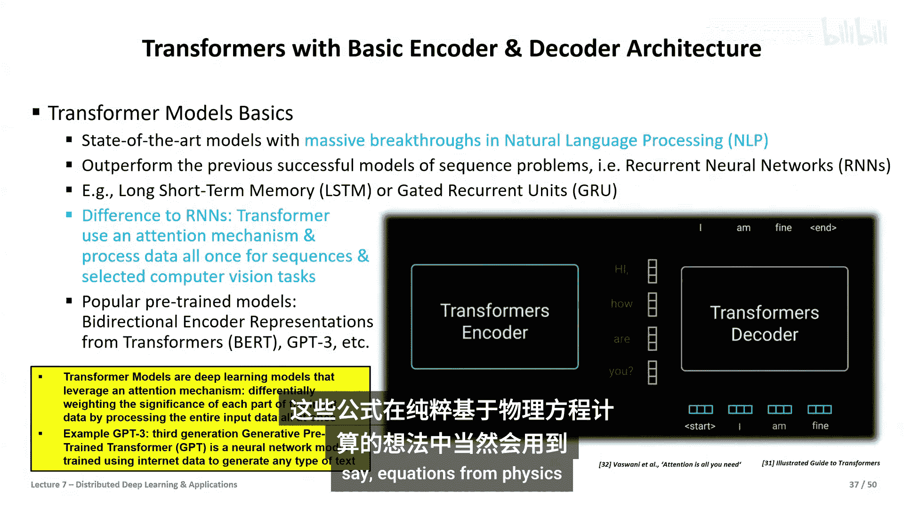

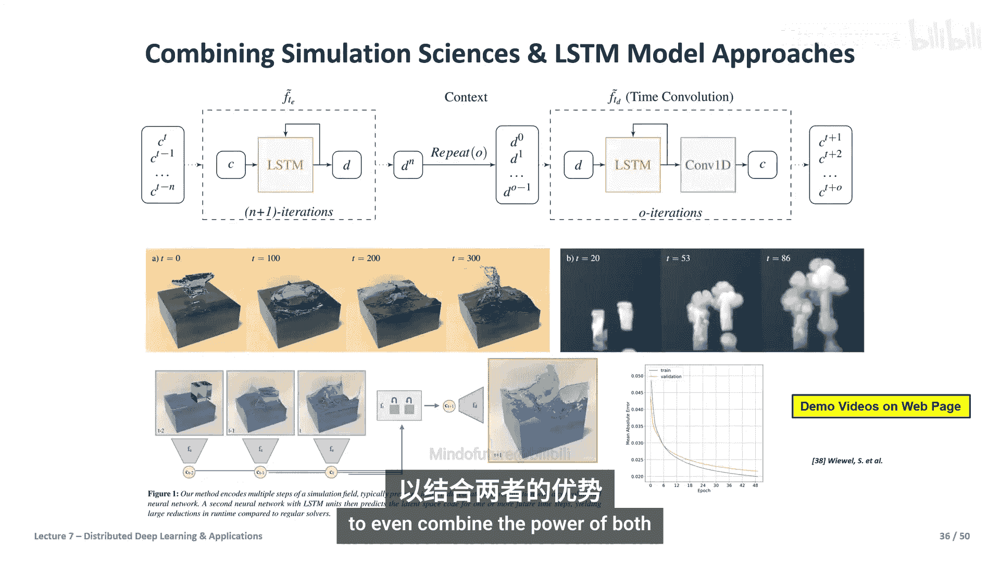

Coming a little bit to transformers really very briefly just to give you an idea that this was。

 let's say the key idea of the massive breakthroughs we see now in NlP in natural language processing already in our talk with you about the trust LM large language model so we don't have to go anymore on this and the idea of how they work is having sort of a transformer encoder and decoder structure where you。

Have a very specific deep learning model that leverage a so called attention mechanism right so you have a different weights and the significance on each of the parts of the sentence that you have。

And you know， G and these kind of models that you already know from chat GT are based on these models and the interesting thing is they're basically much better than LSTMs or gated recurren unit。

 but they of course also need， let's say， very。Let's say they need very large quantities of data to perform very well。

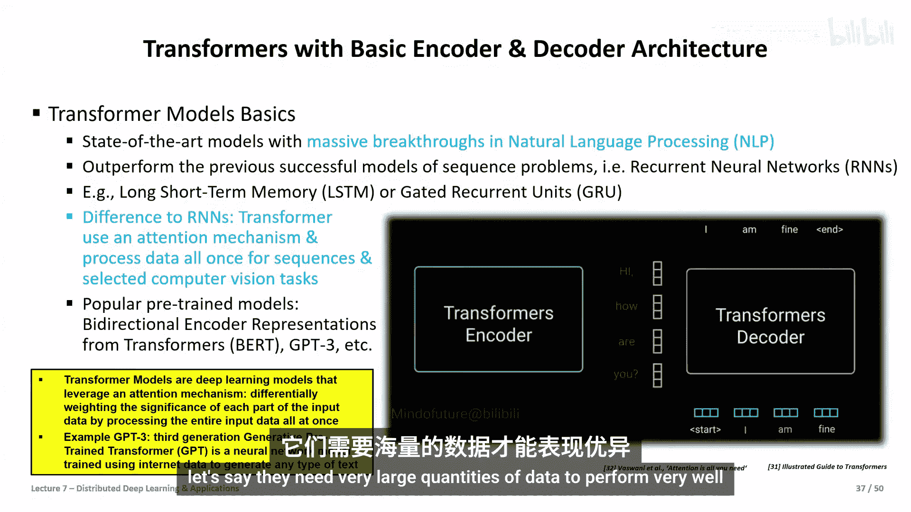

The conceptual ideas really of course stays the same right we have a sequence of data that you see here on the top on the right。

 which is nothing else in our characters our sentences。

And and so on that we built according to the language at hand and the idea how you do this is usually you tokenize the input right so you have basically different characters。

 different sentence and the transformer models now do this attending or focus on the previous tokens that has been basically generated in a way so that you have。

Let's say a better understanding of what happens before so if you see this with the arrows now right that come back to your context in a way they call this where you can then in the in the window see a little bit okay。

 this alien so extraterrestrials like now in the video is somehow alluding to it in other words these transformers have enabled us to look a much bigger bolder view on sentences and then give different weights to the previous tokens to attend really to this different problem at hand and you come through the words。

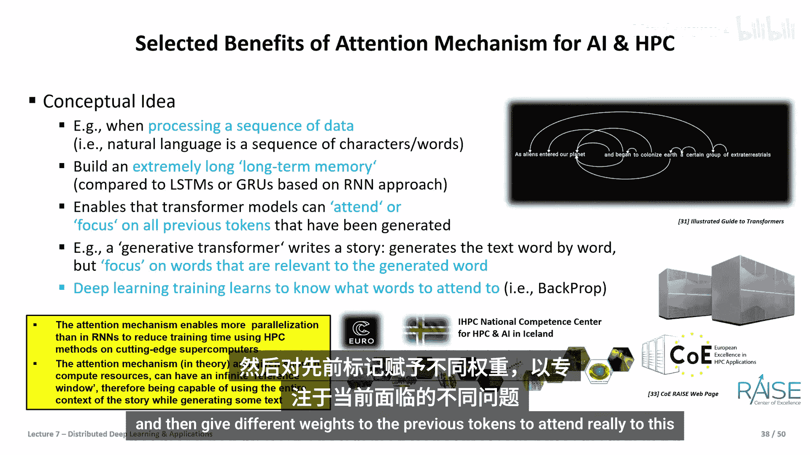

So again， we of course need usually a much more detailed look at this and there's for instance。

 interesting paper here that you can look at again how that works。

 how this is essentially then realized and you see that a little bit here with having the let's say encode and decoder structure again where the encode is really this input sentences that you put in that are mentioned isn't sort of representational learner in a way。

 so it basically gets the input sentences you get in in a better representation。Using this。

 you know different multi head tensions and so on， and you see them stacked up there coming with the input from the bottom and then in the decoder structure you basically use then this representation that you learned。

In the decoding phase and then you can basically generate an output step by step based on this representation again。

 think about it like we had in the convolutional network we said the deep learning is learning also not only let's say from the data itself but also features in the data here it's the so- called the representational the encoding。

That we basically then have learned and then we can then leverage to use for building maybe sequences that also is now the point not only translation tasks。

 but also as you well you know discussing and as we have let's say also discuss a little bit in earlier lectures geneative AI chat GT and so on of course what is then generating new sentences and so on but actually sound very proper as normal language because we have learned from it。

 hence this is a very important building block you know and if you want to understand that really more you really have to dive more in this paper again transformers might be three four university lectures to really understand them well so we cannot cover here all the basic but the attention mechanisms which is then nothing else you learn again right so you learn this weights again it metricses again metrics metrics multiplications to learn this and so on in other words we can leverage GPUs。

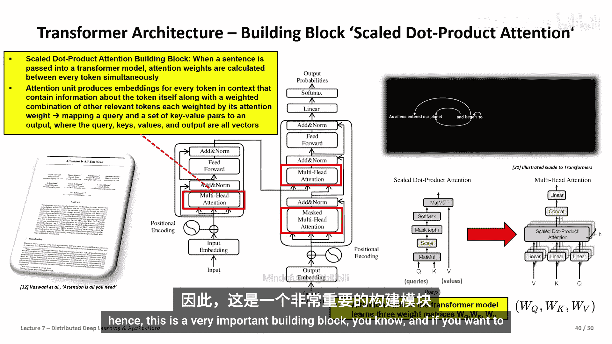

a very well because we have this， you know idea of those weight mattress again that we had also before。

 but here we have it of course， in a much larger model， which are these transformer models。

We use them also for remote sensing just to say you see here one paper out of our research。

 so if you want to know more you can also go there into a transformer model that is actually used for land cover mapping there and also to you know enhancing the training set and of course there's a survey here on the right side which is quite also interesting maybe for you to look at because he's making the large language models much more in detail reviewed and surveyed than I can here actually as part of this lecture today。

At the end of the lecture also just to hint that there's more and more of these deep learning frameworks so deep speeds came from Microsoft in 2020。

 you have seen we have included this in some of our studies。Which sometimes works well。

And has a let's say inherent concept of layer pipelinelining being essentially prepared for large and larger models。

 so essentially here you see that there's a third item and here essentially the pipeline parallel complementing the model parallelism in more or less if you want 3D structure because it's also of course having parts of the data parallel so in a way combining many of the things we've seen here in a smart way or deeppe is delivering being itself more or less based on Pytorch but also being ready than for trillion of power and so on so have something to look at especially now in the future。

 then other frameworks exist like heat there's a race seminar if you're interested on YouTube tarantella colossal AI。

 so many people work basically on this problem of you know having distributed deep learning requirement。

And to give you a reference maybe of some elements which happen also at Google AI and so on。

 I think there's another concept also that you maybe want to look at is local updates here。

 I leave you this video， it's quite also comes back to the idea of power data power attorneys or review see concepts as a quite interesting video maybe for you to look at。

So anyway I leave you here that's all I have to say and we will now basically return to application spaces with Raza。

 you know the postdoc that we have in our research group we'll now do with you a walkthrough of some short lectures really from eight to the end in the next couple of weeks to go through the application speak space again and to explore where deep learning where physical sciences meet HPC and so so have a good journey and see at the end of the course for the APO。

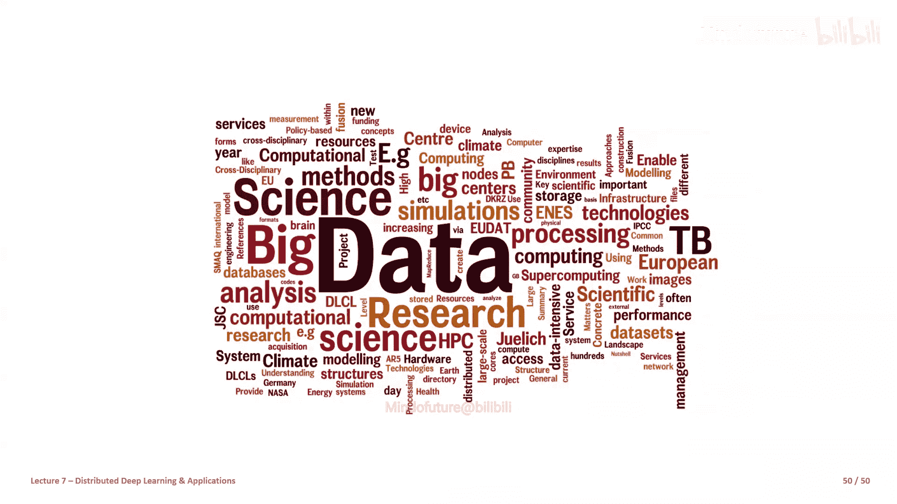