# 【冰岛大学】高性能计算课程-｜-2025-High-Performance-Computing-｜-Prof-Dr-Ing-Morris-Riedel-p11-P11_讲座_7_分布式深度学习__应用_第一部分--BV1k34zzaEK8_p11-

Welcome back to high performance computing， advanced scientific computing Today we have our lecture7 on distributeded learning and applications。

So this is a lecture which builds substantially on material of lecture six。

 so we will review this before we then come to the idea of distributed deep learning。

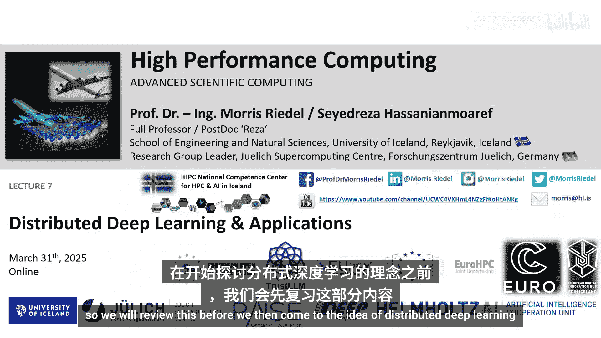

Hence， in reviewing what we had the last time in lecture6。

 we learned about the simplest learning model that you can have the linear perception model。

 it's a linear learning model because it's linear in its weights。

 you see that a little bit in the idea of the perception of the perceptioncept learning model here。

 but before that we even said to build this what we largely consider today as neural networks。

 they are called artificial neural networks， ANNs，We also had to make， let's say。

 a sort of assumption which was a supervised learning assumption hence the focus on the last lecture was really on supervised learning meaning that we have for all the variables。

Where we have you know basically data from some guiding output for its label so for instance。

 you remember the flower classification is it irre sitosa or irzoogenicica so two classes for instance and for each of these points and data points of these different flowers we would have this guiding label why making it then essentially this vector notation of all the features you would have you beta with beta length etc like from the flower last time pair flower and then in each of the flowers you have not only the features basically this feature vector of this particular data height but also then the guiding output that we can use them across the whole data set right that we have here。

In analogy to our problem we had also then explored further， we had the Mnes data sets。

 handwritten character recognition， which is then from zero till nine。

 hence a kind of 10 class problem。RightSo then that means we basically have here the input which was essentially then this you handwritten character。

 if we have seen it at 2D if you remember the last time。

 which was a sort of problem for the initial perceptron learning model and the neural networks because we do a large。

 let's say input vector here or a 2D problem， hence we have to vectorize or basically put it all in one long long arrow array to put an input to the perceptron learning model where we have the ideas that we also you have this kind of linear you know decision boundary if you want right so basically what you see is playing around with a line here。

 you know some up linearly using weights the idea of the data and putting then even the bias that you have easily in the equation for let's say a linear decision boundary also is a part of learnable problem for mathematical convenience you can actually put this little。

In this notation is x transpose W where x then transpose means essentially putting again along you know vector here inside and the weights are anyway the trainable that's why they are read the ideas that we have to learn here true iterations going over this data set again and again with different learning models Now the learning models come as learning algorithms so we have。

 for instance， learned the perceptron learning algorithm in the initial let's say linear learning model and also in the multi outputput perceptron。

But then you can quickly go to something more advanced where you then have， for instance。

 back propagation of error， if you remember in the multilayer perceptron。

 or as it is also called an artificial neural network with two hidden layers。

So I will not repeat everything that we have last time please go back to lecture6 the importance to take away however out of this was the number of parameters and we will come back to this today in lecture 7 that's by making emphasis on this。

 we remember the moody outputward perceptron based on this simple linear idea of neuron or of one perceptron you combine them you basically then learn about parameters which were 6850 so this is something where the CPU still can do。

And then when we go to this idea of putting then this neurons in different hidden layers and interconnect them all。

 I'm using then the back propagation of error to go back to the inputs and visual analyze them and make an update of the learning and the training here and all the different weights。

We come to a parametermeter setup with all these different weights that you see here instead of。

 you know just this dense layer， we have no much more dense layers here。We come to roughly 120。

000 parameters， so you'll see a massive increase ascension and all this trainable parameters due to the fact that we have dense layers so everyone is connected to the。

 let's say neuron in the next hidden layer and so on and so on， making it a dense connection。So。

And a bit in your assignment， you should explore this that you know this is a computing which is not so massive。

 however， we also understood then in the second part， two things， firstly。

 deep learning is not just now adding the idea of one more hidden layer， one more hidden layer。

 one more hidden layer I repeating this come back to this again today to make that clear deep learning is also adding smart layers and the convolutional neural network was one example we focused on to make the point from the same。

 let's say example that we have in the more or less what we call today shallow learning right so artificial neural networks just two hidden layers you know basically that is considered maybe today rather shallow learning。

 while we had them here convolution neural networks。

 which much more layers but then also having this interesting aspect of this different functionality that the convolutional neural network entails and that was essentially the idea firstly that we keep the input in 2D。

Where was no need to you know vectorize or do a very long vector as input。

 but then we had also the idea of this convolution operations and you know。

 basically this creation of features， the feature learning that really make deep learning a little bit of successful part as well together is of course the architectures which are very well suited for specific elements that you need transform us for large language models you have here you know。

 convolutional network very good for vision and the idea of this kind of features that you learn was best captures。

 I think visual visualization that also encourage you to really try yourself。

 you will see interesting insights where you see really the different feature maps here。

 but also in the end， So typical dense layer where you have the softmax probabilities again。

 where you then essentially perform the real classification in the end is it a seven or is this the one that is a bit like you know not straight。

Hence。😊，We have to pray the price for it which is now the idea of connecting it to lecture7 so basically we talked about 1。

2 million parameters suddenly right that we have to train and your assignment will then quickly shows that CPUs are at the end of such a simple network and this is just a very toy network。

 some of the deep learning applications that we will have in the second part of this lecture will show you this and I make also the case to large language models here in this lecture a little bit where we basically understand we talk about billions of parameters right so this is interesting。

So one takeaway message also was of course we can improve。

 so the idea of multi outputer perception was around 90% after 20 apo was this simple learning model of course。

 maybe there was some improvement using then the neural network with two hidden layers and we actually got better performance quite nice with 95 performance。

 95% performance which is quite good already。And then we even top that with a deep learning model now is 20 a post switch。

In a way stands for many classes of deep learning today so by far I would say deep learning and vision recognition and speech recognition has been surpassed everything which was there before so deep learning is the models of perundi and with this also having perfect performance however 99。

36 on a toy problem on a simple problem we have here is 10 classes handwritten characters shows you also one limits of these learning models and this is that you know crap what we put in cannot be learned so we talk about rubbish in rubbish out so in other words there's some of the classes we have seen the handwritten characters which are so not recognizable even for us humans that even machines would never understand it and as's such you know can never achieve 100% because there's some noise in the data in a way and if you have a practical application problem and you achieve 100% chances are also that you are basically doing overfitting hence。

The last lecture was a little bit short on regularization and validation both are therefore combating overfitting。

 which you should learn in a proper machine learning course so hence the idea also today when I don't talk about distributedive learning applications again about learning models。

 this is of course not something where you know I will can give you a complete machine learning walkthrough。

 so I encourage you again go if you're interested and take really a machine learning course where the fundamentals。

 you know statistical learning theory， the law of large numbers。

 you have basically Nick Schonenka's dimensions， V see dimensions。

 things you have to go through to understand a little bit the capacity of the model versus essentially the size of the data you also have to bring I come to this a little bit today of course for large data we need more GPUs。

 hence this distributed treat learning training。But we will start again with lots of things you know already a little bit。

 but from different lectures and we pull that all together now for foundation and motivation。

 why we do distributedive learning， why we have to do it。

 what is now the driving factor of it and here some examples of course from remote sensing but also large language models I want to show you。

And then it's important to understand a little bit the difference between learnable parameters and hyperpar。

 So this is an important part of this lecture as well。

 And then we come again back to things like Nel from Nvidia。 So libraries。

 communication libraries that we need then essentially across nodes and for GPU to GPU communication。

 like also the hardware support that is really there with N links and NV switches。

In the second part then we turn to the real techniques of deep learning in a distributed fashion。

 so there will be two major models you would say， which is a data and model parallelism techniques for doing distributed training of deep learning networks and we often talk about training because this is where the real let's say computational it's intensive part is located when you do inference once let's say a deep learning network is already trained and then do inference this is rather cheap and not so computational intensive so the training is really the challenging part and we will make the case for it。

 how we do it。And go much more in detail like we had in the last lectures on GPUus and deep learning。

 I will also provide you with some limitations of this。 So there's a problem of large batch sizes。

 we have to talk about。 Well， essentially can scale up higher and higher in theory， at least。

 but we will see unfortunately at some point in time， the accuracy will drop significantly。

 So there some limitations in the root of how we distribute the data and the batches。And as such。

 we see the limitations of， you know， even if we have。

 let's say theoretical maybe 16000 GPUs in a system like Leonardo and Euro HPC。

 we may not use them all because essentially we as machine learners are also interested in the accuracy or let's say the lower error rates and if we continue to do。

 let's say more and more GPUs train with them and the accuracy is going down that is not helpful hence we have to also carefully observe these limitations and see with this also some more or less drawbacks that we have the whole machine。

 but we cannot use the whole machine as machine learners and and this has really depend on the data has dependencies also on which of the applications。

 hence we give you some different application examples， one of this is。

 of course remote sensing will be quite strong from the research group but also other application domains。

And then in the end of this second part， then once we come there。

 there's another framework we should talk about called deeppe， is a more recent framework。

 And there are， of course， other distributed deep learning frameworks that I should mention here for completeness。

Hence。😊，If you are ready with this， you really have a much better understanding of scalable networks of scalable。

 let's say deep learning techniques for data intensive workloads and data intensive is important here because we want not to use GPUs more and more while the let's say HM and all the data within is basically so tiny that it doesn't make sense anymore to do this the GPU little scalable variant of having let's say 8。

1632 whatever GPUs edit right so this is an important part so you understand not only scalability but also the limits of scalability here after this leakage after this lecture and then of course again the idea parallel computing on various levels from NCel which is really low level network communication library to high level with Pytorrch implemented or even with Tens of flow combined with Ho what complete different level within。

PythonAnd then you use know model load for Nel and it's automatically they're implementing funnily enough things you already know from MPI。

RightMaking the connection again to certain foundations really of these applications like the already you will learn again today from MPI implemented is something you already have actually seen in the beginning of this lecture So in this sense you have a understanding then of HPpC programming paradigms for machine learning and deep learning in a scalable way right so this is something really what you can get out of here and you have all the tools you can go ahead and basically implement this and with a U HPC machines in the union chances are that where you go in the let's say after your bachelors or masters。

 you were basically also the chance to use bigger HPC systems because there in the union at least for industry and also academics alike。

So let's go a little bit to some。Lectures and materials you already know。

 some slides you already know， but I need to get the foundations right and to connect them now to the other lectures we had not at all together。

 and there would be a certain theme with it established which I also would like to motivate then this distributed learning with。

I mean， we started in the course very early of understanding now the GP GPUs we had this many core concepts so you know we had said。

 okay it's not a cutting edge CPUU anymore， with cutting edge processors。

 it's like just thousands of lets say moderate processor， but the good uses high throughput。

 we had this device memory and so on and so on， so I think by now we have understood the GPU and we have understood that let's say nicely parallelization of several applications that we can do there。

 especially in deep learning now what we had also the last time lecture6 the learning of a car learning of a cow。

 the learning of a cat， whatever is basically characterized of going back and forth through this network。

 especially then a variant of back propagation if you want to update the weights again。

 and this is basically done of course with lots of lots of metrics metrics multiplications or metrics vector multiplication。

 some sort。And for this， of course， in the GPU is really perfect。

 And in this such shows you also the evolution of the GPU architectures we had the last time really reaching from Kepler Pascal Volta and Grace Hopper now the Blackville architectures。

 And of course， this is fueling money to Nvidia， right。

 which is an important part here that essentially， this rise of deep learning also gave， of course。

 new applications that in turn， require GPus to advance in technology and making it more and more affordable to many more users。

 So this is a nice circle。

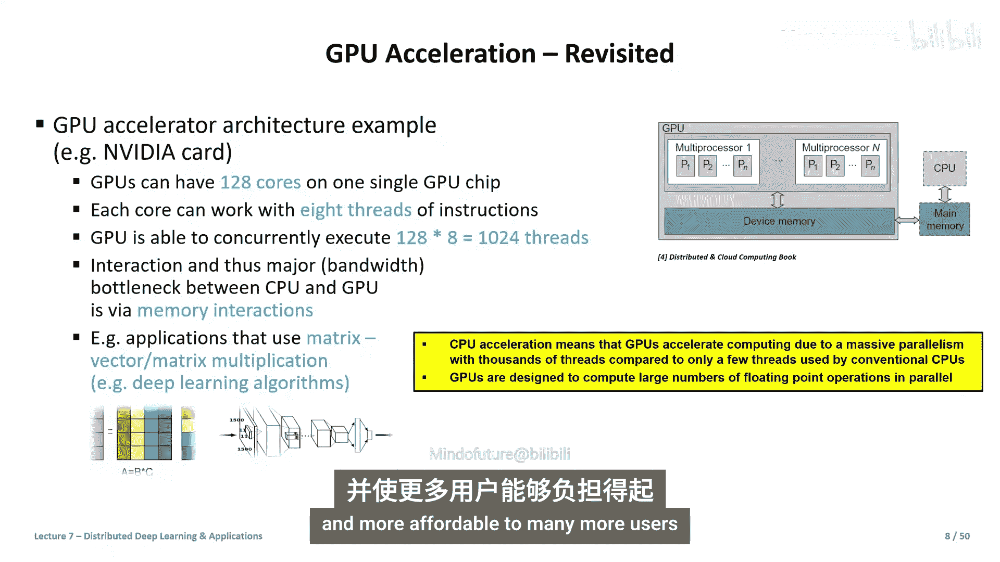

And we also don't need to play now the video I have here for you。

 you remember this to understand all the feature maps and so on， we have done this in the。

 let's say in the review of lecture6， but now I want to also increasingly get you aware of again the the learnable parameter aspect that will be now becoming key in thinking about that you have to go distribute and if you remember we talked about 1。

2 million for this you know kind of con neural network example。

And and even this is not much if you now consider really large language models and so on。

 but we have seen that by adding let's say these smart you know kind of layers。

 we quickly accelerate in or basically increasing the size of the deep learning models substantially in terms of learnable parameters right so everything but we have there the different layers and the convolution for the different features is nothing else and different mattresses that we have to learn over time basically through this iterations and we do this via batches and then epos right and this is something but you will also learn a bit in your assignment a bit。

I hope also stimulating then the idea between the multi output perception。

 artificial neural networks， not so computational expensive。

 and then with steep learning you quickly go into the realm of many learnable parameters and with this we need you know more computing capacity。

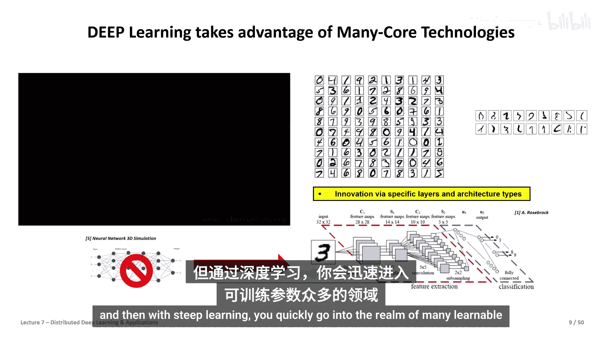

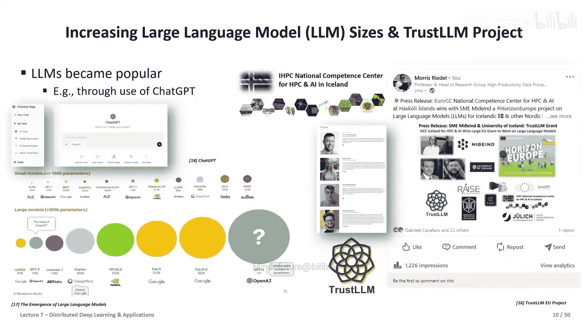

Now this was one element where okay we had 1。2 million learn number parameters and now we are in an era where I think many of you and normally if I would be now in class I would ask you who has used chatGT and I think almost today you don't find any student that has not used chatt GPT and in this sense。

 I think everybody of you is familiar probably what chat GPT can do not only you know chatting around and so on it can do this image recognition so generative AI which is a big theme today also for let's say deep learning models which it intensively really require computing capacity and there you are at the end with one GPU right so this is what I want to motivate here between this。

 what you basically can still do in your assignment with one GPU when you are in the realm of large language models。

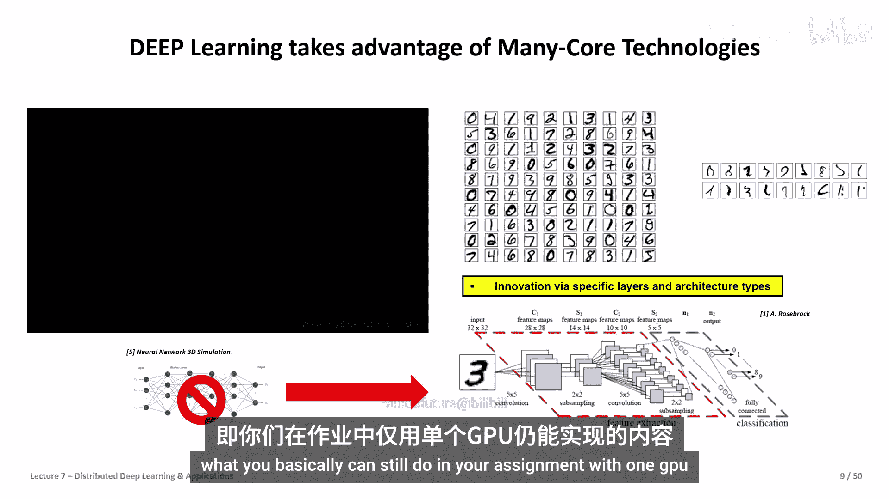

And you see a little bit here the parameters， then you really need multiple GPUs and not just a few of them。

 you see here essentially small modelss which are smaller than 100 billion parameters。

Right smaller is， let's say something very funny if you come to a concrete architecture like here where we said like oh。

 it's 1。2 million， but of course， think about the complexity。

 what it entails to chat to understand natural languages， which is of course。

 then a complete different scenario or use case if you want to just differentiate between， let's say。

 1000written characters。

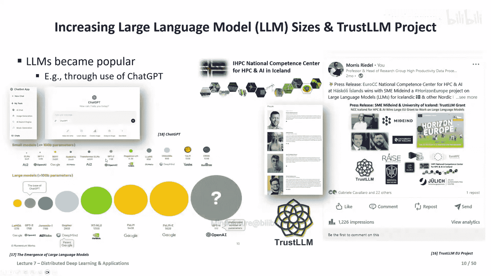

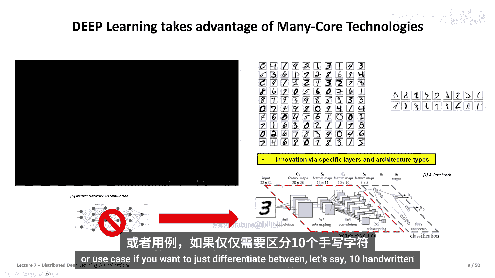

So hence we have a bigger problem and a bigger problem needs a bigger model and the problem in this is that then this bigger model needs also bigger data and I come to this and summarizes for you again this one slide you already know a little bit but make the connection now to just learn more parameters so the key message to take away is of course。

 bring us also to the trust the La project here that I see that I provide here you for where also Iceland is involved the crookux is in the data and we need more and more corpora of these languages to learn well that say if you want to have language translation tasks right so from Icelandic to English now people would say well there's Google Trans but for Iceland is Google Transl is actually not working quite well all the time right so it is already a good start to understand no doubt if you have no clue from the language but the experts in Icelandic can tell you that well the translations are not very nice。

Hence。😊，There's also an idea to improve this， but the problem to improve this and why basically Google and the big players right they don't succeeded in this is that Icelandic and many other languages you know Farese。

 for instance， is not a corpo rich language， in other words。

 you don't have so much text to learn from。And this needs to be incon scene always。

 which brings us a bit to the foundations of statistical learning theory again。

 you need the right amount of data for the capacity of the model。

 and here we talking about large transformer models。

 something I will talk a little bit in the second part of the lectures but requires usually two university lectures as such attention mechanisms and so on。

 which really fuel these large language models today。

 and they have let's say as you see here not only small billion parameters。

 they have also huge billion parameters， especially those which are well known。

RightSo the model for was quite known pile and so on， and even GP4， I mean。

 some of you know GPT3 has 175 billion。Paraitters， right， It's from O May I。

 the people that also do jet GT。Hence。😊，Growing， you see， they were starting at 1。5 billion。

 suddenly 175 billion。And you can imagine that G4 now has。

 you know massive amount of parameters and this is where the computing capacity now is required。

 This learnable parameters is now the idea now briefly to the Trust theirM project。

 So this is a project we obtained here in Iceland together as many partners in Europe in order to enhance large language models for Icelandic4。

 let's say underrepresented languages in terms of corporates So also Fars and so on。

 so our natural language processing lab headed by Haftan andison we boasted the proposal together with many others in Europe AI Sweden for instance。

 and you know we have a couple of PhD students now working in this project in the HPC Compnce center this Trust LL。

And we also collaborate， which is the first naughty point here with a language company or one of the language companies here in Iceland called Meda right you see the logo here。

 So for those of you are much more interested in the Icelandic language。

 you know as Icelanders here maybe in the course firstly。

 I would encourage you to you know talk to Hafstein and you know the colleagues therere really the expert in natural language modeling where I'm more the expert in HPC alongside。

 while on the other hand， of course， meda is an interesting company here in Iceland。

 really working hard of you know getting Icelandic。

 really you know forward in terms of digitalization。

 how it can be used in computers together maybe with another organization like Almanar Roma or those which are interested should also look at this association brr Icelandic also in the country and elsewhere。

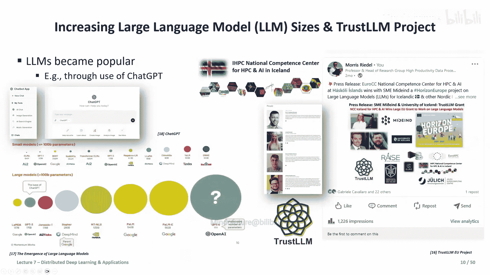

So but the key measure against for the course now is large language models， lots of parameters。

 hence we add this a little bit now to our diagram we already know right so brief review not very long。

 you know large data sets our serial methods are at the end the traditional learning models that't help us anymore is large。

Data we can sample out some data， but still we would not have the comparable performance here and this is not true for small data sets。

 hence having a large language model with very small data is a problem alluding a little bit already to what I said with Icelandic right you just don't have this big data like an English English data sets and so on right you have maybe Icelandic data being rather somewhere here So and you want to improve like with human in the loop approaches for large language models and so on and large language models are just one examples for many other vision problems you also use transformers with many。

 many parameters just the large language models are maybe the king in terms of learnable parameters that's why I put here plus plus plus right so there's essentially no end if you see this like before and by going through these learnable parameters。

 you will see that the footprint for training time requiring HPC is constantly glowing and with this also now motivating。

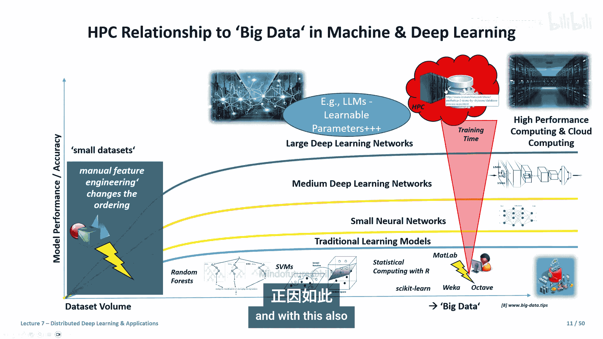

d of going， you know， in a multin， you know setup of learning this large language model。

 you cannot do this with one GPU or let's say with one node with6 GPUus。 You have to go multinote。

 And this is something。 Of course， what is the idea now in this course。Just a differentiation。

 because firstly， we'll have another lecture on it， a lecture 14 on hyper parameters。 And secondly。

 to understand that the learnable parameters are something different， right。

 The learnable parameters where the interconnects the weights that we learn between the different layers and so on。

And when we talk about hyperparmeters， we have elements that we choose as humans， right。

 you see here some examples， the learning rate that you have also in your assignment， right。

 and also batch sizes， the number of epo the optimizers， Adamom， SGd。

 different variants are existing。 Then the whole idea of even let's say。

 creating the convolutional layout sizes， you see there's a liberty in the two publications we do essentially from from our research where you basically very fast have a lot a huge space where we would say optimization space where you want to get。

 you know， the best performance or the date at hand。

And all the changes and that's now an important part。

 please listen all the changes I do here may affect the accuracy again and all the trained weights。

 In other words， when I you know train with a you know activation function rectified linear unit and then switching those to another one。

 maybe in all the different layers， then I have to retrain again and maybe get a completely set of weights of the learnable parameters so the HO is is the idea of this we will learn this in electro 14 in a systematic way it's reaching even in the domain of so-called auto Ml that you also try to let's say automate the process of learning and creating specific eyees。

Right， which is now a key element， of course， in in thinking about HPC again。

 because he had to find the best parameterita setta。

Is now the key So you not only train these large language models or this large。

 you know remote sensing models we have seen here as an example。

 we also thinking about tuning these you know， hyperparits better and better that means we have to retrain retrain or we have to train at the same time。

 And with this we have again the need essentially for you know。

 basically lots of computing power that we need I gave you read an example from our。

 let's say research which stimulates a little bit that you have also or need to have the data for it here's the big Earth net。

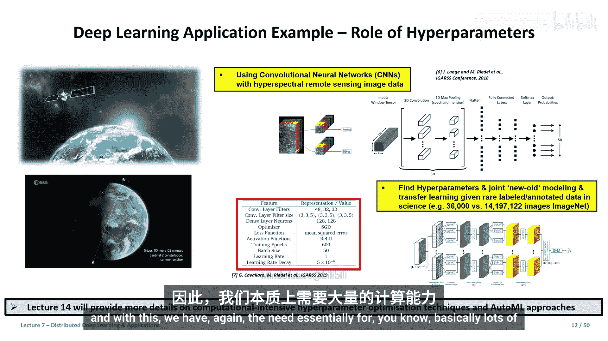

That you， for instance， can use， which has different image sizes。

 and it's essentially a land cover classification problem with multi labelbel。

 So you see that a little bit here again， And this example I already was introducing to you。

 but of course， here you have also an example that then stimulates the idea of this is something what we can't use was one little GPU really in or we have to pay the price in terms of time。

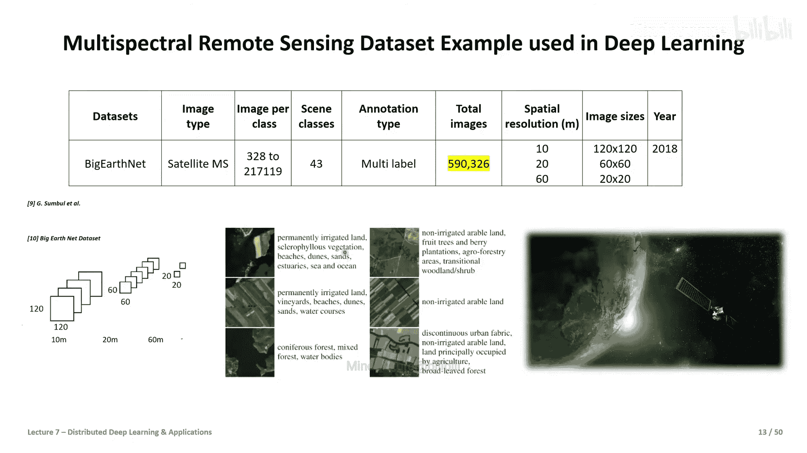

So we use here a ResNe 50 architecture， so which also has already an idea of the parameter growth right when you think about the MNIS when we were the convolutional network and this is also still a convolution network。

 let's say modified with residual connections and so on and and this is already。

 let's say in order of magnitudes more， we talk about 25 millions of trainable parameters。

 this interconnects here， this connections from one layer to another will be all learned。

 which are these 25 million trainable parameters。Hence。😊。

WhenWhen you use the sort of cutting edge architecture for convolutional networks。

 you would say Renet50 is such one which stand the test of time quite good for image recognition combined with the idea of how much computing you put in and it's basically a good tradeoff between the accuracy and then the number of parameters which stands essentially for the computing time。

 you have to invest in it to train it， which is an important consideration reaching in the ideal of green energy energy computing。

 energyware of computing and so on we have to think about also later parts of this course at the end we will have a small reflection on this because even if you have the best cutting edge architectures is it really worth to train it to get。

 let's say one or two percentage of accuracy or let's say the speed is a little bit faster but I paid the price for significant computing is also something to think about when you see this rise of trainable parameters。

Can reflect on the large language models there as well。You know。

 we have seen the billions of parameters。 And if you know。

 have a language already spoken relatively nicely from the chat you be declined or bought。

 Ques remain。 if you now increase it， you know， the parameters more and more。

 And the amount of computing， In other words， energy that goes into it。

 Will it really improve the language significantly。And you would see that， for instance。

 an icece landing that would be probably not the case because we don't have even data for it。

 but even if you're swimming in data with English and many others there might be limits where some things might be not really learnable or where easily some things are。

You know， getting us to a point where we have almost no increase in accuracy。

 but we spent much and more energy， so is there a limit of having more and more let's say billions of power meters added in let's say GP5 as an example or so coming up down the rain。

That is of course something for discussion and depends maybe also from language to language and in this kind of considerations however。

 Resnet is now one example here which already gives us a good motivation for this distributed training right remember we are talking now about training so updating the weights and we have learned this for instance in the lecture6 this is done with the stochastic gradient let's say optimizeimr for instance it could be Adam that sort of momentum there are different ways how you can do it adding it so that you learn from this model iteratively which we are having as a training process and this here is one where we have a data parallel idea that essentially the data will be distributed across all of these different having the same model and of course then when you have the same model here and just the data differently you actually have to communicate the update of the learning process with you know a technique called。

I already use。 You already know right So this is now the idea of a mu node。

 And you see on the left side doing an example on jewelves that we have already introduced。

 you can see that you can significantly speed up here。

 the problem quite significantly of having maybe 24 nodes times 4 GPU。

 So you use 96 GPUs you also see limits again already right So it seems like I cannot just add more and more nodes here because then essentially I don't get any more big speed up and this is。

 of course， something where we find。Different limits which we also will catch up later again in the let's say second part of this course today。

This is just one example， for instance， Horowwoodt is one of the frameworks we will motivate basically in the second part and will'll also go deeper I just wanted to make the connection now to the idea that we need to communicate now between different nodes and this means we need also support for it on the software libraries level but also on the hardware level right how the interconnect is done hence we go back a little bit to things which are now more on the network interconnect level and here's one good example of the NVDdia collectiveive communications library so this is let's say sometimes called the hidden secret of NVDdia so why it's so performant because it has this NICel library very well implemented of InterGPU communication that you will use exactly in this process I just meant here right with Horowwood that's why I put it in。

And the interconnect， of course， has now relationships to how you really interconnect the nodes。

 you see here in in a single performance that doesn't matter。 but you have already the Nmb links。

But do you have also maybe infinni band connections right and here you see here different let's say。

 generations of NVDdia technology in a multinode setup giving you also certain bandwidth much more higher in a multinote performance so these are all relevant aspects to think about that Ho what is so to speak the Python implementation of a distributed deep learning idea which is based on reusing of course what we have in terms of network libraries now this particular example because they're all GPUs in these different nodes which are from NviDdia we can use nickel this is not the case of course if you have other accelerators so it's a bit biased now again on the NVDdia but of course you know also I talked about this before the UHBC systems in the union many of them still have inVDdia GPUs here's one example I brought to you the Leonard system that already mentioned here and there it has you know。

14000 GPs right of the NVDM architecture and now the good news you would say。

 well then let's use them for AI right all the 14000 roughly but you have seen the limits and we will talk about the limits also in the second part。

 you can use a multinote setup， but you probably with an AI problem can also reach to limits maybe not so in the large language models they could probably fuel lot of these systems quite up。

And in this sense， this is something where really the connection can be made now between， you know。

 a large cluster system， many Res， many Res with nodes， having all those GPUs here around 14000。

Which excellent performance， but not only basically having now the accelerators which do the job in terms of compute the manycore also the interconnects are usually very well in these systems and from practical perspective how you would use this you don't even see that you still program or or what。

And you have some small configurations maybe， but usually you just do module load and you have this different implementation like QUDNN inferences for deep bureau networks based on a specific QUDa version。

 and also as I told you here is a NICel library for implementing， for instance。

 MPI or Red very well or accelerators here。This is something you want to load right in a module together with the Qa version which you remember is the NVDdia let's say programming model and this is an example of this system。

 Leonardo HC system in terms of which models you have to use when you want to execute on pi torch GDPP so hence there's also another deep learning framework we're going to talk about in the second part much more that is doing similar aspects data parallel you know。

 and this is also now what we also have to question so what about model parallelism。

And you will see in deep space， a new framework has also other ideas。

Now there's one thing we left a bit out here because and this is again then the relevance of the NV links and Nvy switches。

 which I talked about already in lecture5 a lot， so I don't want to repeat everything we had their use the summit architecture。

 although those summit is decommissioned there's lots of good material here for teaching where you can see that a summit note you know ones number one in the supercomputing had for instance six GPUs per note right in a dual core architecture here。

 so in this sense you have essentially this idea that these GPUs are very well interconnected with an Nvy link in other words GPU to GPU right what we need basically within the note and then you know communicate very well and enables us then with so-called NV switches to really communicate you know all to all。

 what we need and all reduce every remember right？This is of course， the MPI or reduce idea。

 a collective operation， which is having the idea like we had an MPI reduce。

 but then the or reduce is doing the same job for everyone involved in the communicator。

And all of this is basically then making you the connection now。

 hopefully you will understand from the high level horrible framework or Pyto GDP， in the end。

 it doesn't matter over the network interconnect that you have across a node infininni band。

 for instance。In the usage of the note， you know， using envy links using envyses as shown in this particular one where you then see also significant let's say evolution of these bandwidth that we need So again。

 it is about data in the end we want to you know average for instance。

 gradients the learning progress or what we want to have is also having data loaded into the GPU hence this slide what I had also already given to you before shows you again the interesting aspects that we have in this different architectures from Volta up to blackbe。

 which is the most cutting edge one in the moment where you know the envy switch GPU to GPU bandwidth is significantly increasing and I brought you a video to understand a little bit this in terms of switch envy links。

 what that means。And how many you can have is of course。

 a very important consideration and you see a growing， let's say， scale performance here。

 even with the more， you know， next generations that we will see with the Black bulleter architecture。

And I think that's all I leave you on the table today。

 of course now you can go in in different you know more details of technology but we want to understand more distribute deep learning techniques and some applications and context in the second part it's still beneficial maybe to look at this video again I'm not paid from NVDdia I just think it's a good illustration to understand now where NV link is you know coming from and why it's of course now important to think about this technology when you scale up you know your deep learning algorithms。

 so we make a small break and then come back to the distribute deep learning techniques really combined and fueled with some interesting more applications。

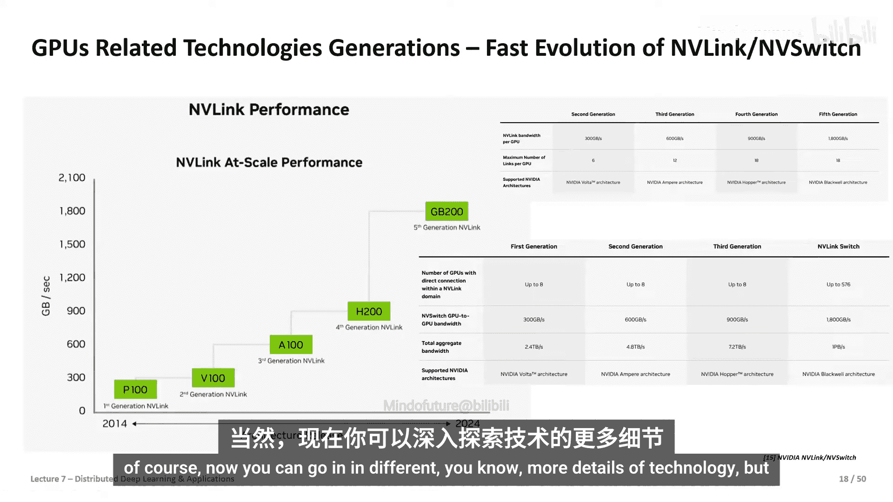

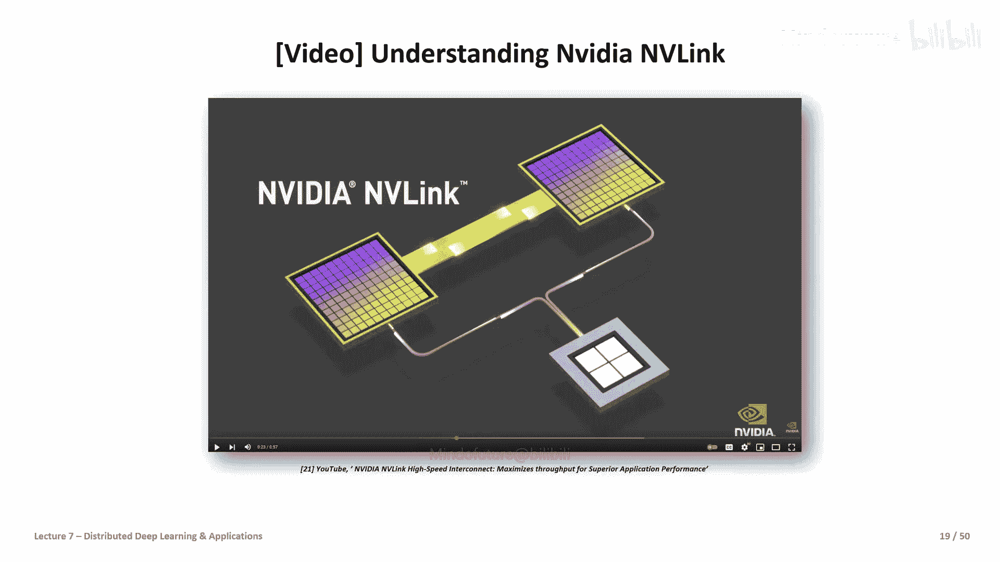

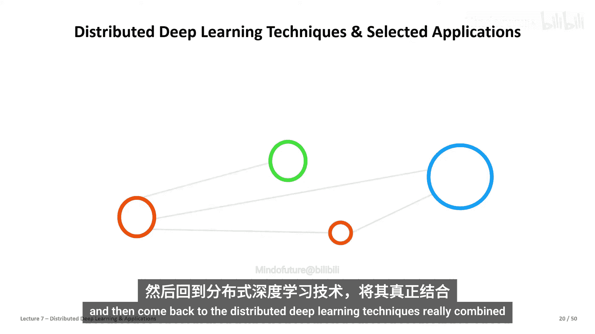