# 高性能计算课程：7：分布式深度学习应用（第一部分）

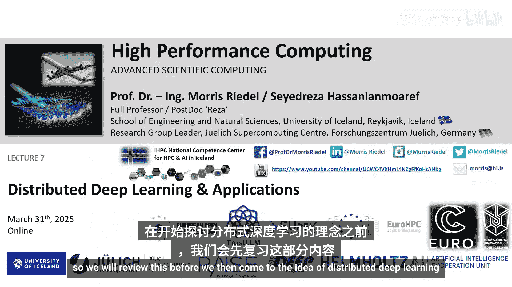

在本节课中，我们将要学习分布式深度学习的基本概念、动机及其在高性能计算环境中的应用。我们将回顾上一讲的核心内容，并探讨为何以及如何将深度学习训练任务分布到多个计算节点上。

上一讲我们介绍了从简单的线性感知器到多层感知器（人工神经网络），再到更复杂的卷积神经网络（CNN）的演进。本节中，我们来看看当模型参数量急剧增长时，我们为何需要转向分布式训练。

## 从浅层学习到深度学习

在第六讲中，我们学习了最简单的线性感知器模型。这是一个线性学习模型，因为其输出是权重的线性函数。其公式可表示为：

**y = x^T W + b**

其中，`x` 是输入特征向量，`W` 是可学习的权重矩阵，`b` 是偏置项。

为了构建今天我们所称的人工神经网络（ANNs），我们采用了**监督学习**的假设。这意味着对于数据集中的每个样本，我们都有一个已知的标签或输出值 `y` 作为指导。例如，在花卉分类或手写数字识别（MNIST数据集）中，每个输入图像都对应一个明确的类别标签。

然而，简单的线性模型能力有限。当我们引入**多层感知器**（MLP）或具有隐藏层的人工神经网络，并使用**反向传播**算法来更新权重时，模型的参数量会显著增加。例如，一个用于MNIST分类的双隐藏层网络可能拥有约12万个可训练参数。

**深度学习**不仅仅是增加更多的隐藏层。它的核心在于引入具有特定功能的“智能”层。卷积神经网络（CNN）就是一个典型例子。CNN的关键创新在于：
1.  保持输入的二维结构，无需将其展平为长向量。
2.  使用**卷积操作**自动学习图像的特征。
3.  通过池化层等减少参数数量并增强特征不变性。

一个用于MNIST的简单CNN可能拥有约120万个参数。虽然对于现代GPU来说，训练这样的“玩具”网络并不困难，但这揭示了模型参数量增长的趋势。

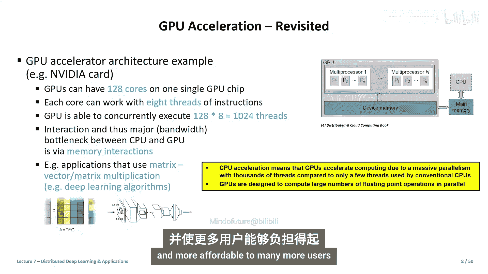

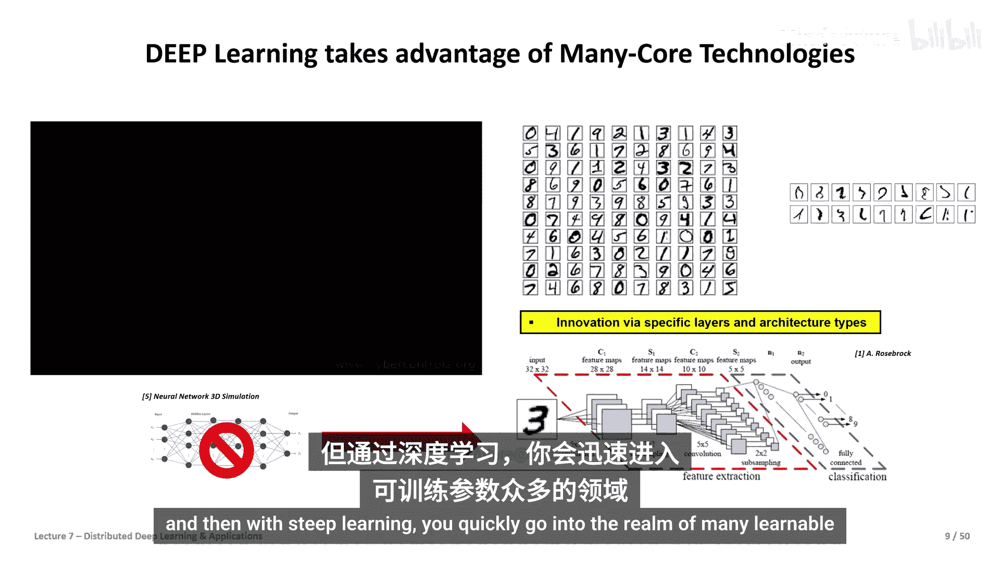

## 大规模模型与分布式训练的动机

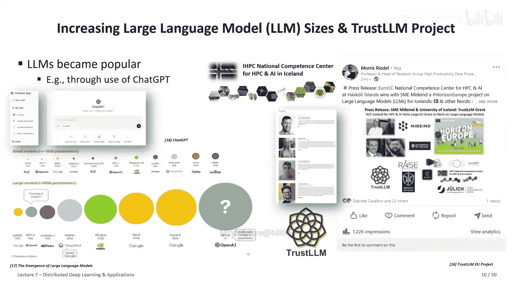

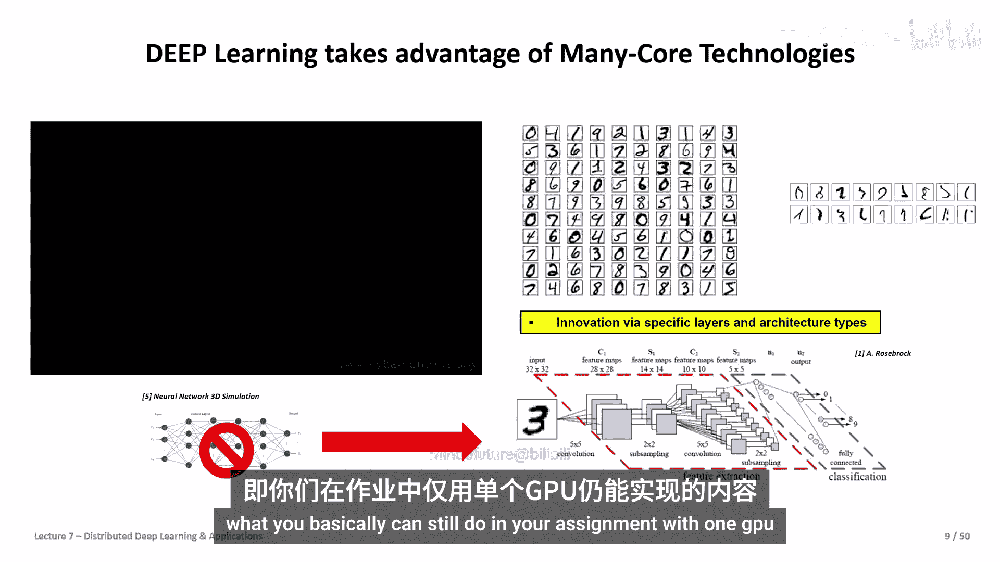

深度学习在图像识别、语音识别等领域取得了超越传统方法的性能。然而，当我们面对更复杂的现实问题时，模型规模会急剧膨胀。

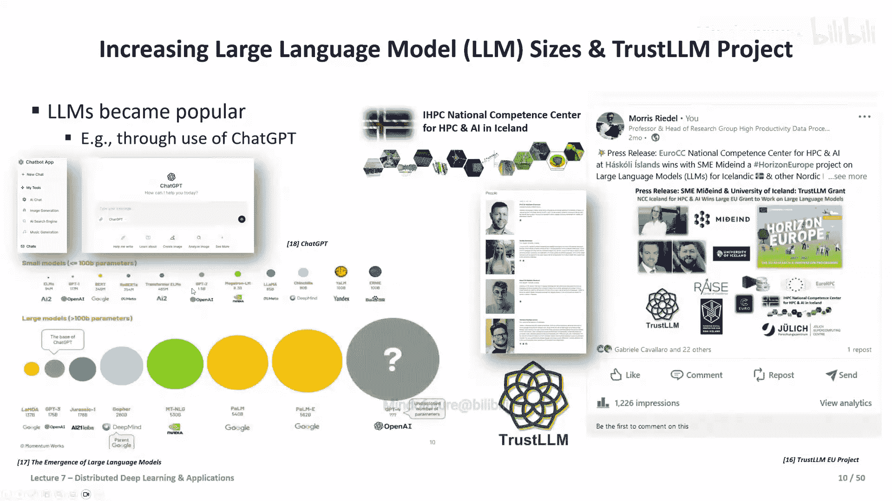

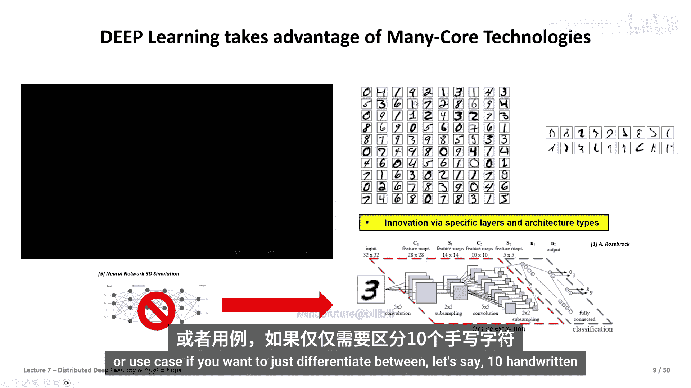

以下是驱动我们采用分布式深度学习的关键因素：

*   **大型语言模型（LLMs）的兴起**：例如，GPT-3拥有1750亿个参数，而更新的模型参数量更是达到了万亿级别。训练如此庞大的模型，单张GPU的显存和算力都远远不够。
*   **数据规模的增长**：高性能模型需要海量数据进行训练。例如，为了训练一个优秀的冰岛语翻译模型，需要大规模的冰岛语语料库，而这正是“资源稀缺型语言”所面临的挑战。
*   **超参数调优的需求**：学习率、批大小、优化器类型、网络结构等**超参数**的选择极大地影响模型性能。寻找最优超参数组合需要多次训练和验证，这本身就是一个计算密集型任务。

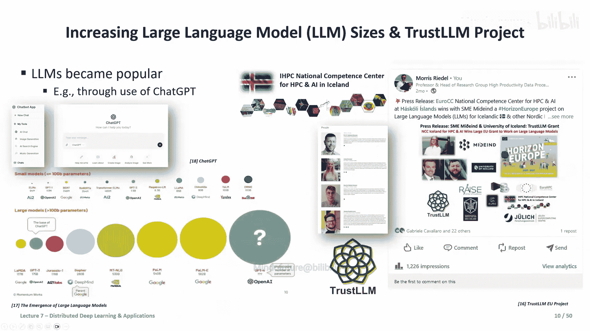

因此，当模型参数量（**可学习参数**）和数据量都变得非常庞大时，**分布式训练**成为必然选择。训练过程是计算的核心瓶颈，而推理则相对轻量。

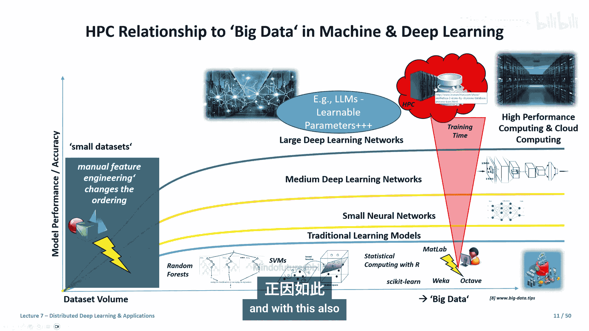

## 分布式训练的技术基础

要将训练任务分布到多个GPU甚至多个计算节点上，我们需要软硬件两方面的支持。

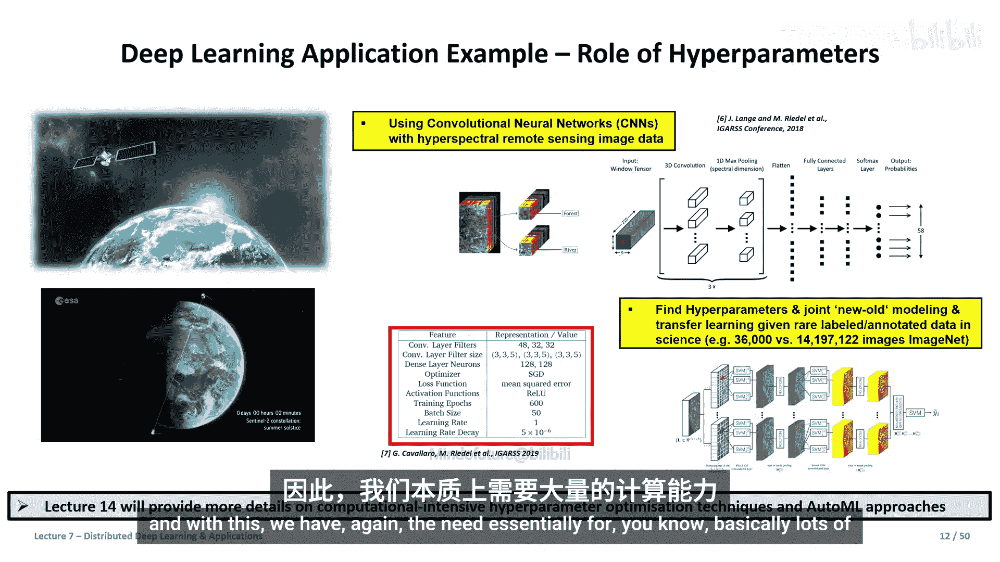

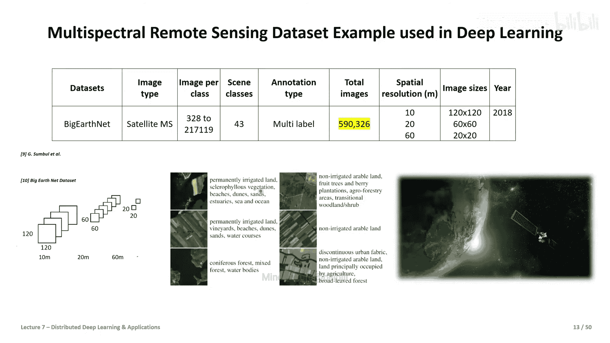

### 硬件互联：NVLink与InfiniBand

在单个节点内，多个GPU之间需要通过高速互联进行通信。NVIDIA的**NVLink**技术提供了远超传统PCIe总线的高带宽GPU间直连通道。**NVSwitch**则允许节点内的所有GPU实现全互联通信，这对于集合操作（如梯度同步）至关重要。

在节点之间，则需要依赖高速网络，如**InfiniBand**，来实现跨节点的数据交换。这些高速互联是确保分布式训练效率的物理基础。

### 软件通信库：NCCL

NVIDIA Collective Communications Library (**NCCL**) 是一个针对NVIDIA GPU优化的通信库。它实现了高度优化的集合通信原语，如All-Reduce、Broadcast等，这些正是分布式深度学习中进行梯度同步所需要的操作。许多高级分布式训练框架（如PyTorch DDP、Horovod）底层都调用了NCCL。

### 实际系统示例：Leonardo超算

以欧洲的Leonardo超算系统为例，它拥有约14，000张NVIDIA GPU。要在此类系统上运行分布式深度学习任务，用户通常需要加载相应的软件环境模块，例如特定版本的CUDA、cuDNN以及PyTorch。系统管理软件会帮助用户调度任务到多个节点，而像NCCL这样的库则负责高效利用节点内（通过NVLink）和节点间（通过InfiniBand）的网络。

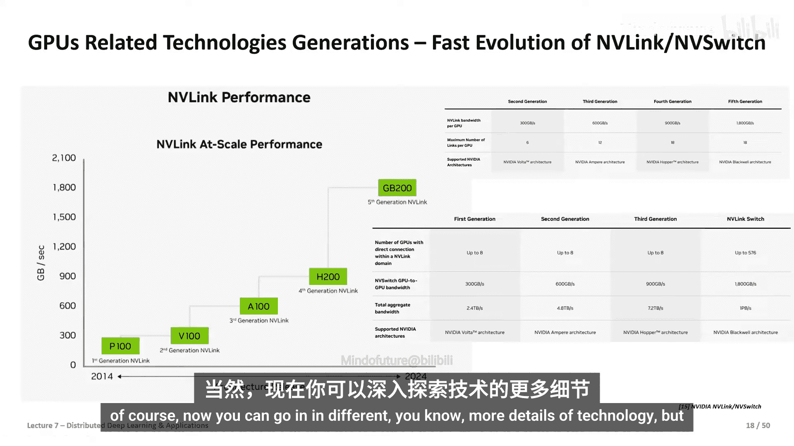

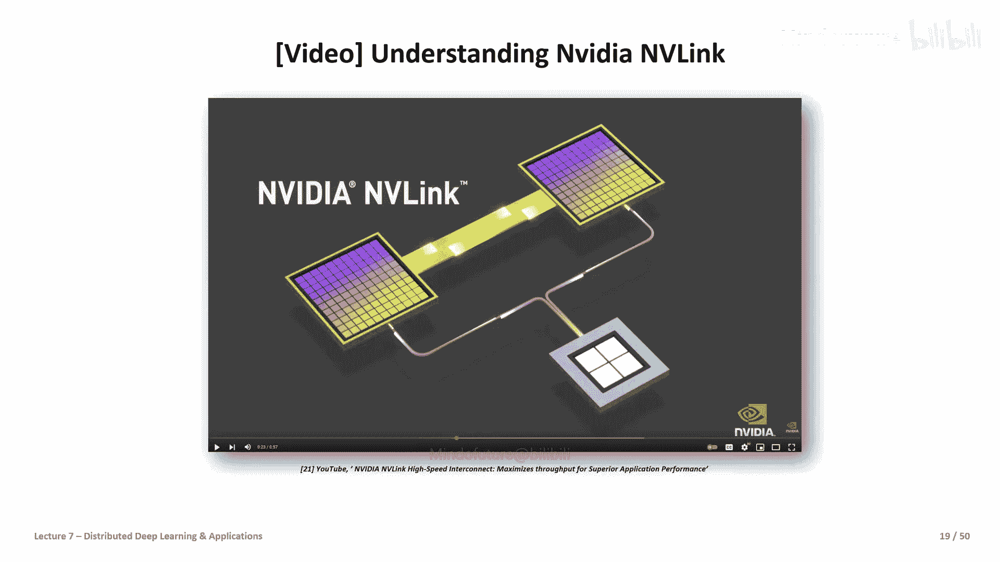

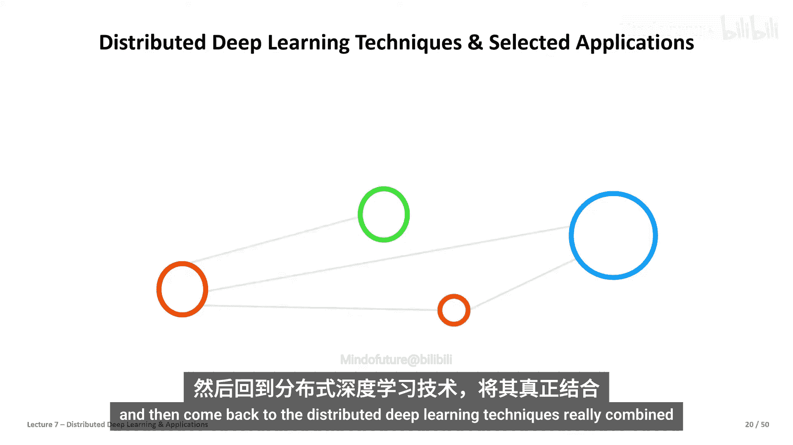

本节课中我们一起回顾了深度学习模型从浅到深的发展历程，理解了模型参数量和大数据如何成为分布式训练的核心驱动力。我们介绍了支撑分布式深度学习的关键硬件（NVLink， InfiniBand）和软件（NCCL）技术，并了解了实际超算系统的运行环境。在下一部分，我们将深入探讨**数据并行**与**模型并行**这两种核心的分布式训练技术，分析它们的优劣与挑战。