# 【冰岛大学】高性能计算课程-｜-2025-High-Performance-Computing-｜-Prof-Dr-Ing-Morris-Riedel-p12-P12_讲座_6_深度学习导论_第二部分--BV1k34zzaEK8_p12-

Welcome back to High performance computing， our lecture 6。

 the second part of it in introduction to deep learning。So in the first part of deep learning。

 actually in this lecture， what we really tackle was not really deep learning。

 it was machine learning。And the idea is that basically many of the aspects of deep learning are derived from machine learning。

 so you will find that the perceptra and linear learning model that I showed you in the first part of the lecture captures the essence of a socalled neuron。

 which is a little bit modeled like the human brain missing some aspects， but。

The very simple learning model， linear learning model linear in weights。

 you have seen we give the input signal and then we sum them up linearly using weights。

 we have the activation function that is going through it。Which could be the rectified linear unit。

 And then if you add more hidden layers。And combining the power of one of this neuron right and this is now a very important term because that's where the neural network obviously comes from that you form a network of them and in that sense what you can do with this is what actually the xo example nicely showed that was one neuron you cannot go very far。

 you have a linear decision boundary， you basically have a linear learning model so you cannot learn it so called nonlinearities。

 in other words the linear decision boundary that you learned， you know。

 remember Erisittoa ur Veronica。The different flowers in part one。

This is basically unachievable if you don't have a linear separable data。

 so what you basically were seeing was a really idealized scenario in the beginning of these part I mean basically in part one of this lecture so this is happening rarely in practice at the data is linearly separable as we would say it。

Hence the idea is of course having more nonlinear decision boundaries and the way to do so is not only to have。

 of course now an activation function that actually activates so-called nonlinear activities。

 one of it is that the rectified linear unit is basically zero in negative but positive increasing in the positive space。

And I basically have given you some examples of the an and on。

That also gives me the maybe opportunity to say of course this is a HPC course right so if you want to really learn about deep learning you have to either do one of my training three days or maybe even a whole week。

That I did in the past here and there and you know it's some of them on YouTube but also the centers。

 you know the centers when I refer to this usually stands for supercomputing centers。

 Barcelona Fland CSC we have also of course usually the center we affiliated with but many of the centers had also many trainings they offer and then we do deep learning for five days or three days even and the three days course might be even you know having arequisite in my past to have machine learning basics first so I have another three days course where we learn machine learning basics in the past。

Hence。Long story short， if you're really interested in the subjects you have to learn and I would basically refer you to my colleagues here at the university to do a proper machine learning course right so there are lots of different elements in the first。

ho was part of this particular lecture we already skipped and two of them I wanted to really note highly because this captures the essence from a let's say。

 beginner of machine learning to an expert。The first is regularization and the second is validation。

 so these topics， two of them you have to master。So regularization usually combats overfitting。

 You penalize the learning a little bit because you don't want to really learn every single detail of the data you want to learn the pattern that is behind this data。

Right， so in， in some respect， every single data。Doesn't really matter。

 You want to go through all the data， learn from it。

But you want to basically then be ready for unseen data what captures the essence of machine learning。

I know thats sometimes hard to understand for some of you that basically have not a machine learning course yet。

 but we want to basically have a learning model or a deep learning model。

 a machine learning model that actually learns from existing data and then performs very well out of sample right So what we learn is in sample。

That's where we learn from， what we learn for is out of sample things we don't know the future。

 some unknown data item。Data point， whatever， classification of something unknown。

And this is something where we call that out of sample performance。

 and this is something what matters a lot。And。Good。Again and again。

 I would say this is something where regularization comes quickly in in order to do performance like you know。

 improvements in terms of dropout you so here and there remove some of the neural network weights for purpose。

 or even if you don't do those its so strict， you can actually penalize the learning also by so-called weight decay。

And enter there many others early stopping another irregularization technique。

 so basically again a proper link to a machine learning course， but here， of course in the HPC。

The more important takeaway message in the first part of the lecture willll see increase of the trainable parameters right the more capacity we have in the learning in the model from simple learning model is perceptionceptron up to artificial neural network we have quite seen an increase in you know going from 8000 trainable parameters to 120。

000 trainable parameters and you pay the price for it。

 you know all of that is basically done by update the gradients， go through by propagation。

 update the waves and the optimization step， of course take some time to do。Now。

 before I go into the material lecture part two， I also want to highlight validation because this is the second part。

 right， I said regular and validation。Cptture the essence from a machine learning， let's say。

 beginner to an expert。 So validation stands largely for model selection。 And。

 and this is a huge course。 So normally， in a machine learning course。

 I would spend at least two lectures on it。And validation means many different things in terms of practicality。

 so if you swim and date you would put a validation set or maybe one or two or three of them。

Usually it's not like that， so we employ techniques called cross validation or reuse data again and again。

And the key reason is that when you pick a certain model in machine learning， right。

 let it be the CNN we do now or the artificial neural network with two layers you have seen the last time。

 or we add two layers， four times， six times。This is not maybe useful， but still， if you do it。

 it's your human bias you put into the learning process。

 So we call that so-called an optimistic bias。 And in the end， it's in this data set， so。You take。

 let's say， an input in the learning progress and that's not good in a sense。

 so we put a bias in and in this sense the validation data set hence the connection to model selection。

 it's your model selection， your number of parameter set you choose is it two hi layers for hi layers is it 128 neurons in the layer one or is it 300 layers。

Neurons in one layer。 so all of these decisions the learning rate， you know。

 this is a hyper parametermeter， yes。But still， this is， you know。

 you take advantage of a model selection in terms of how the model looked like itself， a parameter。

 which basically is then something where there are some real problems。

 hence the validation set would be contaminated if you take this decision and you throw it in the corner never use again。

And then you would use the test set right after training the validation performs and then you use the test set to really report to your bank or to Netflix。

 wherever you get the check from for you machine learning problem you implement and then actually get some credit for it or money you would repel it on the test set。

 but again basically the important is also to first never touch the test set for learning right so it should be hidden in the corners wrote in the quarter never seen again before you actually test so never train on the test set and then use the test set again for you know evolution of performance and in you know proper machine learning courses they should teach you about validation sets which are usually done before video basically getting ever to the test set in order to perform then the final model selection。

So here today。In the second part of the course I saw of doing bias automatically by introducing you to the convolution neural networks so this is material of deep learning so that wasn't existing many years ago or in other words it was existing ideas that we never had the computational capacity and now that's the point to the course right so deep learning is largely enabled by high performance computing by the evolution of GPUus we have seen and you also fear that quite literally if you actually train on this particular data sets with this particular networks so let's dive into the material finally of this lecture to understand what I mean and also to understand the connection then through the train of parameters。

Obous to say the lecture is called Introuction to learning and I could now talk a whole lecture。

Course about it， right？ So this is not something you can capture in any way in one lecture。

 if you be honest。So these days we see tremendous impact of deep learning and this is just。

 you know an overview of some areas of applications where deep learning has made a big difference in vision natural speech。

 natural language processing， deep learning is by now by far you have heard about large language models。

This is by far the Mo operaorrani， so nobody goes back in time and thinks what we did 20 years ago。

There's other even non so obvious pathways where you would say Oomics right you have heard about alpha fold。

 you have heard about different protein folding ideas in the past and maybe now alpha fold is there and suddenly we have interesting breakthroughs。

 even in the domain of fluid gas dynamics and this is really interesting because this is a domain driven by physics are referring more to the lower part because I think the medical imaging diagnostic is very obvious it image recognition where neural networks are very similar like the vision upstairs or basically have seen significant breakthroughs now the interesting thing is like in fluid gas dynamics。

 things which are really driven by you would say numerical methods right driven on physical laws。

Implementing physical analysis has been changed significantly in the last 10 years。

 Hence we have AI factories in Europe。 We have soon maybe AI G factories in Europe we have。

A tremendous momentum around AI because it shapes the fear suddenly enormously also of course。

 just to refer quickly to it AlGo I think you heard about this that this was a game that never was basically possible for some computer to learn because it's so complicated but there was of course Al go that then actually let in the evolution to Al fold for protein folder and so also beating a human in this game and you can go on and go on and I could take talk hours about this my whole research field based on transformers based on outerenrs remote sensing with some of my colleagues from electrical engineering so we do lots of this was HPC and deep learning and by now I think no matter what you heard from others。

 deep learning cannot be just talked away so it has a standing it has significant breakthroughs publications and。

Many benefits in terms of， let's say， also what we call more or less getting the out of sample right and also with the tremendous idea of computing now we can go ever bigger。

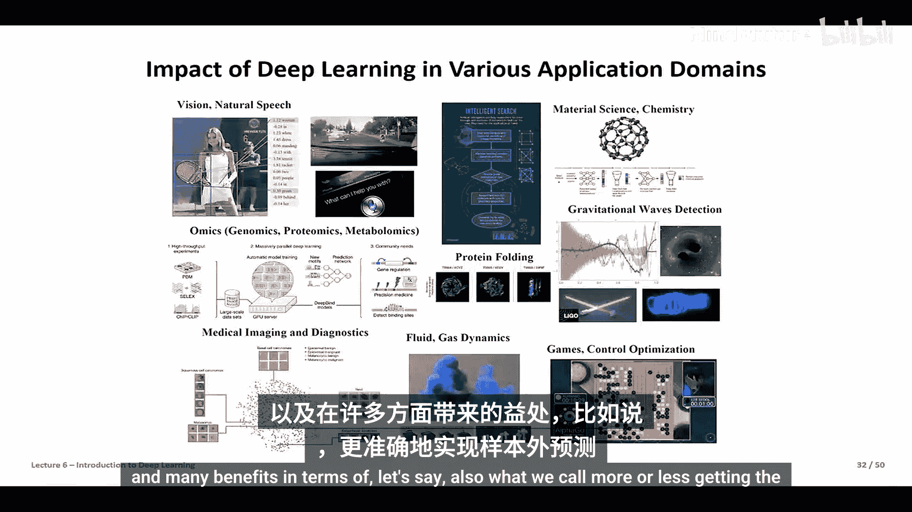

And the slide here I've seen before， I just want to remind you again， in one respect that of course。

 the tremendous success we have is not that just AI people were very smart and say， okay。

 we have this now deep learning networks， we have to give a little bit credit also to the evolution of computing。

 the evolution of high performance computing， eye hes， accelerators。

That you learned the last time so you have seen the Nvidia course of you know advancing from Pascal Vol toumppe up to Grace Hopperships and black belt and so on。

 and this will not stop right we have the MD instinct cast giving competition from C so there will be more and more coming hence the。

The the fruitful results of deep learning is really interconnected with also what you see here the training time。

 the footprint you have right if you have smaller problems you know basically and it's of course clear that the traditional models like random forest SVM Sta computing at large still can be done right nobody says that leap learning will now rule everything one of the key ingredients of deep learning is basically deep and you know big data sense。

No。This leads to a domain called synthetic data sets so people are thinking about， okay。

 if I don't swim in data， can I build data which looks similar。

And there's also the overlap is high performance computing again。

 a topic which I will not address much in the course， but of course you can use HPC。

Stimulations based on physics as an input。To AI， right， and then。

You basically create maybe syntactic simulations where you enrich this with normal simulations。

 which might be not enough， right， because the real world might be not giving you enough data。

 but you can create this maybe HPpC simulations that arere very similar to the real data。

 And then you basically learn better from it when you do again， machine learning from it。

 So it's a sort of。2 levell threelel way， how you would use AI today and it's a very complicated subject hence we are in a point of time in history。

 I think after my 20 years in HPC where you say we need complete professors on deep learning in HPC or we need complete professors that you know are teaching you not only in one course about deep learning but teaching you the powers of transformers teaching you the powers of encoding embeddings outenrs so we are in a time where you know deep learning is such is so large and has so many benefits。

 leave alone in the middle of it maybe large language models because we talk in the next lecture about it。

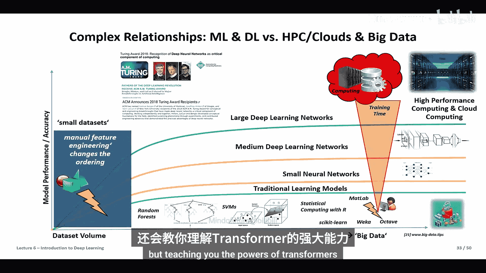

So this is something that is not only。Having so much innovation it's also giving you lots of impact to society I mean everybody of you is using chattGPT probably more or less in one way or another everybody of you is using maybe the browser and Firefox it somehow can suddenly translate the whole webpage into English even in Chinese so there are lots of impacts in life and I think that's why it's also credited that you see on the left side and then I move to the next slide that you know the pioneers of deep learning rightfully credit to the so- called am Turing of some you know basically you probably know some of them like Benji and they couldn't and and this is really important to understand that there's these godfathers in it but they also derive some in our credit from highperformance computing advances in GPU's advances in the technology that mainly make it happen to compute deep learning today at scale and at scale is really loaded。

Especially if we are extremely large deep learning networks， we have to definitively go across nodes。

You know， leave and buildings and what we learned the last time a bit behind and really to distribute deep learning things we will learn in lecture seven。

So let's advance a bit because many of you will now now think okay we had this in the past and also this slide was basically just a remind of you about the differences right and it's important difference to understand now when we move at。

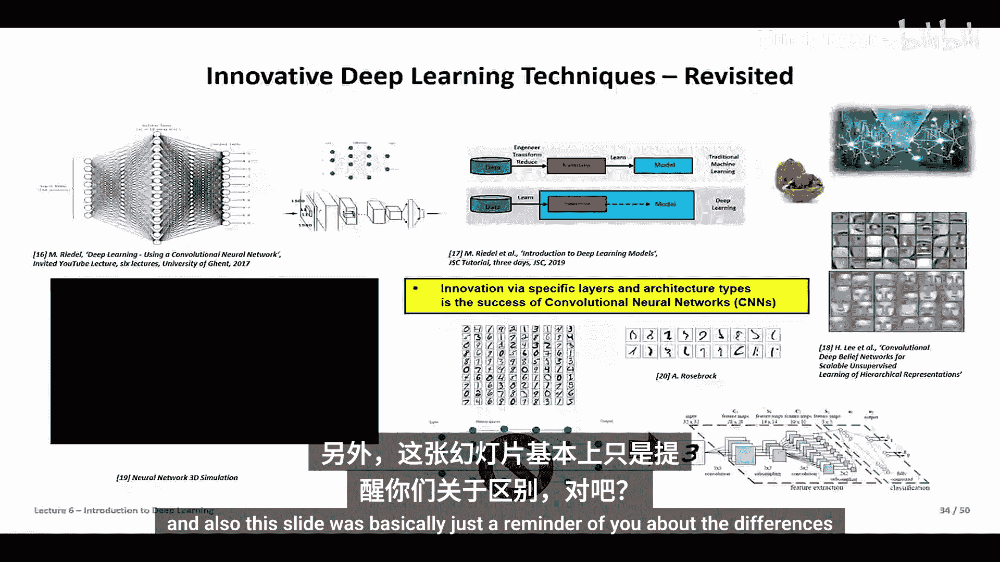

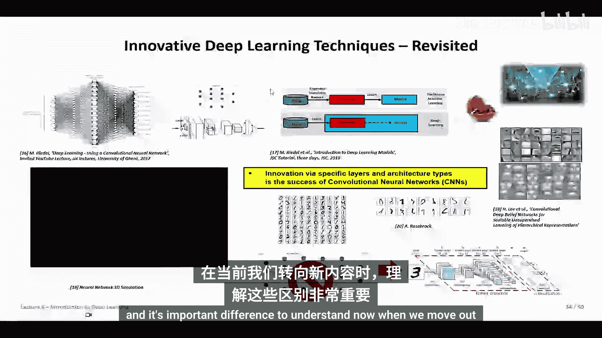

So。What we had in the last lecture part part one was essentially this， right。

 we had this artificial network inputs。S linearly using weight for one neuron。

 but of course then suddenly when we add more and more neurons， we have this hidden layer。

 we have a whole bunch of neurons and then we a hidden you know second hidden layer and then an output layer we come to the problem that actually the arrow cannot be you know directly communicate back hence we need back propagation of arrow through the hidden layers back in order to let's say。

 add to the weight or remove some parts of the weights the strengths of the signal in order to call it learning。

This was also based on you know gradients， so I mean。

 basically we learned of it was an optimization technique， a minimum or a minimization。

For each of those， so hence computation expensive and so on。And with the feature engineering。

 what I did was and showed you before is basically in a one respect， we did a 1 D vector。

That was us but we did this manually。So it's not that this neural network came up with it。

 so basically that was our idea to put features in a 1D model in order to make it learn in a perceptual learning model or in a tool that's say hidden layer neural network which still captures the essence of one long vector as input。

So that was sort of traditional machine learning， and then you can come on and go on and gone and you can have some summetries and numbers is an advanced topic。

 but you can do some so-called feature engineering find better ways of in crafting features in fact one of my early PhD students who is in fact professor now did actually the neighboring now was a so-called mathematical profiling techniques and trees to see how the neighbor features would put in the game if you have。

 for instance remote sensing data and you know than cover classification So this feature engineering was traditionally a very big topic how you prepare the data for the model。

So deep learning changes this a little bit in something we call feature learning。

So instead of saying you spend a lot of time manually。

 let the neural network think what is the best to learn。

This is sort of a little bit misleading because we still have some hyperparameter to choose so how big would a feature map be。

 how many convolutional layers I really have to learn features。

 how big should be you know the sub samplingling be how big should the feature map be。

 the field time running over and so many terms that are not directly obvious to you so it's something what will materialize hopefully in the next couple of lecture slides but。

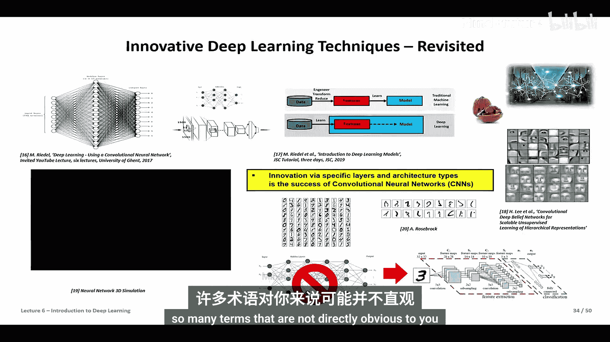

The point to get away is that now the deep learning networks are a little bit in a way to capture these features right and to digest more raw input and with this。

 you can have some effects that you saw here on the pictures that you know no matter what you put in。

 they still can you know get the features of noses， ears。

 eyes and codeed and then can much more easier recognize a person based on these features that they learned instead of us saying。

 well this is a nose， this is a eye this is something so in a way this feature maps enables us to learn that on its own。

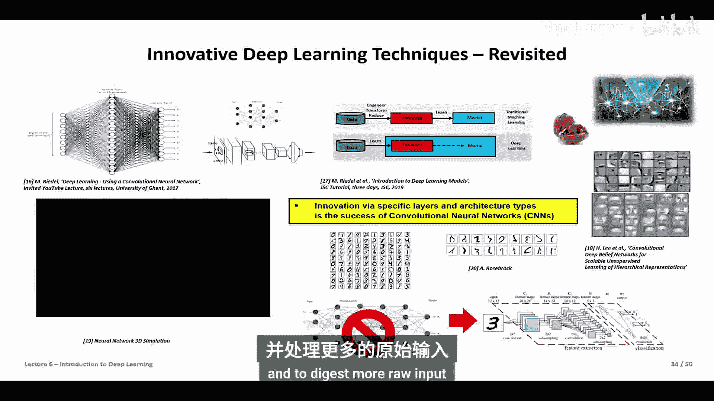

So I will not play the video you have seen that before。

 but you got also the message at the neurons we're talking about so not really just deeper and deeper and deeper in the sense they also have a sort of structure and an eye he if you want that is send this feature extraction layer however。

 now that you had already part one and hopefully looked at this you see the fully classified and the fully connected layer for classification here at the end features again often the softm right the probability again of saying well we are still having zero and nine right so there's a probability that this is an eight or nine because they' very close you know looking very similar but still we have the softmax layer at the end for classification fully connected what changes a bit is the i that you have now in front in order to carve out features。

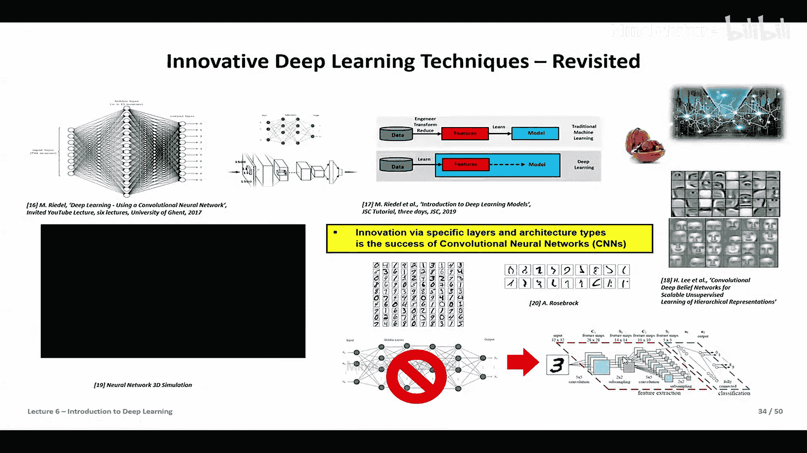

And let's go a bit into this how this is done more and more in the next couple of slides， so again。

 of course using our example that we had of the hand you know basically handwritten characters that we want to identify。

And always when I have this particular let's say examples here。

 it's also for you to understand that we have some of these numbers。

 maybe in the input data set that you see here that is really not recognizable right so especially also for a woman right that maybe should validate all of this so you see here I have no idea what that should be could be zero。

Could be an8， which is very small on the on the top and then very big on the bottom。 hence。

 there will be always some samples which are considered to be noisy。

 So that's the term in machine learning again， feel free free to look on the machine learning course noise data。

Means essentially， we will learn from this。But we learn also not the best things out of it。

 so in other words， if you give this also a shot of classifying。

And when let's say human don't even recognize this how in the world should the machine do this so in the other words。

 there will be never 100% performance usually if it is really like this and it's either toy problem very well prepared and you know basically having you know EDL setups like linear separability that we discussed with the flowers it was also not true I actually left out the third class which was overlapping this particular example so the reality shows again would be not really happening I just provided you was an idealized scenario。

So in the end there's a third class of flowers which is you know another Eris flavor of actually making it much more difficult and you see it here is the same as a character so hence what we want to do if you remember lecture。

 you know basically this lecture but the first part the end。

 we want to improve from 91% okay perceptionron 95% artificial neural network two layers。

So what can we do better？But we also have to be real as stick and this is something which you see a little bit in this particular sample。

 CSO probably， no matter what we do， even with the power of deep learning。

 even with a full cluster of HPC and soon X scale or whatever。

We will never achieve 100% performance because the true error is in the data which is kind of samples which are。

 you know， really noisy or， in other words， not really recognizable。

 even if there is a label for it and should say， okay， this should be a three， one or something。

 but it doesn't look like me as a hub for it。Hence， we have one interesting other part。

 what I want to st here， that is the so called idea how humans work。Firstly。

 we said it's not recognizable for us， so what we do have in our brains and more locally。

 if you want to see it also in our architecture of the eye is a local receptive fields。

Right so this idea is taken forward in the CNNs and the idea is that we look usually when we identify a cow or a car or a cat。

 you know， the famous examples of machine learning， which are not at all the real the essence。

 but know it is something you all refer to， we're not identifying a cow by a pixel。

Reid how by some certain pattern of colors of the whole animal。

We identify a car by having wheels and maybe you know some windows it's a certain position or whatever。

 So hence there's a certain environment region that you want to basically look at once in order to identify features like maybe car tire or let's say a certain interesting color scheme on a cow or whatever it is could be of course。

 from a cat， some some specialities， the famous examples， but we as humans do it like this。

 and you can see it as a sort of window of the whole scene that you look at。

And that's exactly going with us now to the basic principles of why we have a convolutional network that is now doing。

 let's say， different neurons in different layers， and so to speak， redo the visual cortex， right。

 maybe more or less the animal visual cortex or not the human， which a bit more simpler。

 there different types of layers， convolutions pooling， stronger single and survive， for instance。

 max pooling， whatever。To see and here's an example of five by five local connectivity looking at these 25 pixel at once give us much more indicator what happens and it also。

Directly for those of you that looked you know intensively on part one gives you a hint what's now changing right well remember the vectorization and then the normalization in a sense we put everything in a very long vector we don't do this now。

We keep it at the pixels。But instead of using let's say now the whole pixel at once。

 sorry the whole image at once with 28 28 pixels， we have a so-called yeah。

 a receptive field and which is then realized by so-called windows where you move over this over the neural network。

 which is a little bit explained here and I will have also a couple of slides showing you how this works of course over time in the learning and over time in the learning。

 this is now the point where also the convolutional or basically the filter comes in。

So you look over the input space。 you shift it。 basically。 We call that also a stride。

 which you can define。 So how much the stride would be here in the example， we have a stride of one。

 So we look at all of these different 25 pixels。 We define the window size。

We go over it over this picture systematically and in the first next layer hidden layer。

 we have a so-called feature map， what we have to define again in size， we say， okay。

 let's craft a 24 by 24 feature map again something in the architecture that essentially you should choose as a human。

RightSo this is something also where the Is you know really differentiate each other from the type of application they are working on from the data they have to digest so here we assume 2020 24-24 feature map and then with a stride of one we go through this and fill this next feature map you know with some data but with what data and this is now the convolution principle right so basically you have a so-called convolutional filter operation or filter we amazingly that you apply over it and here's an example of it I think quite nice where you then get out the so-called convoluted feature。

Here's an example。We have a four by four for instance。

 and this is completely done over this input space if you want at one step and then we go to the next step of striptripe one for the next neuron for the next neuron and you basically has this way it's filling up this is convolutional operation then and giving let's say the next layer。

 some concrete number information like the convolve features you see here heres a good filter three by three so another example but the animation shows clearly how that looks like and with this you basically have a more dense representation maybe of something that you identify in this particular layer。

So obviously this was so called 2D right now we have to think like real world data is different。

In our remote sensing examples we have even you know really different data sets where we talk about hyperpectral or multispectral data sets where you have 200 dimensions in the data over land cover and maybe that say they are very overlapping in the dimensions but still lots of data in different dimensions。

 here's a 3D examples standing largely for our AGB， something you can connect to。

 but it hasn't be so simple， you know in all the scientific and engineering examples this is again more or less an idealized scenario with RGB but it captures nicely the essence that there's different that say dimensions now that you can put at once right we started with 1D you see array now we had then 2D but now we can also think that data sets like for instance。

 as I said with remote sensing has many， many dimensions。

Bioinformatic standss also for very high dimensions in all features of a person and then of course here an RGB photo is just alluding to some very similar but still trivial factor of go through still what I can do is with a 3D aspect I go through the data and fill the next feature map and you can imagine with having more information and also the locality right and this is a key term we preserve the locality now in this convolution neural networks right and and many of the learning networks have similar tricks where they preserve some element in the input data they and code advisedly coming to embeddings which enables us to do a decoding very simply but they learned embeddings of the data。

 very dense representation basically of what we learned from data is another topic I cannot talk much about it because we have a HPC course you know machine learning course but we publish。

a lot in this area and you know this is also a cutting HD learning algorithm that basically should be teach in other machine learning courses and so so what you see also here nicely is it doesn't have to be one feature map as you saw also in the previous convolution neural network example there were many different feature maps and you define this right and the convolution filter you run over it might be different right and this is also under another part。

So hence this is the first step that you learned already now in several examples going from the input image to some feature maps。

 the same here is a convolution operation， and then you usually put it through a long linearity。

which might be after convolutional rectified linear unit or leaky reluu or something。

 and the next step would be then to see can we reduce the data right and this is a pooling step。

So the pooling step then basically gives you different opportunities you can pull from some certain space。

And using some yeah， particular function， very commonly used max pooling in an analogy。

 maybe of a little bit like the strongest sickness of life yeah。But there are many other options。

And of course， this is now a systematic。For the feature learning， which doesn't stop there。

 although it's indicating here a little bit on the picture。

 now the power begins that you have this deep learning。

 so the feature learning just doesn't stop as one of these elements。

 you would go again and again and maybe create another convolutional layer afterwards。

 another convolutional layer， etc， etc。However， if you want to。

 let's say classify a car that you see here， chances are that in the end whatever you learned with all of these different layers right so convolution giving the idea of different let's say feature maps and then you do the pooling。

 convolution rectified linear pooling convolution， linear et cea， et cetera。

 at the end for the classification you would go to a dense network again。

Now manner you know this could be like 50 times right for instance ass a residual network restNe 50 that I was alluding to in the last art of you know basically in lecture 5 if you remember so this has 50 deep learning networks doing similar things that we see here but in the end that's the interesting thing we still have a flattening out so a dense connection so everything is connected to the out layer where you then perform the softm that you already know now basically giving you the probability is this a van is is a cat is is whatever but we all agree that is probably a car and we identified this car and this is a liberty in the picture because there is some certain properties here maybe the outer now mirror or something that was identified as a features and so on propagated through the layers and then I can easily that say say that this is a car but many different features will probably have been activated going。

Over the data set。Like I told you before， the car feature， right？

Or basically the lights in front feature。And this will be activated when you do inference。

 so what we basically talked about a lot was learning so we training we train the whole network。

 we create this feature maps， we have this ws that you see also again here nicely in red things we learn。

 so here we learn more or less the multi dimensional matrix versus feature maps。

That doesn't matter and the end is something we don't know and the learning algorithms will learn it。

But in the other end of the scale， you would say you learn something。 O， that's done。

 And then you have this learn network with a weights being settled， right， So weights are clear。

 Then you put a new picture in a new car。 and then basically based on this trained weights。

 The feature maps would fire。 The network would fire in of features it finds else in newly unseen data。

 a car it never saw。 Let's say you basically train a car with labeled data on BMW as an example。

 right， And you do this a lot of times and say this is just a car。

 Chances are when you do this with proper data that you can give in a yagua or whatever else。

 the Mercees。 Another car could be Kia。Chances are because of the features of the cards very similar that it will still fire。

 of course， as a car right no matter what the brand is and this captures also the essence of being well out of sample in sample would be okay I would get the next BMW right I get you know I trained on BMWs that's okay but what we want to achieve is that a deep learning network is smart enough to say we want to to be good out of sample any other car that cus and you know basically Mereddes is not far away from BMW all the time key have also SVs。

 for instance， and etca， etc， etc so。

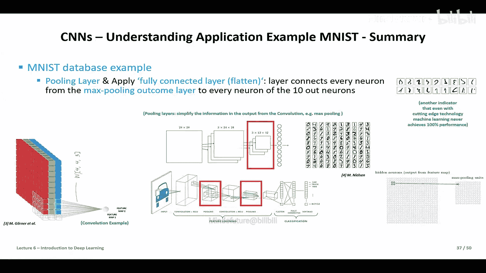

This captures nicely the idea of training and learning network and then you'd perform inference on out of sample data。

And hopefully be right and this is what we want to do in machine learning。Good。

 I think I kept this all on the slides， I do something unusual for our let's say lecture here I will break off quickly to some demo。

 although it's not a practical lecture， but it's not a practical lecture in HPC。

 I wanted to you know allow me to give you this particular interesting website which I found fascinating and I think you should really try it out。

And I did this since a long time in all my trainings to get students directly understood what we're talking about and I think here' is a good example and I now craft our handcraft。

You know。Element， many of you will see that's an eighth it's fine and then you know what is a little bit out blended is now exactly what we talked about this window going over the data。

 they are all weights， you know this is all connected。

So don't think about that this is now you know something magic from one layer to another。

 so you see here sometimes the connections are still highlighted to really make the connection for the different layers。

 but you also see that the aid is so called encoded in the next level as much more feature oriented and then if you go down layer by layer with poolings and so on you see just parts of the features quite nicely。

And you see also the first guess here， it's basically the probability analysis， right it's an eight。

 yeah， that's true。And the down sampleamp drawing sees almost like an8 So this was simple。 However。

 you see also from the probability perspective， as I told you。

 it's a softm activation function somewhere here。And this shows you also that we go down。

 basically input convolution operation， creating a feature。

 some sort of rectified linear units or whatever activation function to cap on linearity is to go to the pooling next feature and X N X and X。

 but the last bits is densely connected。Densely connected again stands for every neuron of one layer is connected to the other lu you see this very nicely in this visualization right so I really want to accredit here the authors。

 I think this is an enormous important partner only in learning also in research to understand really how it works and you see here sort of the two dense layers connected giving them the you know input to the softm。

Which then gives you， you know， the learned probability from all of that before。Right。

 this is all learned over time， iteratively， apo by apo and batches by batches within each apo。

To come out to the solution， it's an8。So obviously。

 we can also now think about more scenarios that's not so easy where you think， okay， it's a six。

But maybe I this and what you say it's an a， but of course。

 the second case might be a six because I didn't connect this and I connected it。

Then maybe if I redo it， it looks much more。Like an eight or like here。

 second guess is even a one because it's like very close to each other。So I think long story short。

 play around with it， especially with these interesting things。 One is a one。One is a one。

 but you know also you can write the run in a one that is maybe rather seven。

depending on when I wrote it。So。This is a tool I just wanted to bring you for an attention and it's of course linked in my Bblography。

 so I will not spend much more time in it， but I think it kept just nice in the essence and if you go to the original page of this。

 let's say brilliant author Harley here， you have different examples you have also 1D 2D and I encourage you to play around if you really want to understand more on basically deep learning。

However， we want to go ahead because the goal of my lecture is not to teach you completely deep learning。

 but also it interconnection with computing。

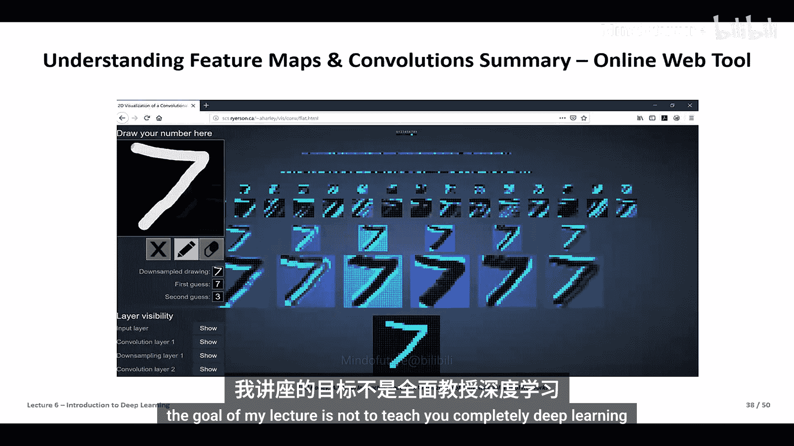

So this is a key goal here， deep learning you can learn essentially in the machine learning course。

 so in a deep learning course。Hence here we have to make the connection out computing and I think some of you probably already know what's happening right so in order to get all these different weights we learn and you see here how we would define this。

 you see also much more elaborate code we define now a 2D convolutional layer with input sizes。

 we have a certain kernel basically size that we want to go over the data。

And then when we have the kernel， we need to basically with this convolution operation ending up with a V so called activation function。

And then having the pooling function to have sort of one layer， really， if you want。

 and then we go to the next layer and the next and the next So here you see one。Let's say yeah。

 convolutional neural network， which was， let's say in the beginning of deep learning。

 really the mod oforandi today， people would maybe rather go for you know resin 50 or some residual network。

 but it captures still nicely in the essence of this convolutional network which shows you a dramatic increase in trainable parameters。

Right and and left alone that we actually left some things out here now。

 which is weight sharing and so on。So hence， when we do all of this with all this different convolution operation feature maps and the againpooling convolution and so on。

We don't have any more 7000 something which we had in the perceptron。

 We don't have any more what we had in the artificial network work。 We have no， suddenly 1。2 million。

Trainable armitus。RightSo and this is now something which of course， shows you， okay。

 the more you do deep learning。The more computing needs to be done， the more optimization。

 the more weights。And and this is now the footprint， right， so hence deep learning in one other view。

 really required this computing power。 Otherwise， you will spend hours on hours on a CPU right doing this。

 even if you have the power of shared memory getting new data in nicely read。

 you still have to do the computing。And。It gives me also an opportunity to connect to the other part that we had basically in lecture5。

 read the other part in terms of， you know there's vector vector multiplication。

 vector matrix multiplication， which are simple。Each of them at very many of them ands many core techniques right the instructions to update weights to multiply it right as we have seen we see update rule really of the weights and so on depending on the learning rate and stuff so these are all in a way simple operations but I do just very。

 very many of them right depending on the input size of the graphics the number of featuring maps and so on you see a 50 feature maps right so and we have the connections and all the connections are weights and then plus a dense layers so you see a little bit how it works here we see number of parameters adding more and more each convolution operation as a very big input to play obviously the dense one very much two right so this is in the end combining everything at the end。

So has a big role to play in this rather simple network right we talk about not a rest at 50 with 50 layers。

 This is like a so-called more or less two layers here right where we have this and this layer and then essentially in the end。

 you cannot really call it anymore， let's say a real layer because this is again the usual you know dense layer with a softm to come to the number。

That we also incorporate here essentially in the code。

Let me just give you a couple of pointers also what what has to be discussed， I mean， firstly。

 what you have seen is， I think if you if you put the input。

 we are not anymore more doing this vectorization， I mean this is by now I think pretty obviously just go with essentially this 28 by 28 input dimensions。

And then we look at the data at once。We train still on normalizedized data。

 this is a little bit hidden here right so of course the gray scale is still there so we don't want to have this with high numbers since we actually normalize this here dividing by 255。

 but essentially we look at this as a 3D problem because then this also means we have to encode it in a 2D but we have seen also here and we have this 2D operation。

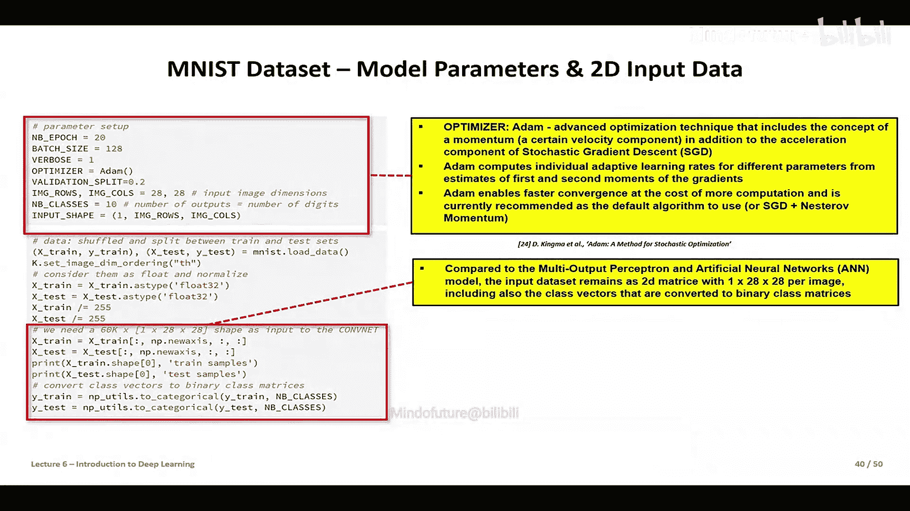

So this is of course all fit together and this also the idea now thinking about what optimizer are using。

 these are now this interesting hyperparmeter I'm alluding to at the end more or less at the deep learning lecture because we come back to hyperpar later。

 learning rate， optimizer batch size number of Airpos。

 how long you learn many other parameters of the so-called hyperparmeter that steer the learning process and also an important role to play as we will hear later。

So in the end， when we do all of this。And we'll compute this。

 you see in something what we sort of expected， so be landing somewhere and I mean here incorporated what I forgot to mention is a bit of validation splits hence we combat overfitting a bit right in other words that's why we maybe not always have 100% in one respect。

 but we have seen in another respect theres some samples we truly can never learn from。

So we come to a more or less realistic setup of 0。99% when you have deep learning models。And。

 you know， given the sheer data size and the， let's say， complexity of the， of the problem at hand。

 this。In our network is already enough。No matter if you' not put a resson at 50 on it or so you would never achieve 100% right and it would be probably even worse because it would overfit。

 it has much more connections， much more weights to learn。

 but it has no data to learn from because we have just 60，000 samples and 10000 for tests。

 this is not changing。And and doing so and throwing then big。

 let's say deep learning models on such a toy problem would basically also not help because firstly would waste a lot of energy right so I mean it still would be trained on the data and given the size of the whole network with 50 layers you probably have lots of much more parameters as you completely understand hopefully by now right instead of having this kind of two layers here yeah 50 so the parameters which I think is best explains also in the large language models these days right if you know a little bit about your chat GPT here and their use and the large language models we talk about billions of parameters not 1。

2 million of train of parameters， billions right and each of these have to be you know learned have to be let's say manipulated have to be computed and with other words using energy of a CPU of a GPU together with many。

Other well long story short， I wanted to just make you sensitive to the point that of course。

 a model we call that capacity or learning capacity of a model that you have in AI should match the problem at hand and other words you basically otherwise will definitelyly overfit or underfi right I mean you can also see that you know a simple statistical method would have maybe no chance。

The linear learning models stopped at 90% performance。

 so here we have quite an improvement to go to the 2D setup and the non linearity and deep learning。

 so they are benefits。And if you have a more， let's say， complex problem like remote sensing。

 as said to you with， you know， different pixels， you want to analyze and on chances are you。

 you really have massive improvements with deep learning and can go nowhere with， you know。

 the simple learning models we started from as a percept learning model for instance。Again。

When you try that out yourself， basically think about the right environment here you have a Upiter notebook since we already introduced a little bit in the course before right so this is something where the right packages have to be included like Kra Tennzaflow here。

 sometimes you use maybe Pythtorch and it's important that the environment in this Upiter notebooks also has basically a kind of kernel that is having these Python packages installed。

Like for instance the Google Collaboratory so if you want to play around a little bit with this example。

 so this would be a good example to use， of course we have also our HPC resources where you can use it but with one GPU usage for such toy problems it's still let's say an interesting environment in HPC we are much more interested in going cross nodes really big setups something I will also teach you in lecture7 and we come then to distributed deep learning as it is called。

Distributed training， if you're really precise on deep learning。

 because the inference is often very quick， right， as I will also explain you a little bit more in lecture 7。

So overfitting underfitting and regularization validation， all more。

 let's say advanced topics that's why I want to give you this video a little bit to look a little bit again why we combat overfitting in machine learning to have a much more realistic saying and realistic learning reporting really to who we report whoever it is your bank as I said or Netflix where you create a machine learning system for they want to have real values and you should not basically either you know in large language models you would say hallucinate。

 but here we would say we would overfit and report a 99 performance。

 but maybe with regularization validation and proper model selection you come to a performance of 80% Now when you report to your bosses at the bank's Netflix that you can do every machine learning test 99% on this date on the movies。

 then they will say okay you get a good check but if they in their production every day in the bank。

And then in Netflix or whatever it is， right， I'm not paid by them I just saying these are examples。

Then if they see the truth is it's not 90， it's 80% so then they want to quickly maybe their money back hence it's important to have training sets。

 validation sets， test sets it's important to have regularization validation techniques so I urge you again not putter off with this course here today and basically the last one and the one we have next to just be in machine learning expert you require some more understanding of statistical learning theory to really make that happen however I think it captures the essence in this lecture and also in the next one why we need performance computing today it was more about the trainable parameters the need for computing。

 more optimization of weights so the next lecture will then capture the essence of why we go distribute it right so why we don't stop is onen but won't have many notes for speedup and so on。

So I stop here。And we see us basically the next time with lecture seven in distributed deep learning。

k to you then。

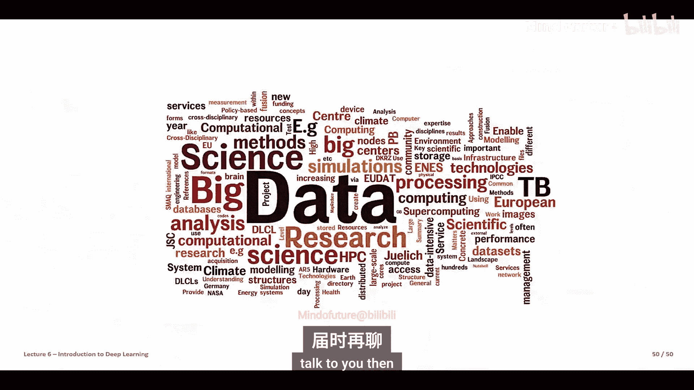