# 【冰岛大学】高性能计算课程-｜-2025-High-Performance-Computing-｜-Prof-Dr-Ing-Morris-Riedel-p13-P13_讲座_6_深度学习导论_第一部分--BV1k34zzaEK8_p13-

Welcome back to High performance computing， advanced scientific computing Today we have our lecture 6。

 and lecture 6 now brings us into the realm of machine learning， deep learning as a new term。

And then we will also learn how machine learning and deep learning are related and also， of course。

 in the course of HPC， we are most interested in also why now they can leverage essentially the GPU so much that we had the last time。

 so let's dive into the lecture of what we had in lecture five because this was all about accelerators and graphical processing units。

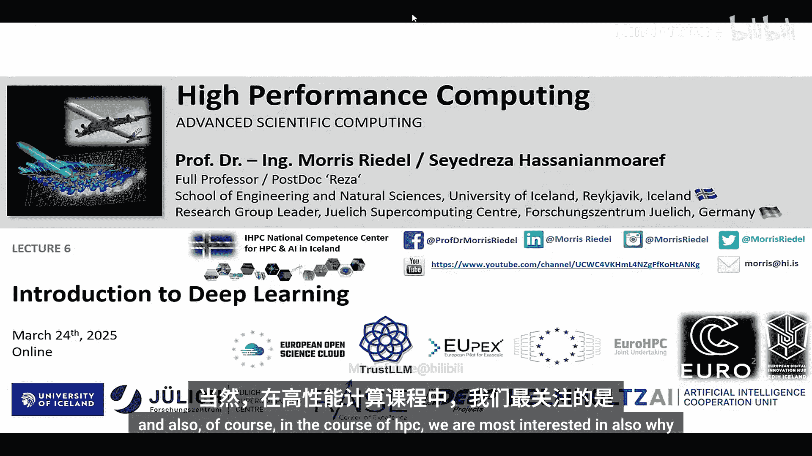

And we had lots of basics in this。Coming back to the many core eye that I don't if even on the slides。

 you remember we have a very many course in one chip that is basically not the cutting edge CPU that you know。

 so it's not high single threat performance as you would say。

 but let's say moderate performance the key is as you see here a little bit elaborating on the Is of an A100 here。

That is basically then essentially having many， many， many of these cores， but in a moderate scale。

So then also what we。Realized is that by far， GPUus as a special form of accelerator， if you want。

 have been now entering the top 500 lists。 So each of the different supercomputers that are there listed in the top 500。

 especially in the upper one， you see here has some form of a GPU。

 and it's used for a GP GPUus or general purpose graphical processing units。

 right So this is the idea， with the idea of having a GPU now we're not interested all in graphics。

 Suddenly the ideas to use them for general purpose computing。

 because some of the tasks as we learned also are nicely parallelizzable I don't repeat that here now we have been through this quite since the beginning of the course。

 what is massively parallel， what is nicely parallel。

 And here we have good examples of many problems。 You can you know parallellyed on a GPU very nicely。

嗯。The other thing you learned is that we have different vendors。

 obviously in the past N V A100 cards， nowadays H100 cards。Are really the let's say market share。

 but what we see more recently is that AMD instinct cards so from Cray and HP are basically following SuU so you see here the top 10 basically from last November。

 the top 500 list always gives basically the list out in June and also in November so they two times updates per year。

 what other let's say most performant HPC systems in the world that are known to this list。Right， so。

 and in one respect， we don't know those that didn't submit anything to the list。

 So there could be something very hidden somewhere。

 which is maybe of much more importance and much more performance。 But we don't know。

 So these that have been submitted to the top 500。Areknow to the world and basically also have this certain ranking。

And you see here that the United States are quite prominent。

 the couple of first let's say are really just the United States and interestingly enough many of them are also now with AMD instinct cards。

 of course Nvidia Grace Hopper cards are one of the most cutting edge cards from NVDdia。

Are also following huge， you see here eag， for instance， from the United States。And for us。

 it's also now very interesting that you have several ones which are then， you know。

 also within the European sphere， you see Italy， for instance。

 or also Switzerland with the Alps system here with a grey opera cart。

 but also then essentially Finland， which is a loomomy system， where also Iceland is a little bit in。

So you can continue and on and on and would say， okay， there's also Leonardo。

 which is a U HPVC system basically from Geneneica and this is something also where we see it's quite a race if you want。

And the race was sort of a specific。Element in the last let's say five to 10 years if you want。

 so because everybody was looking towards excess scale performance and you know one of my earlier lectures。

 you know where where the flops came from so basically this is a floating point operations per second。

And the key message of takeaway is here that basically in 2022。

 we had really the first known system right in the top 500。

 which was a so-called frontier system breaking this particular boundary。Right of having， let's say。

 1。1 exflop nowadays we see here it 1。6 exaflop and we also discussed last time that there was a supercomputer called Summit that you see here and the architecture is known here。

That was quite cutting edge with having six GPUus per node。 And， you know。

 we had seen like 25000 and more than this within the whole system。 So rack by wreck by wreck。

And nowadays。We have even basically decommissioned the system in a sense。

 the Oak Ridge laboratory that hosted the system as basically you know remove the system。

 so even it was the most powerful in 2018， 2019 filling the top 500 we see now that after five。

 six years you know the system had older cards， so it was time to remove it it had actually sixvolta GPU cards right so per note so lots of older technology if you wanted now we basically see that the new system that was coming to Oak Ridge right after it was decommissioned the submit system it now the frontier system which broke let's say in June 2022。

 which is already you now a couple of years ago now and we see。That it's not any。

 the powerful system anyhow。 So now we have Eric Capbittan and Lawrence Levermore。

 So hence there's a quite， let's say， momentum in the top， let's say 10 of the top 500。

And it goes lower down， obviously， systems getting a little bit more settled。 It's not this。

 Let's say big race about the big machines， if you want。And interestingly enough， you see。

 although here and there we see quite a dominance of the United States of these big countries that have。

Let's say lots of money and lots of national labs that you basically see here represented very well。

 So the first is Lawrence Livermore， then we have Oak Ridge National Laboratory and then the third is Arrgonne National Laboratory close to Chicago。

 So these are all national laps of the United States and they have quite some money for it。

 but interesting enough still European systems are in the game。

 So Lomi is one good example that is now part of the top 10 of the top 500 it's quite a while now。

But apart from this interesting ranking， which some people would say is rather political ranking。

 So without any more comment on this， I would just to say that some people believe that performance of a system should be made on more on application benchmarks。

 not just the top 500 list， but。This is a topic I don't want to raise now， but is， of course。

 an important view。 And you have seen us in the top 500， the different， let's say。

 illustrations or statistics you can really derive from the top 500 list so what are the vendors。

 what are the share of the accelerators and so on。So in one respect I want to summarize the lecture then finally also the programming models。

 this was basically characterized that many of the GPUs。

 especially the older ones maybe starting from Pascal and then going up to Vol and and so on。

 they all have this， let's say drawback that you always have to have the O CPUU。

 you know fueling the device GPU， basically memory with some data and also the instructions that are than handled to buy the scheduler in order to do some form of if you want shared memory program within the。

Let's say accelerator， so it executes a so-called kernel and all this different many course that you have available depending on whatever card you have。

 this was a general assumption how it works and then after the work is done because the work is of course essentially done writing back to the device memory right you read from it。

 the initial values， you do your simple operations because mostly this many core systems are fueled with thousands but simple operations。

 not number crunching like we would have in CPUs。And then you write back the results of the Drram。

 and then you get it back to the， let's say， host memory and report the results。So hence。

 sort of an interesting。Way to program it and the kernel is usually programmed in Kuda or as we see nowadays with AMD Int cards also with let's say rock and maybe even here and there is H we have at the end of the last lecture on lecture5 also discuss some standards。

 but of course Kuda is developing very quickly from Nvidia given its market share。

 the money investments so hence the chances that standards which you know like H and so on we discussed a little bit out of date and to get the cutting edge out of a new card and we discuss also blackwell coming right a new NVdia generation and also the let's say environment around it which I would look close now with the envyings that is basically the cards on a memory are very well connected if they are on onenote here with the envyings。

Hence。Final statement， I could talk probably a whole course on GPUs， we have no time to do this。

 so let's have a very quick introduction to deep learning。

And this should be in no way something where， you know， you should see that everything is。

 is is so easy， right， So if I want to teach you deep learning， I need a whole course as well。

So hence we study as very fundamental basics about are artificial neural networks。

 or does a neuron have some more application oriented approach to it that we carry through to some of a very specialized way of doing deep learning called convolutional neural networks that we already introduced early in the course。

 so to make it a bit quicker。However， I think it's essential to have the basic。 So what。

 what is the percepttra learning model is one of the first we will start in this part and then having a very simple application alongside。

 which is the handwritten Eric the recognition and this data set。And then we will advance from this。

 let's say， linear learning model to nonlinear， more fancy if you want artificial neural networks。

 which are fueled by back propagation of error and algorithm that make ANN successful in the past。

And of course then we will with this also discuss a little bit why the computing is increasing so why we need more and more computing what is a GPU now bringing us as a benefit and of course here and there some machine learning insights also including overfitting or what is a classification approach and so on in the second part we will then turn to deep learning but also there they are transformer models outenrs and whatnot large language models so here we're talking about one very specific architecture called convolutionary networks are relatively simple and easy to understand so we will have some of it let's say characteristics going over the data creatingd feature maps understanding why data subtly instead of 1D 2D or even 3D if we have the 3D convolutional network。

And at the end of the second part， you should also get more and more sensitive to the idea of hyperparmeter。

 so these are not the trainable parameters。Hence， the parameter term is now very important。

 the train where parameters are the weights that you have between the different neurons and different layers and different feature maps and so on。

There's also certain hyperparmeter complexity that you have。Switching then to different optimizers。

Thinking about how many layers you really need， for instance。

 in a complex deep learning network or what the learning rate is， which is let's say。

 associated a little bit with your optimization techniques。

And overall we of course want to understand why we do this and of course the accuracy improvement is one key that we want to establish here as a yardschttick if you want。

 so why we actually go into deep learning right so what's the benefit？And of course。

 on the other hand， we also want to understand as a university lecture。

 well and we do everything to deep learning， so is there always 110% performance when I have an application problem。

 so do I need physics anymore and things like this？

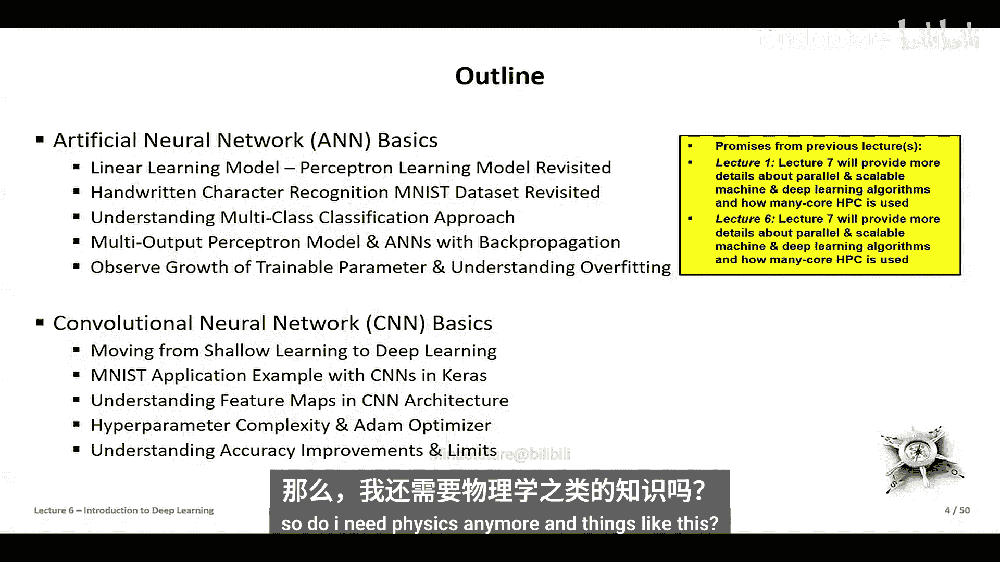

Hence， after that， you go a little bit away from perhaps a deep level of power programming。

 much more to a parallel computing on using， let's say libraries like we have， you know。

 in this example here tens of flow cars， but it is very similar and pitor。

You have a basically idea of power computing on different levels。 of course。

 underneath will be still different elements。Where we will discuss in the next lecture。

 also how we come to distributedive learning， then going back to HPC a bit more。

And then in one respect you have also with this directly foundation approaches to scientific domainspec application。

 especially those of course that are go into AI， but today we have also yeah there may be some links to examples and research also is basically focusing now on something we call physics。

 inspired， deep learning of physics constrained， deep learning， physics， informed deep learning。

 though there are many words around the fact that maybe combining the power of physics formulas。

With AI might be a good case。And a university course like this cannot go into it。

 but I would point you to the C racece project that we had that was already exploring in research some of these aspects。

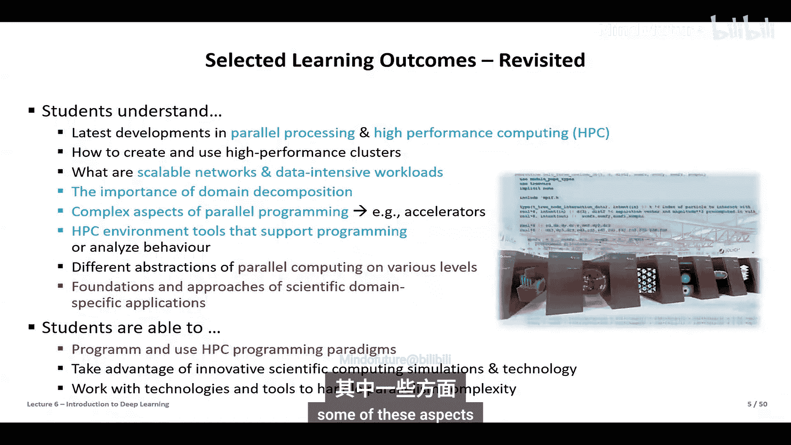

So we really put the focus a bit on programming today and of course this means programming in AI。

 but automatically having also， let's say， HPC programming paradigm of using Read GPUs and next lecture will be then also using the GPUs at scale。

So let's start with artificial neural networks if I would be in class I was asking you now so who has anywhere heard about it and I know some of you have taken already the machine learning course so you have a little bit an advantage in understanding some certain things。

And to get a very practical introduction because we have not much time to cover this topic， I would。

 you know， if you're interested in this， rather point you to our machine learning course in the university and our deep learning courses so。

Let's have some more application oriented approach and we call that a bit here supervised learning is one of the ideas of learning approaches and the idea why it is supervised is that we have certain input data a vector with different values and for each of these values we have a given output that we would expect so we have a guidance of saying okay this is what we want to have out hence for every data element that we have we have a vector which lots of having maybe different features in the data and we understand it is in class A class B class C and so on so the output in a way in an abstract mathematical formulation here acts as a supervisor to really give us guidance in the learning process do we have the right let's say learn done or should we go back and maybe revise our model。

So there are different ways also why you want to do this。

 so there's a sort of prediction that you want to have some。

 let's say future observations and you want to classify them rightly or you have an inference that you viibly understand much more the kind of response when you ever a sort of predictor。

But the key method of takeaway is really that you have this input data。

 but you have also the correct output data， which makes it supervise。 So in unsupervised learning。

 you don't have that。You have just see input data and you have to help yourself if you want。

 maybe through， you know， Euclidean distances， you know， measurement measures and so on。

 there's also reinforcement learning that then works with。

 let's say a little bit like penalty and reward systems。

 agents a little bit more like gaming if you want。 So there are different ways how you can do learning from data。

Let's have a simple example in the given time we have， we want to have this flower classes here。

 Irisittoda， Irisveica， we have 1 hundred0 samples available label。

And we see here when we plot them that you know some of them are basically the esitosa。

 the green ones here and the eitogenicica very clearly separated in the space now the point of machine learning is we want to have future data you know correctly classify it so we don't interested in this data that we have that's where we learn from but what about this flower。

And when I asked all people in class， they would say， visit it Sitoza or Virginiaica。

 I had just one in class after all these years and trainings I gave that could answer this because。

 you know， you have a pay in saal with。And you see indeed， in the flower。

 then maybe certain characteristics， but for a normal human， if you want。

Not being so flower inclined would be this quite interesting question， so given on this picture。

 what would you think， is it a Irisittoa or Irisveica？Hence when we have a new point。

 what is here with civil given characteristics， we want to have established a learning model which gives us sort of a decision boundary and this is now an important term in machine learning where we can decide so everything above that would be erislogogenicica and everything below this would be eristotoza。

 hence we motivate here now the simplest learning model that you can have the perceptual learning model which essentially gives you a linear learning model。

 linear in space and in the weights， so we want to have essentially align in space that is now separating the decision space with a decision boundary。

Now when you model this you can see a line in space is nothing else that you see here for mathematicale convenience。

 you know， we put the bias a little bit， the part where you can shift the line in space a little bit into the learning model with w0。

 otherwise you would have a plus something here。But we also make it as a learnable one and we sum up linearly this weights and the interesting thing is why I Mark this retic is that this are the learnable parameters right so x is a constant。

This is important because this is our data set。Then we would have a nonlinearar activation function I introduce this now because basically later this will be a key idea to understand now why the perceptron。

 although we have this linear combination of the input data linear and weights right so this is not everything right we have these sum linearly using weights but plus a bias but we can still put them through some form of an activation function in order to make this right and therefore mathematically convenience some of you that are a a bit more mathematically inclined we know this we can do x transpose w to make this as a vector and basically the transpose of it which looks a little bit like this you know this x still are constant。

 our input data and then the trainable weights that we have as well and then becomes more or less dot product here。

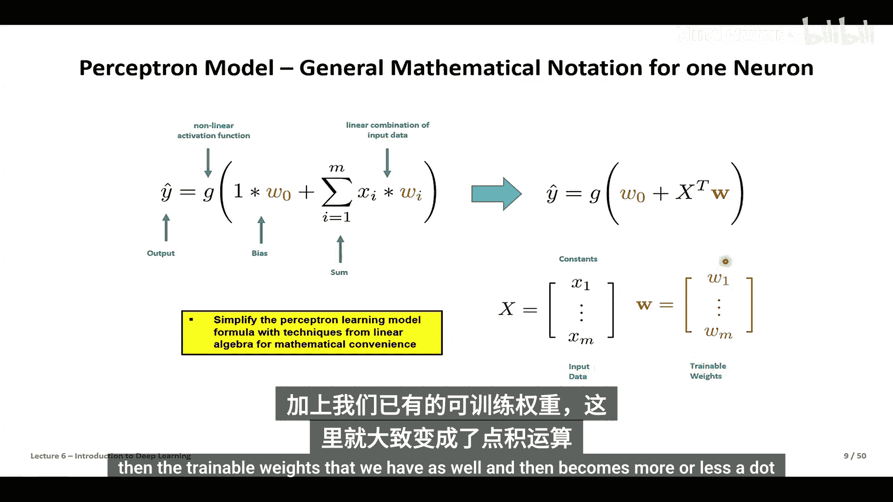

Then for an application example I took here in example， which is let's say 10 digits。

0 to9 to classify， it's a well known so called N data set I'm sure some of you may have heard about this before。

 so essentially we won't have handwritten digits and we want to classify if you know the handwritten digits equal what we would think。

The truth is that there are 28 by 28 pixels， that there's around 60。

000 of them as training samples and 10，000 as test samples。

So these are two names which are also very important for you。

 we will come back to this in lecture6 and lecture  seven and also later when we talk about Razas lectures。

The implement this a bit with care， as you see there below here。Essentially。

 CARRS gives us the opportunity to load this， let's say benchmark data set or this training data set really。

Quly from MNIST and it automatically gives you the training and the tests that where you can work with that you see here below。

 so quite convenient for us。So hence long story short we have the data。

 it looks like this right so when you now plot it a little bit with Python。

 you have this handwritten characters which are then of course gray scale over you know a space which sort of is a painting and you can see it might be a five this might be a zero this might be a four and what makes it now supervised is that we have a label。

Now we see there's not only there's 2 d information that we have。

 there's also one guiding label Y that says in。Y equals 5， y equals 0， y equals 2 and some。

We also have many of those as we learned， but there's a cut in the training samples as you learned。

 there's so and so many in training set and so on so many in test set。

So it is tough to say how much you really need for training and test it's an application domain aspect there's a rule of some sometimes the more your training set is there。

 of course the better the model but in order to be let's say accurate what you predict in real practice you want to have also a testing data set quite large so it is a little bit you would say an interesting question where you do this cut。

 but you need to do the cut in order to validate your model。

 bring also another word into the game here that I just want to talk about there's a validation set you usually have that you use for model selection that I cannot really cover much in this course because this is an advanced machine learning part where you would say you do the training that you evaluatevalte your training results on the so-called validation set you pick the model that is most effective。

 you introduce a bias in the data and optimistic bias。

 hence the validation set should be thrown away basically and。

And you use a test set for actually checking your final performance so there are tricks like cross validation in order to you know do similar things when you don't swim in data and you don't want to throw away your test your validation set but we don't cover that too much here in this course here also I would like to link you to the more insights of a proper machine learning course or one of my earlier let's say courses I have in training you know on three days or so on deep learning completely that you find on YouTube as well。

And these are fundamentals， right， in machine learning， So it's not changing very quickly。

We already learned the Python packages， so Tenorflow and Kas。

 so I would like to you know skip this a little bit just to let you know that the next scripts that you see are a little bit in Kas and underlying then executed in TensaF。

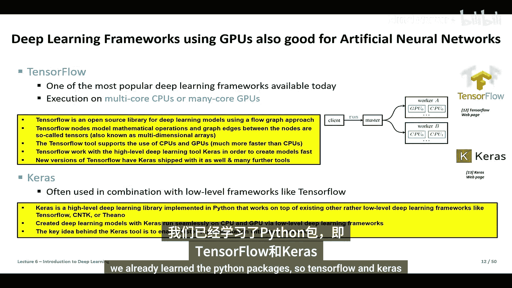

So the first script you see is more or less a data exploration script of the training data a bit like what you have seen before。

 so how the data looks really like when you put it in a Upiter notebook for instance。

 a Python environment where you can execute interactively let's say some Python code。

 we introduce a data set here is KRS， we need NI as a Python library helping we have this data set now loaded as I was alluding to before。

 and the simple function we have here as data exploration script is nothing else and going essentially through the characters that are essentially the space that we have for each of this training set and also test set hence if we call this correct show with a train set on a given let's say index or range we could do the same on a test set it will not look different it's the same sort of idea right that we have this kind of different 2D problem and everyone has a guiding label Y。

So it's a small helper function if you want to see a little bit how this works， if you don't do this。

 let's say online in Jupyter notebooks or maybe even。Different public clouds or in Google Col。

 always take care a little bit of the environment you're in。 You need to write packages to be there。

And then this is an important element。Coming further than now from the perceptual learning model idea。

So how we learn from data and this is an interesting fact because this goes back to the very early beginnings of machine learning。

 so the perceptual learning model that you see here is firstly a linear learning model that means linear in weights and you see that here was W0 to WM。

In other words， we have a 2D problem here。Which needs to be filled in a problem space or in a model space。

 which is one dimensional。Hence， we so call that reshaping。

Some of you are really maybe in numerical simulations or have been learning about this a bit more。

 they know also they would call it sometimes vectorizing right so you would say in some of having this 2D matrix if you want you have one long vector you know one to XM which constitutes your data and usually in class I would ask so what's the problem now？

By doing this， I have a two dimensional data sets that I force to be one dimensional。

And this is a good question I know there's always one or two people in class usually that would say。

 yeah， you you basically miss a context right so basically by vectorizing we have some context。

 of course， data before and after， but we sort of losing you see that a little bit especially in the in the characters here when you have the let's say more grayscale data。

 the surroundings。From 2D to 1D， you have just one long vector。

And this will be a key essential part to understand deep learning later in the second part。

 when we keep the 2D structure， but for now。To put it。

 let's say in the simplest learning model I can give you today we have to vectorize it。

 we have to reshape it and then for mathematical convenience we also have to normalize it because of course with this gray scale you see here quite high number values if you multiply them often what essentially learning will do you remember when I said learning means often matrix matrix multiplication matrix vector multiplications。

 you know the signals is getting stronger and stronger or weaker if we don't multiply or maybe gets lost when we do weight decay or you know weight drop things which are all advanced regulation let's say topics which are also need to you know link you to a proper machine learning course so there's different aspects that I cannot really in the time given to me here focus in this course but the key message to take away is now that the same data more or less is now encoded here in this kind of very long vector in terms of。

2DWe have 1D。And we do this with a test sample and the train samples， of course。

 and we normalize them。In order to have the numbers between essentially0 and one so that we multiply them often and and so on。

 we'll never get a， let's say， out of bounds problem of out of， you know。

 space in terms of integer value。So hence we understood this is a loss of information。

 but still it gives us the opportunity to use one learning model。

 which is a perceptual learning model that stands the test of time essentially。

 because it's still in one respect， really integrated in the models we have that are cutting edge because the idea of a neuron that mimics now the human brain a little bit of having different inputs of the left side。

and then we learn this some linearly using weights， put them to a sort of activation function。

 and then get some output probabilities， stays with the idea of artificial neural networks。

 you know hidden layers and so on， but also later on in deep learning they are really exactly analogies to this neuron as well。

Hence it's a simple Lego building block if you want in order to understand this and what we really learn is that every one of the input parameters is now essentially you know connected to。

 you know and this makes it the sort of dense layer which we also learn to learn in the second part is not always the case。

 but in our simplest learning model we need this。 And this is what we learn and what is computational now the question to you know。

 basically compute。You see the code on the right side。

 so how to do this in cars you have a sequential model。

 meaning you add a layer by layer and you have a dense one from the number of classes。

 so this is now very important to us and the input shape。

 which is now the reshape long vector right and this gives us essentially now a fully connected layer and we add the softmax activation function that gives us now the idea of having this different output probabilities and because we have this number of classes 10。

 we essentially do this you know with the neurons essentially in one of the idea here you know to have is always put through the softm activation。

In order to arrive at some， you know kind of。You would say it's more a probability if it is now a five。

 if it is a nine， it could be also an eight because it looks very similar。Right， so in a way。

That is important for us computationally now for you it's important and KRS gives this out that we have now sort of 7。

850 right there's no secret we have 10 classes we have input parameters。

 784 so times 10 plus bias right then we are quickly at the idea of you know 7。

80040 plus 10 classes which it's 10 biases giving us 7850 parameters to learn。

This is not so much compared to many others， but of course already needs computational complexity。

The way is now we learn is about optimization techniques we use here as a stoholastic gradient to Z technique。

 although they' are also more smarter versions like atom or you know the method of momentum and so on elements in it。

 so here we essentially take the gradient of a certain loss function that we can define essentially and in the idea of hover this kind of10 class classification in the moment put a categorical cross entropy loss which spent the test of time for those。

 let's say problems where there's a categorical problems so from zero to nine， for instance。

And in order to basically optimize it over time， we will always have you know。

 take a gradient essentially from our you know learning progress。

And evaluate it then to the loss function and go basically one step further， one step further。

 iteratively through this。So again， it's a quite interesting quick go through how deep learning works and you don't do this one times you do this。

 let's say in many Ipos， given different batch sizes or that different parameters really that you define in order how to do it。

 you pick the optimizer you see that little bit here in the class and to do stochastic gradient descent and then you have basically the ch here that we already discussed you reshape the 60。

000 training samples at 10，000。

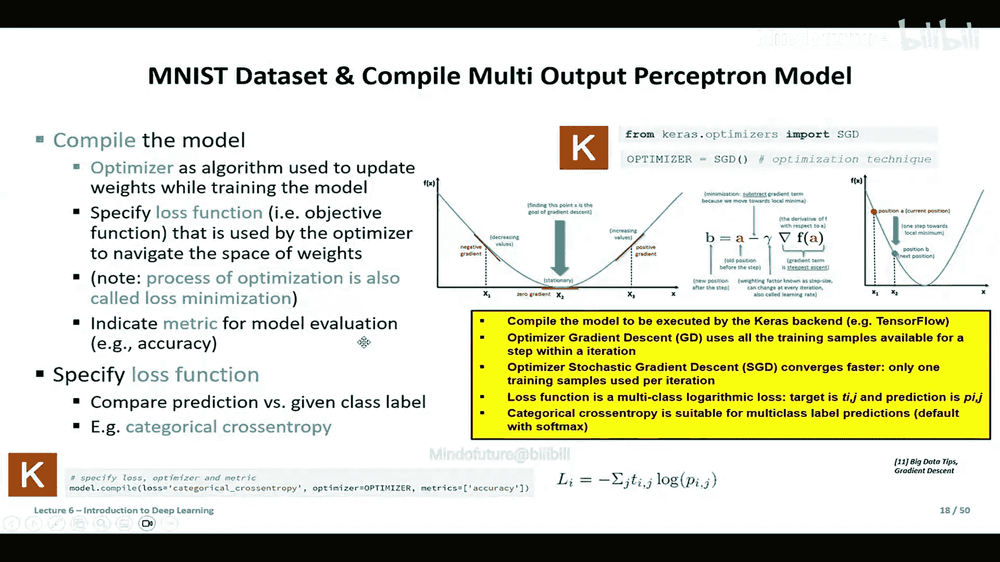

Test samples to be， let's say more mathematically convenient in one array。

 one long vector sorry to be fitting to the perceptionceptual learning algorithm and then we essentially normalize here a little bit to have you know this format convenience of the learning so hence we put this all in  oneD problem if you have the source code。

And then we have the sequential model here， we add this kind of dense layer with a softm probability of saying。

 okay， it would be between one and you know you know zero and nine if you want 10 classes that we defined above as a constant。

And this remains， for instance， for a long time， even in convolutionary networks。

 we will find this again softm layer， so we will come back to this。

And then we have a model summary plotting us a little bit how the model works。

 But really the optimization then we'll use the optimizer like Adamom or S GD in our case。

 will have a certain metric of accuracy and we'll also have the loss function。

 which is a categorical。

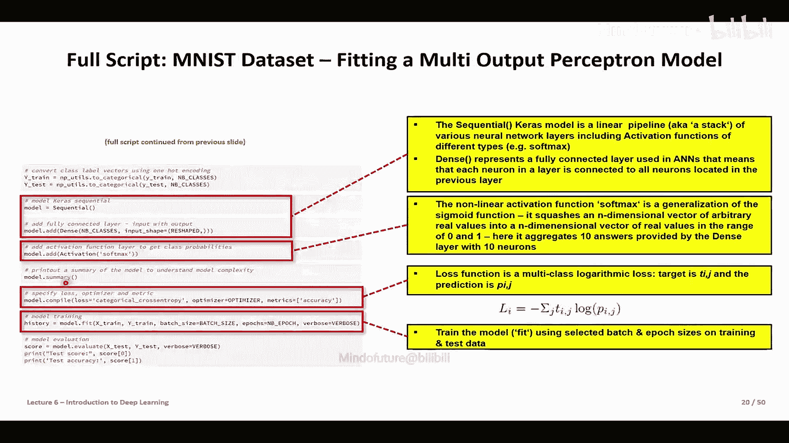

Let's say cross entropy loss function that you basically use and to evaluate if you're really better over time and learning。

 you put this all as you see here in a model fit function x train where y train so basically the labels right for the training do the vector x for the training。

 how big should the batch sizes so often I go through the data in order to reach one e。And then。

 you know， some output and you model than the evaluated score and so and so。

So you see how that works and I give you also some ideas here that you know this is sort of an algorithm already with this。

Kind of efficiency， which or accuracy if you want here is already 92%。

 So we talk about it is quite good already。 like it's a very trivial problem that we have with no hidden layers。

 So basically a simple neural network。 if you want a multi output perception。

 if we call it it's not a simple perception， because we have not yes or no。

 in a typical machine learning course， we would start with this here we have already started with a 10 output perceptioncept 10 classes。

 So it's a bit more elaborate， but it's still captures the essence what we do。 And now there。

 of course， different aspects that you have to understand in machine learning also very important because。

 you know， I talked about you with validation and regularization， which basically combat overfitting。

But there are different parameters to choose in order to take the optimum。

 if you learn too well and memorize each of the different dots， that's not good。

If you have a function which is too simple that then gives no let's say feedback to what you learned really。

 it's also too little so to find the optimum is not so easy right so you will see that usually error on the training samples will go down or the number of iterations。

 you basically iteratively changing the weights update the weights and get them proper to the learning problem and you can follow suit with the error on the test samples but at some point in time you will see that even if you continue learning and learning and learning you will overfit like you see here again where you start memorizing how the data will look like and you don't learn think about an exam where you memorize maybe before you do the exam there's a test exam or the questions you had and you memorize so this is not really learning and you get a new exam and you don't know how to apply you know the basic functions or the basic ideas of an exam from the terms of you know learn material。

Instead of just memorizing an old exam， so you certainly have memorized the old exam。

 but you don't really learn right so this is sort of an analogy。

But it also shows you that now the question is with 92%， and it's a bit， you know， stoholistic。

 radiant， already shows it's a stoholistic process。 So sometimes it's 91%。

 You can influence this also with a little bit of regularization and validation。

 but it will be staying in this category， given this simple learning model。

Hence the question for us would be now what can we do。

 what can we improve on this learning model and I mean here is now the key point to make it from a multi outputward percept model to an artificial neural network neural network really stands for the fact that we maybe introduce more hidden layers。

Right so that we don't have just， you know， sort of zero layers or if you want to kind of， you know。

 directly input output connection。 so maybe we can have the neurons in certain layers。

Hence we come from， you know the linear perceptioncept model and its limits and you know the limit is remaining in its linear learning model because you have just one line and you have here the famous exO example。

 you know， this would be one data set that you can never learn really basically with one perceptrum。

Hence， the idea of the artificial neural networks is to combine different of these。 So you see here。

 there is definitively， again， the same idea with input nodes sum up linearly using weights。

 put them through an activation function per note， which is our neuron or perceptron。

 but use many of them in so-called hidden layers。 the input layer remains and the output layer remains。

 right， This is why。 And this is how our data set or long vector now of numbers。

 not any more matrix that we discussed。Hence。😊，It it's not big magic。

 you just basically combine them instead of having this only weights that you have from all of these different input layer to one perception。

 you have suddenly a hidden layer with many of them。

 and this is now of course something which is important for us to understand that we can choose how many of those。

And then on top of it to catch nonlinearities， what is happening in neural networks and this is of course again a little bit alluding to an advanced scenario but you have to go to machine learning。

 you know of course is a little bit maybe if you want to send the real details but you put this can say you know linear learning then through a nonlinearar activation function which enables us now to create this interesting- nonlinearar boundaries that you see here right otherwise you would stay with this function and have a pretty good line and you see that some of the data is maybe better classified of having a nonlinearity also what is known sometimes catching nonlinearities with linear let's say' activation functions that are well known today that you see on the the righthand side like the Tge for instance。

 or the rectified linear unit relu and so on and so on。

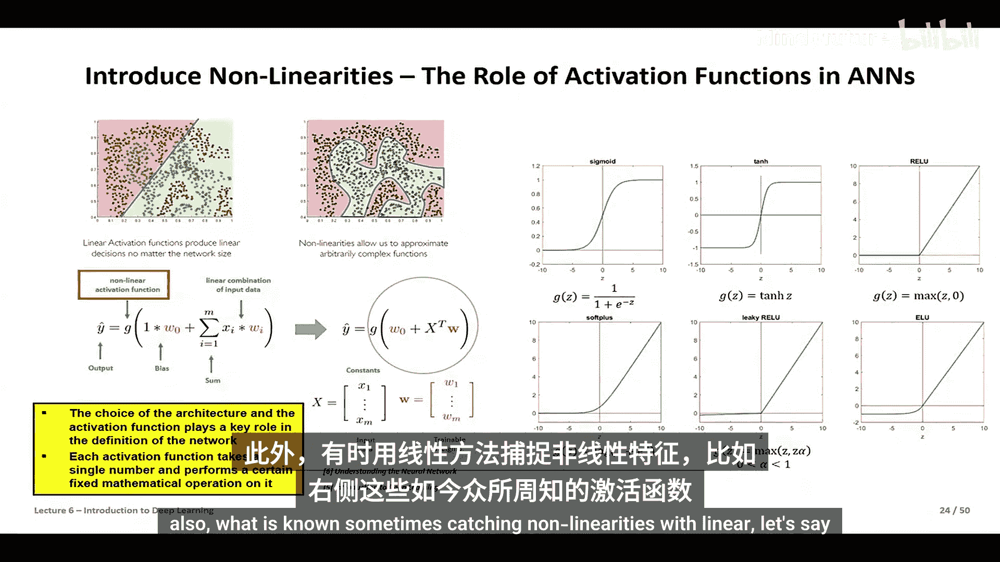

Liy is also getting more and more popular by the way， anyway， so the the goal is here of course。

 that this is something where this is the architecture of the neural network and sets something what you don't really know per se。

 so something yet you have to pick。However to also think about now the trouble that you have essentially when you come now through this hidden and second layer was solved before by the so-cal back propagation of error because in this simple percept and yet always this feedback mechanism going directly back and see you put it through yet access to why and then you know okay why was wrong that do it again now what happens here in the learning when you have now many of those hidden layers。

 you lose a connection directly to the error right this is somewhere on the right side and the back propagation of error based on the chain rule and other aspects I cannot you know from the timewise is introduced in this particular lecture is going and back propagate the error so that you can update you know the way its that you see here。

 that's the learning right what will take place based on this error in each of the iteration giving you know through the back propagation of error algorithm and that was a breakthrough also of artificial rule networks making it from a let's say percept。

Learning model to a multilayer perception or otherwise also called artificial neural networks implementing the back propagation and then in the end the rest stays the same so things you know with the softm and then the winner takes all decision rules or who has the most probability is probably also the best class estimate for a certain input X。

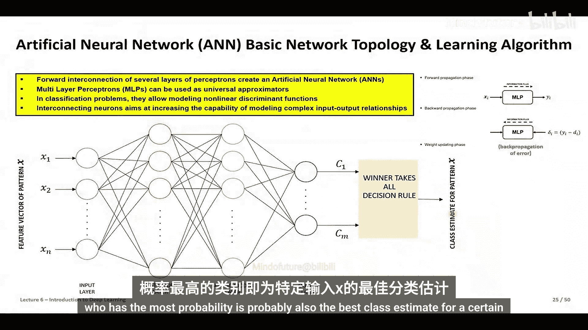

So hence。It's a little bit elaborate to do this is back propagation updates of the weights and then there's even a learning rate that you basically have to do when you do this gradients。

 but this is a computing intensive part now right we compute gradients and we actually multiply this also with a certain learning rate that we ourselves configure and by doing so over time we see the arrow surface here。

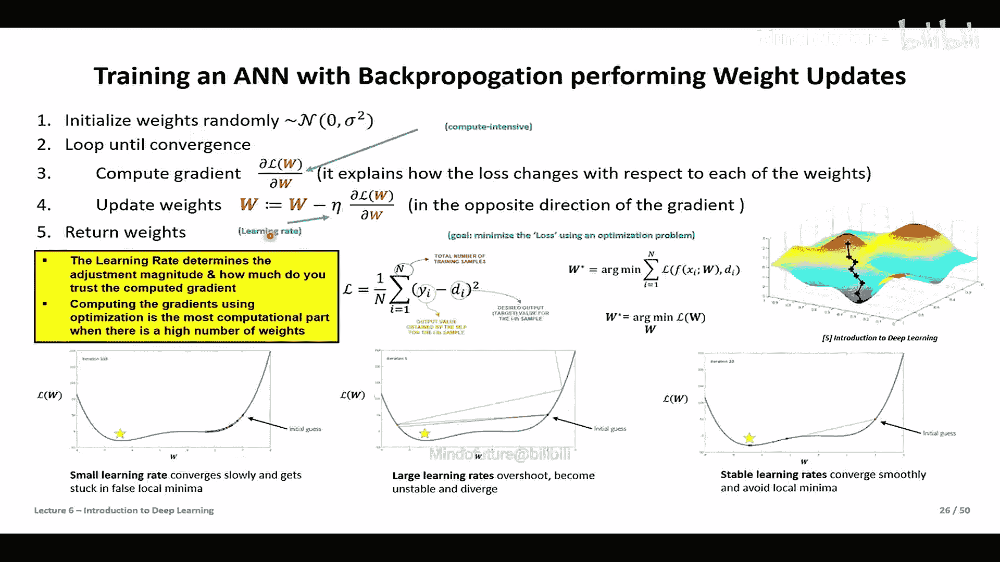

You know of this loss function we are， we go to the minimum hopefully over time。

 which is a bit like shown here and updating the weights essentially every single time step by looking also what was the output。

 why the guiding sample and what we basically have as a solution right now。

The learning rate plays an interesting factor here。

 so if the small learning rate we just you know see here a little bit we kind of start with an initialization and don't really progress。

If you have a large learning rate we jumping and you know back and forth here on the arrow surface and never will find the minimum as well。

 so it's also sort of sweet spot to find the right learning rate to get them to this minimum we need in order to hopefully have the less error on this let's say loss function to then have the best machine learning model in the moment that we can report and then hopefully use。

So many of these points are obviously。Let's say quite quickly in this course。

 and I would say that's of course， clear and you don't have to maybe understand all the deep hidden aspects of it。

 it just basically is a HPC course， you have to make the connection that of course now many of the gradients have to be taken if you have a large。

 large network you know we talk about here not about four hidden layers neurons inside of each but rather maybe 150 or so right you see here a little bit number of hidden layers。

 number of hidden neurons in one layers， 128， for instance， hence the weights will be much。

 much more in order to do this the way how you program this is however not so difficult。

 you have a sort of dense network we understood this every one neuron is connected to the next fully you know area connection making it a feet forward INN here two layers。

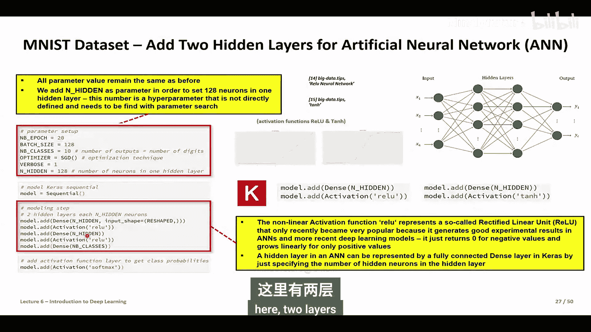

And you do the same the activation function because it's quite popular as a raillo。

 the rectified linear unit and then the N you have still let's say the soft mat activationation function giving you an output probability of this 10 classes zero to9 so very similar we just introduce sort of this now mesh of network and neurons here that we have the rest of this that stays essential 10 classes and so on。

When you do this， execute this。On high performance computing， we will see we improved to 0。

97 because now the learning capacity with the weights is much more an artificial neural network with two hidden layers is quite strong。

 if you have enough data， you can try and learn it and it will be let's say quite good as we see with 0。

9%。 So hence this is a new benchmark where we have to pay the price for it right the multiop perceptron was 92%。

91%，20 apotrain。 Now we have the artificial neural network to hidden layers。 and if you are。

 let's say putting a bit regularization in and other aspects that you see here。

 we are a bit more realistic and now suddenly stand at 95% which is sort of a good yardstick for it。

And however， the price you pay， you see on the right hand side。

 we have not any more 7000 parameters or something。 We have 120000 parameter roughly。

 and these need to be all learned， meaning all computational complexity。

 It ends much more computational intensive to do this network。

But I mean we got a benefit of let's say 4% hence the question is what we do in part two。

 we try to better this with deep learning， which is already a quite challenging task， however。

 for the first part I think we stop here and I give you a video that summarized quite nicely the idea of non nonlinearities of the connections and some so have a view on this and we will basically come back in 10 minutes with the second part。

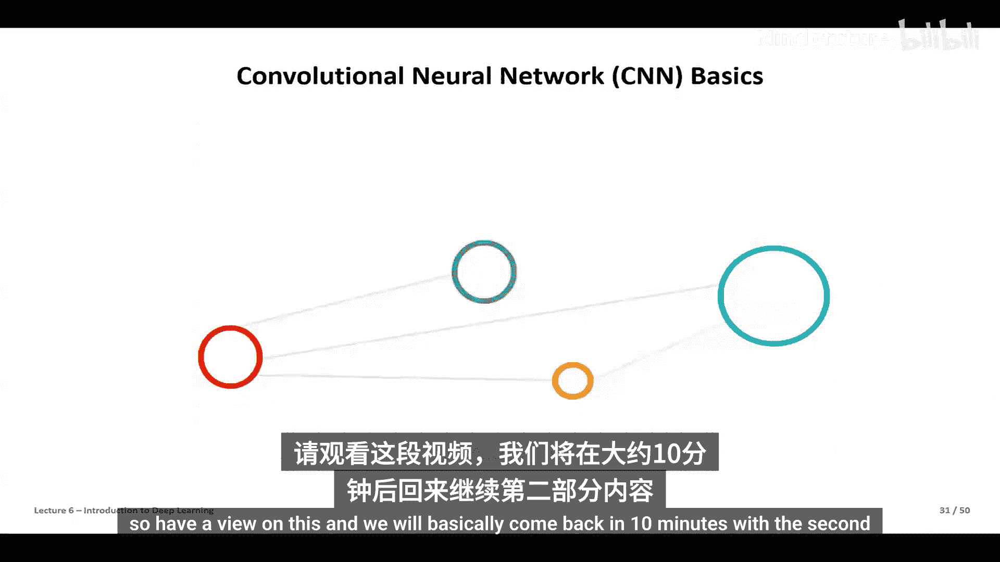