# 【冰岛大学】高性能计算课程-｜-2025-High-Performance-Computing-｜-Prof-Dr-Ing-Morris-Riedel-p14-P14_讲座_5_加速器和图形处理器_第二部分--BV1k34zzaEK8_p14-

Welcome back to High performance Comp， our lecture5 on Acccelerators and graphical processing units。

And we have the second part of it， and in the first part we really learned a little bit more about GPUs at large。

 the abbreviation， GP， GPU， general purpose， graphic processing units。

And we see quite some dominance of some vendors， traditionally。

And we have been walking through these basically from Nvidia， these cards。

 being one of the strongest members of manufacturers really in this domain。

 and we have seen it was quite some evolutions of technology。 So we had this Keplla。

 Pascal Volta andpe heects leading now to the more cutting edge grayho and Blackbe eye heects。

And as many cores are basically the idea of having thousands of this。

 let's say more moderate frequency CPUs or core really on this chip。

 we differentiate from the Muti course that we have with high single threat performance and this should be all in your heart by now。

Another thing we saw also is that computing is not all of it。

 So we have quite seen and also we're alluding to a little bit the idea of the host CPU versus the device or basically the device that is the accceelerator。

 which could be a GPU and in the future， maybe a neuromorphic device or also quantum device。

 So the way of accelerators is a little bit bit， let's say broader。

 but GPs are a concrete representation。And we use them in supercomput a lot。

 and the idea is really to think not about the single GPU in head performance computing。Right。

 so this is an important fact， mostly identified by。The fact that we want to go across the notes。

This is an essential factor now how to use them in HPC， we talked about envy links and envy switches。

 but also the idea that you OneNote has maybe more than one GPU where we can leverage this technology where we have。

 let's say， this HM， the memory really fueling the GPU， let's say course。

 that are the computing entity really with data。So there's more to it than just let's say there's many core that we learned from the beginning of the course and this would be also part of the learning experience in the lecture so you see that we the example of summit being six years let's say on the forefront of HPC being decommissioned now for frontier for instance as an example one of the cutting edge systems we have in the world this is quite let's say a fast pace where the V 100s that have been for instance in sumummit six per node we're really cutting edge 2018。

 2019 where the let the top 500 and now in 2024 we have a complete different scheme of GPUs a label new generations new bandwidth right which is another important term if you think about also the memory excess now。

The second part really should go a little bit more here and there in detail but also should allude to the effect that there are lots of GPU libraries already out there and here the idea is to understand a little bit how you program them so we will talk about N VD Coa but only on let's say some moderate level with some examples here and there。

 of course if you want to program GPUs from scratch you have to take a complete different course and by now I would even say we could have a core GPU course in the university right so it's not just a site effect now basically of high performanceform computing it has serious overlaps as you know in deep learning and that's what we also will shortly revisit。

Because if you talk about the uptake of GPU from applications， libraries。

 people that use GPOs on a daily basis， we have seen significantly increase in the users of AI more recently。

 hence we also supporting this in high performance computing and I want to just steer a little bit due to this。

 although we will have dedicated lecture lecture 6 lecture7 will be all about it。

 just you know basically lecture on GPU cannot you know miss out a little bit on the deep learning hype and also the idea of using now HPPC significantly for so-cal distributed deep learning training which will also coming up。

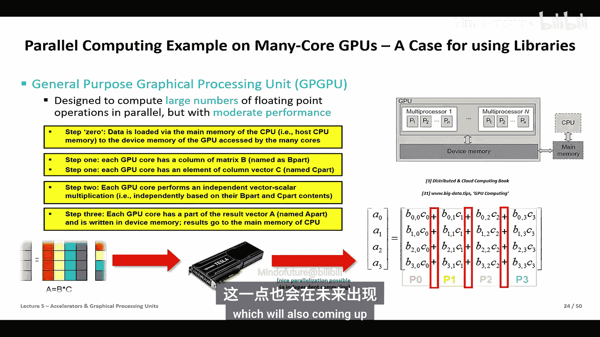

We learned in the beginning。One key aspect of using the GPUs and this has been repeatedly coming again and again is now the idea of using you very nicely paralyzable aspects you see here。

 the orange a little bit， the color coding we had before but how is that working now in the bigger scale and you usually would say it's all about data that's what' sort seem to be obvious for instance here this multidimensional array or here simple matrix vector multiplication can be nicely paralyzed and you know putting this on different processes in order to do so you need to instruct the GPU to do so so we talk about a kernel a program that is now implemented and this implementation of codinging。

 of course in this particular example according to the rules how you mathematicalally would solve now essentially this matrix vector multiplication。

 so no big deal you see the arithme here on the right-hand side relatively trivial but think about that this is now done in the thousands。

Very large mattresses， very large vectors and so for this to GPUs are just very beautiful。

To stimulate a little bit already how that works when you would program it。

 you would have probably the metrics in the vector S data that you have here。

 right this would stand for many different maybe numerical values， whatever' is inside here。

 basically you have this here on the main memory on the CPU and you would basically load this up to the device memory。

 So the data needs to be transferred into the device memory into the GPU but not forgetting and this is now a little bit new in this lecture。

 there is alongside a kernel that you upload The kernel stands for nothing else。

 an application logic So what you actually want to do how you want to leverage it to GPU and so on。

 So in large extent in the simple example would be now of course。

 this kind of mathematical rule how you actually write into the device memory back the results that you computed basically nicely parazable across different course here on the GPU device。

Hence。😊，Gives you a little bit more perspective there is more involved and of course now we have to think one step ahead so we want to not doing for one matrix vector multiplication。

 we want to do it maybe for deep learning models and I want to come back to this slide although you have seen now the video many times already I want to not go into details in that and we will talk about lecture 6 of course again but we will see that many of the deep learning algorithms as I was alluding to already in the prologue and also in the introduction are essentially you know lots of elements where we have to do frequently again matrix matrix multiplication matrix vector multiplication where the learning happens and so on part of this convolutionary network here。

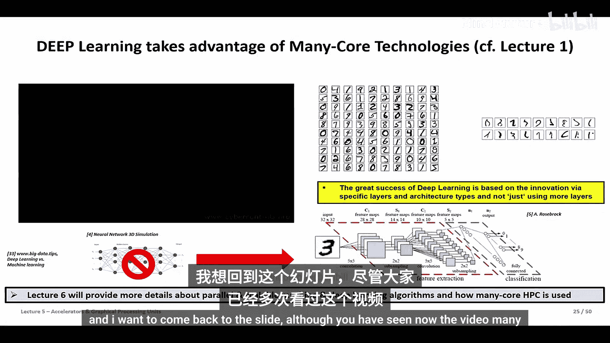

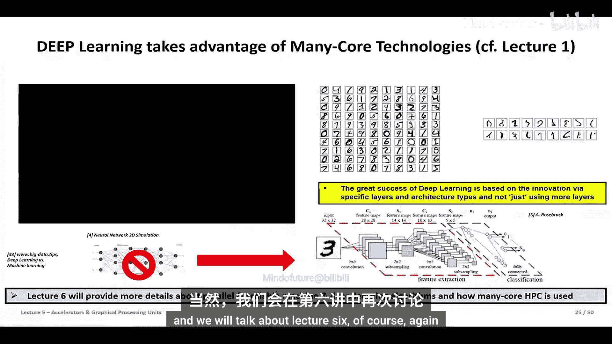

If you remember a bit from the video right carving out the features and the weights that you see here between all of them is nothing else and learning lots of mattresses and multidimensional arrays。

 So in this sense， the GPU is just beautiful for it and of course we will learn in lecture6 a bit more Why is thats the case also when we go in more detail what deep learning really is but by now you know already it's not just putting more neurons to the game。

 but we really have let's say smart architectures， not only the convolution neural networks here we have autoenrs for instance。

 encoder decoder structures we have transformer models with attention mechanisms and by now many of you are probably have also obtained from the media that the area of large language models that you may know from chat GT is also significantly fueled essentially with HPC and you know multiple GPUs working in parallel to make the learning happen。

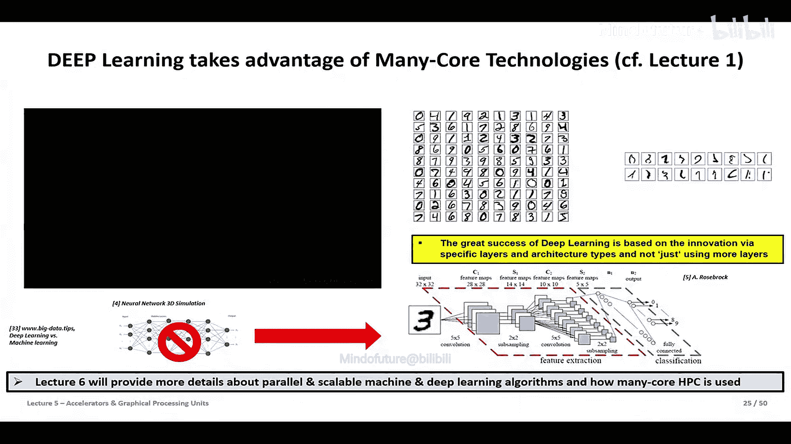

In order to do so。You need also libraries so and that's my point also for you and some of you that maybe go out of this university into some companies don't know you know Poter off and create your own codes always when you hear you should do something with GPUs chances are there are a lot of libraries and frameworks already there that help you implement this application logic or concrete let's say deep learning algorithms with your data and these are just two examples Pytorch is another one I didn't cover here it will lecture6 and7 but these are two let's say Pyon Lame deep learning frameworks that stand the test of time that are often used in applications and they have already done the job to provide you essentially with the programming models needed to fuel the GPU with data and then execute basically on the GPU then the learning the implementation。

 the optimization steps with SGDs to has degraded descent for example as one of the let's see。

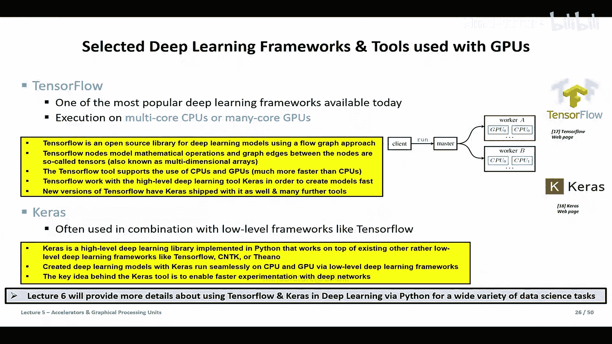

lying optimizationim algorithms for it and we will make the case。

 of course again in lecture6 about the details， but the point is to say in order to use deep learning with GPUs chances are there are lots of frameworks out there even for other you know basically areas where you would say it's not just classification clustering maybe something more as agents you know reinforcement learning is see larger spectrum you would have tools like chainer and so on so hence。

This library is this very a strong aspect now that also drives a bit the community behind the uptake of GPUs because machine learners would not be happy to already you know do coUa implementations and NVD low level。

 they want to work with something they know and these are definitelyly the areas of neural networks。

 deep learning but when it comes to lowerle programming， memory and so on。

 of course here the communities would then rely rather on HPC experts implementing those。

And to shift away a little bit， sometimes also the。

The view for HPC to just speed up things because of course by now you have some examples and then we bring more examples in the subsequent lectures that we can speed up the training of this deep learning networks we will explain a little bit how in the next couple of slides but also of course we'll spend more time in lecture6 to understand this all but for here this particular slide should make you also sensitive to the point that we don't only want to have speed up in a sense。

 we also want to enable the learning from much more data sets we could possibly fill into one node hence the high performance motivation is not only essentially the speedup it's also to work with more data digest more data and if it's high quality data then there the chances also to make you know the learning much more better you see here an example out of our research from remote sensing we have different scenes 43 of them multilabel you see that here where we have satellite data available from the land cover and also。

the associated labels right so we know what's basically in this particular scene here there's a lot of water。

 a lot of forest then here we have non irrigated land and in some areas we have irrigated land so hence there's let's say the task of saying when we do a new classification of a new picture could we learn something from this previous you know identified labels for the new scene that is detected a sort of land cover classification in a multilabel setup。

And here the point is that we have this big airstate net data set， which is quite some let's say。

 you know machine learning problem， deep learning problem which also motivates again to think about more than one GPU right not only for speeding up the deep learning training but also to digest really all the data and this is just one example out of a huge domain in remote sensing with satellite data which is increasingly growing in terms of the number of satellites in terms of the number of data sets being available and then perhaps also on the idea that the sensor data gets more and more accurate and with this also as larger sizes。

Hence。Kind of interesting， let's say， application scenario where you motivate a little bit why we need HPC and we do publications a lot based on HPC。

 one of it is here was using the ReSNe for instance in this area with remote sensing data so is this satellite scenes that you see for uncover classification。

 ReSNe 50 is a you would say sort of a known neural network architecture that stand the test of time。

 it has this residual connections that you see there layer from layer and the speed element in this。

 again also justifying now the use for HPC and the maybe computational complexity。

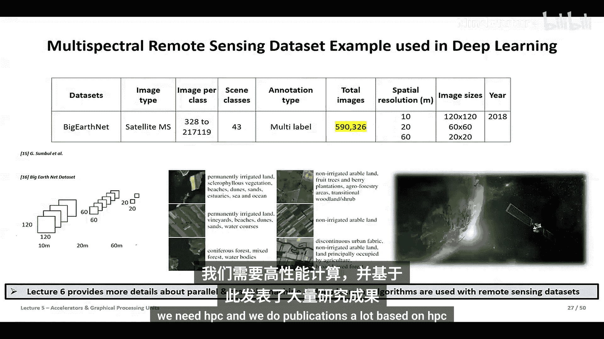

Is now this interesting aspect of twenty-five millions of trainable power。

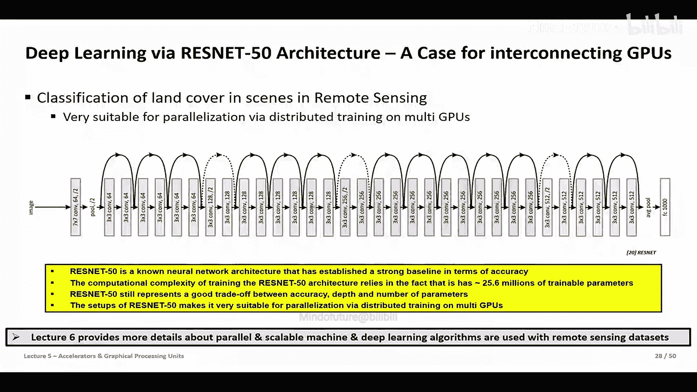

Right so 25 millions of trainable parameters that needs to be computed and when you go to the world of large language models that you may be here in the media today we add billions right so this justifies the need really for having multiple GPUs involved in the training and setups the ResNe 50 is also very suitable for this to do this in parallel。

And how we do this of course will be revealed a little bit more in lecture6 and7。

 but to give you some indicator and already sort of a motivator why we have now included also lecture7 for instance。

 now distribute deep learning training explicitly in the course because it's really often used and also it capture us nicely the essence where MP we're basically also MPI under the hood is still used that is very interesting hopefully as well so first of all you see in Epo here and Epo stands for the fact of how often you goes through the data and it is also an important understand standing factor that you don't go usually once through the data you get several times through the data you will learn from it and with this you know a changing essentially your weights in the model and you know these are more details and deep learning we will talk about but essentially we saying that we have this multi-dimensional arrays that we saw the tens they will be filled with。

What more accurate numbers， learning from data。So。You also see this nice speedup then per E which pays off if you have multiple epo training by putting more GPUs to it and you see here essentially adding more more nodes and here's also the consideration that HPC systems are different right we have seen summit had six GPUs and each of them had to V100 here we have a jewelve cluster in Uli that has basically four V100 GPUs per node and we could speed it up until let's say 24 nodes which shows you also another element that just throwing more and more computing edit we're not necessarily make it always faster right so here again you see some let's say drawbacks or even limits that the data might be not enough right to put now let's say everything on this 56 compute nodes which we would have available label。

Because essentially we just used 24 node at that point in time we were let's say using the GPUs wisely and did it speed up and at some point in time it might be that the data has so little that the old overhead of communication。

 and I come to this in a moment， what means communication would be maybe too much。

When we come to communication here as an example of horror what it's a distributed deep learning package that you put on top of Tensorflow for example。

 that then would enable a process and the framework that then does for instance here data parallel training so the model that you have is here essentially on all of them different nodes distribute it hence the name and you would distribute your data basically and would distribute it on all these different nodes so what's going to happen is that you would perform the learning the optimization steps which would give out so-called gradients which in the end capture the learning a little bit so we will learn more about this in lecture6 and then in lecture7 while we do this also in a distributed fashion you see here then at some point in time of course to have the consistent model across all the different nodes we need to exchange the learned progress hence we do an MPI already use and this already。

Something you know from MPI one， let's say collective operation involving every node and with this exchange the information so even doing let's say GPU training based then on the idea of having you know Tenorflow with Horow what underneath we still use some MPI directives in order to you know basically communicate across notes as you already know from one of my previous lectures and lecture2 and lecture 2。

1。Hence。😊，The idea of distributed learning lifts a little bit also from communication right the learning process and if you know have the data you distribute more to different node。

 of course as communication overhead gets also bigger and bigger you involve more every time you have a gradient and in this sense you have to have a tradeoff at some point in time if it really makes sense to add more notes here in this example we already speeding up significantly if you see a time paper as well was a good result and of course for every of the different。

 let's say machine learning problems， this might be very different from the availability of the data what you can make use of the system。

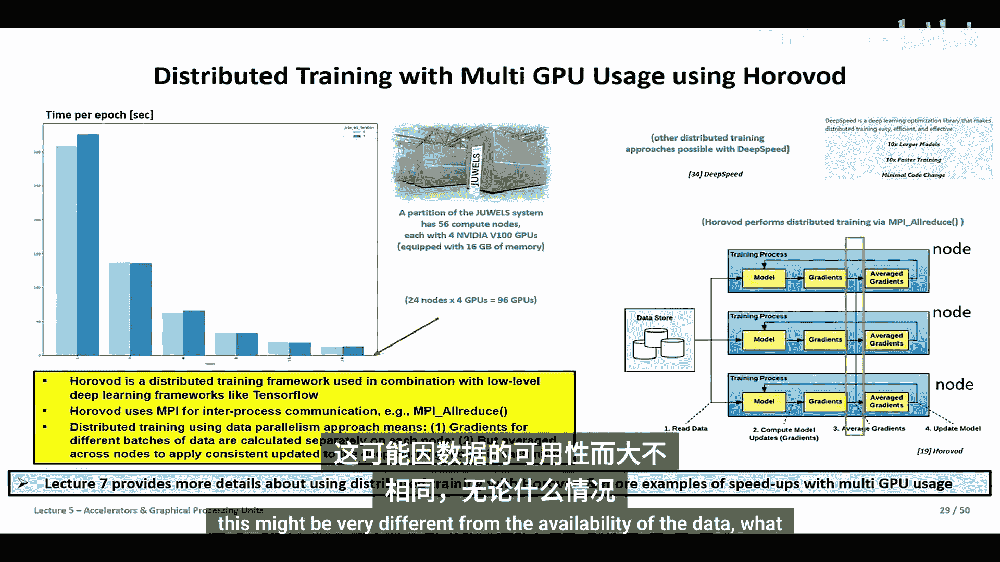

Now in order to go a little bit away from just deep learning all the time as I mentioned and this will be now my final quote。

 we will learn more in lecture 6 or lecture 7， let us also turn back to other problems we have in the domain of HPC I told you there's lots of physics also molecular dynamics is a big field that you see here with ambergrs and MDD and different let's say packages to perform the speedup here from V100s to a100s and this shows you also nicely that the impact of let's say the GPU programming is not just in AI so many of the let's say more traditional topics in HPC like molecular dynamics is really a topic that has been there before GPU existed already calculating different force fields。

 molecules and so on together see if they really can let's say bind over time right well there's molecular docking which checks that molecules can bind to each other。

of static approach molecular dynamics really check it over time as the force fieldss of the molecular stepss together。

 this could be helping in the innovation of new drugs and so on。

 but also traditional physics you know applications are more and more leveraging than let's say the GPUs that means in other words there are lots of libraries already existing and implemented in the so-called common compute unified device。

Iitecture， which is a sort of a proprietary you know programming language that you have from NVDdia and this is of course sort of a we would say a vendor lock right once you have of course implemented in Ka you cannot run it on MD instinct cards directly。

 you need to go certain other ways converters because they have essentially the rock toolkit and other tools to work with it。

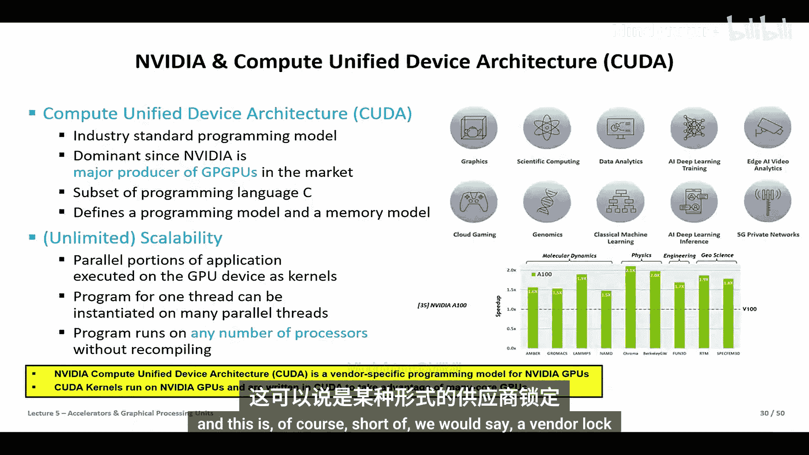

But essentially what I'm saying is even if you're not going into the field of AI and do other elements。

 chances are that there are many different algorithms， approaches。

 even computer graphics and so on and scientific computing at large are already implemented and I give you some more examples here also to show which impact this really has and it enables me also to say that basically the NVdia cards and just to note I'm not paid by NVDdia of course。

 but it is of course quite a dominant vendor in the market so I have to present a bit about it。

 so we have here three different product lines really。

 where you have seen already the Tesla in some of my slides shows you this is really the market segment of high performance computing right and in the resources of the course I also gave you the link to NVDdia high performance computing。

 but also to the In cards from Cray and then the top 500 to look。A little bit。

 what does it really means who is applying you know this into HPC systems today？

And and make sure that， you know these， let's say line of accelerators or of this NVDdia GPUs are really for specific purposes。

 right， so very much condensed together on many different boards to form nodes and to form Os and then in the end also contribute to a very large HPC system we have seen。

 for instance， the summit with 25，000 GPUs。Now。The right side here shows also the other aspect now I want to alluding to and this is that for instance we see now that the scientific computing world that we know in a time from before the GPU is existed has been now also transformed significantly to accelerators so we have 450 plus stands for the fact that by now probably while I'm talking we have already much more that are all GPU a and again the point is if you go no to the industry or if you remain in academics somewhere else make sure that you always check is there not a GPU application already implemented for my problem so we did the example of molecular dynamics right with EMber ND which is a established field Gex also solving similar elements but have distinctive code advantages so they have all the relevance so we also want to go beyond that you see here for instance something which will come up in the lecture later by。

Razor really when we talk about computational fluiddynamics so there's AnZIS for instance。

 a very interesting package and important package really for scientific computing lots of CFD solvers then we have open foam which is also in the realm of CFD where we for instance have also applications here in Iceland where we predict the otherval launches right so basically for instance in flattery the met Office has thats so used open foam to basically model out of the terrain that you have around flattery this open source code open foam which is also used GPUs these days。

Hence， when you have a problem in industry or even in science later check this and with open form。

 for example， it doesn't mean that you necessarily he can just do avalanches right with this technology or with this library you really can do many other different things with another terrain。

 you can also do the avalanches and somewhere else。

 but also that say different problems that also the razor cover in the remaining parts of electro oce we have tackled the deep learning。

And of course， there are similar aspects in all different areas of science。

 So I basically would give you here a link to the NVdia training。

Maybe one I should mention in the area of weather research and forecast， you see the VR Code。

 which is very known in the community of scientific computing。

 has different modules even for Pol and all aspects which makes it so specific to do scientific。

 let's say experiments with it virtually obviously in high performance computing。

 but is also GPU enabled these days。Hence， we have here an impact of these libraries in science and engineering。

 which is enormously and by now I would say you have almost all libraries available for many problems at hand。

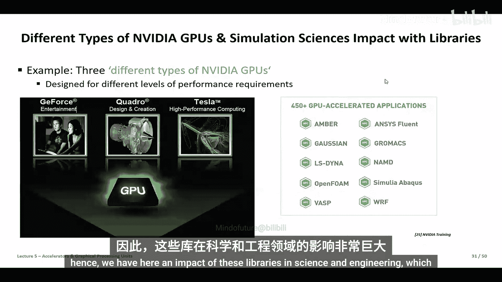

Now another element of this programming that I wanted to cover in this lecture was always this more abstract way of thinking well we always need the host CPUU to fuel the device memory with data and then get back the results so there's a sort of a processing flow that I need to clarify I think a bit more because often students ask in previous lectures and also courses how is that now exactly working and this illustrations that I got out of a JC course here for instance from one of my colleagues there is I think giving you much more a better view how this abstract view is now coming into light so in general we have the CPUU GPU CPUU processing flow and we now look here on one GPU obviously it's not covering the more complex setup than later with NV links doing multiple GPUs and so let's keep the view here with one GPU。

And we have on the left a CPU。CPU memory， we start usually with having the data from CPU memory uploaded to GPU memory。

 there's usually functions for doing this in different worlds like in Kuda， for instance。

 but also of course in the other accelerators because essentially there's no way around it。

These days， of course， you have seen N links。 So we have possibilities within the node to communicate with multiple GPUs and exchange data and so on。

 But this would be sort of the traditional processing flow。 But this is not enough。

 as you have heard。 So we talk about a kernel to upload it as well， right。

 So hence we need also to transfer the program。The program needs to work on this data so is more the application logic right so it is also affecting a little bit the scheduler now in the GPU that is now you know really allocating then the different。

 you know thousands of course， it may be required or hundreds of course required in this in order to now use it with essentially the data you upload it。

 but once you do this， there's an interesting effect of course that you also know already a little bit from shared memory。

Right， so。Since basically the GPU program is uploaded in the GPU。

 the different threats coming out of this very， very many core system， right。

 thousands of different cores。They can read and write from memory again right there's no point of now going back to the CPU memory but basically there's a large let's say option to use lots of the shared memory powerful aspects and that's why the HM that we had in previous lecture part is really also an essence here you have seen with extremely high bandwidth making it particularly fast to read and write here essentially from the memory also think about the cache that you have in some of them and then essentially the results are just written back directly to memory so this is beautiful and fast and doing lots of different learnings maybe in a deep learning network and once you have done this。

 the processing flow is actually then getting the results back to the host memory。

And and this should have given you the processing flow another character。

 hopefully understanding a little bit how it works， needless to say high performance computing。

 we go then one step more， we not just fuel one GPU， we fuel many of the GPUs。

 we let them communicate together。And of course， this communication will take time。

 So there's also someone that needs to take care of the communication， which is an essential point。

 if you then add 10 nodes，20 node， 40 nodes，50 nodes， right。

 so don't forget about these factors to have some source code examples while still not， you know。

 maybe dive into too many details。And also have some analogs what you know already from shared memory。

 for instance， and so on I want to give you also here a couple of examples more towards the end of the lecture。

Firstly。I think for those that stay in scientific computing or engineers。

 there will be the BL library quite important for you。

 there's around 150 algorithms Richard could be very simple routines that are often used in linear algebra。

 here has one example of the sex pi which stands for single precision eight times x plus y。

So hence you would do this maybe it was a very big vector right so even we're not talking about small vector perhaps that you want to use then parallelization for。

 but the problem is a typical equation that is often used and the implementation that you would do in a typical CPU would be very much for based the for loop where you go through all the iterations in this interesting array you would you know multiply it by this particular constant here that is coming in and the interesting thing to take away as a message is this is nicely paraizable。

So if I would be standing in class， I would ask why。

And hopefully many of you would give me the answer， well， the index of C4 array remains the same。

Right so in other words， we are completely independent from the different loops right we fill the resulting array with a calculation depending on you know kind of the array before it was there and also some constant with another array index which is independent from all other loop arounds。

And this is then the option where we think， okay， this screams almost like we can do things in parallellor。

RightSo and when you want to execute it here， this is just， of course， the execution。

There are now different ways how you could do this and obviously as this is let's say a library with 150 routines often used as' also couda implementation of this BL library called KupBs that you can use and of course there's also let's say other aspects where you can learn a bit of the open Act toolkit I show you also the sort of more standardization and approach to this problem which is basically derived from shared memory。

 so let's go a little bit into this into some examples。

 although this course would be not about Quda in our programming of course this is requires much more details but you see the key essence I also was showing you on different slides already so and things you maybe also understand a bit because you have been with me through MPI so we have again the parallel aspects of initialization finalization so here in between we can do beautiful stuff。

Basically in parallel， we see here clearly an allocation basically of the memory we have within the device。

 so within the GPU so we leave here essentially as a space of the typical host CPU but by just allocating them which is a bit related to C programming。

 you remember that a bit from some of the MPI directives we had， so this is just allocating it。

 we also have to fill it with this routine copy data to the GPU。RightAnd of course， by doing so。

 we don't want to have only the data， we also want to do something。 So what we want to do is。

 of course now the application logic， the kernel， if you want。

 which is then essentially here the Kubla6 by blast routine that we actually call on this different let's say you know data that we would have on the host CPU and because it's allocated will be then also transferred here to the host GPU。

 that means we have it available in the GPU。 However， if you want then the results。

 we basically have to get the results back to the host and then basically free the memory here a little bit if you know a bit about C programming。

 Hence the whole processing workflow I was alluding to in detail before is here。

Again represented in the code， but the beauty that you see also is the whole scheduling aspect if you remember right now thinking about the communication exchange you know from memory to the to the different threats they have somewhere and all this different many course this is all hidden right the GPU does it on on itself so it basically just have the routine and knows how to do it because of the beautiful implementation so it's not big programming efforts in a sense for you to do this distributed effect within one GPU。

Now we also talked a little bit already about the analogy that is also possible with another way how you could implement this now by using the Open Act toolkit which is essentially standing for an approach to do power computing also easier you know that from OpenM with shared memory and you know the shared memory analogy is of course very similar now to the device memory and the kernel right what we discussed the kernel in the GPU and it has access direct access to the device memory so this is very similar then we had if you remember a little bit from OpenM right the different power regions that we could actually have a fork on and then here having different threats working in this parallel region before we join back to the master threat so in a way you would have the host CPU the master here and the fork would be the upload of your data and then of course also on your kernel and then you join later。

To realize this， the tool Open Act toolkit is basically mimicking a little bit what you already know from our lecture4 with OpenMP。

 so Prama OMP was there， the key word for instance in the for loop if you remember OMP parallel4 and it has done the full loop automatically parallellyed without us defining lots of big things only what we had to define was the number of threats in the job scripts。

 for instance， in a similar way you see here， the statement that we have to have some copy out right to fuel the accelerator this data。

And then basically we can perform me a prama act instead of OMP， we have act。

 and then have a par a loop， for instance， in front of the for。

 which then will make sure thisIS is kind of sentinel involved and the compiling that we have then something which is leveraging the parallelization within the GPU。

And in this here in different ways。Hence。There's lots of activities around this to really essentially make this for developers as easy as possible and also for scientists and engineers that maybe don't really want to have the low-level communication you know that we usually want to have for instance MPI programming if you remember where we have the explicit message exchange。

 but who is doing what in parallel here it's basically a relatively simple parallelization approach of loops。

 but also this the Kla routine you have seen， there are lots of tools that make it happen and the usual way how that is implemented stays the same as you see here again。

 another visual presentation from the accelerator is waiting being idle until the host CPUs getting a transfer done with the code and having data transferred。

 of course， this is going via different transfers in the memory itself。

But basically then the running of the code is having directly access to this memory。

 hence in a way in analogy to shared memory on the device， and then when it finish the code。

 the results are usually be adding back to the host。

You sort of see a repetition because sort of the approach is very similar and we teach it a little bit and of course now when you go to the bigger picture。

 there are certain other elements that you know we don't have really time to teach in this course now you would go to the next step of saying multinote what we do there with envy links or basically with multiple GPUs on a node with envy links and envy switches how that would you know scale up to different notes yet seem some numbers that I had already with the evolution of GPUs where this is also changing with the number of GPUs that is possible and so on。

So hence we need a whole course for GPUs so I cannot tell you everything and we will fix a little bit the problem now in the sense of moving to deep learning in the next lecture where you learn at least for GPUs a lot。

 how that works with deep learning and then or later on in the course also raises here and there are also some elements of GPUs。

However， let us here now discuss two things really。

 and I think one of it is really the point that there is a certain market dominance of Invidia。

 Quda and so on， but you have also seen the change from sumummit away essentially now to Fronier so summit is the commissioned this HPC system and Fier came into light and this marks also a special time period right that you should know a little bit that basically there was a raise in excessscale the last decade if not more。

 so who would be the first excessscale system in the world and you see that here that was achieved in June 2022 by America one large。

 let's say national Labor O Ridge that we already discussed that hosted summit before and then Fronier the interesting effect however is also to see now that it is a different vendor so here we talk about HPE Cray AMD instinct cards。

Right that have been used to achieve that。 so despite the vendor you know Nvidia being very strong。

 theres also more and more stronger movement to this AMD and Cray to make market balance and basically also to enable us to not only do always couda。

Because now the trouble is that we have many libraries probably implemented in KUa。

 but they not work directly with AMD hardware， so there needs to be work on software also to do basically this move that the AMD hardware needs lots of lots of movements to be used by scientists and with this then require different languages。

嗯。So this was an important part in HPC to mark that excess scale and the second point I wanted to make is also we as Iceland of course are a small country still we are part of the Lummi consortium。

 the Lummi supercomputer which was basically since a long time one of the strongest systems in the European Union now we will seen soon hopefully the Upiter system in in Germany that will be the first excessscale of Europe right so essentially in 2025 we will have then the first excessscale system in Europe and then there would be actually a French system coming shortly after Germany which would be then the second excessscale system however we have area before we closed a lecture on this was a couple of GPUs only for Iceland that's not completely true we still can use the EuroHC JU infrastructures we are part of Lommi so if it's say you have an academic。

blem or something where you think we need more more GPUs please talk to us and of course then you know IceN can also you know leverage these infrastructures despite that it is basically in Finland as an example of Lomi or any other your HPC system。

 basically in the European Union。So。The remaining time just briefly some standardization aspects。

 although that's a bit tricky right you have here Kuda versus H and I just give you some source code here withoutgoing really deeply into it because this requires also an understanding of different programming model details like you see here how you do different wars and threats and so on。

 you will see that the kind of the H idea of this heterogeneous compute interface portability as it is called is standardizing the idea how you do accelerators so however you know it says there' almost no performance penalty but couda is evolving as well。

 so there's always a certain let's say lack of the standard tool follows you immediately so and of course this should be changed over the time so that you basically can also some you know code that is used on couda maybe then also an AMD devices。

Without a large performance penalty， the way how it works is very similar like I already was explaining again。

 and again we allocate memory in the device， we copy memory from the host to the device memory and then you know we do some operation a kernel of sort and application logic here in vectored but then in the end we also copy then the results back to the host and and this is something where you know here you see essentially the analogy of co and hip is very close to each other and I think it requires no further explanation in the simple example it follows the same workflow and procedure you have already heard。

Now just thinking about some other impacts now on applications， you can also look again this video。

 the number tourous GPUs， for instance， also again from the market dominance of NviD it may also a bit refreshing to see again something from AMD coming up and with this I would like to close for today but would say we will carry on this GPUs definitively in lecture six and7 or deep learning and distributed deep learning training。

 so talk to you then。

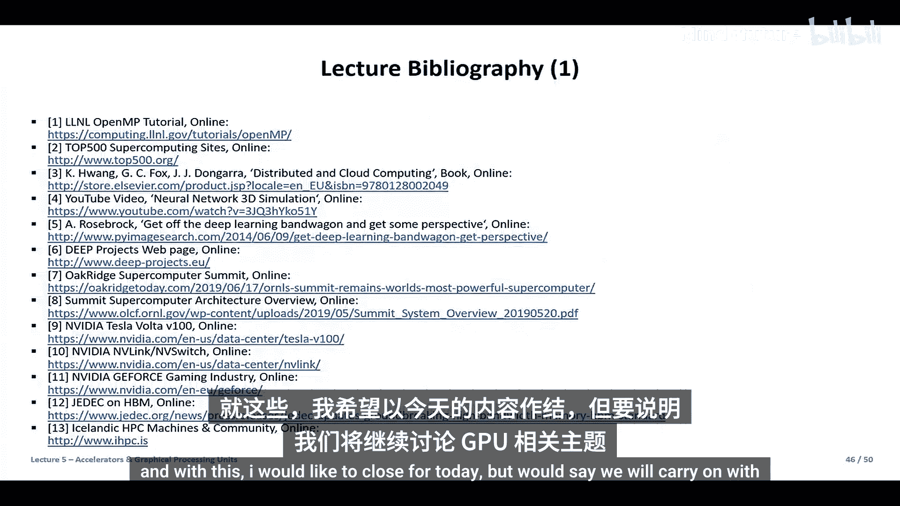

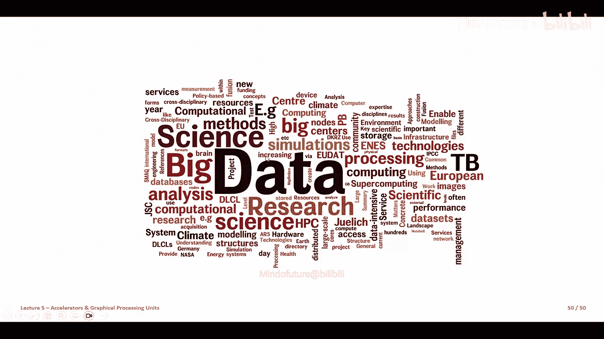