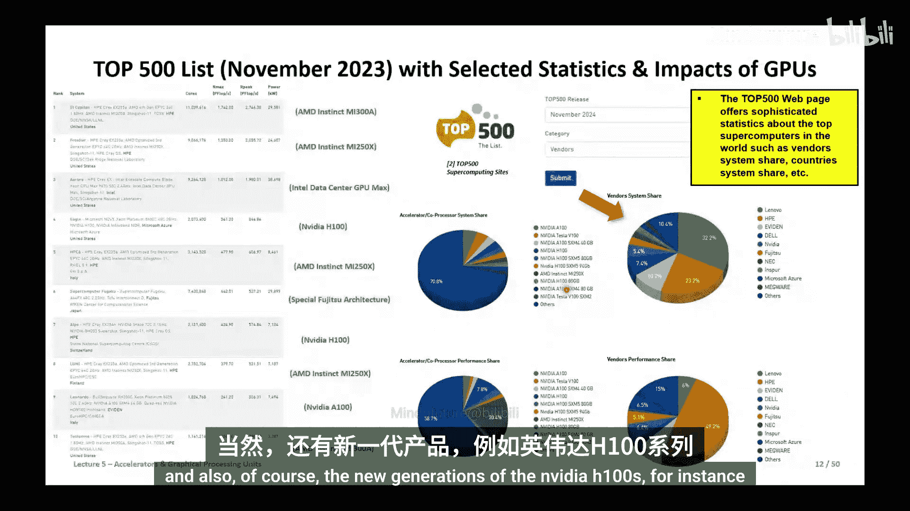
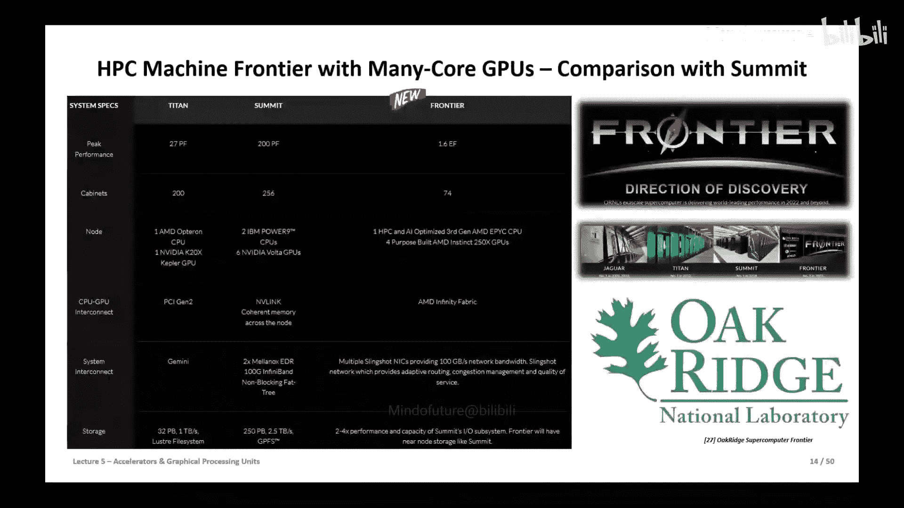
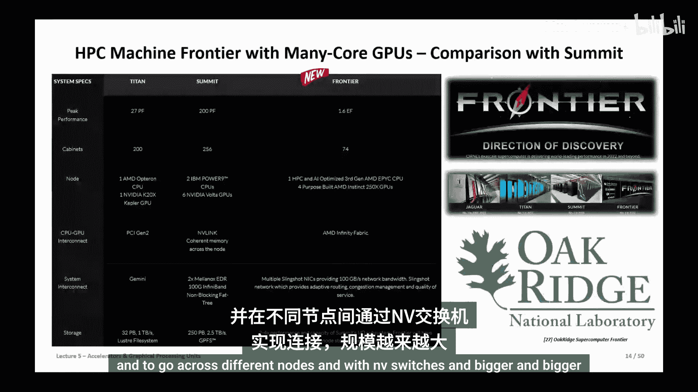
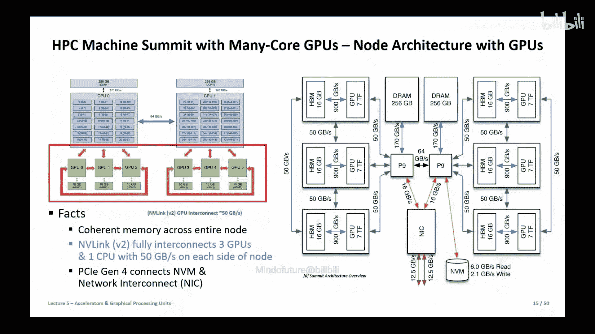
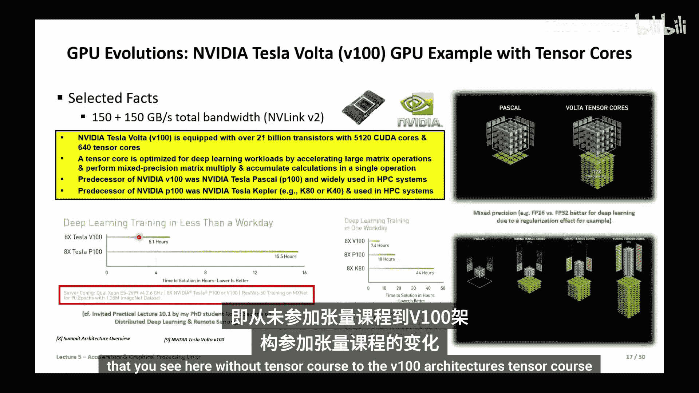
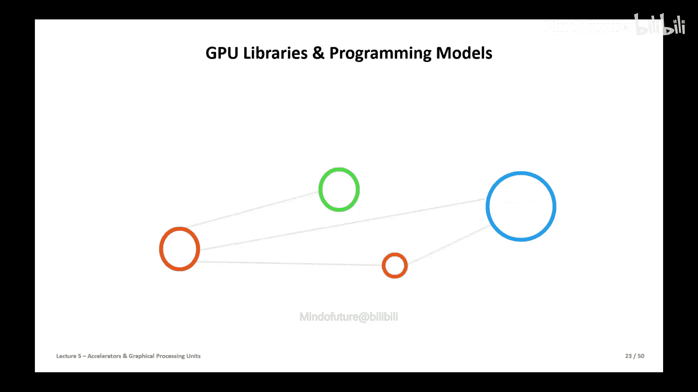

# 【冰岛大学】高性能计算课程-｜-2025-High-Performance-Computing-｜-Prof-Dr-Ing-Morris-Riedel-p15-P15_讲座_5_加速器和图形处理器_第一部分--BV1k34zzaEK8_p15-

Welcome back to High performanceform Computing， Advanced Scific computinguting。

Today we have lecture five and this is all about accelerators or also known as graphical processing units。

 some may even say we should put a GPU in terms of GP GPU which stands for general purpose graphical。

Processing units because that's what we do these days， although we inherited。

 let's say the base technology from GPUs and graphics and so on today we will see being as part of this lecture。

I is in a lot of different。Ideas of how basically this GPU technology was evolving to really specialized processors if you remember these are many cores。

 really not perhaps per processor let's say cutting edge performance as we had in the CPU but still lots and lots of them on a chip and we will review this a little bit。

But before we dive into the material of this lecture， let us review what we had the last time。

And the last time was really all about shared memory programming。

So we had the idea that there is this common shared address space that I can use。

 which was in the Numa setup that you see here， the uniform memory assess or CC numa because it's a cache current let's say bus interconnect that makes us feel that we have still a shared memory address space。

 although it's distributed， so in both of these setups the point is that programmer can actually act that you see here it can basically having a program access the memory and then you know we would program it in a way that we read and write of course variables。

 but we have seen also lecture for that it's not at all that simple。

 so they're different let's say ideas how you can protect critical regions for instance。

 and we have also seen that the idea of race conditions around variables can of course you know cause conflicts。

 especially if you have as this picture will show。And we had the last time that you spawn these different threats and that is all about openmp。

 the de facto standard for shared memory。And it will spawn different threats to do you know work in a certain par region and this could be three could be four。

 here as an example， we had also understood that the master threat was sort of special。

 it always remains basically to give in a way the whole program a lifeline right that is a bit like this gray stuff year。

But every now and then it will spawn different threats to help， could be a loop。

 as we have seen last time， could be different sections or even you know different elements where we have functional parallelism。

 maybe where we say， okay， let's divide it by the idea that we get as a threat ID。

 let's do different things。And this case us the analogy also that you see a little bit here on the top right already。

 So we have a way almost like we had an MPI to understand our identity as read， right， So T0， T 1。

 T 2， T 3。 So we have it is not cold rank。 So don't be。 confused like this。

 But it was similar like basically the idea。That we had an MPI if you remember and based on these ranks。

 we could do different things in MPI and an OpenM you have sort of a similar idea。

 the environment of OpenM gives you essentially not only how many threats are in a parallel region。

 but it also gives you then a unique threat ID if you want for all the different threats。

 which is also then an important differentiation so here we talk note about a whole fully fled process that we had an MPI here we talk about lightweight threats。

 if you will， that really then perform something in parallel and this something is now an interesting way of programming。

That you see a little bit here we see prama Sinel and we see idea of instrumenting the source code that is there so in a way。

When you think about back MPI， where we explicitly programmed message exchanges right here and we did this in parallel。

 we did this was broadcast， we did this was， you know， the ping pg， if you remember， send。

 receive and so here， we don't really touch the source code itself。Rralla gives the source code some。

 let's say， augmentation。 This could be done in parallel。 And this is a different way of， really。

 you know， implementing parallelism here。Of course it can still work very similar like you have here。

 for instance， you see you know this hellello world which is the trivial example that we have shown the last timeHello world X。

 but then when we execute this we have just four times hellello world because we basically have this par region automatically created by the Pragma statement that is covering only the printF statement。

So an important other thing was。If you remember that we could steer the number of threats from the outside and this was this is export OMP nu threats。

 so this is something which you either put in the environment or you have seen it here in the drop script of course the environment then then is digested from this scheduleula。

And the idea that you see there downstairs was just an example to show you a very large source code really that is far away from the hellello world so it's a really scalable and parallel and scalable clustering algorithm that was implemented by one of my PhDs in the past。

 you see here the publication that also references then to the source code。

 and you really see that essentially this is possible to do in shared memory。

 but of course we sort of learned also。ThereSeveral different examples。

That you basically don't scale the shared memory right so if in order to have really large real problems。

 real life problems， you really need to go also the MPI way and that then bringing us to this hybrid MPI and open MP right and we have seen some performance plots if you remember that by doing so and doing the hybrid in other words。

 what does it stand for usually open MP within the node right leveraging the fastest I have in terms of memory access。

Which is limited but still fast， and then I combining this with distributed memory across the node with MP message exchanges。

In previous lectures and basically iterations of this course we had also complete lecture on hybrid programming。

 I don't do this anymore because we have let's say， new technology GPUs it is all about today。

 for instance， so and we cannot cover everything in the code。And in the in the whole course， really。

 And this code， however， is interesting for you to look at because it combines MPI and openM and is a real life。

 let's say algorithm that is there。 And by now， it's basically the most scal and pal one in terms of Da scan。

 which is one of the algorithms that is out there。 So correct me， if I'm wrong。

 also to the YouTube audience。 If you know， anyone that is scaling better。

 let me know the different approaches。 But I think my PhD student here。

 we have done really good job of of doing this。Hence it's still used and a practical algorithm but let's come now to the next step when we talk about lecture5 so this is more a sort of conceptual lecture again right because MPI will be part of assignment1 Open MP part of assignment2 and then we do a bit of deep learning and so on and you know assignment 3 but we have some conceptual topic first because we will see that in deep learning and power and scale of machine learning the role of GPUus is now legendary I would even say right so it was lots of advancements that it's fascinating to talk about this because you know and you will see in previous iterations of the course at cutting S technology saying Volta 100s then I said okay we have now the MP technology and 100 now recently last year I talked about basically Grace Hopper 100 or Grace Hopper at general the next iteration and now we are Blackwell so next generation。

So you have here something which is extraordinary， I would say in high performance computing this this massive。

 massive increase of technology， you know being available also。

 so it's really interesting to see that this evolution and with this is a fast pace of this technology and its adoption has a profound impact in HPC at all and also at applications as I will show and of course deep learning distribute deep learning but not only data science and deep learning can benefited can really benefit from it significantly。

So what I'm talking today。Is sort of several updates to the lecture we had last year。But not many。

 I think some of them of course are still the top 500 lists。

 obviously there's a new top 500 list we will talk about。

 we will shortly review again the Mukos as many Kobec by now everybody should have that hopefully in their mind。

 there are certain terminologies which you hear always when you say it was a Keplla Pascal of Volta so that you know a little bit about this Nvidia I textures。

 although I'm not paid from NVdia。But they have a dominant market share in one respect。

 but we will also see when we talk about the new top 500 that is just out there from November 2024 Cray and AMD with so-called instinct cards actually follows suit and have let's say even the top two or three systems in the top 500 that I actually not anymore more in media but actually grayray。

 and we will talk about this different ideas and then come quickly to the idea of really highperform computing because many of you will think I still need a workstation I put one GPU in and I'm happy and this is not what we call HPC hence we have to talk about so-called node Its and I would like to demonstrate something which is a bit let's say older in the summit but it was very well let's say documented and it shows you also a generation of HPC system which was cutting edge 2018 so six years ago up to 2019。

 2020 would say number one in the lists。In 2024 decommissioned because basically weve 100 cards you know not cutting edge anymore。

 so time for the new system frontier and it shows you very nicely this generations of technology that influence also the bigger picture of the generations of HPC systems。

 which at some point in time， you know a decommissioned。

 you remember in one of my earlier lectures I gave you the BlueluG examples right which was basically Bluelug L Blue P Blueluin Q systems from EBM and Lenovo and at some point in time the whole series just stopped another good example of this quick evolutions radio of technology。

So we talk about this a little bit also is a very nice understanding how research goes along the way。

 so because we have seen islands of Nvy links and Nvy switches and we talk about what we mean by islands。

 essentially you can say you cannot scale up to very many node So there was lots of research done how you could leverage the so-called GPU direct interface you have seen the examples and deepest that come back to this with moduluular supercomput why our boost they has so many GPUs but very let's say low performance CPUUs because in the end。

 they don't really matter for GPU intensive load but we need to have them because we have host CPUs still at least in the older generations and of course we will quickly review earlier what do we have in HPC in Iceland in this area system。

The second part will be then basically after short break much more about uptake usage right so where the programming models we talk about Kuda here a lot because it's in V again but also AMD instinct has its let's say the rock toolkit that has different technologies we see new vendors coming with Intel and there's also some standardization going on although we see still a dominance probably of Kuda code in the accelerator business。

 but this might be something for the future where we have seen already in shared memory。

 the Open app for instance and also the hip interface so hence this is a very short briefing of GPUs and in one respect I think we at the time that I could teach a whole course on GPUs right I think that's now the time maybe already in the last couple of years because there's so much to know to understand。

Things we just not really cover fully as the HM by Ben memory。

 which has a profound impact on GPU so how much you fuel the computing with data。

AndAnd sort of things which are not can cover completely in detail。But it's an interesting。

 let's say lecture。 I hope still to give you an overview if if you want about this thing。

 let's say about the GPUus。 And if you really want to go deep into this， you know， for instance。

 do your own Qa code。 Then， of course， you have to go to some of the centers or to the Ucc competent centers。

 They have probably some courses or experts that can also teach much more about this that I can actually cover in this HPpC course。

All right， so I this you have another aspect of power programming really which is relatively complex accelerators as also this HM I mentioned。

 you have the envy link envy switches different evolutions of GPUs tens of core。

 you will have lots of terminology， quite complex aspects with an enormous pace of technology advancements。

 but really when you master this lecture， you really have also good overview how power computing is done today really by leveraging the so-called accelerators which is a term essentially standing for broad aspects so in the future we maybe could even say a quantum device might be an accelerator of sort right so alongside GPUs for different other problems。

So this is really a different programming paradigm that you really， you know。

 have to understand and use instead of， for instance， using MPI OpenM before。

 and you will see luckily there are already lots of libraries that have implemented elements in so we can simply use GPUs still here and there you have to do data loaders for deep learning and things like that。

 So things that will also talk in subsequent lectures。But let us review a little bit now。

 the Gpg use。And I will start again by the multico CPU by now you know cutting edge performance。

 high single performance per core， that's not what a GPU is that's why we call it basically a multico CPU and you know the limits we cannot do more and more on the chips we had this also lecture one so I go a bit quicker here the solution that then most suddenly there derived really from the idea of graphics right so here you know many of you at least have probably used Nvidia G4 for gaming the gaming industry was really strong pushing NVDdia to its limits。

And still， this is not directly what we do now in high performance computing。

 So we use this as a general computing。 But interestingly enough， we have seen that many of the。

Examples that we have not only in scientific computing and deep learning also many other problems require。

 let's say every time execution which is nicely paraizable。

 we talked about this data parallelism task parallelism a little bit in lecture three。

 you know about the other concepts and where you know even if it's let's say not so cutting at computing。

 we just need very， very many of them thousands or so an operations hence the idea of this many course ship is to have this course really in a moderate performance level but really have thousands on them on the ship and with this the ship is not getting too hot and works。

And。Their general purpose is now coming to the idea that of course we leave the realm of graphics and with this you know different programming models emerge and so on and I would like to give you an example which is quite interesting because it's it's something what we had already before that is of course。

Interesting for deep learning， because you learned already， there's matrix， matrix multiplication。

 matrix， vector multiplication。 They have this color code here and computing。

 and they're nicely paralyizable。 But here I would to give you also another example of Amber。

 So Amber is a molecular dynamics code， very popular， also decades of developments， you know。

 interaction of atoms and so on energy， force fields。

 I would say it would be rather the area of simulation sciences， physics。

RightBut they still have the power basically in this application package to leverage then。

 let's say different GPs instead of CPU。 So hence we're talking about a code that was used in parallel computing since a long。

 long time。 And even those， let's say non-deep learning codes。 and this is now the point in it。

 right， also simulation sciences， those that are driving physics and also the second part of the course with is throughout lectures。

 Ra will give you overview， you know， in different areas of sciences， mostly， of course， with CFfD。

 but still giving you examples where GPUs are more and more used。

 hence it's not only deep learning and not only machine learning that benefits from it。

 we see now and that will come to this also during the course。

 many different implementations on Kuda that leverage this many core idea。And。

We skipped a little bit the idea how now this looks a bit more in detail。

 And then also the sort of generations。 we always said， well， the GPU is like this and fantastic。

 it can do many core。 So what I want to bring across with this lecture here is really the massive pace I told you in this different areas。

 you know that we had in in GPU programming。 So first of all。

 the number of course you see here in one of the earlier let's say you know course and if you want the whole the whole chip。

But you also see quite interestingly the performance here when you do， for instance。

 in AI training on large models， how significantly firstly the generation makes an impact and here we talking for example。

 you know the switch from the Volta Ite to the A100 right so this is basically already quite some speedup but and now it's a point that we have also then the idea of the memory alongside and because we talk about often data intensive computing data is a very important factor on this hence we have here from the a100 theres the 80 gigabytes quite an interesting speedup into should mean that basically through all this Ite generations really right when we talk about Fermi Kepler Pascal was often used P100s Volta V100s A100s and now we have。

even Grace Hopper and Blackbe and we come to this， but it's not only that the number of core change much more course。

 also the HBM， the memory all was going alongside and also with it a little bit the idea of computing let's say not the full floating point precision right you see FP16 and so on and you will see several Tensza course it will have then very dedicated course to do computing for let's say specific workloads at's the name suggests with Tenza course already in the area of TenNza you know this is a fancy name for a multidimensional array really so basically here we talk about again support for deep learning and so on but as I said also this can be used by many different other scientific packages。

And here you see some generations of the past， ID Radon that's not anymore really。

 let's say the GPUs， we have now instinct cards which are really good。

 but it shows you also over a long course of history how this basically has been developed。

And from different vendors really marking then that by the time when we had the P100 and V100 it was pretty clear that there was a large let's say market share going to NVdia and this is continuing still with the Grace Hopperpers。

 it's still continuing probably very soon now as the blackwell， the new architecture， however。

 we will see also some examples where we then come to the point that we have AMD now also catching up as cr and in stink cards。

So you see also here how it works in different areas of sciences。

 That's why I brought these examples。 So this means we leave the idea of typical AI， right。

 So these are let letuce， QcD， genomics， climate modeling。 These are all physics， let's say。

 driven models。You also see the impact which is quite interesting of this envy link network I want to make a case in this first part of the lecture as well。

 we talk about high performance computing that means for us one GPU is not enough。

Otherwise we put it in a workstation somewhere in a desk and that's you know a workstation。

 it's a GPU not a HPC system， hence you want to interconnect right as you would probably imagine many of those cards very many to really do a high performance computing system and being able to scale and what you hear quite nicely see also then the impact when you have a specific network that is supporting this with H100 which is already quite cutting at performance。

And you have this in language， model， G3 and， and so on。That doesn't matter so much。

 but you see again， given the Nvy link network， this has also quite an impact in several of the applications that are communication intensive。

And hence， our top 500 looks now quite interesting。

We can imagine that you know all of the key systems here in the upper part of the top 500 are now fueled by so-called accelerators from different vendors。

 the top 500 is an extraordinary important list for supercomputing for HPC in general。

 it has always every year basically twice and you know release if you want where the always see the top notch systems in the last year I could actually already talk to you about an excessscale system coming into the list and then now suddenly we see a complete different approach again。

 especially if you know consider that you know NVDdia was quite strong in the lists the couple of years before and now we see really the entering of AMD instinct card significantly you El Cappian frontronier frontronier is a new system from Oak Ridge which actually was superseding in away summit right so the one I want to talk about to being decommissioned and now frontier is a system。

And it basically switched from V100s， which are in summit to AMD instinct cards。

You see also different generations of the instinct cards。

 this is also no surprise if NVDdia has several generations of GPUs and technology。

 of course AMD cards are similar in the sense that of course they always have an evolution。

And you see here also the special Fujitsu architecture， which was quite known and quite， let's say。

 on the high end here in the upper system part is basically now coming a little bit lower and lower in the list because there are more and more new technology really。

You see also that even if you maybe deploy cutting edge systems in the instinct MI 300 cards。

 you may be not still in the top 500 or number one。The reasons， of course。

 also money right now here we talk about technology that is extremely expensive right。

 hence the eye performance computing systems are multi millionsions of investments。And hence。

 also a big market and lots of payments for， you know the vendors again。

Which makes it interesting to see what are the vendors and also what are the accelerators， right。

 which are basically the system share。 And there's also more and more changes。

 given A D is basically coming into the game more and more with the instinct cards。And also。

 of course， in new generations of the NVdia H 100s for instance， and also depending on the， you know。

 basically memory setup。 So it's quite a lively list。 I encourage you to test it out， try it out。

 go to the top 500 list and play around with what you can do in terms of statistics。

 It's quite interesting to see the impact of GPus in general today。

 but also many other players and so on like in the vendors。

So let's look a little bit on one example which I found。

Cattures the essence of high performance computing， you know for me in 20 years now， so I have been。

 you know starting with a jump system in Uli here very。

 let's say constellation system of IBM power I。 and suddenly the time was over and then we had the bluegene LPQ it was an example。

 for instance， of a more scalable solution and suddenly the time is over。 So now we have jewels。

 we have Jeureka and soon we will have Upiter the first Xscale system in Europeo。

And at some point in time， probably Juweles and Jaureka will say bye bye。

 So it captures the essence of HPC systems being always on the cutting edge of computing。

 And now when you talk about summit。We have to see they dominated the list in 2019， 2020。

 something like this in 2018， but then of course thinking about that there will still V 100 GPUs and very many of them。

So the fascinating story was it was six GPs from V 100s on one node。

And then and you see that a little bit here， it was 4000 you know 600 nodes roughly of six times GPU so we talk about 27。

000 GPUs， so this is the realm of air performance computing and we want to use them and some of the codes even scale that high so that you can actually use the whole amount of GPUs for real scientific problems needless to say this has impacts in terms of megawatts so what terms of you know power you need in order to drive such a system。

But also on the space， you know， you can imagine already from the space here。

 we talk about two football fields or if you want there are maybe more two tennis fields right。

 but this is also huge holes full of computing， densely connected cards with notes where you see6 GPpUus are very densely packed on on oneNot and this is amazing。

But now the time has come that， you know， basically summit is decommissioned from around actually last year。

 November， something like this。

So just to give you also an overview now said from 2018 cuttingtting edge 2019 cuttingtting edge 20。

 we talk about four years， five years， right that now frontronier is there and we have now instead of payta flow performance。

 Exfl performance， so this is another， I mean， excess care system。 which is now this 1。

6 extra Fop one you know big system， but you have seen a Capan is even bigger and bolder。So， we have。

The cabinets， which were very many at that time， but now much more densely this is 74。

You have the switch from 6 NviDdia voltage， right， the V 100 cards，6 per note。

To now basically this interesting new four AMD instinct cards and you go on and gone basically of this infinity fabric。

 which is similar to the idea of the interconnect right so CPU。

 GPU interconnects play a big role as we discussed to really scale up to more than one node and you know to go across different nodes and withNV switches then bigger and bigger and I will come to this in a moment。

So hence， let's look a little bit more on an eye where we now leaves the space of one GPU but talk about a HPC machine and I think summit again captures the essence well even if it's v 100 cards don't don't worry about this it's still I think a good overview of the eye which I like here so you see clearly the power nine i here。

 CPUUs still required to drive let's say the whole system design but pair node here we have1，2，3，4，5。

6 and here also basically GPUs that you see here and each of them oh sorry no this is you know three GPUs and this is three GPUs so of course this is one note with these together。

So and you see a little bit here also the HM， so this highventous memory I was alluding to and why this is an interesting figure is that shows you really the gigabytes per second。

 900 right， so which is quite impressive， but we will see soon that the next generation is even better。

 but this is already something how you fuel basically data to the GPU。

Still you basically at that time also a bit limited that you have to always go through the host CPUs a little bit right so we talk about this more in detail。

Later on。But this is sort of a node architecture and of course each of the typical CPUUs have also their own memory that helps。

 but you see also the bandwidth to the memory is 170 gigytes per second while we talk about this high bandwidth memory as the name suggests a high bandwidth 900 gigytes per second。

 so we'll complete different order of magnitude， but limited because we in the end have just hereed to one GPU and we have to go。

 of course， if you know one to exchange data with others， distributed learning needs this。

 for instance， we will talk about this in extra six and 7。Then we need to leave the node and we。

 you know， basically to much less performance and this 50 gigabyte per second。

And you see here a little bit the roll now of the so called NV link that you have。

 the links where all of these are actually connected。

With each other to basically have the GPU interconnect essentially in one node right so this is the idea to have you know per node really good you know possibility to use more than one GPU and you see this quite nicely in plots but again the travel is we are staying in this node but we want to go across nodes right so hence the full bandwidths there is also not any more achievable hence there was lots of research done。

 for instance in the de projectject I was alluding to earlier。

 for instance how you can basically go around delivered the problem that you have that essentially you have this bottleneck and had it for a long time that the CPU is you know basically having very good memory and relatively good bandwidth not as good as of course a memory bandwidths we have seen the high bandwidth memory for the accelerator but the achievable point is that you have to。

Always go from the host CPU memory to the device memory and this was sort of always a little bit problem and then of course when you want to interconnect and different cards coming to another problem hence this influenced also a little bit the design of our booster that we had if you remember basically in the deep architecture。

 the booster had many different CPUs which are not cutting edge and powerful GPUs because in the end we were just interested in the GPUs and this also suggests a little bit an idea of how you can use a CPU as an interconnect device or as a communication device instead of you know doing much computing on it。

Send a couple of other facts。😊，Something called Tensa course is another terminology I just wanted to share here what's up with this in Pascal yet basically different precisions where you basically started with a floating  point32 so really let's say precise computing but then people found out with floating point6 this is still much more faster obviously but also has a good effect essentially on deep learning because in deep learning with anyway。

 let's say not the accurateness that is so important in this。

 but rather this throughput and in some studies even it shows it has a certain regularization effect to not take any data part by heart and all the details so this is basically something which we will also pick up a little bit in later lectures right when we talk about deep learning that in the end we don't have precise。

Optimization process and so on and so on and for this the TenNA course were quite good and even now you know some of my students like Marcel also recently graduating are actually experimenting even with less precision right these days so this is an interesting effect that came and then motivating a bit this new TensA course and why you have done this and of course you see here the deep learning training and one workday with this new cards that have then this TenA course you could significantly reduce essentially the time to solution which is one view here or you basically see here again you know the generation change from Pacal that you see here without TenNA course to the V100 Archs TenA course。

And。This is just one part of it what we now have is a little bit that in Hy performance computing again always the idea was scaling。

 so scaling to much more nodes and even if we have the NV links that we discussed from NVDdia there and they're actually quite strong in terms of gigabytes per seconds of course it's not like HM but still relieving the memory space and have an opportunity to have inter GPU communication。

 but still we talked about long time in research also that this is sort in islands so where you can maybe have just 16 GPUs per service H GPU pairs where you know you come to the perspective that we need something bigger and this is where the NV switches came because they incorporate then sort of different NV links to have really an all to all GPU communication and then basically making the single node you。

Perfect， but then again， the problem is you know scaling very high in the number of GPUs you have seen summit with let's say almost 25。

000 GPUs we want to use them all。Then you come into some certain effect that the envy links and envy switch islands would not help you anymore that much。

But technology advanced。 and， of course， I mean， we're not talking about that is everything is very simple still to let's say。

 use a system like sumummit with 25000 GPUs。 But you see interesting new related technology evolutions。

Also the fast evolution here I want to show you of this NV link right because we have learned on HPC we really need the interconnect between the different GPUs so in this sense you see here the Pacal again and then the gigabyte per second that you had really a throughput。

 the NV link and V100 was a big step going to a100s and then basically the Hopper card which was recently basically the cutting edge。

 if you want of GPU I but now we have the fifth generation basically with in our new eye which is fascinating it's the black well。

Aitecture where you know we will see many interesting new elements happening so hence we will see here a little bit also that not only of course the event was improved also the maximum number of links per GPU right which was driving a little bit the summit design maybe。

But here you see now we have 18 or as we have Nvy switchitch GPU to GPU bandwidth right we had this 900600 now we have 1800 so it is really let's say a massive improvement in the bandwidth which is in HPC applications now a major impact right especially because we go now you know to much more different provo loads and so on and with this we have really powerful Nvy links and Nvy switches and I mean we can imagine that this will continue right so the evolution of this technology is really fascinating and fast。

And。Coming then back to the idea that we had in deepest right so when you now think that this is so much quick and the idea that was there in this project。

 for instance， was to UC hostst CPU， you see that a little bit and we will talk about this offing a little bit let's say in the second part of the course more although in some of the GPUs today and in the workloads you have to seriously reconsider this but here the idea is that normally have a CPU right it normally does computing。

 it will use data for uploading from the own， let's say memory and the compute node to the GPU to the accelerator then there's a kernel executing in the GPUs and the results are downloaded again to the MPI sorry to the compute node and then you communicate this with MPI to different nodes and then the story continues and so on and here you can basically see the idea of more more let's say two bigger way of doing CPU GPU offload to this So one of the ideas in deepest。

Then instead to really don't compute anymore more on these and this drive was driven a little bit also then by the idea of the booster right so the booster。

 if you remember in one of the early lectures I said it has relatively weak CPUs so I mean still okay CPUs to get everything but there will be no computing on it。

 So if you want you see that here a little bit with no compute youre in essentially doing a little bit of MPI or communication exchange to get the results and the data directly from other GPUs into the kernel right using this。

 So in a way use it only as a communication device。

 the compute interface and hence you don't need the fullflged CPUs saving costs in a way so that you can basically employ more GPs。

And this was going against the Nvy links and Nvy switch islands。 But now we see， of course。

 more and more that these islands you know， getting very powerful and bigger and bolder。 So also。

 this design has to be， you know， revisited。Then finally for today， just a short hint， of course。

 our systems in Iceland are let's say limited， a small country has also a small HPC system。

 but we have you know GPU cards and not forgetting that we of course are also members of the your HPC joint undertaking so we can have also proposals to be submitted to the larger systems but our local system in Iceland where you see also different elements you have now learned as a part of a100 cardss。

 real of them for instance， and also another dual GPU cut where we have two a100s。

And and basically five times is dual card nodes， hence a little bit limited GPUs， but of course。

 also technology in Iceland for users that need to do it。And maybe finally。

 for you at home to understand as a good quick summary。

 I like this video a bit is really showing you sort of the difference between CPU and GPs。

quiteite nicely， so encourage you to look this video I dont we' play it now and we will do a short break and we'll continue after 10 minutes。

 so talk to you then。

