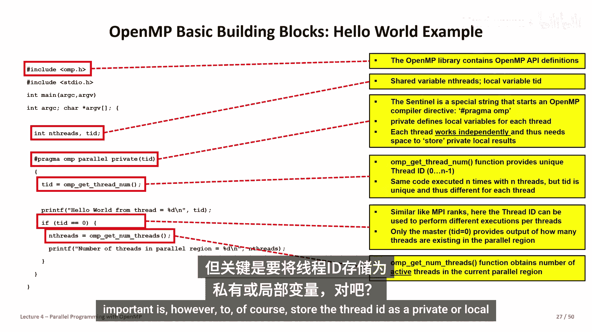
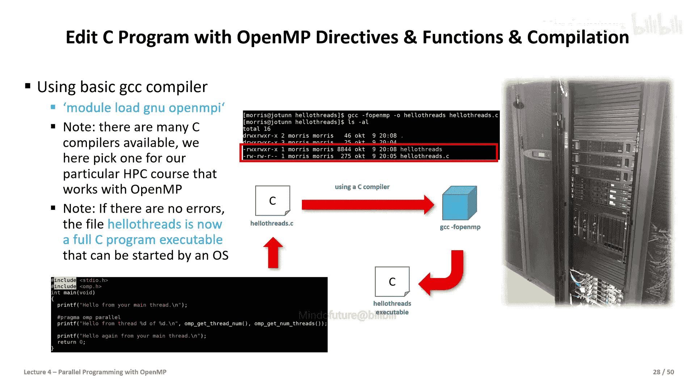
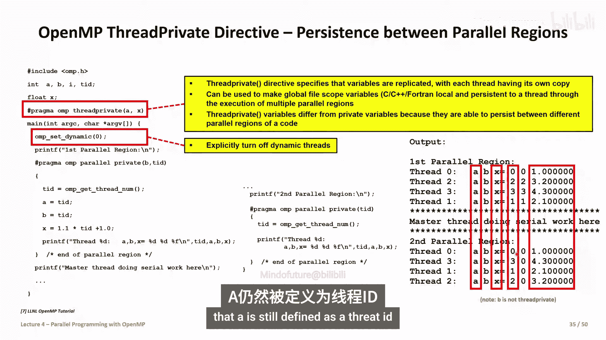
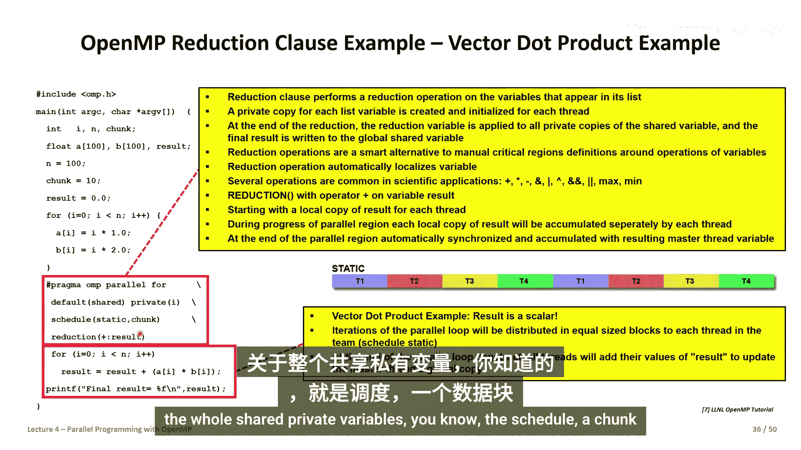
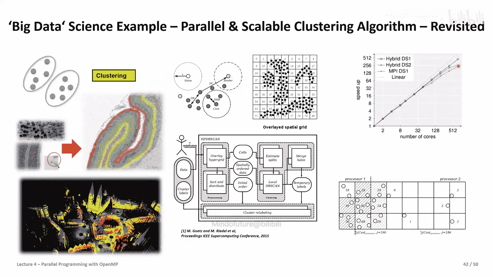
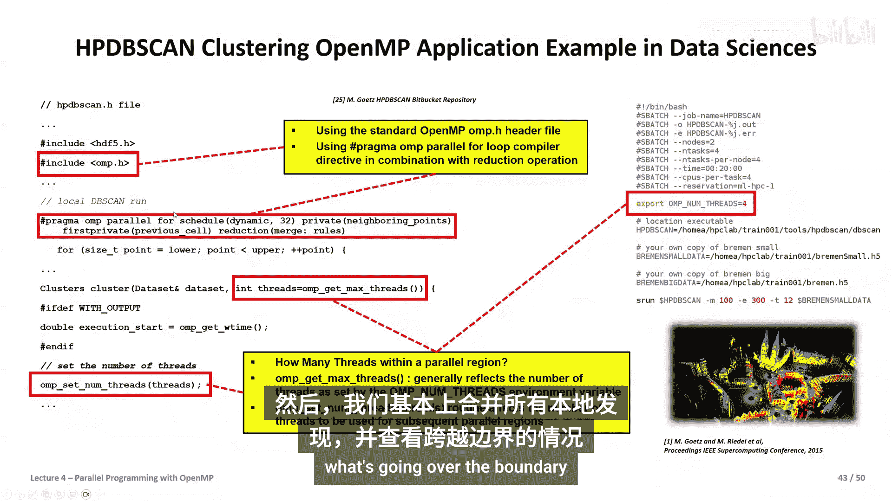
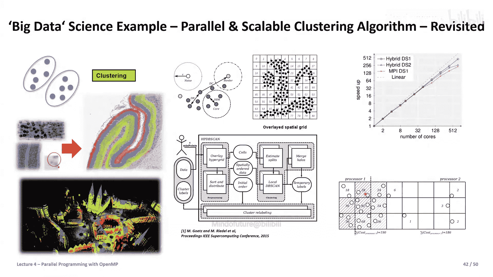
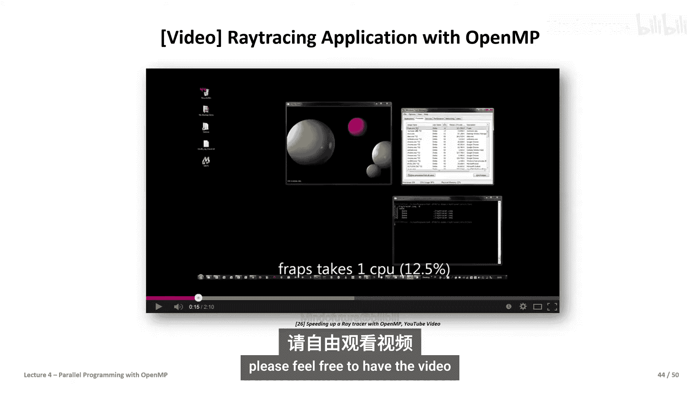

# 【冰岛大学】高性能计算课程-｜-2025-High-Performance-Computing-｜-Prof-Dr-Ing-Morris-Riedel-p16-P16_讲座_4_使用OpenMP并行编程_第二部分--BV1k34zzaEK8_p16-

Welcome back to high performance computing， advancedance scientific computing today we have our lecture four。

 RL programming with Open MP the second part。In the first part we learned a little bit more about Open MP and what it is and what's the relationship with shared memory and also some selected differences already。

 how it is with distributed memory versus shared memory so there are some major distinctions address spaces that you can access with shared memory and open MP but you can't access with MPI and the implementation of MPI is open MPI so。

Careful on this。 These are different things。And in the first lecture we really learned an overview about open MP again。

 why shared memory is useful， we have level of caches and memories actually very fast to get data to the processor。

 so hence the motivation but。The problem also is， of course。

 shared memory is very limited but we had in the first part。 So we see that when you have， let's say。

 bold simulations of the ocean with more and more level of details， right。

 you don't want to have just the wave height， you maybe want to have also。

 let's say the fish population and you want to have the interaction with the atmosphere climate。

 you add more and more details of the simulations and then you will quickly see that your memory is not having enough space if you stay on one node。

Hence， what could there be as an option you extend to different notes and that's what HPC is all about。

 you scale up you amazingly not only speed up things because you have more processors。

 also sometimes the application requires it because the memory is limited。And by doing so。

 we have another note， but we also learned if it's not the CC Nuomer idea where you remember the cache coherent link between。

 you know essentially distributed memory setups， which is also very limited but if you really want to scale to a whole HPC machine the ideas use many。

 many， many nodes and the idea of hybrid programming now hybrid programming is a term a bit careful。

 some people would say hybrid programming could be also GPU programming combined with CPU programming。

So here when we talk about hybrid programming in this lecture and the one we had before be talking about MPI in combination with OpenM and this usually looks like that you really leverage the cache the memory that is available with the fast success within a note using open MP and parallel programming with shared memory while between the notes essentially you have MPI so distributed memory programming and by combining those we have seen for instance the HPC variant of the D scan algorithm we call that HPD scan implemented by one of my PhD students in the past。

 we could really scale up significantly and not losing performance that we have seen so quickly with MPI at some point in time this 500 processes but we keep an almost idealL linear you know speedup。

By doing so we have you know used MPI in combination as OpenM and that made it hybrid so the idea of the second lecture part is now that we really think about the power programming as such so we had lots of overviews we motivated OpenM but how do we really program it。

 we start of course from scratch for those of you are not really have done this before we take a little bit the basis of the C programming however that we have already learned in earlier lectures and also the scheduling part that we have learned in earlier lectures。

 compilation ideas and so on but now we in the realm of threats and not any more processes like we have as MPI so how that looks like and how that works we see job scripts would be one of the ideas today and the second part。

And we start by thinking parallel again and that's what you know already thinking about that we have instead of several processes now basically lightweight threats in other words a team of threats would do the parallel aspects of it so the interesting thing was OpenMP however is we don't do that explicitly that we do as an MPI program you remember the message exchanges broadcast send receive we had our ping pg implemented so this was all in the source code as real let's say entities that are executed during the runtime。

Now， Openmp changes this in saying basically of an openmp program that is just a sequential program。

And what you add in order to make it then a parallel Open MP program are basically then the ideas of really instrumenting the code of having several。

 let's say sentinels that you learned in the first part of the lecture to really mark as a parallel region where then a team of threats and the team of threats is not known。

 not hardcoed you really。This will come through in the job script as we will see will then be you know entering a parallel region is a master threat we learned in the first part of the lecture and then spawns these different threats so empty stens here for the master threat that is always existing no matter if it's a serial or parallel region in the code but if there's a parallel region we have this kind of fork idea of forking many teams of threats that you know can help me then of doing something in parallel so。

Hence it's also nice to do this step by step so when you have an open MP program you don't need to parallelize all at once basically right so you can have this different instrumentation of the code here and there and then it works with a prama statements that you add them over time compile again and then add another region in parallel and so this makes a computing basically quite nice to understand more and more where the parallelization could be possible you maybe change some codes dependencies to make a better parallelization possible but again it's not really like MPI programming and also of course the whole access to variables and so on and is in some respect easier。

But not always， we always will learn， of course， a critical region。

 So what happens one process spawns many threats and then many threats want to work on the same variable that could be dangerous。

 So we learn about this， of course， also during this second part of the lecture now。

 But let's come back to the idea of writing our first hello threat program Ho world basically with a threat。

 but we want to have it not， you know， basically executed by one master's threat。

 but also by team of threats。So the way it works is。Now very trivial you know basically program here。

 we have this main program which is in C， you know the entry function that we always have and then print F is then the statement hellello world and when we download this sentinel right so this is a so-called compiler directive so you tell the compiler now and hence we need a specific compiler that will understand openmp statements right we cannot just use any compiler and C and then think okay。

 well if openmp is not known this will be largely ignored。

RightSo this compiler directive prama OMP or is basically very loaded and has different variants。

 So this is the simplest one where we say， okay， we have the source code it will be executed by one masters rat when we execute the you know basically the job script。

 we submit the job。And then we you know， basically have this there's one aspect which is a sort of external thing right and this is now basically what you see that we say export OMP number threats。

So this is something which actually comes via the job script right so it tells you or the basically environment variable that you have here now tells you in the simplest fashion even without submission maybe with a job script that hello world should be executed four times because you set this variable and your environment even if you don't use a job script now you see we execute this just on the directory well execute four times here。

 because a kind of team of threats is spawned four times which is not entirely true because you see the masterre will automatically become threat zero so in a sense we three helpers while the masterre will take another identity and all one of the part of this team of threats doing the work will print out and then basically continue。

Hence， this is the simplest version， perhaps of a hellello world in Open MP。

 and you see also interestingly enough we programme the main function without anyhow knowing at compile time how many threats we really have。

Hence， when we compile it now， the program is compiled for power and execution。

 but we can steer the number of threats by using this external variable without recompiling。😊。

And this is sort of an important part of this， let's go to a little bit more elaborate example。

So again， when we have a whole picture of a real C program。

 you see we need to include the Open MP library so it's very similar like you have seen in MPI right where we also include the MPI library。

Now we have some different terminologies here， you know about the Sinel。

 I think this is what you already heard in the lecture before。

 but you will see now different variable definitions， so one is a shared variable。

 the number of threats， for instance。And then you would have a local variable threat ID。

So some of you probably already can imagine there's a huge similarity again with MPI with one respect that we had something like the you know MPI Com world which gave us the size。

And the rank。So here we go very similar right， but now it over the threats that we spawn。

 so we want to have some shared variable threats and we want to have a local variable also called private variable。

Tread I D。And I define this， as you see here quite nicely， it is now shared because， you know。

 everybody will execute this。The whole source code， if you remember， it's just the same source code。

 so we have four threads executing it。For example， when we set you this variable to four。

But then you see in Prama O MP par， we have this private definition of the threat ID and why we do this。

 and this is clear when you see the next statement。

 we have an environment of openM with a function that gives me the threat number。

Now this is now in analogy to MPI very clear to you。

 I guess it's basically again in an idea of a rank。Right instead of having ranks zero。

 now we probably obtain threat zero for the master's threat。

 right threat I D zero for the master's threat hence。

You have a way and you know that already by MPI programs a similar way of differentiating source code right you can now use this red ID that you get from the environment which is unique in order to steer your source code in different directions to make different work done。

RightAnd then basically you see that here little bit。

 where you have hellello world from threat threat ID， which is private， in other words。

 every threat has its own threat ID saved， so that means we basically say here hello world from threat  zero to3 right if we have four。

And everybody's executing this， however， we use now the interesting thing of the threat ID similar like the rank to steer the application logic。

 where we've actually determined only for the master threat， right threat ID zero。

How many threats are there overall and you see the OMPmpP environment helps us again。

 instead of getting the threat number， we get the number of old threats。And and that is basically。

 of course， then a very nice idea where you can see， okay， now I know how many。

Threats we have within the application， although I never coded it in the application。

 It comes from the jobscript from the environment。Or basically。

 as you have seen in the simplest version before， just as an environment variable， perhaps。

So outside the executable， I steer how many times I have a you know threat available and I can get it even from the environment and to then use it in the source code for some smart decisions I mean this is not particularly smart you just give it out here but you will see the output is then of course just once done because it's just the master thread that is actually getting this and threats。

 but let's say it's a shared variable so in in further times it means you know just one is doing the work but it's a shared variable so everybody has access to it。

Important is， however， to of course， store the threat ID as a private or local variable， right？

So we we come to this concept again because this is of course incredibly important to understand why it's unique because otherwise we will overwrite this red idea if it's shared again and again。

 so you don't have a distinction so there is a shared address space。But still。

 you can determine some private variable， which are sort of obviously also pay taking part of the shared address space。

 but it is private for this one rent， while the others are shared。

So let's come to practicalities continuing with this example here as a source code in an editor。

 it's basically the same thing， a little bit changed that we don't use now the threat ID one here to give。

 let's say the number of all threats out here， this is a different version where we you know put all in one little source code line where we said I'm threat numbers so and so much on this and this。

So， and you see， we don't even define variables。 So another version of hello world in the real threats。

Like you know before， we now have a compiler directive。

Inights with openmp so we need you our compiler that made aware of this and we do this， for instance。

 a glue compiler here， minus F open MP to let the compiler know you can assume that there are open MP statements in。

And then the rest you already know is minus O I give the output and make a proper output name。

 I always recommend that。And then， you know， the C code that we see here on the left should be compiled。

So no rocket science is particularly that you know with you know。

 similar like we have compiled in the MPI world， here。

 however we take a typical new compiler and the interesting thing is that you have this Manus F openMP option that you really need to include and that you should also test in your assignment。

So let's look a little bit then broader when we now go away from Hello world。

 what else could we do parallellyize， I mean hellello world parallelization is not the purpose of the openmp program。

 but it shows nicely how it works。So let's go to rear workload and this brings us very often in openmp2 loops right you see here as the do or for loop。

 it doesn't matter it's basically a little bit like the same idea that you have from let's say fortran or C or any other language。

周路。And the idea is then that maybe many of these loops could be actually executed with different threats。

 with different parallelization option to make a speed up or to e basically leverage the idea of the threats much better by working in。

 you know， in combination。So then of course， once the loop is done。

 you join again and you could also do the same， actually an open MP resection。

Where you have maybe perhaps based on the threat I， different ideas， how you want to have threat one。

 threat2， threat3 operating， doing it in different sections， which is all executed by a threat。

 right， So in a way， it already brings us to dysfunction functional parallelism。

 if you remember lecture 3， where have the example， I think between atmosphere， land use or land。

 you know， interaction and then another one， for instance。

 that is taking the ground water modeling also so So it's in a similar way。

 the idea that these sections maybe do different things。 while in the loop。

 they do very similar things， just with a different， let's say， index in the loop。

Now of course and single is an interesting aspect， it's here lies a section of the code。

 let's assume you're in Apo or region and there's something which is very critical not just to be done by one single threat before all others can continue。

 you can implement this with a single。So。We start however with the loops I think I gave this example right in lecture three as a general example for parallelization how this could work important is here I get sometimes questions from students in the past why that works remember what is standing here right this is of course now an important part and this is soal court here do and end do so it doesn't matter which language was this is really the important key message to take away is that depending on the index。

You say that the new version of a is nothing else in a constant of the B from the same index。

And this is an important part because this means it is extremely nicely paralyizzable， why。

 because the index is the same。So here you see that you don't depend on the index before what's happening there and essentially every iteration of this loop going from one to thousand can be done separately。

I mean it would be unwise to do so， you have to have then thousands of source code lines。

 but of course a loop is there to help， but the point is that the index e of the E is independent from e plus1 or e minus1 or whatever。

This enables us now to think nicely parallel and for instance we add two processor and say one is running from one to 500 and the other one is running from 5001 to00 right so instead of having one process doing the whole loop。

 we have two processes and more accurately speaking now two threads。

That are actually influencing now the kind of computing of this particular a array or whatever it is。

 depending on the index， and the result is the same because in the end we have a field from one and two all over the index from 12000 and ideally you would do this with more and more processes all with more and more threats in order to get the time to solution smaller right T2 should be smaller than T1 if you let's say spawn a couple of threads and that's the idea of the loops。

So let's see how that works now with a real source code。 I mean。

 this was pal code to get you an idea roughly。 Now we have a nice， very short example。

 how that could work in practice and again。We use here a little bit the mathematical rules and the color coding to let you know how that is now in practice。

 Now the beautifulest thing is again， we see here one example where the color coding already says how nicely parallelizable it is right So basically the index of the x is nothing else that x before plus y So and how this is executed is basically standing here and the color coding and this explains the source goodoo a little bit and we observe also this dependency on E right so this is now the index here for the loop is very clearly nicely parallelizable we just depend on the current index。

So this is now important for this particular vector to be computed and to follow the mathematical rules。

 we can quickly come to the idea of really doing this in parallel。And basically， of course。

 what we have to do per each threat that is executing， keep your own index。

 almost like the threat ID， you remember， now we keep our own idea of E index that enables us that we can。

 for instance， to then the loop from 0 to 500 and from 500 to 1000。Right。

 because we count just in our own threat E， although it exists twice。

 but each threat has a private variable on it。 You see that a little bit here nicely shown， you know。

 if the shared address space。But there are some shared data and some private data。

 which you can still use basically as a different threats， right， and while all have， of course。

 access to the shared data。Now you see clearly that the other threads have no access to the private data or local variable that we define the threat ID and here also with the index of the loop。

 which then makes us really now this easy to paralyze。

And in this nicely paralyizable or independently paralyizable or many words script in the past。

 they also called it sometimes embarrassingly parallel。

 it's so easy and trivial to paraize it that the word embarrassing was always used。

 but I think these days we'd rather call it independent or nicely paralyzable。

You also see that the end result is shared X and y right and the idea of these variables of course is X should be having the result while y is also needed for everyone so of course we need to share this and you see a little bit here that of course this is something we have to allocate here in the realalm of C it's not obvious for everyone and sometimes you even least that out of the source code because we want to not teach you C programming you want to teach you Openmp programming using C as an example right so the idea is also that you can use fortran or even other options in the future where OpenM will play a role。

And yeah， this is a sort to speak simplified。 Democo but chose nice the essence。 And by doing this。

 just instrumentation with one line， right， think about this line wouldn't exist。

 It would be a normal C program and then ency program is one process or one masters threat basically will execute this and is done at some point in time。

 Now， what happens here is now is the openmp that， you know。

 this process being compiled with open MP option is。

 is hitting this and turns into a masters threat being。

 you know threat 0 and then spawns several couple of other threats， which， you know。

 is now depending on the environment， right， It can split 3。 It can4， hence。

OpenMP will make sure to also crunch down the idea here in different pieces how you can actually have the index right you have to see this is not just a three times area that is just an example right let's say this has 10。

000 elements。Then the question is how much should E be and so on and so on。

This means bringing us to the idea of n right so how big is really the idea how you go to the index here。

 it's something which is of course， an application logic which is fixed。

 but what is not fixed is how much would it be crunched down into smaller threats， this loop。

Because it depends on the environment variable I will define。Then there of course。

 are more ideas how you can you know， do some work sharing done in the chunk size。

 So we saw just that this can be automatically done basically so the OP environment will you know take care of this。

 but you can also steer this a little bit and sta a little bit for the idea of the chunk right and you have again。

 the idea of a C vector that is an addition of A plus B as an example And there you want to also think now in terms of chunks right So to work on this。

And the chunk size then will be a， you know， kind of a variable you define， right。

 aesthetic one that is here， 100 for an example， meaning there should be of course。

 and also enough array parts。And with this， you can enable and basically influence a little bit also if you want the schedule。

 And this is nicely shown。 I think here in this graphic。

 if you do a completely static schedule for this， it goes literally through the amount of work。

 which is there through all the threats。And you know。

 then continues with exactly the same static assignment。But if you are， let's say。

 do dynamic allocation or dynamic scheduling。 And now we're talking not about scheduling over the whole machine that you have learned in the scheduling here。

 we talk about the chunks of work and open MP threat has to do。Right within this little program。

 this little shared memory program and assuming that maybe the work is not always completely equal right the static one suggests that the work is always equal and the next work items should be then of course also like the threats。

Let's assume there's maybe some aspect and that's why we want to have a dynamic that。

 you know one work would be much more quicker done and we can assign it then for threat4 again。

 like here， for instance right you see here threat4 somehow as less to do so you can use threat4 again and again to do some more work so maybe the computing was just not too complex。

So there are different ways how you can do this， which is pretty much more than an advanced example of OpenMP so this is already an example where loop is。

 let's say really optimized for the application at hand and the ideas then you how basically that these threats were not really synchronized to add no weight to it when they did basically their individual pieces of work。

Right， and this is， of course， also something you can steer。 You can change。

 But let us come to the other example， the section example， this was now something where we said。

Maybe we'd want to do different things right functional parallelism and this example is not completely reflecting it because here we do just as you see in the X code。

 an addition and the other one is a multiplication。

 but this could stand for different functionalities and physics for instance。

 you know the land surface interaction of the climate versus the atmospheric simulation versus the groundwater modeling but they all have water as a principle to analyze and how the water cycle will be。

 but this might be now functional parallelism and and this is something where you just define the section as you see here and is quite nicely to be paralyzed automatically fromMpi。

Hence， these you know sections can be enabling what you see here and it's not a mandatory thing that all threats maybe have a sections。

 maybe for the implementation logic， it is okay that one of these sections is not you know defined for one thread and continues So this is an application domain problem right so think about a larger problem where you don't know how many threats you really define sometimes it's for sometimes it's just reneeded。

Still there's a possibility you know that that of course also that the threat can actually execute most sections right let's assume down the road here when these are very much quickly done or there's another definition of the section so it depends on the implementation right so this is of course also another idea how this works here。

And the rest is really the same， you see the shared variables ABCD。

 it's obvious that we also have to share this because we have the results shared and again as we going through a loop。

 no matter how it is， how many sections we will have there。

 they have two now the private variable have to be E because we have different loops。Basically。

 in these different sections， hence we have to have in this old parallel region here。

 a private evariable。Yes， and then finally， which is an important part and this is really something I want to your attention on because this is also a very crucial error regime right where you sometimes not think about。

This has all to do with， let's say， principal even computer science we call race conditions。

 right race conditions of this particular variable where different threats want to have x written and write and you know do something with a variable multiply edit。

And read and write again So there's lots of， let's say， activity around one variable x。

Done by different threats。And this is now a very， let's say。

 interesting example because then nobody knows really what's coming out of this because you never can say that the read and write and increment whatever you do will be happen at the same order。

Or in other words， you basically write rareables and assume basically it has been already written。

 but it is not really that the right command has been executed by this one thread already。

 so you read an old result。And this is what we call race condition so in the end it could be also similar that you know in the we call that a lost update right so it's also going to the domain of databases as said was alluding to before so you basically read X at the same time from two you know kind of threats but then one thread writes over the X and assuming that you know the next thread will now read it but it has already read the results before so it now increments to its own mass and overrites essentially what the other threat has done。

Long story short， we have to protect Is somehow right and this is what we do as a critical region where in this assembly on the left。

 you again have a pragma sentinel of course saying this is a parlor region。

And and we have a shared X variable。 So that makes it now the problem， right。

 So everybody can do this。 You see， again， the example here。

 we can read and write at the same time from X because we have all the same access to the memory address space。

 It's just a matter which red is lucky to be first。And in this luckiness is a problem， right。

 especially if they want to be at the same time in order to do so。

And to steer that a little bit more with the application logic that you know there will be correct results。

 you can protect the variable or more notably the whole area we call that the critical region you basically resist statement where you say this is really that only can be executed with one threat right so in other words if a threat is already executing this you know is already doing some work and this is of course a very quick one but think about there maybe bigger aspects to it bigger computing that the threat is working on and all the other team threats basically that want to execute this also in parallel have to wait right only one threat will be able to do this at any given time if you protected from the critical region。

And this would be not existing if you don't have this， because it's a shared variable。

 And if you remove this sentinel， there would be quite some strange output of the application。

And you can also assimilate this a little bit， of course here with smaller additions it's not so obvious but with larger programs that' very quickly go into the race conditions that we mentioned another way。

Is also here than the the kind of OM single we already learned in the overview。

 This is basically that a block of code is to be executeded by a single thread only So in a sense。

 you have this automatically right， because all other threats are not doing this source code。

 which is not always optimal， you see nicely again， our idle problem， right。

 load imbalance starting here。But of course， as we end the matter of threat。

 the impact might be not so crucial， right， there might be a very good way of saying now there are a couple of variables I want to write properly。

 let all others wait and then do the work again and read and write as you want。But this could be。

 let's say， sometimes crucial to protect not only one variable。

 maybe you have a function that you want to execute like input y here that you really need for all other data to initialize well。

 so you'd rather get that executed properly by one only threat。

So you see we already come into the domain of optimizing and so on and here you see that similar example was a threat private variable of AX where you can more and more steer。

 we also say here the dynamic threats again， but here this is nice one you see the output from the first round where you go through where you have essentially the idea of a private you know basically B variable。

That willll then execute at A， B x。And you know here the order shows you quite nicely how that works because essentially you have defined A。

 you have defined B and so on， but B is private。Right so B is private。

 and you see the output here of this， right， A， B， X， A。

 B X and the same here below in the second parallel region。

 which is here where only the threat ID is private。So you see the difference， B is missing。

The trouble is then when we give out B， it was only defined as a private du。

 so it lived in the process space of some threat and when we come into the other parallel region because it's not shared。

This is just zero right so all the values we have here initialize with B。

 which is now for simplicity， the threat ID。Is not existing in the second parallel region here because we didn't protect it in a way the private variable B。

 So that's why you see A is still， of course， essentially then D did the thread I while B is then now。

 you know and this is something which is important as zero because B is not a threat private variable here。

And yeah， so that's important and you see also threat private a enables us overall in the bigger chunk that a is still defined as this red as a threat ID。

And gives us now an opportunity to have different elements defined。

Now I go on and go on and have some you know scheduling vector。

product example and some of these openmp elements is something also where you have similar elements like you had here we see OP parallel4 where you then have also possibilities。

 this is all one line in source code right the Vol shared private variables you know。

 the schedule chunk now you can have also reduction clause。

 which is similar to if you no MPI reduce right where the plus is into the result automatically done and you have a sort of end of the global parallel loop will be then automatically having the result as a reduction clause。

And the rest you already know is aesthetic and many of the things will be also clear when you do your assignment I open piece or I go a bit quicker also to this example。

 some of you know this was random sampling that another word means we always hit the radios where you know。

 basically we hit the inner part of the radios or the total number basically of the random numbers I have here as a seat in one area。

And if you do this， let's say it' basically， you know， with this ratio。

 when you do this in very often。Then you essentially can estimate P， which is one of the elements。

 not when you have 10。But you see over the number of random numbers you really put into the seat and then do this equation。

 which you see also basically here in the source code。

 then essentially you have the opportunity to go close and close to P3。14。

So this is also an interesting in our aspect and of course also in your assignment。

 you should look at this a little bit more so I go here also a bit quicker。

 but this can be done by shared memory programming you see here very quickly with one statement essentially you see and then you can scale up the threats quite dramatically because you basically have now quite some many numbers where you have this random seats so it's a beautiful application example where you basically can scale up quite nicely because there's random seats。

 the more you do the more you close to P right here this value。So。Lots of applications are possible。

 I want to come back， however， to the 2D application example。

 we had already remember we had now here the staten code is the a Kobe server。

 the hate in the room going over the room。 You can implement this shared memory the same way now。

 you know with time steps， you would have a loop for all of this and then can of also instead。

 of course， said message exchanges， you would just simply read basically from your different you know。

 neighbors， the variables or you basically have a shared variable that you write anyway。

 So this is possible， but still remember the memory might be limited and you want to basically combine it then with essentially MPI to really then go across the notes and to have more space。

So some comparisons towards the end right so what what's in for MPI and I think that's very clear now that load embalancing。

 for instance， is here not the idea of having done essentially you know this kind of waiting times between send receive and so on here we have critical regions right。

 for instance， where this could mean that all other processes wait and cannot do anything or you have maybe IL threats right so one threat taking a long time while all other threats already done。

So this is something where you know this is definitelyly very similar。

 you have seen this red ID and the rank ID can steer the application logic。

 we get the MPI ranks and the open MP threat number so we know how many they are very similar than OI but however the major difference was again assuming shared memory right so we don't do interprocessed communication as you see here with MPI on the left we rather communication if you want this data exchanges in the shared variable space or basically then in combination of course private barriers synchronization you have this critical region perhaps to write something in MPI of barriers MPI reduce in open MP possible you know with a plus reduction we just had So I think this automatism for some of the problems remains and the languages shows some analogy to itself。

Then monitoring debugging performance analysis is something what I also had in previous。

 let's say iterations of the course in the past， we had to let go a little bit on this。

 but you can imagine with so many variables it's also getting hard and hard in large applications and there is basically performance analysis tools really to the rescue like total view debuggers that really then also you know can debug can look hard of performance and what other values in larger codes so that makes it then in parallelization let's say you have you know 500 notes and so on really a large application you get lost in all the parallelization and you need this tooling really to understand it。

And finally to come a little bit also to the next lecture， the Polizations GPU directives。

 I will not talk too much about it because we have also our lecture five to come by now you know we have always this idea going through the device memory to the main memory you know and back and first。

 this is you know first the main memory than the device memory is filled with the GPU to do things and here we would have this different prama statements that you can now use similar like open act。

Right， so Openne is now a way of how to program GPus。

 But instead of OpenM that is en forking on the CPU here on the main CPU。

 you actually fork in the accelerator。Right in the GPU itself。

 do the par and join on the master then further。Hence the concept still is very similar。

 we have basline instrumentation， compiler directives and so on。

So we will talk about this more when we come to lecture five。

And the example I also want to remind you on， we have discussed it now many times again。

 think about that， of course， Open MP can be nicely combined with MPI， what we did， for instance。

 here in the HPTV scan algorithm that is available also online and as open source。

 if you want to try it please do so where you see the hybrid version and MPI here the only it loses performance。

 but the hybrid version than it' really much better。 we talked about this before。

 solving also this low imbalanced problem of assigning the processes differently And when you now look into the sourceki。

 you see again， the open source repository you see exactly what you learn today。

 we steer the number of threads externally in the job script。

And then within the source code and this is just a very very small snippet of the source code。

 we include of course the OMPH， this is basically Paul LIO that you also know a little bit from previous courses。

 but then we have a local D scan， so we locally do this within a node using shared memory and pragma to find the clusters。

 let's say within a node。And then later we basically then merge all the local findings and basically see what's going over the boundary because you know when you see here this could be let's say shared memory。

 this could be shared memory but you see in a way maybe this is all one cluster so we have some smart logic that you see here a little bit like merge halows where we then basically have to think about you know when we go to other processes and so on maybe that is something where you know we have to merge clusters and so on but with local Davis scan here can we of course quite nicely done exploiting the shared memory and then of course if you scale higher you see the difference that we have done so and I think that's all what I leave you on the table here today I could talk a lot about the source code HPD scan but it's not the idea of just learning one source code here today。

So this is another example of speeding up a rate traces of OMP， please feel free to have the video。

 we continue with lecture five and the GPUs basically then in lecture five， so see you next time。

