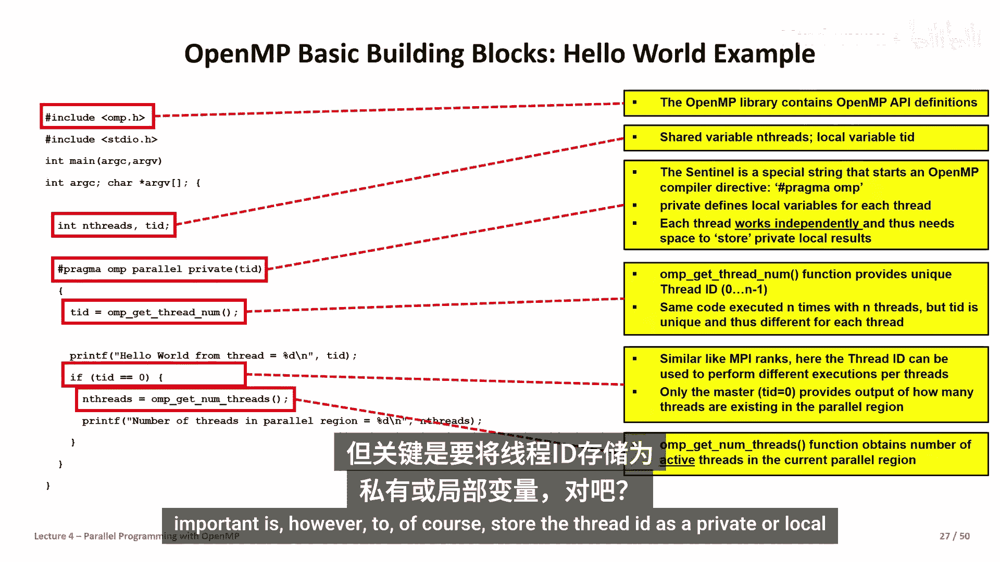
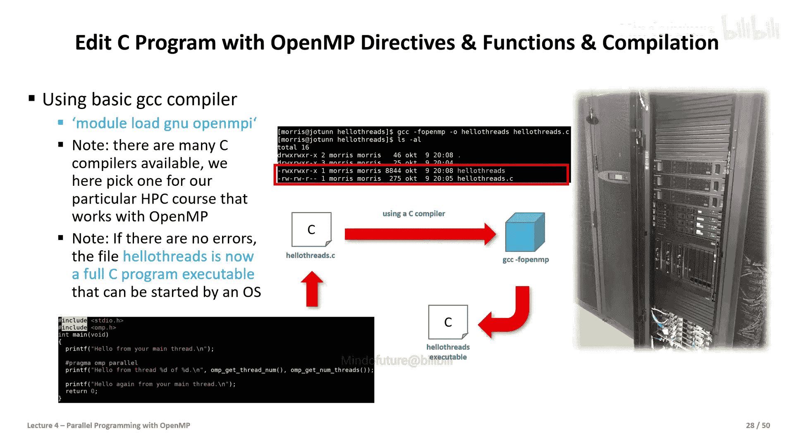
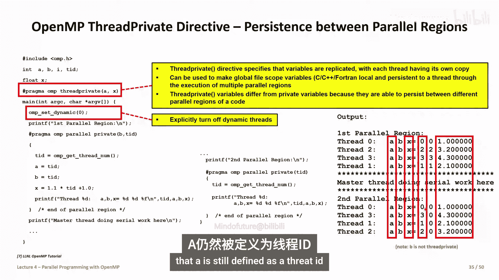
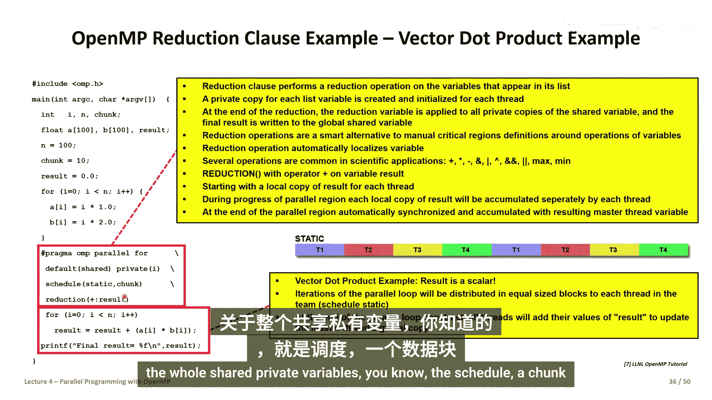
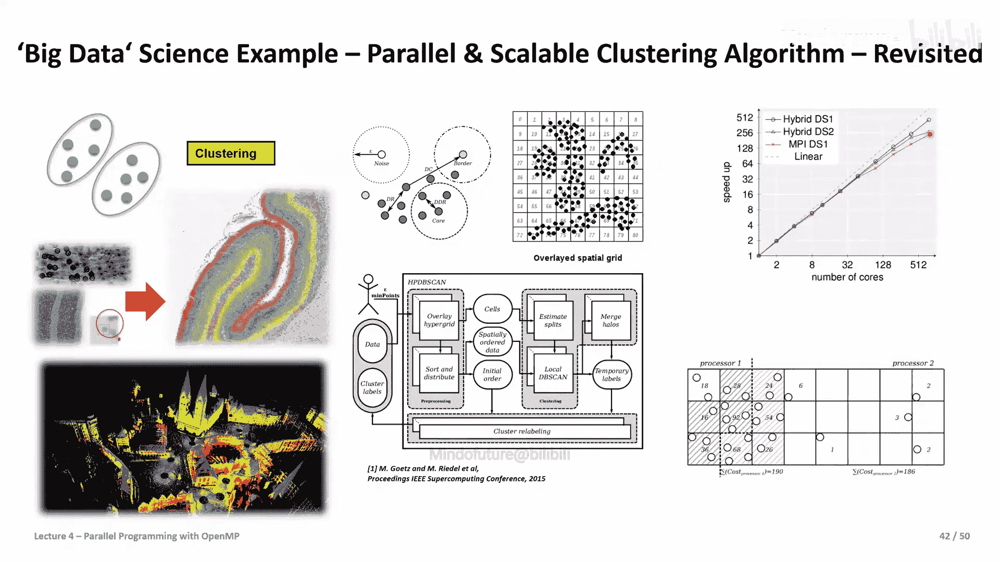
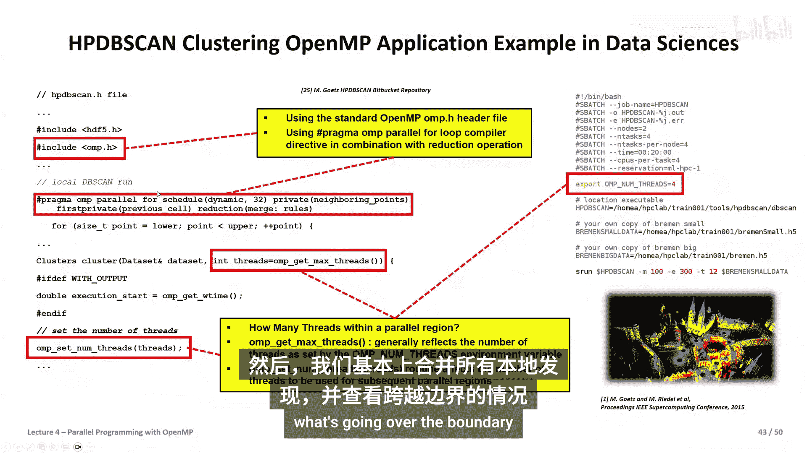
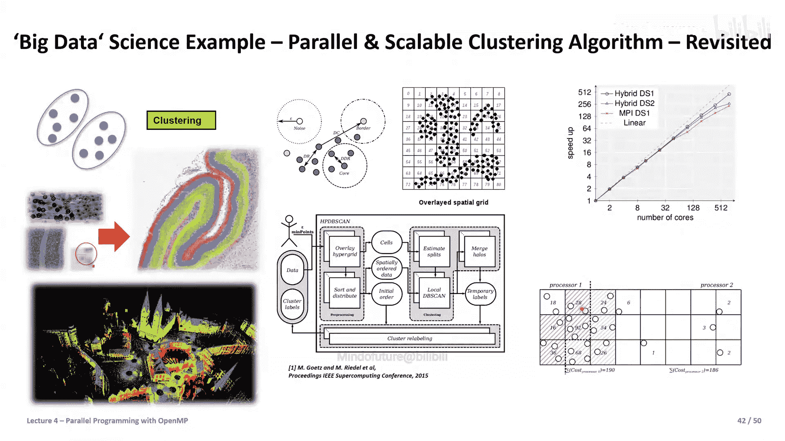
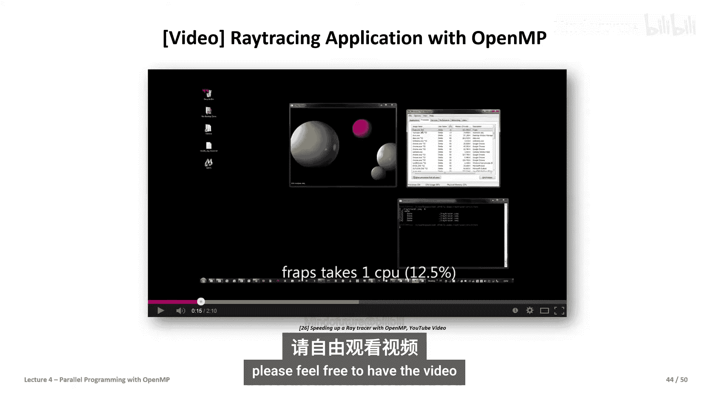

# 高性能计算课程：4：使用OpenMP并行编程（第二部分）

## 概述

在本节课中，我们将深入学习OpenMP并行编程的实践部分。我们将从编写第一个“Hello World”程序开始，逐步探讨如何利用OpenMP对循环、代码段进行并行化，并理解共享内存编程中的核心概念，如共享变量、私有变量、临界区以及数据竞争。最后，我们将简要了解如何将OpenMP与MPI结合，实现混合并行编程。

---

## 从串行到并行：第一个OpenMP程序

上一节我们介绍了OpenMP的基本概念及其与共享内存的关系。本节中，我们来看看如何编写一个实际的OpenMP程序。

OpenMP编程的核心思想是**指令编译**。我们从一个普通的串行C程序开始，通过添加特定的编译器指令（Pragma）来标记并行区域，从而将其转变为并行程序。程序执行时，一个主线程会创建一组工作线程来执行这些并行区域。

### 最简单的“Hello World”程序

以下是一个最简单的OpenMP “Hello World” 程序示例。它展示了如何通过一条指令让多个线程执行同一段代码。

```c
#include <stdio.h>
int main() {
    #pragma omp parallel
    {
        printf("Hello World\n");
    }
    return 0;
}
```

**程序解析**：
*   `#pragma omp parallel` 是一个编译器指令，它定义了一个**并行区域**。
*   当程序执行到此处时，会创建一个**线程组**。
*   花括号 `{}` 内的代码将被线程组中的每一个线程执行。
*   线程的数量不由代码决定，而是由环境变量 `OMP_NUM_THREADS` 控制。例如，在运行程序前设置 `export OMP_NUM_THREADS=4`，则“Hello World”会被打印4次。

**关键特性**：我们可以在不重新编译程序的情况下，通过环境变量动态控制使用的线程数。

---

## 识别线程：共享变量与私有变量

在并行编程中，我们经常需要区分不同的线程，并为它们分配不同的工作。这引出了**共享变量**和**私有变量**的概念。

以下程序演示了如何获取线程ID和线程总数，其逻辑与MPI中的`rank`和`size`类似。

```c
#include <stdio.h>
#include <omp.h>
int main() {
    int num_threads, thread_id;
    #pragma omp parallel private(thread_id) shared(num_threads)
    {
        thread_id = omp_get_thread_num(); // 获取当前线程的ID（类似MPI rank）
        if (thread_id == 0) {
            num_threads = omp_get_num_threads(); // 获取线程总数（类似MPI size）
            printf("Total threads: %d\n", num_threads);
        }
        printf("Hello World from thread %d\n", thread_id);
    }
    return 0;
}
```

**概念解析**：
*   **共享变量**：在并行区域内，所有线程都能访问和修改的变量。例如，`num_threads` 被声明为 `shared`，因此主线程（ID为0）计算出的线程总数可以被所有线程“看到”（尽管此例中仅主线程使用它）。
*   **私有变量**：每个线程都拥有自己独立副本的变量。例如，`thread_id` 被声明为 `private`，每个线程的 `omp_get_thread_num()` 返回值都存储在自己的 `thread_id` 副本中，互不干扰。
*   **数据竞争风险**：如果将 `thread_id` 也声明为共享变量，所有线程都会向同一个内存地址写入自己的ID，导致结果不可预测。因此，区分变量作用域至关重要。



**编译命令**：需要使用支持OpenMP的编译器并添加特定标志。
```bash
gcc -fopenmp -o hello_omp hello_omp.c
```

---



## 并行化循环：提升计算性能

“Hello World”展示了并行执行，但真正的性能提升来自于对计算密集型任务的并行化，其中最常见的就是**循环并行化**。

### 可并行化的循环模式

一个循环能否被高效并行化，关键在于循环迭代之间是否存在**数据依赖**。

**可并行化示例**：
```fortran
do i = 1, N
    a(i) = b(i) + c
end do
```
在这个循环中，计算 `a(i)` 只依赖于同一次迭代的 `b(i)`，与 `i-1` 或 `i+1` 次迭代无关。因此，可以将N次迭代分配给多个线程同时执行。

**OpenMP实现**：
在C语言中，我们可以使用 `#pragma omp parallel for` 指令来自动分割循环。
```c
#pragma omp parallel for private(i) shared(a, b, c)
for (i = 0; i < N; i++) {
    a[i] = b[i] + c;
}
```
*   `private(i)`：确保每个线程有自己的循环计数器 `i`。
*   `shared(a, b, c)`：数组 `a`, `b` 和常量 `c` 被所有线程共享访问。

### 调度策略

OpenMP允许我们控制如何将循环迭代分配给线程，这称为**调度**。

以下是主要的调度策略：
*   **静态调度**：循环迭代在并行区域开始前就被预先、均匀地分配给各线程。适用于每次迭代工作量相近的情况。
    *   `schedule(static, chunk_size)`
*   **动态调度**：迭代被放入一个任务池中，线程完成当前任务后，动态地从池中获取下一个任务。适用于迭代间工作量不平衡的情况。
    *   `schedule(dynamic, chunk_size)`
*   **guided调度**：一种自适应的动态调度，开始时分配较大的块，随后块大小逐渐减小。
    *   `schedule(guided, chunk_size)`

**`chunk_size`** 参数定义了每次分配给一个线程的连续迭代次数。

---

## 功能并行：并行区域（Sections）

除了数据并行（循环），OpenMP还支持**功能并行**，即让不同的线程执行完全不同的代码块。这通过 `sections` 指令实现。

```c
#pragma omp parallel sections private(i)
{
    #pragma omp section
    {
        for (i = 0; i < N; i++) { c[i] = a[i] + b[i]; } // 线程1执行：向量加法
    }
    #pragma omp section
    {
        for (i = 0; i < N; i++) { d[i] = a[i] * b[i]; } // 线程2执行：向量乘法
    }
}
```
在这个例子中，两个 `section` 可能由两个不同的线程执行，实现了加法与乘法运算的并发。这类似于在气候模拟中，一个线程计算大气运动，另一个线程计算海洋环流。

---

## 保护共享数据：临界区与数据竞争

当多个线程同时读写同一个共享变量时，就会发生**数据竞争**，导致结果不确定。例如，多个线程同时执行 `x = x + 1`。

### 临界区

为了防止数据竞争，我们可以使用 `critical` 指令定义一个**临界区**。在任何时刻，只允许一个线程执行临界区内的代码。

```c
int counter = 0;
#pragma omp parallel
{
    #pragma omp critical
    {
        counter++; // 确保counter的递增操作是原子性的
    }
}
```

### Single指令

`single` 指令指定一块代码**仅由线程组中的某一个线程执行一次**，其他线程会在此处等待直到该代码块执行完毕。常用于初始化或输出最终结果。

```c
#pragma omp parallel
{
    // ... 所有线程并行执行一些工作 ...
    #pragma omp single
    {
        printf("Final result calculated by one thread.\n"); // 仅一个线程执行打印
    }
    // ... 所有线程继续并行工作 ...
}
```

---

## 规约操作

规约是将一个操作（如求和、求最大值）应用于所有线程的某个私有变量，并将结果合并到单个共享变量中。OpenMP提供了简洁的 `reduction` 子句。

```c
double sum = 0.0;
#pragma omp parallel for reduction(+:sum)
for (i = 0; i < N; i++) {
    sum += a[i]; // 每个线程计算部分和，最后自动合并到总和中
}
```
`reduction(+:sum)` 子句自动为每个线程创建一个 `sum` 的私有副本，并行计算结束后，将所有私有副本的值通过加法（`+`）操作合并到原始的共享变量 `sum` 中。

---



## 混合编程：OpenMP与MPI结合



正如开篇所述，单一节点的共享内存容量有限。为了在超算集群上运行大规模应用，需要结合使用OpenMP和MPI，即**混合并行编程**。

*   **节点内**：使用OpenMP，利用多核CPU的共享内存进行快速数据交换和并行计算。
*   **节点间**：使用MPI，在不同节点的分布式内存之间进行通信。

这种模式结合了两者的优点：OpenMP减少了节点内进程间通信的开销，而MPI提供了跨节点扩展的能力。例如，在之前提到的HPD-SCAN算法中，混合编程模式相比纯MPI实现了更接近理想的线性加速比。

一个典型的混合编程作业脚本会同时指定MPI进程数和每个进程的OpenMP线程数：
```bash
#SBATCH --ntasks=4      # 启动4个MPI进程
#SBATCH --cpus-per-task=8 # 每个MPI进程分配8个CPU核心
export OMP_NUM_THREADS=8 # 每个MPI进程内启用8个OpenMP线程
mpirun -np 4 ./hybrid_program
```

---

## 总结

本节课我们一起学习了OpenMP并行编程的核心实践内容。

我们首先从编写一个简单的“Hello World”程序开始，理解了通过编译器指令创建并行区域的基本方法。接着，我们深入探讨了**共享变量**与**私有变量**的区别，这是避免数据错误的基础。

然后，我们学习了如何并行化**循环**，这是提升程序性能最常用的手段，并了解了不同的循环**调度策略**以适应不同的计算负载。此外，我们还看到了如何使用 `sections` 实现**功能并行**。



为了保护共享数据的一致性，我们引入了**临界区**和 `single` 指令来管理线程同步，并学习了使用 `reduction` 子句简化规约操作。

最后，我们探讨了将OpenMP与MPI结合的**混合编程**模式，这是在现代高性能计算集群上解决大规模问题的关键策略。







通过本课的学习，你应该已经掌握了使用OpenMP进行共享内存并行编程的基本技能，并能够理解其在更大规模高性能计算应用中的角色。