# 【冰岛大学】高性能计算课程-｜-2025-High-Performance-Computing-｜-Prof-Dr-Ing-Morris-Riedel-p17-P17_讲座_4_使用OpenMP并行编程_第一部分--BV1k34zzaEK8_p17-

Welcome back to High Performance Comping， advancedanced Scific Comping。

Today we have lecture four parallel programming with Open MP。And this is not open MPI。

 so this is not about the message passing interface。

 indeed it's about a standard or de facto standard really for using shared memory with openmp It's usually a problem sometimes that students get confused by open MPI and openmp so these are different things Open MPI is an implementation of the standard of MPI and open MP is a language we will learn today in order to do pile programming with shared memory Hence we will also use this lecture a little bit to differentiate between distributed memory。

 what we know now very well with MPI， but also a little bit you know what is the key and shared memory。

 what are the limits， what is the comparison with MPI and so forth。

OMP shared memory leads also a little bit into the space of GP。 So graphical processing units。

 or more accurately general。You know， processing GPUs， graphical processing units， GPGPUs。But。

 you know， this is something which we just sketch a little bit today in order to have them lecture 5 where we then。

 of course， talk much more about accelerators and GPUs。So。However。

 before we go into the lecture 4 in detail， it's time to review a little bit our conceptual lecture 3。

 because we see some analogies， of course， today， when we do shared memory。

 especially also facing limits， of course， because shared memory as a name suggests everybody is access to the shared address space。

 This is limited。 So what can we do about it， It's about hybrid programming。

 we learn this a little bit too。 But the parallelization fundamentals that we learn in lecture 3。

 Were also very relevant essentially for basically what we learn today。

 So the last lecture was really thinking more conceptually what is parallel computing。

 Why is there speedup， what does the speedup bring。

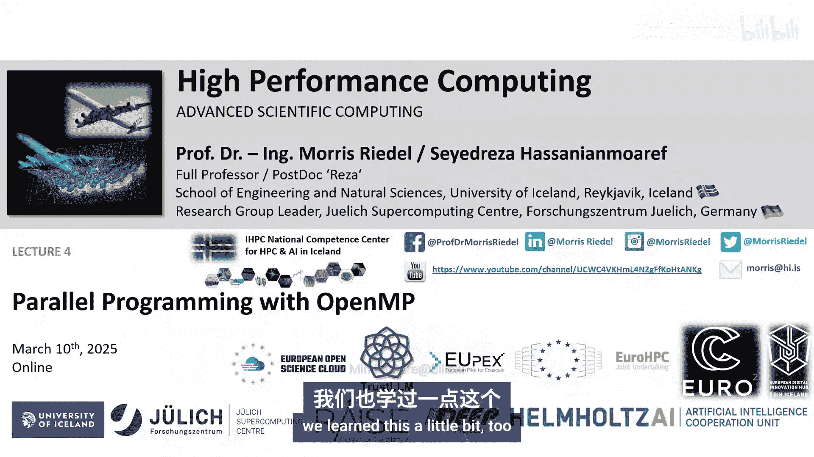

And we started a little bit with an idea， very simple。 We have an array of 16 elements。

 you see that here on the top left， which we would call now in one respect， our domain， right。

 hence the name of domain decomposition。So admittedly， this is a very simple domain。

 We come to later onces。 We remember these ones are then more heavy weighted domains where we have to think about domain decomposition much more。

 But when you think now the simple array， we learn several things with it。 The first is。In a way。

 if you have four cores available， for instance， right we have multicho these days。

 that means we can also use shared memory maybe here you know basically 16 elements of an area would be not a big problem。

 so the conceptual idea of parallelization stands， I can break this into four parts right in order to figure out the local maximum in these four parts。

 which you see they depicted a little bit。But it gave us also the opportunity to learn about some aspects。

 And this is the master worker paradigm and also some sort of load imbalance that we had the last time。

 So this is really important terminology， what we learned。

 because you learn that this is a graphic which is sort of not really true。

 because if you have even for course to break down the local maximum of all of these array。

 which might be useless， actually to do in parallel computing is just more an image for you， still。

 we see that there must be someone also computing the max global out of this four maximumims， right。

 So this is a graphic which is sort of showing not the reality， That means even if you do this。

 let's say parallelil。That's fine you have spent still some of these course having the responsibility to do the maximum of all this local ones so gather adversely all the results。

 make the computing to do the global results and then report it or write it in a file and this would mean that core one necessarily takes longer than core 2。

3 and4。RightAnd this is a sort of thing that life and you know when we now talk about real domains。

 real decomposition of larger domains， it is not at all that simple to say。

 well let's break down a big problem into force single pieces， everything is nice。

 everything is actually quite homogeneous you will find also here on the ocean right depending on if do we do you know ocean wave simulations then we see that these parts that having these processor assigned and we learned that a little bit last time with these domain and compositionposition here because the overall domain might be not mapped per grid pair one processor。

 you can have here also eight processor tackling one part of the domain but essentially you mean when we do wave propagation on the ocean。

 you see that these parts would be necessarily having much more to do you know communicate then maybe those that have lots of land in it because on land we don't do waves in other words much less load。

So and this would lead to lots of load imbalance right when we heard this kind of domain you know done。

Of course， luckily， people would be also maybe and in this context also want to compute the atmosphere。

 which is also above those styles， so there would be still something to compute。

 but the load to keep them balanced like the let's say the kind of image that you see here。

 really is not at all that simple and that was really one of the takeaway message last time from parallelization power computing is not that simple。

 just throw more course to it and it will be faster。There are many showstoppers。

 there are many ideas where it looks quite brilliant to shop down a big domain in smaller pieces and this is not at all a flight of balance load。

 hands load imbalance， in other words some of the CPUUs we have or the course or GPUs even they will be idle because they're waiting for others and that's what we also learned last time which is a no no in HPC we want to use essentially the HPC system to the maximum degree and idle resources is never good。

 Hence you should come up as a much more adaptive domain decomposition advanced material that we don't cover here。

 I gave some example of advanced material which is for instance。

 the adaptive mesh refinement that is not news and let's say computing where the mesh or the domain decomposition if you will。

 is moving along a little bit with computational requirement with the needs so adaptive means there that the gridit or basically the mesh is always refining itself。

Depending on the computational complexity。But yeah， please go ahead。😊。

And look again in lecture three is some of these terms are not still clear to you。

 another element which is very relevant for MPI and then also in some respect when we talk about hybrid computing today and hybrid programming with open MP and MPI we have this ha and ghost layers another sort of idea where we learn a couple of things with which are important to repeat so the first is that when we do simulations the wave propagations over the ocean。

 the atmosphere simulation of the next let's say 10 decades how will the earth will be this is all dependent on so-called time steps。

 usually the physical formulas we compute have a sort of idea of you know we have a certain time step and then for the next time step we compute again the physical formulas but of course we have to see how our neighboring how our surrounding has evolved as well over time hence the other processes so you could see that a little bit was here this time。

Dmenion that are modeled here with T0 and tier1， So this is about the time steps as an example and you would say that t0 will be computed and the T1 the next time step is heavily depending on the inputs from the previous time steps of the neighbors。

RightIn other words， we need to take our neighboring into account。 Now。

 the other thing to take away is that， of course， when we do now today。

 shared memory in this lecture for you， we will see this space sort of。

 which is here out of the book。 The shared memory will be also a little bit limited right we cannot put everything into the memory of one processor。

 if you want to have this large scale simulations， maybe it works for the coar grain scenario depending on what I want to do。

 maybe today， memory is quite big these days， we can still solve it with shared memory。

 but if you go to higher scales and involve maybe not only wave propagation， but atmosphere。

 land surface interactions and lots of other physical formulas Chs are that the computational capacity would be of course。

 too little。But also the whole amount of memory， the information of the whole， let's say。

Proropagation of the system， the old properties of the system。

 all of that would be not enough in memory， hence we have to talk about distributed memory and then by using this concept we learned something which we would say relieving the end of one domain into the other right。

 let's say between these blocks now that the trouble we are in is then that we are dependent in the next time step on the time step before。

 but how I should do this when basically the time step before was actually computed on another processor。

So this is something which is sort of a common paradigm leads also into stencil methods and so on。

 but there the harlo and ghost layers coming back now to this terminology have been introduced as a way forward where you will find many codes where they do lots of physics。

 lots of interactions， but before they go to the next time step。Similar like you see here depicted。

 they will fill the ghost layers of this one domain with the data on the corner of the other domain and vice versa。

 you see this quite nicely on the image showing you also that essentially what you see here and this is now referring to the term ghost this is actually in the real world not existing right it's very clear it's just a fake just to store variables that can be then used in computing the next time step and every time you see here these two takeaway the message that this is the same paradigm applied to every part of this gridit in domain and domain2。

So I think that's sort of very obvious and again coming back to the load imbalance kind of code that we have learned is more from the let's say data mining machine learning area here we have the HPpB scan and power code and you see that when we want to cluster these points which was one of the task here you see quite a load imbalance when we would have a typical grid over it。

 hence the domain decomposition might be still inspired by a grid of course。

 because it has properties but the real let's say processor decomposition might be still assigned differently right you see processor one has just this fraction here by processor two has quite a big grid domain but the point is that the most of the computing will happen here by to cluster it into one cluster it's very obvious that these are outliers or maybe they form a cluster and these are outliers they're far away there's not much to compute about you know basically Euclidean distance。

And so on。Hence， in other words， load imbalance can be very quick， not only in simulation sciences。

 but also we see here in a data mining application as well。

And then we went on and said okay speed up is something we're interested。

 so more course should mean you know fast execution and when you see that here we saw essentially two laws where we have essentially putting more and more course to it and a certain tail off means we have this kind of strong scaling idea right and here the idea is if you remember a little bit like keep the work constant right of course you have hear different ends。

But you have in order to， you know， show then these different， let's say types of what you do。

 but in each of the different adding to the number of course， you keep the word constant。

Now that is very different from weak scaling and again we see here the quite difference。

 we change the particles per core， we didn't change them here。

 they stay remain the same right in strong scaling plots in weak scaling plots we see that ra we give them more work the course basically in terms of getting more core the simulation gets also bigger because we keep the particles per core more and more constant and with this we are filling。

 let's say huge machines you see here 460，000 cores even on an older HBC system but it doesn't matter but the same problem applies that you know you cannot just always increase the number of cores and it will be just growing and growing in terms of you know the efficiency that we then see there will be communication overheads more and more when you use really half a million cores and approximately here so there will be several different show stoppers that gets away。

From the EL performance and this is another part which is really let's say showing a bit the trouble of speedup you cannot just throw more and more core and will be always better better and there will be load embalancing as well or let's say the efficiency goes down in other words the CPUs or the GPs even don't have enough work to do and parts of it is again id also so。

So this is something， you know， they wait for communication， for instance， instead of compute。

So these are very important terms。But you have lecture3 to look at this so let's go ahead with lecture4。

 which is now parallel programming with Openmp， another practical topic because some things you will do in your assignment and this really starts with shared memory programming concepts we will learn openmp has several concepts called regions what is a parallel and serial regions we will start with and then quickly how we talk about threats instead set of processes hence we will fork different threats to do different work and this is sort of let's say some say in my course easier then you do an MPI because you sort of do a let's say not really programming of this。

 but you change source code to be in parallel and I will make the the point of it when we talk about Sinel and so on and so on but before we go into the details of programming really I want to also show some benefits of using OpenM because in some respects shared memory can be even done with normal Unix code C code。

the question why openmp exists and the standard which enables us then of course better portability and then there's also this motivation where I said we can always you know combine shared memory distributed memory we'll have a look at this where we talk about hybrid programming motivation and then of course these days we do lots of python so we also will look at some Python ideas。

To do it coming to Pcoms and comps which then leads actually to a bigger picture that when you talk about already these tasks that you give different threats。

 you easily can come to the idea of a rather big wordflow a taskbased execution and following the data flow instead of just think about always computing and this is something what we will also show you with Os and so on and the second part will be then really looking a bit more to the practicalities of using openMP is our hellello threats program of course。

 first basic building blocks of sentinel， how you shared memory。

 what's the difference between local and shared variable types and how you can quickly paralyze loops for instance by doing let's say source code that is influencing the shared memory address space it is also important to recognize that we have some regions where this is maybe a little bit critical or you need synchronization on it。

Several different threads want to access maybe one variable at the same time， not for reading。

 but maybe for reading and writing at the same time。

 so lost updates and elements that you maybe know something from databases。

 maybe if you have to read some lectures about this。

 there have similarr problems with lost updates and so on if you' not to do a proper let's say protection of these regions and we talk about this and the second part of the course and before we close then was the second part it's important to understand really where the difference are between MPI what are the performance issues。

 what are the limits of shared memory， why we need hybrid programming essentially and of course there will be some application examples along the line。

So with this before fill some promises， of course， from earlier lectures where we said， okay。

 shared memory is not what we focus on， we focus on distributed computing in the beginning to also work now in your first assignment before we now come basically to this assignment with shared memory。

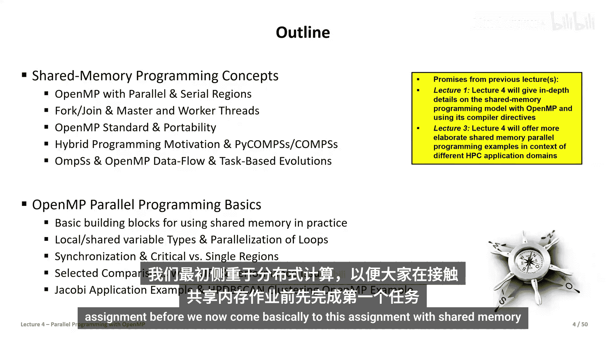

With this， you basically have an idea that scalability is a enabled by hybrid computing and still the tasks and threats that you can execute that are really data intensiveive ideas when you want to have a loop and so on and work on data so you are basically already having the counterpart of MPI to do really complex aspects of power programming not even maybe going into hybrid programming at the beginning。

 but this would be certainly something where shared memory at some point will be having limits and it's very obvious that you then have to go to MPI and we will show you some examples with HPD scan for instance how you can combine this。

And of course not the complete source code we would otherwise need a complete hour just on the source code。

 however， with this lecture today you have again a very complex aspect of power programming understood。

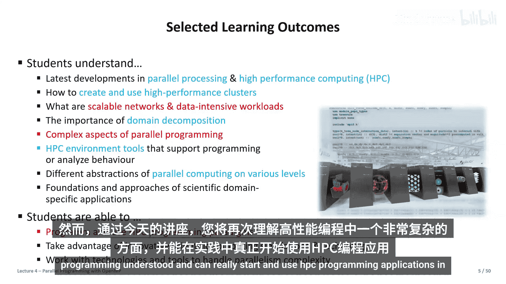

And can really start and use HPC programming applications in the in practice。

So let's go with shared memory programming concepts and there are basically two varieties of these shared memory systems。

 you know that already from our first lecture there's this unified memory access and the CC Numa the cache coherent non-uniform memory access basically these or the developer are still let's say very similar it's a cache current idea will protect the developer of thinking that it is is inherently a distributed system so it is a shared memory system because we have this cache coherent link we learned this the last time right and of course still the cache current protocols still as developer and you see that a little bit here gives us still the idea we both interconnected it is all one shared address base although it's in fact distributed hence we as developers don't necessarily need to know this or basically we're not program against it and can port applications to it because the underlying。

Cash current protocols will help。In general and this is now an important part when you see here T1 T2。

 T3， I was alluding to this in early elections as well that we are not talking about processes here anymore。

 but more rather lightweight processes that we are calling threats and each of these threats of course。

 as the name suggests is you address having access to the shared memory address space that you see on the right hand read and write variables do something with them。

 of course， and this is now really the idea of shared memory and openmp is now the dominant shared memory standard that we're going to use today。

 which essentially is now interesting to understand that it's much more let's say changing source code with so-called compiler directors。

 marking parallel and regions， So we're not talking about essentially doing this message exchange with MPI if you remember that's by modeled it a bit differently where we said from a to B。

 we did a broadcast， whatever here we're talking about。

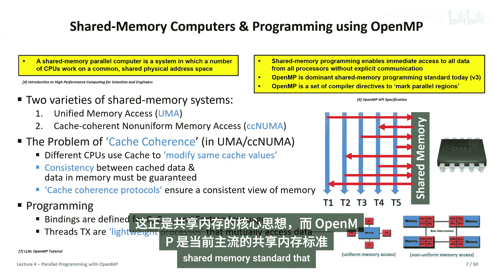

Pilot directive so the communication essentially is again not really there。

 but rather you know through the shared memory address space， of course。

 so let's look at this a little bit Uma and CC Uma quickly again。

 although by now you know the effect that these are almost similar from the programming but of course from the architectureural design on the chips and so on a bit different for us however。

 it's important to understand that you know the memory model that you have。

 including caches is of course very beautiful So when I say you have to use distributed memory that's of course not really necessarily for speed because you know having so many level of caches and this is by fast you know this is the fastest that you can have to have storage you know getting back into the let's say chipset itself to do really work so hence memory is expensive right so and this is the fastest option but as you also know。

It has a certain amount， so basically this can also not be changed of putting more and more memory to all the course so hence in other words we really need let's say extension of this and。

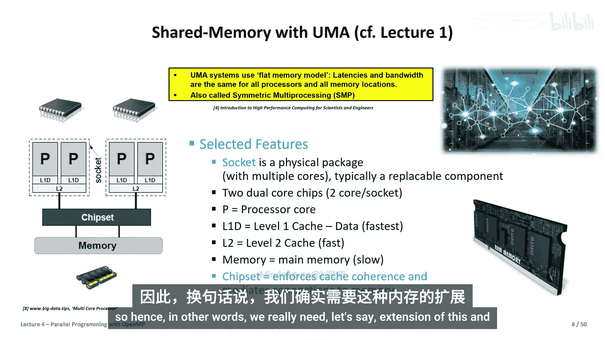

A little bit you see that here with the extent of CCNummer systems where the network logic we said already has this cachehe coherent link where we have different。

 let's say distribute memory systems， but they are designed with this Ke coherent link again like CCNummer system which means it is for us as programme is not really visible that let's say different memory spaces and again we benefit of course from the different layers of caches here and so on for each of the different processes。

So in this ideal world， you would say why we don't have just large CC doma systems。

 but also this is not really possible at scale， hence we have at some point in time the limit that you see here enforced by this memory and this memory of the let's say physical space in the memory that even it maybe an aggregated single address space for speed。

 but still is limited in terms of scale。

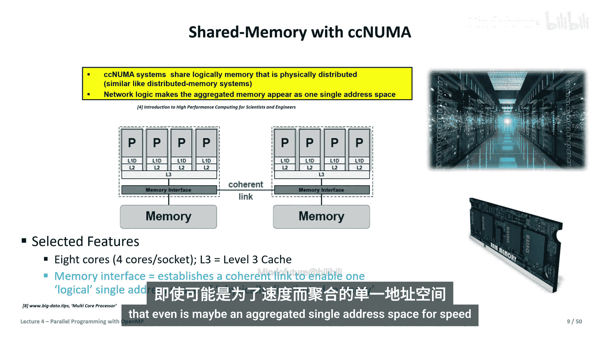

So meaning also we have to talk a bit about the shared address space。

 but I think many of you that had the basic lectures and computer science at least should know a little bit about this that。

 of course you have here two examples， you have two。

wo threats here which have their own data right and their own stack with all the data。

 but when they now write into the memory right this is during the execution。

 they have their own private data per threat and the same variables maybe but when they want to write something to memory they have the shared address base and this shows you that you know one thread might write into the shared address 23 then another threat can actually use it and users here was know a simple addition of plus one and can actually work with it so read and write its simple。

 we don't need message exchanges we just have the variables however you notice also it depends now if really thread one was finished in order for thread2 maybe to start so you see in other words is two green and red line show already some of the trouble that could come that how to understand that the memory variable was written at the correct time is read at the correct time and not at the same time。

And so on and so on。So and this is where openmp helps， for instance， but also for other things。

 I give you also a kind of visual interpretation because I know that we have also several bachelors maybe from other fields and computer time a computer science so that maybe are not so familiar with this again the point is that the processor can still without really message exchanges right into the memory and read into the memory read out of the memory and this is true for Numa but also CC Numa sorry Uma and CC Numa which you see yeah so in other words you don't really have to program any message exchanges that we had an MPI we access a local memory I think I have repeated this enough so let's come to the openM as a library or being one of the de facto standards really in high performanceform computing for shared memory and。

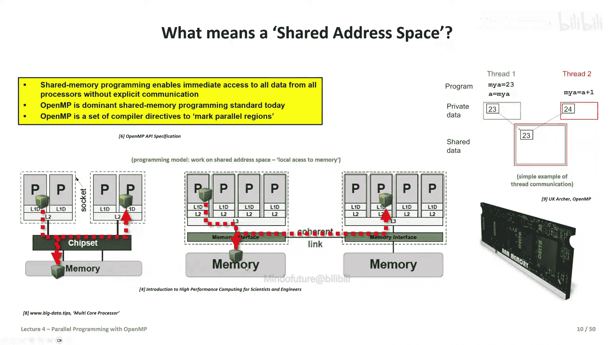

Basically we mark parL regions in a code which is essentially serial right so and this enables us still lots of scalability。

 we can have speedups actually， and also we of course need to have let's say specific workloads and so on that matter to the problem and the suitable data let's say idea how we then can do this parallel and processing for instance the loop which will come later too。

And it's important when we talk about OpenM that you think about much more threats， right。

 lightweight threats that are basically lightweight processes， right。

 having then the share of the common address space， but their own variable stack and so on。

 and they're a little bit less heavier than a complete process。RightSo this is an important part。

 When you think about this coding， think about threats and not processors。

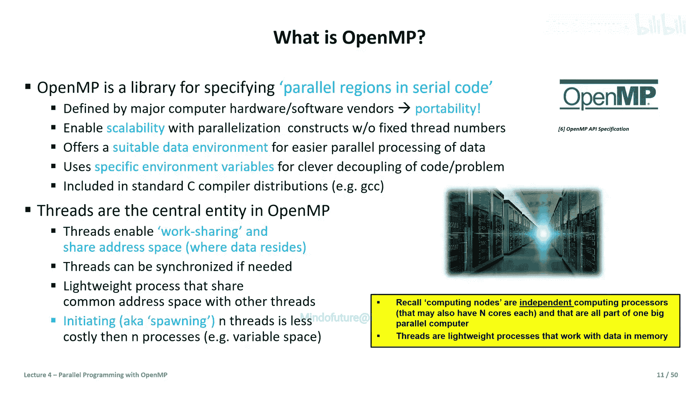

And the way how it works is now influenced by several important terminologies from the old man piece done at so first。

 you would say you have this master threat and this shows you also quite nicely the picture that we had we see array where it was you know having the maximum of the array you could depict it here you would say。

 okay， the master threat is working then we want to have a parallellor region where we do the maximum of the array here we have five not four threats work unit it and then you know you join and in the zero region you would maybe do the max global right and still the master threat has to work here。

And the master threat becomes the first threat also in the parlor region right and then you do something else as a team of threats which not necessarily needs to be5 could be four etc。

 and this is sort of the openMP program idea in parallelization so you see that there are some elements in the source code where it actually makes sense to do par but others they keep it serial。

And you see that a little bit here in the same analogy， you have a sequential part， a parallel part。

 this is a parallel region and then we go back to sequential and then again a parallel region etc。

 how you do is a socalled you know this is sentinel you see here this pragma or MP parallel。

 this was what we call a sentinel and stands usually in front of a parallel region that can be many different things could be something you know。

 you know as loop， for instance as a simplest perhaps and you see here different examples basically in forran and in C。

So of course， we still need C， so OpenMP is essentially just influencing then risk compiler directives the C execution。

And this is something which you really have to understand here right so we're influencing the C code which is inherently serial and just by adding some compiler directives。

 I make it parallel still the C code needs to be programmed in a way that this is actually possible and we will make some let's say。

 points on it。

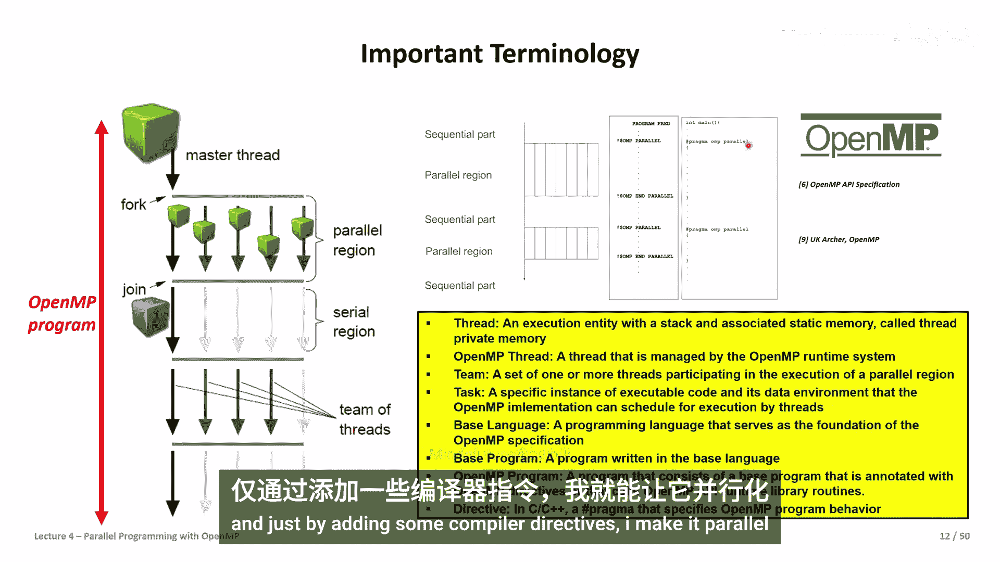

Importantport is also to understand not only the serial regions versus parallel regions but also that the master threat has a life that goes through。

 let's say the whole MPI program so it's a backbone right of the openM program where you have the master threat here。

 parallel regions that in three threats something you see that nicely depicted here。

 it always survive so to speak even if you collapse the parallellor region we are back to the master threat to keep the whole work and to keep the whole let's say idea of the par program working again heres a good example when you come to this you see there's a function you call in the serial region which is just executed by the master threat and then you havemo MP par where you then execute Billy a couple of times depending on the number of threats and we will come to that how you steer the number of threats doally perhaps。

And this will then also collapse at some point in time and done the work and then we do a serial work here was Daisy。

 whatever。

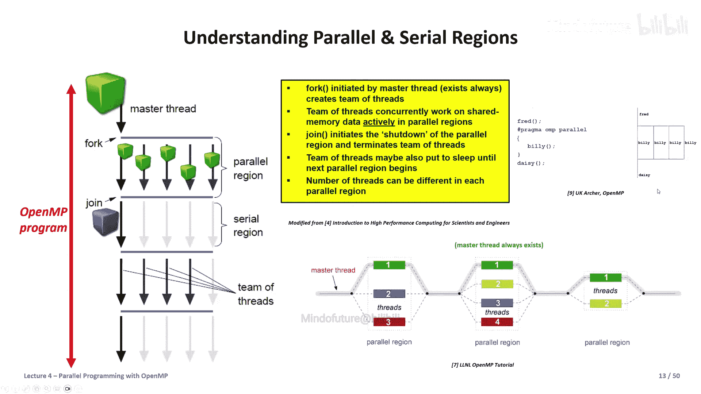

these are just examples。The benefit we have， of course。

 is then thinking about a standard that also enables us to see the bigger picture of HPC machines。

Right now， again， the portability is something we are very interested in because in your HPC in one of the earlier lectures you learned。

 we have many different systems in the union。 So chances are that you get computational time on one and continue as another。

 you know computational time and on some other machine and you want to have your open MP program working。

 And of course， you remember that also from the MPI lecture， right。

 so this was sort of the similar idea as MPI， let's have a standard so that every time we use another HPC machine we can。

 let's say， port an application not only MP but the open MP and also the hybrid ones with this。

Of course。This has limits I mean first of all given the quantum momentum now this is not working directly with quantum computing systems right here we talk about different HPC systems however you also have to think about different vendors at different technologies the amount of memory that you have pair node is maybe completely different right an older HPC system is a new one the clock frequency of the CPUs in other words the speed might be very different so in this sense also the whole openmp application works different with the threats。

So this is all of course enabling you a basic portability and works quite nice if you adhere to the standard OpenM。

 but still of course there are limits in the end other end and you look you know all the different heterogeneity of the systems still it's good to take this basically into account and you share memory and especially then also of course when you think now about the bigger picture be said basically the large HC systems are programmed in a way that they let's say more hierarchical hybrid computers what has less to do is essentially that you see here node where you maybe have let's say a shared memory system here you know they all can happily access the shared memory system but when you want to have a bigger and bolder assimilation that doesn't fit into the memory or you want to have more speed up you always have to add some other node but with this you can't access the memory anymore you have to use an。

Network interface， the communication network that you do。

 and you do this usually by using MPI messages。

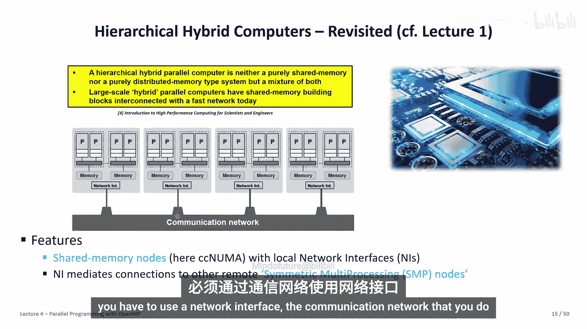

Hence， this enables us now to think a bit more about hybrid systems so just have some motivation and I would give you also here a link to some tutorials for those of you who are really and I learned some of you during the industry projects in our course so that's really good to know that some people are really interested in MPI programming and and doing much more and you have here in praise tutorials quite a hard amount of of materials right videos tutorials which go far beyond the materials produced in this lectures because we have our HPC not only focusing on MPI and OpenM So also here you see with the openmp videos here it's something that you really can。

Let's say have a good insight on how to do openmp and then also combining this with MPI videos here。

 you will learn how to do more hybrid system programming where you combine them the power of distributed memory and shared memory techniques right so and this is the point where I said also on the other side maybe you know MPI instead of。

 you know open MP would make no sense。RightYou would copy what you see here as an example because。

 of course， essentially you could say one processor talks to another， you can do this， right。

 you could do within an node MPI， but it usually is not really very useful because you will copy the buffer if you remember in the memory。

 what you want to send， but you also of course， have a copy of the buffer what you want to receive before you write it to the variable。

 So in all in all， it's quite a big overhead because you have the access to the shared address space。

Right so this is sort of a memory copy with MPI and to do this this is sort to speak not really useful hence by programming them。

 you would do different things and would rather see essentially that you program within a node to shared memory right and this is always possible if your paradigms and of course。

 in the second part today， we will also learn a bit about the programming of it or sentinels and how we see this variables a parallel regions and sentinels。

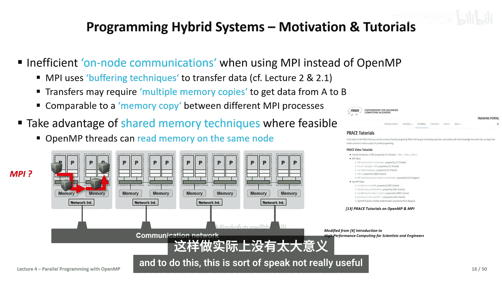

But of course we know then of course it is limits and for instance。

 the memory is not enough for your application， then you think about distributed memory across the nodes。

 hence the hybrid programming stands a little bit for it that you know you have always you know this kind of idea shared memory within the node to really leverage the speed of the caches of the memory it's fast。

 but limited in terms of size， So every time you go across the node you do now MPI messages and this is。

 of course， an opportunity to scale up quite heavily right as we see with some of the applications So you see that also a little bit here depicted again。

 openmp within the node right in each hole itself of course。

 can use openmp so you need to have your application in a way done that some things can be speed up in the different region thats say from your domain decomposition and then you know basically compute the wave height。

 for instance， that we。all over the ocean using open MP in parallel within the node to leverage maybe the whole。

 let's say， idea of the caches and the memory access。

 but then when you see about the bigger time step of the old ocean。

 you have to communicate with your neighbors so what was my wave height here with shared memory in order to communicate to the others。

 my you know wave height with NPI。So over the network， over the node。

 and this is sort of the hybrid system programming idea where you now combine MPI with OpenM。

 which is very often done in applications today， right。

 to really have domain compositions that are scalable and that are also。

 let's say giving you the opportunity to go way beyond the typical memory you have。

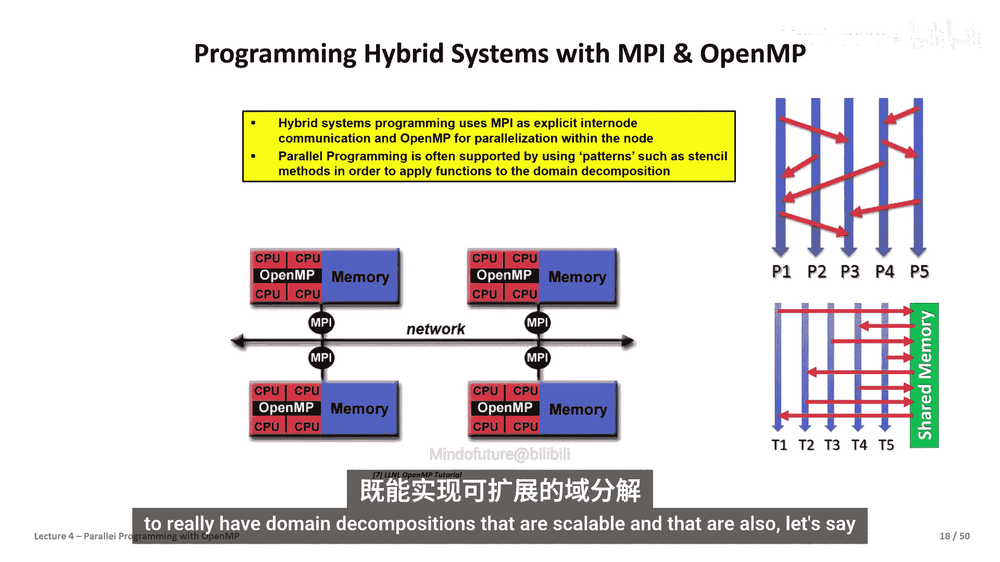

And one example I want to show you is out of our own research。

 I already gave you this example as the MPI example because it's also an MPI code right。

 and you have here this DB scan algorithm we call this HD Vican because for high performance computing implemented from Marco Scs one of my PhD students in the past who finished is PhD already and。

You see quite nicely in the scaling plot that we did at the time that the MPI was some data one。

 you know， which is essentially different data sets here of the city to really cluster back from a point cloud measurement just basically points in space。

 we cluster back the city parts So based in the buildings based on Euclidean distance again。

 or'll close other points and then giving different colors， etc， etc。

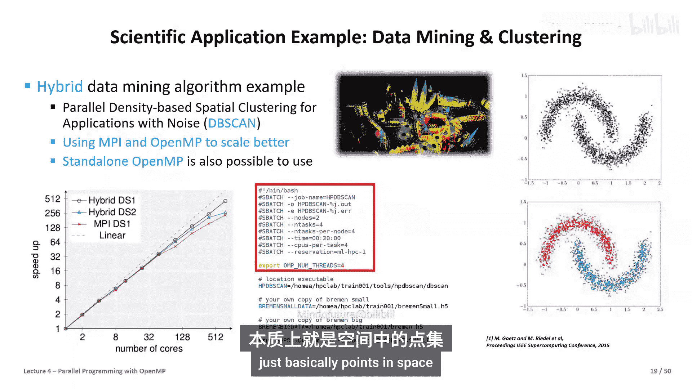

But here is something where you clearly see with MPI at some point in time we break off with a performance right so when we add more and more cores to this data science problem。

 you know there's some trouble and overhead with it。Now， when we do dispose different data sets。

 a smaller Bramen and a large Bramen data set and add here the hybrid one。

 where we actually implemented Open MP and MPI in parallel and using it in parallel。Hence。

 the code can be used with MPI only， or you switch on。

 let's say that within one different region of the clustering。

 there should be also the power of shared memory used by using open MP statements。

You essentially are the hybrid domain with different data sets and you see that you already actually scale better right Well data2 is a bit an unfair comparison because you know we have to see data one here。

 this data set one， you see definitively the hybrid version is scaling better I still of course the ideal scaling here that you see what you probably is hard to reach for every we usually say something it is near linear scaling right so it's not directly linear scaling it will be always breaking off at some point in time。

 probably especially if you're now talk about extra scale is also coming up in Uli like Upiter。

And the way how it works is a little bit。You know， influencing also the job script that you by now know very well from my MPI right so and also thinking about much more these elements and tasks per node。

 right， we were for the last time we thought about nodes and tasks。

 but we didn't thought about too much what are now the tasks per node and and basically we we kind of crunched down the problem even more in detail。

He， right。And CPUs per task that you see there oops。

 that was a bit too fast and we give then also here different threats as an input， you know。

 as a kind of input to the application so that the application can know how to expect how many threats it can expect and with this the implementation of this or that say is done really in a high performance way that this is then much more better than just using pure MPI。

Good， so before we break today， I also want to give you some。

 let's say out Look how it also influence more and more GPU design。

 And I think here ons and the evolutions ofM where you think shared address space can be also a little bit the idea of a device memory now。

 right So we have the host memory of the CPU and the device memory。

 we have learned that a little bit already in earlier lectures and we will dive into more detailed definitive lecture 5。

But you see also here how oms over the time， basically has influence the open and P standard right in P5 and more these days and。

To a way that there's more and more of view， perhaps。On task computing， if you will， right。

 So what are the tasks that are computerd with this and seeing bigger pictures。

 And that's why I like to show you this。 But this is something what we don't really want to tackle too much in the courses is about workflows。

 larger view of problems， dependencies and trees of executions where you can essentially see that when you break up one serial source code into parallel parts that are dependent on each other。

 you come to sort of an execution tree， right and part of this needs to be parallel。

 we see here some sentinels right， where have the task idea already basically shown here from Oms where the programming model is much more task base and just having a parallel region and you're on your own。

 So you can have a couple of more influence if you want。

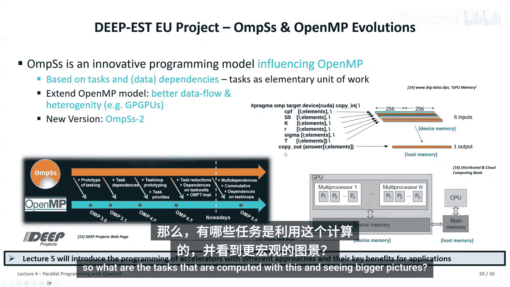

And this is sort of driving more and more the open and peace done that。

 you will see here also different ways how you can now do the parallelization over different domains。

 really， up to maybe also here， functional decomposition a little bit。 you know。

 what are these different you know， elements doing and having then inserted some task dependencies on this。

So this is all something which OMS stands for。

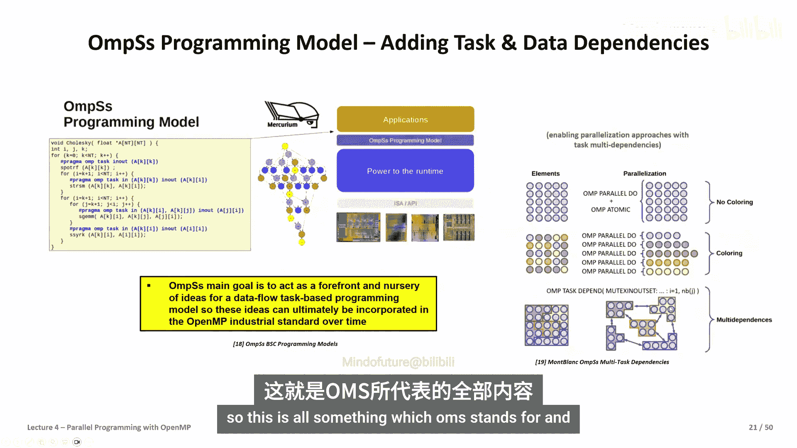

And leading also to some development of Pycoms， which is in， you know。

 trying to do similar aspects now in Python。And it's basically a framework to have applications now on a bigger picture right so where you want to have some tasks executed and openmp is very low level。

 it targets one shared memory， but with comms and Picoms now you think bigger and think that it might be not only this one HpC machine there it could be also two other HPBC machine somewhere as long as my task executed could be maybe even using some EC2 cloud parts。

I'm fine and of course， the bigger your problem you might be needing this right again thinking about the you know restrictions that shared memories。

 you know not so let's say powerful in terms of the size of the memory So here you have a way of making you know applications bigger and that's also sort of showing you how the developments of you projects you have seen a little bit also the deep project again。

 there were some developments on on this also in within the project that also influenced the openmp standard again。

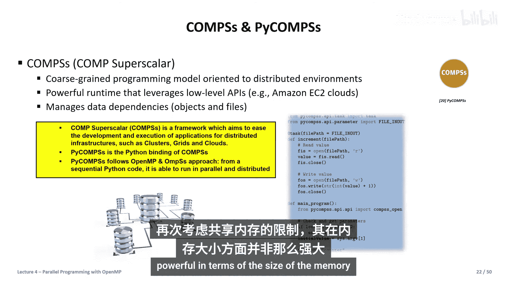

So much for the openmp overview right which we had in the first part you see in ocean wave simulations I was talking about this a lot。

 so here you see an example oh this work with CFD Razor will go in later lectures also much more into CFD。

 but this would be one example where you can have a small ocean part perhaps also simulated nicely in shared memory but then if you want to have the whole scale then you'd quickly at the hybrid programming。

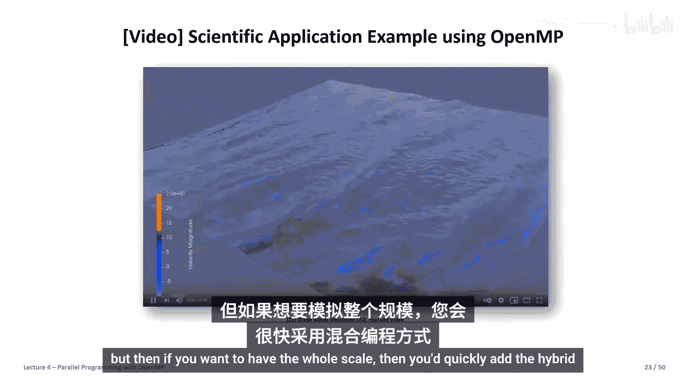

We stop here before we go to real programming basics after a short break。

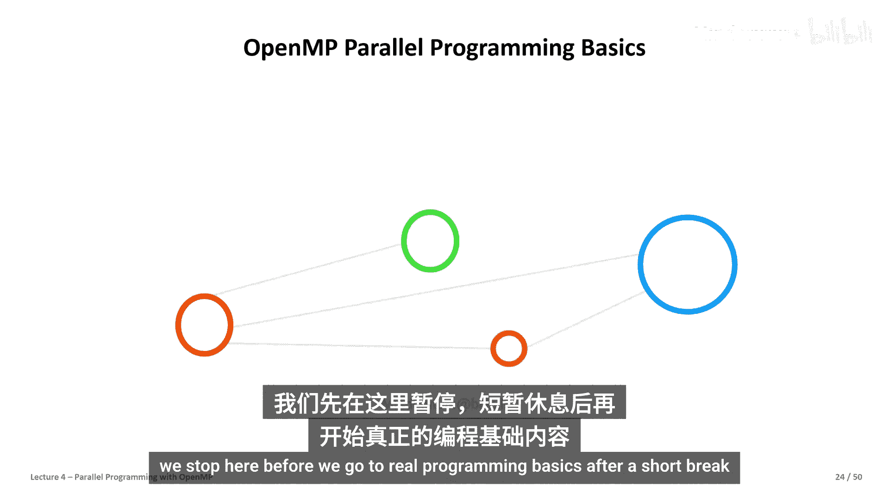