# 高性能计算课程：4：使用OpenMP并行编程（第一部分）

## 概述

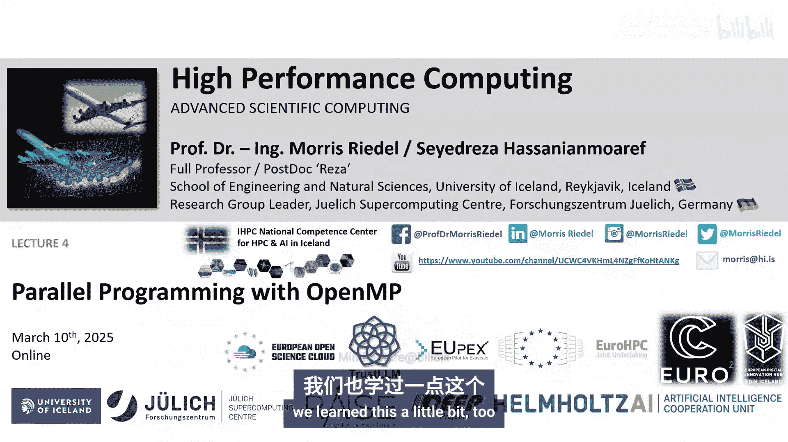

在本节课中，我们将要学习使用OpenMP进行共享内存并行编程。OpenMP是一个用于共享内存系统的实际标准，它通过编译器指令来标记并行区域，从而将串行代码并行化。我们将了解其核心概念、编程模型，并将其与之前学习的MPI进行对比，理解共享内存编程的优势与局限。

---

## 回顾：并行计算基础

上一节我们介绍了并行计算的基本概念，如域分解、负载均衡和加速比定律。本节中，我们来看看这些概念如何应用于共享内存环境。

在之前的例子中，我们有一个包含16个元素的数组。如果我们有四个可用的核心，可以将数组分解为四个部分，分别计算每个部分的局部最大值。然而，这引出了两个关键问题：

*   **主-从范式**：需要有一个核心（主线程）负责收集所有局部结果并计算全局最大值。
*   **负载不均衡**：主核心的工作时间可能比其他核心长，导致其他核心空闲等待。

在真实的科学计算中，例如海洋波浪模拟，计算域的不同部分（如海洋与陆地）的计算负载差异巨大，这会导致严重的负载不均衡。高性能计算的目标是最大化系统利用率，因此我们需要更高级、自适应的域分解方法。

另一个关键概念是**Halo（或Ghost）层**。在基于时间步进的模拟中，下一个时间步的计算依赖于邻居在前一个时间步的结果。当计算域被分解并分配到不同处理器时，我们需要在每个子域的边界创建“幽灵”层，用于存储来自邻居子域的数据，以便进行下一时间步的计算。

我们还回顾了**强扩展**（固定问题规模，增加核心数）和**弱扩展**（保持每个核心的问题规模不变，同时增加核心数和总问题规模）。两者都会遇到通信开销增加、效率下降的瓶颈，无法通过无限制增加核心数来获得线性加速。

---

## 共享内存编程概念

现在，让我们进入共享内存编程的核心。共享内存系统主要有两种类型：

1.  **统一内存访问（UMA）**：所有处理器对任何内存地址的访问时间相同。
2.  **缓存一致性非统一内存访问（CC-NUMA）**：访问时间取决于数据在内存中的物理位置，但通过缓存一致性协议，对程序员呈现为统一的共享地址空间。

在共享内存编程中，我们操作的基本单位是**线程**，它们是比MPI进程更轻量级的执行单元。所有线程都可以访问同一个共享地址空间，直接读写其中的变量，而无需显式的消息传递。

以下是共享内存编程的关键特性：

*   线程拥有自己的私有数据栈。
*   线程通过共享内存进行通信和协作。
*   需要机制来协调多个线程对共享数据的访问，避免冲突。

---

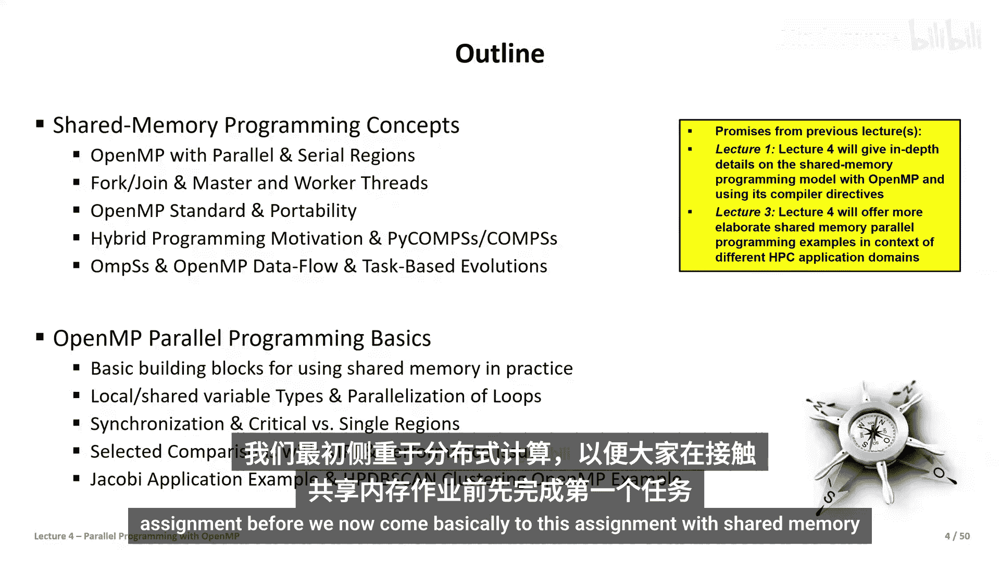

## OpenMP简介

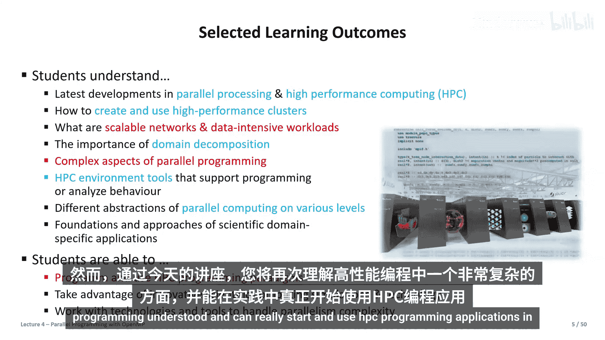

OpenMP是高性能计算中用于共享内存并行编程的事实标准。它的核心思想是通过向串行代码中添加特殊的**编译器指令**（在C/C++中称为`#pragma`，在Fortran中称为注释）来创建并行区域。

OpenMP程序的基本执行模式是**Fork-Join模型**：

1.  程序从单个**主线程**开始执行（串行区域）。
2.  遇到并行区域时，主线程**派生**出一组工作线程，形成一个线程团队。
3.  团队中的所有线程（包括主线程）并行执行该区域内的代码。
4.  并行区域结束时，所有工作线程**汇合**，只有主线程继续执行后续的串行代码。

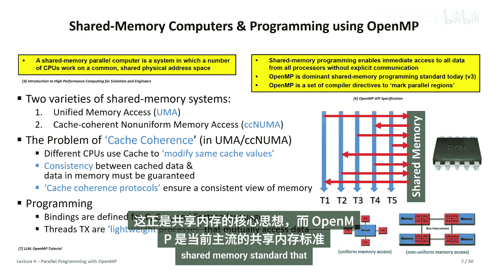

一个简单的OpenMP程序结构如下所示：

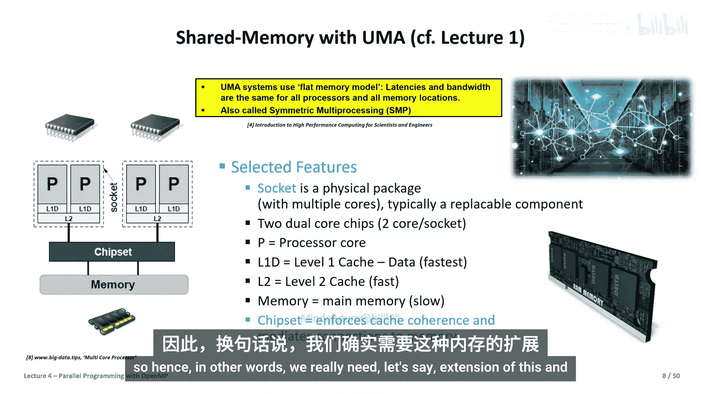

```c
// 串行区域 (仅主线程执行)
master_work();

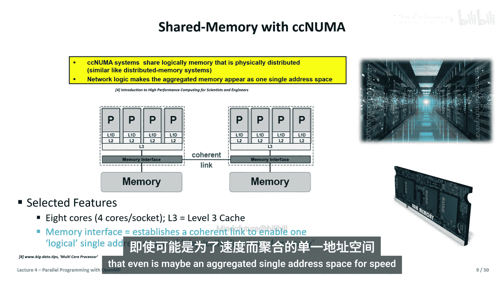

// 并行区域开始
#pragma omp parallel
{
    // 此代码块被所有线程并行执行
    parallel_work();
}
// 并行区域结束，线程汇合

// 串行区域 (仅主线程执行)
more_serial_work();
```

使用OpenMP的主要优势包括：

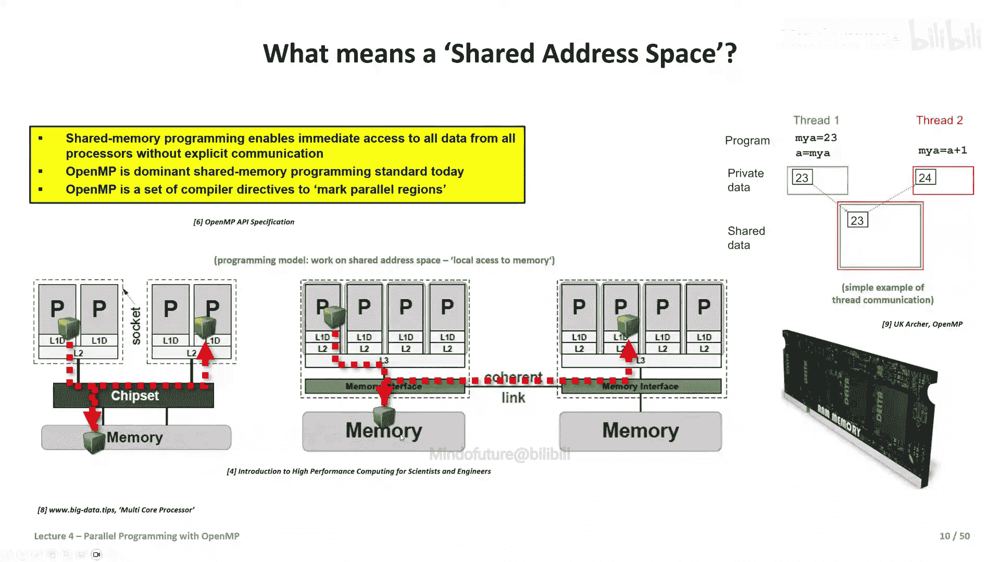

*   **可移植性**：遵循标准编写的代码可以在不同厂商和架构的HPC系统上运行。
*   **增量并行化**：可以逐步地将串行代码的特定部分（如循环）并行化。
*   **编程相对简单**：无需像MPI那样显式管理进程间通信。

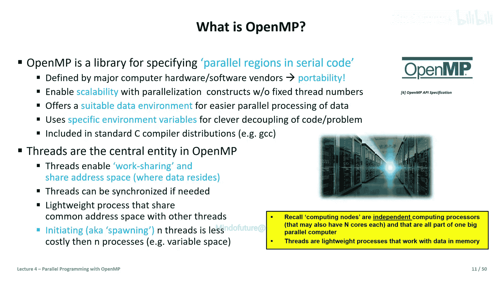

---

## 混合编程动机

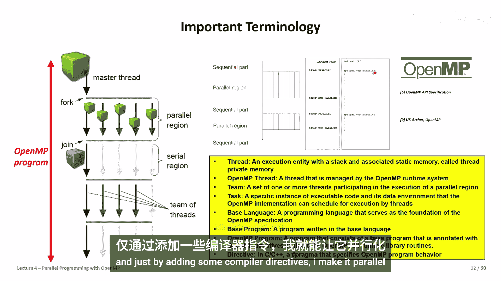

尽管共享内存编程很方便，但它存在根本性限制：单个节点的内存容量是有限的。对于大规模模拟问题，数据可能无法全部装入单个节点的共享内存中。

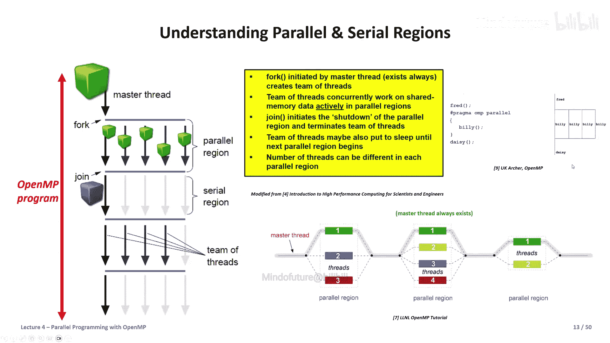

这就是**混合编程**的动机所在。现代大型HPC系统通常采用层次化结构：

*   **节点内**：使用多核CPU，内存由所有核心共享。在此层面使用**OpenMP**，利用其快速的内存访问和缓存优势。
*   **节点间**：由多个节点通过高速网络互联。节点间的内存不共享。在此层面使用**MPI**，进行显式的消息传递，以实现跨节点的数据交换和任务协调。

混合编程结合了两种模型的优点：
*   **OpenMP**：在节点内实现细粒度并行，高效利用多核和内存带宽。
*   **MPI**：实现跨节点的粗粒度并行，突破单个节点内存和核心数的限制，获得极致的可扩展性。

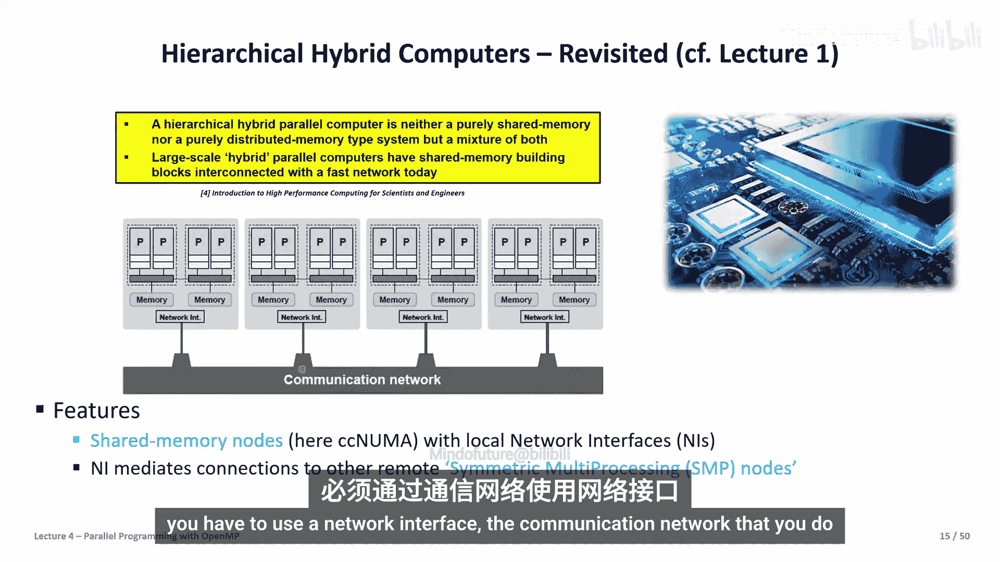

一个典型的应用场景是气候模拟：在单个节点内，使用OpenMP并行计算大气或海洋某个区域在单个时间步内的物理过程；在节点间，使用MPI交换不同区域边界（Halo层）的数据，以推进到下一个全局时间步。

**研究实例**：HPDBSCAN算法（高性能密度聚类）。下图展示了纯MPI版本与MPI+OpenMP混合版本在不同规模数据集上的扩展性对比。可以看到，对于某些数据集，混合版本能更有效地利用大量核心，获得更好的扩展性能。

（此处原讲义包含一张性能扩展对比图，显示混合编程优于纯MPI）

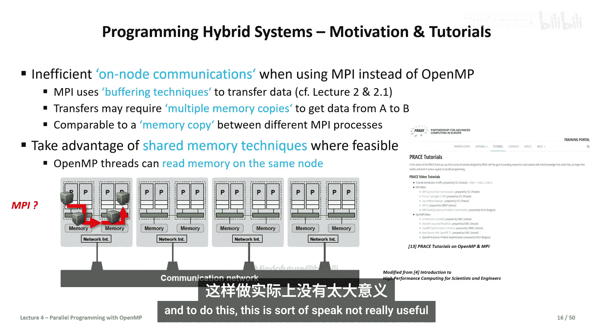

混合程序的作业脚本也需要相应调整，需要指定每个节点的MPI任务数，以及每个MPI任务使用的OpenMP线程数。

---

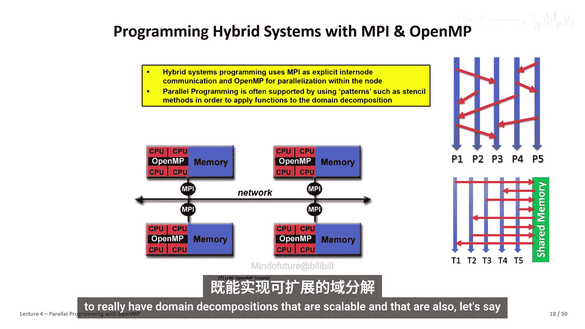

## 扩展视野：任务与数据流

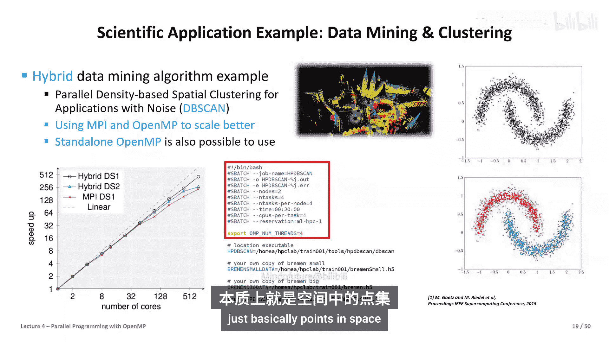

OpenMP标准本身也在演进，从早期的以并行循环为中心，发展到支持更灵活的**任务并行**模型。在任务模型中，程序员可以定义独立的计算任务及其依赖关系，由运行时系统动态调度执行。这更符合一些不规则或动态负载的应用模式。

这种思想进一步催生了像**PyCOMPSs**这样的高级编程框架。它允许用户用Python定义任务及其数据依赖，运行时系统可以自动在分布式计算资源（可能跨多个HPC集群甚至云平台）上调度这些任务，处理数据移动和通信。这为构建更大规模、更复杂的科学工作流提供了工具。

---

## 总结

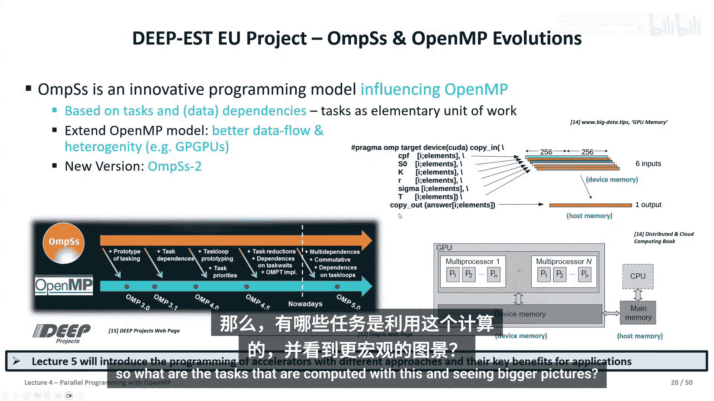

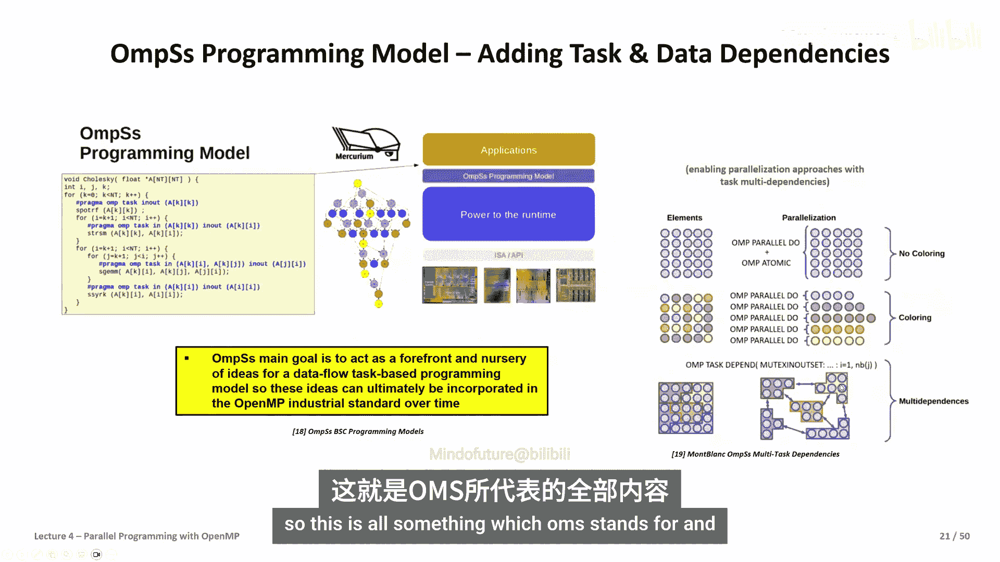

本节课中我们一起学习了共享内存并行编程的基础以及OpenMP的入门知识。我们了解到：

1.  OpenMP通过编译器指令实现共享内存并行，采用Fork-Join执行模型。
2.  线程是轻量级执行单元，通过共享地址空间直接通信。
3.  共享内存编程简单高效，但受限于单个节点的内存容量。
4.  为了突破规模限制，需要采用混合编程（MPI+OpenMP），在节点内用OpenMP，在节点间用MPI。
5.  OpenMP正朝着更灵活的任务并行方向发展，并与更高级的工作流系统（如PyCOMPSs）结合，以应对更复杂的计算场景。

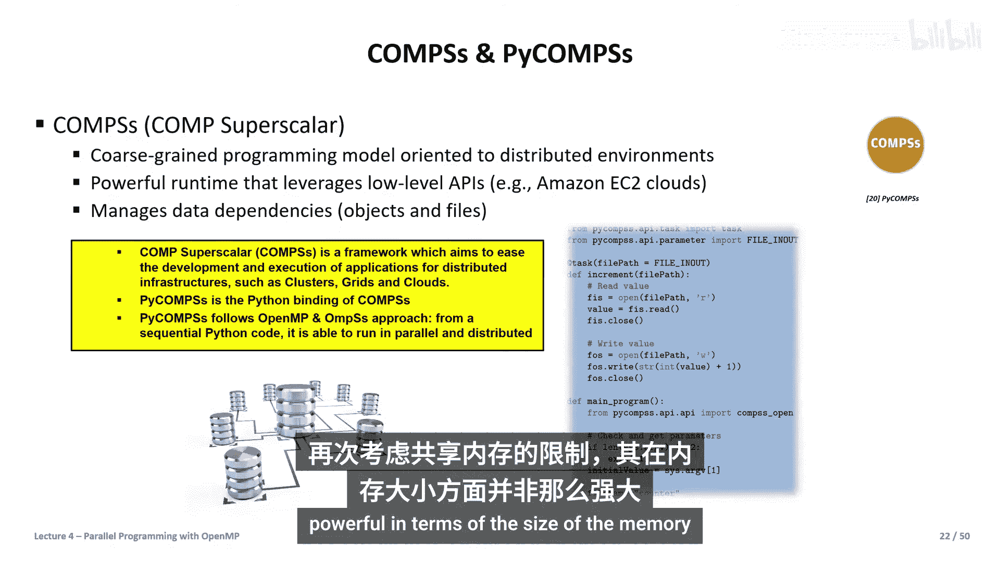

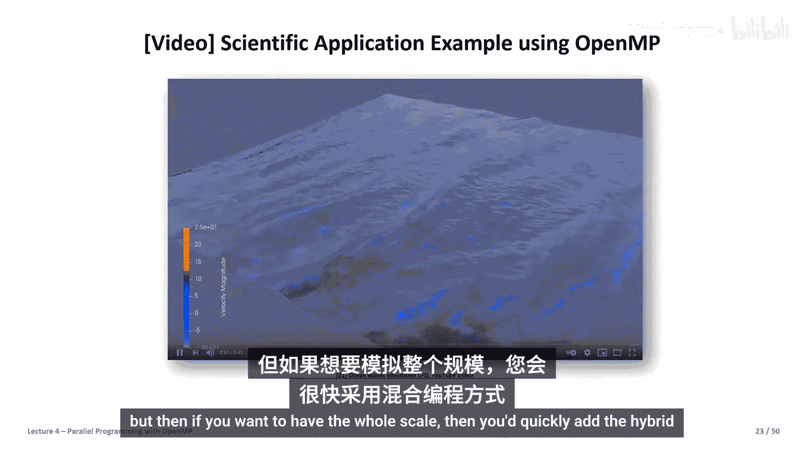

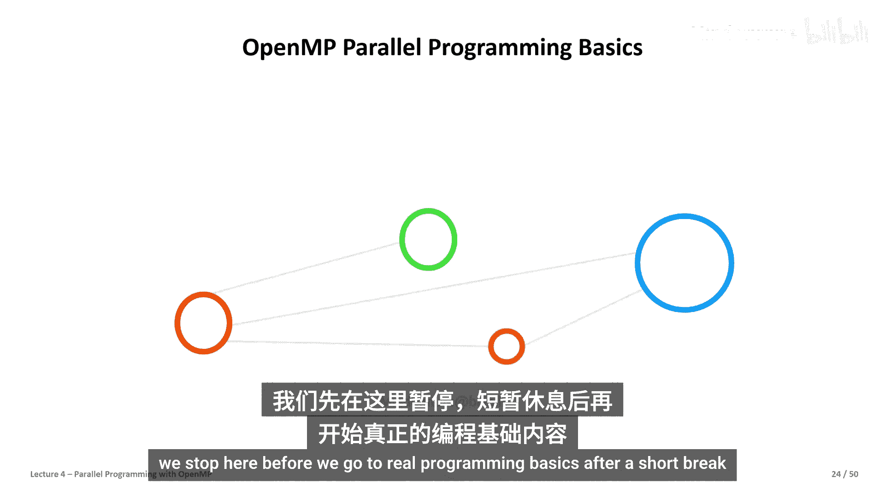

在接下来的第二部分，我们将深入OpenMP的实践编程细节，学习如何编写第一个OpenMP“Hello Threads”程序，以及如何使用指令来并行化循环、管理变量作用域和处理线程同步。