# 【冰岛大学】高性能计算课程-｜-2025-High-Performance-Computing-｜-Prof-Dr-Ing-Morris-Riedel-p18-P18_讲座_3_并行化基础_第二部分--BV1k34zzaEK8_p18-

Welcome back to High performanceformance computing， advancedance scientificific computing。

 we have our lecture three， parallelization fundamentals and the second part of it。

In the first part we clarified more in deep details。

 domain and composition as a sort of terminology in HPC， which can stand for lots of things。

 data parallelism， functional parallelism will have an influence on this as well we had the example of different codes working on different areas。

 let's say atmospheric level and surface level which would be much more functional modeling they saw。

The physics differently， but interact with each other to really give a real big picture。

 And in similar ways， we have seen then the interesting stencil methods that although they basically compute for every tile for every grid part。

 always the same， right， it was。Basically the idea that we had to see a Kobe the heat in the room。

 for instance or any other physics you want to do in this area， the weather prediction for instance。

 they would of course have then in this particular areas of the grid the same code to execute but with different data hence same program multiple data and this is usually a big paradigm and we have also seen in order to do so and simulate something in parallel the way why we want to do it to give a big picture a simulation over time it is necessary that we do communication exchange right so that we basically exchange this power。

And from time step to time step inform form what was happening in the last time step and involving the neighbors so all in all the last lecture part really was to stimulate a little bit to you that the world is not all completely cattasian alone that everything is nice and shiny that we have one round computing everything is done。

 we rather see a numerical process really， so iteratively going to the solution so there's also some approximations involved hence why we cannot predict the weather in let's say 20 days with an accuracy of 99%。

We can't do that because there's numerical instability after six days， so there will be。

 you know the simulation a little bit， you know， weekly。

 you know that by now from all your apps that you don't note and predict whether。

 there's by no one can predict the weather， let's say in 50 days to a degree of 99% because we want to have。

You observations integrated and we have certain amount of you know physics that really can work that far。

 but it works pretty well， we know that already for a couple of days because you know this topic has been advanced。

But I don't wanted to discuss all again what we had， of course， in lecture3 part one。

 but I would encourage you in order to understand some elements we were talking now in the second part。

 it is maybe good to have the terminology again that we established a little bit with domain composition iterative methods。

 stencil methods over time is really the point here which will have then also an influence how much we can do with high performance computing memory is a limiting factor。

 computing we maybe not have infinite amount of processes。

 so there are lots of elements into this parallelization。

 that's why we call it parallelism and fundamentals， which you need to know。

In order to tackle a problem really in power。Now what I want to do now in this。

The part is not to do a kind of formula by formula by formula thing and go to all the different terms。

 theories and theorems， we have even some laws in HPC Gustavson's laws unal's law and to some extent even most law although it's bigger bolder or computing still this is more a lecture of giving you now a little bit of connection to again the parallelization scheme of things performance measure what it really means to be high performance and that's why we need some formulas。

 but not for the sake of it just to understand that of course adding more and more processes is sometimes limited and there are some established words we have to talk about when we talk about high performance computing which are not really have talked about so much and this is scaling。

Scaling is a term which is very well defined basically in HPC， there are two variants of it。

 weak scaling， strong scaling， for instance， but in a way that's what we want to do in high performance computing of course we want to scale up our problem。

Most linearly， if we can， which means more and more computing means to more and more results。

 And we will talk about this now in the lecture。 So this will be now。

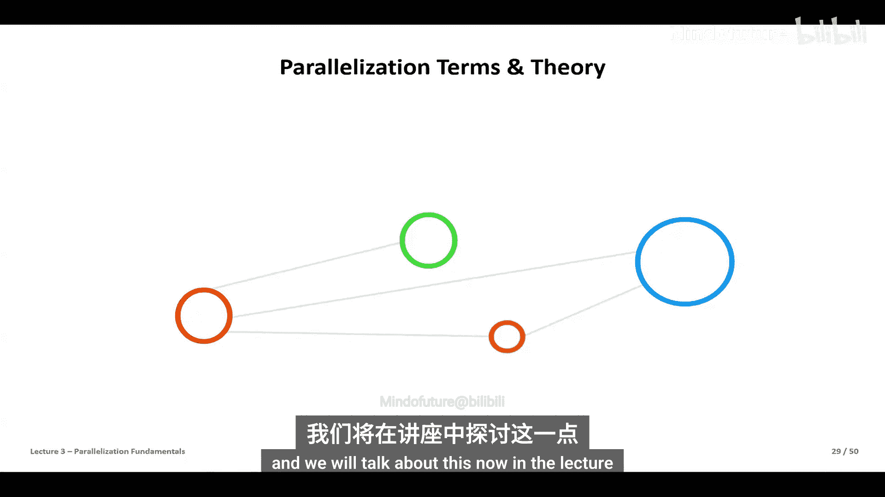

Again， some， you know ideas where we can motivate the whole problem that parallelization is of course。

 now not only the idea of having more and more speed to it。

 we also want to add more detail to it what you learned in the ocean part in the last part of lecture。

 but you can also make the connection here， if you think about a tree or basically sort of train that you want to simulate plans that we simulate in 3D This is virtual reality here's an example of a train that we burn of course this is quite nice because we don't do it in physics on a reality we do it in virtual reality using high performance computing。

 we can test out different materials， how much it burns down the train how quick， how fast。

So are lots of studies you can do with do this， that it is high performance computing and you can put in more and more reality and more and more you know elements of granularity in it due to the train on compartment level or let's say on a really let's say several parts in it like the roof is some very specific but materials etc cetera。

 etc cea so。

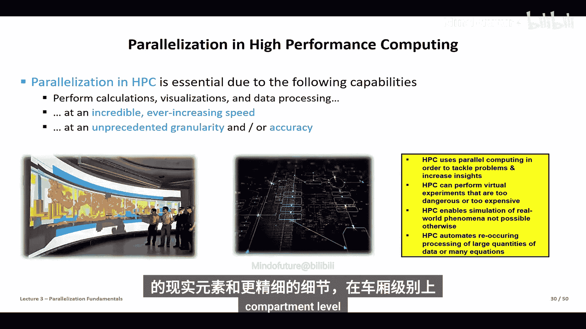

Which means there are lots of capabilities in using HPCs for problems。

 And right now everybody of you is aware that deep learning networks and using workflows then which is a bit shown here as well。

 shows you then the whole picture， perhaps of a real problem that we face in the real world。

 but HPC can really nicely help to enable these capabilities to simulate this and which then requires us really to go in parallel because one。

Microchip or one chip is not enough。hence we need more of those together and which was also then the ID。

Of this Moorese law that you remember here a little bit on the left。

 I think you know that essentially the number of transistors that you have on these ships is doubling every couple of years。

 two years， which was then sort of an interesting growth factor which was stopping at some point in time when we said well multi corere is nice。

 I think the set performance is nice but the ships get too hot。

So unfortunately we cannot put more and more transistors more more cores on the chip it would be getting too hot hence there was then suddenly the GPU to the rescue and said。

 okay， we don't do maybe this cutting edge course， but for some problems that we have seen successfully in AI。

 it actually makes sense to do moderate you know processors and many， many of these chips， many。

 many on these chips and you see here the latest evolution of race hopper cards this it goes back to a long tradition。

 we will have GPUs and extra5s or we do not talk too much about。

Right。But this was really growing from very， let's say。

 interesting architectures in the Kepler Volta up to Amppere。

 which already then featured tens of course， very optimized course for deep learning。

 we were talk about it to now grey Hopper cards where you have even here this interesting NVdia envying and are not paid by Nvidia。

 but NVDdia is quite a market share and interesting technology where you the CPU plus GPU core model of the memory。

 which was sort of a limiting factor a long time for GPU computing。

 Some of you know that that also my courses in the past or looked on YouTube here were talking now about interesting developments that the main memory of the CPU and the GP is quite let's say having the same memory model helping then really with the throughput of the application。

So these are terms。Wwhichch are you know quite established you should know like Muco。

 minico and I think this is getting also mainstream today some actually say to many core these days also accelerators hence our lecture5 will be also called accelerators and GPUs accelerators is a broader term we have to talk about it but by now you also can imagine the reasons for parallelization I mean there are two major reasons which means that usually one core is not enough to do the required task let's say burn a train and all the material details that we have seen in a certain amount of time so let's say over the duration where the train is fully burn。

On the other hand we have seen then what I thought could bring across very nicely in the in the earth system research。

 you would have lots of lots of memory variables for a single system this would be much too much to do right your laptop will be out of memory very quickly of storing everything which is you know in this Earth system elements for atmosphere to down to the land surface and so on hence these are the ideas of twopoliization methods like we have discussed with SPND or you to the M。

EMD， as we also have already introduced as terms that are different ways。

 but want to achieve one thing， usually making it work if there's not enough memory or making it faster。

 which we then establish with something we call the speed up term。The speed up term。

Here is a is a good example for。 I mean， you basically would have again， some， let's say tasks。

 whatever it is， right， And now we abstract a bit。 I'm sorry for this。

 but this has been now a bit more abstract。 and we go into some formulas。 But in the end。

 we talk about certain tasks that in this time can be done and the work that has to be done is here the amount of 12。

 and you have just one worker， he just have to do this sequentially over time。Now。

 if you come to the situation where you say it's nicely paraizable， nicely in the sense of， you know。

 the time step before is not the time step now is not depending on the one before。

Then you can maybe also do something like this。Right you put them all together in parallel yeah this this condition and then you have a speed up of a certain amount。

 a speed of n， if you say we have three workers， then you can compute essentially a speed up very simplicity wise。

 I mean this is a very trivial example of saying well。

 we have this T would be let's say the 12 time steps that I need to do the work usually。

 but with three workers we can go down to four time steps to do this work。

And then you can of course balance more workers means you know less time steps。

 but is it really possible， does it make sense and so on is another question。

 so we have to go in much more detail to understand speed up and to understand then also scaling andprint what we do here to more and more processes。

It gives us also the opportunity to think about another term which is very important HPC because it burns psycho for nothing。

 it leaves it essentially not used。And this is。Thing， and it is， however。

 very natural to have this if you compute physics formulas。

 doesn it all have always the same ideal picture that you saw in this one so that each chunk of work takes the same amount of time。

 although there might be very different and very similar physics there might be different data takes longer one task is shorter。

 you see that here and here， which brings us to the fact that when we have this work over this different processes。

 they should also let's say， have an ideal resource usage of 100% which is probably not reachable。

 but use the resources to the most possible degree because when you allocate it you have seen this in the scheduling work the last couple of lectures。

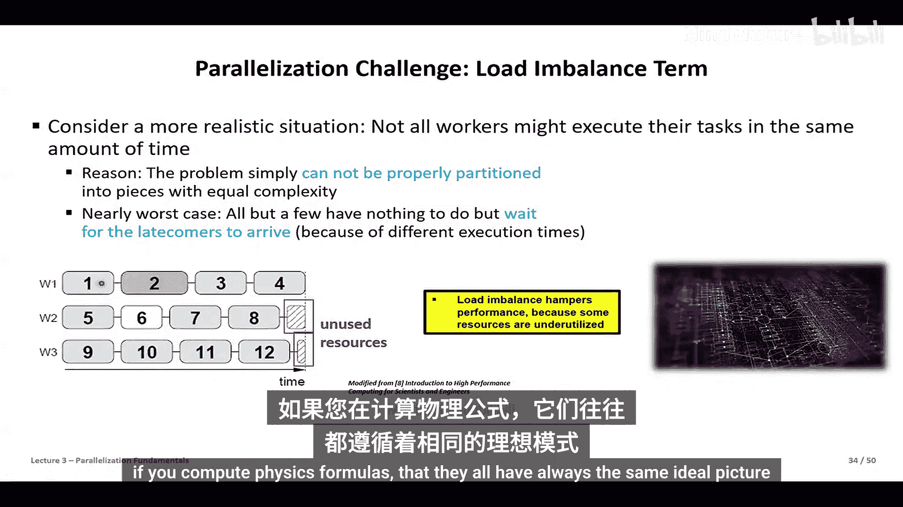

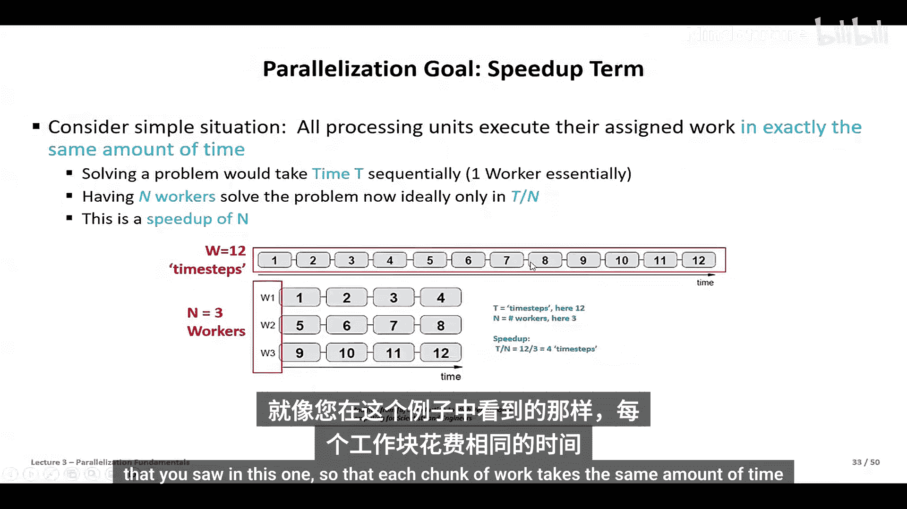

It's allocated to you， no one else is using the processor so hence when you use a processor。

 you want to get it active， you don't want to have idle time as it is also called right here the unused resources it's idle no one is using it no one else can use it because you have allocated it for your jobscript hence the work that you do should be also ideally balanced and this is is really a problem hence load imbalanced term which is not at all to achieve always in in this application so you have to think about very carefully about how you crunch again a big problem into smaller pieces because you don't want to have the situation that one work is finished in a minute while the other work is still requiring one hour。

So hence， in other words， maybe not at all。 always。 it's always the same amount of work。

 like suggested here that makes the best to weigh their composition in this sense and the mapping to the processes。

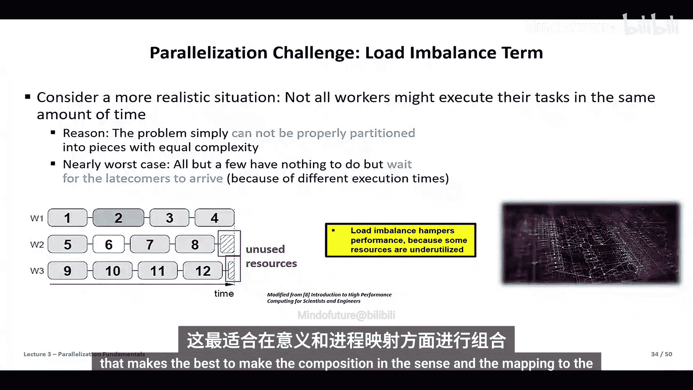

So you get more and more the idea that power reforming。

A power of performance to achieve is not the simplest。 You see a very good example。

 you know by now from MP ranks from， you know， the MP what we discussed last time。

 I will not repeat this 32 processors have some work to do and what we identify here is quite a load imbalancing scheme。

 So first of all， every one year is already quite imbalanced they compute something。

 What a compute is not important for us。Important is for us that there are lots of IL resources and why is that the case。

 because you see that on rank zero。That essentially even if all the processes are actually done after 20 seconds。

You know， the whole job space， let's say the resources you have are still occupied with your job right your MPI rank zero probably doing a master worker scheme so using rank zero as a master which is common sometimes getting all the results from these ones is doing now the let's say maximum of an area or whatever it is and the overall compute time is 38 seconds now simple you know explanation of this but there might be different issues that this now needs to affect where the administrator will call you of the HPC system and say well you don't really use。

Allocs very much you allocate your job and it's actually needing of course this allocation at least for one task NPR rank zero thank you very much congratulations but all others are actually absolutely in idle and these are elements we want to avoid right so what you see here is not an ideal situation this has lots of problems that can lead to it。

One is， you know， synchronizations which are maybe unnecessary， you know。

 this MPI weight or that we are from non balancing， sorry， basically the communication MPI。

 which was non blocking。So then this could all lead to load imbalance from the data perspective as well。

 from the load perspective。 and sometimes you have even serial execution limits。

 Let's think about that maybe some of the things should be going then to IO and someone has not done parallel IO that you also know by now from lecture2 You know all processes will right in the file at the same time。

 someone。It's done maybe a serial I hope and saying rank zero is the only one writing to file and the file system is just waiting and taking time。

 so serial execution limits could be also the case。

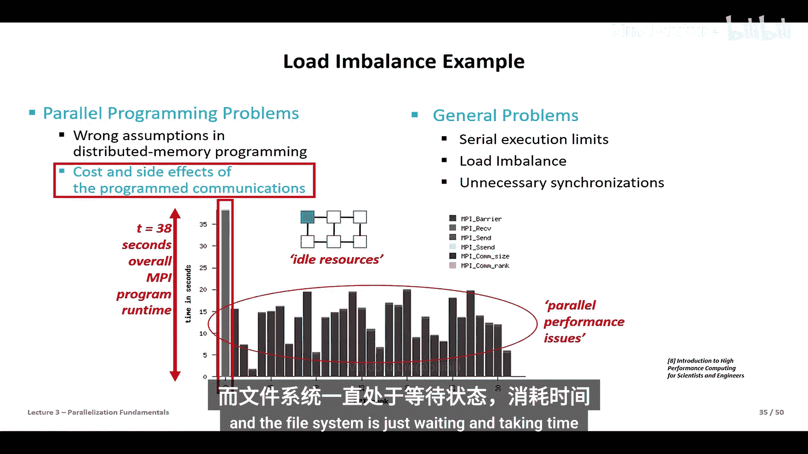

Now thinking about that this is now bringing us to a very interesting situation where you think about okay。

 not all in the world's catassium right some things has to do with distances， for instance。

 and I think the tree codes here for embody simulation is a very good idea where the short range interactions are differently computed from long range interactions and with this if you model this a little bit in a particular space for instance。

 like this embody problems here you see it could be some specific particles that you want to accelerate here you see a sort of short idea of a laser can there was one idea to solve cancer in the past so or at least you know helpless cancer。

The key message to take away is that you interact between different forcees and different let's say equations of physics with other particles and by doing so you have lots of particles to cover in the space you see here and the more particles you add the more to compute hence in some areas maybe for long range interaction for instance。

 and you have to define what long range means right might be something certain distance from the one you compute right now。

 you want to switch to a more let's say threewise setup。

That you see a little bit here in this particular element and this is just showing you as an example and we have no time to go into this very much in detail that this particular code that we use here for some examples is sort of a tree code so it's not really Caassian。

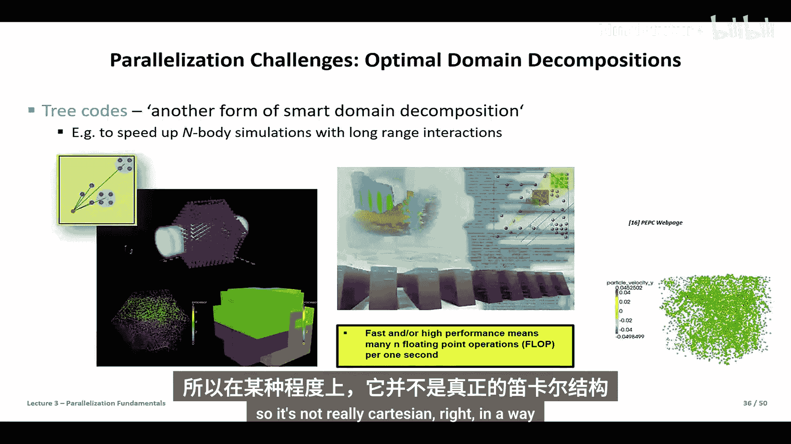

Right， in a way。 So here we have different physics E。 Now。

 the idea how we do also the dewaic composition more effectively。And this is a Pepsi tree code。

 which you don see with this tree approach can also scale quite highly， which we prompt。

It would not the case if you don't have the tree coat。Hence， now， this is now the。

 the point making it now as an influential factor in this so-called scalability。

And with this you also see that high performance， domain and composition， scalable applications。

 this is all connected right you cannot see and make one arrow in the domain de composition method and then think art can still scale very well and even if it does maybe it has load imbalance and then the administrators are not happy so there's a lot of interconnection work that needs to be done。

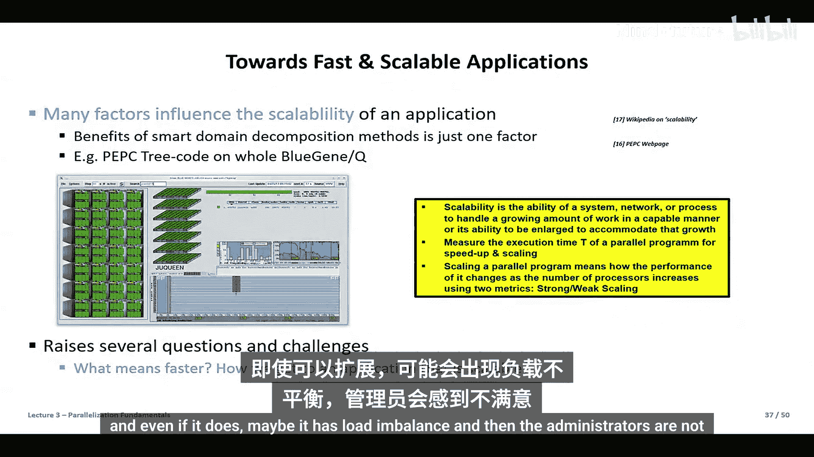

And let's look a little bit on this kind of speedup more in detail and also maybe a little bit more in terms of theoretical wording and formulas。

 But keep some， let's say， important terminology into our mind。

So one of the simple ideas is speed up where you think， okay， two instead of one processes。

 do I really improve on 50% in。Accuracy or will really improve 50% of speed up for the simulations。

 So these are still questions which needs to be tackled。 And in many cases， if not at all。

 there are limits。Right you have， of course， an ideal linear scaling that you see nicely in this plot here。

You know， this would be the mob course I have， the most speedup I have。

 but the reality shows us these plots that you see here， there's a sort tail off。

And this is an area where it's now get into a problem domain in a sense of saying we lose the parallel and efficiency。

Today you would even say the more compute you put， the more energy you waste right so there's also a sort of energy factor to it and say well with green energy it might be not so dramatically。

 but in general if you have green energy to be wasted。And the speed up is getting less and less。

 So the tailoff could be very dramatic up to， you know， specating。

Then it doesn't mean we make sense to apply more core， in other words。

 the parallelization has its limits。And we see that in many of the application examples。

 hence we have some sort of metrics for it。Where you can show this explicitly。

 which is of course our goal to be near linear performance。

 but you have different ways how you combat this， how you can make it better。

One idea that you see here in this example from our clustering algorithm is for instance。

 that you don't use just MPI， you use also shared memory right you see as MPI at some point in time we tail off quite early。

But， you know， and this is different datas for clustering。 We should hear DSs 1 and DSs 2。

But that doesn't matter so much。 But you see this hybrid， which stands for MP I plus open MP。

 something you will learn lecture for。 We can keep close to linear performance still and don't have a major tale of。

But this is something what you need to add。Plies that you want to show where the number of course when you scale up with your application。

Hence we have these two metrics， strong scaling and weak scaling and now I really want to have your attention because this is a common question and answer session with my students all the time。

 so the difference for that seems to be still for many a bit an issue to understand and I understand that maybe it's going already into the details of HPC what you want to do with it。

But scal， the scalability metric maybe from strong scaling to Scott， start with this。

 it's sort of the really intuitive way you would say what parallelization benefits I have。Right。

 so you see this here green。 So you have a total problem size you want to have。

 and it will always be like that。All what you do is you increase the number of processes working on it。

 right， the same work， more people Think about eating a pizza with two students 6。

Students 12 students， 20 students， how much pitch left for you？So this is basically the idea。

And this is what we want to show then in terms of limits that at some point in time。

 you know that the analogy versus a P suggests right when you have 100 students in a small pizza。

 there's not much left for you to do as processor， so why you do this？

And this is the scalabilitysymmetric metric of strong scaling， I have some example later。

Just to contrast it now。 So weak scaling。Right， so weak scaling is now。Different。

 and and the key difference is to think that the problem size increases。With the rate of processes。

And this is really important to understand I know for some it's very trivial。

 but somehow my students always come back to me Q& A what is not the difference。

The problem size increases in weak scaling， in strong scaling， it remained。

Every time the same problem， you do different runs with different number of processes。Yes。

 in strong scaling， in weak scaling， you don't do just more processes。

 you also increase the problem size of the applications，1 million particles， 2 million particles。

 but also more processes。So in a sense， what we want to。

To see is a bit the sweet spot of keeping the work per process the same and I think some students really in discussions revealed that what it is possible to do right the strong scaling get the parallelization benefits of having more processes for one problem。

But， you know， in a way with weak scaling of an application， which is， of course， our idea。

 why we do this， We have an application。We want to see what is it possible to do。

 We keep the work for processor saying we scale up more processes， more work， more work。

 more processor。 So we， we keep the work， and Ill keep them busy。

And see what's possible and in a way you could see it's similar like the idea of having more and more detailed of the application there。

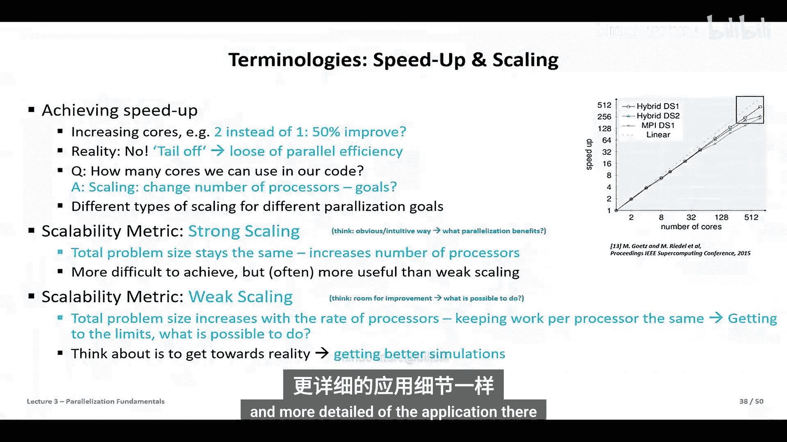

And this is also the way towards thinking， getting better simulations towards reality。

 more granularity， and so on。So let's have some kind of small formulas before we go again to some plots and so on。

So when we say strong scaling again， we have this kind of fixed size problem right。

 this is now this Tfs which is basically coming out of the serial part of an application push the parallel part the serial part could be for instance。

 the initialization you have seen MPI in it starts at some point in the source code maybe the elements before could be the kind of idea to first that the scheduler actually have to put all the MPI executables on all the different nodes allocated and then runs the application so there's certain serial overhead always。

Application。The P part is， of course， then the nice part that we see in the MPI program that we actually paralyze。

 right Ping and pong， we have two processors， you know， that's something what we have divided by two。

And say okay， but it was not really a speed up in that example。

 but then when we think about two processes having the same work， right that we want to do。

We can apply now here。 four processes， maybe 8 processor。

 If there's a parallelizable array that we have seen， for instance。

 we want to crunch down the time of having the max of an array。 This is nicely paralyizable。

 So let's do this。 Still， there was a serial part that remained a bit。 If you remember。

 with see Maxs global of the local part。 So someone has to compute this。

 And this is not to be paralyzed。 We need the output out of the parallel entities。

 They're local from the arrays。Hence。😊，You know， this is something where there are also， of course。

 it some limits and it was also leading his here a little bit too。

Ining effect that we have that the parallelization of let's say of a program。

 really of a time for a application is often in its serial parts and hence we have a law for it later。

But here， think about again when you now want to contrast it against by weak scaling later。

The work stays constant。And we have more and more processor for the powerlyzable part that that doesn't help us。

 however， for the serial part and here the goal is really of the parallelization， you know。

 minimize the solution time， right， just speed up， pure speed up。

 something that I can you know crunch stone smaller， just do it。

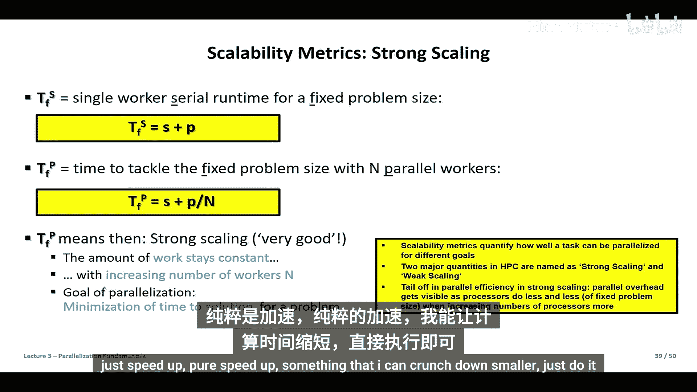

And here are some examples of strong scaling and you think about each of plot is in itself， right。

 so you see the number of course we actually execute to the right。

And then you see essentially the different runs that we've done with， you know。

 different factors in terms of the application size。

But this means still for each of the problems we have， the solution size stays。

And then we see the tailor coming up every now and then when we see here a number， of course。

4000 for some of the problem， 64，000 note the exponential scale here。

So this is something which is important。And。This is a strong scaling example， is a bit older example。

 but it captures still the essence and you basically。

See here different use cases really where you have the different use case on the top with homogeneous particle distribution right which scales。

 let's say quite good， and then you have the inhomogeneous particle distribution bottom different use case where you then have。

 let's say， as you see here， the space is very much different with having this kind of elements where now this long range interaction in the particles would matter much more than maybe this local。

 etc， etc。So this is the time to solution how it varies with a number of processes ready for a fixed total problem size at the official definition is。

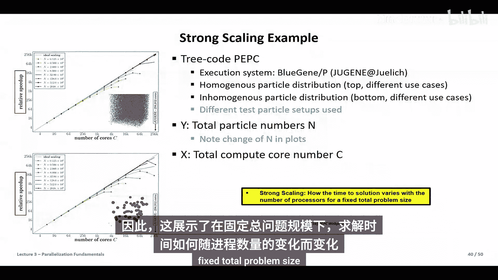

Now when we talk about weakcal， that is not at all that simple anymore and hence students sometimes ask there could be different factors where just to speed up by adding more more processes is not a problem。

 is not possible anymore， let's say we need more and more memory as well right not only processes which is sort of an example of the factor NA or an alpha that you see here。

So there you would have seen a size that is basically now thinking about the variability of it so that the depending on the more processes you put。

There's also more that you see essentially multiplied by it by this part from this alpha perspective。

 where it's n to the alphas。Could be quite something depending now on alpha that it is you positive。

 So you basically would say， you know， at some point in time， it's not anymore。

Not good to para it more。 That's why it's probably called weak scaling right not very good to do so at some point in time and the tail often in weak scaling shows them several aspects where keeping the work more and more increasing that means more and more and of course。

 more and more processes with it means more and more communication exchange as well。

And as a data remains the same， it's not less data because the problem domain is not the same anymore。

 We have more data。 We keep on and keep on communicating more and more and more。

 And this leads to communication overheads， for instance。And this means at some point in time。

 we expect was a weak scaling plot。

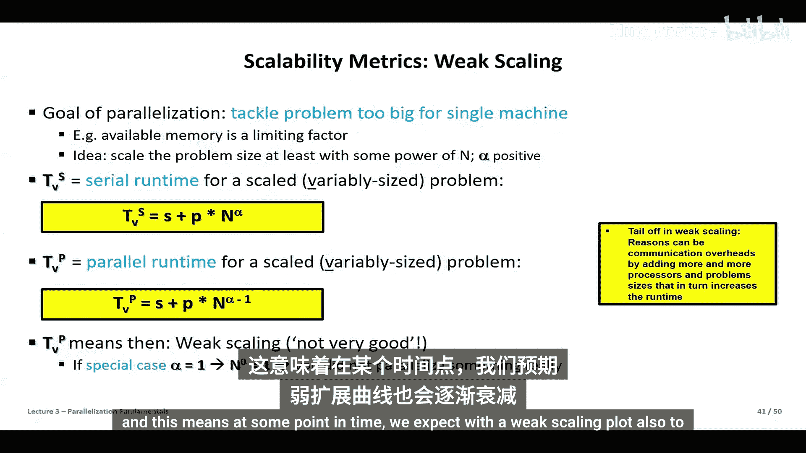

Also， to tail off。Because then， you know， some other factors will have a huge in。

Priends in this alpha game where we basically， you know， see more and more of these limits。

And here's just the idea that also of course the efficiency is a big part of it。

 do we really use the course to the degree where we can do it， you see here two good examples again。

 think about no pair core we increasing here with the problem domain size of one particles pair core。

Now this is important to understand so in the strong scaling。

 we had a certain amount of particles and things we changed， that's okay。

But we don't change the per core。 We change it for the overall problem。

 Now what we keep here basically is a little bit the work for the processes。

 right we say we do more and more processes， but we keep the number of particles per core。

So hence we keep them loaded， we keep them active working。And of course。

 the runtime is different from the amount of particles pair run。

But you also see then the difference tail off， especially in efficiency， you see 10。

000 particles per core are breaking off quite lot in efficiency after， you know， let's say 450。

000 core， possibly because there's you know， essentially too much overhead in communications or the computing is waiting for communication to happen to give me more particular interactions of the surrounding neighbors。

And and this is sort of the idea of moving towards a Gutfson's law idea that we need basically larger problems for larger numbers of CPUs。

 where you need to also compute a lot right and this is something where then weak scaling shows you where we vary the number of processor this is of course now something where we have a you know fixed problem size。

 but it is pair processor。And in the strong scaling， I put it here again for comparison。

 we want to see how the time resolution varies when we have a total problem size when there's not work increased our processor when I add it。

And that's why there are two interesting metrics that are very important these days also often in publications we do to show right people want to know what are the weekend strong scaling plots。

 if you talk about high performance computing our code scales， HPB， okay， show us this。

And the same is true for Pepsi the tree code here。And this is something which I hope all of you have a little bit understood by now。

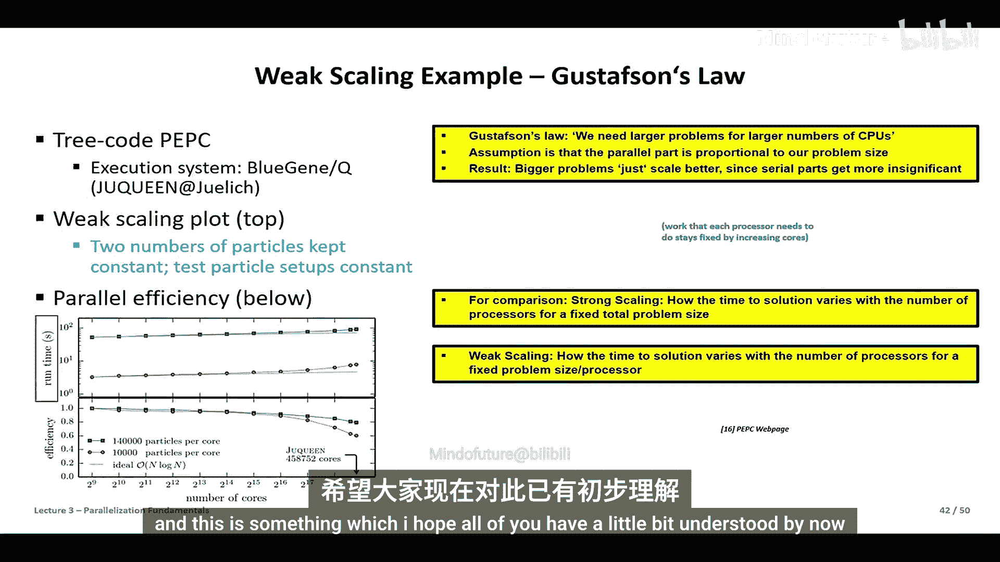

And just to contrast it a bit again from Amd's law， the Gustavson's law。

 where we said more detail is good， Amd's law is a bit different and says basically we are hindered by the domination of the serial of partss at some point in time。

Now in the ideal situation， it is now a little bit mathematically， of course。

 saying like we can have this。You know，1 minus S is just a fancy way of saying the parallelization part of an application right。

 it's a parallelizable part divided by n and assuming we can have infinite HPC machines and these machines today that we actually have in the union are really very powerful already and when we soon have Upiter and Uli extra scale you will see many applications running in that problem you have maybe more in more processes but the application will not scale necessarily much more and the problem is really is the serial parts which we will you know have in many areas when we talk about large scale applications still and that we cannot improve on by just throwing in more processes。

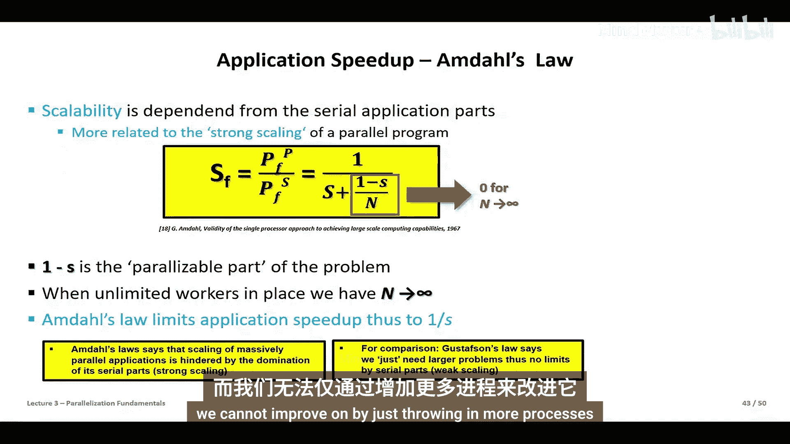

By this， you have learned I think， quite some many terminologies which are very relevant for HPC。

I mean， again， I think the laws are good good stuff laws， so think about bit， you know。

caling Amal's law， the idea of strong scaling， even if you have end processes for the same problem。

 serial parts at some point in time will catch you。

And I always actually here and there also often affect nowadays。So we learned also the speedup term。

 which is sort of a you know a kind of a fluffy term if you want right if we of course want to show speed up。

 but then please show it with a graph of the scalability and usually also want to have the efficiency with it these days so how much you actually use the system really。

And in order to understand this in previous lecture series and also in previous courses。

 we had always one lecture performance analysis， I had to skip this this year because we're taking on too much new topics and hot topics as you know hyperpyramit optimization AI。

 everybody talks about it， So we have one more lecture on AI。

 I need to get rid of some of the elements， but if you are really。

Deep into MPI and I know from the discussion even today with an SME。

 some of the student groups will actually use performance analysis with an MPI code probably to analyze the code more deeply。

And this is something where you have Scalaskka for instance Va。

 these are all tools in HPC and in previous recordings you will find a lecture on it。

 so for those that are really interested， please go back into the history of the YouTube lecture。

 think about there a performance bone and analysis lecture somewhere that really gives you then an order of understanding that you just don't run and experiment with the code。

 you also analyze a lot when you talk about this icecal。

So you will see bottlenecks in MPI not only what problem in the elements we already discussed a little bit in the last practical lecture is non-blocking communication context。

 for instance， but in generally an MPI would say late send waiting along in a blocking communication could be not good。

 so one of the courses is doing nothing just waiting。

This will be all let's say shown in the performance analysis tool it。

 so hence it's a key field also in HPC that I cannot bring completely across in this code and by now our sentences。

 supercomputing centers in the Union offer also three days tutorials or three days you know just lectures on Scla Va score P is another one where you can have work all of them together to understand your code better what you need because if you scan up to things we have seen half a million core then you know it's not at all to understand all of that anymore by a human so there's lots of automation in the space to analyzes for you to understand where your MPI can be much better programmed where a bottlenecks like IO and so on。

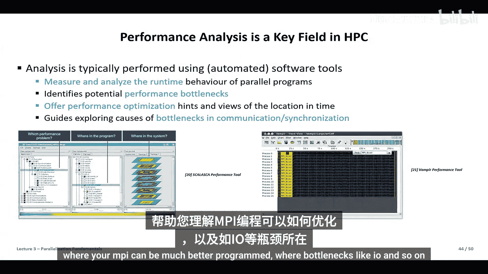

But in a way that's all really I wanted to leave you on the table today。

 we could go on to more and more， let's say let's say technologies， many of them will come also。

Alone from the theory aspect， you can imagine when we talk about the physical loss。

 there's no end to the physical loss we can have。We will actually see many of them in the second part。

 really of this course with CFD computational fluid dynamics。

 right when we there talk about different laws and physics， which then inherently have also steer。

 you know some of the applications we do in terms again of the things you know now domain de compositionposition how are basically the physics formulas computed over time。

Is an optimization process that takes place optimization where we also a key term when we talk about deep learning。

 something I left here a little bit， you would also continue maybe a little bit with this optimization theory。

 but deep learning will have a little bit of those and will also come back to some of the ideas how then you know HPC can be engaged in physics。

 so today I talked a lot about physics except a few arrays but you know the physics code is of course that can benefit a lot from HPC and needs it really to to show an evolution over time of this simulations。

I brought you here a YouTube lecture again， just to have some stress on materials and so on。

 you see also nice measures here again， also to motivate the second part of the course later。

Because now we will in the next lecture for go again to let's let's say more basic topic because this is also related to your assignment I know openmp shared memory programming also very important to understand HPC and the applications will follow you then later reusing basically these fundamentals that we teach you basically at the beginning of the lectures in the meantime your projects with industry will。

 of course， advance， so here and there I think the team today I met will probably touch MPI。

 some others will。Just use the jobscripts to do some parameter studies and understand the differences between CPUs and GPUs。

 but we have to have some fundamentals first before we go off into all the different applications。

 but we'll raise a do with you before this we of course have to talk about deep learning hence after Openmp we will move to the world of GPUs we will understand why deep learning is now on scale with distributed deep learning。

 a key factor in training large language models why this has been a big。

 let's say hype now I think everybody of you is well aware of this that AI is everywhere so we will talk about this in lecture。

 let's say 56，7 before we then turn to CFD and other matters。Hence。

 we will continue this lecture for next week and up to you then。

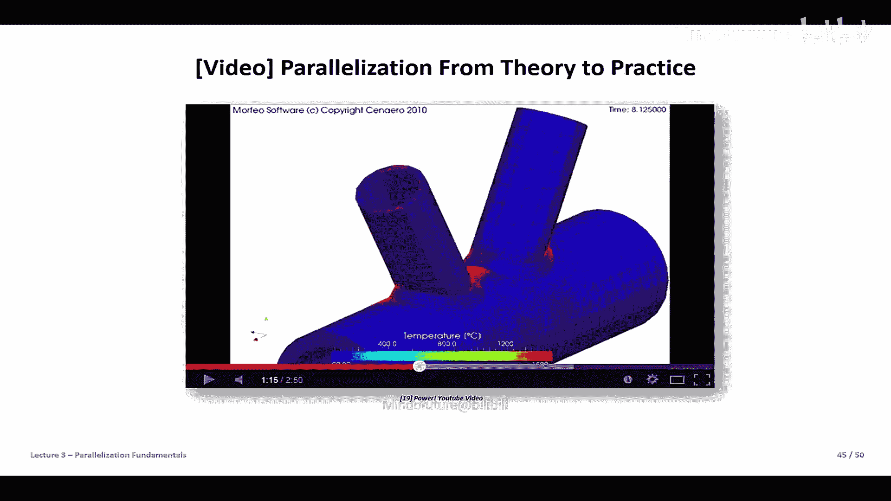

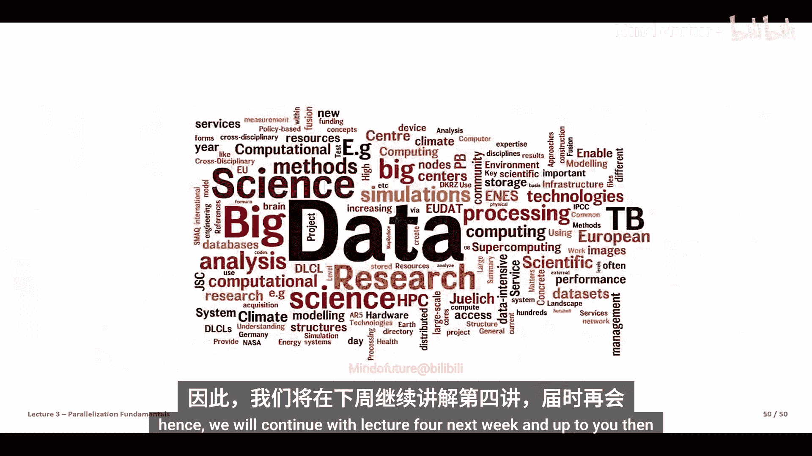