# 高性能计算课程：3：并行化基础（第二部分）🚀

在本节课中，我们将继续探讨并行化的核心概念，重点关注性能衡量指标、可扩展性以及影响并行效率的关键因素。我们将学习强扩展与弱扩展的区别，理解负载均衡的重要性，并介绍一些高性能计算中的基本定律。

---

## 概述

上一节我们介绍了域分解、功能并行和模板方法等并行化基本概念。本节中，我们将深入探讨如何衡量并行程序的性能，理解“可扩展性”这一关键术语，并分析影响并行效率的各种因素，例如负载不均衡和通信开销。

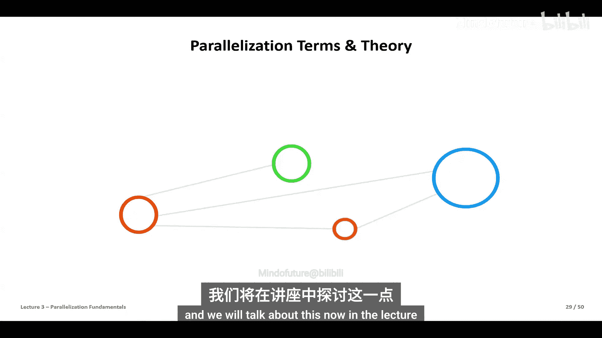

## 性能衡量与可扩展性

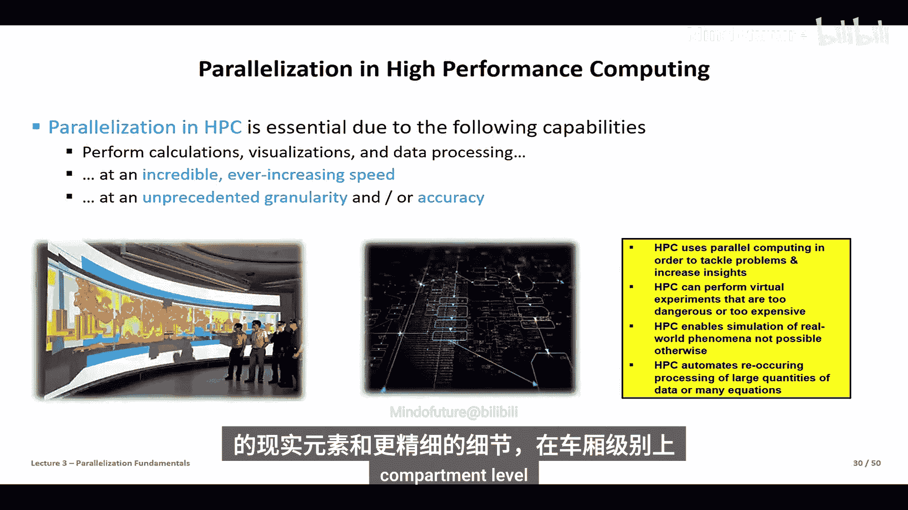

在并行计算中，我们不仅追求更快的速度，还希望程序能够有效地利用更多的计算资源。这就是“可扩展性”的概念。在高性能计算中，可扩展性主要分为两种：**强扩展**和**弱扩展**。

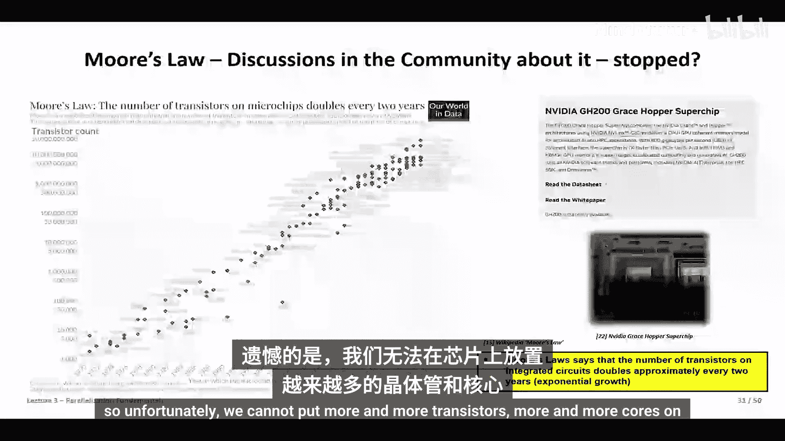

### 加速比

加速比是衡量并行化效果的一个基本指标。它表示使用多个处理器相对于使用单个处理器时，程序执行速度的提升。

**公式**：
`S(n) = T(1) / T(n)`
其中，`S(n)` 是使用 `n` 个处理器时的加速比，`T(1)` 是串行执行时间，`T(n)` 是使用 `n` 个处理器时的并行执行时间。

理想情况下，加速比是线性的，即处理器数量翻倍，执行时间减半。但在现实中，由于各种开销，加速比通常会低于线性。

### 负载均衡

负载均衡是指将计算任务均匀地分配到所有处理器上，以避免某些处理器空闲等待。以下是负载不均衡的一个示例：

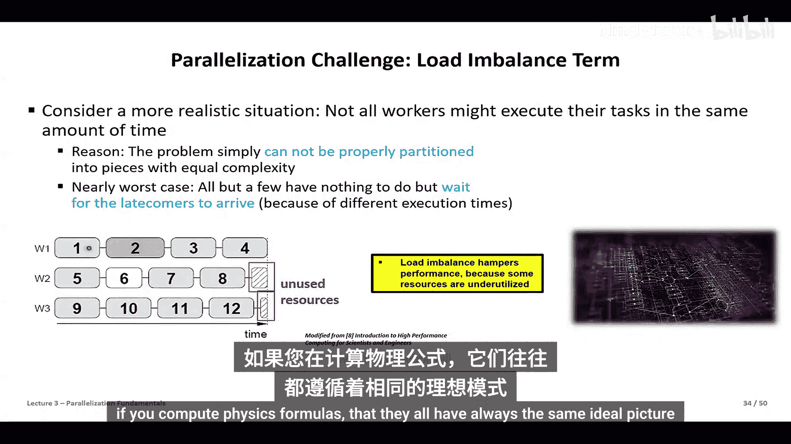

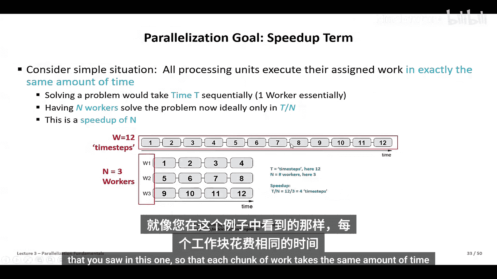

```python
# 假设有4个任务，执行时间不同
task_times = [1, 5, 1, 1] # 单位：秒
# 如果平均分配给4个处理器，总时间取决于最慢的任务（5秒）
total_time = max(task_times) # 结果为5秒
# 理想均衡情况：每个任务耗时相同，例如都是2秒
ideal_times = [2, 2, 2, 2]
ideal_total_time = max(ideal_times) # 结果为2秒
```

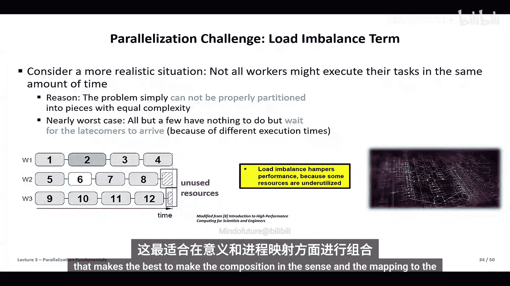

负载不均衡会导致资源浪费，降低整体效率。在MPI编程中，如果主进程（如rank 0）需要汇总所有结果并进行后续串行处理，而其他进程早已完成计算，就会产生大量的空闲时间。

## 强扩展与弱扩展

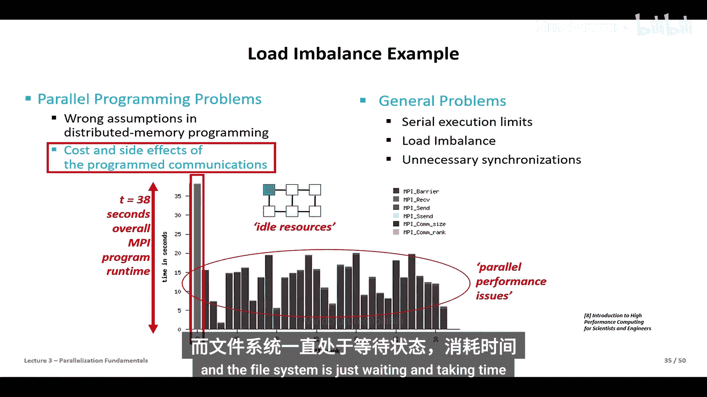

理解这两种扩展方式对于评估并行程序至关重要。

### 强扩展

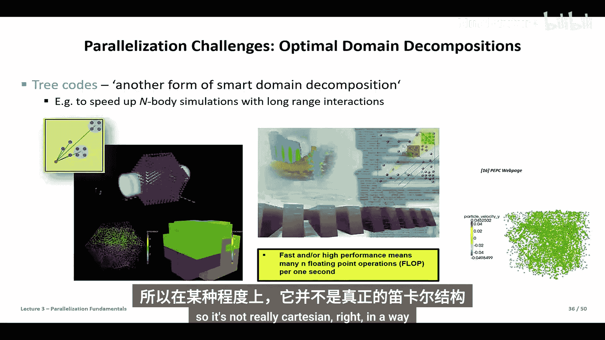

强扩展研究的是：**在问题总规模固定的情况下，增加处理器数量对程序执行时间的影响**。

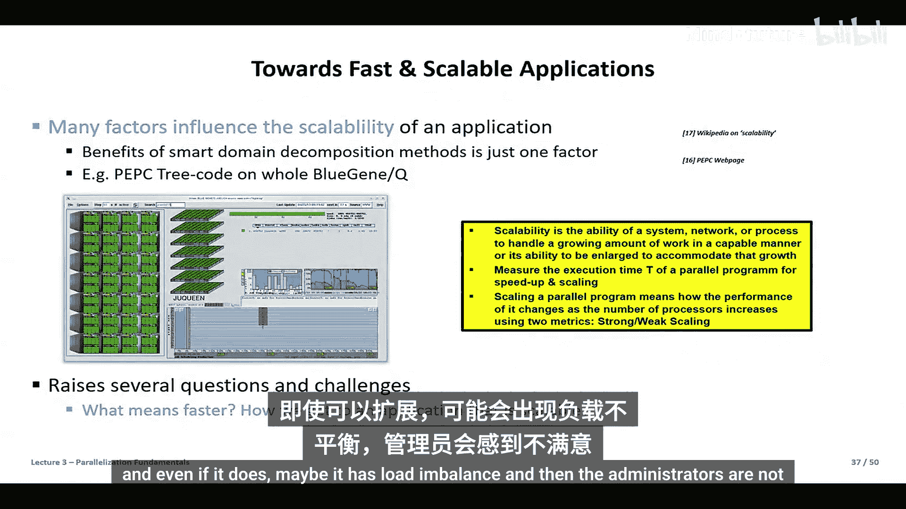

*   **目标**：最小化解决固定规模问题所需的时间。
*   **类比**：固定大小的披萨，让越来越多的学生来分着吃。学生越多，每个人分到的就越少，吃完的总时间可能变短，但协调（通信）开销会增大。
*   **挑战**：随着处理器数量增加，每个处理器处理的数据量减少，但进程间的通信和同步开销可能成为瓶颈，导致加速比无法线性增长，甚至下降。

### 弱扩展

弱扩展研究的是：**在保持每个处理器上工作量（例如，每个核心处理的粒子数）不变的情况下，增加处理器数量对程序执行时间的影响**。

*   **目标**：在增加处理器数量的同时，按比例增大问题规模，看是否能保持相同的效率。
*   **类比**：学生数量增加时，披萨也按比例做得更大，保证每个学生分到的量不变。目标是看制作和分发更大披萨（更大规模问题）的总时间变化。
*   **意义**：这反映了我们利用更多计算资源来解决更庞大、更精细的现实问题的能力。例如，在模拟中增加更多的物理细节。

以下是两种扩展的对比示意图：

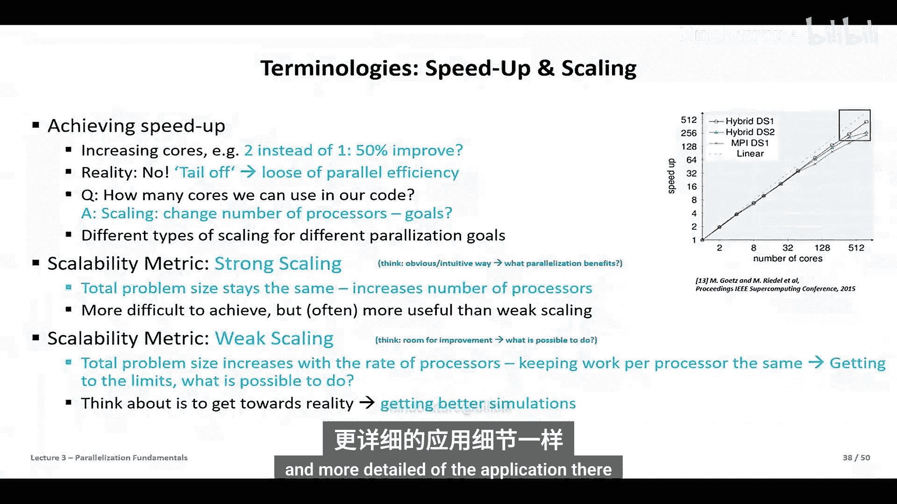

```
强扩展：问题规模固定，增加处理器。
[固定大小的网格] -> [更多处理器处理该网格] -> 考察时间如何变化

弱扩展：处理器增加，问题规模同比增加。
[小网格，少量处理器] -> [大网格，大量处理器] -> 考察每个处理器工作量不变时，时间如何变化
```

## 影响可扩展性的定律

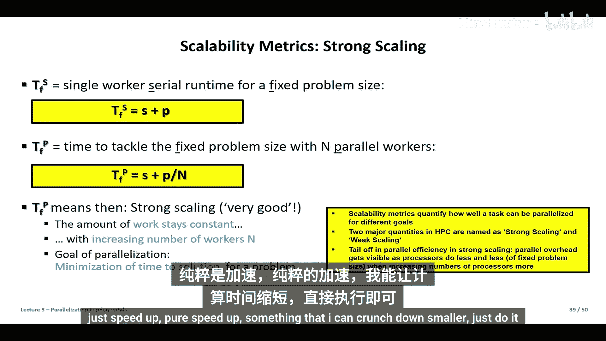

### 阿姆达尔定律

阿姆达尔定律指出了并行程序中**串行部分**对加速比的上限限制。

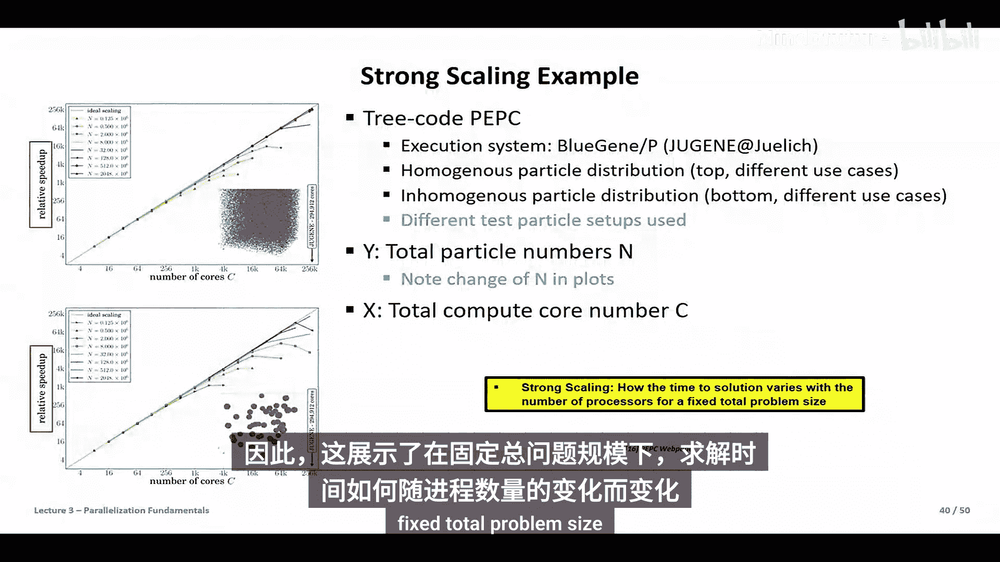

**公式**：
`S = 1 / ( (1 - P) + P/N )`
其中，`S` 是加速比，`P` 是程序中可并行部分的比例，`N` 是处理器数量。

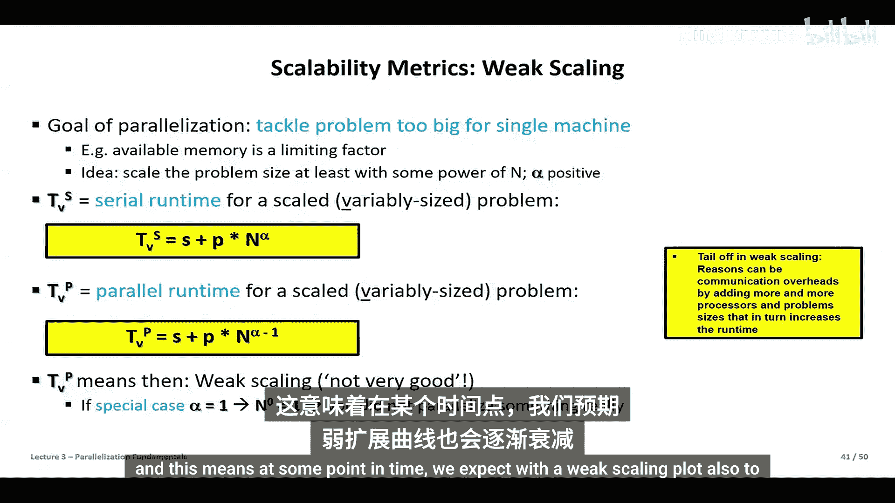

该定律表明，即使可并行部分 `P` 达到99%，只要存在1%的串行部分，加速比的理论上限也不会超过100倍。串行部分是提升并行性能的根本性障碍。

### 古斯塔夫森定律

古斯塔夫森定律为大规模并行计算提供了更乐观的视角。它指出，**在计算资源充足时，科学家倾向于解决更大规模的问题，而不仅仅是更快地解决原有问题**。

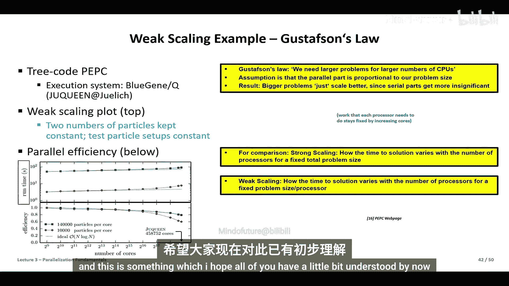

*   **核心思想**：通过增加处理器数量来求解更大规模的问题，此时串行部分的时间可能保持不变或增长缓慢，而并行部分的工作量随问题规模增大而显著增加，从而使得并行效率得以保持。
*   **与弱扩展的联系**：古斯塔夫森定律的思想与弱扩展的实验目标是一致的。

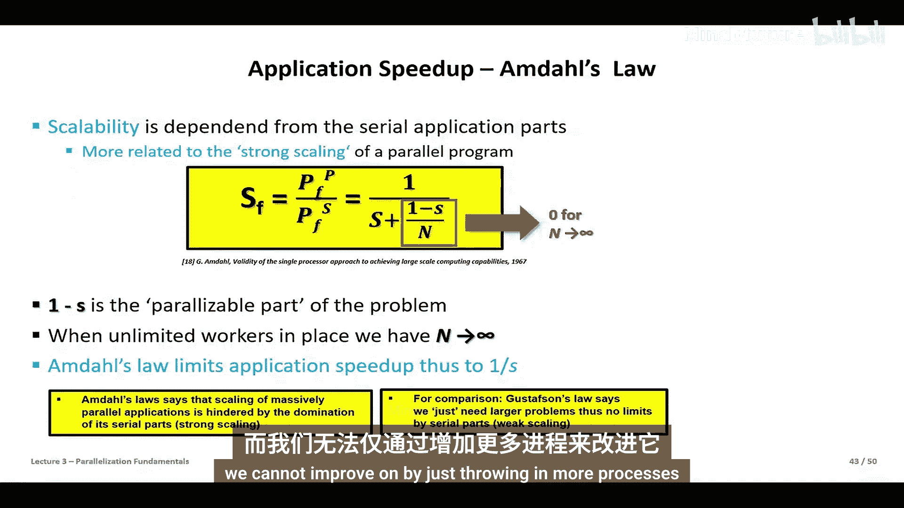

## 性能分析工具

要深入理解程序的扩展行为并定位瓶颈（如负载不均衡、通信延迟、I/O等待），需要借助性能分析工具。

以下是HPC中常用的一些性能分析工具：
*   **Scalasca**：用于大规模并行程序的自动性能分析。
*   **Vampir**：提供图形化界面，用于可视化MPI程序的通信和性能概况。
*   **Score-P**：一个集成的测量和剖析工具，为多种分析工具（如Scalasca, Vampir）提供数据。

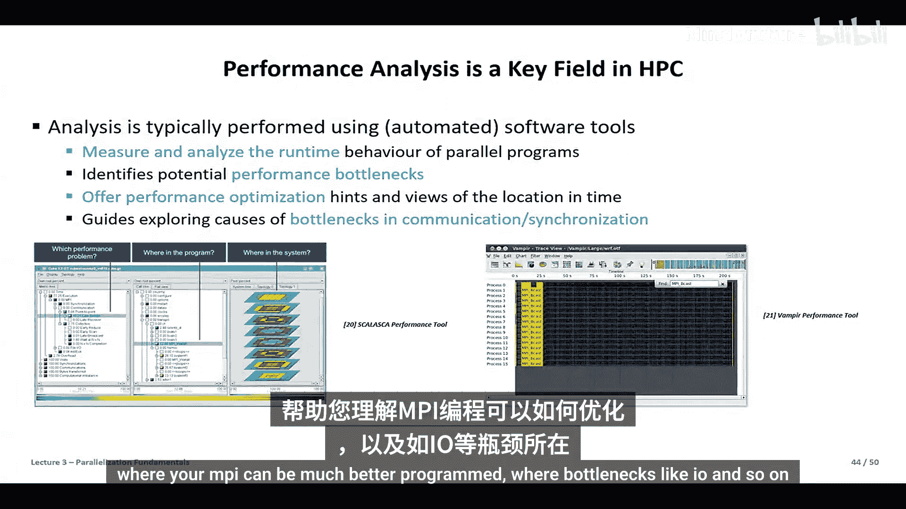

使用这些工具可以帮助开发者发现代码中的性能问题，例如非必要的阻塞通信、串行I/O瓶颈等，从而进行有针对性的优化。

## 总结

本节课中我们一起学习了高性能计算中并行性能评估的核心知识。我们明确了**加速比**和**负载均衡**的概念，并重点区分了**强扩展**与**弱扩展**这两种关键的评估维度。我们了解到，由于**阿姆达尔定律**所揭示的串行部分限制，并行加速并非无限。然而，通过**古斯塔夫森定律**所倡导的解决更大规模问题的思路，我们可以更有效地利用大规模并行资源。最后，我们认识到使用专业的**性能分析工具**对于理解和优化并行程序行为是不可或缺的。

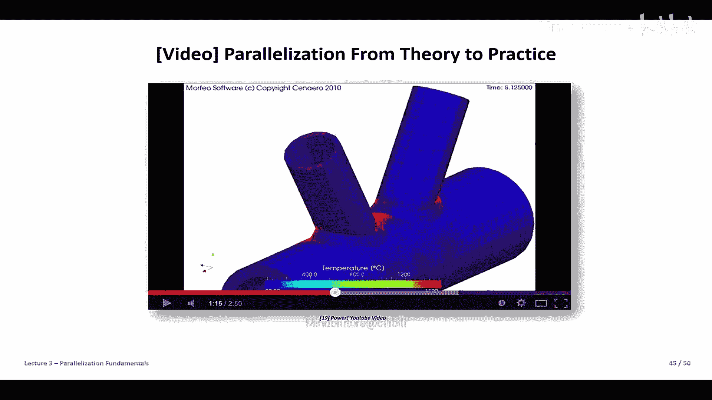

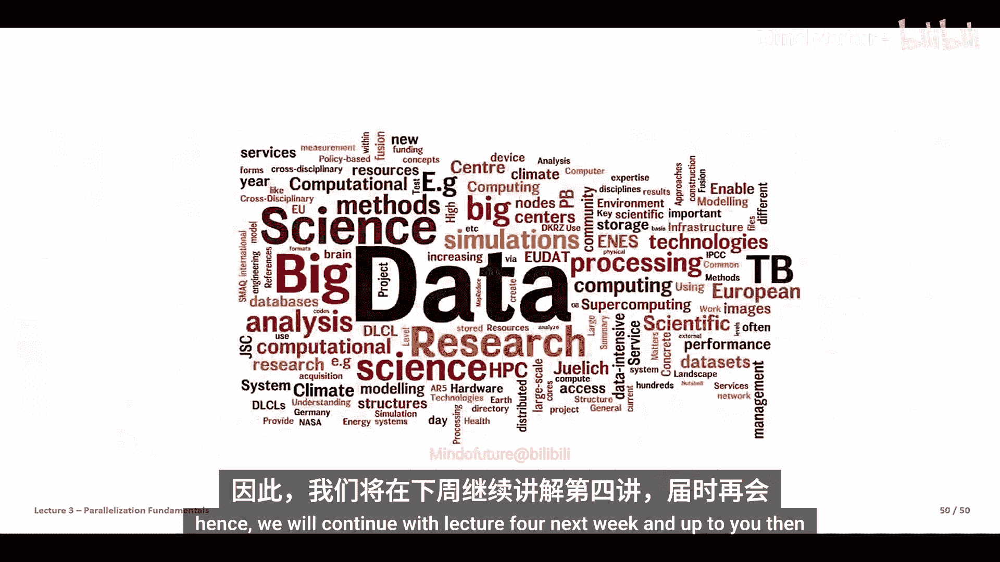

这些基础概念将为我们后续学习共享内存编程（OpenMP）、GPU加速以及分布式深度学习等主题奠定坚实的基础。