# 【冰岛大学】高性能计算课程-｜-2025-High-Performance-Computing-｜-Prof-Dr-Ing-Morris-Riedel-p19-P19_讲座_3_并行化基础_第一部分--BV1k34zzaEK8_p19-

Welcome back to high performanceform computing， advanced scientific computing today we have our lecture three on parallelization fundamentals and admittedably this comes a little bit later in the course as it maybe should。

 but the ideas of course to give the assignment earlier with the MPI and for this you essentially need quite some substance of logging into the cluster visitors age。

 things we discussed around compiling C programs which then of course have some MPI messages。

And method change functions to be call so long story short。

 this is a bit out of sync to give the practicals an earlier start。

And in order to review a little bit what we had the last time and the practicals and what essentially also awaitates you in the assignment。

 let us review what we had the last time。

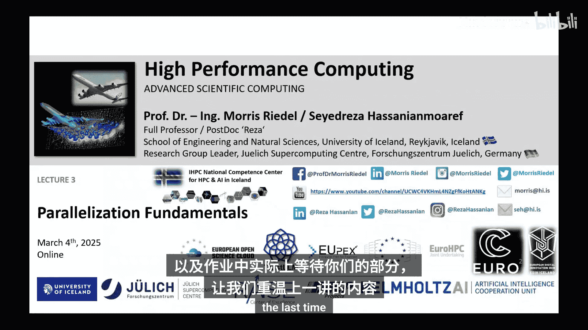

And this was really a practical lecture 2。1 that was building on the conceptual aspects of MPI we learned in lecture2。

 so there we had these interesting point to point communication which was let's say one form of message passing that you do with this standard。

 they are the ideas of course， as we know from distributed memory to really basically transfer some data from the process memory from one to the other。

Hence this is not shared memory， this will come in lecture  four。

 but here we need really message exchanges to transport any form of data to the other processor。

And we learned this in several different ways， one was this point to point communication。

 which in reality， if you remember some of the practicals look rather that we had a sort of buffer to be created right so when you have some data and we want to put it over the wire in other words to the other processor space we need some system buffer for it allocated and then invasive basicallyly ascend over so this is an important concept。

 this point of point communication， but this is not the strongest。

 let's say from all the communication paradigms that MPI has。Instead， we use often collectives。

 right， the MPI collective communication that you also learned already in lecture 2。

 and we demonstrated a little bit broadcast the last time， right。

 where we basically have one process or one task sending data to all the others。

Right so this is something which is quite nice because it's scalable to the world of old processors that we have allocated in this particular job。

 So for instance， here MPI con world is 10， let's say tasks defined and ask for so to 10 processor in a way that we can use you can make the broadcast that you don't explicitly have now a full loop go's let's say 10 times to asend and receive pattern so。

In other words， you save a lot of source code lines here， right by having a broadcast。

 It is automatically clear that the source is sending it to all other processors that are in the MPcom world。

 For instance， we learned also， of course， you can do your own。 let's say subgroups。

 We have created the Cartasian communicator the last time as well。

 If you remember where we then are able to have a much more cattasian gridit oriented communication that is possible。

But then when you look on the further aspects that we did， we use， of course。

 the C compile and the scheduler that is shown here by the Jo script。

 we have also seen that the amount of processor enables us with the rank information really that although we all execute basically the same source code。

 we can differentiate。And this is， of course， another important aspect now of MP that。

Although we have here in MP Com 10 processes， everyone gets a unique rank to know exactly who you are in this space。

And this enables us something that you see here with a ping pong， quitete a famous application。

 right， so one takes the ping。 the rank 0 is a ping and the rank one takes the pg of the ping pg application just to transfer a message and back。

Another important aspect of course when we looked at the coding was also then the idea of having the MPI con sizese and rank field。

 which just one part of the elements， but also we learned that between MPI in it and MPI finalized which basically every MPI program has is the time to do power programming because before that you'd have just the serial space。

 so there is not the allocation that you ask for in the job script。

Another element which was sort of important is exactly this blocking communication here。

 MPI S needs a matching MPI receive。And this is quite nicely beauty in the ping pong very simple。

 you can imagine that here is a ping starting and someone has to listen to the ping。

Now this is important right so I made the analogy last time as a ball player right so if you pass the ball from one player to another it's a second one it's not listening it's not paying attention。

 it's not ready to receive the ball。You basically hurt him or you know。

 it will be just going somewhere hence。Similar in MPI。

 we learned also nonblocking communication last time， a bit more an advanced concept。

 I don't want to repeat the whole lecture here， but I think these are the key elements in it。

 and then of course once we have done this ping which MPI sent here and it was well received from the other rank that has now received the ping the other rank rank one ear is now basically able to perform the pong back and of course。

 if theres a pong back， then the initial rank that actually sent the ping has to be ready to receive the pong also。

RightSo I think these are important concepts。 You see。

 we have to talk a little bit about what is going over the wire what we really sent in terms of data types。

 who was a destination source。 And we also the Cartesian communicator gives us all this information if we are in the Cartesian gridit。

And today。😊，We only want to review a little bit also the Cattesian communicator。

 but see the topic more broadly， really engage in parallelization on a bigger scheme。

 although it's a conceptual lecture it has practical examples from applications where maybe the world is not always flat and gr。

 maybe there are trees needed。One final concept that I also have shown you last time that I just want to point out which is important。

 was of all time and scheduling， remember that the times that you put in the job script are really the ones where the scheduler things thats the job time and everything when the application continues running that scheduler will just really delete or basically better set cancel to job。

So this means you have to basically estimate the running time of your application to give the scheduler a better option to schedule all the other jobs also from all other users。

 if you fail basically to do so and your application takes much longer。

 you're running against the wall as we call that and this is here the analogy whistle a wall that you see there which can be cumbersome。

 let's say if you have a 247 I would say sort of running jobs which is really taking a long time。

 maybe week to compute and then suddenly you realize that you need maybe more then all these hours you specified and then you're running against the wall after have wasted lots of computing time over all the week。

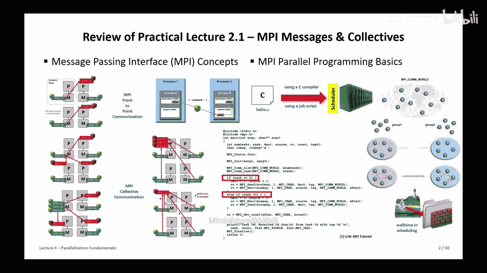

So very practical purposes today， a more conceptual lecture again。

 not really directly relevant for your assignments， but a little bit related。

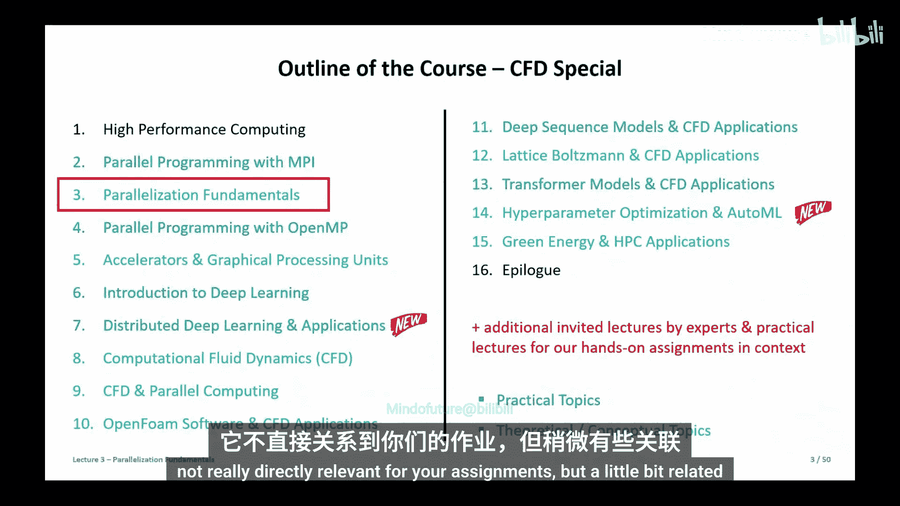

And we will basically see。That there are common strategies for parallelization。

 which will be the first topic where we talk about examples， multi core， mini core。

 we give very simple parallel computing examples， but then also we will talk about something which is an important concept in generally in simulation sciences and in parallel computing。

 which we refer to as domain decomposition。Right so the elements there is really tackled domain which is quite large computational expensive and we want to really think about how we crunch this into smaller problems to do so that's not always very easy we have also Harlo and ghost layers that we have to talk about then that basically mimic then this parallelization stream so this will be part of the you know first element of the course we will talk about the SPMD and thempMD which are sort of different paradigms。

 how we can do parallelization as well as data and functional parallelization so you see lots of terminologies and this will be actually in the second part even more we will talk about several laws which are quite important starting one Amda's laws of Gustavson's law and also review a little bit what happened with the Moorese law which is quite known and with all of this we have a couple of terms to really reaching into the theory of HP。

Although we don't do this too much thinking about scalability matrix。

 what does it mean to have a speed up and also the load imbalance and so on？So， let's go。

So let's start with common strategies for parallelization。Well。

 parallel computing that we already learned in lecture one was all about solving a problem。

 a large problem， possibly in a cooperative way that means we have this parallelization that we already talked about now in the course that we have different processors。

Or if you want to say it also， you can see different processors， but also more notably speaking。

 different processes that running on this different hardware that is essentially now enabling us a parallel processing。

 we call it also sometimes tasks。Not really threats because in the very lightweight some comes something which is much more than a topic of lecture4。

 but by now you know that。The idea I think already from MPI and so on that we now want to solve this problem by involving much more processors and with this we ready to communicate between them that's also what you already know now from practical lecture 2。

1 for example， however。Now let's tackle some of the ideas why we want to do this。

 that's something of course would be left a little bit out also of course here the ideas to have let's say the best possible performance or performance as a name suggests in high performance computing a very important part。

 we have the top 500 list I would encourage you which other let's say the most performance systems in the world right now for HPC。

 there are benchmarks that are done in order to get this ranking on this site。

 which is now an important part for you to look at。But inherently， again。

 this means also it's built from these different ideas of processors， more not。Le GPUs today， right。

 This changed a lot of the pictures， and we will understand here a little bit why。

And also think about maybe the bigger scale。 So here you have one Lego break。

 which was the multi course CPU processor we already did discussed。

 So here the let's say high performance comes really through the caches we have high seamless threat performance in each core。

 So we talk about high performance just on a chip but when you come to high performance computing。

 you lease the idea of just one chip， you basically combine many of these chips and hence we have then many other aspects that follows you like the interconnect。

 for instance， which then also enables you to have low latency communication source Just of course。

 in the baseline。

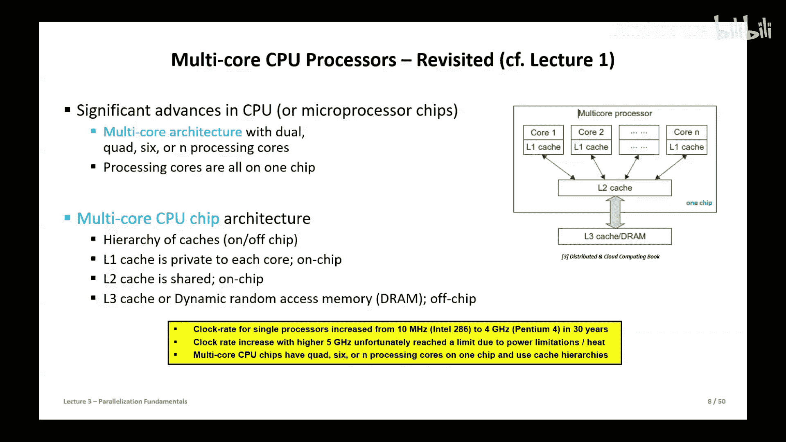

We would have this still as a basic building blocks， right， CPUs， GPs is not that we don't use them。

 They're just differently aligned and basically also differently。

 a little bit assembled in racks very densely together instead of just somewhere in your lab。Tpe。

Now when you think about the parallel computing example and we want to solve a problem in a cooperative way。

 I think this is one of a small， tiny good example。

 you want to find the maximum in an array of 15 elements or 16 elements here， of course。

 in production that might be sort of like 10 to the 15 elements， not just here， 16。

So here you think now about the word domain decomposition because what we have here is now quite interesting a domain of 16 entries in an array that's where the domain is and okay。

 then we can now think about that how many course we have in order to actually break down this problem into smaller pieces。

And now the idea is that thinking about we have four cores。

 that means each can have an equal share of a core set up by four elements in the array and determine what is the maximum locally。

RightSo basically that's what we can do and then just basically from this information。

 we can find out what it would be the global maximum I think that's very obvious。

To find out and the idea is now by not using one chord that is going through all the 16 elements。

 we use four cores in order to obtain something we call a speed up。

And this is one of the motivation of power computing per speedup having。

 let's say high performance applications that are then faster in parallel than using a sort of more serial approaches。

 However， this is not always so obvious you see here very optimized pictures in reality you would also see that someone has to do this max global So it's not all equal shares that you see here right so that the max local a has the same let's say computing capacity as Max local D。

 maybe you know some of these in core1 were also competing then with some resources in order to compute the max global at the end。

 collecting all the information， you know that from MPI now。

Maybe perform a gather at the end in order to do then this maximum and then this is something now or we would say or reduce or reduce even with a maximum already inside the command。

 so you would use some collectives。And with this， you change a picture which is now starting to something we call in load imbalance。

 but this will come over time。

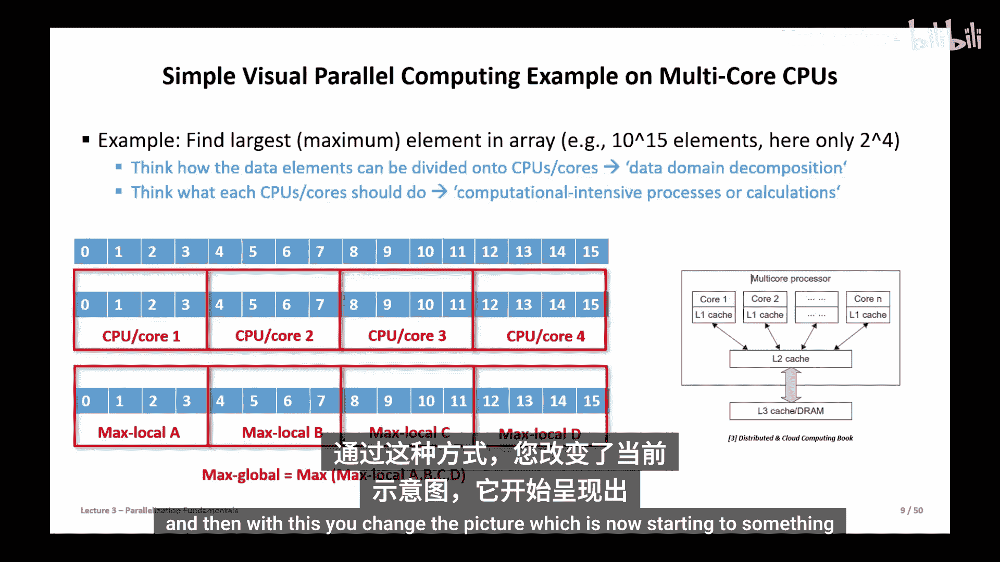

And we will make some points for it。Now GPUs is something we already discussed here and there。

 you know by now it's in many course or the thousand processor of the core and the key difference to the one I just was explaining is then that there are no big cashierarchs。

 there's a device memory， there is something we call processes in the thousands。

 which is just of moderate performance， not the high single threat performance you have in a typical GP and number crunchship。

And usually have a long way through the device memory to the main memory to the host CPU。

 you will see that there are several news and new NVdia architectures， I mean， one is。

Hate high bandwidth for memory we will discuss but more in extra5 then and we talk about more GPUs in detail。

 but also GP has specific1s of course now that actually enables us also to do more AI more deep learning and scale and performance so。

This all leads to the fact that performance can mean also sometimes several different things right for this term。

 not only necessarily speed up， it could be also meaning for an AI model to have not only speed up better modeling。

 better accuracy， lower error rates because we do highpy tuning but we will also do later in the course。

 so the performance terms has to be also revealed a little bit in terms of architectures in terms of what this the application goal and so on。

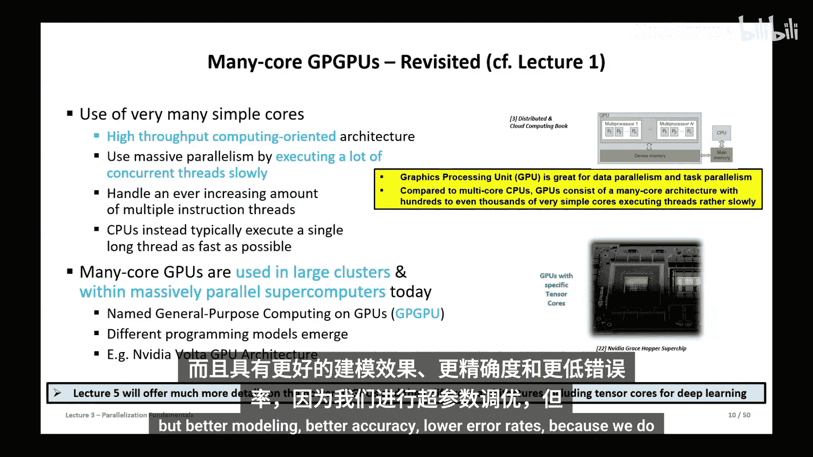

Here you have a very good example again from GPUs why say they are so good in AI these days you have eaten H100。

 for instance， on Nvidia now we have the greyhopper cards which are already even more performance and the way that work。

Even if they don't have the perfect processes is exactly now the idea of the lecture。

 they have a domain， and this should be framing again an idea of a domain then compositionposition idea of a large。

 very large， maybe array that they want to multiply was a very large vector which could be in deep learning。

 really， very large， right？So what you see here on the pictures just should。

 you know show you the kind of idea how you process this in the color coding。

 which is really independent from each other， you know。

 you see everybody has a certain part only to compute and there needs to be no communication between them there can fill the resulting vector that you see here A by doing B times C according to the color code and can fill the cells very easily independently from each other And this is sort of the success why the GPUs are quite good in the performance in AI for instance。

 because there's lots of matrix vector multiplications matrix。

Uricx multiplications where the maththematic rule beyond it is a domain composition that enables us to really nicely parallel and to have not too much communication between us。

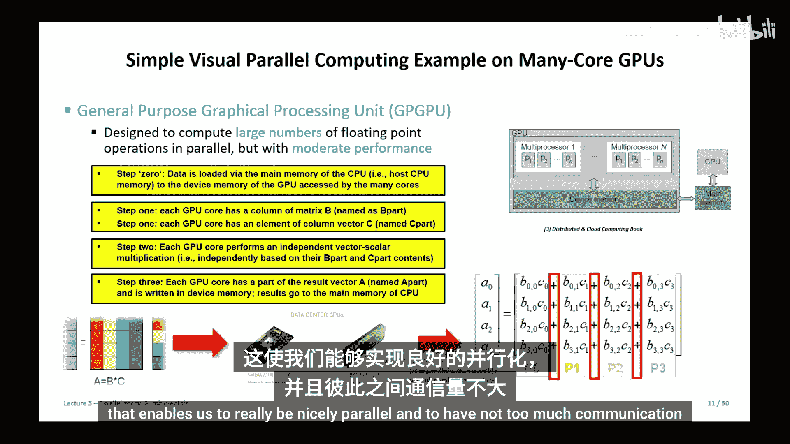

So， this is。Perhaps a little bit different， for instance。

 and that should frame again another domain decomposition term where you basically have domain decomposition in here。

 very obvious the earth right so here we're talking suddenly about 3D grid cells。Where the， the。

 let's say， physics。What you do， you see here， physical processes as an example， right。

 there are many， many in one tile， as you can imagine， the earth is very complex。

 but what matters usually is what you do in one gr part。 and one of these small parts here。

It matters also to the neighbor。And it matters to the other neighbor。So we have a problem here。

 which is not so nicely parallel， right， So basically。

 and you here feel a very prominent example in America。

Cical weather prediction based on known physical loss， of course。

 this is something where you need the region around to be but pretty precise about a grid part itself。

In other words， you have lots of communication between your neighbours。

RightAnd this is really a very important part of high performance computing as well。

 So it's not only the computing of the physical processes which are here meant to be accelerated faster。

 it is also the communication that you need them to be fast in order to say。

 well I had rain so much and I had rain so much so it's a high probability and that in the next hour in main gridile there's so much rain or whatever whether you basically predict right so in other words。

 your neighboring is important and hence the domain composition has to be seen also a little bit in that direction。

 So their domaincoms which are quite nicely parallel we have seen this with the GPU computing but there's also domain compositions like here where the physical processes interact with each of the neighboring tiles and this brings us also to some of the elements why we need message exchanges so much in MPI what you do now in the practicals So this would enable us in MPI now to talk to our neighbors。

As you have seen in the ocean example I gave at the end that the practical 2。

1 it's very close to the idea that we see here， it doesn't have to be the ocean wave height or the fish population we discussed。

 it can be you know the storm weather in terms of wind in terms of rain and you can add more physics to it in different atmosphere levels and so on so simulating the earth is pretty complex as you can imagine and a very good example of domain de composition。

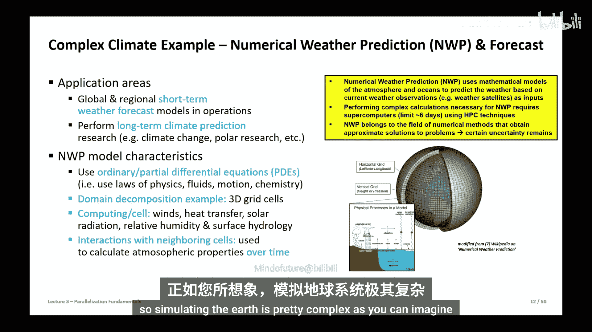

Now， thinking about this， we should be seeing this term now a little bit broader and not very specific because it could be different parallelization methods。

 How I decompose my domain。And you see that in arrays， you can do this way， you know， in long line。

 you can have arrays after a certain paradigm in automatedd composition。

 we have seen the idea of as a GPU。Then。😊，You would say you maybe decompose your domain。

 which is another important factor in this like here in the 3D grid。

 it could be somewhere in the earth or ocean again， maybe just， you know not anymore more 2D but 3D。

 So then it doesn't necessarily mean that now every grid part has one processor right at core like in the MPI ranks that you discuss in fact to collect 2。

1 it could be still that the processor decomposition would be looking like this and having eight pieces or8 grid parts So this is also something of course you have to think about when you do parallelization and here many other examples how you can arrange this depending on application logic the one might be better than the other。

And this is more sort of thinking about the data， the domain you want to do。

 We can also think about a。Oh way。Which you have maybe different models that need to interact with each other on a more higher level scale。

 for instance， here is a good example， again， from one of our elements where you have different models here interacting with each other。

 Each of them might be an MPI code， right， being really in detail having a domain and composition like this。

But then here we talk about functional parallelism。

 where this is all physics about atmospheric levels， hydrological levels， and then the land surface。

 how we interact with the Earth and with the ocean。 So each of them has different physics to solve。

 But you see in the arrows。 And this's now， again， the important part。 they are interact。

 So maybe they don't run a big simulation in terms of a one big thing， but rather， let's say。

 a very smaller part in in different areas of physics that needs to be combined to get the complete picture。

 and。And then for AI， we have a complete other way of thinking partly which also。

We then show you more in lecture 6 and lecture 7， when we talk about distributed deep learning。

 there's again， something called data parallel， model parallel， and so on。

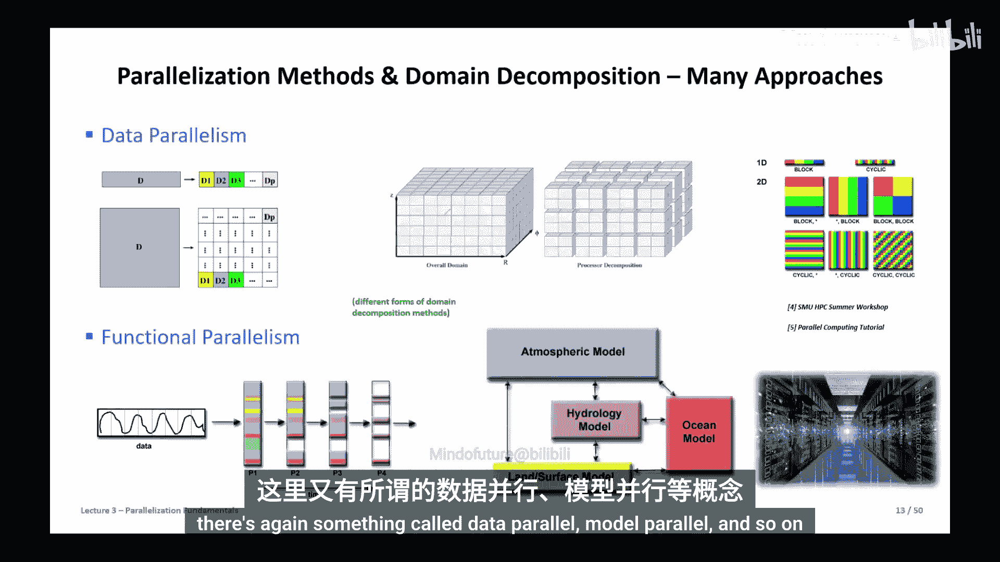

So when we look at this detail in some terminology and you have learned this now by far also with the MPI a little bit。

 we have executed always one single program right， so it was always that you know this eight processes we had or eight past we had in broadcast。

 whatever， they worked in the very similar you know very same program。They just had different data。

 Every rank was different。 So according to the rank and the data and the ranks。

 we could specify then that just one is performing a broadcast to all the others。Of course。

 this is a very tiny example last time， so of course here in the big weather prediction you can imagine that this is a much bigger scheme。

 but it's still one single program。1 executable that will be maybe across。

512 processor or 2048 processes or even way more we will discuss as well。

Then with functional parallelism， that's not the way right。

 you would say normally would have maybe multiple program multiple data aspects that could be going back here。

 for instance， there would be an atmospheric code， there would be lens surface model code hydrical model code and they interact with a so-called coupler from oaseis。

 this is something where you know we have some applications on this area So there are different subts of the problem that solved the physics inherently themselves and every now and then of course have to exchange some boundary conditions。

 some data。

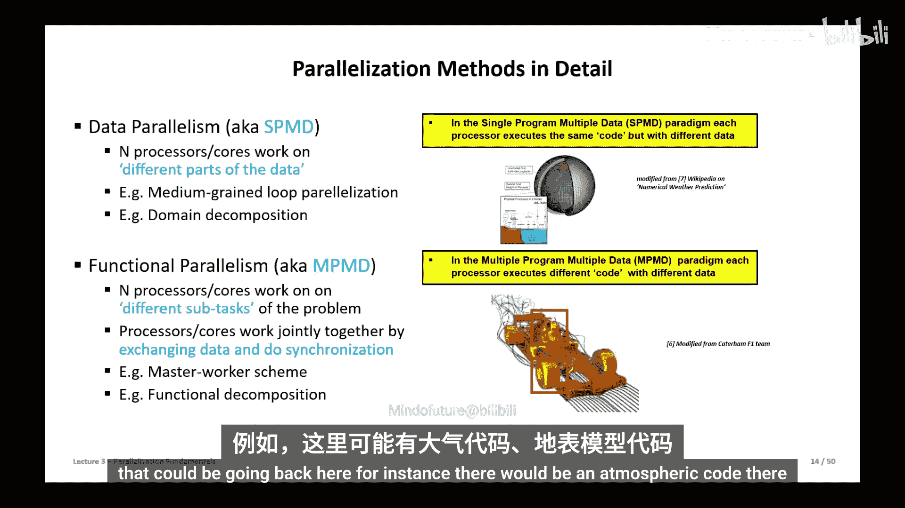

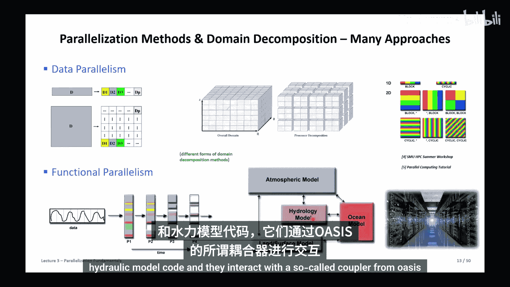

Hence multiple data， but in the end it's also different executable and in the we also see often the master worker scheme functional decomposition。

 also coupling， which is a bit missing here， So you couple these different codes where let's say where you have three different application you would have a fourth。

Application that manages all the message exchanges and the functional parameter exchange point。

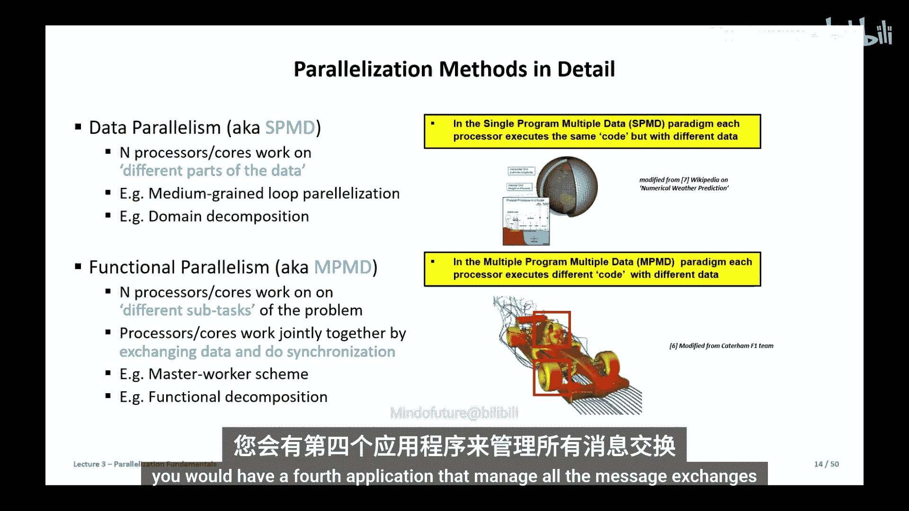

Then when we come to another idea how you can do you know。

 sort of parallel programming and also idea of data parallelism。

 you can think about much more source code ideas and shared memory parallel programming that we will have coming up now in lecture 4 for you。

 is' essentially this way of thinking， well there's a big loop， which is done by one。

 let's say threat。And here we talk about threats in shared memory programming。

 and we will make the case more deeply in lecture 4。

 we had this already at the beginning of the course。

 but lecture 4 will make the case a bit more because you have always basically your shared memory address base you can access。

 And with a loop， this is just straightforward to say you let basically independently the loop run from  one to 500 and then from 5001 to000。

 and you can do this。Because you essentially do nothing else in having a constant multiplied by some vector。

 which is depending exactly on this index。And here also， right。

 You fill the result area also depending on the index， in other words。

Each loop execution is independent from each other right except of course the E is accumulating to a higher value。

 but this is elements where shared memory is just beautiful right you put that in a different index put it in the array and by doing this by using now different processors really that have access to the same shared memory space you will then have a small execution time but this has limits as you can imagine so think about always like even this multiprocessors and a multi course you don't have enough processor to maybe do now a numerical weather prediction right at scale。

Hence， the physics that you can do with a shared memory is， is very， very limited。And with this。

 we come then also later then to the combination。of distributed memory， the shared memory。

 but we will make the case later for it。

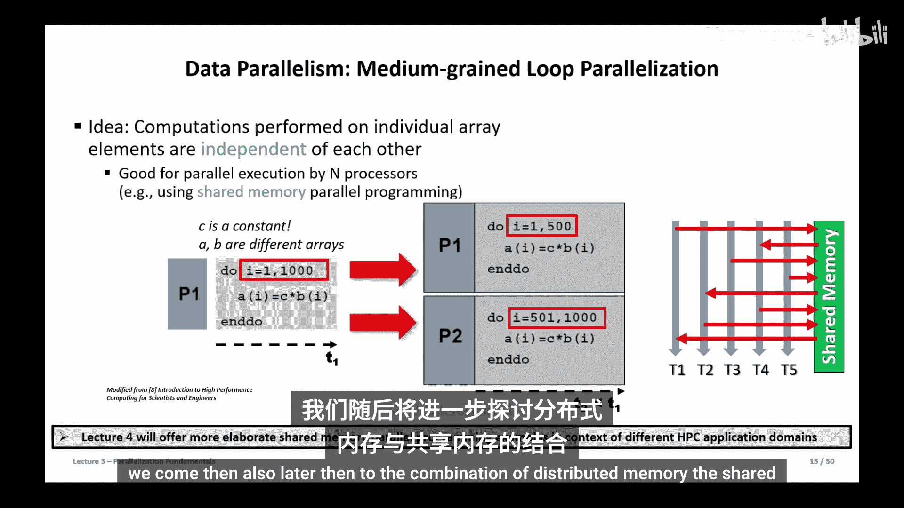

Hence when we talk about data to compositionposition。

 you can have this on different areas on different sort of levels and here's one again also discussing a little bit how you exactly do it and forming sort of meshes it needs to be not always Catasian in the iconen code we have fix the hexa you know based you know composition or that you see here 2D grid display。

 so sometimes maybe that is good in the Caassian world and you go then to the 3D grid display。

 but in others you would not。So in the end it's a very application domain problem and also you have to think about how much end processes you have available label to do this and one thing that I want to make here also is the point with the physics again。

 you need to have variables that you know need to be stored per processor and if this。

a lot of data that needs to be stored， the amount of memory might be limiting。

 and you maybe can even more compute， but the memory is full already。

 so you will have more processes involved， not because of the computing。

 but because the need of memory。The need of storing all of this information， which is， of course。

 for the scientists at hand doing this and for the engineers of the race cars as well。

 absolutely an important factor as well。 Otherwise， it doesn't make sense。

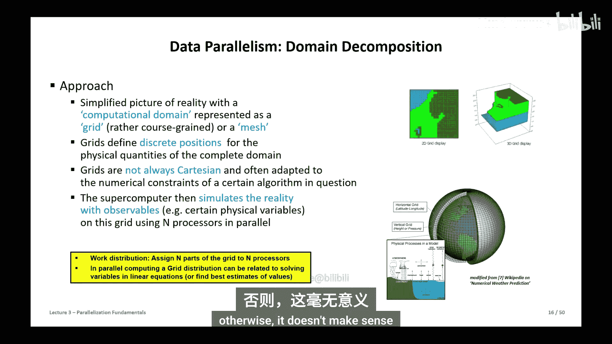

And there are different ways how you can do it。Some of them you already know the ocean we discussed We see Cartesian grid 3D。

 you see here more advanced to made the composition。 we call that also adaptive mesh refinement。

 Sometimes it depending on where the load is very much from the processes。

 more processes are involved then let's say in regions where not so much is to be computed。

 we have this in the race car， but also in the airplane here。 And then even in in simple setups。

 you would say there's still a choice to do。Right and this is。

 I think what you see here a little bit， the 3 d grid cell where you store one information representing the cell or you go to a more lattice display where the nodes basically are are just existing and so to speak framed from the values that you have around it that that build the lattice So you see it's a different way of simulating it and it really is an application the men。

Application specific problem， but also think about the amount of data again that you hear and there to store。

 maybe then it is more representative whether whether this is it or you can have a smoother approach to predicts by doing it in the letters。

 This is really something where there is no one rule to rule them all。

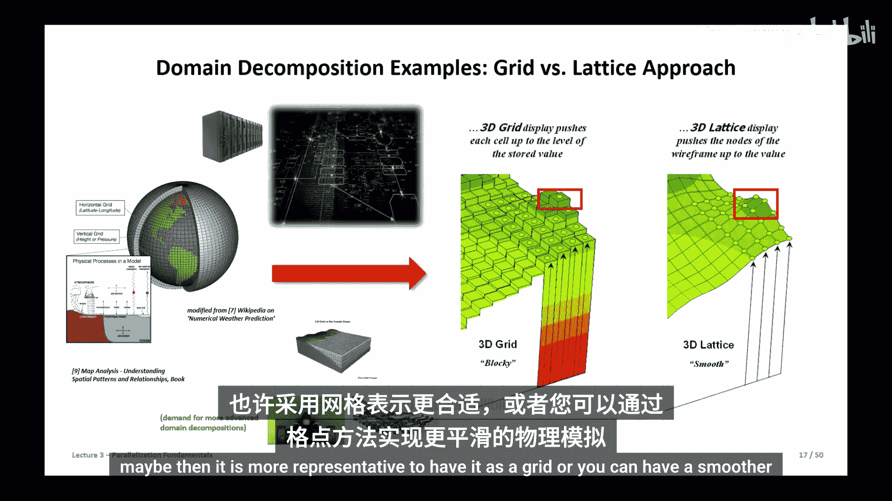

And here's another good， I think， example making the case to our practical lecture 2。

1 where now also the computing capacity has to be put into the perspective right， So in MPI。

 we were not thinking about this very much。So it's there。

 but if you have an application domain problem interreial systems like here。

 we want to simulate this ocean area there that you see。

 we have different choices and perhaps also different data giving ground truth giving data for the inputs and you know the more and more I want to have more fine grainined realistic behavior for the simulation or the scientific computing over time。

Right we need more more resources and this is so to speak a independent project it comes even to the point that you have to have more detail。

 okay， what detail you want to add maybe today you add the boats and you remove the boats and you do the people then you do the birds and you do the oil platforms or you do all together objects to study in this particular area right for logistic simulations。

 but also again then in other simulations where it's about you know climate and so on long-term climate aspects this is all something where you have to decide。

B with the domainic composition， the resolution， as you see here on kilomet scale。

 basically to what computing capacity you have actually available。 Now， then over time。

 simulating this and giving you then the opportunity to exchange between this different grids information you already know。

 we learn this in practical lecture 2。1， right， to do an iteration， iteration， iteration。

And to basically exchange parameters in that。

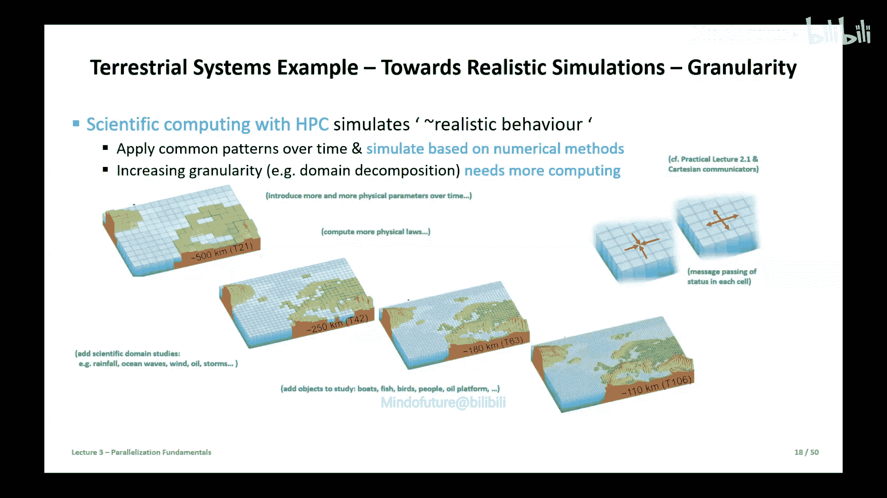

So from this， I want to stimulate you a little bit to a sort of autoagonal aspect to the domain decomposition and this is time。

So one of the key essence， even if it's in deep learning。

 right over time we want to train deep learning models or if over time we want to see a race car。

 you know， going through some area with， you know， interacting with the wind。

 understanding the speed performance， bottlenecks of the race car。Time is always there。 And。

 and this is an aspect which。Exit now much more complicated， right。

 We don't execute the MPI code once。Usually， there's a sort of overarching loop。

 right that guvs time step by time step， time step by time step， advancing the physics。

 the location of the race car， but also the interaction with the environment。

the same is true as a heat map in the room， right， so if someone now opens up the window in the classroom。

 what's going to happen？It's not something but we simulateulate directly from。

 from this a moment where you open it。To the end， in one step。You see here after 200 rounds。

 we know how it looks like maybe in an hour。And this is something which is again an important factor firstly。

 the time is never necessarily to be equal than real execution time of HPC so this 200 rounds would stand for half an hour in a room in a classroom or for one hour in the room of the classroom so this is dependent on the physics variables and secondly in order to go to the situation that you have in a certain amount of time you have to adhere of course the values of physics before you cannot just jump and simulate in one hour it's like this you basically usually have a time step behavior。

Where you go through your domain and composition， you will exchange information what was in the time step before。

That will have a major influence on the next time step。

Right and if some of you are a little bit AI inclined client statistics inclined it's similar like the mark of bit like markov chains。

 mark of properties right you have this one markov area obtained and then you jump to the next here we talk about different things it's about evolution of physics over time because many of the physics variables will be also having a time dimension to it。

 if not almost all of them。Hence heat in the room we already discussed。

 but also there I wanted to show you that not each simulation is like each other here。

 we talk about that maybe the simulation could be， you know taken。

An account in a very rough way with6 neighboring cell and a very accurate way with 26 neighbor cells。

 So lots of more communication also required here。This is a so called C Kobe solve that can solve the heat in a room application example。

 and it's so calledled an iterative method in numerical simulations that basically step by step get you closer to the solution。

 it is not the exact solution， it is an approximation。

And it is usually a formula that is well defined in basically in physics， which you see here。

 which is the you know diffusion equation that is called this is change over time。

 and you see this right nicely here how the temperature rises。

 depending on other properties that you have， maybe the cold in the room or whether they the temperature and the room before you open the window。

 whatever it is。But it's a certain aspect， I also wanted to convey here。

 and this is exactly what you see here with the arrows。

You see quite nicely that time zero is a time step now。Basically that we had already computed。

 but in order to inform what's happening on time step one， the next one。

We seek very clearly that in order to compute the next time step for this particular area here in the domain。

 we need the information from the neighbors and the arrows now show nicely what we have learned in MPI。

Right， so this is sort of now the time dimension to what you know in practical lecture 2。1。

 which looks a little bit like this。On an eotropic lattice here。

 so this is kind of a nice do combination some call it already also stensr code because we will do the same for every cell。

Like we learned also last time， but the truths is you don't want to do this just like that。

You have the time dimension making it like that， right so that means usually at the end of one of these overarching loops over time that you see here with thousand steps。

At the end of one of such a loop usually something like this happens that whatever you compute it in all the different tiles。

 you will inform your neighbors about it， right like here， for instance。

 but you do it from the results of one time step that influenza time step next。

 and then the new physics formulas will be applied with a new data of the time step before。

And you see that a little business fee here at times step one it heavily depends on what was computed in times step zero。

So one example formula let's not go too deep into it。

 but this is an important part to realize when you come to this that you need the information from the time steps before and now of course this has a sort of dimension what you see also with the arrays and the values with K and E this is now of course the another autoagonal and this is now really then going to performance tuning how big are the arrays for these data structures how much can be used shared memory versus distributed memory shared memory will be always faster but it is significantly limited we need distributed memory to scale so hence there's a big question mark which you see is a gray arrays part to what extent we can use cache to what extent we can use shared memory and song。

And for that， I want to influence a little bit your thinking to this distributed memory approach。

 which we need at some point in time， which needs to operate the same way if I leave shared memory and I have a situation like here。

Then I would need information which is practically not existing。

 that's why we call it the ghost cell because it's somewhere in the other processor domain。

 somewhere in other memory。So what happens is that we introduce this halow and ghost layer， really。

That is just for information exchange， essentially。

 and will be then taken up on the next time step for the computing of the actual data。In other words。

 if you simulate here the ocean， this area of the ocean is practically not existing。

It is just to get some data structure。For the next time step so that the wave on this corner or on this boundary here can be still well computed by the tile on the other side of the processor。

And of course you don't do this for one， you do this for every single one。

 they all exchange it in the ghost cells and the halo layer and what you use MPI for it。

So's another good usage example where NPI is often used to really fill the ghost layers or the halow layers with information。

 and also there the domain decomposition matters， although you see here one domain decomposition which looks like it is the same。

 it is the same amount of tiles right， but you will see with a gray。

 depending on how you do the domain decomposition here have much less communication。

RightSo hence this blocky idea that we had in the beginning。

 you remember the ocean or parts of it that we then had in this four times block rather than long once means that from the physics perspective。

 we have to actually exchange much less parameters， much less communication is needed here。

 right and this means high performance or more high performance usually because less information exchange means less communication and you know we can focus on the computing。

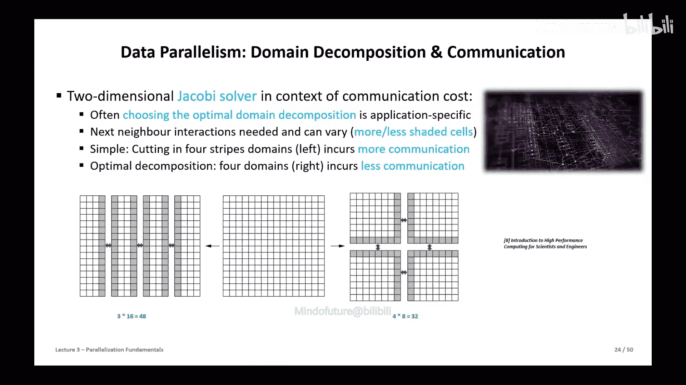

And I know that is kind of bringing all together means。Our own programming is not the simplest。

 and I even left out a little bit the data and losers and machine learning domain where you can end up like situations you have here。

You have HPB scan implemented from Marcocrs， one of my bright PhD students in the past。

 it's still one of the high scaling codes that we have。

Where you can clearly see that at some point in time the processor domain maybe looks like the same space and you would cut it equal。

 but then you basically learn with the data in question they are all on one side here as an example and where you do clustering right that we discussed already in one of the earlier lectures so you want to bring these points together which are closer together so this processor one is basically has much more to do in the end then processor two and to mitigate this you would do some cost metric that you cut basically here in this interesting space already because then the processor two can help processor one to digest all of these different points because have you know kind of Euclidean distances checked or whatever it is it's quite an elaborate algorithm we cannot go in all the detail here but with this you then can do more and more course and get to a sort of almost linear performance if you adhere to these rules right so that you not just bluntly cut a domain。

Necessarily in something but we as humans would see are very obvious cutting it here in the middle。

We will come back to this code again here and there。

I think by now you have learned a lot about the doating composition which was sort of goal of the first part of the lecture or the master worker scheme。

 there will be also other lectures coming on later in the physics space where we again go to this master and slave idea of workers somewhere in deep learning we have there also we will talk about this a little bit so I would say this is topics which you have much more than when we talk about the CFD codes。

 they are solvers， they solving particular elements like air foam。

 for instance that you see here and then we will also talk much more about how open form and other multiphysic simulations and can simulate this。

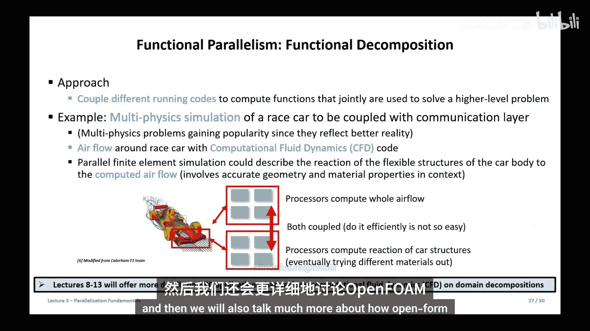

I'll leave you this video here to study our famousvolcano Aku that was here going over Iceland and then had an influence basically on the no fly zone do you see in the video。

 there are other examples I encourage you to watch the physics problems in this video because not at all is everything in HPC still AI right so there's something where there's lots of other problems where。

You know， HPC is still needed， not only AI。

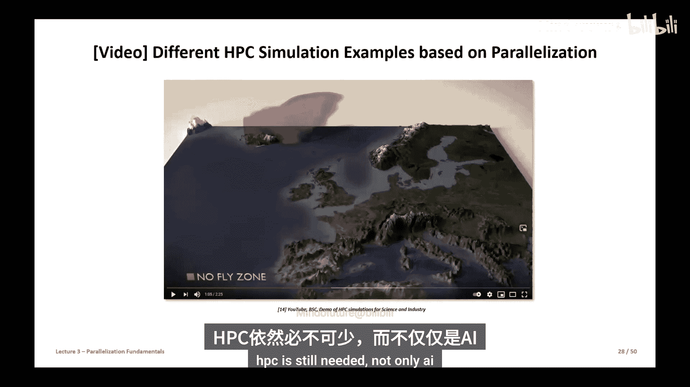

We continue with some parallelization terms and theory then after a short break。

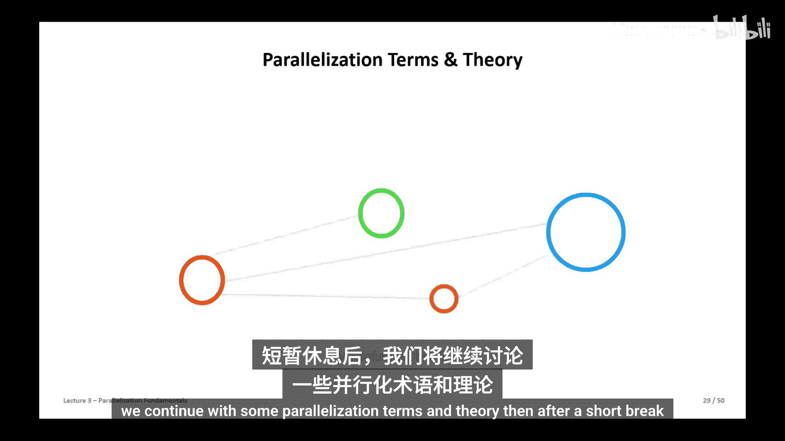