# 【冰岛大学】高性能计算课程-｜-2025-High-Performance-Computing-｜-Prof-Dr-Ing-Morris-Riedel-p20-P20_实践讲座_2.1_MPI_消息__集合操作_第二部分--BV1k34zzaEK8_p20-

Welcome back to High performance computing， we have our practical lecture 2。

1 and the second part of it。The first part was about MPI messages and then we essentially learned with this also the MPI environment first MPI Innet and so on。

 then we had simple point to point communication already in the last part and then transformed over to some collectives where I showed them the broadcast for an example。

We also。Try to understand a little bit with all of this。

 the differences between the job script again versus C code。So this is an important facet of it。

 because here， we thinking about that。We can do changes to the sea code， then we have to recompile。

But we also need to think about that some of the code is hopefully written in a way that it's just scalable。

 so that means in other words， the job script can then steer how many processes or really how many tasks I execute out of this one source code。

And this is usually the problem for students。 So understanding that， again。

 the same source code is used for all of this。Hence， the idea with the ranks。Right。

 so with the ranks， this gave us the opportunity。 In the first part， what we did was a ping pong。

 for instance， to identify who of the two ranks now being part of the programme of the parallel programme。

Who is taking now the part of the ping and then who is taking the pong back。

That is not totally obvious and you have to really look a little bit into the lecture part the last time so part one of lecture 2。

1， if you not really have understood this yet， because what we will do now in the second part of lecture 2。

1，We do much more practicals again， as usual as a practical lecture。

 but also we will go to more advanced material， so many of the things I was just putting into par。

Let's say one of these lecture is really basic and we cannot go back to early every detail。

 but we will also see that the application logic we will have now with non-broing communication。

 we have cattasian examples， but then also move almost towards the phish simulation or the boat simulation over the ocean where we try to understand what is。

 you know when we can have in a loop， then this cattesian communicator used to basically simulate over time steps。

 a movement from the boat or information exchange more accurately。

So all of this is quite a comprehensive lecture again。

 based on student feedbacks that were let's say giving us a hint every now and then we have lots of repetition and we try to remove that here a little bit now with this。

Hence， let's ask new seatbelt for an interesting lecture starting with nonbroing communication。

🤧If you remember we had already some aspects in lecture too about it。

 so the basics I will not go into too much detail， but what we have essentially learned from the beginning of the MPI lecture processs is blocking MPI sent。

And when I'm inside this， I don't do anything else。

 I just execute this function and you know there's nothing else to do。

And I'm waiting because you have learned in point to point communication。

 I need a matching receive someone has to listen。RightSo basically。

 this is blocked until someone is executing the receive。And with this。

 you basically are stuck in your source code cannot do anything， assuming that for instance。

 you know here is a late sender， here its the other way around so someone is actually listening since a long time in a blocking way so can do nothing else and waiting and this is the thing that we want to avoid the waiting times here because essentially that means idle time right I don't do anything I just waiting for the MP send to come。

And this is a possibility now to combine essentially with different ways with an IN。

 non blocking communication， and then I receive that you see here as a let's say。

 non blocking receive。But the nonblocking then introduces something what we call MPI weight or MPI weight all that I also show you best in practice。

 So let's go to some practical example where we can say。

 you know that this is often use in different programs。

 you will see that the MPI I send and I receive I will give you at the end of this lecture indeed。

 as an example when we have understood the Cartesian gridit， if that you have there。

 you know from one of our previous lectures we said if you want to have the ocean simulated。

 we would put a Cartesian grid in the ocean， but this is not everything we also have to find out how we can use this Cartesian gridit。

 then for communication and in this communication， this nonblocking communication is quite useful。

But before we go into the material of this， let's understand first non blocking communication as such。

 it was a let's say small example， and then we move over to the Cartesian grip because it's also not completely obvious to you because that's also a new communicator。

So we come to this step by step， the communicator was always MPI Common world that what we know。

 and suddenly we have a new communicator。And this is something also we go stepwise and then finally when we have built on these concept nonblocking and the CAtsian cut simulator。

 basically we can go to a real application sort of where we can per time step。

 you know give information to the surrounding grit， which is important to understand there。

 let's say variables examples might be the fish population you know which fish is swimming in which direction and is increasing the population there。

 but it could be also the other way around what fish population is actually coming to mytile in order to simulate the fish swas。

 for instance， but could be also let's say boat or not boat could be any other variable。

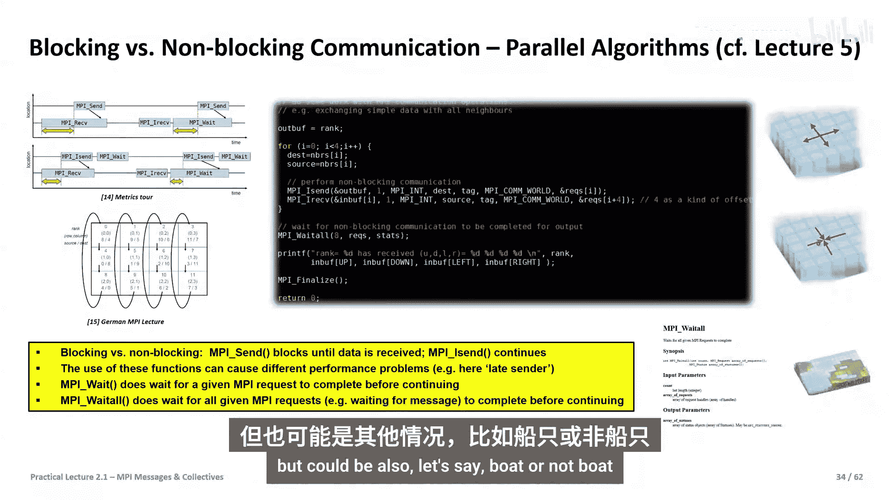

But let's go step by step， let's start a little bit with non blocking communication。

 and as this is a practical lecture， let's go back to El。

So what you see here is that I already lo in so I also want to not redo this now again and again and say。

 well， okay， we have you know locked in DS SSH， you know by now how to do this on earlier。

 we see username， we see。We see SSH key and you also will learn this in the first assignment。

 how to do this yourself。So let's go directly into the non blocking example here that I've prepared for you。

And when you looked in the C code it's quite an interesting conversation。

 it's a little bit reddish here because it's around the text。

So we start a little bit with the usual things you already know in it Com size Com rank right so this is something which is you know probably not a problem at all and the same I've also here for you in the source code text documented what is actually happening here。

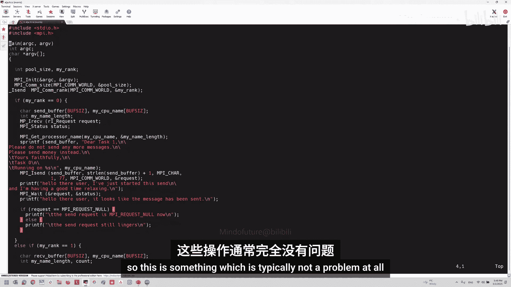

And depending on the different， let's say。You know， rank information now we have two players here。

We say rank zero is you know the first player and then you will see lower， we have also an else part。

 which is else if my rank one， so if it's the other processor， I do something。

So here we want now to understand this idea that when I do something like acending， right。

 then I want to continue with something in my own source code while already sending you know。

 something to the other source code execution， hence the other rank。

And this is nicely a best put when we do a print F here you see essentially。

Here has someone talking and start talking to the other you know task at that you know here please do not send any more messages。

 please send money instead， etc cetera， this is something what the you know thing is going over the wire here it's just a sort of funny example I got from you know some tutorial here。

 but the key message takeaway is that we sent this now。Essentially as a buffer， right。

 that we have defined here。And in this buffer， we essentially address directly our， you know， other。

 our rank。And we do this in the MPcom world。 We will later do this communicator aspect then withs a cattasian。

 but here we remain an MPcom world So things we know and the beauty is also we get some information out of the request the MP request here that you can define and also the MP statuss gives you then information。

 that is essentially then binding these requests that you fire up in this。

 let's say non-blocking sense so that the weight razi gets the connection and waits until these requests are done So in a way it's a synchronization aspect here right so you can have multiple eyesense。

 obviously because you see I can continue is source good printf hello there I just started the send and I have a good time relaxing。

 So in other words， I can do something I'm not stuck in a blocking send。But in order to do so。

 I need also at some point in time in my program， a synchronization to say。

 well now it's another time step or something else is you know that we don't want to lose a connection too much between the different power processes and there。

It looks like the message has been sent because here we see the MPI weight is now the synchronization waiting really for the request that has happened。

So in other words， we know now， okay， the receive was actually executed or it was received。

And this is just for let's say boxs if there's a problem and then the second part is now the other role if you want right so and this is an again showing us you know high user here。

 but of course I receive it。But I also do something。 I started this receive。

 and I am having a good time relaxing。 So basically， nobody waits for each other。Until of course。

 they get then to their MPI weight request at that point in time。

 we need to basically see that we have actually at this the matching send giving us something in the buffer and then of course we want to see what we got in the buffer you see that a bit here we say get count MPI get count from the status how much characters where insight that we will print out here and also the rest is just more or less for bug fixing here so MPI finalized to end this。

 but let's also go a little bit back to the practical so this is a source code it is already compiled。

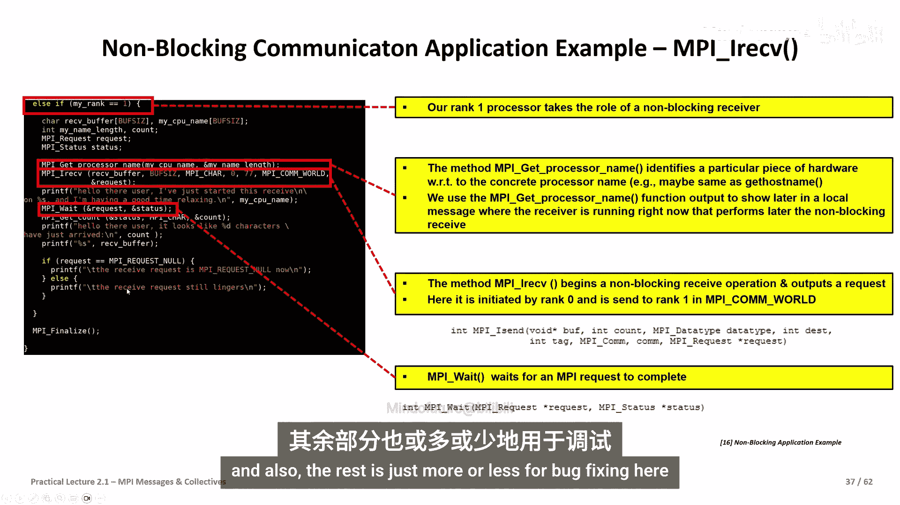

Then we want to look what we do in the submit script there's also no big surprises。

 we have two players so two tasks it is a little bit hardcoded in this example just to make the case of this nonbing example。

 but that doesn't really matter as you know in bigger programs you probably don't do this and when we come to the CAtesian example we will see also that this is not always so easy we have applications that have a certain let's say application domain that we want to paralyse and that something also which you will learn in lecture three。

 but essentially we can now execute this example。Be gonna to。

In our job ID back it's so actually Q it's so fast that we again don't see it in the queue。

 but we assume there's an output and when we look into the output。

 we probably have a nice conversation。And you see a little bit here what we had also in the source code I just started this receive。

 you see the receive comes first， although honestly speaking。

 this could be also because it's all written in one file， sort of race conditions around the file。

 so sometimes it could be also at the send maybe here first。

But I'm having a good time relaxing and then there comes a sending。

 but I'm having a good time relaxing。And basically， it looks like the message has been sent and。

You know， it looks like 128 characters just arrived。

 and this is a text that was actually initially come out of the， let's say， rank0 that wrote。

 you know， to task one or if you want to task zero。

 wrote to task one and essentially that's what's going over the wire。Or in other words。

 via the non blocking send and receive。So admittedably a trivial example again。

 but it captures the essence of this non blocking communication。SoAnd this is of course。

 something we want to use later again， so we will have a more advanced example also later。

 let's advance a bit in the slides。

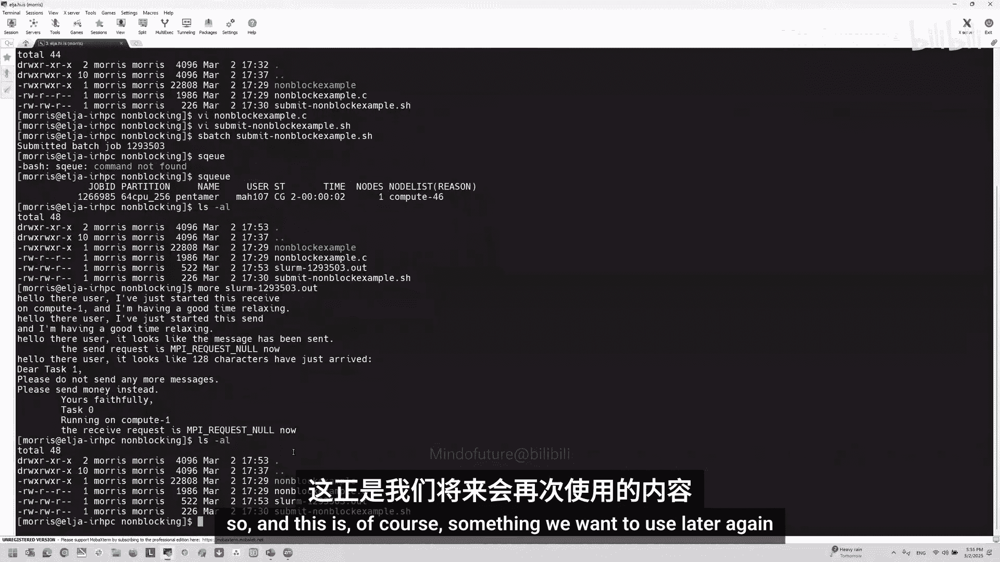

Literally what I actually sent here you know in the example and so on。

 I think this is all what I described already have also here the typical way how to do it right I avoid here again the compilation as you know this is basically always similar and you don't need to necessarily always you know compile also when you load the modules you have learned this you know I have done this already in the first parts of the modules that are still there when I would compile and then you don't need to necessarily do this as you have seen I could just submit the job also。

Now when you look into the machine that's different， right， so it's fresh。

 then you basically have to note the module in order to compile it properly。We looked in the output。

 we saw the message going basically to task zero not to task one from task 0 128 characters with I send and I receive with two players all what explained。

Now let's advance a bit and think about communicators again， so this is very interesting material。

 it doesn't have to be the CAteizian communicator you can create your own subgroups if you want what is shown a little bit here you can actually create a communicator group one and group two。

 the interesting thing is that in the MPI co world。

No matter how many other groups you form out of these processes。

 they will always have the same rank information like MPI Comorld in one particular communicator and this is the MPI Comworld。

So hence this will remain the world of all processes just because you create a new one is the rank information new in the new communicator hence then you now create co1 and CO2 and you will you know do the message exchanges within the world of this communicator they get new assigned ranks from0 to5 zero to4 because here we have five and here we have50 to4 but these are not the same processes anymore because we in the space of these different communicators and for the communications you will have to specify co1 and CO2 for these groups。

 however， parallel to this will be always MPI comm worldorl existing where you basically get you know still your unique rank in the world of all processes。

So when we create a new one now， were thinking about message exchanges again， but in a more。

 let's say structured way in a more you know Cartasian grit as it is called and I mean you can see that a little bit in the ocean example here very clearly what happens if you want to have a boat you know basically going over the ocean or a wave propagation of some height that we want to calculate over a certain ocean。

 the fish population of a certain ocean， there are different examples here that you know basically mimics the same thing that we want to have information exchange propagated through the gridit and by doing this in a much more systematic fashion we can specify already the application domain like the ocean here。

 and assign them， let's say different areas of the ocean for instance。

 and hence you have something we call here rather than array that we mathematically want to look on。

So in a way that is here explained this example is， of course。

 a three times four ocean part right that you see maybe not really here fully， you know。

 this is more， but， you know， think about that we are now here in the ocean。

 Now you have few different ranks。 this is now the interesting thing when you create it this new let's say Cattasian communicator will have this rank structure。

And then， of course， we can suddenly talk about rows and columns， right， You see here， row 0，1，2。

 and， and so on and column， you know，0，1，2，3。So and then the source and destination is now something which means when I do a。

 let's say periodic。Sort of in our communication idea over and let's say a follow loop or sometime interval。

 you see that I would like to have something like a shift done here， right。

 you want to shift the information。 But what you also see is now I need to know。

Who is actually my next partner when I shift here to the lower part， right， Hence。

 the source here is 8 where we receive something from。But also。

 I am basically sending to the floor in the next time shift。

And that's how you come to this information exchange over time。

 mimicmicking here maybe also the red arrows， right over time over the ocean。

And that's where they have this conceptual view of this communication， this a cars in grid。

And of course， by having this commicator， the beautiful aspect is that I can understand know what。

 you know what where I am in the bigger field and I can understand when I want to perform a shift in a certain direction。

 then the MP environment gives you source basically and destination automatically you don't have to really program that of sort。

 you will know， in a sense from the environment， what are。

 you know the the kind of coordinates and this is perhaps better explain when we go to some practical example。

 So here I wanted to show you this example， leave the non-blocking。

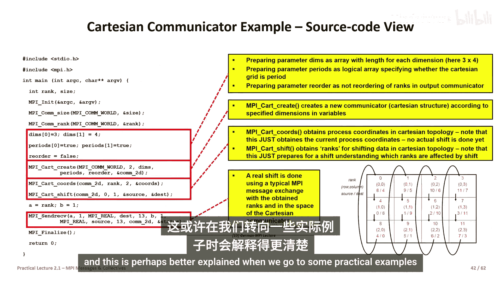

And we enter the world of the cattasian admittedly it's a little bit more already complex material hence you will see the source code getting more complex more and more。

 especially when we have the other catassian example。So when we come here。

 we have the usual things you already know， I stop repeating it now。

 we said the dimension should be three times four we said periodic that is sort of a switch on or off and we want to have it in most periodic in other words。

 you see that here a little bit， you know that when we at the end。

 we still want to continue you know and at the beginning to make it a really proper simulation。

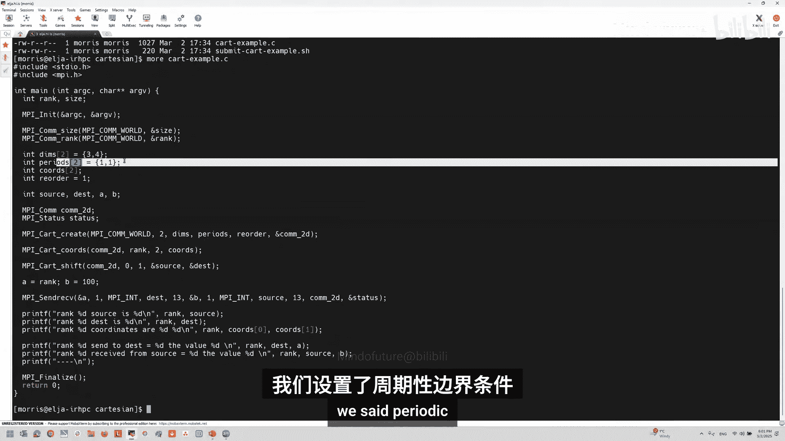

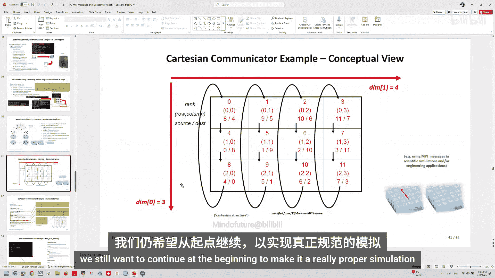

And then we already had something what is here the MPI communicator， so we define a new variable。

 which would be our new communicator next to the MP Com world baseline that we established right we have an MPI status to obtain some status information later and you see that we out of this MPI Com world you know the world of all processes we create now with MPI CAt create a Cattasian communicator which has exactly the kind of properties that you see here。

And that you also see will be stored in this communicator to the MPI communicator。

 hence in other words， if I now want to use let's say。

 this communicator or I want to use information exchange like a broadcast。

 I don't use any more MPI Com world。I use now Com 2D to do something， right。

 because we are now in a complete different world。

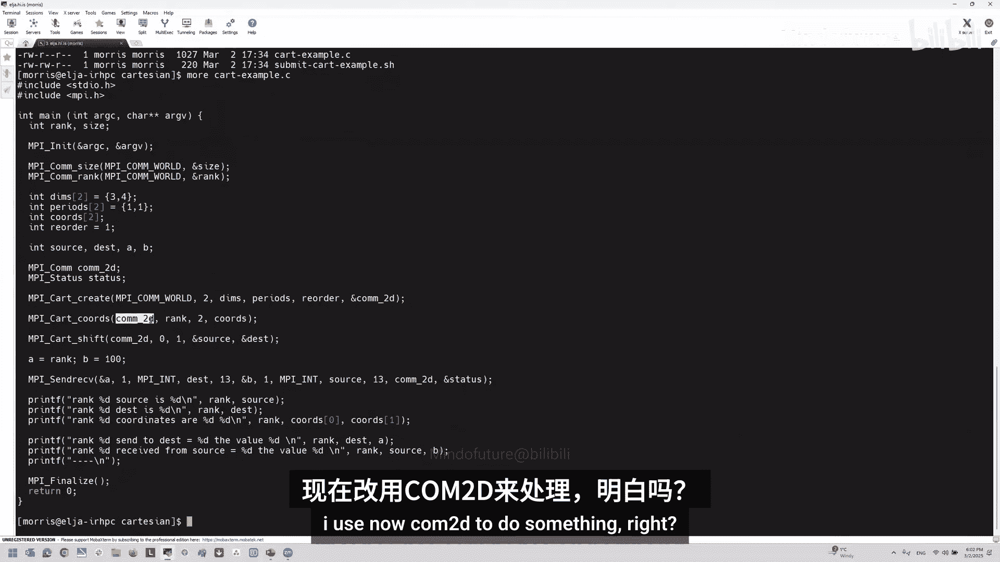

Again， just for you to understand coming back to this beautiful pictures。

 we have created something like this。You know， a subgroup where new a new world lies right。

 and it looks more rather than this like a Cartesian world。But still MPI convert is existing。

 but whenever I do communication exchange like here in this Cartesian grid。

 I have to now actually have this comb2 D to basically use in my information exchange So that is one thing and before we come now to really information exchange you see also how nicely this MPI card code coordinates helps us to obtain now the rank information based on these coordinates where I am in the Cartesian grid So this is another nice function coming out essentially out of the。

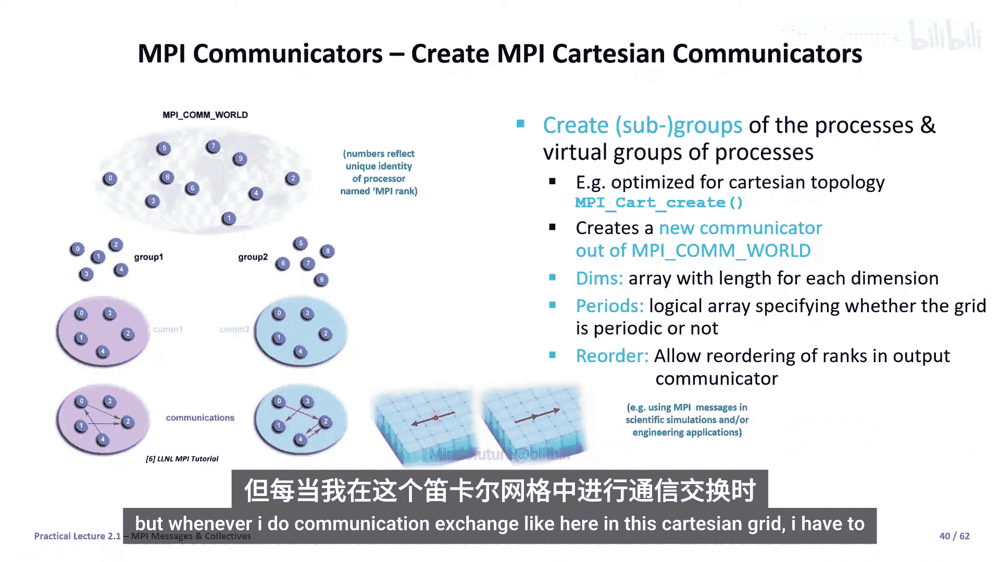

You know， out of the cattesian world or out of this power that I have really from this communicator。

 and then I can try to find out， you know， and this is now an interesting element because it suggests now that we shift something which is not true。

 it's just we want to understand what would be the source of d destinationsination if we do it。Right。

 let's say。 and， and this is something which is now the important aspect to understand the shift is just preparing the con is preparing the。

Message exchange in terms of finding out who I am in the bigger grit and to who I want to send when I do this in a certain。

 let's say direction。You see that then basically here two variables that we want to get over with。

And here， we use this destination。Where we want to basically do a centered receive is also possible with one。

 let's say command。And then we use the MPI in here because essentially we have just an integer that we want to send around and because this where we now executed you know the source code from from top to bottom we start with MPI Com world here。

 we have suddenly a complete new one co 2D hence when we want to do the send receive in this new world in this co 2D。

 we also have to specify this code in this communicator there。

 and then get the status basically and then we can hear you know give some information out the rank is this and the source is this and then the destination is you know based on this the information that we essentially automatically receive here from you know the idea of shifting that we then used also。

But the shift itself again didn't do the shift， it just or didn't shift the information really。

 it was still you know one of our message exchanges。

And I think the best is to explain it when we run it。

 so we will have you know the submit card example shortly and now we see that could be run on you know。

 12 notes， 12 tasks really， if you want， right a tasks in a note。So why we do 12， 12 is very obvious。

 I think three times four， because now what we sort of simulate in parallel computing here with a big simulation the ocean would be that we need in order to you know compute the fishing population or the boat movements or so you know in this manner。

 so we have a four times three， in other words， you know。

 as we know every rank of course needs a processor。

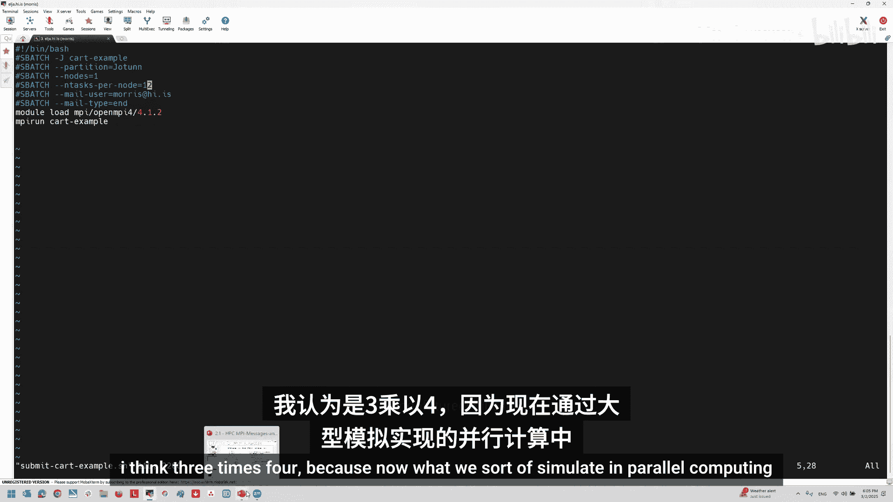

So by specifying the three times4 art coded in the source code， we lose， of course。

 now a little bit the idea of being flexible。

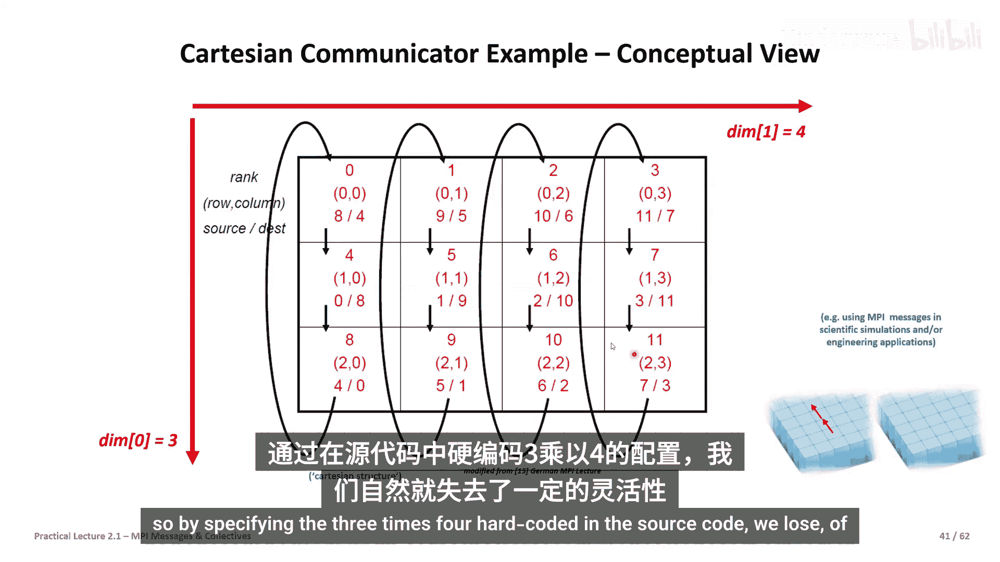

Hence we need 12 processes and we can imagine what happens and I will demonstrate it when we do just 11。

 but do now 12 here I think is our way to go in the beginning， we s it quickly to see how it works。

Also， this example is so fast， you see it's almost already done when we already want to see the output。

And now， when we see， we have this 12 processes executing exactly the same source code。

 but being in the same coordinate system， right， So everybody is involved in the MPI code world。

But we see now exactly these different ranks， you know。

 they all write their output and get the information from this shift that I had basically here for you as a conception graphic right and we can now go back and see。

 is that correct when I shift one downstairs we can pick maybe rank two， for instance。

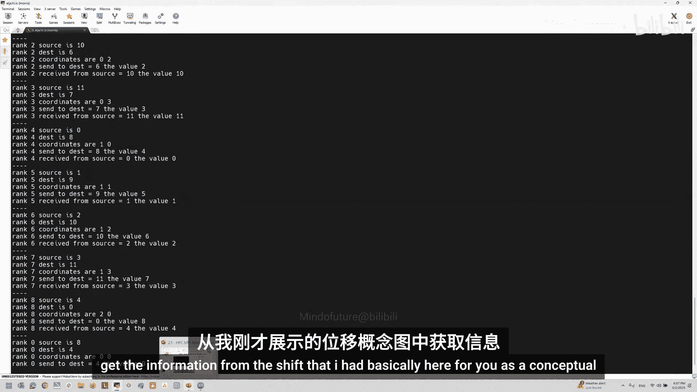

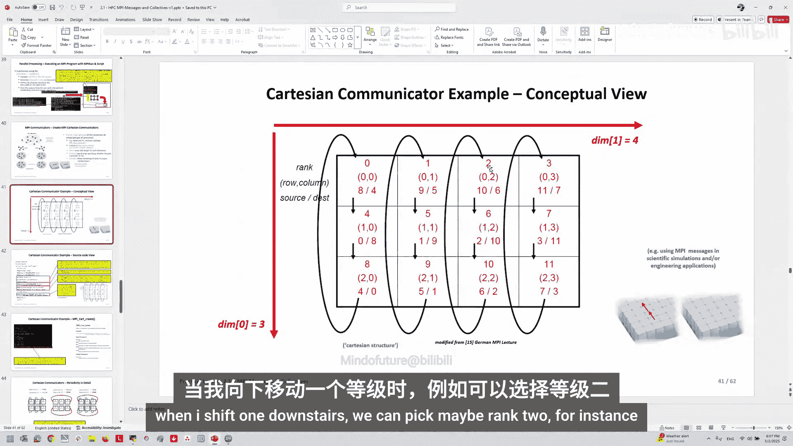

For rank2， we say source is 10， right， that means in other words。

 10 will send us something that's also here。

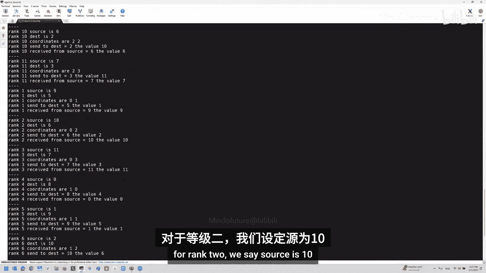

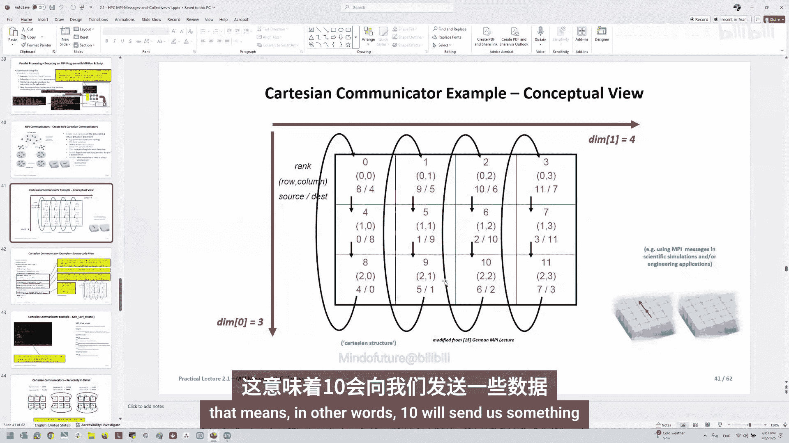

What we expect is that the destination should be six because， as your the graphic suggest， of course。

 to go lower in the communication， I then basically do a you know kind of information exchange down there so I sent basically to this destination while I receive from this source。

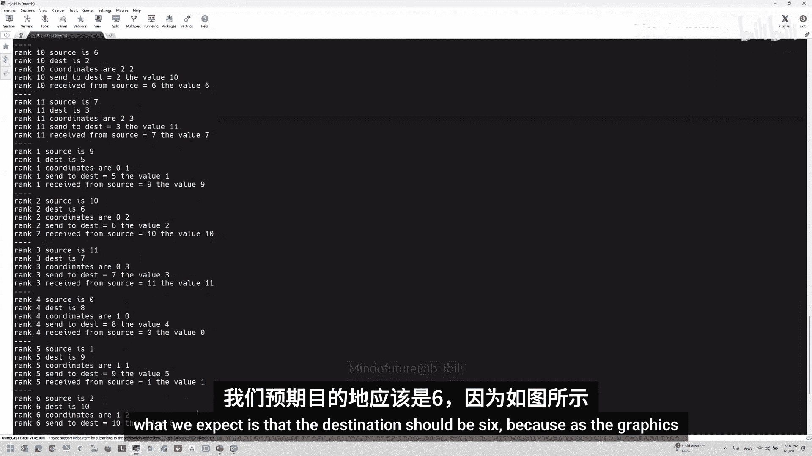

And I think this information is absolutely correct rank2 coordinates as 0。2。

 I mean there's also row0 and 2 is also fitting。

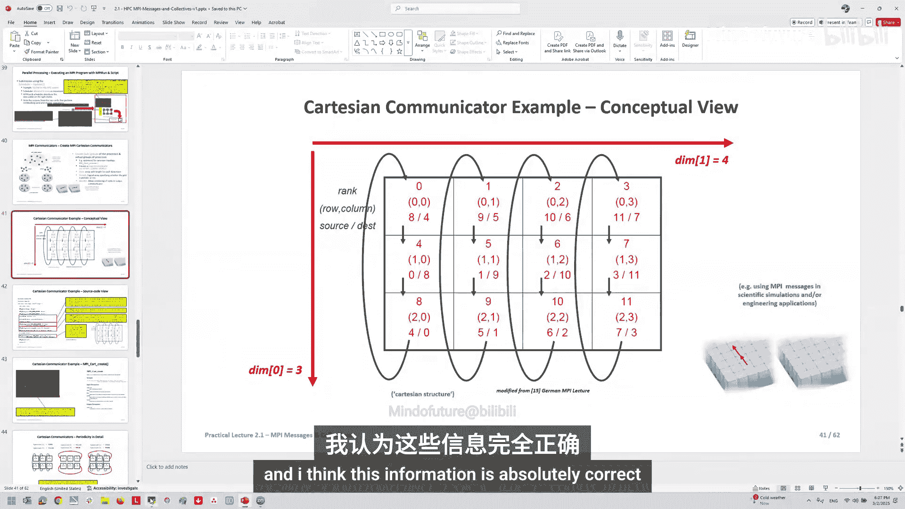

And then yeah， we send just some value basically over the wire。

 so this is then exactly how we thought it should be。Hence， it' was working。

And you see that we never really thought about any ranks or something like this and to really you know paint this。

 this is more like， you know for you kind of validation now right that sort of I can find out from this environment when I am let's say executing parts of the source code and I you see kind of different cards here that I also explained to you of course。

 in the slides a bit more boldder this coordinates to obtain the process coordinates from yourself。

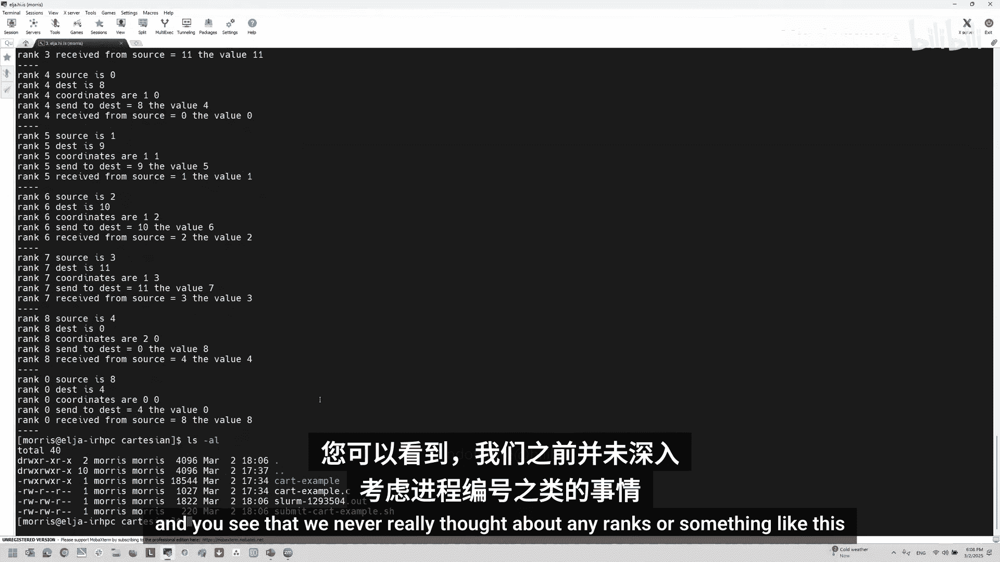

You know， as one of the 12 executing it。So sort of unique as well and then you do a shift and say how would be you know the ranks now in this CAtizian to apology depending now on where you want to shift so in which direction right so this is something where we here go one below and in order to do this I get the source and destination which was now for rank two for instance10 why we want to send receive then of course to essentially then you know you know we get basicallyly the send receive to the six we sent and we receive from the10 and this is what we put in here and important is of course you see also that we remain of course in the Cartsian grid which is an important factor on this。

Right， so what I also wanted you to show is a to show a bit is， of course。

 also the different periodic things that you can do。 So we basically set now， you know。

 that is always going now downstairs， so to speak， but you can here also have essentially the idea of doing。

 you know， the periodic aspects to different， you know， directions。 I think that's quite easy。

 It's sort of a，Kind of indicator that you have to specify there。Then this MPI card coordinates。

 we have already discussed that you basically get your own status in the big gridit。

 the card shift this is important but you know， just obtains the rank of them but doesn't do it。

Right， and here upwards in dimension means down。 that's here what we had， we see。

Aspects of essentially having this。Then computed always to the to the you know the direction we can of course change this also or do several shifts right which we also will do in one of the examples now periodic versus nonperioic standard shifts you know there's a positive shift in one direction a negative shift so there this you know again opportunities and possibilities how to do it there's just one interesting element of course if you have a nonperioic one and you specify it。

Theres and there's a sort of problem， right， because you're not going around in the grid as we had here。

 right， so here we this periodic， we can go again and again and again through it when we would specify it a nonperic。

Then we need some indicator of saying now we stop， let's say we are we're reaching the beach of the ocean。

Right， or another continent。 So now our as should stop the boat trip。 but， let's say。

 go over the over the beach because that's not possible。

 Hence for us to note that there are some changes。They're so called a dummy process called MP pronole so that I know that。

 you know， when I do this specific shift， I will find out， you know。

 there's there's sort of a not really a rank right this is now important to understand there is no rank behind this。

 that's why we call it dummy processor， but there's an indicator that the next shift would be let's say stupid。

 for instance， if you want to make the information that the boat goes from tile A to tile B and tile B is a beach or sand where the boat can't go then you can basically realize this by MP pronole and understand okay。

 the boat should stop here。Of course this all depends on the application logic right the boat is just one example where so should be an analogy why you probably want to have something like this。

 but everything can be periodic。We have discussed the send receive， which is。

 let's say send and receive in one， it's also no big magic you have to still。

 you know you see here a little bit the API， of course you have to give in much more information because youre sending and receiving so to speak you need to of course the source and destination but then also of course the information that should go over which is here twice you seen MPI integers。

 what we send it also an MPI integer would be received and the source and destination I got and this is now the funny thing without knowing anything because this is what gives to me via the nice environment from this card shift in preparation。

And because I'm executing it 12 times。Right so this means now we have all of these different outputs for each of the different ranks because every rank will execute it。

This， let's say more trivial source code， all of them will go to the same direction as indicated here。

And then we'll report this information according to what you see here。So in this sense。

 CAizsian communicator also simple， not not communication， so we had non blocking communication。

This is not non blocking communication， in other words， blocking communication。Hence。

 now we had the Cartesian communicator， let's combine both to make it a bit more interesting。

And this is sort of a first stepping stone really to a real interesting application where you then could really start essentially of doing this。

 but before we go there that's through I wanted to show you one more thing and of course this should be done in practical terms。

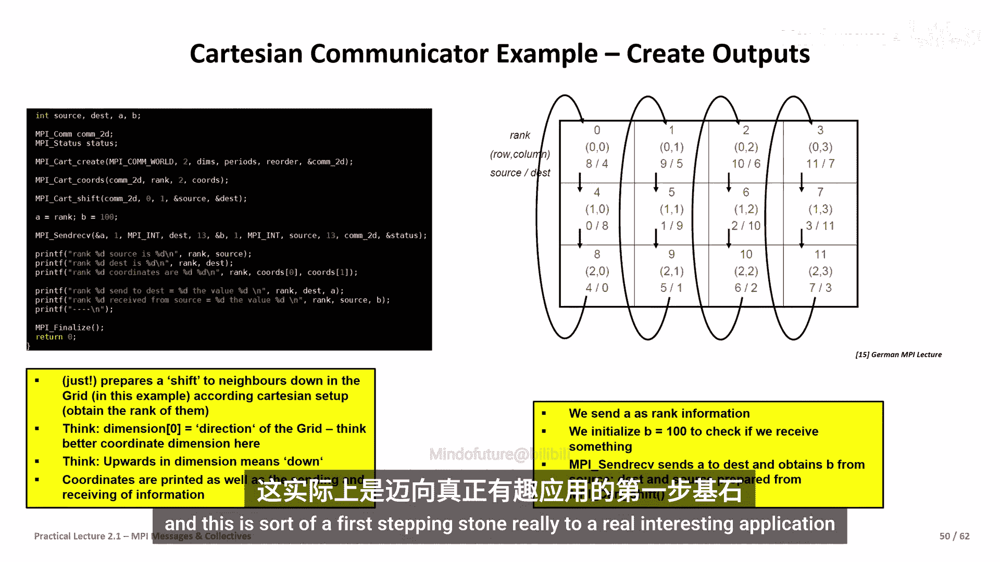

So we talked about that great of course， well three times two， and I was forgetting this a bit。

 sorry。So then what happens when we would do 11 for instance， right I mean。

 this is sort of almost obvious and you know I don't really have to recompile my C code because it's 12 that's what I want to demonstrate here。

But my jobscript was just 11。So how you do this if you now say you need 12 processes or tasks。

 really， to fill this grid。

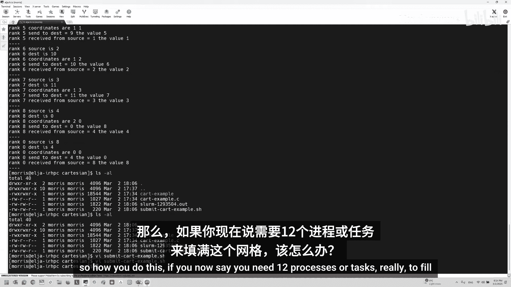

We could say， okay， it was 11， we could  zero to 10。Not anymore 11， we have just 11， so four， eight。

11。

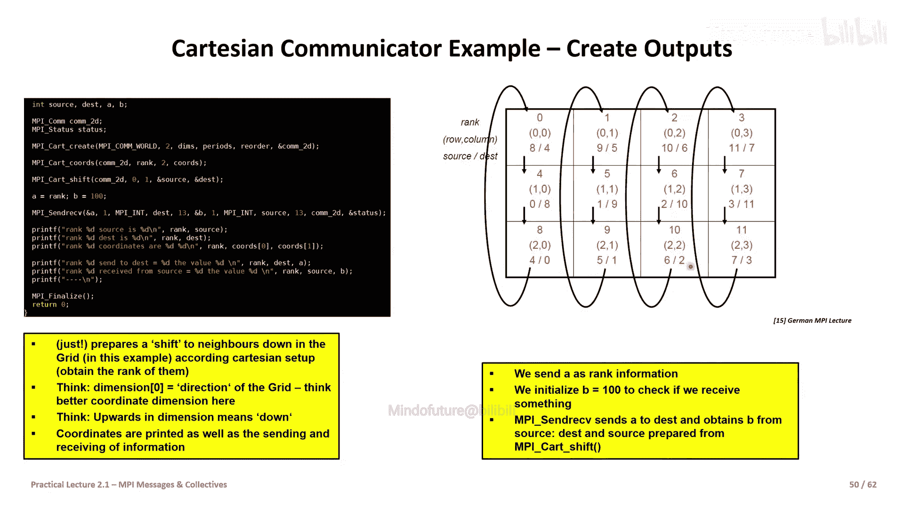

Hence， we expect something that is not going to work because here we see in good example that the Cartesian communicator needs a bit more massaging also via the job script because somehow the amount of processors need to match the number of tasks need to match to the。

 let's say Cartesian communicator and when we now look in we already see some phishing output here much less than we expect。

 and here we see the error cured in this MPI card create that basically you see it here and more process been sent but essentially saying it's not matching right what we have here and there cannot be just the creation of this Cartesian communicator in other words the complete job was failing。

Now I can repair this smartly， very smart of you know doing here just the 12。

But you can imagine with， you know， other amounts， it would be also a problem。

 So when I have repair this here， we can， you know， execute it again。

 and we will probably get the same output again。 the zero here a good learning experience when we are too fast with this。

 we see that basically the job has been not done yet and not written into it。 But if we repeat。

 you see now that the job has written in the output file。

 And we probably see what we saw before with all the nice and beautiful rank information。

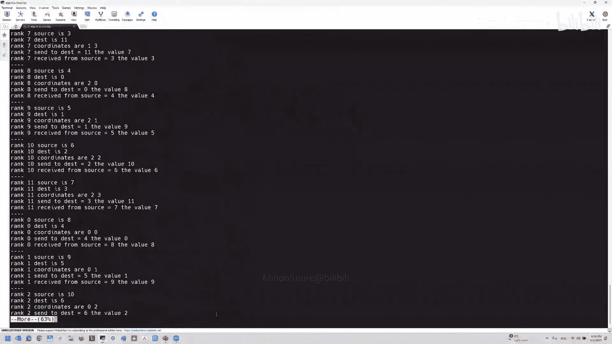

Yes， song。Good the remaining parts so this is just the slide captures exactly what I demonstrated so will not talk about this much more and also the output we have now tested validated。

 let's go to some interesting idea how you can now really start in simulation code and in areaer versions of this course。

 people have done a phishing simulation， for instance。

 is one part of the assignment here we switch now a little bit this year to this industry projects and so on and other elements of the course so we don't do the phishing simulation really。

 but still in having this code and experimenting with it shows you quite nicely how a real application could be and the real application has an environment。

And we pick here the ocean， right， for fishing， for instance。

But this means also that one grid part would have， let's say， an up down left and right partner。

 right， Let's assume the size of the cattasian would be 16 so four times 4 of the ocean here somewhere。

Hence， we will define a little bit this buffer information which this MPI pronoural variable I was already alluding to before indicating essentially for us here。

That there is a shift that is maybe stopping then we have the neighbor arrays that we have with four pretty much defined right we said okay。

 it should be four neighbors for one， it's also clear the dimension of the cattian should be four times four and basically the period will be defined here。

We create an MPI communicator again and having， let's say， then a request and stats and so on。

 So this is a simplified demo code here and let's go a little bit into practice when we thought the year code。

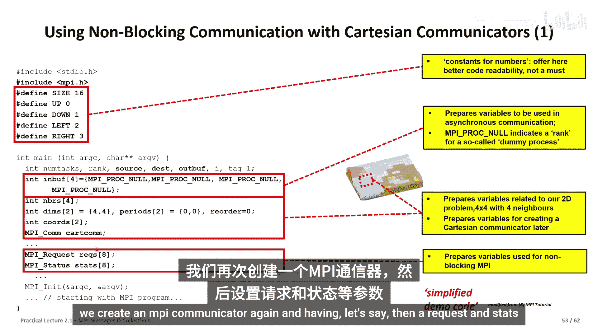

Obviously there's still some application logic missing there then the fish population has to be transported or things like that。

So this is just a journal， let's say， look and feel of this。

Where you know would do some work with MPI communication and so on and so on this is something what we you know not do changing simple data with old data data with neighbors or so right so here we do the following。

 we basically have this you know shifts was up down left right and you know this determines in other words。

 the gridit and our neighbors and because we can you know prepare the shift in different directions。

 we can also understand that this is given to us then。In other words。

 without knowing which ranks they will have， we will be able to get the ranks through the environment。

 right， by just specifying up down left right。And this is beautiful for us being sitting in the middle of the ocean。

Right， and then when we go lower here， we see we want to exchange some information。

We have this kind of four times because these are my neighbors I will go through， right。

 So you have four neighbors。And here you see， I do a non block communication。 Now。

 I sent to a certain destination that I actually just got out of the。Cart shift。

Right basically so in other words， again， automatically given through the MPI environment I got my neighbor as a destination。

 but I also got the source as information basically out of the neighbors right to basically from who I get information sent I put that on the slide a little bit with some message exchanges here you see that so you see the first part is really I sent my information to my four neighbors and then the second part the I receive is then you know I will get something good from all my four neighbors。

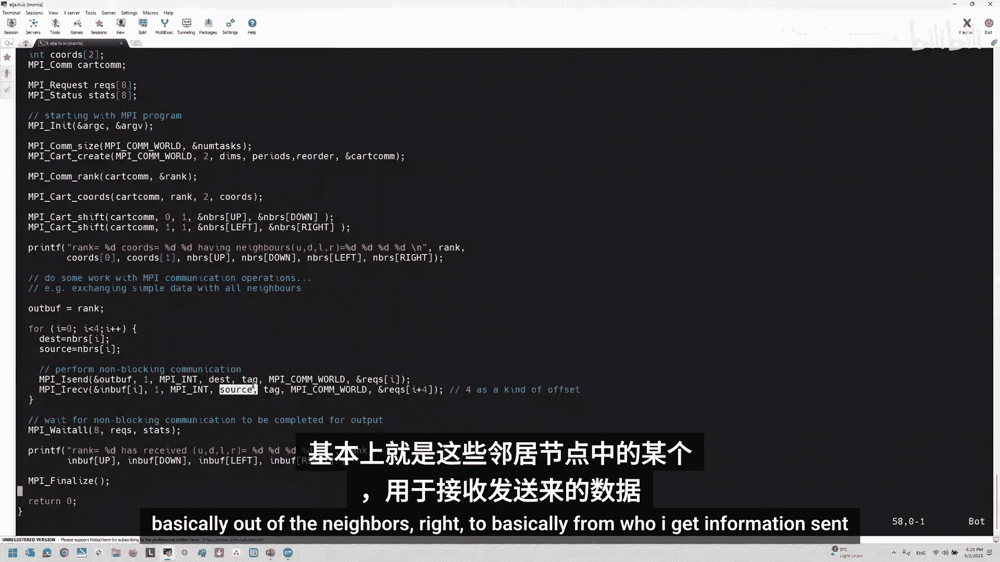

And， you know， that's not so obviously if you think alone。 now。

 we have to think a bit bolder and think about that this will now be executed 16 times。

With you know different ranks and they will have of course then also the job to do not you alone as one processor。

 the 16 others or the 15 others really have to do the same thing you do right so in other words in order to communicate with you we need some you know communication if you remember a send needs a receive and a receive needs the send and this will be executed then from others around you from this four neighbors which have some rank we actually don't know per se because this is given to us from the Catthian world and of course we specify this hence we talking about four and four exchanges in a non-blocking way。

Meaning for us， we have to wait for all of these eight requests that you specify here in the array。

Right， depending on the loop index。 So we always go one eye and having， you know。

 these four requests for sent and four requests for receives to be weighted。 And now in a real。

Application， you maybe would do a loop here。Right， and we'll do a time step loop and say， okay。

 let's exchange again。 Let's exchange again。 So the pure information exchange that you see here。

 what we， you know， have here in the source code。

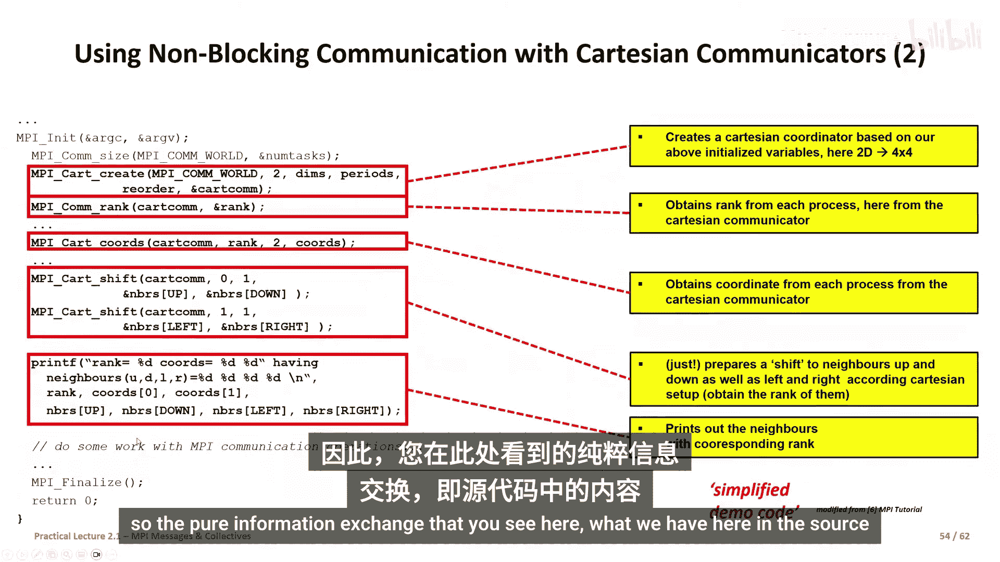

Um， is's， of course something now to just exchange and and print out then here the ranks that I received。

 you know， who is my left up and so on。This is of course one thing but normally I would really now calculate the fish population would send this over the wire。

 right to my neighbors or to some specific neighbor or you know in one direction now that is really application logic dependent。

But here you see also a nice example of synchronizing from all of the nonblocking communication。

 which is very beneficial because it might be a bit different load if I have to calculate fish depending on how much fish population I get from right and left and so on。

 or I got nothing， so maybe a simple calculation which makes my job much easier。

 I'm much more faster done， but the others don't have to wait because it's a non-blocking situation。

I hope you understand that I mean it's a bit， I know one of the more complicated examples maybe starting is real application ideas。

 but let's see and submit this when we do the Cartasian you know idea here we have 16 there's also no secret we have defined find it as's a four times four gridit so in the Spatt we suggest to get some output of our neighbors out。

By one iteration， right。 So I be now see that we have this。Git part here。

 The 12 is our job script here。 We see We get the neighbouring information out from all of them。 And。

 of course， then I can do something with it and can say the boat is going always to my right neighbour now。

 or， you know， let the fish swim over the different tiles。

 which was sort of the assignment in earlier times。Hence。

 what what's missing here now for a real application。

 you would say this is a space where I do now my nice loop。 At the end。

 I've synchronized every request is finished。 I'm for the next iteration。

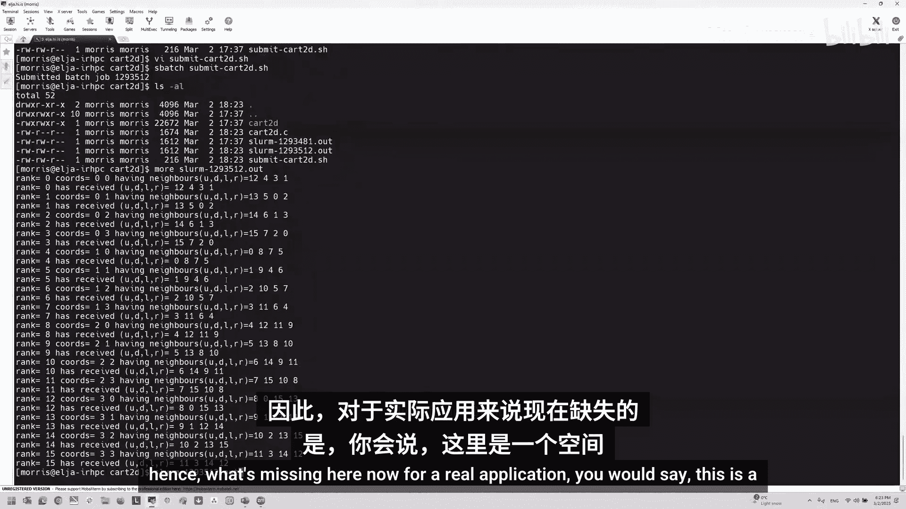

And that's where then you know the status of a time comes in way would say essentially this is all also demonstrated to you。

 but this is where you're over time by doing just this communication。

 but you execute 16 times can put a variable you know and inside this with some logic of saying for instance the fish is swimming through this ocean in one direction which you still have to implement because here we just have an information exchange right so you still have the logic to do basically and to make this here's a bit an example again when you take different examples out of this。

 how that looks like when you see that again when you are rank five then we want to see that my top is actually from one my you know bottom is nine sort of you see here the information has received four and six which is accurate here in this case and shows you nicely that this actually works。

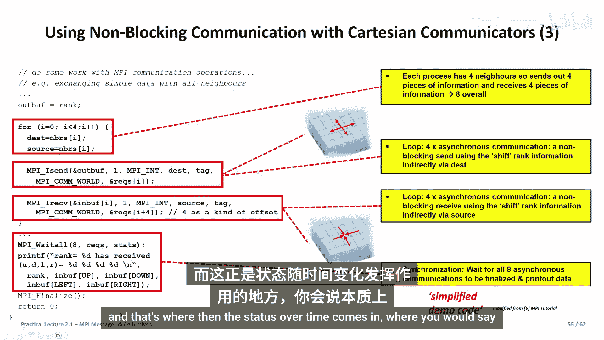

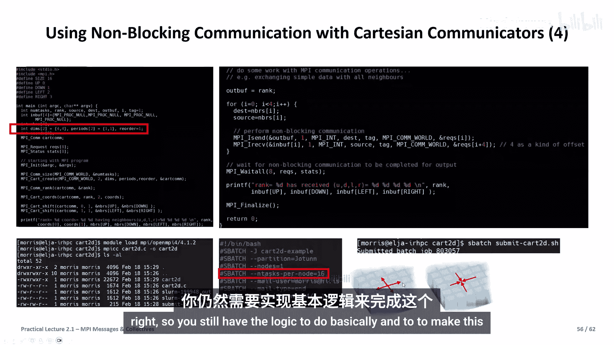

Right， so and it's a periodic one and in a way that's also already a lot I think for today and of course now we would proceed a normal MPI tutorial to really create such assim much more in detail。

 but as we have also later open MP and other aspects like machine learning deep learning we cannot go into all the details。

 this is also not a lecture or let's say a course all on MPI we have many different facets in HPC in this course with a CFD special even so in this sense we keep it to this degree。

But we encourage you also to really go to one of the centers to the UHBC undertaking the National Competent centers to find more on MPI examples and tutorials。

 which would be maybe material that you have for a whole week instead of just one lecture。

 I hope it was still useful for you。 Thank you very much and we talk to you next time with lecture3。

