# 【冰岛大学】高性能计算课程-｜-2025-High-Performance-Computing-｜-Prof-Dr-Ing-Morris-Riedel-p21-P21_实践讲座_2.1_MPI_消息__集合操作_第一部分--BV1k34zzaEK8_p21-

Welcome， everyone for High performance Comping advancedanced Scific computinging。

Today we have our practical lecture 2。1 all about MPI messages， Collects， communicators。

 Cattesian communicators in the end， so it's quite a。

 let's say comprehensive lecture that complements also really what we basically have learned the last time so let's go a little bit into this but here we see some conception aspects of the message passing interface and this is something what I will also demonstrate a lot today。

 we will cover a little bit the MPI environment that is very important you know do in hello world MPI。

But we quickly learn also differences today what we had also the last time。

 so MPI can be about message exchanges。Which we talk about MPI point to point communication here。

 from one memory space to the other， Basically， from another processor。 Hence。

 remember if we talking about distributed memory programming here。

Then we had also these interesting collectives which have some functionality within it and also enables us to have in scalability and I will demonstrate this again today。

 for instance MPI broadcast is very often used to really broadcast information to all other processors within basically the same communicator and it's not clear necessarily how that is。

 we started this a little bit last time， but I will show you again demonstrations。

And then we be getting much more clearer instead of broadcast， you can have also gather and scatter。

 you see here scatterton array to many other processors gather data from many other processors and then also we had this interesting addition here that you have in terms of having。

 for instance a global sum or so that you can also put when you do let's say these operations and we will come to some examples today。

 I motivated a bit MPI was one of these interesting you know applications of you know glacier clving here。

 if you look a little bit into this paper if you want then you can see some interesting ideas how MPI can be used and you see here out of this paper。

 one key idea that there's some serial processing done to generate a mesh。

 how it looks like the situation with gllaacier and so and then we have different solvers that actually deal with the problem in different ways also。

Different parallel ways。 you see 16 cores are used for the Elma over here。

 which then is an input to some transformation package that we basically just now。You know。

 we'll transform to hideE and with this we have the problem that we want to run a more course to have this since we need more basically yeah more CPU resources really。

So， in this sense。This is something where MPI is good for， it's parallel codes。

 we can use this different course in parallel and should be a real application example for you。

So what what we also had done was starting with some parallel programming basics I can back to this a lot today so I will not spend very much time you can think that the same executable will be executed four times so the question will be how we can differentiate if you run on different processors and this is something what we call the MPI rank and says a communicator and every let's say process that is initiated from the MPI environment gets a dedicated rank and with this rank I can really differentiate between this different processes and that can create subgroups different groups and。

And yeah， so basically here we talk about that we can use this in communications these ranks and of course also then when we have the same source code。

 we also want to have different parts of the source code executed right this is also not directly obvious to you we will see how that materialized when I give you also some examples。

So finally， what we had the last time was also then the idea of MPIIO here we reacted a little bit also to student feedback to the course there were lots of repetition so we have a bit let's say compress some of the MPI materials and one of the points here is now also given that we put in new attractive topics to the course that we don't have really very much let's say practicals on MPIIO anymore。

 but still it's an important topic think about that you have a parallel file system we learned a little bit about this the last time and you have this MPIAO that can really leverage this so really treat this concurrent access to files as a common event so that all this different processes can write at the same time within one file which is a binary file usually accessible via one let's say high level IO library I gave you HDF5 I think as an example last time for instance。

 which is then also used in。Applications， hence。Let's come a little bit now only to the lecture 2。1。

 which supports basically the lecture we had the last time is practical examples。

 so we will go back to the idea of having really C based MPI programs。

 distributed memory par programming， we will understand then from see how we can get to MPI programs。

 essentially adding this parallel environment with MPI code parts and then we start with message passing。

 although the very first application that we really will use will not do message passing。

 but just use MPI and ranks。However， then we quickly understand ping pong as a way of point to point communication versus collective operations where I give you a little bit of insight on broadcast then of course with all of this we should understand a bit the situation how it works together with the scheduler again right。

 remember what we have learned from the beginning from the course and also how this is now allocated on computing resources。

The second part will be then a bit more advanced topics of MPI also here we react to some let's say student feedback and also YouTube listeners that said let let's bring some things together so this lecture here will be much more you know let's say comprehensive material so there's a little bit more in it then having let's say more repetitions what we had here in the past here and there but the speech should be still let's say moderate so that you can let's say follow quite good and then。

We will start with the second part really with the blocking versus non blocking communication。

 this is not clear we will see how that materializes when we talk about this I send and I receive and then why we have to wait and so on。

And then an interesting topic is a very application oriented is then this Carteizian communicator dimensions and shifts programming。

 This reflects a lot also on something we will have in lecture3 So Paul programming a bit more conceptually understood again。

 but we had already the example the last couple of lectures where we had the ocean right where we said okay。

 let's make a carteiz in grid over the ocean when we want to have waves propagated from left to right So how I actually implement this or how I do this boat that we had as an example。

 how I actually do in a simulationim a boat that is actually going from grid to grid to grid part So this is something what we also will do in the second part today and of course some application examples of this non-blocking combined versus is Cartsian communicator on El。

To give you practical examples after that， you really have't good idea of complex aspects of power programming with MP。

So you can putter off and do your first MPI programs， you will see it's not so trivial。

 we start very trivial， but quickly will advance by using MPI ranks， using collectives。

 and then quickly also think about non blocking communication and CAting communicators which are getting then really too complex materials。

 and you will see how the source code were getting a bit more complex and complex but this is then basically the foundation how scientific domain applications work in many cases。

 right， especially when you think the CAtian communicator which is often used。Then with this。

 you should be really able then to， you know， start parallel programs with MPI。

 and you will do by reusing this in our assignment one a little bit。

So let's get started with a more practical lecture here on MPI hence I will switch again as you know already to my SSH climbed a lot。

 so let's connect first on earlier by now I also will not explain these things too much anymore because we have done this all the time essentially in the last couple of lectures remember we had also to put the private key into place which is a very important part usually passport protected here it's probably already in because I had already the you know couple of the material tested before。

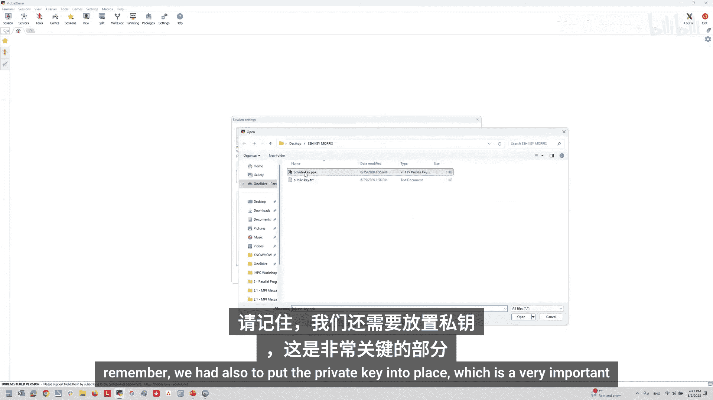

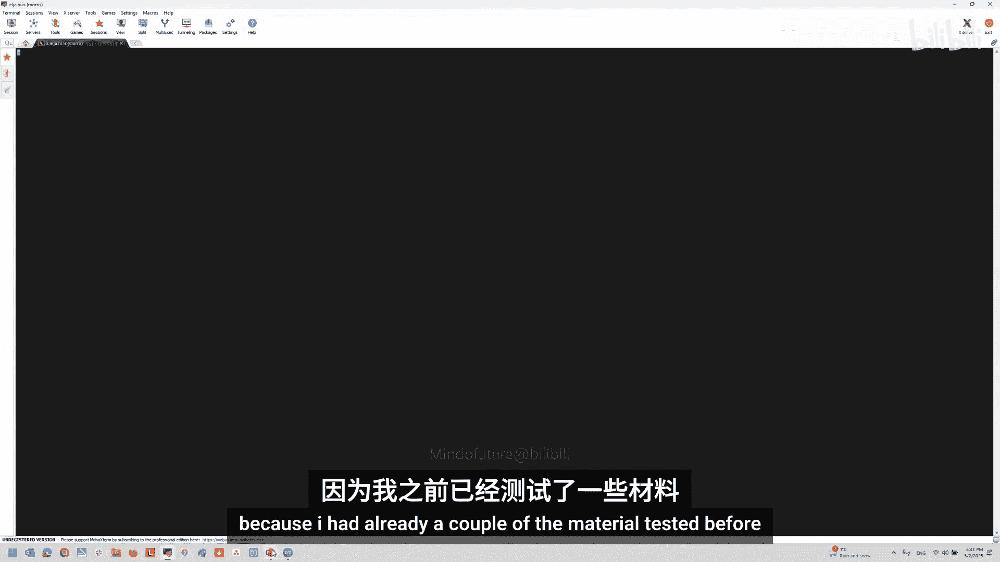

While we wait for earlier to give us a lockin。Just to basically think about what I said also in the idea of the lecture today we have this point of point and then later we will talk about collectives when you have a point of point communication now we see the first time really source code there's basically the MPI header which we have to add to our normal hello world that we had and then there's this interesting MPI in it and MPI finalized which determines then really the region where basically there is an MPI par environment and there's sort of two important and often used commands that you see here MP consse and MPI comm ranked and these are important to understand in a given communicator which is for us now in the beginning the MPI comm world so the kind of world of all processes right so we have there a size which is here 10 from zero to9 and then the size would be then equal for all the same because we have 10 processes。

But however rank will be very unique it is a very important key let's say variable for us that we always have to you know initialize we have this MPI environment to later on show also differences and you see how that works hellello world I am someone out of someone hence we'd say I am rank out of size right so this is something what we want to practically now understand if El has now finished the lock on we can go into some practice so we。

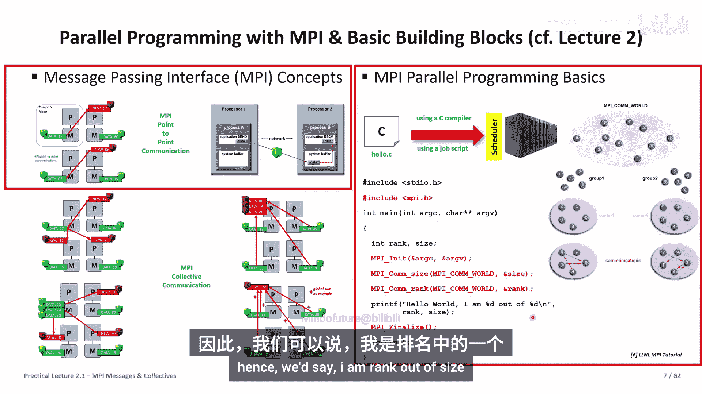

To hear a higher font size。We go to our HPpC course in spring。And the MPI。

And there we have already a hello MPI， if you remember now rel the space from the typical hello world that I basically had in practical lecture 11。

But here we add now this interesting size and rank information that we want to give out in order to prove if we really work in parallel。

Now you remember also what we had in terms of compiling。

 I will also not make a bigger message here you see a little bit I can go through the history here to make it simple that you know we want to compile。

 this is another one but in order to compile we will also to do this module load right so that we had describe last time so that we are sure that the right MPI implementation is loaded and now we can say okay let's compile with MICC minusos output and we want to or that's maybe we should remove the hellello right first so let you see that it's really working soCC minuss or hello。

讲 hello dot c。And we have our back hour executable and the job script is also no magic by now you know this。

 we do the hello and we load the module load environment and we want to execute it on four。

 which is sort of important because this now will determine if we can really give out。

 let's say four of this。So I I now say Spat， submit script。Then we get a drop Id。

 The drop is running so quickly that we don't even see it in our queue with SQ。

 You can see the queue usually， but we see as the same drop I， which is now you remember。

 a very important part for us。 there's an output already。 And when we look into this。

You will see an interesting statement that although the same source code was executed。

It is literally true that through the rank you see that here we get different ranks for each of the execution of the source code and this enables us many different things right I mean we can also do the following interesting thing that we also don't program it actually for four processes right so now we say task per note8 and I don't need to change the executable because it's inherently scalable as we said in the lecture2 already that's one of the goal of programming MPI usually。

So you see it so quick with our outcome here， we can look into it and then no surprises probably now we have eight processes and the rank is very unique for each of one starting from zero to7 with eight。

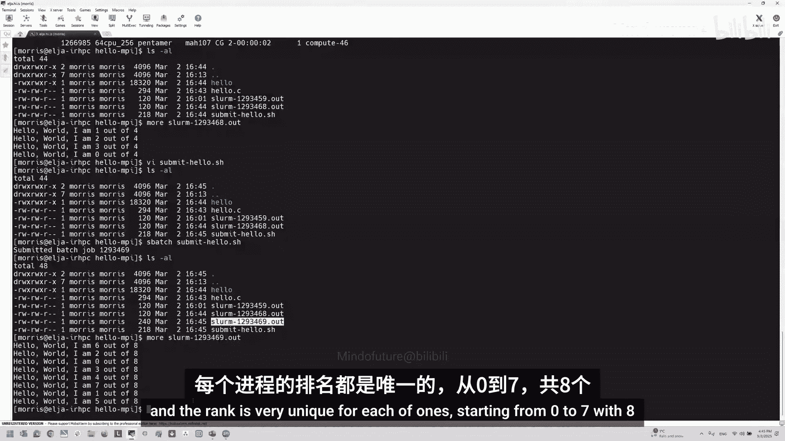

Now a very trivial example in a way that is also what you see here on the slides for you to better understand it。

 what I explained the hello world， the InNe to finalize making the environment happen very important is to get the size and rank and you can see that almost all MPI programs I would say have the size and rank you know this kind of initialization of these they may be called differently。

 but you know basically the variable can be of course named differently as a typicalacy program but you will find that this information is usually quite needed we have used the compiler we of course had first to run and load the module here in order to compile properly and basically that is all what you have seen when I was executing then but MPI run and the batch script I could see a withIS batch script4 or8 or 12 maybe I want and then I would be scalable。

So that's what we have done and you have basically understood by now。

 I hope a lot of how this scheduling works， but let us come now to something more because in one respect we have done now this interesting hello。

 but you also understand。That this is a parallel approach。 And， you know。

 this means now we want to also do some message exchanges， hence the name， message passing interface。

 right， a standard。 The hello MP that we had now was absolutely not a message exchange， right。

 It was just rank information given out and size information giving out。

So now we want to switch a little bit the perspective and want to see what's happening if I do a point to point communication or two of them using something called ping pong。

So here we have the same that we had in lecture2， the more conceptual idea how it works with the serial environment before and after we have the MP environment and in this MP environment we use these different processes that are available but they all have their own memory as you already know from lecture2 Hence we talk about distributed memory we have to have message exchanges right in order to communicate between the different processes here has a simplified idea how that works。

 the real idea I also was presenting last time is then really the idea of you know making some buffer where you have some information in ready to receive when you send it over the wire and then maybe can even update your own variable with it So let's do this at practice again I will go back to this There's another application example for you as I said it's a bit more condensed and usually in a couple of years。

 but this is not a bit problem let's look into ping pg and。

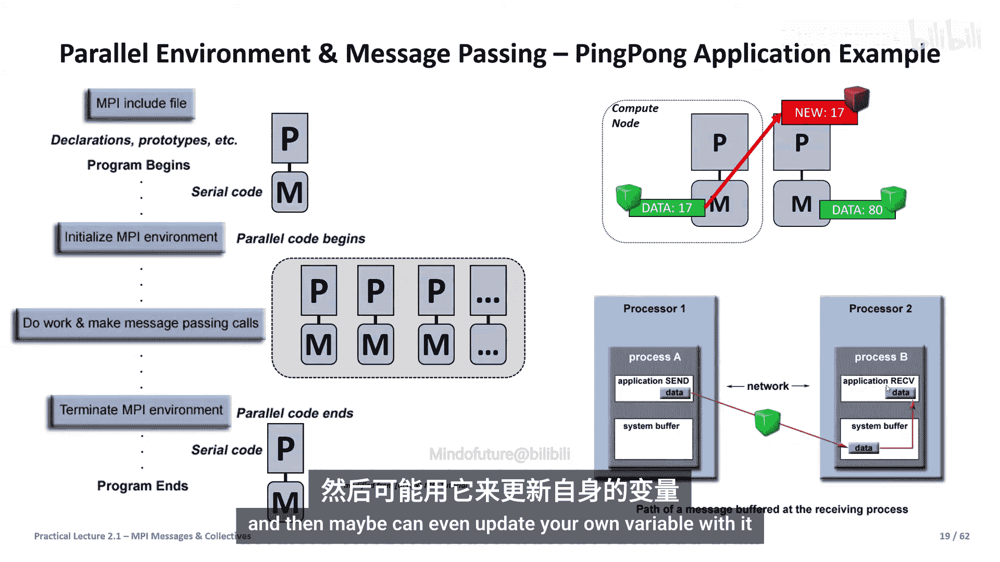

Think the name already suggests what's happening we have here and our MPI in it。

 we have our MPI finalize。 it's important we have the initialization of these interesting number of tasks or ranks so this is equal to the number of processes that I have here available in the you know MPI code world and here you see now how beautiful this works with rank zero and rank one right given now that this is the same source code executed twice I can steer the application logic with it So I say if you rank0 your destination should be one so sending from zero to one but if you rank one and this is now basically sort of the pong right then you know we have a ping pg where you know the first one is sending and the second one is you know receiving the ping。

And then the second one is receiving and waiting for the pong to happen。

 which is then initialulates by rank1 to do the pong。

 You see also with this that this point to point communication is now an important factor that someone has to listen。

Right so think about a ball that you have in some game like basketball and you pass the ball to another player If the other player is not listening to the ball is not paying attention that he might get the ball。

 the message will not work or in other words， the ball will not really land in its arms and instead will maybe knock his nose or something。

 So here's a very important aspect of it that every scent needs a corresponding receive from another processor。

 hence we can determine this via the different rank And then this is the ping implementation。

 which sort of needs two source code lines here。 then the pong is of course the reverse。

 given on the identity once we have done this， and we do this a little bit here with some chas that's not so important to understand for you exactly but you know we want to send something。

 of course， from the destination from the source that we have here and then essentially。You know。

 the source will be later。 The one that sends a pong， Hence the destination for the ping is one。

 and source is also， then， of course， it has the origin。 So to speak of the pong。

 hence both needs to be one。 And here's the inverse， of course， we get first from the source of p。

 And then I want to send the pg back to the source， which is also then essentially the zero。

 And we want to here use MPI get count to really understand how many shs were going over the wire。

 and print out a little bit in a small statement here。

 text can be used to have different messages also taed as the name suggests。

 So this is also something where usually you have。There are quite some。Yeah。

 possibility really to understand the differences in all of these let's say messages because here we do just the simple ping pong right and for the sake of time I think I have here on the slides of course that you need to compile it and of course what I have here I have also you know described you all what I basically just said you know in the。

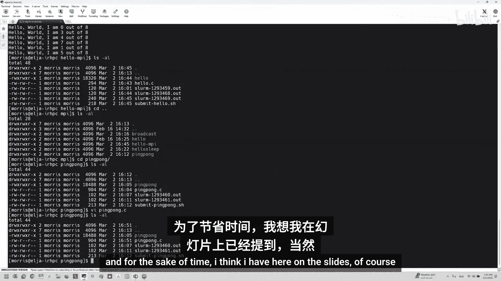

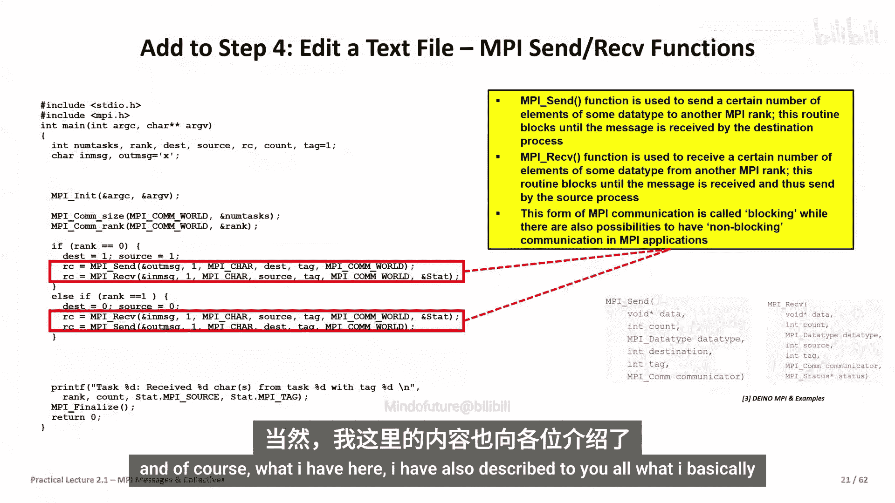

Messages， and I would now skip a little bit here。 this compilation process。

 you can imagine you need to do the same MPICC and stuff like this in order to do so。

 And we don't need to do this now， we have already is executede here。 you see the ping pg。

 and we look a little bit into the jobscript。 Also here no big surprises。 We need two tasks per note。

 but I also want to stimulate you a little bit to this notes and tasks。

 And you know that already a little bit what we had in earlier lectures。 So you turn had four notes。

 and each of them have different processes that we can use。 Hence when I do it like this。

I would say now S batch submit ping pg， the job Id and the SQ。

 we probably are so quick that it has been already a ping pg performed。 Also。

 no big surprise in such a little job。 You see here the job I。

 this is equivalent to the one just executed。 So let's have a look on it in order to understand what's inside。

 And here received one cha from task 0 with tech1 and then received one cha from task one with tech1。

 So this is a ping and the pg。 right， So this is exactly from the simple source code that we have seen the idea。

 Now， interesting might be for the following in this context。 because we can see， of course， that。

 you know， firstly was a partition you tune that it has for compute notes。 You see here notes。

 compute 1，2，4。Right so that means in other words， when we want to analyze now how the job was run。

 we can do this S control and then something like show job ID。Very， you know， much output。

 And then we go now with the job Id。 And this is now something we had executed here。

And this gives us now good understanding it's exactly what we requested number of nodes was one。

 number of CPUs was two， so no surprise there it was running on compute OneNote now interesting enough again also to show the independence again from the source code we can do now the following and do let's say two nodes。

And on each of the notes I want just one task， it is so to speak a waste now what we do the waste is because we basically use now two two notes and just with。

 you know each one。One little task。 And this would be not needed。 Again， the SQ is by far too quick。

 But if you now go into the S control， let's say， I mean， first。

 we want to verify as we get some output right， So more this time we had our 71。Sorup。That' sorry。

 That was， of course， we won't hear the whole file， ran。You see that was working as well。

 but the difference now from this interesting job what we did is and this is good for you to understand。

Show job ID D bottom minus Dd。 When we now look into this。

 we will see that actually this was executed now on two nodes on the compute and one and two。

 So and here is compute one and we have basically two complete nodes and with this basically where let's say wasting in a sense resources because we just needed two tasks really to execute this little program。

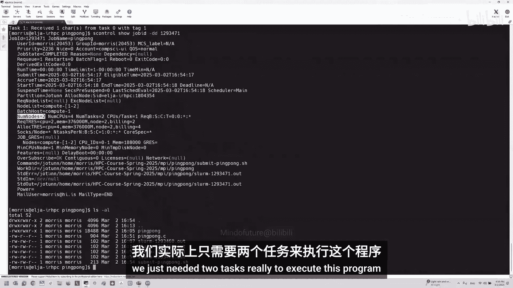

Good， let's go back and essentially。Think about that this was now point to point communication I was also in earlier lectures already pointing to this interesting thing that you see here。

 the ganglia report that you can have and see the compute node loads and so on I gave the link here in the sake of time I also don't really will talk about this very much is sort of more additional information right here。

This is also what I presented to you to the output playing a little bit with the nodes and tasks so to understand that this is different things and I put you this here also on the slides so that you see in the one hand is a node right。

 two nodes each one job and one node with two job but essentially use two nodes which is not really necessary and these are different things。

 although just more power me in both work， but we really have two in HPC more fine- grainined and understand what we're doing in terms of computing when we have especially also let's say larger applications。

Speaking of larger applications， it's time for us to move ahead。

 this is let's say the area of collective communication now so we at point to point with ping pg very simple。

 now collective communication enables us as I also repeated basically in the beginning of the lecture。

 it is enabling us really to have， let's say all processes involved that are part of one communicator so much more easier than always writing for loops right for instance in order to you know get communication done to all of them。

Today， I will show you just a little bit the MPI broadcast， right。

 And we will start to really identify again the idea with， with ranks。Right， so this is here。

On this side， this is the same that we already had before， but here we do a buffer。

 which is important for us to basically have then some information inside that we want to fill。

And when you want to broadcast then， let's say for one processor。And this would be， let's say。

 source count and buffer is uninitialized， as you see， right， It's basically just here。

 And only if rank equals sourcers。Essentially， then the buffer is initialized。And this would mean if。

 let's say the communication will not take place that we will implement here in between。

 when we give this out only one processor that source zero， which would be our rank zero， of course。

 will have filled the buffer。That means in other words， we want to have four times this output。

 for example， of saying each of the ranks， but here we want to now send this filled buffer that we have actually just filled here with four loop very simple with e。

 so from zero to let's say the number is count here so we have four， so we assume from zero to three。

Hence。😊，Very important to now use only one source code line。

 the broadcast where you can actually have now the count of the information go over the line。

 what type it is the MPI in which source it is and basically the whole world of communicators hence you see no destination the destination is clear from this MPI con which will address every processor inside here。

Right and this is now an important part because many and also when we looked at some source could before for instance in this paper where let's say machine learning experts have created a parallel version of the support vector machine very sweet material it's a good machine learning algorithm but the parallel version was a little bit interesting It was not so good MP if you want right there was some improvements because there was an iterative send and receive often in the loops instead of just using collectives。

 for instance， and the collectives are really well implemented so it also is a sort of let's say performance aspect it to really use them in production in applications a lot。

 so lets let's see how that works now when we do this again in practice of leaving the space again a little bit here we had ping pg now let's do the broadcast sample。

And here again， the broadcast。C is essentially what I already said only for the source we initialize。

 and then we have the broadcast that sends this initialized buffer to everyone else in MPIWorld and everyone。

 remember that this source code that you see here will be four times executed。

Four times executiveive with four processors because we want to do so and we can steer this with this job script and say。

 as you see here， four times， task and node four， and the MPI run will make sure that I executed four times。

So whenre I now aspect to this。Again， I skip here the compilation aspect。

 I think it's for all of you clear that normally you know you have to make sure they have the model environment。

 you have to execute or the MPICC and we don't do this here again and again because it would be also more repetition。

So instead we got the job ID here and so let's look what happened when we now go into this。

We see now the expected outcome that essentially everyone received the buffer。Everyone in。

 in terms of， you know， basically the， the other ranks that are now can give out the buffer。

Without any initialization， it would look very weird numbers if you know， see a little bit。

 but here it's very clear that this0，123 has been going basically via the broadcast command to everyone else and then was influencing how the buffer can be。

Right， so this is all in a way simple， more interesting for you maybe also to understand is now the in scalability right so see what I do now I basically improve now our job script and say well let's do eight processor or task them basically if you read precise。

And I don't change the source code。Again。Right so。And the source code itself was done in a way that it was really scalable if we come back bit through the slides。

 so for instance， you see we basically can say that we have you know。

 this buffer that we have and the count that we have。

But not how many players we have right so how many really are in the processes or so and this is now the interesting thing which of course comes through the MPI environment right we're going to do now S submit broadcast。

And again， I will look， this is very quick， usually as a thing we see first of all that the file size has been。

 let's say， increased quite significantly and there is no wonder because instead of four us eight tasks have been not working and hence instead of having just four ranks or zero to three。

 we have no zero to seven and while're steering this outside the C code which is now the important learning experience with this。

And of course， it's scalable if you want to do this again， let's say， unless yourself we submit。

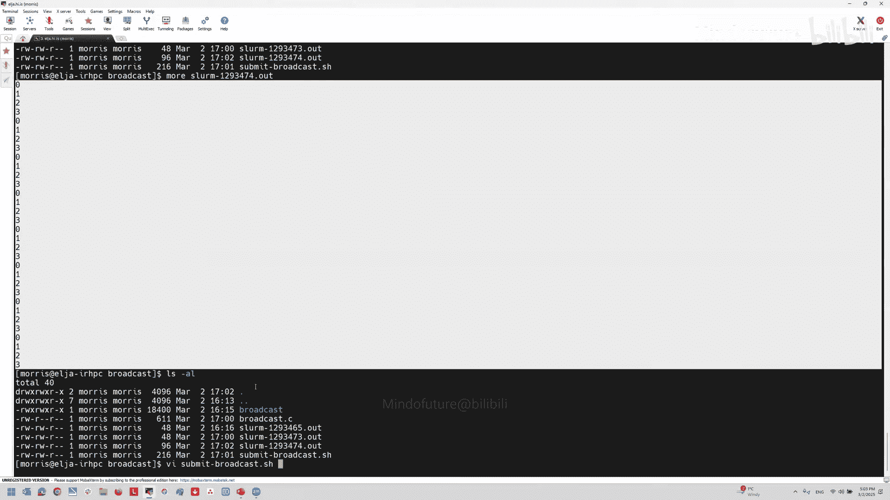

broadcastad we could also， of course， think about may we going for 12。

And I think then the message is clear。So， and as there's no surprise， again， you know。

 the size has been doubled and also no wonder why， because now， instead of， you know。

 we have now much more again。From these processes。so it has been not really doubled just see。

 of course， but this is something where this is an interesting aspect to see that again。

 we can steer from the outside versus jobscript here the amount really of processes working on it。

While the source code remains the same。

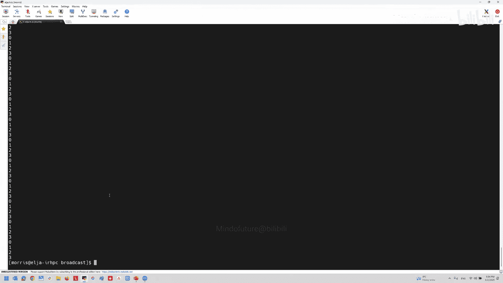

Right， so this was already， let's say four examples that are all in itself a bit trivial。

 So I hope you're still with me in all of that。 Think about that， of course。

 when we simulate this over time， like race cars or so reactions there's many much more information that you want to exchange maybe between different parts of the application between the different processes right over time and of course。

 and also the the whole aspect of the simulation will be not only， let's say a small program。

 it will be run for a long time， we discussed also the SVM that you don't， you know。

 should program this as an iterative send receive。 In other words。

 an iterative point to point communication。 What you could do， of course。

 but it doesn't really is efficient。

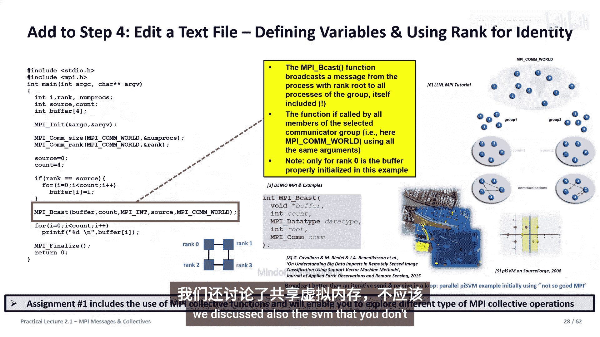

So we have done these things， we have played around a little bit with task per note and the last couple of minutes in this lecture today。

I want to demonstrate sort of two important concepts， and。

One of it is this interesting parameter that you see here with the time。

 And I think I go directly to the practicals。They'll show you when we have a practical lecture and it's also beautiful。

 I called that a little bit sleep。And this is loaded from two perspectives this example。 So firstly。

 we have something which is inherently in the C code like here， the sleep seconds right。

 I've put that now to 20。 So this is a parameter which is really within the C code。

 meaning when I change this， I really have to you know remove the executable or in other words。

 you know， do an MPICC。And now I can do this because essentially I've already loaded the modules。

You know， otherwise I would now load again open MPI and it's on。

 but here I don't need it and because I already had done this before if you remember。

And when we now compile this， we have the executable again。

 and also with 20 sleep seconds hard coded right in the source code。

Now the concept I wanted to explain to you today is this hard coded example。

 but also this parameter here， we call it the time or the wall time really until the drop is crashing literally into the wall and said it stopped。

Right， so these a kind of。Idea of explain this a little bit。

 So when you basically run in simulation or application on these systems。

 you usually have to also specify this time parameter。 So how long is your application going to run。

 This is an experience parameter that over time， you will notice。

 you will experiment and will find out that， you know， this needs a couple of hours。

 hence there's a possibility of giving hours minutes， seconds。In our example， we stick to seconds。

 but think about that this is an important parameter also for the schedule overall。

 so think about all the different jobs of all the different users by having this information。

Essentially， the scheduler can work quite better right and can see， okay。

 this job and you see this kind of interesting diagrams here as an example show you then the length of the job or at least the expected length。

 Of course， it could be that the job is earlier done。

Right so this is sort of not really hardcoded in stone that it needs to be exactly this time until the job finished。

 So maybe especially in larger programs， it's really hard to deter。 Or in other words。

 when you run 24 hours， you maybe do 25 hours in the jobscript just to be sure that the 24 hours are really。

 you know， properly done their computing until the end。

And this is now an interesting part if you remember we have said 20 seconds sleep。

 so there's nothing done， it's a kind of strange aably application that we want to do。

But that's the point of understanding now when we change later this parameter。

 so I can do S patch and submit。It we have the job Id。 We can go to SQ this time because essentially。

 you see that the Morris job， the hellello sleep on YouTube。Is running， right？ on compute 1 Oh man。

 much， of course。Here is now the point that。Essentially we do nothing we sleep。

 but for the scheduler the application is running so it's a proper application and of course the scheduler has no idea that there's just a sleep inside however。

 what the scheduler is very aware of and this is all the learning experience is this time right so we said this job has just 20 seconds。

And after this 20 seconds， he will cancel the job， right， And if my application is not done then。

It still in the cu or processing， then it will be deleted。

And cancel basically so you see that a little bit that now when we now go to our one that we had was BoC 77。

 if you remember this one here， so let's look into the output what's happening is that essentially they're going to sleep now and you know just awake this is a little bit like here the source code that you see here so we have this kind of processes that if you know only one reports here the hard code is sleep seconds just to make the difference also to our example now then we say which you know rank we are out of how many sizes and they're both going to sleep here and of course also going then afterwards awake when we have performed the sleep so in other words。

 we see from the output in the practicals。That this was working。

 so essentially they both go to sleep and they both are awake now so。Hence。

 what would happen now if you do the following， if we would say hello sleep and 100。

 Now many of you will know the answer。 now I was just explaining it。But here is it， also now。no。

His is now also important to， to think。That， you know， we have changed the source code， right。

 so hello S。But see， we have this 120 inside， hence we have to remove the executable because this was a hard coded 20 second sleep that we don't want now and to do this again。

 we of course we have to do the same procedure and compiling it again because the hard coded 120 is inside。

In order to make now the difference， we have os sorry for thats see。

And here we have our executable again， and now we will S that and you remember we don't change anything in the job script hence if you verify it。

 it is still on 20 seconds。So this is a little bit now the tricky part and would say， well。

 it's not really working。Because you know the applicational runs with 120 seconds in a sleep while our job script says。

 well， you have just 20 seconds and we can observe this a little bit right if you look here seconds go by 8。

10， maybe 14 now 60 now， 70 now。18 job is still running。You see a little bit over time。

 but this has something to do with the environment and when we now wait a little bit。

We basically will notice a couple of things that firstly。You know that you know。

 this kind of job here will have an output。But the output will also look different probably because I could not finish my job。

 so nobody was really， let's say awake。Hence， when we now look into this。

We see hard coat sleep seconds 1 out 20， and hello world， I am you know one out of two。

 one I going to sleep， but nobody woke up。And the reasoning is， of course。

 that the job was actually running against the wall right so it is stopped in the SQ which still looks to be there。

 but the point is that after 20 seconds actually the do has been cancelled。

And we'll also essentially will write this into the job script later sorry in the job outcome later。

 basically if we repeat this command， for instance， here now。

 when the scheduler has done all its business， you see essentially here compute one error。

Job uncanceled at some specific time due to the time limit we put in the job script right so this is also an important part now to understand that if you do large applications in large computing centers like you see here。

 you usually have to also specify the wall times here or the time that your job runs and if you specify this wrongly。

 let's say that it can be that your application， as it is suggested here is running against the wall。

 as we say。

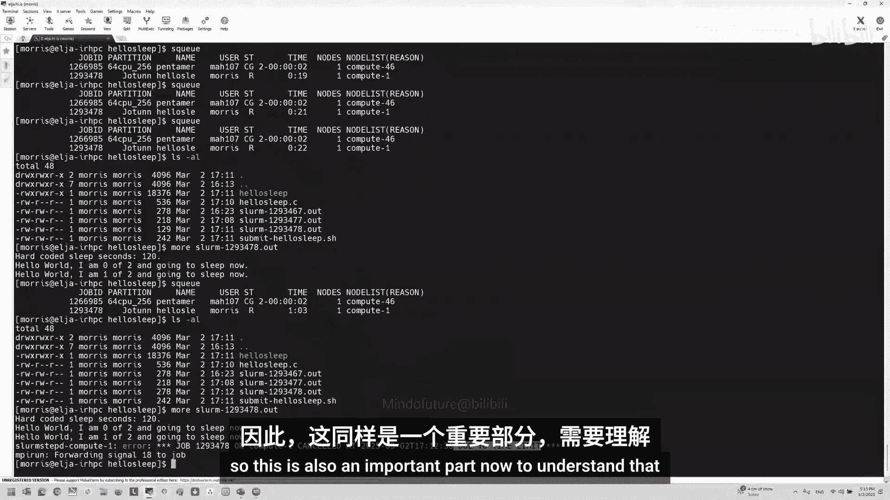

And this is really all I wanted to present you in the first part of the MPI examples。

 kind quite let's say simple examples， but I think for beginners of MPI still lots of elements to digest。

 we actually continue with some more examples with nonbing communication and communicationicators and withup in the next part after some break see you then。

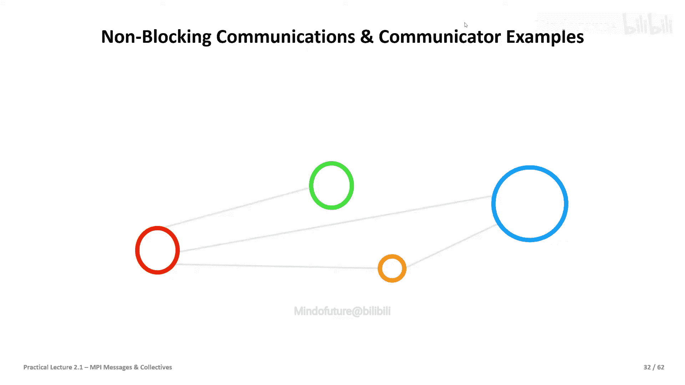