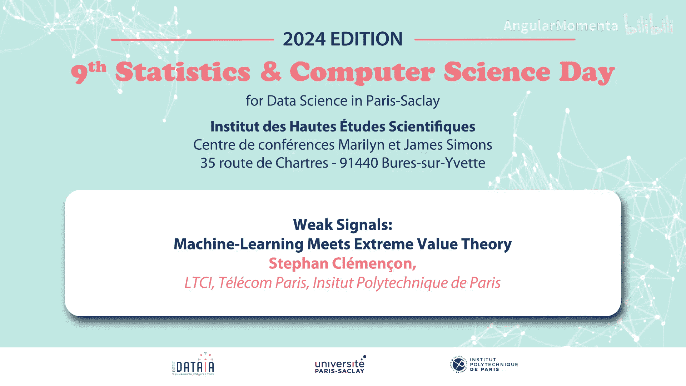
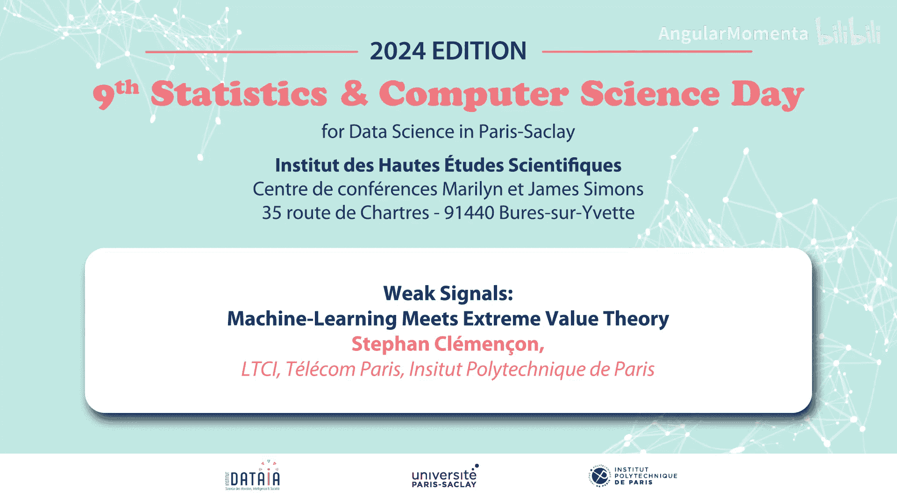

# 004：机器学习遇见极值理论

在本节课中，我们将探讨极值理论如何为“微弱信号”这一概念提供精确的数学含义，以及如何将其与机器学习技术结合，以解决异常检测等实际问题。我们将从机器学习视角出发，处理高维数据，并引入“角测度”这一核心概念来描述极端区域内的依赖结构。我们将看到，尽管角测度是一个渐近对象，但可以从数据中恢复，并利用其性质来保证分类、回归等机器学习任务在极端区域的有效性。

## 动机：异常检测

上一节我们介绍了课程的整体目标，本节中我们来看看研究的主要动机：异常检测。异常检测可以是监督式的，也可以是无监督式的，目前在实际应用中多为无监督。我们将从机器学习的角度看待这个问题，这意味着我们需要处理高维函数型数据。

核心概念是**角测度**。这个概念能非常详尽地描述协变量在极端区域内的极端依赖性。我们将看到，角测度是一个渐近对象，无法直接观测，但可以从数据中尝试恢复。主要的理论路径是控制经验角测度与理论角测度之间的偏差。这些集中性质有很好的应用，特别是允许我们对分类、回归或无监督机器学习算法进行微调，使其在极端区域也能良好工作，并具有泛化保证。

在机器学习中，我们通常计算平均值等标准统计量。为了处理极端区域的信息，我们需要计算更复杂的统计量。最后，我们还将讨论降维等经典任务，以及如何恢复角测度的稀疏支撑集，并可能讨论一些真实数据集上的应用。

## 微弱信号与机器学习视角

上一节我们介绍了异常检测的动机，本节中我们来看看如何从机器学习角度理解“微弱信号”。从机器学习角度看，这意味着数据将是高维的。在极值理论中，问题通常从参数建模的角度处理，而这里的数据将是高维且海量的，样本量非常大，使得极端值变得可观测。

目标是检测一些统计规律性，但不是接近平均行为，而是在分布的尾部。这在预测性维护或功能监控等领域有许多应用。通常没有标签，因此异常性在某种意义上将替代数据的标签。主要假设是异常对应于多元极端观测，它们位于数据集的尾部。但极端值并不总是异常。

异常检测的目标是从数据中构建一个区域。如果未来的观测落在这个区域内，则认为是正常的，否则发出警报。在单变量设置中这相对容易，但在维度大于2时，没有自然的排序，必须学习偏差的类型。我们将采用完全非参数的观点，不预先指定如统计深度这样的对象。

## 监督式异常检测：二元分类

上一节我们讨论了无监督场景，本节中我们来看看更简单的情况：监督式异常检测，这实际上就是二元分类。这是机器学习中的旗舰问题：模式识别。我们还有更具挑战性的情况，即完全没有标签，以及中间的半监督情况。

现在，极端观测是可观测的，这与过去不同。在机器学习中，我们通常避免对数据分布进行建模，而是专注于特定任务。然而，为了使用我们将要引入的概念，我们需要付出一定的代价，即**正则变化**的概念。

我们假设数据位于正象限。角测度将是本次讨论的重点，我们将处理角度，即向量除以其范数。角测度是正象限与单位球面交上的有限测度。目标是从数据构建经验角测度，并控制其与真实角测度之间的均匀偏差。这些经验测度将使用最大的观测值构建，因为我们在处理极值。偏差的量级将是 `1/√k`，这是参数速率。但与通常统计的主要区别在于，这里的保证是渐近的。

## 二元分类问题框架

上一节我们引入了监督式分类，本节中我们来看看其标准框架。在二元分类中，我们有一个系统，例如一个高维图像，以及分配给它的标签。目标是基于数据构建一个分类器，即从输入空间到输出空间的映射。理想情况下，这个分类器应该是最优的，即最小化错误分类的概率。

这可以重新表述为最小化0-1损失的期望。最优分类器被称为贝叶斯分类器，它依赖于后验概率。然而，我们不知道未来的数据分布，因此完全依赖数据。我们用经验分布代替真实分布，并尝试在某个具有控制复杂度的函数类上最小化经验风险。

我们的想法是比较机器学习算法产生的风险与最优风险。可以将其分解为偏差项和方差项。为了证明机器学习对未来数据有效，必须控制这些最大偏差，这通过为这些最大偏差建立置信界来实现。这需要对函数类做出一些复杂性假设。得到的速率是中心极限定理的速率，这是普遍的，不依赖于数据分布。

## 极端区域的分类挑战

上一节我们介绍了标准分类框架，本节中我们来看看在极端区域进行分类的特殊挑战。如果我们运行一个算法并在极端区域评估其误差，效果通常很差。这是因为超过大阈值的概率非常小，在风险量化中几乎不起作用。

一个更好的想法是考虑条件错误概率，即给定观测是极端的情况下的错误概率。我们希望这个定义独立于阈值，因此需要一个渐近版本，即渐近风险。我们希望为这种渐近的分类风险概念提供保证。

## 极端分类框架

上一节我们指出了极端分类的难点，本节中我们来看看为此开发的框架。核心思想很简单：仅使用最大的K个观测值来学习分类器。由于只使用K个数据，我们期望学习速率为 `1/√k`。这看似可预测，但证明需要大量努力。

方法极其简单：首先对数据集进行标准化。我们使用秩变换，即分量wise的经验累积分布函数进行变换。这种标准化被称为**Pareto变换**，是典型的秩变换。标准化每个边缘分布至关重要，这确保了在每个方向上，数据都以相同的速率趋于无穷大。

一旦使用这种边缘变换转换了数据，就提取K个极端数据，仅使用其范数和角度信息来解决优化问题。直观上，在某些方向上，蓝点比红点更可能出现，目标是利用角度信息来解决分类问题。如果这样做，可以完全胜过使用所有数据集的朴素技术。

## 多元正则变化与角测度

上一节我们介绍了极端分类的预处理步骤，本节中我们深入了解一下其理论基础：多元正则变化。我们假设随机向量取值于正象限，技术上需要假设连续边缘分布。我们引入角度和球面的概念。

多元正则变化是一个经典概念。它声称，如果对随机向量进行缩放，当阈值t趋于无穷时，缩放后向量属于某个集合的概率乘以t，会收敛到一个极限。这个极限是一个测度，称为**指数测度**。

指数测度是齐次的，可以通过极坐标变换表示为半径分布和角度分布的乘积。角度分布就是**角测度**。因此，知道指数测度等价于知道角测度。角测度完全描述了无穷远处的依赖结构。如果数据点沿轴线分布，意味着在极端区域坐标之间是独立的。角测度类非常通用，可以是球面上的任何有限测度，因此是完全非参数的。

## 角测度的估计

上一节我们定义了角测度，本节中我们来看看如何估计它，因为它指示了极端情况发生的方向。想法是模仿Pareto变换，用经验累积分布函数代替真实的累积分布函数。这是一个插件策略。

复杂之处在于，需要整个训练观测集来计算经验累积分布函数。因此，转换后的数据不再是独立的，它们依赖于整个数据集，这是研究这些量的真正挑战。但如果经验分布接近真实分布，这应该可行。我们用经验版本替换理论中的角测度，并使用K个最大的点。

选择K是一个难题。理论上需要更复杂的假设来回答这个问题，这里我们将避免讨论。角测度波动性的研究以前并不充分。我们期望最大偏差的界为 `1/√k`。当n和k同时很大时，这是最优的。

## 理论保证与证明思路

上一节我们提出了角测度估计的期望速率，本节中我们简要看看其理论保证和证明思路。如果我们知道理想的秩变换，一切都会很容易。存在一个类似于Vapnik-Chervonenkis不等式的集中不等式。

但我们必须进行变换，因此经验角测度可以重新用指数测度表示。关键是将随机集夹在两个确定性集之间，并对角度集合的复杂性做出假设，以控制夹逼集的复杂性。证明思路是将偏差分解为随机误差项、夹逼间隙项和偏差项。通过平衡这些项，可以获得保证。得到的速率大约是 `1/√k`，可能带有对数因子。

## 应用于异常检测

上一节我们建立了角测度估计的理论基础，本节中我们来看看如何将其应用于无监督异常检测。当没有标签时，目标是确定观测空间中的一个区域，未来的正常观测应落入其中。这可以转化为一个优化问题，即寻找一个包含数据一定质量分数的最小体积集合。

最小体积集合是观测密度函数的超水平集。统计方法会尝试估计密度，但会面临维数灾难。与分类类似，我们用经验分布代替未知分布。这里也需要渐近水平，因为经验分布不是真实分布。我们可以获得与监督分类非常相似的保证。

在异常检测中，目标是确定球面上的最小体积集合。通过解决优化问题，并利用之前解释的结果，可以保证以 `1/√k` 的速率恢复最小体积集合。如果角度位于该区域内，则不发出警报。

## 扩展到其他任务

上一节我们完成了对异常检测的讨论，本节中我们简要看看该思想如何扩展到其他机器学习任务，特别是降维。在统计和机器学习中，我们喜欢稀疏性假设。角测度可能具有稀疏支撑，即并非所有正象限的面都被数据点访问到。

既然现在可以准确地估计它，就可以尝试恢复表现出依赖结构的坐标组。完全相同的技术可以用于恢复这些组，且具有相同的速率。这在环境科学等领域有许多应用，因为稀疏行为在数据集中经常被观察到。

## 总结与问答

本节课中，我们一起学习了极值理论与机器学习的交叉。我们探讨了如何利用角测度来定义和学习极端区域的微弱信号，并应用于监督分类、无监督异常检测和降维等任务。核心是通过Pareto变换标准化数据，并仅使用极端子样本来进行学习，从而获得具有理论保证的 `1/√k` 级学习速率。算法上，这很简单：使用经验Pareto变换进行标准化，然后仅对极端观测部分应用标准的机器学习例程。

---

**关于范数选择的问答**：  
提问涉及使用无穷范数（即最大值范数）的问题。这种方法可以扩展到任何Lp范数。变换是相同的，但角度会根据几何形状而变化。复杂性假设需要根据所选范数进行转换。对于无穷范数，已经证明是可行的；对于任意范数，目前尚不清楚。无穷范数意味着至少有一个坐标非常大才能被认为是极端的。