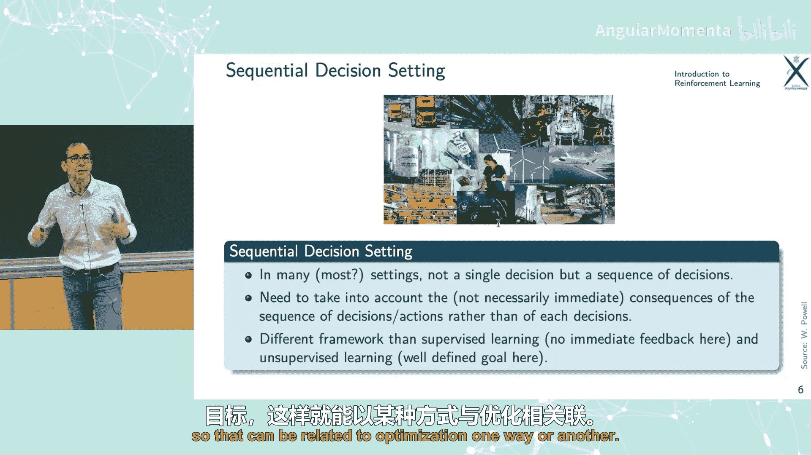
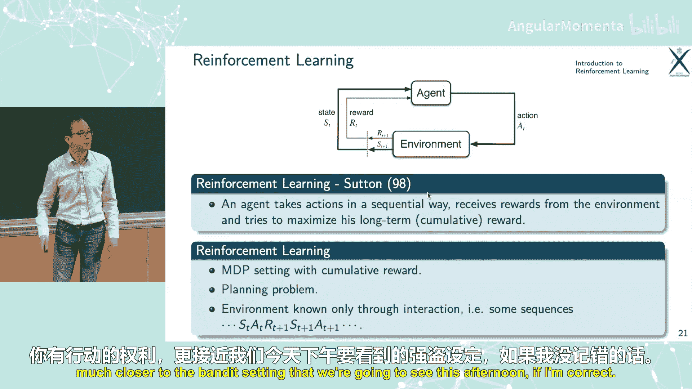
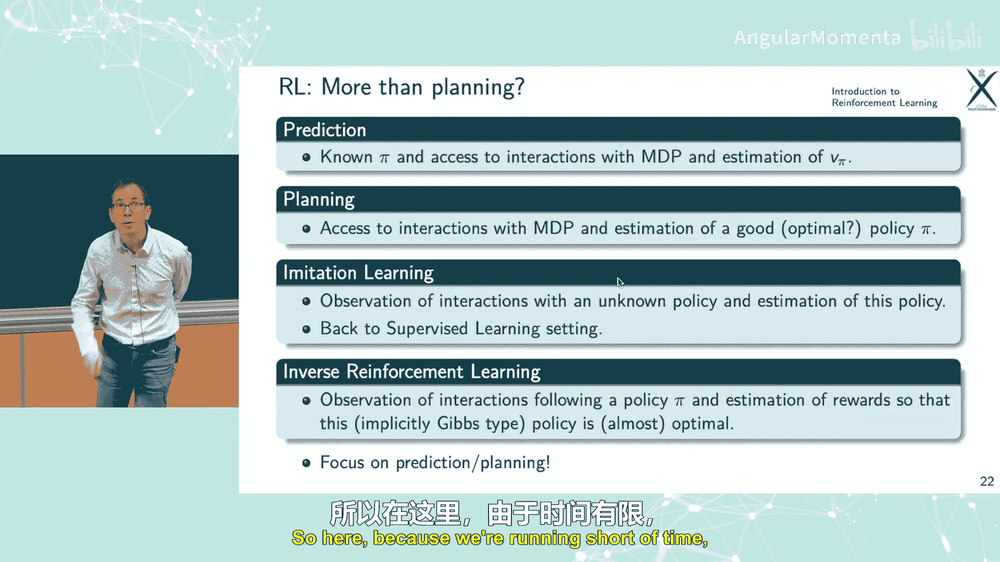
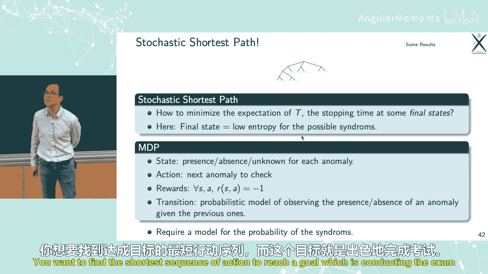
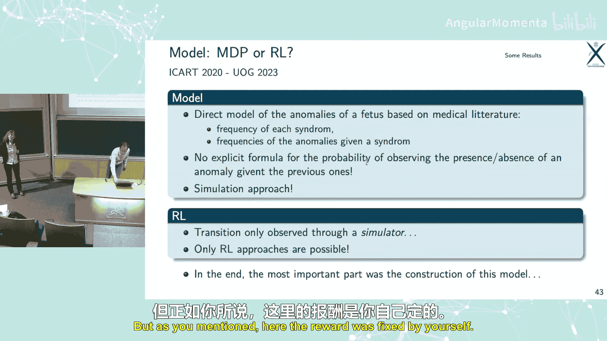
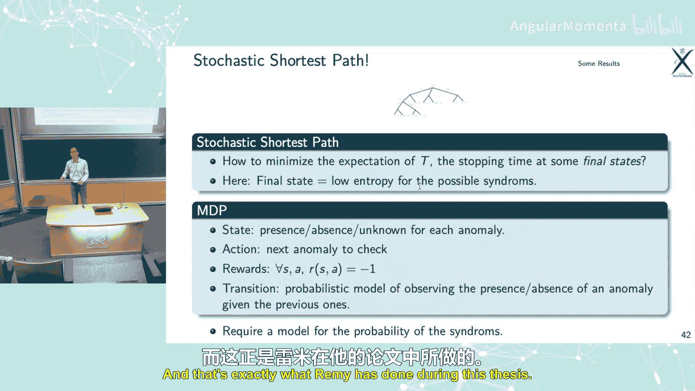
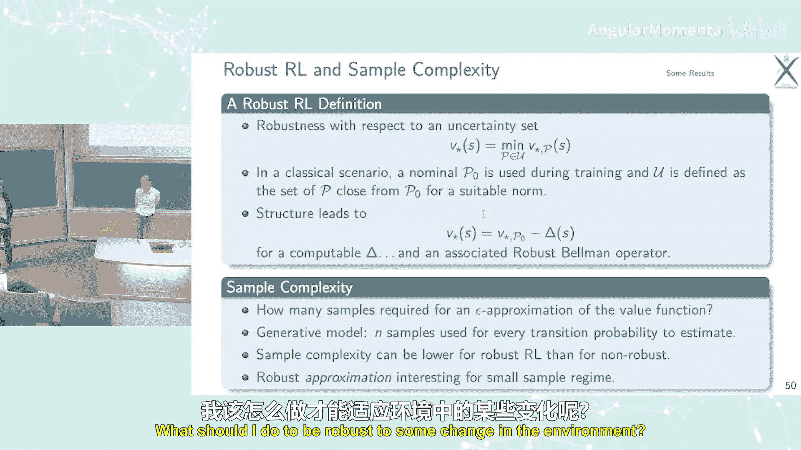
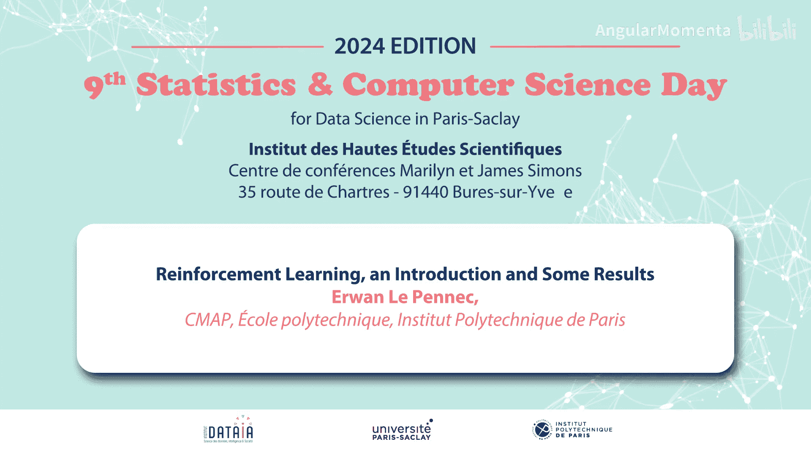

# 【IHES】数据科学主题统计与计算机科学 ｜ the Statistics & Computer Science Day for Data Science p01 01 Erwann LePennec - 强化学习：入门与部分成果 -BV1HvvzBvEU3_p1-

🎼Bgeaus， I'm going to stick to broken English。

And we're going to talk about reinforcement learning。

 so how many of you know something about reinforcement learning。Okay。

 so you can sleep basically during the first half， at least。For the other。

 I'm going to try to give you an idea what is this？And then discuss some new results。啊。

So if you look at the menu。We're going to spend most of the time introducing what is response learning。

 and then I'm going to describe three results that have been obtained by students of mine。

And that would be。I hope I will be able to do this。40 minutes。

So what is this reinforcement learning story？It's related to something that we can call sequential decisions。

Often。When we think about machine learning， we think about the art of making single decision。

 making prediction of something。It turns out that in the real world， often when you take a decision。

There are consequences， the world is changing。And you cannot rely on the IID assumption that is often there in the classical machine learning setting so super provide learning one。

 for instance。And that's exactly what we're going to try to tackle。

So we're going to sync a situation in which。The finite results。Ass not due to a single decision。

 but to a sequence of decisions。😊，What I mean by that one， so again。

 the fact that when you make a choice， when you take a decision。

You're going to have consequences and you need to take into account those consequences to know whether this is a good or bad thing。

As I have said， this is different from the supervised learning framework in which you have an immediate feedback as soon as you make a decision。

😊，You suppose you know whether this is good or bad。

At least if you wait enough time or you ask someone you can assign a performance to each decision。

 that's not going to be the case here。The word sequence of decision will be important。

It turns that this is easier some old than unsupervised learning and the sense that we're going to define the goal in a very specific manner。

So that can be related to optimization one way on another。

That by the。For plan， we're going to restrict ourselves to a simple model as often in mass。

So here we're going to talk about sequential decision as a way to。😊，Choose actions。Those 80 ear。

Depending on some information。And the information will be denoted ST。The state。

In older talk at least， I hope。So we're going to act depending on the state of the world。

Can you imagine that？Each time we're going to act， we're going to receive a new state of the world and so on。

And the way were going to measure the quality of our action。😊。

It threw a very specific mechanism called a feedback。😊。

Which is going to be measureded by a sc reward that we're going to receive at each time step。

So I mentioned a lot the idea of actions。And you can't imagine that the wool。

Point is to pick those action as well as possible。🤧う。So maybe I've got a strategy in mind。

And I want to know whether this is a good or bad one。That's one kind of question。

But probably the most interesting question is， can I do better？Or ideally。

 can I find the optimal way of choosing this action？😊，This is very broad。Very generic。And。

Most of the time we're going to restrict ourselves to a simpler setting that we can model。

In an efficient way。So here I've roughly of the environment in the state。

 I'm going to be much more specific。😊，I'm sorry I'm going to rely on the Macovan description of the wall。

 don't worry I'm going to describe it again in a few slides， very specific。😊。

W of thinking of the wall。Probably not true。But sufficient to do some analysis。

And what I've mentioned that we've got the feedback through Scalar here I'm going to be much more explicit。

 the way I'm going to asset the quality of my decisions is going to be。😊，Through。

The sum of those reward wallss。We had something which was not very specific and air going to be very specific。

Still have the same question， can I assess the quality of a policy way of choosing the action？

And can I make it better and I define the optimal one？If I'm here， I'm in the world of probability。

A macrovian model is a probabilistic object。😊，I know everything about the world。And I'm trying to。

Findine what is the best choice within this wall that I know perfectly？

If we move to reinforcement learning。😊，That exactly the sameling。

But we are relaxing the assumptions that we know the world。

The only thing we have the right to do is to observe the wall through interaction so we can play。

We can observe the wall。And still we want to know whether we are doing something good or not。

And still you want to find a better policy， a better way of acting。Onidely an optimal。

Very classical sitting in。Mudly。We start by Ro I D。Move to a strong， well defined model。

Sa probabilistic one and then。😊，If we are missing some information。

Because we cannot observe everything in the real world。

 we have a certain problem that we really want to tackle。嗯。Maybe some of you have。

Read something about optimal control。That's basically the same question。

At least if we think of discrete optimal control， thats exactly the same thing in reinforcement learning。

 we want to maximize。😊，A reward。In optimal control， it's very different。We want to minimize the cost。

But you can see that particular s on that related setting。😊，Sttochastic algorithm。

 stochastic search in which you'll trying to find the expectation of something and regret。You which？

You don't want to minimize the sum of。Theice， but there some an expectation。The tool that。

Or we're going to see or we're going to use others are similar in those settings。

what are those Macum decision processes？Its。Probably the most simple model you can imagine。

If you want to deal with the situation where you have。No very。Having a certain state。

Feed to this environment action。 So we want to act and receive a new environment。As that said。Try to。

At each time step， so this is a discrete time war。We know everything about the world。

Guai strong assumption。I assume that's okay。We have a pool of action。In which we can choose what。

We feed this information to the environment。And we receive some new information。

 two type of informations。First。The reward。That we're going to use to measure the quality of our decisions。

And then a new state。New state of the world。Which should depend on the action。

What kind of model can we make this a lot？啊。If we stay to the probabilistic world。

 we need to define the probability of reaching a new state and receiving a new reward。Giv。The best。

On ear， were going to use this very strong macroovviian hypothesisesis that this load depends only on what are doing right now。

So everything will depend only on the current state。Under current action。No memory at all。

Poor by over simplification。But I'm pretty sure that many of you that have been dealing with time series or。

Discrete events have viewed this assumption。Very convenient。

I'm basically the only one which we can do a lot of math。I'm going to add the furthest assumption。

Which is slightly more than technical。I'm going to assume that everything is finite。

So the state of state。The set of action and the set of reward。The main game。

that we can write sums instead of integral。That's going to be really a detail of the story and respect for of the reward。

Each time you see a reward that could be continuous。Basically。

 any low provided is bonded will be okay。You can move to continuous state。By working well。

 but moving from a discretere of action to a continuous one is much more challenging。

That said this is a very classical setting， but we're going to start with this one。

I'm going to be slightly more specific， so I've said that I'm going to measure the equality through what is called the return to sum of the reward。

😊，And if you look carefully。I've added some。Sttrainrange factor。In front of the reward。

I'm going to multiply the reward by a discount。That depends。From the distance from the best。

And the only reason I'm doing this is for this object to be well defined。

 this is an infiniteiteome orseri and you know that it may not be well defined here。😊。

If I'm putting this assumption， this object is always well defined。😊，So I can work with it。

For this talk， I'm going to focus on what is called a discounted case。

In which this gamma is going to be strictly smaller than one so that everything is well defined。😊。

If you want to go deeper。You can relax this assumption。

 but you had to add much more complexity to the analysis。

Last thing I want to stress is I'm going to rely a lot on a very complex。Observation。

We said basically that up to this gamma factor。What we're going to gain。From now。

Is what we're going to gain right now， the reward， plus what we're going to gain in the future。

Very clever， but that's going to be very important in the analysis。

And then I going define what is the policy that's the way I'm making the action given the state。

I need to define a few objects， the value function。This is the state value function。

 not a K function。Which is the expectation of the gain starting from a certain state。很吃啊。

So one is the state action function where I'm going to condition with the state and the action。

And the question I was asking at the beginning， am I good， can I do better， can be framed as？

Policy evaluation， given the policy。What is this value function？

What I can expect starting from a certain place。And the second one。What is the optimal policy。

 maybe the optimal one is one which is better starting from any space， any state。

Not claiming that those objects exist。Not obvious。It's true。But you have to walk。

And what is interesting is this is not something new can be traced back to the 50s and even during the Suigon World War。

 it's really rated to operate certain research。The idea of optimizing a decision。

When there is a sequence。And for those of you we have control。

You can translate everything I'm going to say in the vocabulary of control。

 just a matter of changing the sign because we're going to maximize the reward when you're going to minimize the cost in control。

So what can we do？First， we can try to。Solve the first problem。

 I know the policy and I want to know whether I'm good or not。I need to compute this value function。

And it turns out that there is a key property。😊，Which showed that。The value function。

 either solution of an equation。This beman equation， which is ear， it seems very complex。

But it's not saying， but saying that。Why I can expect？Starting from a spec S。

Is what I'm going to receive from this state。Breswater I'm going to receive afterward。That is。

 we can find this value function by solving this system。😊。

AndI it indeed a way of solving this problem？You write down this linear system and you solve it。

T though that's。There is a slightly different path， which is going to be much more useful。

In the reinforcement learning wall in which we don't know this。

 those transition probabilities that are appearing everywhere here。By solving this equation。

Through a fixed points。Algorithm。So here， if you look at this equation。

We mean that V is equal to the image of V through a linear operator。There's a fixed point equation。

And it turned out that this operator ear that we know explicitly is a contraction for the subnome。

Hence I can solve the system by iterating。Please application。This is called dynamic programming。

Because basically it's betting on the fact that if I have a good estimate of what's going on in the future。

😊，I'm going to have a better estimate of what's going on right now。😊。

So we are propagate getting the information from the future to now。Can we improve the foot？

Dont want to look at the exact result， but the answer is yes， there is a way to make a policy better。

Whenever you have one。And the idea is。Funny， some oh unqu intuitive。 If you're like me。

 you are a bad chess player。You're just looking at the position。

Trying all of the of the possibilities and seeing whether it seems good or not。

That exactly here what you can do， and you can prove that this is a good idea。😊。

You can look at what's going on， if we play。A specific action。Year。

And then play using the Qurran policy。And you can prove that if it was better to change a single action and then follow the rest of the time the current policy。

 it was the best third choice from the beginning。😊，Justification of this bad strategy。Yeah。

You are proof of the convergence on everything， but that's not the point。

And there is another way to look at this problem and to go back to the fact that instead of。

In then seeing a policy， maybe I may want to find directly the best one。There is an equation。

 which is some equivalent to the linear one that we've seen， which is called the beman equation。

It's almost냐。Except there is a max。So we move from the world of linear equation to the world of linear programming。

There are solvers for those in our problem， but still we can show that this operator is a contraction。

 so we can rely on the idea of applying this operator every time to obtain a good solution。

So in the MDP world。We've found a way to find the best solution。On a way to。Obtain。

D the best solution。And this is an idea that you're going to see everywhere。We're going to。

Most of the algorithm， we're going to maintain two estimates。

An estimate of the quality of the policy。On the way to NN sit when well or another。It's。

Very efficient。But it's relying on a very strong assumption。We know the transition probabilities。

 We know the world。This is not realistic in many applications。

So we need to move to the reinforcement learning city。😊，And that's basically exactly the same thing。

 except that you don't make the assumption that you know the transition probability。😊。

You only observe。😮，The result of your action。So it's slightly different， for instance。

 from classical data collection here you have the right to act。

 which close out to the bonded setting that we're going to see this afternoonbdo if I'm correct。

诶。But still you have the same question， can I know whether I'm doing good or not， can I do better？

And then you have other question， can I imitate what I see， can I guess， what is the reward？

Given what I see and so on。Put field of question。Within this specific problem。

Because we went in short of time， I'm going to fetchticcus and the prediction planning point。

What can we do？We cannot rely on。The probability formula that we've seen。

 so we cannot rely on the solving those linear equation or this linear programming。

How to know whether we are doing good or wrong。There is a very simple way。Just play。If we play。

We can collect the result。I've read them。And see whether that was a good idea or not。

This is the idea of promoting out。Doing simulation。

Averaging the result you know whether we're going do good or right。啊。That is nice。

We can prove that this is more or less working。He turned out that。

It's much harder to show that you can use this to indent the police。And the other issue is that。

 in order to。Update anything。You need to wait till the episode ends。

Because we need to sum the rewards。If the episode have an infinite length。Then we to do it。

So we may want to find a way to do a similar update。Updating an average。

But it can be done in an online way like this。But without having to wait。Till the end of time。

Natural lighting。This wool serve over time。And there is a naive I D。that's going to walk。

That is replay the game by an estimate of the game。We're going to do some kind of bootsrapping。

The idea of using an estimator to enhance itself。By replacing the gain in the future。😊，Bye。

The immediate gain plus an estimate。Some O of the game in the future。I'm writing on EVP。

 but we don't know it。That's going to be an estimate。It leads to a non nonlinear algorithm。😊。

That you can write up。Is it going to walk？Probably yes or away one month unit it。

But the reason is not because of this heuristic， but rather on a flavor analysis。😊。

This algorithm as a stochastic approximation one。😊。

So I wanted to make a connection between those technique and stochastic approximation。

 And that's very important。 So we have an algorithm here that is sufficient to。

Do the estimation of the current value function online？And we can extend it。To。

File the best possible policy。Either by following a policy and trying to enhance it at each time step。

Or by computing directly the optimal value function。😊，And then in the end。

 they using the best bodies。This last approach is called Q learning。

Because as you can see on this slide， but that I didn't mention。

 we had to estimate the Q value function conditioning by the state and the action on underneath the state for technical reason。

The expectation of a max。Is。Easier to estimate that the max of an expectation。You can do something。

And thats。So what I wanted to tell you is that it's possible to solve this problem of transformal knowledge。

😊，大吧也行。I focus here on an approach in which we compute those value function and then they use the policy。

 but we can。At made model。And then you use the MDP approach。It' not such a bad idea。

Or we can do with real time planning， trying to adjust our policy in real time to make it better。😊。

Regarding the variation， we can。Play on the depth， the number of step we are collecting before we do an update。

And we may try to look at the width， the number of action we consider at each time1。

Your literature on this。I but nobody is using this in the real world。Why。Because basically。

 I'm assuming that I can。Store。A huge amount of information。

I need to have a value basically for each pair of states on action。And that could be very large。

A we doom， not completely we can use。Approxiation。And I'm pretty sure this is something that you know。

When we have a large set of function that we want to approximate。

We can replace it by a parametric approximation。And that's basically the basis in。

Supervised learning。You do not try to estimate directly the conditional expectation。

You try to estimate it through proxies。Brametrictry one。Here we can try to do the same。

What about the parameter transition？In the reinforcement setting。

 they are basically two up the world linear approximation in which we can prove something。

And the world of deep learninging， which is going to work。Turn out that it's much。

 much other than supervised learning。😊，Because as soon as you add approximation。

You need to have some kind of idea of O to im the quality of the approximation。

And it's far from being obvious。Do we want to？Match。The ideal target。

Do we want to find an approximate solution of a fixed point problem？Nobody knows。And why。

 because most of the time， it's very hard to make a connection between the solution of those approximate problem。

😊，On the optimal solution。It's a literature in which often。

The main result is that the algorithm is going to converge。To all what， the students are questioned？

Quite surprising， but there is a huge of places， huge places where you can walk if you're interested in this fitting。

 because it's a world where it's very hard to work in this approximation wall。😊。

Slightly easier in the。Classical supervised learning。That said the algorithm。

A lot of variation of algorithm， but often they are unstable。Very hard to make them converge。

 and you have to rely on a set of tricks， I would say。When I'm。Talking about tricks。

 is because often the Ids are going from the world of practitioner that are building。

Algorithm to estimate those quantity on the at tricks。Instead of solving one problem。

 maybe we can slightly change it and we observe it better。

 what I claim is that often after what you can have a theoretical intion on why it's walking by looking at the theory。

😊，And now the game。アい。Better and who better and better at is to use the theory to give youuristic to in the algorithm。

The last thing I wanted to mention before I jump to the results。

Clained I at the beginning is that we are focused on a very specific point of view。

In which we're looking at。The quality of a solution through those value function。

 the expectation of the gang starting from a predictive position。That's perfect。

Without approximation， because there is an equivalentvalence。😊。

Between this set of value function on the set of police。Our most equivalentvalous。

So we can move from policy to value。Function and optimize policy。

Is related to optimal value function。As soon as when'。Making approximation。

It may not be the that the optimal value function within a certain subset is related to the optimal。

ポリシ。So instead of approximating。The value function may be better to go back and try to approximate directly the policy。

 which in the end is the objective of interest。But it's funny， this is。

I see the state of the auto algorithm in the last few years are based on this ID。

But that was an idea that was known since the 50s in the control world。

You may have heard of Ponreagine approach。This one based on。

The parameterization of the poi the action。AndThe Hamilton Jacob one。

In which you are thinking of this value function， the interest of the position。

Just wanted to say that we can do that， we can compute gradients to policy。

The parameter of the pur respect to everything and their numerical stochastic approximation of all those quantity so that you can。

At least mely try to compute the derivative of the policy respect to the world。

He did what we said before is is everything what we said before is useless。You no。

And the reason is that in。Or the formula that I know。E somewhere， the does value function。

So we need to estimate them sorry there is of plug， we try to estimate those quantity。

 plug them in the formula and bet on the fact that this is stable enough to work。And it is。

And the most。Efficient approach today。based on this ID that we need to simultaneously parameterize the policy。

😊，安迪。Value function。 And if you do this。You can obtain good results in the end。

If you are interested in the proof。The only proofs I'm aware of are in the case when everything is linearar。

Or I are up to logistic。For the policy。And here， the proof ad involve related to stochastic approximation to stochastic algorithm。

And in particular to the idea of two scale algorithm in which you move some the policy。😊。

At a slower pace than the estimate of the value function， so it's at each time state morally。

The value function are close to the value function of the current policy。

If you move them in an arbitrary way。You may diverge。If you are。

Careful and move one piece slower than the other， the P that you should move slower is your target at the policy。

It's much better。That the type of algorithm that I used， for instance， in ChaGPT。

You may have heard that they used reinforceful learning from human feedback in the end and the final algorithm in which you tweaking the so large run model is based on this IT。

😊，I have five minutes to talk about results。Just to give you an idea of。

What one can do with such a tool。Or what your students in the future will do and what you a student are going to do。

The first thing is maybe to use them as a tool。And this is exactly oh it started for me。😊。

With Hermi Bison on Step。We had the collaboration with Nikke， the obstetricians for Na care。

 And they ask us a question of。Optimization of the pernatal。Eltrason exam。Po Stepany and I。

 we know a lot was supposed to be expert in image processing， so we thought that's great。

 we're going to do what we know image processing。And they say， no no， we're not interested in this。

 we want to be help。😊，To conduct。The example。啊。So this was discovered during the internship ofmi Remi Bison。

She's here。And we say， okay， are you brave enough to change completely the subject and move to something new。

A subject for which your advisor will probably be incompetent and you say yes。And during his scsis。

 he has been able to use the tool basic。😊，Way of using reinforcement learning。

But for this specific setting。So you can imagine here that the question is。

Or can I rephrase my problem？Conduct a better exam。As something that you can solve with。

Reinforcement learninging。

And that so gets six short pass。Thats a way of rephrasing this， you want to find the shortest。

Sequence of action to reach。A goal， which is。Conductting the exam well。

And the outcome has been a paper。We've been able to publish this results。

In a mass journal on on in a medical one， but。

Best of be a company remains know the CO of Soio。Which has built a product starting from this ID。

I'm saying starting because issue。However， if you are familiar with this startup world。

 you start with an ID on Indian end， it's very different。Starting with this。

 they are building a tools to help practitioner conducting those exams。

This is this optimization that we've seen is a very tiny brick。

And that added a lot of thing regarding the way to。Send the picture in the end。To have。

So Mary of the exam。To measure thing， go back to image processing。

 it must have the product of the company。

Another thing that you can do when youre walking on a field is to say， okay。

 can I do something better？And this is what also。For Gary is doing。

 it's a second year PhD student working within Castel on Emmamanuel you。And here。

 the idea was to say， okay， can we go back to a very old problem？The MP。

That we've mentioned from the beginning and work on numerical solution of this MB problem。

I' have said that this is not。😊，Practical in any situation。

 there are still cases and particularly in network optimization。

 and with the size of the matrices are okay so that you can do this in practice。😊，That said。

 if the matrices are very large。😊，There is a need to optimize the problem。

 And we've tried to tackle this by using old I。Of good parameterization of the solution。

For which we want to。Be able to prove that the right algorithm is sound。

That is we want to have proof of the converggenence of the algorithm toward the optimal solution and at the same time。

Ha numerical results showing that indeed in practice it's faster。

And this is exactly what also is doing currently。And what is interesting is that starting from this specific way of formulating the problem is done a huge study of benchmarks in this world in order to know whether an algorithm is fatter than the other。

As often， it depends。Depending on the style of problem。

Now many problem that you can formulate as an MDP， one algorithm may be faster than the user。

But what is interesting what they have shown that is variation is often the fastest one。

And the last thing I wanted to mention before I stop the idea of extension。😊。

Maybe you want to depart from the classical way of formulating the problem。

And this is what Pi Pire clgy has done。😊，And during the last。Two years on F。

He wanted to add some kind of robustness in。This setting。

So we made the assumption that the environment is nice。That is bathing well。And it may be nasty to。

就E的7己。Wor case scenario when you have。An adversarial force， which is trying to make you fail。

But you may imagine that。In the real world， the world may be changing。

 maybe evolving in time on what you learn right now。

 maybe not exactly what iss through in the future。The idea of robustness， can we find a way to。

Make the learning part robust to a changing the environment。And Pierre has been very brave。

To tackle this problem from the theoretical point of issue。So， he tried to。Measure。Weath。

It's harder not to find the solution of a relaxed problem in which。You want to be robust。

To change in the environment。So very theoreticalicalization in the end， there is a funnyny result。

 it's easier to find a solution。😊，Of the rubs problem。That of the non robust one。

It may be surprising。But this is something that you've seen in many places， often perturbation。

 stochastic perturbation one one another， they're acting at a regularizer。😊。

And finding the solution of a regularized problem is easier。So in practice。

 this is what is interesting。😊，There is a way to use this ID。😡。

That is to us some kind of pessimism in the estimation， quite different from the bandit wall。Here。

In which you can imagine that if you want to be robust。

You have to bet on the fact that the ultimate gain may be slower lower than what you have you planned。

 so you need to be pessimistic。And what has shown that in practice。😊，It leads to better solution。

 so you go faster。to a good solution， and if you reduce the penalty。

 you reduce the pessimide in the end you converse to a good solution and in the ward of approximation。

 this is very the most surprising result。You obtain in the even better result that if you had started with the regular problem。

 So even if the environment is not changing when you are doing approximation， it seemed that。

Doing this kind of regularization of the program。Elps。This may be a reason why。

But you know that from theory to practice and from practice to theory， there may be a difference。

And he is still fighting to know whether this is just a heuristic of if there is a deep connection between those two ideas。

😊，Last thing I wanted to mention。You can see that。There are three。Question mark here。I put a day。

 because I'm quite convinced that。This time it's going to be okay for the conference。

But this is a very out part of。The work of a scientist right now。

 being able to publish your research and sometimes you can be very proud of the work of your student。

And it felt。Just be patient。And I'm pretty sure that in the end， that's going to be okay。

 we are joking with P。😊，I've called it。Thecur to one。Because for one year it was pure rejection。

And for absolutely no good reason， sometimes there are good reason for it。

And this year starting in January， everything is。Going in the right direction thats way I've put the date。

Still on need interrogation weather。I could be the name of the conference。

But we cross our finger and that should be okay。So thank you for your attention。

What I want you to say so if you are interested。There are a lot of books。A lot of lectures。

Please feel free to read them。😊，好。NoWithout joking， if you're interested in this topic。

The best introduction is probablyed the book of Saturn and Bato。Very easy to read。

Because they are adding a lot of thing。Under the carpet。

And if you want to have a better view and a more accurate view of what's going on。

 you have to dwell into much more technical books。And what is funny is that often when we have a technical question。

 you can find the answer in very old books， and that's the truth here。

 there is a series of books from Bte Ca and Siys。Where。30 years ago。They were using neural networks。

To solve those problems。It was mostly theoretical at that time。😊，For computing reason。

But the Is out there。You just have to understand the vocabulary。And the notation。I'm almost on time。

不べ。Thank good。Time for a few questions。Maybe I can just start with a small one on the start that to mention。

 I was wondering what were exactly the rewards that you had。

 was it to detect some disease or was it to have the most beautiful picture of the baby？

So for the exact problemm。Rimemia solve during his PhD。

 The I D was to reduce the number of interaction， the number number of。

Organ that you have to visit before you can make a diagnosis。Because， okay。

Nobody is pregnant right now。Most of the time they don't have time to check everything。

They are doing their best。But if they see something strange。

It's very hard to know exactly what you need to check after world。And that's exactly what we were。

Doing， suggesting the next object to check， the next organ to check。And this was a mix of meley。

Using expert modeling。We're using the expertise of naked， not by。

Observing the way they are conducting the exam， just asking them question of the prevalence of different objects。

 building some old simulators of fes。On which we were training the reinforcement log algorithm。

But as you mentioned。

Here， the we world what' fixed by yourself。And that may not be the right one。

We just we looking at a number of organs。And that's exactly what Remi has done during this visit。

 you can imagine that if you move a product。

You should avoid the idea of moving look at the it， look at the fit， look at the。

 do you look at the fit and there is an idea of proximity of。😊。

More than one thing that you need to check at the same place。Would that the difference between it？

Research on research and development。Building an I D， a proof of concept on the product。

Two different things。あがこ。Thanks for your talk， maybebe a technical question。

 but it's about this robust period。

I was just wondering you have this uncertainty set to you which is。

Where your transition lives in different terms。 What do you know about this。

 do you know is 0 or the ra， Okay， so it really depends on the scenario。

 Most of the time that the way robust business is is。Present it。 So you have a non set。Here。

 the scenario here is interested in is the one where you are observing a single value。Of this un。

 distance offset is set。The nominal transition。And you think that the real one is somewhere within book。

Once again there are a lot of different modelling， this is a simple one。But realistic。

 and I say admit that you observe a certain world and you expect that the world is going to change the future and you don't want to be good only on this specific world。

 but on the world that are quite similar。Another setting in one in which you can observe different world。

On then， you can even put a distribution on them。反で是这方面。这样。你相亲我就。A distribution of robust。

 supervised learning。It's all the same ideas everywhere。

 we are making strong assumption in the classical analysis of algorithm。

What happened when this is not true？And it's very natural to say to。

Bet on the fact that the assumption that the world is not changing。Is false。

T I in classical supervised learning， what should I do to be robust to some change in the distribution？

Then here， what should I do to be ri to some change the environment？

没。哦，歌是。

