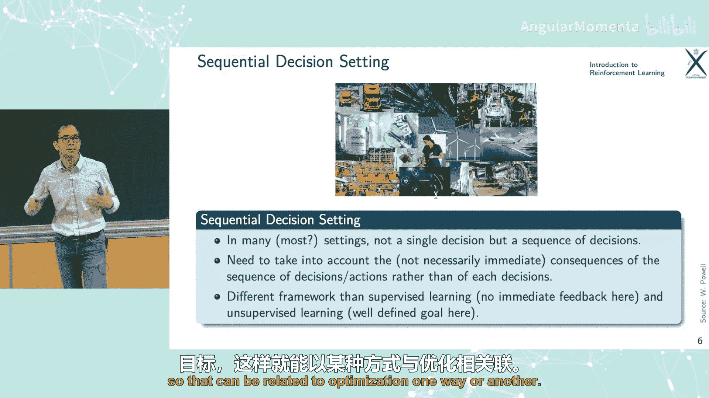
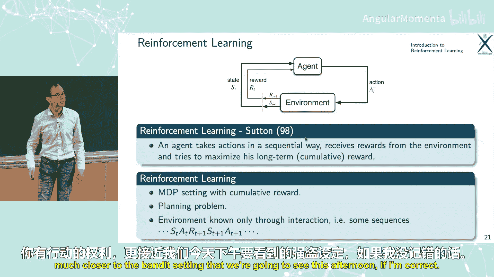
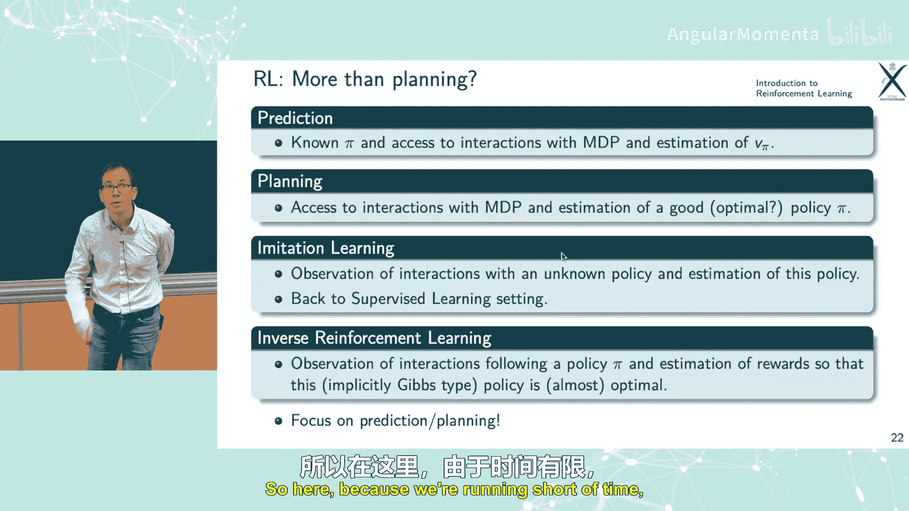
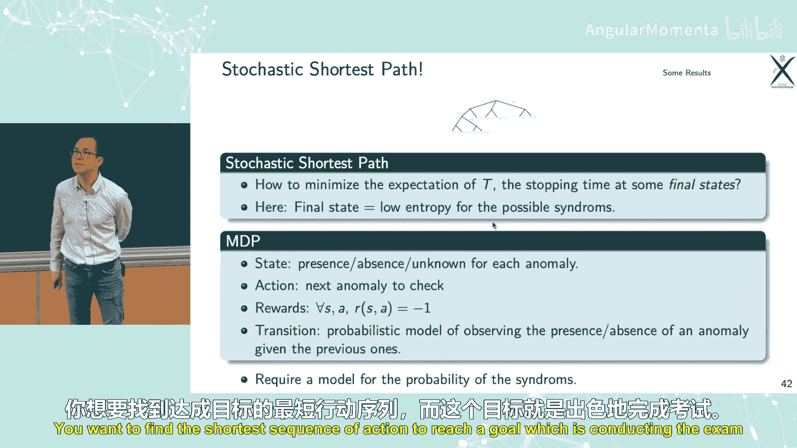
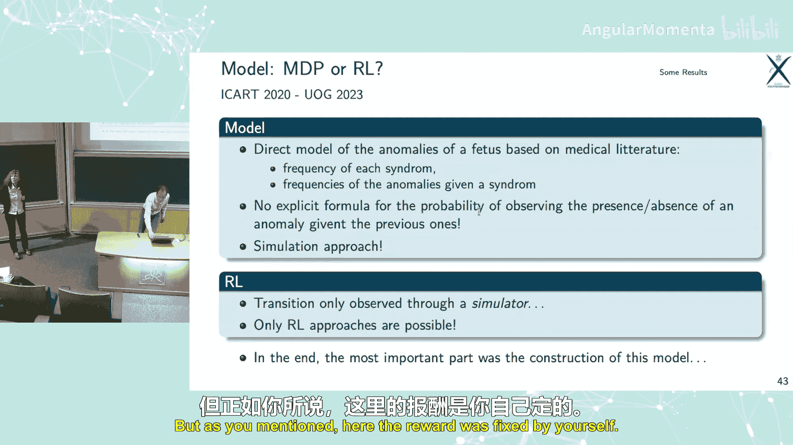
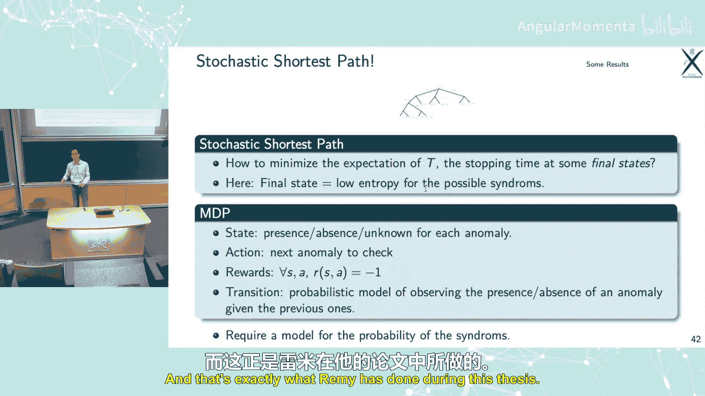
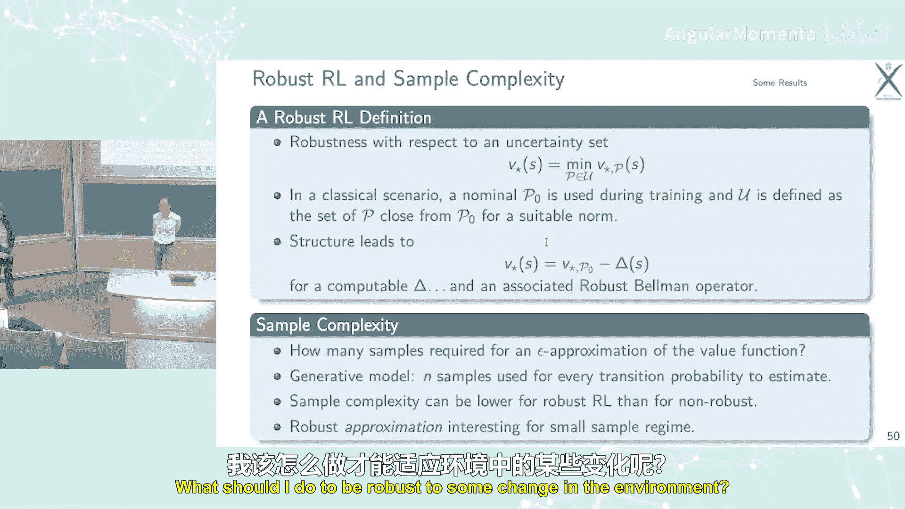

# 强化学习：P01：入门与部分成果

在本节课中，我们将要学习强化学习的基础概念。我们将从理解什么是强化学习开始，然后探讨其核心数学模型——马尔可夫决策过程，最后介绍一些前沿的研究成果。

## 什么是强化学习？

上一节我们介绍了课程概述，本节中我们来看看强化学习的核心思想。

强化学习与一种称为“序列决策”的问题相关。在经典的机器学习中，我们通常关注如何做出单一的预测或决策。然而，在现实世界中，一个决策往往会产生后果，从而改变环境的状态。因此，我们不能依赖经典机器学习中常见的独立同分布假设。强化学习旨在处理这种情况。

我们关注的是这样一种情境：最终结果并非由单一决策决定，而是由一系列决策共同导致。这意味着，当你做出一个选择时，你需要考虑这个选择带来的后续影响，才能判断其好坏。这与监督学习框架不同，在监督学习中，你通常能立即或在短时间内获得决策好坏的反馈。

序列决策问题在某种意义上比无监督学习更简单，因为我们可以用一种非常具体的方式来定义目标，从而将其与优化问题联系起来。

## 马尔可夫决策过程模型

为了进行数学分析，我们需要一个具体的模型来描述序列决策问题。最常用且简单的模型是马尔可夫决策过程。

我们设想一个智能体在一个环境中行动。在每个离散的时间步 `t`，智能体观察到环境的状态 `s_t`，并基于此选择一个动作 `a_t`。环境随后会反馈一个标量奖励 `r_t`，并转移到下一个状态 `s_{t+1}`。我们的目标是学习一种策略（即从状态到动作的映射），以最大化长期累积奖励。

为了简化分析，我们做出以下关键假设：
*   **马尔可夫性**：下一个状态 `s_{t+1}` 和奖励 `r_t` 的概率分布仅依赖于当前状态 `s_t` 和当前动作 `a_t`，而与历史无关。
*   **有限性**：状态空间、动作空间和奖励集合都是有限的（或可处理的）。
*   **折扣回报**：我们通过折扣累积奖励（即回报 `G_t`）来衡量长期表现。其定义为：
    `G_t = r_t + γ * r_{t+1} + γ^2 * r_{t+2} + ...`
    其中折扣因子 `γ` 满足 `0 ≤ γ < 1`。引入折扣因子是为了保证无限时间序列的回报总和是有限的。

基于此模型，我们定义两个核心函数：
*   **状态价值函数 `V^π(s)`**：表示在策略 `π` 下，从状态 `s` 开始所能获得的期望回报。
*   **动作价值函数 `Q^π(s, a)`**：表示在策略 `π` 下，从状态 `s` 执行动作 `a` 后所能获得的期望回报。

我们的核心问题可以归结为：
1.  **策略评估**：给定一个策略 `π`，计算其价值函数 `V^π` 或 `Q^π`。
2.  **策略优化**：寻找一个最优策略 `π*`，使得其价值函数在所有策略中是最优的。

## 已知模型下的求解：动态规划

如果我们完全了解环境的动态（即状态转移概率和奖励函数），问题就转化为一个规划问题。我们可以使用动态规划方法求解。

**策略评估**可以通过求解贝尔曼方程来完成。对于给定策略 `π`，其状态价值函数满足以下线性方程：
`V^π(s) = Σ_{a} π(a|s) Σ_{s‘, r} p(s‘, r | s, a) [ r + γ * V^π(s‘) ]`
我们可以通过迭代法（如值迭代）求解这个方程，因为对应的贝尔曼期望算子是一个压缩映射。

**策略改进**则基于一个简单的思想：如果在某个状态，存在一个动作能带来比当前策略下更好的即时奖励加上后续状态的价值，那么改变这个状态下的策略就能得到一个更优的策略。这引出了策略迭代算法。

**寻找最优策略**可以直接通过求解贝尔曼最优方程来实现：
`V*(s) = max_{a} Σ_{s‘, r} p(s‘, r | s, a) [ r + γ * V*(s‘) ]`
同样，贝尔曼最优算子也是压缩映射，可以通过值迭代求解。得到最优价值函数 `V*` 后，最优策略 `π*` 就是每个状态选择能使上述等式右侧最大化的动作。

## 未知模型下的学习：强化学习

在更现实的强化学习设定中，我们不知道环境的完整模型（转移概率 `p`）。我们只能通过与环境的交互（尝试动作、观察奖励和状态转移）来学习。

以下是解决此问题的几种主要思路：

**蒙特卡洛方法**：通过运行完整的回合（从开始到终止），收集观测到的回报，然后直接对回报进行平均来估计价值函数。这种方法简单，但需要等到回合结束才能更新，且方差可能较高。

**时序差分学习**：结合了蒙特卡洛的采样思想和动态规划的自举思想。其核心更新公式（以TD(0)为例）为：
`V(s_t) ← V(s_t) + α [ r_t + γ * V(s_{t+1}) - V(s_t) ]`
其中 `α` 是学习率。我们用当前估计 `V(s_{t+1})` 来替代真实的未来回报，从而实现在线、增量式的更新。

**Q-learning**：一种直接学习最优动作价值函数 `Q*` 的时序差分算法。其更新规则为：
`Q(s_t, a_t) ← Q(s_t, a_t) + α [ r_t + γ * max_{a} Q(s_{t+1}, a) - Q(s_t, a_t) ]`
学习到 `Q*` 后，最优策略即为 `π*(s) = argmax_a Q*(s, a)`。

## 函数近似与策略梯度

当状态或动作空间很大时，存储每个状态（或状态-动作对）的价值表变得不现实。此时需要使用函数近似，例如用参数化函数 `V_θ(s)` 或 `Q_θ(s, a)` 来近似价值函数。

然而，价值函数近似会引入新的挑战，比如近似误差可能导致算法不稳定或不收敛。另一种思路是直接参数化策略 `π_θ(a|s)`，并优化其参数 `θ` 以最大化期望回报 `J(θ)`。这引出了**策略梯度方法**。

策略梯度定理给出了目标函数 `J(θ)` 梯度的表达式：
`∇_θ J(θ) ∝ E_π [ Q^π(s, a) ∇_θ log π_θ(a|s) ]`
我们可以通过采样来估计这个梯度，并使用随机梯度上升法更新策略参数。

现代最成功的算法（如Actor-Critic）通常结合了价值函数近似和策略梯度，同时学习一个价值函数（Critic）来评估当前策略，并利用这个评估来更新策略（Actor）。为了保证稳定性，通常让策略（Actor）的更新速度慢于价值函数（Critic）的更新速度。

## 研究成果举例

最后，我们简要介绍三个由学生完成的研究方向，以展示强化学习的应用与拓展。

1.  **应用于医学超声检查**：与产科医生合作，将胎儿超声检查流程建模为一个寻找最短路径到达诊断目标的序列决策问题。使用强化学习来优化探头的移动路径，减少检查时间和操作步骤，相关成果已转化为创业公司的产品原型。
2.  **大规模MDP的高效数值求解**：针对已知模型但规模巨大的MDP，研究如何通过巧妙的参数化和算法设计，在理论上保证收敛的同时，在实践中获得比传统动态规划更快的求解速度。这项工作涉及对大量基准问题的系统评测。
3.  **鲁棒强化学习**：研究当环境动态可能发生变化或存在对抗性扰动时，如何学习一个鲁棒的策略。理论分析表明，求解一个考虑最坏情况扰动的鲁棒优化问题，有时比求解原始的非鲁棒问题更容易，因为扰动起到了正则化的作用。在函数近似设定下，这种带有“悲观”估计的鲁棒方法甚至能在稳定环境中带来更好的性能。

## 总结

本节课中我们一起学习了强化学习的基础。我们从序列决策的概念出发，引入了马尔可夫决策过程这一核心数学模型。我们探讨了在已知模型下如何使用动态规划进行策略评估与优化，以及在未知模型下如何通过与环境交互进行学习，包括蒙特卡洛法、时序差分学习和Q-learning。面对大规模问题，我们介绍了价值函数近似和直接优化策略的策略梯度方法。最后，我们通过几个研究实例看到了强化学习在医疗、算法优化和鲁棒性研究等方面的应用与前沿进展。强化学习是一个连接决策、优化与学习的强大框架，在人工智能领域具有广泛的应用前景。