# 【IHES】数据科学主题统计与计算机科学 ｜ the Statistics & Computer Science Day for Data Science p03 03 卢卡·加纳萨利 - 图与嵌入的无监督对齐 -BV1HvvzBvEU3_p3-

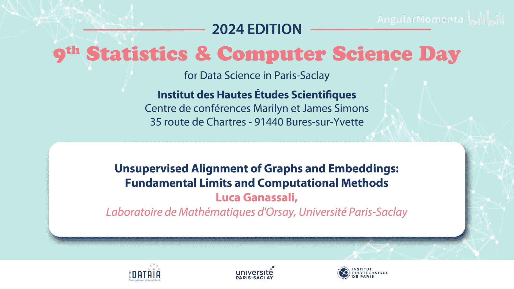

🎼Thanks a lot， thank you Florence and Aginea for the organization of this nice event in a nearly sunny environment。

😊，So my talk today will be at the interface between statistics。

 machine learning and computer science， so I hope everyone can。😊，Can learn something interesting。

And yes， I will speak about graph alignment， which is one of these。

Main problems in inference on graph， but I will mainly dedicate a substantial part of the talk to introduce this broad topic。

 which is inference on graph。And then I will talk about this problem more in depth。

 giving some fundamental and computational results。And if time permits。

 I will also conclude with an open note， but this is just if I can fit in。😊，Okay， so first of all。

 inference problems on graphs。 Okay， this first slide is just to。

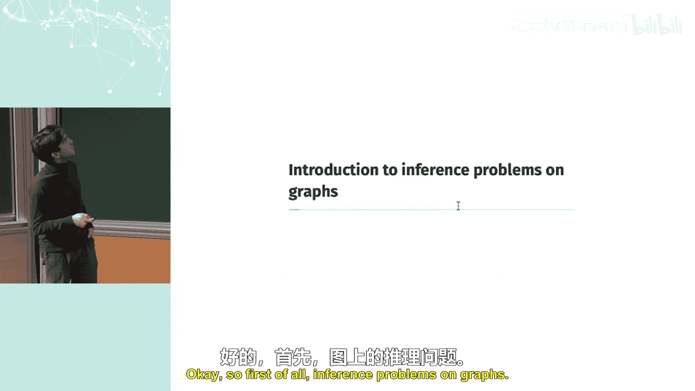

To convince you if need be， that graphs are ubiquitous in the real world data。

 so graphs end point clouds in this talkque will be a little bit the same because I will call a graph just a set of vertices。

whichch can be labeled you can have coordinates on the vertices for instance。

 and some of them are just linked by edges okay and these edges can also be weighted。

You have several examples of fields where graph shaped data appears， of course， social media。

 image processing， computational biology。And this last one is。

In natural language processing and in many actually many deep learning approaches。

 one of the key step is to embed your data that can be complex like an image or a word here。

 for instance， you embed a word in a RD space and you represent it as a Ddimensional vector so you can consider this as a graph or just a point cloud。

 putting edges that may encode， for instance， the distance between the embeddings。Okay。

 so on all of these objects， there are many natural questions that I will give a few examples of now which can actually be phrased as optimization problems okay so let's let's look at a few a few questions so the first one is。

Okay， how can I optimally cluster the node sets into two groups？Okay， very natural question。

 this is okay， if I give you a graph， I ask you for the best split。😊。

And you can solve this optimization problem this is called mean bisection， okay I ask you for a bise。

 a partition of the note sets such that there is a minimal number of edges crossing these two parts。

That's the first one Okay another one could be okay I want to find some dense subgraphs in my in my data。

 maybe because I want to I don't know to sum up my graph with a few nodes or something like that。

 so can I find，A largest subgraph with a given density。

This is another optimization problem and if we think of point clouds。

 maybe a even more very famous question is what are the optimal directions in which to project my data so that I can reduce the dimensionality of my？

😊，Of my data， well， I think you know this problem， right？

This is just PCA so I put it in green because usually this problem here is quite easy actually if we know how to diagonalize the matrix that appears。

😊，This optimization problem is tractable。Whereas as you can imagine。

 the two first ones in practice in all generality are quite difficult。

And this is now what I want to emphasize some of these problems， actually many of these problems are。

😊，Are difficult， I will define how difficult they are。

 but the thing is they are difficult because we are seeing them。

 we are defining them in all generality。In the worst case approach， okay？

Meaning that I can ask the questions I just presented for any graph and these questions can be difficult on some of these instances of course。

 so because some of these instances may be atypical by atypical I mean for instance。

 if you want to cluster your graph in two parts maybe you have a graph that has no real communities in it because it has no geometry nothing happens in your graph so it may be difficult to actually find。

The optimizer for this task because there are many or because there are many of them that are quite close and this can be a mess computationally because actually your underlying instance is not very typical for the problem you want to solve。

So this is the problem of the worst case approach， is that if you want to guarantee some。

Result on an algorithm。On the worst case approach， it will be of course harder than if you know a bit more about the data you want to apply it to。

This is my main message of this talk so if you understand this everything is clear okay so there is a price thats why that's why I talk about the price of the worst case approach for instance this mean bisection problem that I just presented。

😊，In the worst case it's an NP hard problem， right there is no polynomial time algorithm that is known to succeed in all generality for this problem。

Okay。这个第7算的。So I will give you a few remarks now that will motivate a change of point of view on these problems and I will now switch to another perspective on these kind of problems so here is the。

A few remarks that may guide us if we want to depart from this worst case approach。

We can think actually that in practice。Real world data from the problem I want to look at。

Actually contains some significant signal in it for the community detection problem， for instance。

 if I applied to a real world graph that means that I kind of philosophically assume that there are communities in the graph okay otherwise I would not study the problem。

😊，Okay， so these are typical instances where there is a signal in it。😊，Okay。

 so we can assume that actually the。The set of instances we're going to look at on which we're going to define the problem。

Contain some signal that that's the first thing okay and second we would like to create instances that are typical in some sense。

 so typical means okay imagine that I have a signal in my data。I know where it stands。

And there is some kind of noise that petroates it， okay。

 it's like linear regression if you want the basic model for linear regression， you assume there is。

Say there is a slope and then you pet your your petturbate your your samples。 Okay， so this is just。

This is just the purpose of this re， so we will assume now that data we look at a different problem actually where data is now generated according to a generative model that contains some signal。

Okay， so for the community detection problem， it will be communities， the signal is communities。

 and we want to recover it。Okay， does this make sense？

This new approach okay so this is often called the mean case approach because now we are not looking at worst case instances。

 we know that the data has some kind of community structure， some kind of dense subgraph in it。

 some kind of direction in which there is significant signal。Okay。

And this is called the plentyed approach so in the plentyed approach as I explained this is a variant of the initial problem you had where now the data is randomly generated and moreover we have a notion of what is the solution in the data because。

😊，We use the structure to generate the data。Okay， so there is an underlying signal that I want to recover。

This is called Esta。So for instance， in the community detection problem。😊。

I can imagine now that my graphs are generated according to the popular stochastic block model where you have a graph of end nodes and each node has a community which is sampled。

 okay I trend， say probability 12 to be in the first on the second community。

And the graph is not well case， it's a typical random graph where actually the probability of connection between U and V depend on the community。

😊，So this probability will be。Will be P if they belong to the same community and Q if they have different communities。

 Okay， so here is an example of what a stochastic block model looks like in the case where there are two communities。

So for the sake of presentation here， I cheated two times， actually， I color out the points。

I tell you which community they belong to and I also represent the graph so that you see clearly that there are two communities。

 but in general I can't have any canonical way of representing Min graph okay this is just for presentation just to show you that。

These graphs indeed will contain a community structure。

And now the goal is a little bit different from what we had at the beginning。

 remember we had this mean by section combatorial optimization problem now it's more of a statistical flavor because we observe。

😊，An instance， and we want to recover the signal here the signal is sigma star the communities。

So actually， these two objectives may differ， okay。

 it's not clear that sigma star is also the solution of mean bisection。😊，It's not really clear。

 but by changing this point of view。We go from a difficult problem to a statistical inference problems and also a very nice thing about these kind of models。

 what we like in it is that，😊，They have parameters okay that quantify the hardness of the problem as well here P and Q are the different probabilities to be connected intra and inter community and if you may think of extreme cases for instance。

 if p equals q，You don't see the communities because。Nothing happens depending on these communities。

And the doular extreme case would be like p equals 1 and q equals 0。

 while in this case you have two disconnected clicks。😊。

It's pretty obvious to see what other communities， okay。

But it kind of interpolates between these two extreme cases， if you like。O。

So this is an example among the wide family of。Inference problems on graphs。

So to sum up the planted approach， it provides many advantages because there are typical instances。😊。

That means they are easier to deal with in generality and you also have a notion of ground truth what is the signal you want to recover so that's actually very helpful when you want to train a land because give you give it the graph。

Okay， and then you want it to output a star， but you know a star。

 so you kind of know what is the error he makes， okay？

And also it's usually very easy to sample these kind of graphs or this kind of models。

 so it's very nice to get free training data for any algorithm you may think of。And of course。

 there are parameters that actually play a role in controlling the level of。😊。

Noice and and the level of hardness of the problem， so now we we're happier than a few slides ago。

 I hope you are up here too。Okay， so I will now that I introduce the setting。

 maybe if there are questions on this general approach， it's a good time too。To ask them。Okay。

So I will delve into one of these。Fundamental problems， which I will describe now。

 So this is the topic of graph alignment。 Okay so what is graph alignment？

So in our problem now we will have two graphs。And this problem arises from a very famous one。

 which is graph isomorphism， so you have two graphs。😊，呃。

And you want to find a byject between the two node sets of these graphs。

 I imagine they have the same number of nodes， such that this byject preserves adjacency。

That's exactly the graph isomorphism problem， maybe the computer scientists in the audience will know a lot about this fundamental problem。

So we wonder whether there is a bijection that preserves adjacency， meaning in fact。

 these two graphs are the same。Up two hours of officerism。Okay。

 so in this example they are and I show you what is the bijection okay， but in general， of course。

 finding such a bijection or even just saying whether there exists one，😊，This is very difficult。😊。

problemble which stands in the NP class， okay， meaning there is no polynomial time algorithm up to now which is known to succeed for this task and it's also a very intriguing example among this family of problems because。

It is somehow intermediate between being polytime solvable and being NP complete。

 meaning being a good representative of the NP class。

So that's why there are many threads of research on this problem because it's believed to be a key。

A key theoretical problem to look at conjectures like p equals in P， for instance。

 and this kind of stuff。So in our setting we ask a slightly different question。

 but not that different， you'll see because we may consider cases where actually the graphs are no longer isomorphic。

 so maybe they are quasi isomorphic。😊，Okay， you see I deleted some edges， I added a few ones okay。

And we kind of asking the same the same more or less the same question， meaning okay。

Is there a dijection now that？Maybe it does not preserve all edges， but most edges。

ThatThat's the question we're looking at。So what does it mean mathematically well okay。

 first there are a few a lot of applications actually of this kind of problem。

 you can easily imagine that if you're able to，😊，If you're able to align two graphs。

 then you're able to recover information on the second graph。Thanks to the thanks to the first one。

 okay imagine there is one of these graphs that is anonymized， for instance。The other one is not。

If you can align these graphs， well you can deanonymize the first graph。This is not a vague。

Beautiful application， maybe， but it's it's one of them actually。

 this is one of the first applications that。😊，Gave rise to research on this problem。So these hotels。

 Hyionan and Smticica were able to deanonymize some large networks that were thought to be well anonymized。

And therefore showing a problem in the anonymization procedure？

But many other things actually look at this problem。

 I'm thinking of computational biology for instance where you have many large graphs in this field。

 one of them is the protein interaction graph that you can actually model from a cell you look at all the proteins you look at how they chemically interact and this gives you a notion of how what is the interaction in your cell between proteins and if you are able to align this kind of big graphs even across different species sometimes they do this also。

😊，Like you take a mouse cell and a human cell and you kind of align these these two protein interaction networks。

 you can infer some properties on what is the role。

Of this protein for the mouse and this protein for the human。

 and the roles may be comparable if you're able to align these graphs。Just a few applications。Okay。

 and now lets me formalize the questions， so we have two graphs。

 okay with the same number of nodes and we want to find these biject that preserves most edges and here。

😊，What I call。An optimal solution is a solution that minimizes disgust over here and discussed if you look at it is just the number of edge disagreements。

Between the first graph G and the second graph H relabeled by this permutation F。Okay， so this。

 in the case where the graphs are isomorphic actually。

 this can be there is a F such that the cost is 0， which is the isomorphism。😊，But in generality。

 maybe the optimal cost is not zero and we still want to minimize it。Okay。

Another way to rephrase this kind of。😊，Proble is to actually phrase it as a maximum optimization problem。

And you see the function so A and AG and AH are just the Idgency matrices of the graphs。

 and this kind of formulation is an instance of a famous problem in the literature which is called the quadratic assignment problem。

 quadratic because pi the permutation matrix appears two times here in the objective。Of course。

 as you may have guessed， this problem is NP hard in the worst case as well because it's even harder than graphsomemorphism。

Okay。So this is our optimization problem in this setting。And now， as you。

Are already experts of the field。 You know that we are going to。

To look at the planted setting for this problem。To avoid this kind to hopefully avoid this kind of complications and that's what I'm going to describe right now so the graphs in our planted view on the problem are now random okay they will be generated according to generative model but in this model I will plant a solution and in this case I will plant a permutation which will be the correct。

😊，Solution to the problem。Then of course I will add some noise， etca， but this is。

This is supposed to be echoing with the first slides， okay。

 this is the planted setting for this problem。And what I am going okay and also I want to recover the signal okay with high probability when n goes to infinity n is the size of the graphs。

 I will look at large graphs and asymptootic results on this。

The model that I will consider now for this problem is the correlated the undertrain model。

That I we describe just now。So now I do this in two steps。

 first step is to generate two graphs that will be aligned。And that will be correlated。They carry。

They are correlated in the sense of edges， okay， they carry a large intersection。

And then second step。😊，I take my two graphs and I just relabel one of them according to pi star。

 which is the permutation that is the solution。So a good way to see how to generate aligned graphs is simply to look at one graph with colored edges so edges in this single graph may be two colored。

 meaning that they will belong to both graphs， or they can be just blue。First graph， red。

 second graph， or just no edges okay？So that's the model here。

 so we generate the two graphs with the same node set。Independently。

Every edge is either two colored with probabilityq times s， I will describe the parameters next。

And with probability Q times1 minus S we get only a blue edge and with the same probability。

 we get only a red edge and with the remaining probability。😊，There's a knowledge。

So here is what it can look like， okay， you have a substantial part of the graph which is an intersection between G and G prime。

Okay。一。Intel G prime。This is denoted like that， the intersection graph and then second step I will take my two graphs separately。

😊，So you see that here if I show you those two graphs it' pretty obvious what is the alignment because I didn't do anything。

 but of course before showing it to the statistician。

 I relabel according to some uniform permutation pi star， I relabeled the second graph。

And now I show you these two graphs and it's a bit less obvious。

What is the alignment and how to find it？Okay， is that clear？😊，Okay， good。

 So I will give a few remarks just to， to make sure everyone。We understand the same thing。

 So Q here in the model is the marginal edge probability。 of course， if you look at the model。

You add Qs and Q1 minus S， you have Q， which is just the probability of。One edge in one graph。Okay。

So these two graph have the same marginal nodes。We can assume that s equalsq which is assuming positive correlation and this model actually interpolates between also two extreme cases。

 the case where S equalsq， if you look at it is the case where the graphs are independent。😊。

Totally independent， okay？And the case where S equals1。😊。

This is the case where the graphs are strictly isomic。So there is an intersection。

 which is the the total graph。Okay。A very nice quantity to look at first when you deal with these kind of problems is the so-called posterior distribution of the signal given the data。

 so what's the probability that the underlying alignment is pi？You can compute it。

 you can believe me it's one of these kind of it has this form and the quantity here is some positive constant。

 so if I want a max likelihood estimator I want to maximize this kind of stuff。😊，And maybe this is。

Reminiscent of something。No， okay， this is exactly the quadratic assignment problem that we had in the first place。

When I describe the optimization problem。In the worst case。

So there's a link quite strong actually between those two visions， those two point of views， okay。

So the optimization problem is actually the max likelihood estimator in my model。Okay。Okay。

 so in the rest of the talkrque to describe the problem I will focus on a regime where the graphs are sparse okay this is quite coherent with the real world data where actually many graphs are just sparse that means that they have a constant mean degree。

Okay， so Q has to be of the form lambda over n for this to be satisfied so that means that the average degree in my graph is lambda and the correlation S。

😊，Will be a constant， not scanning with that。So for the rest of the talk。

 you can just keep in mind these three parameterss。Number of the nodes n。

 mean degree Lada and correlation S， all the results then will depend on these parameters that quantify the hardness of the problem。

So what's the goal exactly okay， we said we want to recover the signal that's fine。

 but how well can we do this？😊，Let's look at in this regime， let's look at what G and G prime。

 which are two aligned graphs look like。😊，Okay so we see that there are some things happening here so there are a lot of actually a lot of isolated nodes in my data。

 this is typical because the graphs are random and the degrees constant so you can easily find out that there will be a lot of isolated points。

 the problem is isolated points。There is no hope to align them well。

 I think you can agree on that if I give you a graph， which is just。Empty well。

You cannot do anything better than just you know。tellingling me a random how to align them。

 that's so。Just this to say that actually。There are some trivial automorphisms in the graphs。

 and this makes the recovery of the signal impossible if we seek for exact recovery。

 I cannot recover all。😊，パイスター？So the only thing is to recover a substantial fraction of it。

 so that means I want to be able to match a substantial fraction of the nodes across the two graph this fraction won't be one but。

The highest possible is what I look for。Okay， so I will not going into the details but just give you the typical results that we have for this problem that also these questions are typical for a lot of these inference problems on graphs right so this is if you like an illustration of what are the main challenges and the main questions in this this setting okay so first of all I will just define what is partial recovery。

because I mentioned that I wanted to do partial recovery。

 so partial recovery is basically not outputting a permutation because you know that you cannot recover it totally so you just output a partial mapping。

 meaning you have this set C here that is a subset of the nodes of the first graph。

That you think you are able to match。That your algorithm thinks。

He's able to match it's part of the output of the algorithm if you like so I won't say I output a perut。

 I just say I output some pairs of nodes that I think are matched。

And there are measures to tell you if the performance is good on it。

 okay the first one is the overlap， so what is the fraction of the nodes that are correctly matched？

😊，Among these note setsy。And the L fraction is just the fraction of the nodes that are not correctly matched it is the complementary quantity here。

 so we are interested in achieving partial recovery， meaning that there is some fraction eta。😊。

That I can guarantee。The overlap will be larger than itita with probability1 when n goes to infinity。

And in the same direction in the opposite direction， actually。

 I also want the error fraction to be vanishing。When n goes to infinity with priority1。Okay。

 n is the number of nodes。So in other words， I want to output a fraction of pairs。

For which I'm pretty sure that I won't make mistakes in matching them。Okay。

So this is partial recovery， this is what we seek for。

 just from a handnd Way point of view it's just I want to match a fraction of the nodes。

Without any L，So the questions in these kind of problems are always of two types。

 the first one is more related to statistics， I would say it's information theory theory if you like it a fundamental question on。

Without any computational restriction， is there a hope that I can find an estimator that will。

 for instance， guarantee that the overlap？Is great dance。

Positive fraction This is just a question which can be rephrased as is there enough signal in my data。

 what's the noise level？Above which the problem becomes impossible。Okay。

 this is really statistical because I don't care about how to compute my esttator I just want to。😊。

Just want to find out if there exists one。And of course。

 what's the maximal fraction in this case that I can hope for？😊。

And then the other aspect of the problem is much more computer science flavor。

 it's actually a computational question meaning。😊，I have my parameters and are there some efficient。

 that means polynomial time algorithms。That will succeed at outputting a partial mapping of my notes and which one works better in practice it's also related to。

You can benchmark every method， you can look at what happens in practice。

One key quantity also for the rest of the talk which will be lambmbda times s lambda times s if you think about it in my original model。

 this is the mean degree。In the intersection graph。

The purple graph that I showed in the first place has mean degree lambda times S。And it's not。

Difficult to see that actually this quantity governs。The theoretical harnessness of the problem。

 we'll see that in a few moments。In this slide I give you just the information theore results so I will answer the first question。

 what is the noise level above which this problem becomes impossible？This is the theorem。

 so basically there is a netage path showing that。😊。

You can always up your bound the itta you can opt for， okay？There is no， okay。

 for whatever value of Lodas， there is no estimator that can achieve more than。This fraction。

Of correctly matched node and what is this fraction it can be defined in many ways。

 but what I just want to say is that this fraction is the typical fraction of the nodes that belong to the largest connected component of the intersection graph maybe a bit。

Complicated in the first place， but。An important thing is that this typical fraction when lambda S here goes below 1。

😊，This is simply zero， this quantity is0 if from D the parameter here is less than one。

So this means that I can not hope for a positive fraction of the node to be correctly matched if from D S is less or equal to one。

Okay， this is。An impossibility result， and there is a subsequent positive result which shows that actually if Lais is greater than one。

😊，Then。You have a totally different behavior。 There is this estimator， which is the。

The maximum likelihood estimator that actually achieves partial air recovery， okay？😊。

So it's feasible in theory， but in this case even this one does not recover any positive fraction of the signal so you see there is a sharp transition here in this problem for Lada equals 1。

Above this， we can do it theoretically below this， we can hope for anything。

I just want you to note that this is a very difficult estimator to compute in practice this is just theoretical This one is the quadratic assignment problem I don't want such an estimator in practice but。

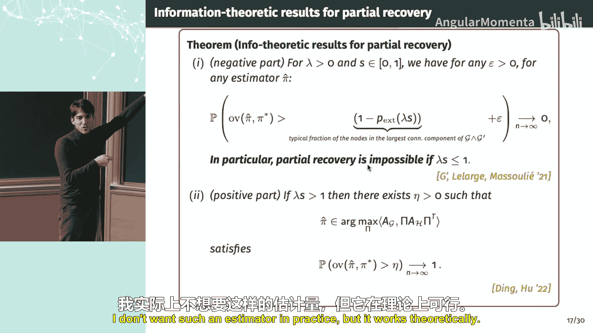

But it works theoretical so a way that people like to sum their results in this kind of problems is the so called phase diagram okay so you represent your space of parameters and you want to partition it。

😊，In different phases where the problem depending on the parameter may be impossible， easy or hard。

 we will see this later， but for now。We have at least one phase。

 we know that below this in this red area here。The problem is impossible。Okay， that's what I。

The question is what happens above？And this is the second question， okay。

 is there a computationally efficient method？😊，To recover max signal when I am in the。

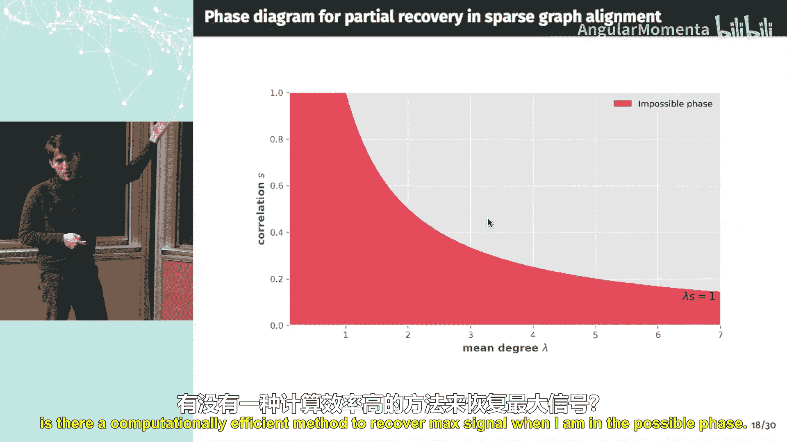

Possible phase。Okay。So I will briefly describe one possible approach to be efficient when。

You want to recover your signal。In this problem we are in the sparse regime。

 so the graphs actually showed you some examples， if you look at them locally。

 if you look at what happens around the vertex in these graphs。

You will see a tree looking some of you may know this if you studied a bit of random graphs this is quite standout as a result。

 but this is quite nice for us because we can in order to be efficient we can propose a local method a method that only looks at what happens locally around my node so you are at a node I and G you are at a node U in H and you wonder are these node matched on not you want to create a procedure to decide okay and since you observe trees then。

You can say something maybe I can compute a score on these two trees。

Telling me if they are somehow close or not。This is the spirit of the skull and if these trees are close enough。

 I will say， okay， I can match I and U because they I think they belong。

 they actually matched by pi star because their neighborhoods are close enough。Okay。

 because if you remember the model， whenever you're matched or whenever you're aligned。

 then obviously your neighborhood will contain some significant intersection because of the model okay。

So this is the spirit of this procedure。So we have to test whether these trees are close enough or not meaning correlated or not。

This is another problem in fact， actually a problem on trees and hypothesis problem on trees where you have two hypotheses。

 okay these trees may be so they have depth D and they may be either independent or correlated。😊。

And actually how are these models defined， well if you look at what happens where the nodes are matchshed。

 we know the distribution of these trees， namely it's actually Galton wetson trees with preon offspring distribution and they bear this intersection which carries the signal okay。

When you and I are matched， but when they are not matched， we may think of the trees locally to be。

More or less independent if you take two nodes on the graphs that are not matched。

 you explore locally not too far。Then you want intersect and you will see as a first approximation。

Independent trees。Independent with the same marginal， though。They are all galelton wets and trees。

 but in the first case they carry some intersection and this is how I can discriminate my two hypotheses so you see this is a statistical hypothesisesis testing problem very。

😊，Stand out in this formulation。Pretty hard to analyze though。Okay。

And now I'm switching to another problem which is related to the first one but it can be studied per se it's a hypothesisesis testing problem okay is there an underlying intersection in my two trees on not？

Okay， so I won't elaborate right now on this procedure how to design the score。

We can talk about this later if you want the correct score to look at in fact is given by statistical theories given by the likelihood ratio when you have an hypothesisesis testing。

 you can compute this likelihood ratio， the ratio of the probabilities and if it's high enough you declare that the graphs are the trees are intersecting if it's too low then you don't match the statistics okay this is just a procedure youre not supposed to look at this is just to tell you there is a way to compute these course and this computation if you look at this formula it is recursive。

 you can do this recursively。The depth can be fixed by the practitioner。In practice。

 you fix it to be not too large。But okay， you can do it recively compute your scars and then look at the scars and match the nodes according to these scar。

Okay， you compare this call to some threshold。So you take D of Al log n。

 the depth of the trees has to be logarismmic。And this is just the procedure。

 you compute all the scars and we match given nodes U and U prime even and on leave this skull is larger than some threshold that you have chosen wisely。

Okay， this method is actually polynomial time， it may not be obvious when I show you this formulation。

 but as soon as these logarimic in n，😊，Everything works well and the method is polynoial time。

And what I so the result is as follows it says that， okay。

 if I can find a test for correlation detection in the  tree model。😊。

Then I can apply this method to the graph problem and use it。

As an algorithm to achieve partial alignment。Okay， so you have a connection between these two problems if you like the tree problem is the local version of the graph problem。

So that's why one needs to study the local version。

Anaze analyzelyze it and then did some results photographs。And we actually did so。

So we want to analyze what happens locally to deduce the general result photographs。

 and we have to analyze easy， easy or not to detect this correlation in trees。

Okay so that's another kind of analysis and this analysis will give us some results on the computational or hardness of the original problem on graphs。

And just to present the result briefly I need to introduce this constant which is called alpha so alpha is the o constant because it's been actually discovered by otter in the 40s you see he was interested in counting the number of unlabeled trees with a given number of vertices this is just combinators okay this number probably behaves like that its exponentially large in n when n goes to infinity and the exponential rate is alpha1 over alpha and alpha is called the o constant you have numerical approximation and interestingly。

In this three problem， this constant plays a role。Because it appears in the phase transition going from impossible to possible。

😊，By that， I mean that okay， if the correlation is less than square root of alpha。

Then we prove that the problem of tree correlation detection is impossible。

 so there is no way I can detect the intersection tree。Whereas if s is strictly larger than this。

 then for Lada lambda being the mean degree for lambda high enough。

The tree the tree correlation test is is working and this problem is though feasible。 Okay。

 so that's a theoretical result on what happens on trees， but it has。

Computational implications for my polynomial time method because whenever I'm in the first no second case。

 okay I can apply my method， my local method and succeed in partially recovering my signal and you see where this transition happens。

😊。

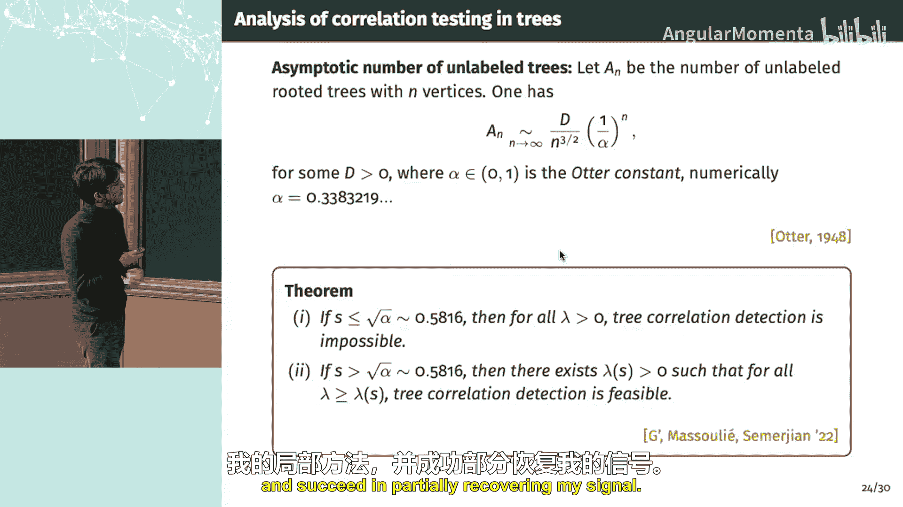

At S equals square root of alpha， so we were left with this phase diagram that we can now complete。😊。

And showing that there is in this feasible phase， theoretical feasible phase。

 there is a phase above s equals square root of alpha asymptotically where。😊。

There is an easy algorithm by easy， I mean polynoial time。

 there is an algorithm that works in polynomial time， so we call this phase the easy phase。

 okay but in the middle。😊，At least well now。We don't know whether there exists a polynomial time method。

That works for this problem Okay， and okay， this is not on us。

 actually people have studied other methods。Non local， global etc cetera。

 and even like deep neural nets like graph neural nets and stuff like that。

 and they all actually fail at the same。Level of correlation S square root of alpha。

 So this is why we are many clues now to conjecture that this is。The sign of a computational or gap。

And there is somehow mess in this problem because here we know that theoretically we have enough signal。

😊，Thanks to this first result， but we are not able to find a method that works in polynomial time to recover it。

Is that clear the difference between harmness and feasibility？

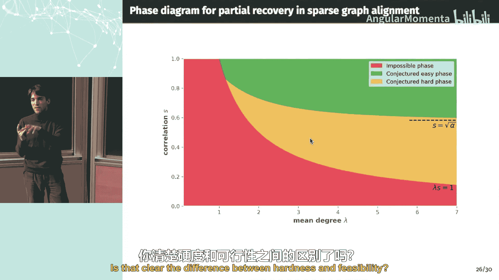

Okay， I don't know how much time I have left， okay。

 so I just want to give a few take home messages maybe before lunch。

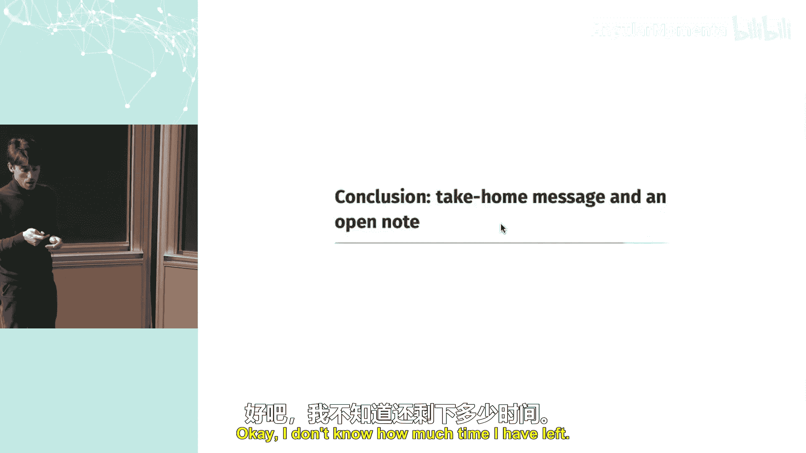

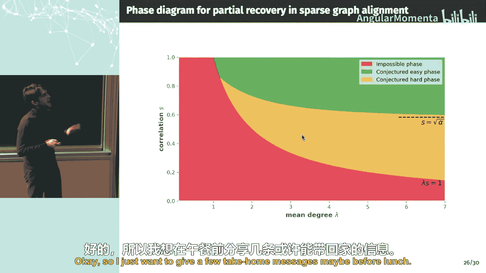

So graph alignment in this talk is thought of as an example of what people do in these kind of areas right in influence on random graphs。

 I presented you two different types of questions， the information theory results and the computational results。

 all of them require of course some technical proof that I alludd in this talk and。😊。

Looking at a local method for this problem， often we are so in this case it's true we actually end up with another problem in trees here and we analyzed this correlation detection problem in trees and this gives us a local algorithm。

 I call it message passing because，😊，Computation of the costs are recursive so。

It can be thought of as a message passing method as well for the initial task， right？😊。

Many things are left untold， but feel free to chat if you want it I'd be very happy to answer your questions。

😊，And I think I will I will conclude here saying that yeah there are many extensions that can be looked looked at for this for this kind of problem。

 we may think of other models and also another problem which is even more applied， I think and even。

that has many applications in real world data sets。

 it's a problem where now you assume that the data is just two point clouds okay so think of embeddings in RD。

And you observe these two point clouds but y and x and y is just a deformation of x plus some noise。

 whats the transformation of x here， first you use pi star to relabel the vertices of x。😊，Okay。

 so x is a set of n vectors in Adi and you use Q star to do an orthogonal transformation on your point cloud。

This is a bit different than the graph alignment because here you have two things you have。😊。

First the per mutation， then notagonal transformation。

Whereas for graph alignment here you add also another permutation because you permuted rows and columns here you just permute rows。

 say okay。Anyway， and this problem is thought to be a bit easier and it has many application specifically in natural language processing where people use this to do automatic translation。

 of course， because if you're able to embed your worlds to align your point clouds，😊。

Then you may think， okay， in this example， you see that German worlds are aligned with English worlds。

And this brings a method to do automatic translation， for instance， many others。

 this is called Po by such time alignment and this is a growing。呃。A growing field as well。Right。

I will let you go to lunch now， thank you very much。

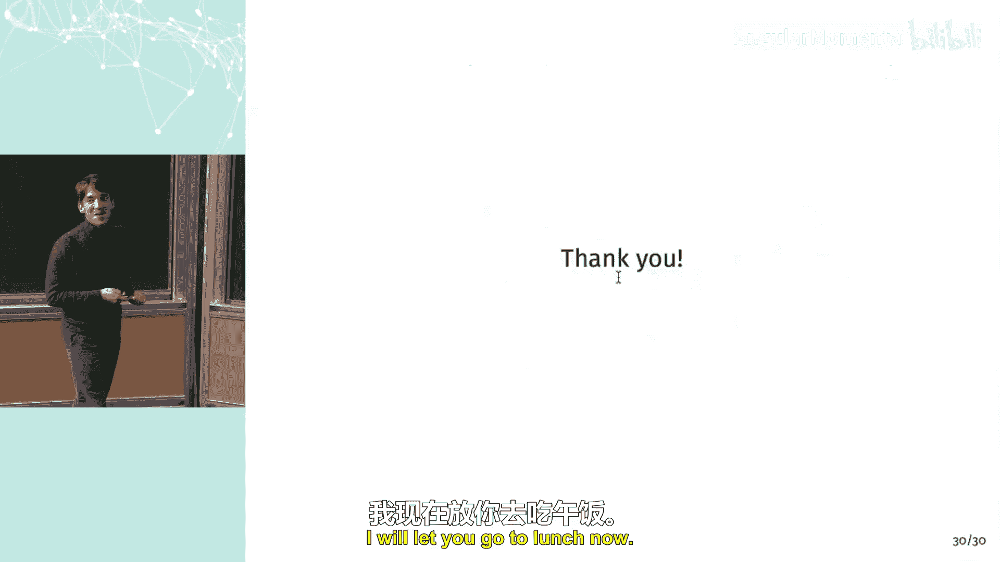

Thank这か。可以。Hi thank youov that's very interesting As I saw you mentioned the graph alignment per usually assumes that we have an equal size of the notes that usually if we are only able to align only part of the nose or edges I it possible to extend your method to an uneven size of the graph That is a great question Thank you for asking it actually yes it has been done and it's currently being done。

It's called the what I call the asymmetric case， maybe it's not the correct wording for that。

 so you may be able only to say to have graphs that have different sizes and you want to align a little graph with a bigger one so you want to inject somehow structure into another and this kind of method is for instance the algorithm that I describe the local method is directly applicable to that case because。

😊，Once again， you look at what happens locally。You don't look at the entire graph。

 so yes it could be applied to uneven cases， as you said yes。Thank you for the talk。

 So you assume that the each vertex has an equal distribution of probability of。It's number of a。

 but I think there are many real world graph that has like a small world property。

 And it seems to be easier in that case。 So do you think we can。

Iften the algorithm or adapted to have results in that case thats great question Thank you Yes。

 so indeed the adultphni model there's no geometry in it。

 everyone has the same probability to be connected。😊，It's easy for computations。

 but it's not very fitted to real world data， so I cheated a bit when I said that this model was but yes。

 so in the case where the graphs have geometry， so as you say small world properties or simply they are sampled according to an underlying geometry indeed the problem is easier because because locally are the variations of what happens locally。

😊，Is higher than in India Srini but okay there are other problems to apply this local method。

 maybe it should be a bit modified and adapted because the tree like property may not hold。

And when you are not a tree。Uh localally， maybe these kind of computations are harder。

 but still a local method based on what happens locally。I think could be investigated， thank you。

Great quick question嗯。Quest technical in the square root of alpha threshold for the testing problem on trees。

 there okay， so it's an information thetic threshold。

 but there is no computational gap like your method already gives。

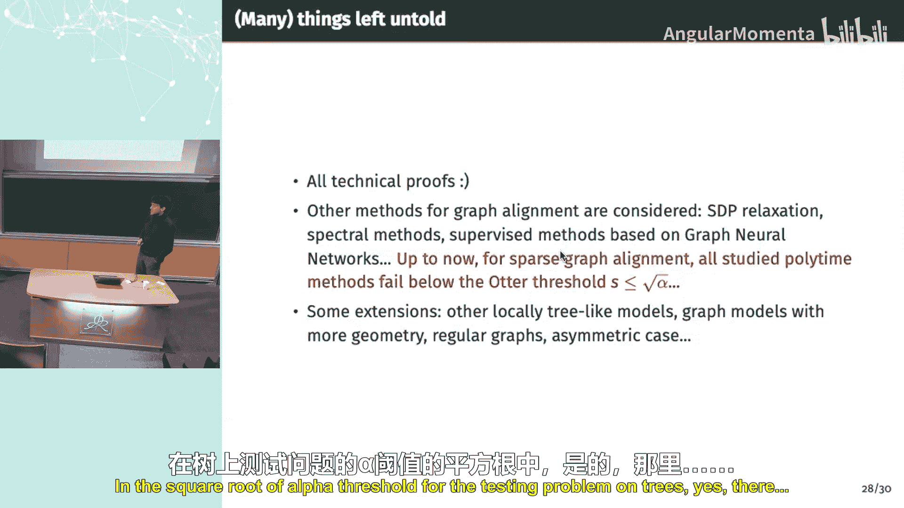

嗯。So it depends on what， okay， it depends on what you。Okay。

 it depends on what yeah that's a good question actually so in this problem there is the there is no n there is only a D D being the depth of the tree and you want this test to work asy clean D。

😊，The problem is this is only infotheoretical because this computation its not polynomial in D。Okay。

そう。It's not prenomial in D， but in our case we only need D equals log n。

 so that's where we have a deficient method， but yeah good question this is just in full theoretical。

And the question of Arness is still open and yeah， and I believe actually there might be some storms。

So this problem per se it's also intriguing we were surprised that actually。

To our knowledge no one had looked at that before。Hello I asked another question。

 So I see that you mention some of the polynomial time methods and I I'm aware of another method that can be solve in polynomial harm。

 which is for the Hungarian algorithm for assignment problem I there any way that this could be applied to the graph matching Okay。

 good， very good。 So the Hungarian method。😊，And I won't show the slide it's too far away。

 but the Hungarian method is okay， the Hungarian algorithm is a method to solve。😊。

Some assignment problems that take linear form。So these are problems where you have vectors。

 for instance， and you just relabel， for instance it's small applied to your point clouds。

 okay I can maybe show this is better then。So the Unian algorithm will be very useful in this problem。

😊，In this problem， if I know Q star， the only thing I have to look for is pi star and finding the best pi star its a linear assignment problem and theguian algorithm works polynomally indeed for the linear assignment problem。

😊，The problem is here in graphraph alignment， as I showed it's not linear and it's not Hungarian algorithm networks。

Because if you like， you have n squared。😊，In your matrix， in your graph。In your adjacency matrix。

 you have n squared entries， Okay， and it's not a permutation of n square numbers that you look for in graph alignment。

 It's a permutation that takes the form of a。Permutation of size N。 So it's not linear in in the。

And the objective。

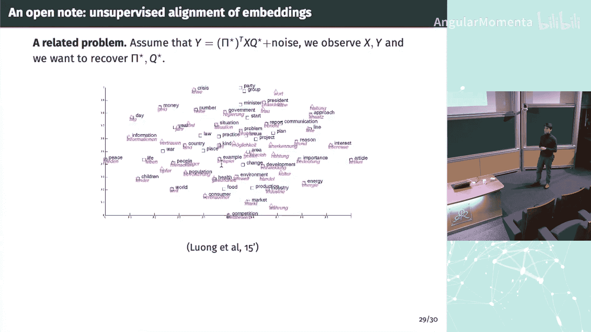

👏Thank you。

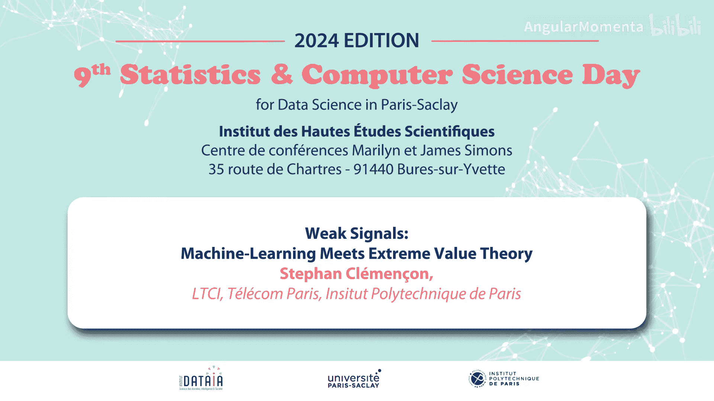