# 数据科学主题统计与计算机科学：P03：图与嵌入的无监督对齐

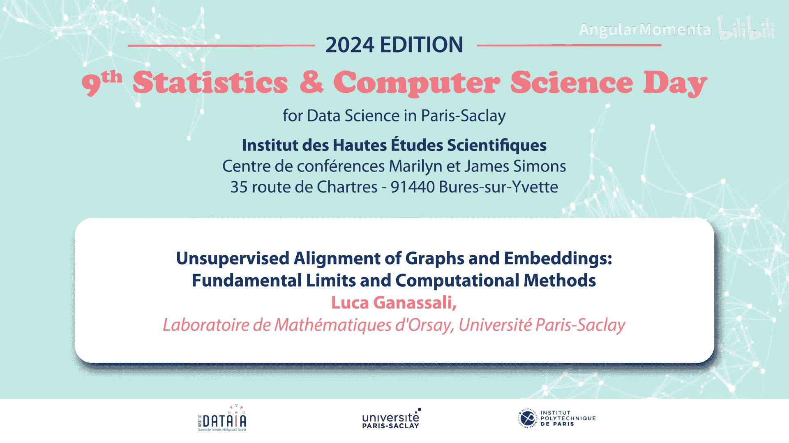

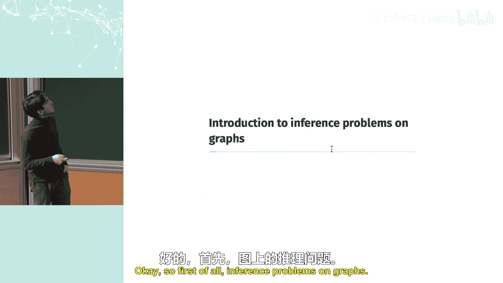

在本节课中，我们将学习图对齐这一核心问题。我们将从图推断的一般性问题出发，介绍最坏情况方法的局限性，然后转向基于生成模型的“植入式”方法。我们将深入探讨图对齐问题的定义、应用、理论结果以及高效算法，特别是局部消息传递方法。最后，我们会简要提及一个相关的点云对齐问题。

## 图推断问题概述

首先，我们需要理解图在现实世界数据中的普遍性。图或点云是表示顶点集合及其连接关系的数据结构。顶点可以带有标签或坐标，边可以有权重。图结构数据出现在社交媒体、图像处理、计算生物学和自然语言处理等多个领域。在深度学习中，一个关键步骤是将复杂数据（如图像或单词）嵌入到高维空间，表示为向量，这可以视为一个点云或图。

在这些对象上，存在许多可以表述为优化问题的自然问题。以下是几个例子：

*   **最优聚类**：如何将节点集最优地划分为两组？这被称为最小二分问题，目标是找到一种分割，使得连接两个部分的边数最少。
*   **寻找稠密子图**：能否在数据中找到具有给定密度的最大子图？
*   **降维投影**：为了降低数据维度，最优的投影方向是什么？这就是主成分分析问题。

在这些问题中，PCA通常是可处理的，而前两个问题在一般情况下则非常困难。这种困难源于我们采用了“最坏情况”方法，即我们为任何图实例定义问题，而某些非典型实例可能使问题难以求解。

## 从最坏情况到植入式方法

上一节我们介绍了最坏情况方法的局限性，本节我们来看看如何改变视角。以下是一些引导我们脱离最坏情况方法的观察：

*   在实践中，我们处理的数据通常包含针对我们研究问题的显著信号。例如，研究社区检测问题意味着我们假设图中存在社区结构。
*   我们希望研究包含信号的典型实例，其中信号被噪声干扰。

因此，我们将采用一种新方法：假设数据是根据包含信号的生成模型随机生成的。这被称为“植入式”方法。在这种方法中，数据是随机生成的，并且我们明确知道想要恢复的底层信号是什么。

以社区检测问题为例，我们可以使用流行的随机分块模型。该模型假设有n个节点，每个节点以一定概率（例如1/2）属于两个社区之一。连接概率取决于节点所属的社区：同一社区内的连接概率为p，不同社区间的连接概率为q。

通过改变视角，我们将一个困难的组合优化问题转变为一个统计推断问题。植入式方法有许多优点：它提供了典型的、更易于处理的实例；明确了需要恢复的真实信号；易于生成训练数据；并且模型参数可以控制问题的难度。

## 图对齐问题定义

在介绍了植入式方法的框架后，本节我们深入探讨其中一个基本问题：图对齐。图对齐问题源于著名的图同构问题。图同构问题是判断两个图是否存在一个保持邻接关系的双射（即节点的一一映射）。这是一个非常困难的问题，属于NP类，目前没有已知的多项式时间算法。

在我们的设置中，我们考虑一个略有不同的问题：两个图可能不是完全同构，而是近似同构。我们寻找一个双射，它可能不保留所有边，但能保留大部分边。数学上，我们有两个具有相同节点数的图G和H，目标是找到一个排列π，最小化边的不一致数量。目标函数可以表述为：
`min_π ∑_{i,j} (A_G(i,j) - A_H(π(i), π(j)))^2`
其中A_G和A_H是图的邻接矩阵。这实际上是二次分配问题的一个实例，在最坏情况下也是NP难的。

图对齐有许多应用，例如网络去匿名化（通过对齐匿名图和已知图来识别节点）和计算生物学（通过对齐不同物种的蛋白质相互作用网络来推断蛋白质功能）。

## 植入式图对齐模型

正如之前所介绍的，为了避开最坏情况的复杂性，我们将采用植入式方法来看待图对齐问题。在这个模型中，图是随机生成的，并且我们植入了一个作为问题正确解的排列π*。

我们使用相关Erdős–Rényi模型来生成两个相关的图。生成过程分为两步：
1.  生成两个具有相同节点集的相关图G和G‘。每条边以概率Q·S同时出现在两个图中（交集），以概率Q·(1-S)仅出现在G中，以相同概率仅出现在G’中，其余情况无边。
2.  将第二个图G‘的节点根据均匀随机排列π*重新标记，得到图H。

观察者看到的是图G和重新标记后的图H，目标是恢复排列π*。参数Q是边的边际概率，S是相关系数。当S=0时，两图独立；当S=1时，两图同构。

在稀疏图机制下，我们设Q = λ/n，其中λ是平均度数，S为常数。这样，图的平均度数为常数λ，而交集图的平均度数为λ·S。这个量λ·S将决定问题的理论难度。

## 恢复目标与信息论极限

在稀疏机制下，图中存在大量孤立节点，精确恢复所有节点的排列π*是不可能的。因此，我们的目标是实现部分恢复，即匹配相当一部分节点而不出错。

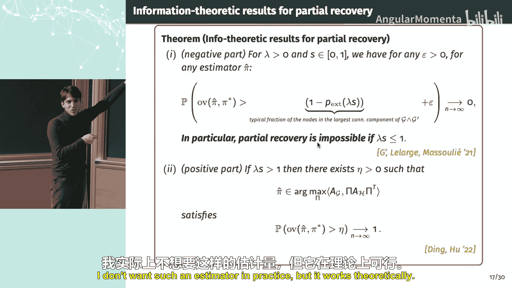

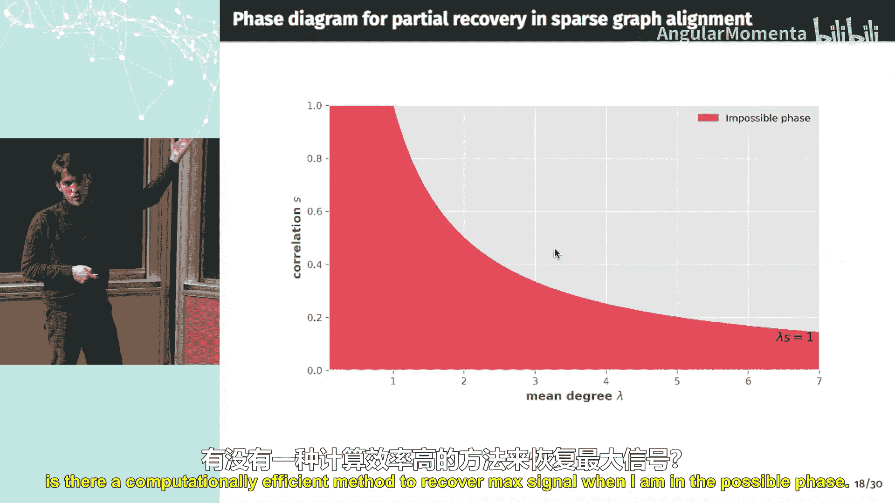

部分恢复定义为输出一个节点子集C ⊆ [n]及其到第二个图的映射。我们关注两个指标：重叠率（正确匹配的节点占C的比例）和错误率（错误匹配的节点占C的比例）。目标是保证重叠率大于某个正数η，同时错误率随着节点数n增大而趋于零。

对于这类问题，通常有两类研究问题：
1.  **信息论极限**：在不考虑计算限制的情况下，是否存在一个估计器能够实现部分恢复？这等价于问数据中是否有足够强的信号。噪声水平达到多高时问题会变得不可能？
2.  **计算极限**：是否存在高效（多项式时间）的算法来实现部分恢复？

关于信息论极限，我们有如下定理：当λS ≤ 1时，任何估计器都无法实现正的重叠率（即部分恢复不可能）。当λS > 1时，最大似然估计器（即求解二次分配问题）可以实现部分恢复。因此，λS = 1是一个尖锐的相变点。

我们可以用相图来总结这一结果：在参数空间（λ, S）中，λS ≤ 1的区域是“不可能”相，而λS > 1的区域是“理论可行”相。

## 高效算法：局部消息传递方法

上一节我们确定了理论可行的区域，本节我们探讨是否存在高效的计算方法。由于我们处于稀疏机制，图在局部看起来像树。这启发我们使用局部方法：对于图G中的节点i和图H中的节点u，我们检查它们局部邻域树的结构是否足够“接近”或相关。

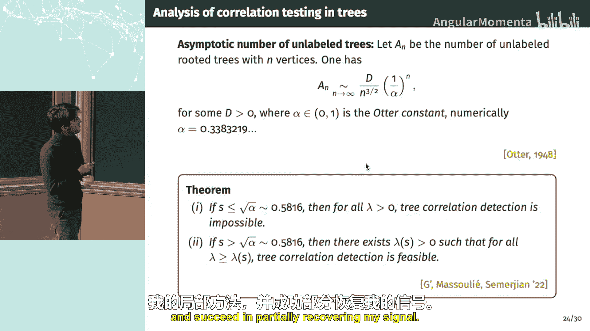

这引出了一个树上的假设检验问题：给定两棵深度为D的树，它们是独立的还是相关的？如果节点i和u是对齐的（即π*(i)=u），那么它们的邻域树是相关的；否则，它们近似独立。我们可以计算一个基于似然比的分数来区分这两种假设。这个分数的计算是递归的。

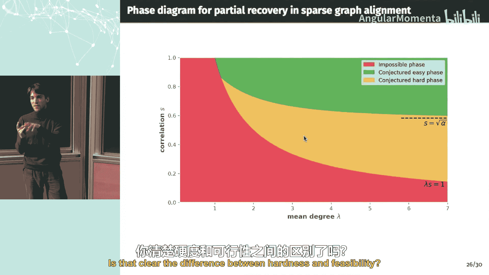

具体算法如下：设定深度D = Θ(log n)。对于所有节点对(i, u)，递归计算其局部树的匹配分数。如果分数超过某个阈值，则认为这对节点是匹配的候选。这个方法的时间复杂度是多项式级别的。

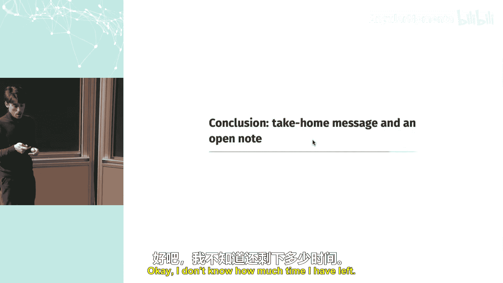

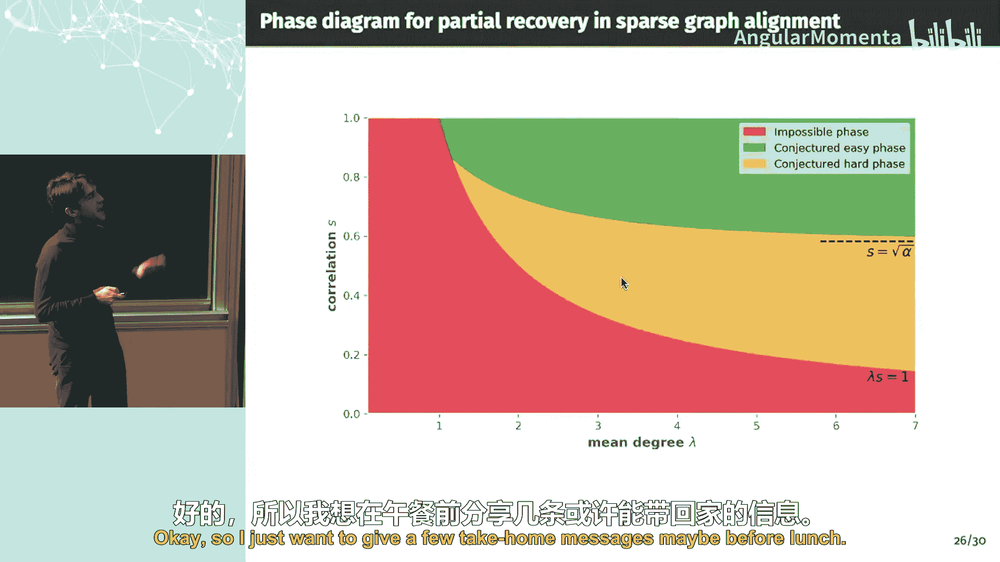

这个局部方法的性能取决于树相关检测问题的难度。分析表明，存在另一个相变点：当相关系数S > √α时（其中α ≈ 0.3383是Otter常数），对于足够大的λ，树检测问题是可行的，从而局部图对齐算法有效；当S < √α时，树检测问题不可行。

## 总结与扩展

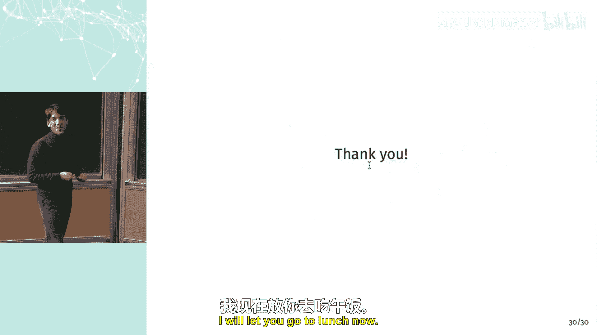

本节课我们一起学习了图对齐问题。我们从图推断的一般性问题出发，指出了最坏情况方法的局限性，并引入了基于生成模型的植入式方法。我们详细定义了图对齐问题，介绍了其应用和植入式模型。我们探讨了部分恢复的目标，并给出了信息论极限：当λS > 1时部分恢复理论可行，否则不可行。为了寻找高效算法，我们介绍了一种基于局部树检测的消息传递方法，并发现其在S > √α时有效，从而在理论可行相中划分出了“易解”相和“计算困难”相（中间区域）。

还有许多扩展方向，例如考虑其他图模型，或者处理更实际但可能更简单的点云对齐问题。在点云对齐中，我们有两个点云X和Y，Y是X经过一个排列π*和一个正交变换Q*后再加上噪声得到的。这个问题在自然语言处理（例如跨语言词向量对齐）等领域有广泛应用。

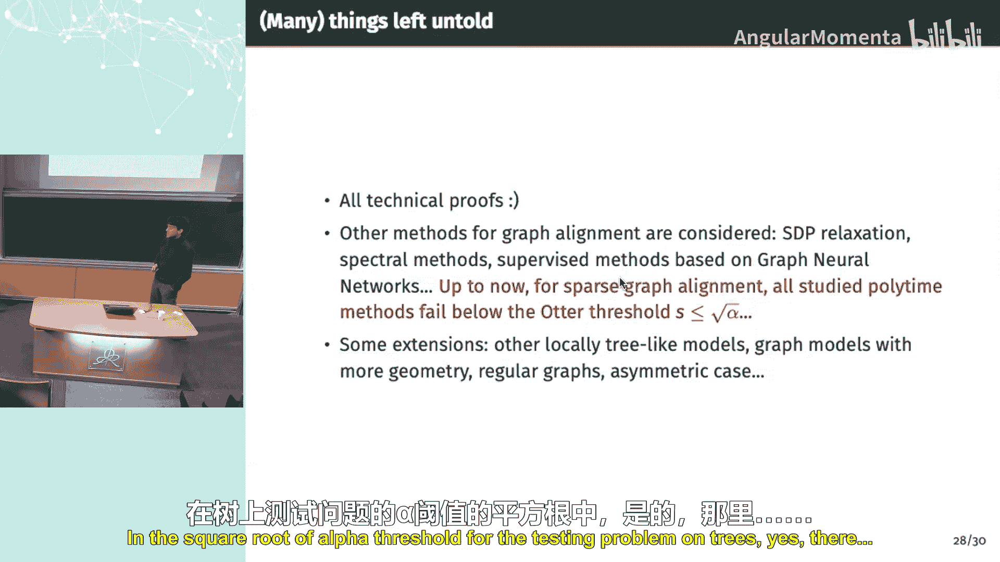

---

**问答环节摘要**

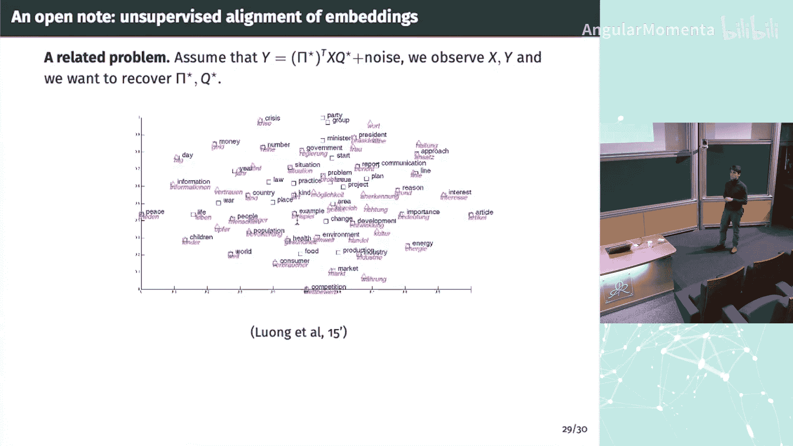

*   **问题1**：方法能否扩展到节点数不同的图（非对称情况）？
    *   **回答**：可以，局部方法可以直接应用，因为它只检查局部邻域，不依赖全局大小。
*   **问题2**：模型假设度分布均匀，但现实网络常具有小世界特性等几何结构，方法如何适应？
    *   **回答**：在具有几何结构的模型中，问题可能更容易，因为局部变化更大。但局部树性质可能不成立，需要调整局部方法，这是一个值得研究的方向。
*   **问题3**：在树检测问题中，√α阈值是信息论极限，是否存在计算间隙？你的方法是否已经达到了最优？
    *   **回答**：在树检测问题本身中，我们的方法计算复杂度关于深度D是指数级的，但因为我们只需要D = log n，所以整体是多项式时间。树检测问题本身的计算复杂性间隙仍是开放问题。
*   **问题4**：匈牙利算法能否用于图匹配？
    *   **回答**：匈牙利算法适用于线性分配问题。在图对齐中，目标函数是二次的（涉及邻接矩阵的二次型），而不是线性的，因此匈牙利算法不直接适用。它更适用于点云对齐中已知变换Q*后求解排列π*的线性阶段。