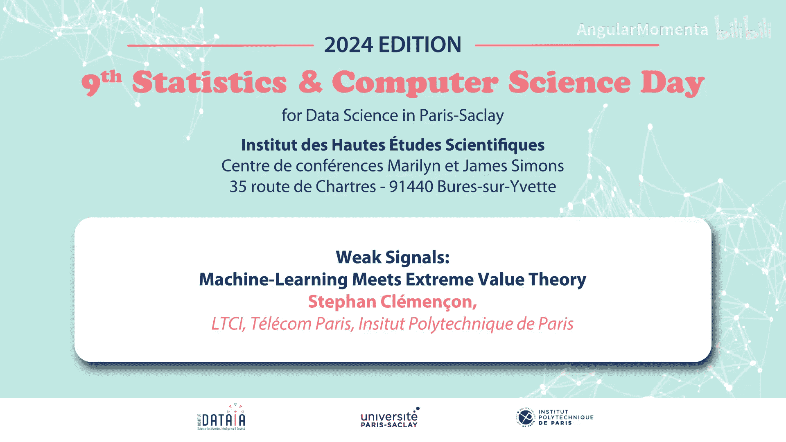
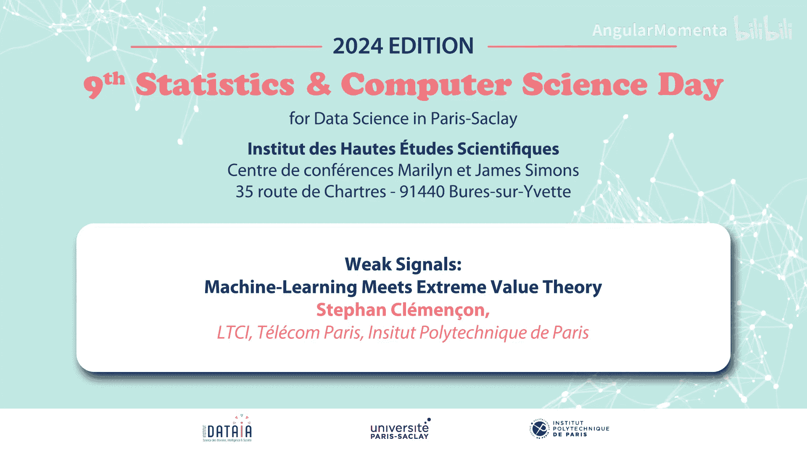

# 【IHES】数据科学主题统计与计算机科学 ｜ the Statistics & Computer Science Day for Data Science p04 04 斯特凡·克莱门松 - 微弱信号：机器学习遇见极值理论 -BV1HvvzBvEU3_p4-

Thank you Florence， thank you for this nice invitation。

Yes， the subject will be extreme value theory， but essentially to show that。

It can provide a precise meaning to the notion of weak signals。Yeah。

And it can be coupled with machine learning techniques to answer obvious questions。So。First。

 I'll give a word about the main motivation。 It's essentially anity detection。

 supervised or unsupervised，Rather autoy today， especially in the application。

And I will focus on the machine view perspective of this problem。

Meaning that we shall cope with ID functional data。And the key concept。Will be that of angularular。

 So it's。It's a notion that describes very well exhaustively。

The extreme dependence between the covals in the extreme regionss。And this object。

 we shall see it's an asymptotic object， so it's not directly observable。

But you can try to recover it from data。And this will be the main theoretical path to show that you can control the deviation。

Between theer e and the theoretical notion， we press em toique， of course data。

And these concentration properties they have。Nice consequences， in particular。

 the permits to show that。You can slightly modify classification or regression over unsupervised machine learning algorithm。

So that they work well and by well， I mean， with generalization guarantees。

 they work well in the extreme regions when the。The relevant information for the machine learning task is very far away from the center of the mass。

You know that in machine learning， deep learning， the statistics that are computed engineering。

 there are standard， the averages。And here， of course， to deal with external。

The information in the extreme regions， you need to compute more sophisticated statistics。呃嗯。

last time， I will discuss also over classic tasks， such as diamondgeneity reduction。

 how to recover the hopefullyly sparsed support of the angular measure。呃。

And maybe I'll discuss some applications on real data sets。So as I said， the。

 the the motivation is to give。A meaning to that notion of weak signalss。嗯。

And from a machine learning angle， it means that's the data。There will be ID Mon。So in general。

 in extreme value theory。Problems are tackled from modeling parametric modeling perspective here here the data will be id dimensional。

 massive as well。Meaning that the sample size will be very al。So extremes will become observable。

And the ID is to detect some statistical regularity， but not near the average behavior。

But the in the tails of the distribution， and it has many applications in particular。

 predictive mes or F monitoring。Youum monitor the functioning of very complex systems with。

Hundreds or thousands of variables， so in my team we work much in the domain of atics or energy networks。

So the idea is to detect or to compute statistics that permityras to。

Possibly to predict the future abnormal behavior of the system。So in general you have no labels。

 So sometimes you have labels。It's easier。 You know that what works very well in machine learning supervised machine learning。

But in most situations， you have no labels and we shall see that in some sense raity will replace v labeling of the data。

And the main assumption is that anomaities。They shall correspond to multivariolet extreme observations。

 so they are multivarit of I dimension。And they will be located in the tail of the data sets。

So anomaities are extreme， but it doesn't mean that extreme Sun anomaities。And in particular。

 in aertic， for instance， if you monitor the functioning of an aircraft engine。

 if you have to look into it。 So force alarms are very expensive。 So it's very important。

To have a very accurate anity detectionional。There are also interpretability issues。

 but I think I will have no time to address that。So and anoma。

 you don't need to know much about this。 just a common sense。 It's a data point that。

Does not conform with the expected behavior and the expected behavior。

 it's a local average or the average。So sometimes you have labels and off。Inverse situations。

 you don't。And the goal of pursuit in anity detection。Is too build from data some region。Of course。

 if future observation lies in that region， then you claim that the observation is normal otherwise。

 you raise via laama。You are far from the。So it's rather easy in the univiate setting because what is abnormal is in general。

 whatt is either too large or too small with respect to some central measurements such as mean or mediumn。

But as soon as you are in dimension larger than 2， there is no natural ordering and you have to learn the type of deviation。

For instance， learn how to project the data sets， so there are other approaches。

 for instance statistical depth， so it's a classic way in statistics。

To to define an ordering on a multi space。But it's rather rigid， as I said here。

 the point of view is fully known parametric。😊，And so we won't specify an object such as the statistical depth in advance。

 but just know that。There are overpop ways of addressing this issue of defining an order。

So I start with a simplest situation， supervise the anomaity detection which is actually it means that you have a data set where you have uns。

Reli indicating whether of the observation is an an or。So it's just classification。

 binary classification，We see the flagship problem in machine learning， that of pattern recognition。

But you have also the more， the more challenging situations where absolutely no labels are available and you have situations in the middle。

 Sometimes you have you may have a super semi supervised city， but I won't discuss that。Okay。

 just I T is the the。The talk。So we have said that now extreme observations。

 there are no observable that was not the case before。In general extremes we out of sample。

 so you add to model some other distributions and that's not the point of view of machine learning。

 it's completely agnostic in general you try to avoid the modeling of a distribution of a data set you learn what you have to learn and you escape。

 you avoid the cost of dimensionality in general。Simply because you focus on a certain task。

 so in general of these problems， there are M estimation problems。

You fit your neural networks by solving an optimization problem。

 so it won't discuss optimization in Vta， but the point of view is not that of modeling。Nevertheless。

 you have to pay a certain price in the notion we shall use is that of regular variation。😊。

So here the data Is， we assume that they will lie on the positive ats of atupo。

So D is the dimension of the data。It could be extended here。

 we just focus on the right tail of each component。Okay。呃So we。

Just assume that the support it's the positive button and。As I said， the angular measure will be the。

The point of interest of this talk， so we shall deal with angles。

 so angle was just the vector divided by its normal。

The norm can be actually any LP norm of the max norm for a presentation I will just consider。

The energy norm， the next normal。And this angular measure will be the finite measure on the intersection of the spheree。

Of a Michi space and the positive ats。And our goal will be to build from data and empirical ca and to control the uniform deviations between that empirical e and the true empiricalical measure。

We shall see that these empirical measures， this is no surprise they will be built by means of largest observations because we are in the extremes which so we just。

We shall just use。The largest observations say the key， larger observations。

And the order of magnitude of these fluctuations will be of order one over a square root of k。

Which is actually the parametermetric cr。But the main novelty compared to usual statistics is that the guarantees here are known as some totic。

 so in machine learning， most of the results。Where of thetic nature， you have n data。

 or you use K data and you want to learn as best as possible using this data。

 so n is very long of course。The infinity is very long particular near the end。

 so the national learners， they prefer to establish none as to results。

And of course this seems very abstract， but we shall see that there are nice applications of these results in particular。

To guaranteeee that classification or unsered anomaomy detection or regression or dimensionary reduction。

 it works when it is applied in extreme regions。所犯这个。That's the global objective of this talk。

I said I shall start with。The supervised setting so certainly the most documented problem in machine learning is that of binary classification。

 so supervised you have a system for instance an I image x i dimension dimensional object and there is a label assigned to it。

 for instance you try to decide whether a certain object is present or not in V image。

So the label is binary， say it's minus1 or plus1， for instance。And the goal is to build from data。😊。

AClifier just a mapping from the input space to the output space。

 so it has to be programmable so for instance， if this is your neural network or this is a support vector machine ruleer。

And hopefully this classifier should be optimal。😊，For all possible data。

 so the goal would be to minimize the probability of error。

 the probability that the true label assigned assigned to x differs from the prediction。

 so this is the classification error。This can be reformulated as we expected of the loss。

 the 01 loss， and ideally you would like to minimize that quantity。

So it's a problem to determine the solution。 This is known as the base classifier。Just to define it。

 you need the per probability， the probability of being one given x， okay and of course。

 the best way of predicting just is to predict the likeliest label。

So if Eta fixed the poster probability is larger than when else you predict positiveive otherwise。

 you predict negative。Okay， so this is a well known folklo in machine learning。

But you don't know the future data， you don't know the distribution。

 and you don't want to try to moderate it。So you rely fully on data， so you have observations。

Independent copies of your system XY， and you replace the risk by its empirical version。

So you just plug your on distribution， you replace it。

You replace the true distribution with the empirical distribution， so you count the number of fers。

Okay， and you try to minimize that， but over a certain class of control complexity。

 So it depends on the architecture of the neural networks you choose。

 or maybe you you consider ensemble learning rules。 There are many possible classes。Okay。

And you try to mimic the best classifier under the this set large G。😊。

So this is your IP parameter in your machine learning algorithm。😊。

And the idea is to compare the risk produced by the machine learning algorithm and the optimalma risk。

And if you're familiar with statistics， you can decompose it classically。

Into two termss on the right。Here， the the biasas。 So of course， if a class large is rich enough。

 this is very small。If it contains， for instance， the base classifier this is zero。And here。

 as it has engineer out a very complicated form， so you can program， of course。😊，Your classifier。

 but your neural network， in particular， if it's a deep neural networks。

 it's not an explicit function of the data。The classifier is produced by some optimization algorithm and you have no closed and cell。

So you have no choice to control this， so you can use delta method or classic tricks in statistics to investigate。

The fluctuations。Of that quantity， so you focus on the worst case situations。

 you bound this by the supreman。So to show that machine learning works for future data。

You have to control these maximl deviations。international。

They are obtained by establishing a per confidence bounds for these maximal divisions。

 So you try to control the maximal divisions between V and pi caloistic。And the true risk。

 or the function。And of course， you have to to make some assumptions because you want to make no assumptions about the distribution so。

engineering general。You have to stipulate some。Complexity property for the class J。

 so historically this is a communatorial notion of complexity， Vtnik Chevrens， Dmon Sheki。

And so I will skip the details。 It's also very well known in the domain。

 and the rate you get is that of the central limit forM。

 and this is no surprise simply because the empirical risk。😊，This is just the frequency of error。

 it's an average， so you have a CLT value of large number of these very simple statistics。呃。

And this is universal， so it means this is true， whatever the distribution of the data。

 you need no assumption on that， so what make that works work is that of course the ver is the loss 01 so everything is bounded。

It's much more ugly if you deal with regression， for instance， you need tele assumptions。

But it's very classic。 Of course， you can look at situations where the learning rate be could be faster。

You know that Michelle Talaagon has received the Vibel Pri recently。

 so he has contributed much to the refinement of this concentration inequalities in particular to involve the variance。

In localization properties， in these reserves。And of course， if you are a deep learn。

 you know that you have to tune less or with zero1。

 it's not appropriate for stochastic gradienton descent or gradeon descent， so you have to smooth。

Or possibly conveify the loss。 So as to。To， to design an efficient algorithm。

 But I won't deal with optimization。 So in in that talk。Vi go or even。

Just it soft the black box that provides the minimum。Of the risk。 Okay， of course， if you。

If you want to be really exhaustive in that decomposition。

 you should incorporate the optimization error okay。So at the。あ。A few decades ago， N was very small。

 and the the statistical O was very large。 So we were not very。Paient with optimization。

 but now we have big data sets， so n is very large， so whenever square root of n is very small。

 so we are very careful with the optimization。But here I neglect this part。

So the the whole goal is to try to predict well， for instance， the label classificationification。

 but in extreme regions， very far from the。From the mean behavior， from the。

The center of a distribution。Okay。And if you run an algorithm and you evaluate its error on these regions。

It's very bad in July。😊，And you just need to write the full probability。Equation to to see that here。

 just just because the probability of exceeding your large threshold is very small， this the。

Plays almost no role in the quantification of the risk。Okay케。

So what would be great would be to consider a conditional probability a probability of error。

 but given that。You have an extreme observations or an observations you have and some frialty。

But you would like the definition。It would be great if it's completely independent from T。

 so you need some asymptootic version， so the supreme limit of this quantity。

 this could be the asymptootic risk。Okay。So would like to have guarantees for this notion of classification risk for this asymptotic notion。

So with my colleagues， we have developed some framework for classification in the extremes。😊。

So the ID is simply to learn the classifier using the K largest observations and as you are using only K data。

You expect a learning rate of order whenever of square root of key。Okay。So it seems predictable。

 but actually it requires much effort to show this。But viame is extremely simple。

 so you have your data sets。😊，We shall see the reason for that， but you need to standardize it。😊。

So you have some rank transformation， so here F add to sorts of so Vi and the component wise。

Cumulative distribution marginals。Okay， for each。So the XigG here there the components of the observation XI okay。

And here that's just so there is a one over n plus1。Is just that to avoid that this quantity is0。

Okay， but。If it's confusing， replace it by whatever add and you recover the usual empirical cuulative distribution function。

So this standardization is known as。You need Pyth to transformation。

 so it's a typical rank transformation because here you don't use any of the value。

Taken by the coordinate， you are just using its rank。Okay。

So you standardize each marginals and that should be intri。呃。Because if you have， for instance。

 to coordinate that as a much every year or 1 and the over。It means that。In the extremes。

 you will see only the coordinate with the heavier tail。Okay。

 so the ID is to standardize all the data so that in each direction they go to the infinity at the same rate。

So that's really key。呃。To make this this transformation。

And then once you have transform the data using this。Maraginial transformation。

You just extract the K extremes data， so you have a La and you have the transform input information。

And you solve the optimization program using this data set only and your the norm of the input。

 you just focus。And the angles were foam。Okay。So， V I D。Is that。呃。아in Tri니티。

There are directions where you have more likely blue points than red points and the idea is to detect to use that angular information。

To to serve the classification problem。So its。R on at and actually it works if you do this。

 of course you have to tune k and this is a recurt issue in extreme value theory。

 so you have to select the fraction of extremes。You are considering in the estimation or in the in the learning stage。

 but if you do this， of course， you completely outperform。ANive technique。

 which would consist that using all the data sets。So a word about multivarit nonstand down regular variation。

 So you have a random vector we have said it takes its values in the positive atns。Technically。

 you need to assume continuous margins， so the F of G。OrG is the。I G is the。

The component will coordinate the number G of a random vector。

And you have this pitro on storm version， So one over1 minus L G of XG。

 So this is your re scaled observation okay and as I said here， we just we shall just。곤시ア윈신니티ノ。

So the next of coordinates。I need to introduce the angles。

 I think I have done that already and the sphere the sphere。Of the positive ats。

 all the points with norm1 laying in the positive ats。

And what is this property of multiviate regression， so it's a very classic。

So he dates back from the 70s or the 60s， you have a nice book from David Drsni about this。

So it claims that if U scale， so typically here have the threshold t tends to infinity。

 so the probability that your new Uscale random vector belongs to T of B with t tending to infinity。

If you multiply that with T， so of course， this term on the right。

Vanishes and that tends to infinity。But there is a limit and this limit。Is actually a measure。

OnVotton， which is referred2 as the exponentialonent measure。

 so that's the definition of multiviate regulation regular variation。呃所。

You need to stipulate some asymptootic behavior， but we shall see that here。

There is nothing like a parametric hypothesisesis， this class of。

Miltivit regular variation distribution is very， very large。If you have this property。😊，N。

 the experimental measure is homogeneus okay？And actually。

 it can be expressed if you make a polar coordinate transformation。

Mu can be seen as the tenssoile product。Of Uto distribution for the raius and a distribution。

F young girls， which is known as the angular measure， sometimes it was called the spectral measure。

Okay。And this is because of this homogeneity probability。So， you have a。Of course。

 so via some to distribution， it's something like this， okay？

And so venoma is distributed as a unit Pyth as a classic unit Python distribution。

And the distribution of Y。Okay， he a。KIt means that so there is a relationship， of course。

 it's completely equivalent to know the exp measure of the angular measure。

Because of course we have said that the angular measure it's a measure on the set of angles and it has this form the bola with a maxoma this is this the unit board it like this so you take a subset of angles and phi of a that just the exponentialon measure of the part of the cornera here that is depicted by extreme angles。

So there is a complete equivalence between the two notions。And so somehow phi of a。

 this measure rules the distribution of the。An girlsinfin니ity。And so as I said before。

 but it completely describe the。😊，The the dependent structure in V streams。

 if you have points like this。It means that there is some dependent structure between the coordinates。

In contrast， if you have data only along the axis， it means that's at infinity。😊，In the extremes。

 you have independence between the coordinates。Okay。So in that case， that done to looking at unvi。

Distribution， so that is very simple。And here the goal is to focus on i dimensional settings。And。

So the class of angular measure is very general， it can be any finite measure on the spheree。😊。

Okay so it's fully non parametric， so of course it will be less analysis will be less universal than the classic machine learning theory for generalization。

😊，Because inequality， I have stated the we chave inequality。

It requires no assumption about the distribution， but here we shall assume that the distribution of the data。

Intenification for class distributions。That of the positives and that of the negatives。

They they both multiy diet regularly dying。Okay。So how to estimate phi because it gives you an indication of the directions along which the extremes occur。

😊，The idea is just to mimic the。The p to transform。

 you just replace the cumulative distribution functions by the RP caivs， you count how many points。

For each code you need less than。 So here its X。 So see that an N we see that an X。Iise a mistake。

And so it's a plug strategy and you replace。X I by V I at okay。😊。

The transformation using this empiricalical version。

So what makes this complicated is that you need all the training observations。To to compute the。

The Vp cuulative distribution functions。 So now。The the transform data。

 they are not independent anymore， they depend on the world data set。

 so that's really what is really challenging to study these quantities。But。If F is close to F。

 this should work。And just you replace here phi by phi ads。 So here this is a press emmptic version。

T to T was standing to infinity is replaced by Annaarchque。

So k is the number of points that are really used in this don， okay？And for N overK。

 if you want N over K 10 to infinity。You need that K as to 10 to infinity。

 but at a much slower rate than N。So k and n over k should be large simultaneously。Okay。呃。

I think I have said that before the choice tuning K is rather it's a difficult problem in practice。

To find an theoretical answer for that questions you need a much more sophisticated hypothesissesis in general。

 I hold hypothesissesis。So you need assumptions about the。Great。At which this converons occur。

Here we shall avoid this。Okay。And so it was absolutely not known before。呃。

So it was not documented at all the fluctuations of youngal measure。Compared to the true measure。

 there were some attempts in low dimension， in dimension 2， and only asymptic results。Okay。

And just I shall explain why it's very challenging to。To get results like that，Very close to the。

To the supreum to the maximal deviations between empirical risk and true risk。

 so here we have maximal deviations between empirical measure and the true measure。

We take here our collection of subsets of a sphere， bo Meable， of course。

So some complexity assumptions should be required， so we have sets of directions okay。And ideally。

 we expect the bound to be of order one of a square root of k。Okay。As when both N and K over n。AndK。

When k and k n simultaneously。When n over k and K are simultaneously large。And。

So we have no logo bound， but its rather not tricky to show that this is really optimal。

 but very is some op because this is the VSM30 cr in dimension 2。So certainly。

 we cannot do a better job than that。Okay。嗯。If we。If we knew the。

The perfect of the ideal rank transformations if we knew the marginals。Everything would be easy。😊。

Because there is this。V of the ethnicnic Chaveing key inequality for air events。

We have proved years ago。呃。So here this is very much like Wenikshaveinki's inequality。

 except here you can see sets。That are not frequently visited by the data。 So P is that probability。

Okay。Here we see a Ne confidence bound for the max deviation。And issue sets。

 p is equal to k over N then。You get enough confidence band for the re scaled probabilities here at platform。

 typically。呃。Red bond of order or one of square root of key。

So this could be enough to show that for instance classification in the extremes。

 it can be learned at whenever square root of k。If you don't need to make the N transformations。Okay。

But you have to do that， so V at that transformation is involved。Okay。

And so you can reexpress the empirical vular measure in terms of the exponentialon measure。

So we have said that so C of A is theoon。 Okay， remember that。诶。That。왜 bit요？Okay。

And issue reexpress the。The empiricalpicular angular measure this way here。

P of N is just the geo distribution。 but here as the。The marginal transformation depends on the data。

 so it's random， it's random in the data so here rather than some set gamma of a。

 you have some gamma out of a okay which depends on the data so which fctuates as well so how to to control these fluctuations so VID so I will skip the details because it's rather technical。

That's VD。算一算么，不看能算。Is to frame your random set here between two detaministic sets。

And to stipulate complexity assumptions for the set of angles。Okay， the the Vs。

 so as to control the complexity of the framing sets。So the construction was really different。

 but this ID had been already used by John and Mel。Some decades ago。呃。

And the key is simply the decomposition of the deviation learning。

here you have some as in the Vnic Shainki inequality have。A term that is just the stochastic era。

 the difference between the empirical distribution and the true distribution evaluated at these framing sets。

You have the framing gap so the expon measure of the difference between the true framing sets。

 plus the bias thema。呃。Because of course， what you compute here are your statistics。

They are computed by means of non asotic observations， of course。So you need to control the dis。

 We are not doing that here， but you need a rate in the。

Definition of multi regular variations I have。Explain before。Okay。

And the key first is to build these framing sets。So there is no surprise。

You build them using boards with your。The norm you you have chosen。Okay， and of course。

 so Epidon is ver raius。So of course， if Eppsilon tends to zero， the framing gap vanishes。

But of course， it's more difficult to control that with I probability， your set。

 your random set is between the two sets。This one and this one。Okay。But by chance。

 you can balance all the terms， all the free terms。So as to get grantees。

 So it a bit agree because it's for technical and。Thank me for avoiding the。The technical it is。

 but you have to just to observe that ver rate。Is really a lucky。ADiv by square root of key。Okay。

 so I don't know if log if can be avoided or not。 So certainly this is an artifact of of。

Of the methodology， or maybe there is a deep reason for that， I don't know。

But in spite of huge dependence between the observations we have done。屁谷歌。真真皮죠。Okay。

So issue apply this to the problem I have mentioned before。😊。

Here you shall try to minimize the onic elevation， but of Vi quantity。

 typically you choose t equal to n over k。It means that you after having made。The the。

The marginal transform， you use only V angle girls and you compute the empirical version。You can get。

A bound for the excess of S20 cs， typically a further one of a square root of key。

So maybe a log of case like in here。呃。So that was the original goal pursuit。You can， so I ski that。

I was mentioning anomaity detection， so I will finish with that。 So sometimes you have no level。

 So the the goal is also。To determine some region in the in the。In the observation space。

 we have future observations， which normal observations should be linked to。

This is this can be cast also as an optimization problem。

 so VID is it has to do with concentration properties， so you need some reference measure。

 so you need to find a region containing I don't know maybe a 95% here of the data。

And that question should be as small as possible using some new measure of a size。

 using some reference measure， typically a luic measure。

 so this is known as a minimum volume set estimation。

 so this is a straightforward generalization of the notion of cantla。😊，Okay。

And so VID is to minimize the size of the volume。Over a collection of regions under the constraints of that that region contains a fraction alpha of the mass of the data。

Okay。And of course， typically you choose alpha La。And when your observation is in that set。

There is no alarm and okay so you can show there is no this is not surprising。

These minimum volume sets， they are super level sets of the density of the observations。😊。

So of course， the statistical approach would be to try to estimate the density。

 but of course you face the curse of dimension。So VID is just like for classification。

 you replace the unknown distribution by the empirical distribution。Okay。

And here you need some to ounce level， because， of course。

The empirical distribution is not the true distribution。

 but we know that the fluctuations there of order one over square root of n。

And so you have guarantees that are very similar to those of super valid classification。

And in an memoryity detection， that's exactly the same thing。😊。

But you look at directions in the extremes that are more unusual than the others V ID is to determine minimum volume sets。

But un this fear。By solving some optimization problem。

 so I don't explain how to solve the optimization problem。Challenging on the sphere， of course。

 because。The topge is a bit more difficult。But the results I have explainer。

Provides guarantee that you can recover the。The minimum volume set at rate whenever square root of k。

Up to that lo thema， by means of of the data only。 So here if you have the an angle lying in that region。

Then there is no alarm over。And the bounds there are rather sharp， of course。

 they can be refined using model selection， but it permits to get a rate of first alarm much much lower。

Okay， in just to finish， because I think I'm doneno。

The same IDs can be applied for many of machine learning task， dimension reduction in particular。😊。

So we we like to make spaity assumptions in statistics and machine learning。 So that aular measure。

 maybe it has a spars support。 So maybe。Not all the faces of positive returnss are visited by the data points。

And as you know now that you can estimate it accurately， you can try to recover the the groups of。

Coords。That exhibits some dependent structure when says that it cannot train everywhere at the same time。

 it means that。Combinator， you cannot have。All subgroups are viable simultaneously large。 Okay， you。

 you。You could try to understand。Which components exhibit some？

Extre mal dependence and exactly the same techniques can permit you to recover these groups and with the same of course。

 orders。So it was very fast， but it has many， it has many。It has many applications， in particular。

In environment sciences， because this sparse behavior is frequently。Obsserving the data sets we。

All right， interested in both the theory and the applications。Here are a few references。

But the main message say that， yes， it's possible to learn in the extremes。

 it's a bit technical because you cannot avoid rank transformations。

And it in it implies some complex dependent structure。 We all not only standard out the。

Sple means in machine learning or in statistics。These statistics， the extreme classification risk。

 for instance， there are L statistics， so there are all complex order statistics。

 but nevertheless you can control nanoymptoally ver fluctuations and you can ground algorithmically everything is simple。

 you just standard die using the empirical Pythho transform and you apply standard and machine learning algorithm。

 but only to the fraction of extreme observations so that's why it was very fast about algorithm because it change nothing you can reuse all the routines you are familiar with。

Excellent for the presentation， so we are still time for a few questions。

Just just a quick question about。You work as the infinity arm， like the ball in needle。

 If you change the ball， does it affect your transformation or the rate。ItIt's not universal。

 you can extend this to any LPO。Okay， the transformation is the same that you're doing。

the transformation is the same， but not the youngers of course you will compete and it's all about the geometry so here I have said nothing really about the complexity assumptions。

So。In the usual setting。You make assumptions about the geometry of minimum volume sets。

Of the regions where you expect positive observations rather than negatives。Gピ。

Assumptions about the shattering coefficients of these classes of sets。Here you have to。

 as you are using this framing set， framing sets。You have to translate。

The complexity properties and the subsets of on sphere to the framing sets。

 and so it's rather complex。But it works for almost in the machine learning algorithm in general。

You are using hyper cubes or maybe ellipsoids or regionsions that are defined through。

Parametric equations。So just know that it works。But the。

 the choice of the norm is really key in showing that。

 So I'm able to show that it works for the next norm other。

The figure of square for the next node here。But for an arbitrary norm， I don't know。

 and we don't know yet。So the maximumomic just means that at least one coordinate is very large。

YouTo be extreme， at least one coordinate as to be extreme。Okay。

 anyway we can discuss with at the break after， Thanks again。

