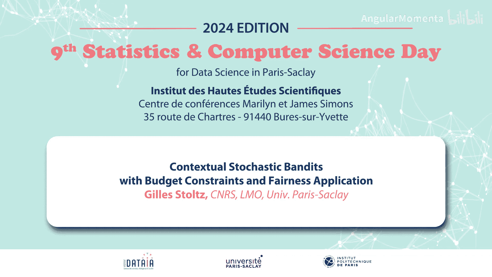
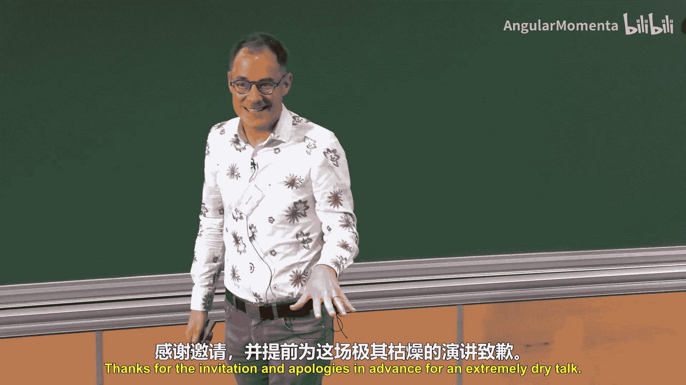
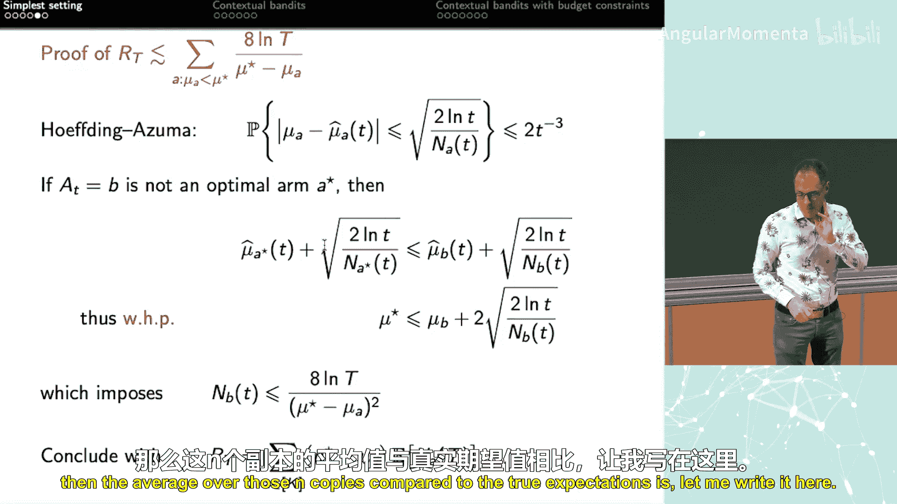
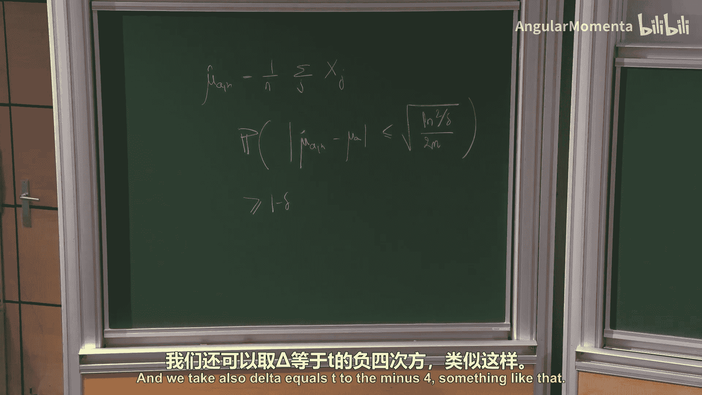
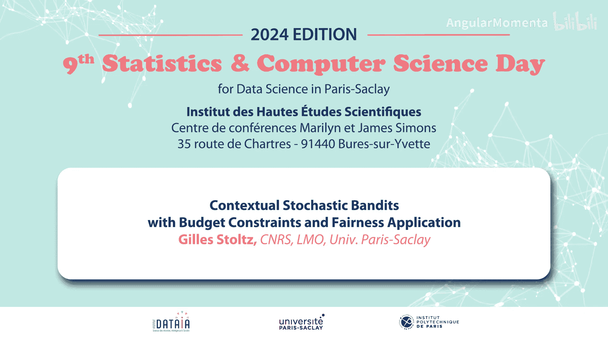

# 【IHES】数据科学主题统计与计算机科学 ｜ the Statistics & Computer Science Day for Data Science p05 05 吉尔·斯托尔茨——预算约束与公平应用下的上下文随机老虎机 -BV1HvvzBvEU3_p5-

Thanks for the invitation and apologies in advance for an extremely dry talk。😊。

I mean， it will be probably the first talk of the day without any picture。

But I will do some proofs and I'll try to go。😊，Slow and gently so this is joint work so it has been published in New's last year with Aginea。

 we're sitting here Christ of Jeho， so the three of us are with the math department in Ose and generally he' is working at BNP Pba full time in some finance department and doing the PhD on weekends。

😊，So it's pretty impressive， it will take some years， I mean it's expected to last rather five years。

 six years， etc cetera， so it's not as if he could do it full time， but we're making slow progress。😊。

Okay， so that being said。I first want to so actually the Nris article is there， I mean it's oops。

 yeah it's the final size but I'll try to spend most of the time on the basics so the basics the most basic case is the KA bended setting。

So you have some model， so in statisticstistic we call model what you know about the distributions。

 so take as example， our running example later will be all probability distribution on the 01 interval。

Okay， so that's a simple model。So we have some model。

 you have k arms and each arm is associated with an of course unknown probability distribution。

 so we have new one， new 2 till new k and at each round。

You can pull one of these arms and you will get some robot just like in the casino。you put a coin。

 you imagine that the slot machine has several arms。

 you pick an arm and you try to identify which arms provides the best rewards and of course this arm you want to put it more often but you know do you have no clue in the beginning so you have also to explore so you'll explore some arms but that's some。

😊，Point you'll identify that some arms are better so you'll use them more etter。

 so there will be what we call a tradeoff between exploration。

 you have to pull arms so as to get information and exploitation of that information。😊，Okay。

 so these are the keywords exploration expectation。Okay， notation， notation。 So new new for。Yeah。

 I'd realized that this one was a tough。Poiner so new for the distribution， new for the expectations。

😊，So at each round the statistician picks an arm8， so the K into brackets means the interval 12 till k。

 so statistician picks an arm based on the past information she gets a reward ycer T drone according to the a of teeth distribution。

 so in la theory we use the female for the statistician and usually the environment is the male。Okay。

 so she gets a re。John in according to the distribution she picked and that's the only feedback she gets。

And then we do it again。Okay and there's a tension between estimating the distributions。

 actually the expectations of the distributions because we'll only work in expectation。😊。

Versus getting rewards。So to phrase our goal， so our goal is to maximize rewardts。

 but that's usually phrased in minimizing regret。So it's been decades that regret has been minimized in the machine learning community but I remember in my good old times in the early 2000s。

 we were not too many minimizing regrets and it was always a pleasure discussing with PhD colleagues and telling them yes。

 I'm minimizing regrets and also when I was having dinner in town as such。

 you say you minimize regret people do say wow， that looks fancy and enjoyable。😊，Indeed。So。

You want to maximize your cumulative payoff。Here。So instead of maximizing this we'll be minimizing something else so the your best choice had you some gut knowledge you would know the best arm so you would always pull that arm and on average you will get t times max of the Musa bay so the max of the Mua bay with the node by new star。

In expectation， you'll get T times mu star。 That's the best God would do in expectation。 Okay。

 so that's our goal。 And we're comparing that to the。to what we actually got。

 the sum of the payoffs and we're taking expectations。For simplicity to start。

 okay so that's what we call regret。So on the next slide will be our first proof。

 I'll show you that we can rewrite the regret in the following way。 So the Al de note by N sub 80。

 the number of times we pulled arm A and I'll show you that the regret can be decom as the。😊。

Expectation gaps， new star minus the expectation of an arm time the expected number of times you pull that arm A。

Which indicates that in all bandit proofs to minimize or to control the regrets。

 either with upper bounds or lower bounds。It is。Sufficient and necessary to control the expected numbers of time you pull each suboptimal arms。

Okay。So。If setting is fine， first proof。So on many slides。

 I'll just summarize the notation of the earlier slides above。

 so you see we have K distributions with K expectations and that each round we pick an arm and we get an observer payoff independently drawn according to the distribution we picked。

Okay， and we'll rewrite the regrets。😊，So the first step is what we call the tower rule rule is。😊。

Expectation of the conditional expectations is an expectation。Okay。

 so let's see the conditional expectation our payoff， actually by definition。😊，Since once our arm is。

Set the payoff is independently drawn according to the distribution new index 80。

So that payoff has expectation new index 80 just by definition。

So that's the conditional expectation and then I'm taking expectation on both sides and it shows by the Tower rule that the expectation of my payoff。

😊，Is the expectation of new sub 80？Okay， and I'm substituting this in the definition of the regret so the regret is。

So the regret is I'm just writing it as a sum of new star minus expectation of the Ys。Okay。

 so it's just I'm just inverting the sermon and the sums。

I'm replacing expectation of YT by what I just showed。And now， I'll be decomposing。According to a。

 Okay， so Im。I'm just adding here， if you wish some of a new a indicator that capital A sub T equals I。

Okay， so。Just doing this and then I'm inverting the two summations。

 so I'm first servinging over I and then I'm grouping all summations over T and this is where the number of times played A appears。

Okay， so we have the writing of the regret as。The sum of the expectation gaps。

 time expected number of times we played a given arm。Okay。

 so that was the first prove I hope you survived it and now I'll show the most popular strategy Okay。

 if there was a one or one bended course that you would see that in the first hour。😊。

So we'll take the model of all distribution over the 01 interval for simplicity。

And so the strategy was introduced well actually analyzed by Peter Aen Nicols Saabbki and Peter Fisher in 2002。

 if you discuss with Nikko Lo， it would tell you that the strategy was known it's just that the。

Provided the finer time analysis via the helping aszumma in inequality and Nikcolo is always so surprised that this paper is so much cited but of course the paper is cited is whenever you write a bandit strategy you have some optimistic way of thinking。

 you have some upper confidence bound and you cite that paper。😊，Okay， so the strategy is as follows。

😊，In the first K rounds， I didn't write it， but you pull each arm once。

then you have some empirical mean for each of the arm。

You shouldn't trust these empirical means I mean there are traps if you trusted these empirical means and always played the arm that got the best reward。

 of course there would be a large probability that you。

That you didn't get like and identifying a bad arm。

 which is why we want to continue exploring all arms and this is。Quantified in the following manner。

For each arm， we'll maintain what we call an index。Which is not given by the empirical mean。

 but by the empirical mean plus a confidence bonus。Okay， so MP called me Muha， confidenced bonus。

 what is in the root？And this， as we'll show next， will be an upper confidence bound on the true expectation。

 so with high probability。That guy。That guy。Is， I mean upper bounds the expectation。

 and we'll be looking for the bright side of the world。

 we'll be looking at the optimistic way of seeing life in bandits will focus on the upper confidence bound。

😊，And we'll pick the arm from the next round that is associated with the current best。

Upper confidence bound。Okay， so you see in that term that the arms that were not pulled often。

 I mean， for these terms the。Confidence bonus will be large that helps。Continuing exploring。

What we'll show next， proof number two and proof number three are these two regret bounds。

 so the first one is called a distribution dependent bound。Why， because is of the form。

 a constant that depends on the underlying distributions timed sum rate here， a lock T。

The second one is called the distribution free Bo， it actually corresponds to a breastcase。

Well be taking the the soup of the。Regret over all possible Kate tuples of distribution in 01。

Okay so these bounds I have really different natures and merits， etc。

 the first one looks nice because it's log， everybody would prefer a log over a root。

The slight difficulty in the first one is that the consent can be abitarily launch。

The expectations gaps are small as they become smaller， the consent blows up。

which is not the case in the second one， but of course。

 the rate is not as good in the second one okay， different minutes the two bounds are nice and。😊。

That's sub optimal written this way， I mean the distribution dependent bound can be made sharper in the first case and the lock T is unnecessary in the other case。

 but what I like in those bounds is that it's easy to prove them and the second bound will follow from the first one。

Okay， so I'm ready to trade off a lock T for pedagogy。And I'm sure you don't mind。Okay。

 so proof of the first bounce。So the key really is the happening Zuma inequality。😊，Oops，そそ。Well。

Just giving up。So having as you may inequ， you typically see it for ID data if you have NID copies of some 01 bound in variable then。

😊，The average over those n copies compared to the true expectations is。

Let me write it here。

嗯。So。Say that this is。An average of I D。Copies。Okay。

 so the having asum would tell you that the difference between these two。Would be with probability。

 at least。1 minus deelta。Like something like this。With constantstance。Probably a two here。

 some saying。Yeah， and two here。Yes， something of that。Okay。

 but this is when you have a determined stick number。Of terms。

It actually turns out that we use that as a building block to prove this inequality here。

 just by adding some decomposition depending on the values of N8T。And we take also delta equals。

T2 D might useful something like that。Okay， so because we do that decomposition according to the values of NAT。

 it adds some T factor。Okay，Otherwise， we would have a T2 D minus。4 here。

 but because of the coefficient its only neo t2 d minus3 okay at1 to give too much detail on that。

 it relies on theemum dubes optional sampling okay so but just。😊。

The idea is that we leverage these just by controlling the fact that n is random。Okay。

 but I'm putting some dust under the carpet so that the proof looks simple。Okay， no。Our goal。

Remind that remember that our goal is to control the expected number of times we pull suboptimal arms。

 so I take a suboptimal arm， I call it B。And if it's not an optimal arm， then in particular。

 the index associated with B is larger than the index associated with an optimal arm。😊，Okay。

 so we have that first inequality。and now I'll be lower bound。

 so I just assume that this inequality holds for all A's， so with high probability。

It holds for a style so I can lower bound。The index of for a star by the true expectation of a star。

 and I can upbound the empirical average of B by。The true expectation plus the root。Okay， so here。

It's larger than Mu star and here it's smaller than a muB plus another root and I already had a root hence that factor2。

Okay， so if all goes well and it goes well with high probability。😊。

I have that ranking so and that deterministically imposes that NB。

 the number of times are pulled the suboptimal RB so far is not too large that it's something of the order of a lock。

Okay， I log small T， but I up bond a small T by a capital T。Okay， so if all goes well。😊。

The number of times B was pulled is bound to be smaller than that。

And since I'm taking an expected bound， I can sum up all the probabilities of these small events。

And yeah， are the order of T2 D minus3， so it sums well to a consensus cell。

 you don't even see it in the regret part Okay， so which is why this is exact this gives you exactly the。

嗯。Main order of magnitude of the regret part。Okay， so that's。That's the first proof。

So you Sam and you obtain the bond above which will substitute to get the distribution free bond I mean it's Hermi Minas who showed me in 2008 how the distribution free bond that I'll show next follows from this distribution dependent bond and I remember I was just amazed by the simplicity and the beauty of the proof。

I mean， it took me years to digest its。Okay， so。I' just show you what we proved so far。

 we proved this bound。Okay。And。And the regret equals this times expectation of NAT。

 and I'm writing it as a product of roots。So when when。

I only need to consider the A's that are suboptimal for the A's that are optimal。

 I mean the expectation gaps are zero， so they disappear from the equations。And so when。A is optimal。

 I can substitute。That bound， okay， so I'm getting that8 lock T because the denominator is just I mean cancel cancels out with this term。

So it's root of a t times the sum of these roots， and now I'm using the fact that the root is concave。

To get that it's smaller than the root of k times the sum and the sum of the NITs is smaller than t which is how I get first the last step。

 I mean last step is just genen's inequality。So you see two more life？To line long proof。

Okay so this is what I wanted to say for the simplest model， so everything done is on that slide。

 but the simple model as the name indicates is simple。

 so we want to make it more complex so for what I want to do at the very very end and need contexts。

😊，So。Contextual bandits will be that at each round you're not facing exactly the same bandit problem。

 I mean the bandit problem will evolve over time， but you will get some contextual information。

About it。So how does it go？So at each round of a， ad de vectorvalued concept is determined by the environment。

 either drawn at random or even picked adversararily by the environment。

The statistician still picks an arm。Still gets a rebound。😊，But the question is。😊。

Which is the distribution of the robotot。So for now， I'll just call R of X T8。

 its conditional expectation。And later you'll see that we'll make structural assumptions on that for the learning problem to be tractable。

 I mean we'll need assumptions otherwise， if the depend is arbitrary there's nothing you can do。

 I mean you need something to be learned。And of course， as before。

 the reward is the only feedback she receives。And the game， I mean， the goal will still be the same。

I mean， maximize the expected accumulated payoffs， which we would write as minimizing some expected regret。

But the question will be， which targets should we pick now？Kim what。

I'll define that on the next slide and I'll now explain the。😊，I mean， some handy assumptions。

So the simplest assumption would be。That there's some linear approximation， I mean。

 usually people are happy。When it's linear and there are often good reasons。

For believing that some phenomenon is approximately linear。So how do we do？We suppose， I mean。

 this is not the way I mean you you take some linear banded paper， it will not be written this way。

 it will be written in different ways but。That， I think， is。Niceer to understand。 So you have some。

I mean， everything will be governed by some power me。

 Titata so that we we learn that parameter me and then there are transfer functions and。

Assume that the conditional expectations are。Linear modlo transfer functions in the parameter titata so for instance。

The case before would correspond to。Phi Xa being some unit vectors in the inner basis。

and then you only need to learn one of the components of data style。Okay。

 as if the components of the theta sum were given by the expectation muA in the previous set。

 so it's one way of generalizing the previous setting。Okay， transfer functions are known。

 but parameters are unknown。And then in that case， we could say that the targets。Are given by this。

 so at each round you compare yourself to the best arm given the context。

To the best expected arm given the context。Okay케。So small recap as usual。 So we have context。

 we pick arms， we get rebounds， so the rebounds have。Conditional distribution。

Yeah giving up so they have a conditional distribution Phi in a product with a feta star and that's our regret。

😊，And so we want to learn a theaterta style。So by the way， I long wondered。

What distinguishes machine learning from statistics and why learning would be different from estimation？

Okay， so one answer could be that learning is estimating。While it's not the primary goal。

 so here will be estimated theta star while taking actions one play。So the standard strategy。

 so I only wrote one reference， but there are two earlier references from 2010 who introduced the strategy but did not analyze it well and I'm only citing the ones that analyzed it well because I'm a mathematician and I care about analyze and not so much about the algorithms。

Okay， so it's called lean UB for linear UCB。😊，Okay。

 so it's based on the same upper confidence bound ID。

 but you hear that theres some linear algebra involved and that's exactly it。😊，Okay。

 so the intuition。热。Is there。Let's look at this quantity just for the sake of looking at this quantity。

By。Martinier properties like having azuma， we can show that it's close to a this quantity here。

 I'm just replacing。Y sub S by its conditional expectation。Okay。

 so I have the as you might if the files were for instance， bounded， this is true up to a booty。Okay。

 so if we believed it was an equality， how would we get theta star so theta star would be this matrix inverse well if it has some inverse times this。

Okay and this is exactly how the strategy will proceed。

 so to make sure that the matrix is invertible， were just taking some regular parameter to lambda。😊。

And we will be adding lambmbda identity to that symmetric matrix。

 so now it is a symmetric definitive positive matrix and it has an inverse。

 so I'm calling it M sub t minus1 and I'm defining theta hats。

As empty minus1 inverted times the quantity ahead， so the good thing in Fita hat is that I can compute it。

 I know the context， I know my actions， I know my rewards。😊，And phi is also known， so okay。

 this is indeed an estimator。And it's only based on what I played， so I'm learning theta。Okay。

I'm just putting again the setting and how will estimate theta hat？And in the analysis of L UCB。

 so the key will be that there is some confidence region on theta style。Okay， so the key is this。

Okay， so this theorem。And I'm not showing the proof。

I still don't have a proof that I would be able to present in some graduate course okay one day I love to simplify proof etc cea。

 but this proof really looks like。😊，Not mathematic but mathe magic。

 I mean there's some mixture of mar games you wonder why they take it it I don't I still dont have a good intuition for it。

😊，But' well。It says that in some Euclidean non governed by that matrix m sub T minus1， theta star is。

Rootlocky close to。To hitta hat， with large probabilities。And once you have this。

 the good thing is that you have simultaneous confidence intervals on all conditional。😊，Payoffs。Okay。

 so you have one confidence region and then you have lots of confidence intervals on the quantities of interest。

So， the conditional expectation。Of why of of when you play arm A is here。

And we have so this point estimate。And if you want to see how good it is。

 so first you apply the kosi Schchwartz in niole tea。Okay， so that term。I mean。

 you just substitute that bound and that term are just copied and this is what we call epsilon and then。

Then that's a three line long proof that I understand of linearya algebrajiba。

 You can actually show that those the sum of the。Of those confidence bonuses。

 they sum up to something of the order of routine。Okay。But yeah。

 it's a good example of a proof that mixes probabilistic arguments and linear algebra arguments。😊。

Okay， okay， I'm just giving you a flavor， but。One of my aims next year is to write a textbook giving a probabilistic introduction to stochastic bandit with all these Martinale Theorem theorems。

 so I hope to be able to find a proof that with some natural flow that I could present。😊，Okay。

 but ask me again in one year if you want a readable proof。Okay， so once we have this tool。

 then it's easy to imagine what the algorithm could be， so the algorithm is take the point estimate。

 take I mean the upper confidence margin。😊，Add the two that's an optimistic estimate on the conditional expectation and play the arm that maximizes this。

😊，Okay， so it's same logic and you can prove a rootie regret bound。So， actually。

I started with some expectation， we lost the expectation and I'm giving you a high probability bound。

But there's a catch。If you want that hyper probability bound then you need to set the confidence level and the delta1 minus delta and the algorithm would depend on delta or you can have an expected bound and in this case the algorithm is does not depend on the confidence level delta and same for the。

First Van case at the very beginning， but I didn't want to dig into this。At that stage。Okay。

To summarize， we had context， and that was one way。Of making some structural assumption。Another way。

 slightly more recent from 2020 by people from Kto， they try to。To place ants。

That setting will look natural I mean in that setting at some。

So let me describe the thing in I comment， so context is determined Staistician picks arms so far so good it's the same。

 then an outcome dynamicish。😊，Is drawn with some probability that depends on the context and on the action picked？

That's only feedback the statistician receives and then she gets some reward that is given by some known。

We want， based on the。Action and the context times。

That' Yt which we call a conversion actually you're looking whether that a conversion of a client。

 whether the client or not clicks on the a or buys the product。

 this is why you have that random binary variable but the on other parameters unknown。

 you know you imagine if the client buys etc， etc， but the conversion is unknown。Okay。

 and then they do some structural assumption based on some logistic model。

So they take the logistic regression function and then in the middle you have something linear。

 I mean you with the same form as before。and then they extend the lean UCB theory to this。

 so it's more involved because to estimate the parameter here you need to result to some maximum likelihood estimation and it true challenge to have all theorems and good theoretical guarantees extend to that case。

But I don't want to detail。AndOkay， in the。Not even 10 minutes that I left and I'm happy because I didn't want to dig too much time on that last part。

 well Eg told to me so some days they go， oh， I was surprised that you picked that article it's super complicated to do a talk about it and indeed indeed。

😊，So I mostly want to explain how we came to this。😊。

So I'll explain national the application on the next slide， it's a fairness。😊，一し。

But first let me give you the the setting， so the setting is that you have context， you pick arms。

 but now on top of getting rebounds， you also。Surfer some costs。

And so I have conditional expectation function for the rewards and conditional expectation function for costs and your feedback is your reward and also your cast vector。

And you want to maximize your payoffs while suffering some heart contraint。On the cars。

 so the cars really cannot go beyond t times some vector valued budget B。Okay， which is known？

And reward us are what they are。Okay， and so R is unknown， C is unknown。

 the distribution Q for the context， well suddenly for the context。

 we're not super satisfied with that， but we need them to be drawn idd。Okay。

 we are not smart enough to work with。Context determined or picked by the environment。and of course。

 we'll issue structural assumptions on R and C。But let me explain where this comes from。

 so that setting is called CBWK， that's our nickname contextual bandit with NApsAX。

 well they call the various budget constraints NApsAX and don't really know why。So the。

There's a first reference in 2014 and then the state of the art was that the total budget。

Should be at least of the order of T2 d3，4。so B can actually depend on on T。

And that was extremely unconvenient for us because of the application we had in mind so the application was。

Already stated in paper from 2021， well actually we had the same ID one year after but you know that happens all the time okay so we had the same exact ID of using contextual Ben with NAA to deal with fairness。

Except that we could provide regret bounds and to do that we had to suffer a lot because basically。

 as I'll explain， well need TB to be of the order of Ruti。

So thats the math brute force will be in that from going to T to the three force that are constrained to root T。

Okay， and in that article， they were just mentioning that it would be interesting。

 but they were not providing a solution。So the example is that it's about some fair budget spending among groups in so they were lawyers and they were。

Studing how to provide ride share assistance for people to appear in courts okay。

 so if you have some budget and of course was a US example so budget was split between。

eththnic communities， the question was should you spend how should you spend your budget between black Asians and Caucasians to maximize efficiency so appearance in Cols but somehow in old groups and not。

😊，And favouring too much some other groups while ensuring that overall it's efficient Okay。

 so I'm not giving all the details but。It's something that we that we could translate into equations as for。

 so for each guy you have you decide or not whether you provide right assistance and a various level so they are various cast so you have a total。

A total budget on the right share assistance and you want to make sure。

 I mean the fairness constraint is here， we want to make sure that the average budget spent for one ethnic group。

Is close to the average budget overall。and we have some threshold margin of error tau between the groups that utternce factor and ideally you want it to be one of a root because these are the natural variations that are dictated by central limit theorems。

 so it's impossible to it's impossible to have zero。

 I mean because of central limit theorem you have at least one of root but we don't want more。😊。

We really want to shoot for the minimal to what is the first possible。Okay。

 so you can translate these two lines into。2G plus one cost vectors。

Okay with a B total cost component and then components that are plus or minus gammaji。

 whether the proportion of people in each groupgi times style okay I'm not giving the details。

 I mean at this stage everybody wants to have a coffee break and I just want to give you the ID。Okay。

 so the benchmarkque is some static policy， so if you know all the parameters。😊。

What could you do best in expectation so in expectation the policy would be maximizing rewards while making sure that the costs are on average smaller than B okay so that's your benchmark and you regret is t times that benchmark minus what you。

Okay， with these our constraints。Okay， so yeah that's here we rewriting I mean here were trying to give the ID of the algorithm so that that target it's a constrained soup so I'm introducing some lag so I'm rewriting it as a soup in the tata and then I'm inverting the soup and the in under some。

😊，Conditions and then its easy to see what the best strategy is。

 its just a pointwise maximization okay so you will writeite the target as this and this tells you exactly what the ideal strategy was if you knew Lambda star but its parametric。

😊，Wwhichch is great because learning parametersmetric parameters that we can do if you know the best lambda and you had and since we will have access to the context。

 we would just pick the a that maximizes this。Okay， and that's exactly what we'll do。Okay。

 so it's like a direct， I mean， the strategies that were in the literature were a bit more in the direct。

 but here is something super direct。Okay， so that's， yeah， I will not comment the algorithm details。

 but the idea is that we maintain estimates。😊，So an upper confidence estimate for the reward function and of course lower confidence estimate for the cost。

 so were pessimistic for rewards and we are also pessimistic when it comes to cost but that means lower bounding the cost。

😊，Okay， and we take some margin on the budget。So we do some primal optimization。

 we play the arm that optimizes this， then we make some gradient step to learn the Lada and we go on okay。

And the key but really， I don't want to explain is that we tune the gradient step in a much better way。

They啊。I'll not read that side， but the key here。 I mean， we use some doubling tricks。

 So we start with some initial value of the。The step size and if。

Then we have some various conditions to be checked and if conditions are broken。

 we're just doubling that value and at some point it's automatically of the good size and。

Everything is fine at thear and at the end of the day we get a routiney regret times Dutch factor。

 which is also the factor that the to hand and we are able to do this。

And the only condition is that the B is of order T2 d minus12 instead of minus 14 okay so that we were very happy about that。

 it turns out that the meta review of Neur Ri was also excited by that which we don't see every day。

 but yeah I have to admit that this is like a super technical contributions that even high。

Had difficulties to rig again one year after， so I really don't want to give the details and let's rather go to the coffee break thanks for your attention。

Are there any questions？So each time in the strategy there is an optimistic factor。

 so I guess it's to take into kind of exploratory parts。But if you。DT is finite and you know。

 so you will end the experiment at some point and you know when。

I guess at the end you should make it you should just pick the best solution。

 so is there some disability events？No， actually。呃。I mean， whether T is known or unknown。

 it' the same。If the end time would be known， I think I could put a capital T in the numerator here。

But it wouldn't change drastically， the strategy and。We should continue exploring。😊，Whatever， I mean。

Whatever the time spent， there's always a small probability that if you just stick to an arm for the rest of the time。

 you do it， I mean you pick the room arm with a small positive probability and the regret will billionre。

Which is why we really continue exploring till the end of time。Usually with fell less constraints。

 you can really damage the rate。And here it seems that's not the case， but you have a little for。

The program you are considering。No， so no， we don't have a lot of bounds， it's just I mean。

 the final bond we get here is just the bound that everybody is getting。

Okay so we were happy with that note that if I mean this is small。

 then I mean you're paying a good tea here as well。😊，I mean。

It all depends on how this varies with with be the opt so it's I mean actually even the rates are difficult to read in the bounds I have to admit。

And no， no one does lower bounds in that， I mean， at least not the nice lower bounds like in Lion Robins in the simplest case it。

 I mean， yeah， it's really terror incognita， no lower bounds。But you're right， as it test。

 we should do lower amounts。One last question， the proof of。说嘛。Problem dependent to problem in Japan。

 is it true stuff， like in the books， it's always different proof。

Like this that you did with the root of expectations and was it。ally， yeah。

 they usually split by gaps。 The sum is split by gaps。

We three to one and treat the other and then find the message。That少々。

At least next change would be easy。Right。There are no more questions we the pose and comment back it。

是。Yeah。不管。

