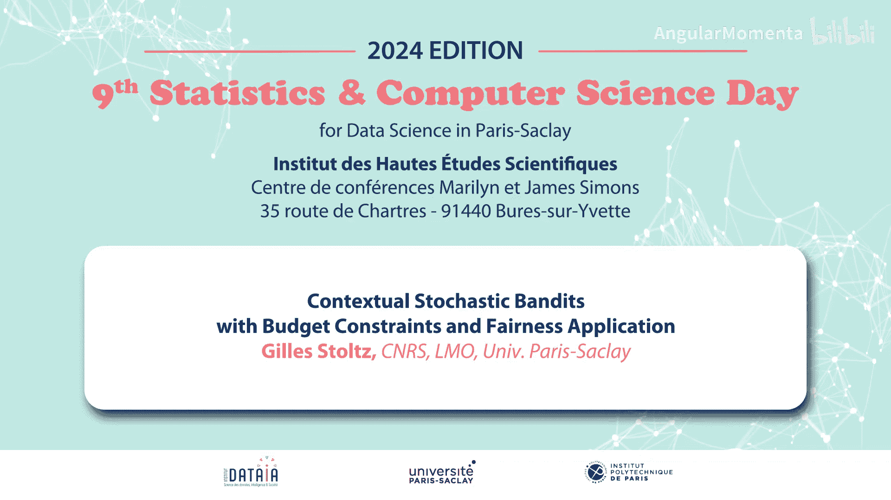
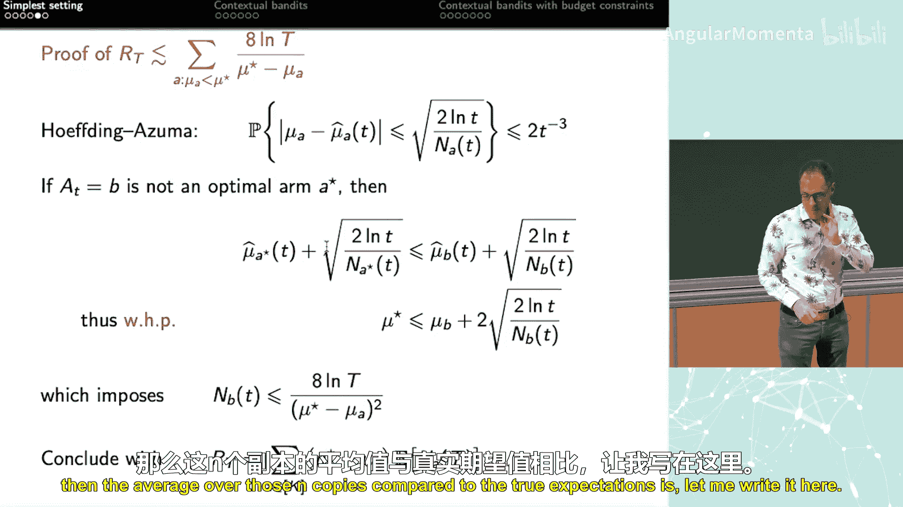
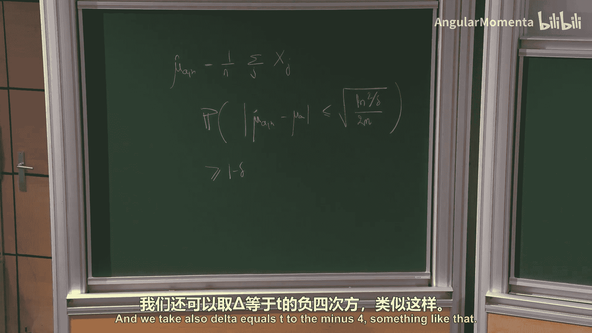
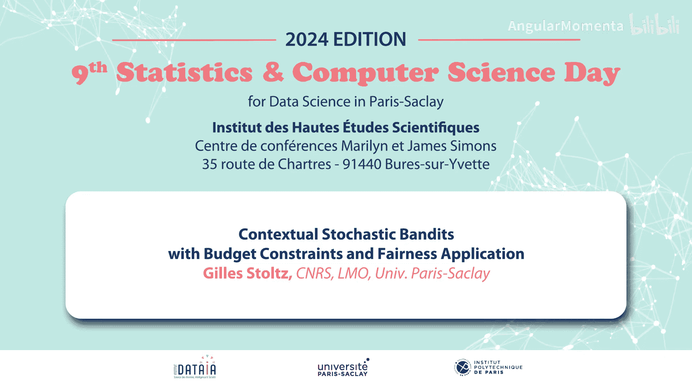

# 数据科学主题统计与计算机科学：P05：预算约束与公平应用下的上下文随机老虎机 🎰

在本节课中，我们将学习随机老虎机问题的基本概念，从最简单的K臂老虎机模型开始，逐步深入到更复杂的上下文老虎机模型，并最终探讨在预算约束和公平性要求下的应用。我们将介绍核心算法、分析其性能的理论保证，并理解其背后的数学原理。

## 基础知识：K臂老虎机模型 🧮

首先，我们介绍最基础的K臂老虎机模型。在这个模型中，我们有K个“臂”（或选项），每个臂`a`都关联着一个未知的概率分布`ν_a`，其期望值为`μ_a`。在每一轮`t`，统计学家（或智能体）根据过去的信息选择一个臂`A_t`，然后获得一个根据所选臂的分布`ν_{A_t}`独立抽取的奖励`Y_t`。智能体的目标是通过选择臂来最大化累积奖励。

为了衡量算法的性能，我们通常使用“遗憾”这个概念。遗憾`R_T`定义为：如果从一开始就知道最优臂（期望奖励`μ* = max_a μ_a`），那么所能获得的总期望奖励`T * μ*`，与实际算法所获总期望奖励之差。公式如下：

`R_T = T * μ* - E[ Σ_{t=1}^{T} Y_t ]`

上一节我们介绍了模型和遗憾的定义，本节中我们来看看如何分解和分析遗憾。

### 遗憾的分解

我们可以将总遗憾重写为一个更易分析的形式。证明的关键在于使用期望的塔性质（全期望公式）和引入计数变量`N_a(T)`，它表示在`T`轮中臂`a`被选择的次数。

`R_T = Σ_{a=1}^{K} (μ* - μ_a) * E[ N_a(T) ]`

这个分解表明，要控制（最小化）总遗憾，本质上就是要控制选择每个次优臂（即`μ_a < μ*`的臂）的期望次数。这是所有老虎机算法证明的核心。

## 经典策略：上置信界算法（UCB）🚀

在理解了遗憾的构成后，一个自然的想法是：我们需要在“探索”（尝试不同臂以获取信息）和“利用”（选择当前看来最好的臂以获取奖励）之间取得平衡。最流行的策略之一是上置信界算法。

UCB算法为每个臂`a`维护一个“指数”，该指数由两部分组成：
1.  **经验均值** `\hat{μ}_a(t)`：基于历史观测对`μ_a`的估计。
2.  **置信区间奖励**：一个与`log(t) / N_a(t)`的平方根成正比的项，其中`N_a(t)`是到时刻`t`为止臂`a`被选择的次数。

在每一轮，算法选择具有**最高指数**的臂。这个设计的直觉是：经验均值低的臂，如果被尝试的次数也很少（即`N_a(t)`小），那么其置信区间奖励会很大，从而鼓励算法去探索它。

以下是UCB算法能获得的理论性能保证（遗憾上界）：

*   **分布依赖界**：`R_T ≤ C(μ) * log T`，其中常数`C(μ)`依赖于各臂期望奖励`μ_a`之间的差距。当差距很小时，常数会很大。
*   **分布无关界**：`R_T ≤ O(√(K T log T))`。这个界对最坏情况下的所有可能分布都成立，但增长速率比对数慢。

第一个证明依赖于霍夫丁不等式等集中不等式，核心思想是：如果一个次优臂被选择了太多次，那么其UCB指数以高概率会低于最优臂的指数，导致矛盾。第二个界可以通过对第一个界应用詹森不等式等技巧推导出来。

## 引入上下文：线性老虎机模型 📈

上一节我们介绍了静态环境下的老虎机，本节中我们来看看当环境动态变化时如何处理。在上下文老虎机中，在每一轮`t`，环境会提供一个上下文向量`x_t`（例如用户特征、广告信息等）。奖励的分布现在依赖于所选的臂`a`和当前的上下文`x_t`。

为了使学习问题可解，我们需要对奖励函数做结构性假设。最常用的假设是**线性假设**：假设给定上下文`x`和臂`a`，奖励的期望是某个未知参数向量`θ*`与一个已知的特征映射`φ(x, a)`的内积。即：

`E[ Y_t | A_t=a, x_t ] = φ(x_t, a)^T θ*`

我们的目标仍然是最大化累积奖励，但现在的比较基准是每一轮在已知`θ*`的情况下能选择的最优臂。

### 线性上置信界算法（LinUCB）

基于线性模型，我们可以设计LinUCB算法。其核心是构建参数`θ*`的估计`\hat{θ}_t`和一个置信区域。通常使用正则化的最小二乘估计：

`\hat{θ}_t = ( Σ_{s=1}^{t} φ(x_s, A_s) φ(x_s, A_s)^T + λI )^{-1} * ( Σ_{s=1}^{t} φ(x_s, A_s) Y_s )`

理论分析表明，以高概率，真实参数`θ*`位于以`\hat{θ}_t`为中心、形状由上述矩阵的逆决定的椭圆置信区域内。利用这个置信区域，我们可以为每个臂`a`在上下文`x_t`下的期望奖励计算一个UCB指数：

`UCB_t(a) = φ(x_t, a)^T \hat{θ}_t + β * √( φ(x_t, a)^T M_t^{-1} φ(x_t, a) )`

其中`β`是一个与置信水平相关的常数。算法在每一轮选择UCB指数最高的臂。可以证明，LinUCB算法的遗憾上界为`O(√(d T log T))`，其中`d`是参数`θ*`的维度。

## 高级主题：带预算约束与公平性的上下文老虎机 ⚖️

现在，我们考虑一个更复杂且具有实际意义的场景：在做出决策（选择臂）时，不仅追求奖励最大化，还受到**成本约束**，并且可能需要满足**公平性**要求。

在这个称为“带Knapsack约束的上下文老虎机”的模型中，每一轮除了获得奖励`Y_t`，还会产生一个与臂和上下文相关的成本向量`c_t`。智能体有一个已知的总预算向量`B`（`B * T`表示`T`轮的总预算允许量）。目标是最大化累积奖励，同时确保累积成本不超过预算。

一个具体的公平性应用例子是：为不同族群分配法律援助预算（如网约车券以便出庭）。目标是最大化总体出庭率（奖励），同时确保花在每个族群上的平均预算与总体平均预算的差距不超过一个阈值`τ`，以体现公平性。这个公平性约束可以转化为一组成本约束。

### 算法思路：拉格朗日对偶与乐观主义

解决这类约束优化问题的标准思路是使用拉格朗日乘子法。我们可以将带约束的基准问题转化为一个无约束的鞍点问题，引入拉格朗日乘子向量`λ`。

理论分析表明，如果知道了最优的拉格朗日乘子`λ*`，那么最优策略就是在每一轮，根据当前上下文`x_t`，选择最大化 `奖励估计 - λ*^T * 成本估计` 的臂。

由于`λ*`未知，我们的算法需要同时学习奖励/成本函数和这个乘子`λ`。算法框架如下：
1.  **乐观估计**：像LinUCB一样，用上置信界（UCB）估计奖励，用下置信界（LCB）估计成本（因为我们要控制成本不超预算，所以对成本持悲观态度）。
2.  **对偶梯度更新**：在每一轮，根据观察到的成本与预算的差距，对拉格朗日乘子`λ`进行梯度下降（或上升）更新。
3.  **自适应步长**：一个关键的技术贡献是设计了一种自适应的步长调整机制（如倍增法），使得算法即使在初始步长选择不佳时，也能快速收敛到合适的范围，从而在仅要求预算`B = Ω(√T)`的条件下（优于之前文献要求的`B = Ω(T^{3/4})`），获得`O(√T)`的遗憾界。

## 总结 📝

本节课中我们一起学习了随机老虎机问题从基础到前沿的脉络：
1.  我们从最简单的**K臂老虎机**开始，理解了遗憾的概念和分解，并学习了经典的**UCB算法**及其理论保证。
2.  接着，我们引入了**上下文**，在**线性奖励假设**下介绍了**LinUCB算法**，它通过结合线性回归和乐观主义原则来处理动态环境。
3.  最后，我们探讨了带有**预算约束和公平性要求**的更复杂场景。通过将约束问题转化为拉格朗日对偶形式，并同时乐观地学习奖励函数和对偶变量，我们可以设计出有效的算法。这类算法在公平资源分配等实际应用中具有重要意义。

这些内容展示了如何将统计学习理论、在线优化和对偶理论结合起来，解决序列决策中的探索-利用困境和复杂约束问题。