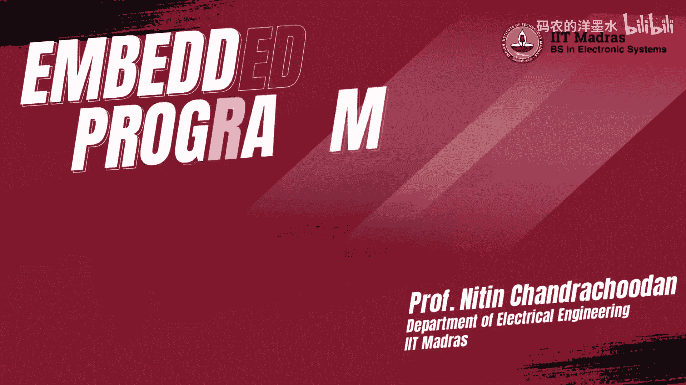
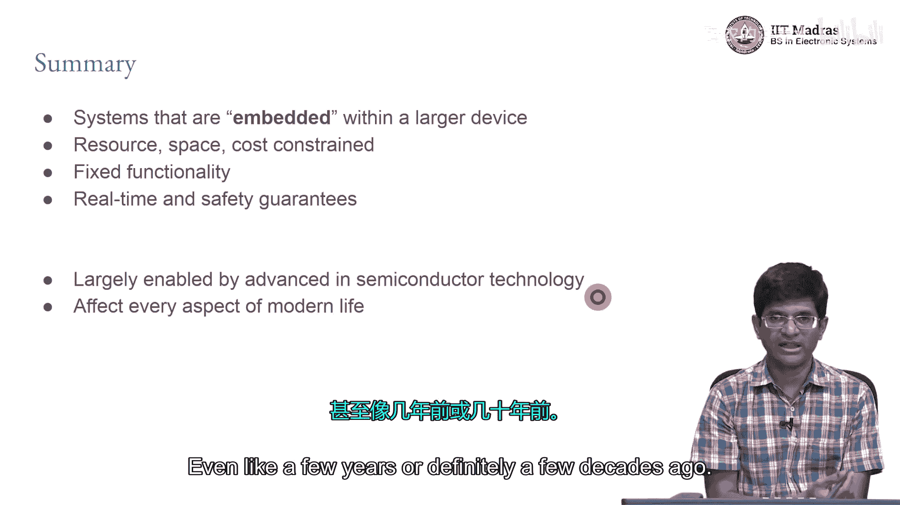

# 001：嵌入式系统与嵌入式C语言编程入门 🚀

在本节课中，我们将要学习嵌入式系统的基本概念，了解它们与通用计算机的区别，并探讨为何C语言是嵌入式编程的核心工具。课程将从嵌入式系统的定义开始，逐步深入到其关键特性、组成部件、应用领域以及设计约束。

## 概述

嵌入式系统是嵌入在更大设备或系统中的专用计算机系统。它们执行特定的任务，通常具有实时性要求，并受到资源、功耗和空间的严格限制。本课程将引导你理解这些系统的独特之处，并为后续的嵌入式C语言编程打下基础。

## 嵌入式系统的定义

根据剑桥高级学习者词典的定义，嵌入式系统是一个名词，属于计算领域。它指的是在机器或更大的电气系统内部执行特定任务的计算机系统。

这里的“特定”一词非常重要。它意味着嵌入式系统不是通用机器。我们谈论的是具有非常具体任务要执行的东西，并且它会根据需要反复执行该任务。

另一个需要注意的术语是“在机器或更大的电气系统内部”。通常，我们设计的这个计算机系统将被嵌入到其他机器中。它可能是一台机器，也可能是另一个电气系统，甚至可能是另一台计算机本身。

当我们说这个系统在更大的系统内处理特定的任务时，会产生某些特性，这些特性允许我们以不同于设计常规计算系统的方式来优化和设计它们。因此，我们称之为“嵌入式”系统。随着课程的深入，我们将探讨这些系统与通用系统的区别，特别是这对编程方式意味着什么。

## 嵌入式系统的关键特性

嵌入式系统有许多特性，其中首要的是我们所说的**专用功能**。这意味着它们不是通用的。

这与个人计算机形成对比，我们假设个人计算机是通用计算机。购买计算机的整个理念是它可以执行许多与计算相关的任务。通常，你有信心，只要具备一定的编程知识，就应该能让它执行几乎任何其他计算系统可以执行的任务。但这不是嵌入式系统的目的。嵌入式系统通常具有非常特定的功能。

当我说“内置”时，是指这些功能以某种方式被写入系统的存储器或其他配置中，这种配置不易更改。因此，改变嵌入式系统的行为需要深入了解其构建方式，并修改那些通常无法访问的部分。

嵌入式系统的另一个重要特性是，许多系统都有所谓的**实时操作**要求。

“实时”是一个有趣的词。在日常口语中，我们经常用“实时”来表示某事很快，但这并不是“实时”的真正含义。实时仅仅意味着在**受约束的时间限制内**。

通常你会发现，嵌入式系统中的实时约束谈论的是毫秒级别的时间持续时间。也就是说，你需要在几毫秒内对某种刺激做出响应。

在计算机的背景下，一毫秒是非常、非常长的时间。毕竟，当你在超过1 GHz的速度下工作时，意味着计算机内部的一个时钟周期只有一纳秒长。这意味着一毫秒实际上是一百万个这样的时钟周期。

因此，实时并不一定意味着快速。然而，它的确意味着你对需要多快响应存在某种时间约束。如果你没有在规定的时间约束内响应，通常会伴随某种惩罚。这可能是灾难性的故障，比如整个系统失效、安全气囊未弹出、汽车撞上某物、刹车失灵；也可能是一些更简单的事情，比如跳过一个视频帧导致视频质量变差。

无论如何，实时意味着在实现此类嵌入式系统时，你需要满足一个时间约束。

## 嵌入式系统的组成部件

那么，构成一个嵌入式系统的典型组件有哪些？正如你可能想象的那样，并且我们将在本课程的其余部分看到，一个核心或最重要的组件将是**微控制器**。本课程的很多内容将讨论微控制器及其行为。

但仅靠微控制器本身是不够的。你还需要某种**传感器**和**执行器**。通常，这些可能是温度传感器、压力计、检测环境光的东西等。你还需要执行器，执行器可以是继电器、开关，也可以是实际移动某物的电机，或者是导致某物移动但不以旋转方式运动的线性执行器。

无论如何，这类执行器和传感器是微控制器与外部世界“对话”的方式。

当然，将所有东西联系在一起的是**软件**。除非你有软件，否则仅凭微控制器、传感器和执行器，你无法做太多事情。

但一旦你把所有这些放在一起，你得到的就是一个**系统**。所谓系统，我们指的是所涉及的一切：你需要硬件、软件、算法、正确的传感器、正确的执行器。

由此产生的一个嵌入式系统例子可能是健身手环。这里我们展示的是苹果手表。它有许多不同的功能，其中更有用的当然是显示时间。其余的功能包括测量心率、测量血液中的氧含量、计算你走了多少步等。所有这些都是非常具体类型的功能，被“烘焙”到手表的行为中。

因此，我们得到了一个完整的系统。在进行系统级设计时，你需要记住很多事情：需要选择正确类型的微控制器、正确类型的传感器和执行器、编写正确类型的软件。但除此之外，还有许多其他与技术无关的事情，或者说不与此方面（技术的电子方面）相关的事情。这可能包括诸如外壳使用什么材料、连接人的表带使用什么材料、系统内部应使用什么电池以及它能持续多久等问题。

当你设计一个系统时，需要回答的问题远不止“使用什么微控制器”这一个问题。在某种程度上，随着课程的推进，我们将触及其中一些特性。

## 嵌入式系统的应用实例

日常生活中的嵌入式系统实例无处不在。

你可以从厨房开始，你可能遇到过微波炉、冰箱或烤面包机等。厨房里几乎所有带有电子产品的东西都是某种嵌入式系统。

通信领域当然也是。你能在线观看这些讲座，很可能意味着你能够使用计算机或手机。很可能你有一部手机，大概是智能手机，它具有许多功能。我们稍后会再谈谈智能手机，但从技术上讲，智能手机是嵌入式系统的一种形式。

当然，如今健身手环是件大事。每个人都想测量自己走了多少步，以及与此相关的其他方面。是的，它们对使用者的健康也确实有积极影响。它们构成了一类嵌入式系统。

娱乐当然是嵌入式系统应用最广泛的领域之一。从我在这里展示的可以用作耳机的耳塞开始，还有便携式音乐播放器等。当然，现在我们大多使用手机来播放音乐，但也可能有其他方面，比如某些专门用于娱乐的特定设备。

汽车领域是我们经常遇到和使用嵌入式系统的一个非常重要且庞大的部分。这当然只是向你展示汽车仪表盘可能的样子。你有一个显示屏，显示诸如续航里程、当前速度、油箱剩余油量、发动机转速等各种对你有用的信息。

在过去，这些实际上是专用的硬件：旋钮、模块和实际会旋转的仪表。如今，几乎所有东西都只是一个由车内某处的嵌入式控制器控制的显示屏。但这只是冰山一角，只是你能看到的部分。嵌入式系统在汽车领域真正发挥强大作用的方式实际上与发动机控制、电池管理以及与车辆安全或操作本身相关的其他方面有关。这些在很大程度上是你平时甚至看不到的东西，你不会直接与它们互动。

除此之外，工业和制造业当然是人们在不同层面使用嵌入式系统的一个非常大的领域。你会在工业应用中遇到许多这样的例子。

## 嵌入式系统发展的驱动力

如果你看看过去几十年推动嵌入式系统数量大幅增长的原因，主要是**半导体技术**的巨大进步。

特别是**微型化**，在过去50多年里一直在进行，使得微控制器变得便宜且易于获取。事实上，便宜到编程微控制器通常比构建定制的模拟电路更容易。

回顾控制系统的历史，大多数控制理论实际上基于模拟微分方程，其中很多内容是关于如何通过直接改变某些模拟参数来应用不同类型的控制。

随着时间的推移，人们发现，只需加入一个数字化器、一个足够快的模数转换器和数模转换器，并在软件中完成所有计算，就可以获得更具可重复性的结果。这实际上是关键所在。整个要点是模拟电路很难精确复制，将一个模拟电路与下一个完全匹配并非易事。

而对于数字电路，你几乎可以成百万地复制它们，它们的行为将完全相同。

嵌入式系统发展的下一个驱动力再次与半导体技术相关，但也是我们可用**传感器和执行器类型**的巨大增长。这带来了更广泛的应用范围，部分是由半导体革命驱动的。

但除此之外，还有一些以前根本不存在的其他类型的传感器。当然，如今仍然有很多新的传感器正在被制造出来，特别是在健康相关领域，比如可以感知各种不同健康相关参数的生物传感器。

此外，使嵌入式系统发展成为可能的第三个方面是**通信系统**的进步，特别是无线通信。

如果你回顾过去几年，我们在如何实现非常低功耗但非常高效的通信方式方面取得了显著进步，无论是短距离、中距离还是长距离。除此之外，我们还有无线通信技术。我们目前可以说处于5G领域。4G可能是你们大多数人拥有的，5G正在崭露头角，而6G已经在地平线上。这些“G”指的是无线通信的几代演进。

重要的是，其中大多数越来越关注嵌入式系统的需求。“物联网”这个词到处出现，几年前非常流行，现在有点降温了，因为人们现在不怎么谈论物联网了，有些人谈论“万物互联”。关键是发生了一场通信革命，它基本上使所有这些多种多样的小型嵌入式计算元素能够相互通信和交换信息，这真正改变了我们甚至思考使用它们的方式。

## 关键应用领域及其影响

让我们看看一些关键应用领域，以及在这些领域使用嵌入式系统所能带来的预期影响。

正如我已经提到的，一个是汽车领域。在这里，我们可以将其分解为不同的类别。我们有像发动机控制和燃油喷射这样的东西，它们对系统本身的运行至关重要。如果你没有合适的发动机控制单元，意味着你没有以正确的方式燃烧燃料，事实上，汽车可能甚至无法启动。现代汽车内部通常有数百个微控制器，包括在发动机控制单元中，甚至像在给定时间点燃烧多少燃料这样的事情通常也由某种嵌入式系统控制。

除此之外，还有安全关键方面，例如当检测到碰撞时安全气囊的展开速度、碰撞是如何被检测到的、刹车在不同情况下应如何响应等。像防抱死制动、牵引力控制所有这些都由某种形式的嵌入式系统控制，这些绝对是安全关键的，你不能说“好吧，如果它失效了也没关系”，这些系统不能失效。

另一方面，还有导航等方面。当然，如今我们大多数人可能使用手机上的地图应用，但另一方面，许多汽车内部也直接内置了导航应用。

气候控制、音乐系统、娱乐，所有这些都是汽车内部嵌入式网络的不同组成部分。

**医疗保健**是嵌入式系统发挥非常重要作用的领域之一。我已经提到了如今非常流行并发挥重要作用的健身手环和手表。我的意思是，提醒人们注意健身效果以及需要更多锻炼这一事实，本身就是这类系统非常有用的应用。但除此之外，嵌入式系统还在更具体的任务中找到自己的角色。例如，它们可以用于持续监测血压、血糖水平和身体的各种其他化学或生理方面，比如温度或其他可能需要持续监测的东西，特别是对于那些刚刚从某种严重疾病中恢复的患者。这些系统可以构建成能够连接并持续运行数天，可能只是收集信息并传递出去，这使得它们从实际使用医疗保健系统的角度来看非常重要。

当然，还有**消费电子产品**，正如我已经提到的，这里有许多不同的应用，可能是家用电器或厨房用具，也可能是娱乐或你在家里发现的任何其他东西。所以这些是你将发现嵌入式系统日常实际使用的一些关键领域。

但拥有所有这些的实际影响和用途是什么？其中之一是它们实现了以前不可能的测量和控制。像持续血糖监测这样的事情是医生一直希望拥有的，但直到我们能够以便宜且足够容易的方式检测葡萄糖的传感器，以及围绕它的整个微控制器环境（可能仅靠纽扣电池运行，甚至仅从运动中获取能量）出现之前，这根本不可能。所有这些最终还必须存储数据，并能够将其传输到可以分析数据的阶段系统。所有这些发展共同促成了今天这种功能的实现。

**安全性**：你可以进行持续监测和反馈。比如汽车中的牵引力控制，或者工业自动化系统，那里有数百或数千个传感器监控工厂车间的每个方面，其中任何一个都可以检测到问题。事实上，现在已经到了因为传感器如此便宜，可能值得拥有多个这样的传感器从不同角度或不同方面观察系统的同一部分，其中任何一个都可以作为故障保险，这样你就不再存在单点故障的问题，并且可以跨多个传感器进行协调以优化各种成本或确保系统安全。

总的来说，过去几年嵌入式系统发展的结果是**用户体验**的整体改变。即使你深入到像厨房电器这样的东西，你有一个微波炉，能够根据它感应到的内部食物来调整功率水平或烹饪时间，或者如果它能自动检测到某物过热并在失控前关闭，所有这些都是非常有用的用户体验改进，在过去几年才成为可能。

## 通用系统与专用（定制）系统

考虑到所有这些，我现在回到通用与特定或定制的概念。

**通用计算**。我们的通用计算机是我们最熟悉的，如果你用过像笔记本电脑这样的东西。它能够运行应用程序。你可能使用的最常见的应用程序是浏览器，如今甚至可能只是一个浏览器，因为浏览器可以为你做其他所有事情。当然，特别是如果你在处理任何类型的文档或编程，你可能使用过某种编辑器或文字处理器。你几乎肯定在检查邮件和其他类型的消息，但很可能目前就在浏览器内部。除此之外，这里实际上还发生着各种其他事情，比如播放音乐、观看视频等，这些实际上都可以被编程到系统中。

你注意到的关于像这样的通用系统的另一件事是，交互方法也非常通用。有一个键盘，几乎允许你向系统输入任何命令或任何数据。有一个鼠标，基本上允许你在屏幕上导航。屏幕本身被用作一种反馈机制，告诉你计算机想向你传达什么。键盘和鼠标是从你到计算机的一个方向，屏幕则是相反方向。

通用系统的关键部分当然是它的**可编程性**。可能是你作为最终用户直接编程它，并且作为电子系统课程的学生，你正试图编程你自己的笔记本电脑和计算机。但即使你不是自己编程，你也可能将其他类型的软件或应用程序加载到系统上，以使其执行不同类型的行为。

现在，将此与**定制系统**进行对比。在这里，我们拥有的是**固定功能**。微波炉或洗衣机等家用电器再次是一个很好的例子。它有一组预定义的任务，最多你可能需要在几个不同的烹饪级别之间切换。这几乎就是你所被允许做的全部。例如，你不能在微波炉上查看电子邮件。也许将来某个时候你可能可以，但现在不行，谢天谢地。你可以与之进行的交互量是有限的。有像键盘和按钮这样的东西。

所以微波炉只需要非常特定的东西：你需要能够设置你想要烹饪东西的时间。洗衣机你只需要选择你想要的洗涤周期。事实上，计算器是你可能在某些时候使用过的嵌入式系统的一个很好的例子。计算器有非常特定的功能，它只有一组数字和一组操作，这就是你能用它做的全部。

当然，重点是人们确实会扩展计算器。有所谓的可编程计算器，它们通常具有实际接收程序并执行的能力。

现在，这些系统中的大多数确实具有有限数量的软件可编程性。你可能在某些时候遇到过这样的情况：你得到所谓的**固件更新**，它说你的电视需要更新固件，或者你的洗衣机需要更新固件，并且他们发现了一种新的洗涤周期，可以更好地清洁你的衣服。

“固件”是一个用于指代软件的术语。底线是它是软件，这一点没有争议。重点是它也不像常规软件那样容易修改。你不能轻易下载新的固件。必须有人专门为你尝试更新的设备创建它。它不能是人们构建并发布在互联网上供每个人下载和运行的软件包。它必须是专门针对你尝试更新的设备的东西。

这就是为什么“固件”这个术语用于此，它介于完全可编程的软件和基本上被认为是固定的硬件之间（你对此没有选择）。固件用于定制硬件的行为，但方式不如通用软件灵活。

## 智能手机：嵌入式系统吗？

所有这一切最终让我们回到“嵌入在更大设备中意味着什么”这个问题。

在讨论了所有这些之后，我们在这里有点两难：我们如何看待智能手机？智能手机经常被作为嵌入式系统的例子提及。

为什么？有很多原因。手机的实际核心功能是固定功能。你需要能够通信，所以每部智能手机最基本的是它有一个调制解调器，其工作是连接到最近的手机信号塔。调制解调器内部有某种标准固定功能，说明如果这是一部4G手机，那么它需要遵循这种协议，需要做这种信令，这是它连接的方式，这不应该被轻易改变，也不能被轻易改变。不能说你下载一个新软件包，它就会搞乱你的手机或改变事情。它必须在很大程度上也受到提供商（网络提供商）的控制。所以这部分在允许你做什么方面非常受限。

类似地，也有一堆传感器，例如倾斜传感器、触摸屏传感器、可能还有温度传感器、红外传感器等。各种这类东西通常也内置在智能手机中，并用于各种目的。

你与智能手机的交互类型也有些有限。如今卷土重来的旧手机，你可能遇到这些被称为功能手机的东西，它们往往只有一个带数字和可能几个其他按钮的键盘。

通用智能手机通常尝试拥有触摸屏，这是一种非常通用的界面。触摸屏允许你在上面显示几乎任何你想要的东西，包括例如一个键盘，因此你有可能使用触摸屏进行任何类型的交互。所以触摸屏再次让你不清楚为什么这是固定功能。

智能手机的某些方面实际上需要实时响应，特别是我们在这里讨论的整个通信方面。它们有特定的要求，这意味着它们需要能够实时响应，否则你实际上会失去连接，并且可能无法管理你的整个通信系统。

从所有这些方面来看，智能手机可以被视为嵌入式系统。

但与此同时，如今大多数智能手机通常运行一个成熟的操作系统。就数量而言，目前大多数可能运行Android。另一个更重要的操作系统当然是iOS（iPhone）。但也有一些其他操作系统，虽然罕见，但可能用于特定情况。

关键是操作系统本身是一个更通用的东西。它允许你做的事情之一是，你也可以对系统进行编程，你有可以在其上运行的应用程序。所以你有一个应用商店或游戏商店，允许你下载和运行为非常通用的智能手机设计的应用程序。只要你的智能手机满足某些要求（可能是在其当前的操作系统版本方面），你就应该能够在上面运行该软件。

它们具有非常广泛的计算能力。大多数Android手机实际上可以运行成熟的Linux桌面，因为毕竟操作系统的核心（内核）在Android系统中实际上是Linux。有可能在手机上运行几乎像完整的桌面环境，甚至可能显示到外部更大的显示器上。

除此之外，如果你看看智能手机芯片中的原始计算能力，今天即使是中端手机也比20世纪80年代可能被归类为超级计算机的设备强大得多。

这些手机通常也有不是很限制性的操作系统。事实上，它们有文件系统的概念，你可以在其中实际存储文件和文档，它们允许访问网络等。

考虑到所有这些，智能手机是否是嵌入式系统这个问题并不容易回答。至少就我而言，我看待它的方式是，这可能也不是一个非常重要的问题。如果它有嵌入式系统的方面，是的，你需要从嵌入式系统的角度来看待它；如果存在实时约束、功耗约束或其他需要以某种方式编程的要求，你需要考虑这些方面。而如果你对开发通用应用程序感兴趣，你可以忽略所有这些，并将其视为计算机。

## 嵌入式系统的设计要求

考虑到所有这些，并看到你对嵌入式系统有非常特定类型的功能期望，让我们也看看嵌入式系统的一些要求。在某种意义上，首先是一系列限制。嵌入式系统实际上是在限制你能做什么。

通常对可用计算资源有**严格的约束**。你没有非常强大的处理器。大多数嵌入式系统上的可用内存通常非常有限。事实上，我们今天习惯于拥有千兆字节内存的笔记本电脑。在嵌入式系统中，你仍然可以考虑谈论千字节内存的系统。事实上，有些东西的内存甚至不到一千字节，你可以在上面做有用的工作，这对大多数人来说实际上相当困难和具有挑战性，因为你不习惯以需要非常少量内存的方式编写程序。

**交互机制的数量和类型有限**。可能你只有一个键盘，所以你不能真正输入所有任意字符。可能存在**空间限制**。在健身手环上，你只有有限的空间可用。你不能把它做得非常大和笨重。而且你还需要用电池运行它。

因此，考虑到所有这些约束，你必须设法拥有能在这些约束内工作并仍然提供有用功能的东西。

可能还有一些要求，比如**交互性**，特别是保证响应时间，这对于安全关键系统尤其重要。防抱死制动和安全气囊是最常出现的例子。

当然，我们还有**连续运行**的概念，即这些系统实际上是7x24小时工作的。手表不期望在一段时间后关闭或关机，你只是让它永久开启。

因此，所有这些意味着我们在这里进行的优化类型，不同于通用处理器上的优化。在通用处理器上，我们主要可能对速度感兴趣：程序运行多快？而在这里，存在某种我们称之为**效率**的东西，但也需要更仔细地定义。

你有一些效率的概念：是就电池寿命而言？是就所需内存而言？是就与用户的交互性而言？还是就满足实时约束而言？在某种效率概念下，你试图优化系统的性能。

## 总结

本节课中我们一起学习了嵌入式系统的基本概念。嵌入式系统通常是嵌入在更大设备中的东西，它们经常在各个方面受到严重限制：可用资源、空间、实际构建和销售系统的成本。它们通常具有固定功能，并且经常也具有实时性和安全性保证。

整个事情是如何实现的？很大程度上得益于半导体技术的进步。就目前情况而言，它们影响着现代生活的方方面面，并且嵌入式系统的存在使得一些非常重要的事情成为可能，这些甚至在几年前或几十年前都是不可能的。