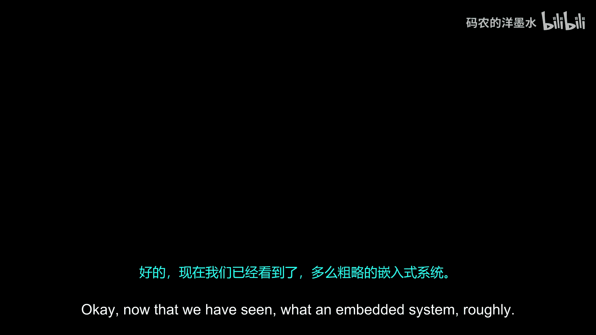
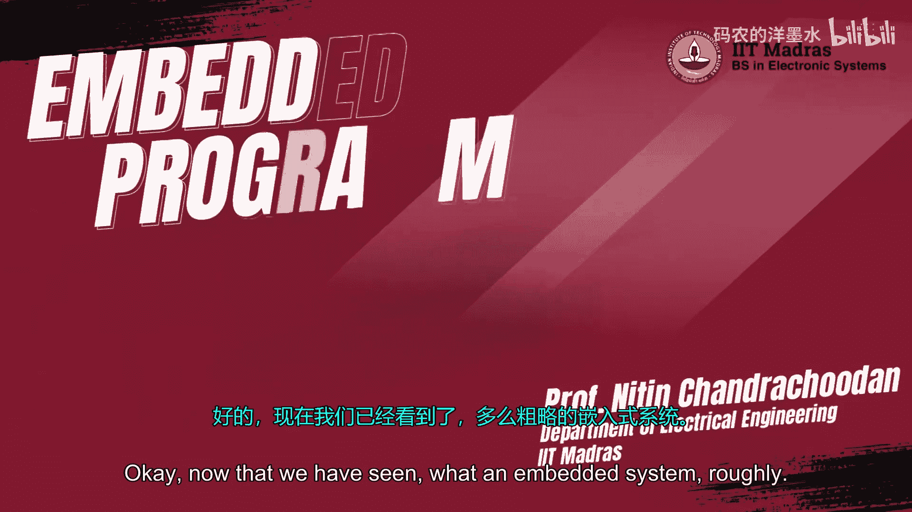
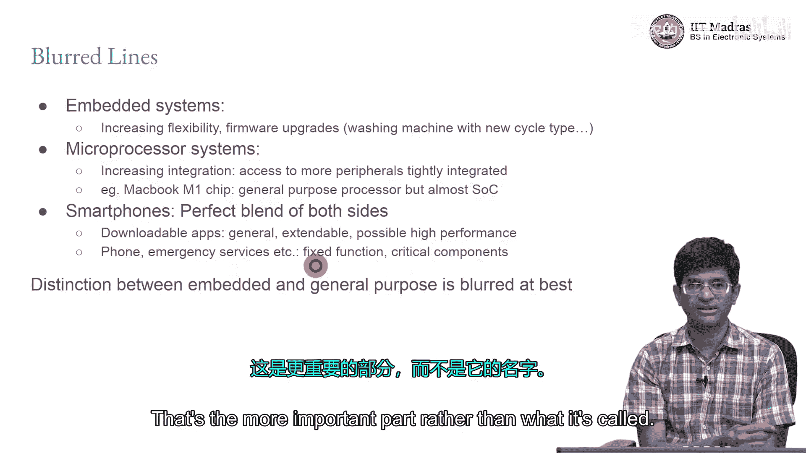
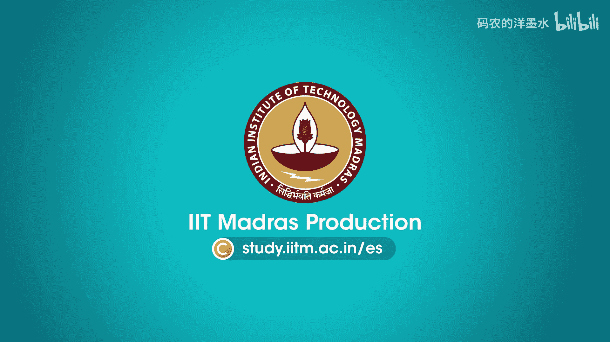

# 002：现代嵌入式系统中的微控制器与微处理器对比 🧠💻

在本节课中，我们将要学习嵌入式系统的核心计算单元：微控制器与微处理器。我们将探讨它们的定义、架构差异、各自的优势与适用场景，并理解为何在现代设计中，这两者之间的界限正变得越来越模糊。

---

## 通用计算机架构回顾

上一节我们大致了解了嵌入式系统的定义。对于我们将要处理的大多数嵌入式系统而言，一个至关重要的方面是微控制器。当然，也存在没有计算单元的嵌入式系统，例如完全依赖模拟电路和硬连线控制的系统。但本课程主要关注的是包含微处理器或微控制器的嵌入式计算系统。那么，这两者是什么？它们之间有何区别？让我们深入探讨。

下图展示了一台通用计算机的架构。

我们已经从C程序运行的角度了解过处理器。我们可以将处理器视为具有核心功能，通常称为**中央处理单元**。CPU内部包含一定量的控制单元、算术逻辑单元和一组寄存器。这些元素共同构成了一个**可编程系统**。

通过将CPU与外部存储器结合，我们可以扩展这个可编程系统的行为，使其能够执行仅靠基本ALU无法完成的许多任务。换句话说，我们可以将系统状态存储在寄存器中，基于此执行计算，并与外部存储器交互。通过使用合适的控制单元，任何此类处理单元原则上至少可以模拟其他处理单元的行为。

当然，图中还有其他几个重要元素：
*   **主存储器**：是扩展CPU功能最重要的部分，用于存储运行中的程序和数据。
*   **辅助存储器**：通常是容量更大但速度较慢的存储设备，如硬盘。
*   **输入/输出设备**：从CPU的角度看，这些设备就像是可以通过地址访问的“东西”。CPU通过发送地址请求数据，如果返回的是存储的数据，那就是内存；如果返回的是按键或鼠标位置，那就是输入设备；如果地址接受数据并显示在屏幕或打印出来，那就是输出设备。

这种抽象使我们能够以清晰的方式看待处理器核心（CPU）与外部世界的关系。

---

## 微处理器与微控制器的定义与核心差异

现在，我们关注两个术语：**微处理器**和**微控制器**。我们的目标是理解两者之间的区别。

在本课程的语境中：
*   **微处理器**：被视为为系统提供计算能力的核心处理单元。它通常需要额外的支持电路来处理输入/输出、与外围设备通信，甚至与存储器交互。
*   **微控制器**：通常将许多功能集成到单个芯片中。它通常包含一个中央处理单元、一定容量的存储器，甚至可能包括I/O外围设备。它们通常为特定应用而设计。

从这个定义来看，你可能会注意到，微控制器在某种意义上包含了微处理器（即核心处理单元）。那么，微控制器是否优于微处理器呢？并非如此。关键在于，将多个功能集成到单一芯片上时，你必须在某种程度上对CPU的能力做出妥协，这意味着该芯片的计算能力可能会降低。

---

## 微控制器的集成优势与片上系统

这种将不同功能集成到单一芯片的能力，是微控制器得以实现并变得有用的关键。以下是通常被集成到微控制器中的组件：

*   **片上存储器**：
    *   **RAM**：系统的工作内存，用于存储变量、创建临时数组和执行计算。
    *   **ROM**：只读存储器，存储配置数据和启动代码。
    *   **EEPROM/Flash**：非易失性存储器，即使断电也能保存信息，允许对设备功能进行编程和修改。

*   **各种外围设备**：
    *   数字和模拟输入/输出接口。
    *   **定时器**：用于在特定时间间隔执行操作。
    *   **UART**：通用异步收发器，用于串行通信。
    *   其他通信协议，如SPI、I²C、CAN总线。
    *   更复杂的网络协议，如Wi-Fi、蓝牙、以太网。
    *   高速接口，如摄像头接口。

通过集成这些组件，我们创建了一个**片上系统**。过去需要一整块主板和多个芯片才能实现的系统，如今可以集成到单一芯片上。SoC的存在和可用性，使得许多原本不可能的功能成为现实。

---

## 为何选择集成与SoC？

人们选择集成并创建SoC有非常具体的原因：

1.  **降低物料清单成本**：用一颗集成了10种功能的芯片替代10颗独立芯片，可以减少元件数量，简化库存管理和供应链，这对大规模系统设计的经济性有重大影响。
2.  **降低功耗**：集成后，不同组件物理距离更近，信号在芯片内部微米级导线上传输，而非电路板上厘米级的导线。这显著降低了切换信号所需的功率和电容负载，对依赖电池供电的设备来说，直接提升了电池寿命。
3.  **直接控制物理系统**：MCU设计允许我们使用通用I/O和各种总线接口直接连接传感器和执行器。
4.  **内置通信功能**：现代许多微控制器已内置USB、蓝牙、Wi-Fi等通信协议。
5.  **成本效益**：集成化减少了组件数量，单一芯片可以大规模生产，从而降低了单个单元的设计、制造、维护和升级成本。

---

## 微处理器的优势与适用场景

既然微控制器有这么多优点，它的缺点是什么？我们为什么还需要微处理器？

记住我之前提到的**权衡**。当你试图在单一芯片上集成更多外围设备或功能时，就必须牺牲一部分原本可用于纯粹计算的芯片面积。因此，在**计算和数据处理是关键需求**的领域，你仍然需要微处理器。

例如，在智能手机中执行视频处理或数据分析等复杂计算时，你需要一个能够极快执行计算的单元。这类系统通常受益于将内存管理和外围设备管理等功能“外包”出去。你不希望这些功能占用主计算芯片的面积，因为此时系统的首要需求是**运行速度**。

对于这样的系统，你可以：
*   **扩展微处理器**，使其能够访问更大的内存存储。
*   使其更加**灵活和可扩展**，支持不同类型的内存连接（由专门的内存接口芯片处理）。
*   通过标准化总线与其他芯片通信，使系统能够扩展USB、PCIe等外围设备。

总之，微处理器的目标是**最大化系统的处理能力**。

---

## 应用场景总结与界限的模糊

微控制器和微处理器各有其适用的领域：

*   **微控制器**：通常用于**家电、消费电子**等功能有限、对**成本效益**要求高的场景。如果为特定功能设计微控制器是合理的，并且不需要某些扩展功能（例如微波炉不需要USB接口），那么一个高效、待机功耗极低的微控制器就是最佳选择。
*   **微处理器**：用于**计算密集型、需要高性能和高度可扩展性**的场景，如个人电脑、服务器、高端移动设备。

然而，这两者之间的界限正日益模糊：
*   **嵌入式系统端**：功能越来越复杂。例如，带有Wi-Fi的洗衣机、带触摸屏并能显示库存的冰箱。这些设备可能运行操作系统或应用程序，模糊了嵌入式系统与通用平台的界限。
*   **微处理器端**：人们也开始将外围接口集成到高性能计算芯片上。例如，苹果的M系列处理器就是强大的SoC，将大量计算和外围交互功能集成在同一芯片上，最初用于智能手机，现已进入笔记本电脑领域。
*   **智能手机**：完美融合了两者特点，既有可下载应用的可扩展性，又有高性能计算能力，同时保留了电话、紧急服务等固定功能。

因此，试图严格区分嵌入式系统和通用系统可能没有太大意义。更重要的是，**你试图用它实现什么功能**。如果功能需要特定的固定功能或资源优化，那么如何利用技巧来实现这些目标，比给它贴什么标签更为重要。

---

本节课中，我们一起学习了微控制器与微处理器的核心区别。微控制器通过高度集成实现成本、功耗和尺寸的优化，适用于特定功能场景；而微处理器专注于提供强大的、可扩展的计算能力。随着技术发展，两者正相互融合，形成功能强大的片上系统。理解它们的特性和适用场景，将帮助我们在设计嵌入式系统时做出更合适的选择。🚀