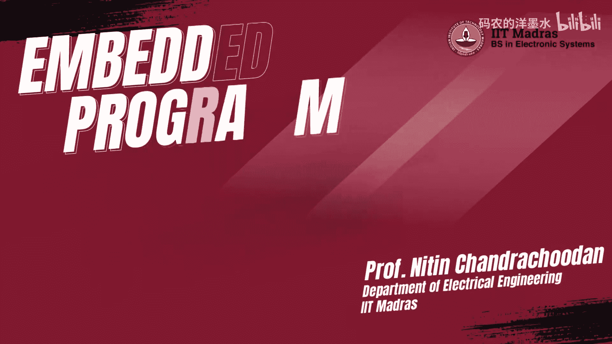
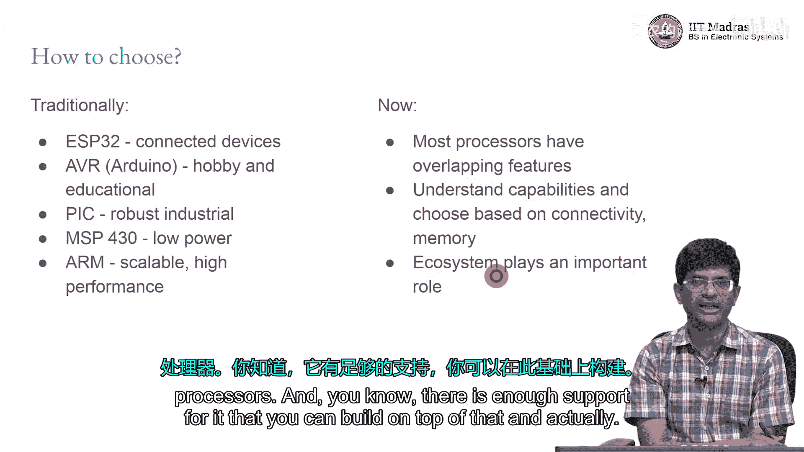

嵌入式C语言编程：第3讲：微控制器系列的优势、局限性及主流嵌入式系统架构

## 概述
在本节课中，我们将学习不同的微控制器系列，了解它们各自的特点、优势与局限性，并探讨如何根据应用需求选择合适的微控制器。我们还将重点介绍ARM架构，特别是Cortex-M系列，并解释为何它在本课程中被选为主要学习平台。

## 微控制器系列概述
首先，我们需要理解什么是微控制器系列。微控制器系列通常指由不同厂商生产的、基于特定指令集架构（ISA）的处理器家族。了解不同的选项有助于我们做出明智的选择。

### 指令集架构（ISA）
要理解微控制器系列，必须先了解指令集（ISA）的概念。处理器通过执行指令来工作，其核心功能包括：
1.  执行算术和逻辑运算。
2.  从外部存储器加载数据到内部寄存器，或从寄存器存储数据到外部存储器。
3.  执行控制流操作，例如分支或跳转指令，以改变指令的执行顺序。

处理器能够理解并执行的指令集合，就构成了它的**指令集架构（ISA）**。从计算能力上讲，大多数ISA在理论上都是等价的，但它们在针对特定操作（如循环优化）和架构设计（如RISC、基于栈或累加器）上各有特点。对于嵌入式开发，我们更关心ISA是否提供了对我们应用有用的特定功能。

## 主流微控制器系列简介
以下是几个知名微控制器系列的高层次概述。这并非详尽列表，选取它们是为了展示微控制器的多样性和比较方法。

### AVR系列
AVR系列最初由Atmel公司推出（后被Microchip收购），自1996年左右问世。它是基于闪存的8位处理器。

*   **优势**：基于闪存意味着可以轻松升级或更改固件，无需复杂的编程器。在1996年，这是一项重要改进。
*   **应用**：其最著名的应用是**Arduino**平台。Arduino极大地简化了微控制器编程，使其变得大众化。它被广泛应用于消费电子、可穿戴设备，尤其在艺术和教育编程领域非常流行。

### PIC系列
PIC是另一个非常古老且流行的微控制器系列，由Microchip Technology公司于1976年推出。

*   **特点**：早期型号使用电可擦除可编程只读存储器（EEPROM），甚至需要通过紫外线照射窗口来擦除。其指令集非常适合于使用**查找表**进行编程，这在嵌入式系统中是一种有趣的编程方式。
*   **应用**：曾深受业余爱好者欢迎，但由于通常需要较复杂的调试设备，在易用性上很大程度上被Arduino取代。它在工业自动化领域仍有传统优势。

### MSP430系列（德州仪器）
MSP430系列自1992年存在，专注于**超低功耗**应用。

*   **低功耗特性**：它提供了一种机制，在仅需保持内存内容的待机模式下，电流消耗可低至**0.1微安**。这使得使用一枚纽扣电池，设备可能在不丢失内存内容的状态下维持数年。
*   **开发支持**：其LaunchPad套件针对大学项目，提供了易于使用的USB供电调试系统。

### ESP系列
ESP系列（如ESP8266和ESP32）来自上海乐鑫公司，以**极低的成本和高度集成**而闻名。

*   **特点**：价格非常低廉，并且集成了包括**蓝牙和Wi-Fi**在内的多种外设。这意味着可以轻松创建联网设备。
*   **架构**：使用一种名为Xtensa的专有ISA。

## 如何选择微控制器？
面对如此多的选择，一个关键问题是：我们应该使用哪个系列？本课程又将使用哪个？

这是一个竞争激烈的市场。虽然MSP430以超低功耗著称，ESP32以优秀的连接性见长，但其他系列中也能找到具有类似特性的成员，因此很难简单区分。

一个非常重要的选择因素是**生态系统**。例如，Arduino IDE的流行意味着有大量的用户和支持资源，使得编程变得容易。一个系统越流行，它就会吸引更多的人，形成良性循环。

那么，本课程将使用上述四个系列中的哪一个呢？答案是：都不使用。我们将使用**ARM处理器**。

## ARM架构：嵌入式领域的巨无霸
从出货量和实际使用数量来看，ARM处理器完全碾压了其他任何架构。你可能听说过“每个地球人拥有的ARM处理器数量可能接近10个”的说法，这是因为ARM处理器被用于各种意想不到的地方，甚至包括USB数据线或电源适配器中的协商芯片。

### ARM的商业模型
ARM的成功源于其独特的**知识产权（IP）授权模式**。ARM公司本身不制造芯片，而是设计处理器核心，并将这些设计以IP的形式授权给其他公司（如Apple、Qualcomm、NVIDIA等），由这些公司集成到自己的芯片中并生产。

### ARM处理器系列
ARM处理器主要分为32位和64位变体。本课程将主要使用32位ARM处理器。

在32位ARM架构中，有一个名为**Cortex**的系列，它又分为几个子系列：
1.  **Cortex-A（应用处理器系列）**：通常为64位，用于运行完整操作系统（如手机、笔记本电脑），支持大量内存和高速计算（如浮点运算）。
2.  **Cortex-R（实时处理器系列）**：用于有硬实时要求的嵌入式应用（如汽车刹车系统、牵引力控制），具有紧密耦合的内存、容错和纠错能力，以确保可靠性。
3.  **Cortex-M（微控制器系列）**：**本课程的焦点**。主要用于低功耗嵌入式应用，通常没有或只有很少的内存管理功能，主要在独立模式下运行。它可以处理大量中断，并采用哈佛架构（指令和数据存储在不同区域，可在同一时钟周期访问，提高效率）。

### ARM Cortex-M的特点
*   **授权方式**：以可综合的RTL代码形式授权，允许厂商在集成到硅片前添加额外功能。
*   **中断处理**：能处理大量中断。
*   **架构**：哈佛架构，提升计算效率。
*   **流水线**：有限的流水线能力（高性能并非其主要目标）。
*   **数学支持**：许多型号仅支持整数运算，无浮点单元。
*   **功耗**：优秀的低功耗模式和模式切换能力。
*   **编程语言**：本课程几乎全部使用C或C++进行编程，不会深入探讨汇编语言。

## 微控制器的关键能力
在选择微控制器时，我们需要考虑其多项关键能力：

### 处理能力
*   **处理速度**：可以从极低的频率（千赫兹甚至赫兹）运行，但更高的速度对实时控制响应有用。
*   **位宽（8/16/32/64位）**：这主要影响可访问的内存大小和计算便利性。32/64位处理器能更轻松地进行数学计算，但功耗通常更高。8/16位处理器计算能力和内存访问有限，但尺寸更小、功耗更低。

### 功耗
*   **运行功耗**：由操作频率和芯片规模（门电路数量）决定。更多的开关活动消耗更多能量。
*   **睡眠与唤醒**：能否长时间睡眠，以及睡眠后快速唤醒响应的能力，对于电池供电设备至关重要。需要待机电流在**亚微安**范围。

### 多任务与生态系统
*   **多任务处理**：能否同时处理多个任务，这通常需要更多内存和强大的中断处理能力。Cortex-M系列在这方面表现良好。
*   **生态系统**：开发环境的易用性、社区支持和可用库的数量至关重要。Arduino的成功很大程度上归功于其简化的生态系统。

## 总结
本节课我们一起学习了主流微控制器系列（AVR, PIC, MSP430, ESP）的特点，并深入探讨了在嵌入式领域占据主导地位的ARM架构，特别是适用于本课程的Cortex-M系列。

选择微控制器没有绝对的公式。传统上，人们可能会根据特定优势进行选择（如ESP32用于连接性，Arduino用于教育，PIC用于工业自动化，MSP430用于低功耗）。然而，如今这些处理器的功能存在大量重叠。

**最重要的是**，通过理解处理器的核心能力（处理速度、位宽、功耗特性、外设支持、生态系统），并基于你的具体应用需求（是否需要蓝牙/Wi-Fi？是否电池供电？是否需要高性能计算？），你能够做出明智的决策。希望在本课程结束时，你能够具备评估和选择适合特定应用的微控制器的能力。