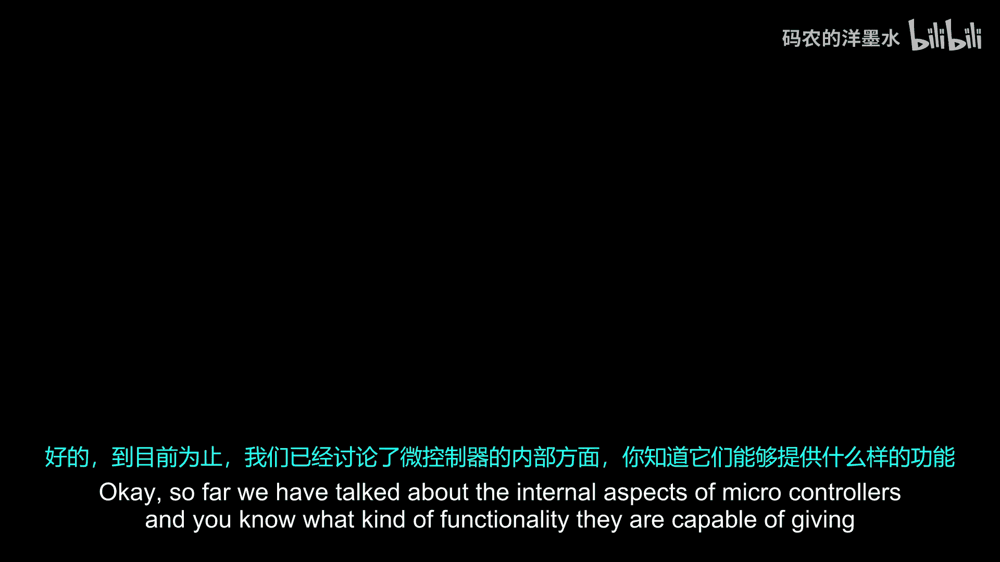
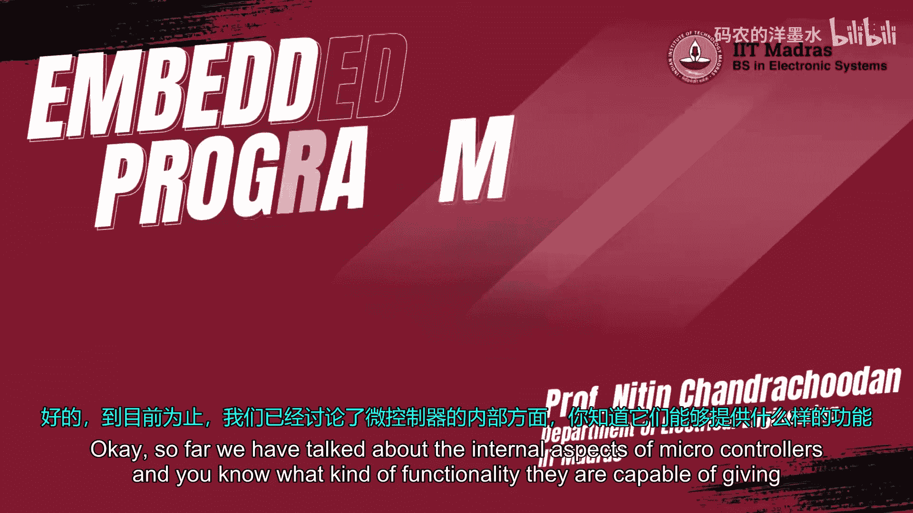
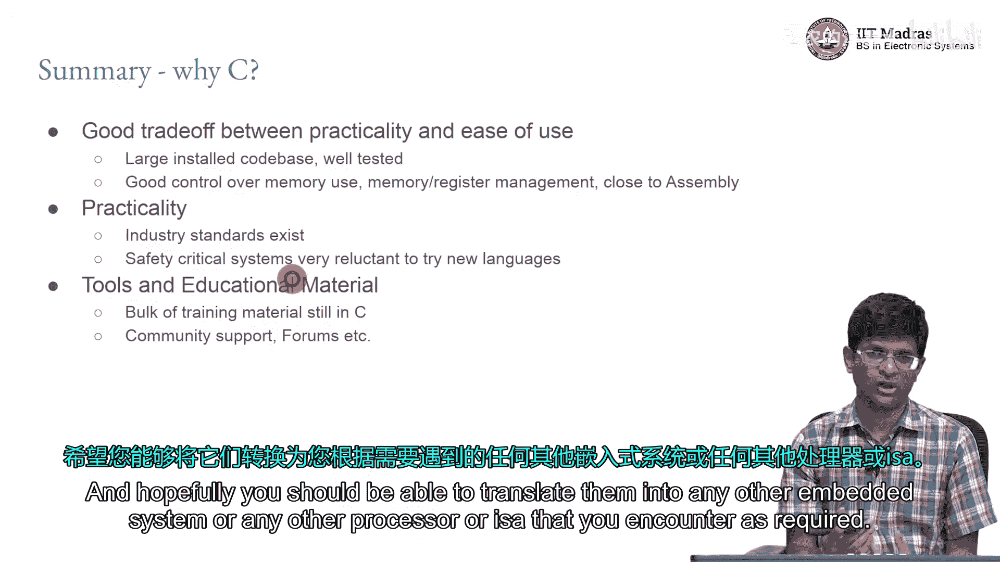
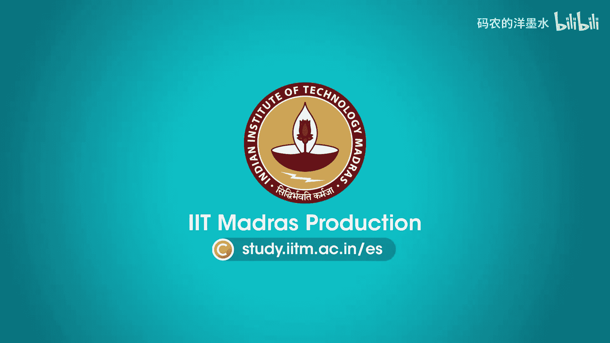

# 004：语言选择——为嵌入式系统挑选最佳编程语言 🎯





在本节课中，我们将探讨如何为嵌入式系统选择合适的编程语言。我们将分析汇编语言、高级语言（如C、C++、Rust）以及其他编程方法（如可视化编程）的优缺点，并最终解释为何本课程选择嵌入式C语言作为核心教学语言。

---

## 概述

上一节我们讨论了微控制器的内部架构及其功能，并初步探讨了在不同处理器家族（如ARM）之间进行选择的方法。本节中，我们来看看如何为这些系统编程，即选择何种编程语言。编程语言的选择直接影响我们对硬件的控制能力、代码的可移植性以及开发效率。

## 编程语言的选择

为嵌入式系统编程有多种方法，每种方法都有其特定的应用场景和权衡。以下是主要的几种编程语言及其特点。

### 汇编语言：直接硬件控制

汇编语言提供了对系统最直接的控制能力，允许开发者尽可能接近硬件，精确控制微控制器的每一个操作。其核心在于直接操作指令集。

**公式/代码示例：**
```assembly
MOV R0, #0x01    ; 将立即数1移动到寄存器R0
ADD R1, R0, #2   ; 将R0的值加2，结果存入R1
```

然而，使用汇编语言存在显著问题：
*   **高度依赖特定硬件：** 需要深入了解目标处理器的指令集架构（ISA）。代码与特定微控制器紧密绑定，缺乏可移植性。例如，将代码从ARM迁移到ESP32几乎需要完全重写。
*   **不利于结构化编程：** 难以实现如函数封装、条件分支（if语句）和循环（for/while循环）等结构化编程范式，这使得构建和维护大型复杂程序变得困难。

因此，汇编语言通常仅用于对性能或控制有极端要求的特定场景。

### 高级语言：平衡控制与效率

高级语言通过提供函数、迭代和各种数据类型/结构，使编程工作更易于管理。在嵌入式领域，C和C++是最流行的选择。

以下是高级语言在嵌入式编程中常见的代码模式示例，这些模式在普通C程序中很少见：

**代码示例：访问硬件寄存器**
```c
#define PORTF_DIR_REG (*((volatile uint32_t *)0x40025400))
#define PORTF_DATA_REG (*((volatile uint32_t *)0x400253FC))

void configureLED() {
    // 设置特定引脚为输出模式：将寄存器特定位设为1
    PORTF_DIR_REG |= 0x04;
    // 启用该引脚
    // ... 其他配置代码
    // 控制引脚输出高电平
    PORTF_DATA_REG |= 0x04;
}
```
**说明：**
*   `volatile` 关键字防止编译器优化对硬件寄存器的访问。
*   直接通过内存地址操作硬件寄存器（如`PORTF_DIR_REG`）。
*   使用位操作（如 `|=`）来设置或清除寄存器的特定位。

**代码示例：中断处理程序**
```c
void Timer_Interrupt_Handler(void) {
    // 进入中断后重置计时器值
    // ...
    // 通过访问内存地址改变输出引脚状态，例如控制LED闪烁
    PORTF_DATA_REG ^= 0x04; // 翻转引脚电平
}
```
**说明：**
*   函数响应硬件中断事件（如定时器溢出）。
*   在中断服务例程中直接操作硬件寄存器以改变系统状态。

选择C语言进行嵌入式开发的主要原因包括：
1.  **贴近硬件：** 允许直接操作寄存器、内存位和地址，同时能方便地处理中断、定时器并与外设交互。
2.  **可移植性：** 通过将硬件相关的地址定义（如`#define`）集中管理，核心逻辑可以方便地移植到不同架构的处理器上。
3.  **广泛的生态与遗产代码：** 存在大量经过验证的C语言嵌入式代码，理解和维护这些代码需要嵌入式C知识。

关于C++，在本课程中，我们主要将其视为对C语言的抽象和扩展，例如使用**类**来封装数据和相关函数。我们会有限地使用面向对象编程，主要是调用和分析现有库函数。

### 其他编程语言与范式

除了C/C++，还有其他语言和工具可用于嵌入式开发，各有其适用场景。

以下是其他一些可用于嵌入式系统的语言及其简要说明：

*   **Python（MicroPython）：** 语法简单，应用领域广。但在资源受限系统中，解释器的运行开销可能是个问题。
*   **可视化编程（如LabVIEW， Blockly）：** 通过图形化块编程，对非程序员友好。适用于将预制的优化代码块组合成工作流，但可能对底层代码的控制力有限。
*   **Java：** 拥有庞大的开发者社区。但通常需要Java虚拟机（JVM），会带来额外的内存和性能开销。
*   **Go（Golang）：** 语言简单易学，提供一定的底层控制能力。但其垃圾回收机制可能对实时性要求高的应用产生干扰。
*   **Rust：** 近年来备受关注，它能在语言层面解决许多C/C++中存在的内存安全问题，并能达到与C相媲美的性能。但其语法更复杂，且在嵌入式编程中有时不得不使用“不安全”的代码块，这在一定程度上削弱了其主要优势。它是未来值得关注的语言。

## 总结

本节课我们一起学习了为嵌入式系统选择编程语言时的各种考量。

我们分析了从最底层的**汇编语言**到高级语言如**C/C++**，再到**Python、Java、Go、Rust**等替代语言的优缺点。最终，我们阐述了选择**C语言**作为本课程核心语言的理由：它在**硬件控制能力**、**代码可移植性**、**庞大的现有代码库与社区支持**以及**开发实践性**之间取得了最佳平衡。





重要的是，本课程的重点并非局限于教授某一特定处理器或架构的编程，而是旨在让你理解嵌入式编程的**核心概念**。掌握了这些概念后，你应该能够将它们应用到未来可能遇到的任何其他嵌入式系统或处理器架构中。