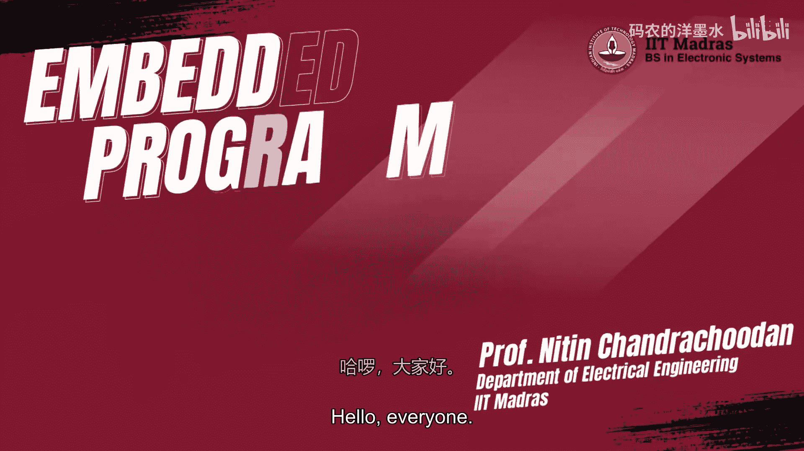
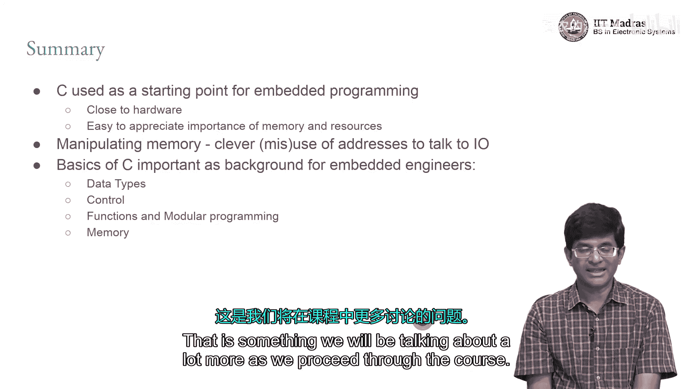

# 005：嵌入式C基础




## 概述
在本节课中，我们将学习嵌入式C编程的基础知识。我们将探讨嵌入式C与标准C的区别，理解在嵌入式系统设计中“效率”的具体含义，并快速回顾C语言的核心概念，为后续的嵌入式开发打下基础。

## C语言简介
C语言诞生至今已有约50年，最初是为了编写Unix操作系统而设计的。这门语言的一个关键特性是“贴近硬件”，这意味着有经验的程序员通常能够预测一段C代码会生成怎样的汇编指令。这种特性赋予了程序员对系统资源（如计算能力、内存、存储、I/O和网络带宽）的精细控制能力。同时，C语言也支持结构化编程，提供了函数、循环和复杂数据结构等抽象机制，使其在提供硬件级控制的同时，也保证了代码的可读性和可维护性。

## C语言的应用领域
C语言在多个领域发挥着重要作用：
*   **操作系统开发**：如Linux内核，正是由于C能提供精细的资源控制并能直接映射为处理器指令。
*   **高性能计算**：包括科学计算、内存密集型应用和数据库系统，这些应用需要将硬件性能推向极限。
*   **网络应用**：需要在代码简洁性和数据传输速度之间取得平衡。
*   **游戏开发**：尽管有更高级的语言，但C语言提供的原始性能使其在游戏开发中仍占有一席之地。

## C语言核心概念回顾
以下是对C语言基本概念的快速回顾，请注意，熟练掌握这些概念需要通过大量实践。

### 数据类型
数据类型用于存储和操作数据。
*   **基本类型**：最常用的是`int`（整数，通常为32位）和`char`（字符，通常为8位）。此外还有`float`（单精度浮点数）、`double`（双精度浮点数）和`short`（短整型，占用空间更小）。这些类型的大小通常依赖于具体实现。
*   **嵌入式系统中的类型**：在嵌入式系统中，资源紧张，我们需要精确控制使用的比特数。标准头文件`<stdint.h>`定义了如`int8_t`（有符号8位整数）、`uint8_t`（无符号8位整数）、`int16_t`（有符号16位整数）等类型，它们能提供精确的位宽控制。
*   **复合类型**：
    *   **结构体（struct）**：允许将多个不同类型的数据（如整数、字符）封装为一个新的数据类型，提高代码的可读性和可维护性。
    *   **枚举（enum）**：常用于嵌入式系统，例如构建状态机或枚举不同的输入/输出类型。
    *   **联合体（union）**：允许以不同方式解释同一块内存区域，在特定场景下有用。

### 程序控制结构
掌握了数据类型后，我们需要控制程序的执行流程。

#### 条件执行
条件执行由`if-else`关键字实现，它允许我们根据条件选择执行不同的代码块。在嵌入式系统中，一个典型的例子是：**如果**水位传感器显示水位达到某个高度，**则**关闭电机，**否则**保持电机运行。`if-else`可以链式使用，也可以通过`switch-case`语句实现，后者能更紧凑地表达基于不同值的多路分支。

#### 循环（迭代）
循环用于重复执行代码。
*   **for循环**：通常用于执行次数已知或确定的场景。其基本结构为：`for (初始化; 条件; 更新) { 循环体 }`。
*   **while循环**：更为灵活，只要条件为真，就执行循环体。条件可以在循环体内被修改。**任何for循环都可以用while循环实现**。
*   **无限循环**：在嵌入式系统中很常见，例如`while(1)`。循环内部会检查某个条件，一旦满足，便使用`break`语句跳出循环。`break`和`continue`语句用于改变循环的控制流。

这些控制结构共同实现了**控制流**，即改变程序中下一条要执行的语句，这是编程语言强大功能的重要组成部分。

### 函数与内存管理
函数是C语言中实现代码复用和模块化设计的关键。

#### 函数
函数是一段可重用的代码，可以接受参数（函数实参），并可以返回一个值。它使得代码更易读、易维护。通过头文件、函数原型和库的有效使用，可以构建结构良好且可系统重用的代码。

#### 变量作用域与内存
函数引入了变量的概念及其**作用域**。理解内存的两个关键区域至关重要：
*   **栈（Stack）**：为每个函数调用分配的内存区域，用于存储局部变量和函数调用信息。它支持**递归**调用。
*   **堆（Heap）**：用于动态内存分配的区域，也存放全局变量和静态变量（其值在函数调用结束后依然保留）。

在嵌入式系统中，由于程序通常需要长时间运行（数天、数月甚至数年），必须谨慎管理内存的分配和释放，否则可能导致内存耗尽和系统崩溃。

#### 指针
指针是C语言中一个强大但需要小心使用的概念。简单来说，**指针就是一个指向内存中某个位置的变量**。在嵌入式C中，指针被广泛用于直接操作硬件寄存器（即特定的内存地址）。我们将指针视为内存地址的持有者，就能更好地理解和使用它。

## 什么是嵌入式C？
嵌入式C本质上就是C语言本身。它之所以适用于嵌入式开发，是因为：
1.  C语言编译生成的指令贴近硬件，允许我们直接操控硬件能力。
2.  C语言能让我们较好地控制生成的指令，在资源（如内存）受限的场景下非常有用。

### 嵌入式系统的约束
嵌入式系统通常在严格的约束下工作：
*   **功耗**：可能由电池供电，能量有限。
*   **尺寸**：设备需要小巧便携（如手机、相机）。
*   **成本**：需要控制制造成本。
*   **实时性与安全性**（如汽车、医疗领域）。

嵌入式C帮助我们规划和满足这些约束。

### 标准C与嵌入式C代码对比
上一节我们回顾了标准C的通用结构，本节中我们来看看嵌入式C代码的典型写法。

**标准C示例（面向通用计算环境）**：
```c
printf("Enter some data: ");
fgets(input_buffer, sizeof(input_buffer), stdin);
```
这段代码通过高级抽象（`printf`, `fgets`）与用户交互，隐藏了底层硬件细节。

**嵌入式C示例（直接操作硬件）**：
```c
#define SENSOR_DATA_REGISTER (*(volatile uint8_t *)0x40021000)
uint8_t sensor_data = SENSOR_DATA_REGISTER;
```
这段代码：
1.  定义了一个宏`SENSOR_DATA_REGISTER`，它被解释为一个指向地址`0x40021000`的`volatile uint8_t`指针，并立即解引用。
2.  读取该内存地址（即传感器数据寄存器）的值，并存入变量`sensor_data`。

**`volatile`** 关键字告诉编译器该变量的值可能被硬件异步改变，禁止编译器对其做优化（如缓存读取的值）。

嵌入式C代码直接通过内存地址与硬件寄存器通信，相当于实现了`fgets`从输入设备读取数据的功能，但更加底层和直接。两者都是有效的C代码，只是目标平台不同。




## 总结
本节课我们一起学习了嵌入式C编程的基础。我们了解到C语言因其贴近硬件的特性成为嵌入式开发的起点。我们回顾了数据类型、控制结构（条件、循环）、函数、内存管理（栈、堆）以及指针这些核心概念。特别强调了在嵌入式系统中，由于资源（内存、功耗、尺寸）受限，精确控制数据类型大小、谨慎管理内存以及通过指针直接操作硬件地址变得至关重要。后续课程中，我们将深入探讨如何利用这些知识编写高效、可靠的嵌入式系统代码。